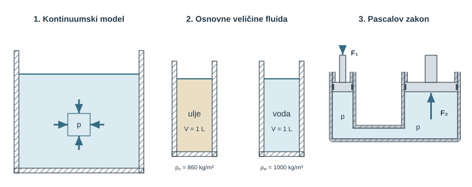
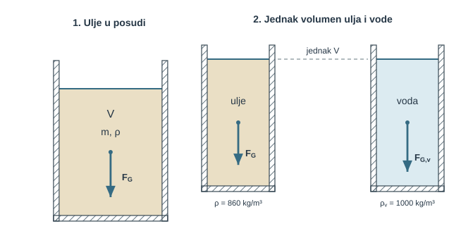
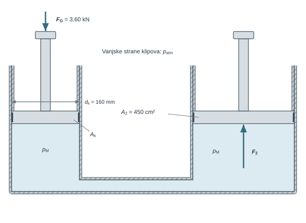
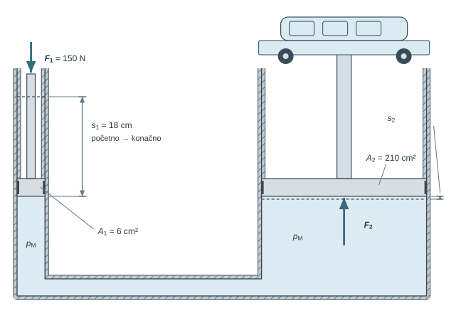
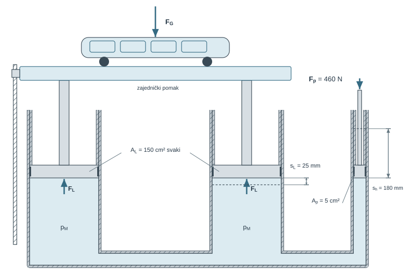
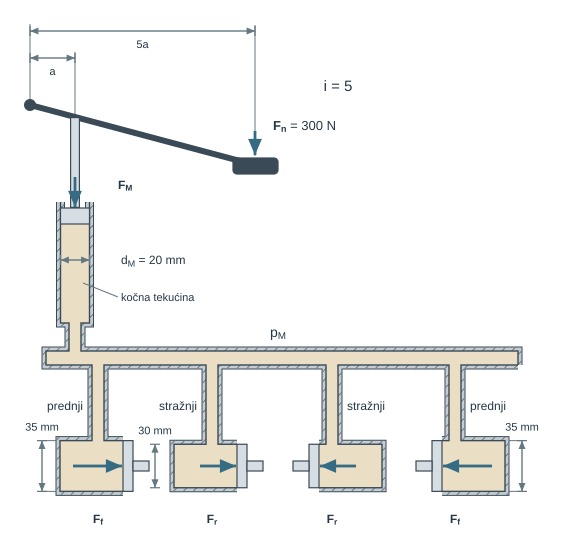
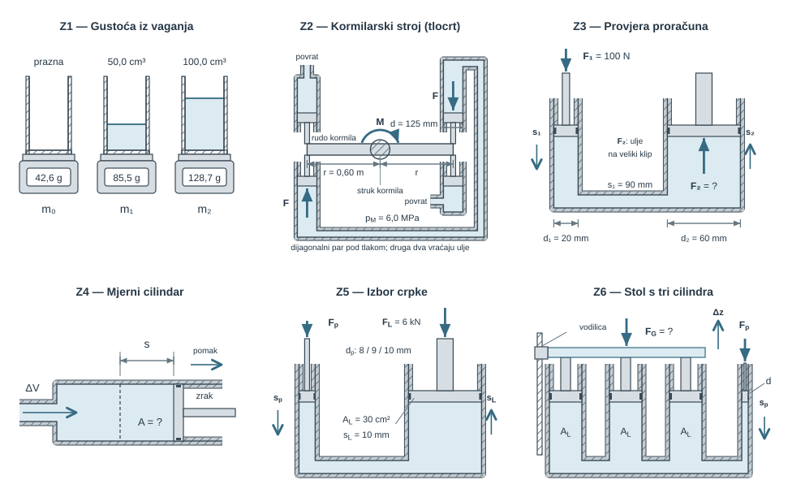

Tekućine i plinovi zajedno se nazivaju fluidima. Od krutina se razlikuju po tome što se pod djelovanjem tangencijalnog naprezanja neprekidno deformiraju, odnosno teku. Fluid koji miruje zato ne može preuzeti smično naprezanje: na svaku plohu s kojom je u dodiru djeluje samo okomito, tlakom. To jednostavno svojstvo polazište je cijele hidrostatike, a u ovom poglavlju vodi do Pascalova zakona i hidrauličkog prijenosa sile.

Iako je fluid građen od molekula, u tehničkim proračunima promatramo ga kao neprekidnu sredinu, kontinuum. U takvom modelu gustoća, tlak i brzina imaju određenu vrijednost u svakoj točki prostora. Gustoća $\rho=m/V$ kazuje koliko mase sadrži jedinica volumena, specifična težina $\gamma=\rho g$ koliko ta masa teži, a relativna gustoća $s_r=\rho/\rho_v$ uspoređuje fluid s vodom. Litra ulja gustoće $860\ \text{kg/m}^3$ tako je za približno $1{,}37\ \text{N}$ lakša od litre vode.

Tlak je okomita sila po jedinici površine, $p=F_n/A$. U mirujućem fluidu tlak je u istoj točki jednak u svim smjerovima, pa je skalarna veličina, iako se od točke do točke može mijenjati. Porast tlaka s dubinom obrađuje se u []{.mf1-chapter-ref target="u03"}.

Pascalov zakon kaže da se promjena tlaka nametnuta na jednom mjestu zatvorenog mirujućeg fluida prenosi nesmanjena u sve njegove točke. U hidrauličkim sustavima tlak koji stvaraju klipovi mnogo je veći od razlika tlaka zbog visine, pa je tlak u cijelom sustavu praktički isti: $p=F_1/A_1=F_2/A_2$. Mala sila $F_1$ na malom klipu zato daje veliku silu $F_2=(A_2/A_1)F_1$ na velikom klipu. Energija se pritom ne stvara: ulje je nestlačivo, pa su istisnuti volumeni jednaki, $A_1s_1=A_2s_2$, pa veliki klip prijeđe proporcionalno kraći put, a u idealnom modelu bez gubitaka vrijedi $F_1s_1=F_2s_2$.

Na tom se načelu temelje hidrauličke dizalice i preše, kočnice vozila te brodski kormilarski strojevi. Poglavlje redom obrađuje kontinuumski model i tlak, osnovne veličine fluida i Pascalov zakon, a zatim ih primjenjuje na hidraulički prijenos sile. Pritom pokazuje i granice idealnog modela: gubitke, stlačivost, propuštanje i visinske razlike.

Sljedeća slika sažima te tri ideje. Lijevo okolni fluid tlačnim silama sabija mali element sa svih strana. U sredini jednaki volumeni ulja i vode imaju različite gustoće, a time i različite mase i težine. Desno je Pascalov prijenos: sila $F_1$ djeluje na mali klip, a $F_2$ je sila ulja na veliki klip, uz zanemarene visinske razlike, gubitke i stlačivost.

{#fig-uvod-u01 fig-align="center" fig-alt="Kontinuum i tlačne sile na mali element, svojstva ulja i vode te Pascalov prijenos između povezanih klipova"}

## Fluid kao kontinuum

::: {.mf1-application}

Inženjerski kontekst

Hidrauličke dizalice, preše za oblikovanje lima i brodski kormilarski pogoni temelje se na prijenosu tlaka zatvorenim fluidom. U takvim sustavima tlak povezuje ulaznu silu, geometriju cilindara i radnu silu aktuatora.
:::

**Procijenjeno vrijeme rada uz priručnik:** 8 sati.

### Kontinuumski model

Fluid je tvar koja se pod djelovanjem bilo kakva, pa i vrlo malog, tangencijalnog naprezanja neprekidno deformira. U inženjerskoj se analizi njegova molekularna građa obično ne promatra izravno. Umjesto toga primjenjujemo kontinuumski model, u kojem su veličine poput gustoće, tlaka i brzine definirane u svakoj točki prostora i u svakom trenutku.

Polja $p(x,y,z)$ i $\rho(x,y,z)$ matematički opisuju prostornu raspodjelu tlaka i gustoće te omogućuju određivanje sila i gibanja fluida na razini prikladnoj za tehnički proračun.

::: {#cfd-rashladni-krug-model .mf1-cfd title="Računalna dinamika fluida"}

**Rashladni krug: od uređaja do modela.** Zamislimo tekućinsko hlađenje baterije: crpka šalje rashladnu tekućinu kroz razdjelnik u uske kanale hladne ploče. Želimo saznati prima li svaki kanal dovoljno tekućine. Računalna dinamika fluida (CFD, engl. *Computational Fluid Dynamics*) iz zakona očuvanja računa približna polja brzine i tlaka. Najprije izdvajamo prostor unutar razdjelnika i kanala; u metodi konačnih volumena taj prostor dijelimo na male ćelije, povezane protocima i silama.

Za prvi model pretpostavimo potpuno napunjen sustav i stalnu temperaturu. Stijenke, ulaz i izlazi čine granice na kojima zadajemo ponašanje fluida. Takav model može pokazati nejednoliku podjelu toka, a temperaturu baterije dobit ćemo tek kada uključimo i prijenos topline. Ćelija je dio kontinuuma, a ne molekula. Taj krug u nastavku proširujemo svojstvima fluida, gubitcima i crpkom.
:::

### Tlak

Za jednoliko raspodijeljen tlak na ravnoj plohi tlačna sila $F_n$ i površina $A$ povezane su izrazom:

$$
p = \frac{F_n}{A}
$$ {#eq-svojstva-tlak-fizikalni-uvod-i-matematicki-izvod-01}

Ako tlak po plohi nije jednolik, omjer $F_n/A$ daje srednji tlak. Lokalno se tlak definira kao $p=dF_n/dA$, a rezultantna sila dobiva integriranjem po plohi.

Tlak nije sila, nego normalna sila po jedinici površine. Ista normalna sila raspodijeljena na veću površinu daje manji tlak. U mirujućem fluidu nema tangencijalnih naprezanja, a tlak u pojedinoj točki djeluje jednako u svim smjerovima. Tlak je stoga skalarna veličina.

## Osnovne veličine

Gustoća, specifična težina i relativna gustoća različite su fizikalne veličine:

$$
\rho = \frac{m}{V}
$$ {#eq-svojstva-tlak-osnovne-velicine-koje-se-najcesce-mijesaju-01}

$$
\gamma = \rho g
$$ {#eq-svojstva-tlak-osnovne-velicine-koje-se-najcesce-mijesaju-02}

$$
s_r = \frac{\rho}{\rho_v}
$$ {#eq-svojstva-tlak-osnovne-velicine-koje-se-najcesce-mijesaju-03}

Gustoća $\rho$ jest masa po jedinici volumena. Specifična težina $\gamma = \rho g$ jest težinska sila po jedinici volumena u zadanome gravitacijskom polju. Relativna gustoća $s_r$ bezdimenzijski je omjer gustoće fluida i referentne gustoće vode $\rho_v$. Primjerice, vrijednost $s_r=0{,}86$ za ulje pokazuje da je njegova gustoća manja od gustoće vode, dok za živu iznosi $s_r\approx13{,}6$.

Izraz $\rho=m/V$ daje gustoću homogenog fluida, odnosno srednju gustoću promatranog volumena. Kada se gustoća mijenja s položajem, lokalno pišemo $\rho=dm/dV$. Referentna gustoća vode u omjeru $s_r$ određuje se pri zadanoj temperaturi; u zadatcima se često usvaja približna vrijednost $1000\ \text{kg/m}^3$.

::: {#ex-u01-gustoca-specificna-tezina-i-relativna-gustoca-ulja .mf1-we}

Gustoća, specifična težina i relativna gustoća ulja&nbsp;T1

**Tekst zadatka**

Hidrauličko ulje ima gustoću $\rho = 860\ \text{kg/m}^3$. Za usporedbu s vodom usvoji sljedeće referentne vrijednosti:

$$
g = 9{,}81\ \text{m/s}^2
$$ {#eq-svojstva-tlak-kratki-primjer-gustoca-specificna-tezina-i-relat-01}

$$
\rho_v = 1000\ \text{kg/m}^3.
$$ {#eq-svojstva-tlak-kratki-primjer-gustoca-specificna-tezina-i-relat-02}

**Traži se**

1. Odredi specifičnu težinu $\gamma$.
2. Odredi relativnu gustoću $s_r$.

{#fig-u01-gustoca-sr fig-align="center" fig-alt="Usporedba gustoće, mase i težine jednakih volumena ulja i vode."}

**Uz skicu.** Lijevo je ulje u posudi: težina $F_G$ odnosi se samo na ulje, bez posude, i djeluje u njegovu težištu. Desno su jednaki volumeni ulja i vode, napunjeni do iste razine. Strelice njihovih težina, $F_G$ i $F_{G,v}$, nacrtane su u omjeru gustoća, pa je njihov omjer upravo relativna gustoća $s_r=\rho/\rho_v$.

**Rješenje**

Specifična težina ulja iznosi

$$
\gamma = \rho g = 860 \cdot 9{,}81 = 8436{,}6\ \text{N/m}^3\approx 8{,}44\ \text{kN/m}^3.
$$ {#eq-svojstva-tlak-kratki-primjer-gustoca-specificna-tezina-i-relat-03}

Relativna gustoća omjer je gustoće ulja i gustoće vode:

$$
s_r = \frac{\rho}{\rho_v} = \frac{860}{1000} = 0{,}86.
$$ {#eq-svojstva-tlak-kratki-primjer-gustoca-specificna-tezina-i-relat-04}

**Provjera i tumačenje**

Jedinice: $[\rho g]=\mathrm{kg\,m^{-3}\cdot m\,s^{-2}}=\mathrm{N/m^3}$, a $s_r$ je bezdimenzijski; $s_r<1$ znači da je ulje lakše od vode.
:::

::: {.mf1-cfd title="Računalna dinamika fluida"}

**Voda ili smjesa vode i glikola?** U istom rashladnom krugu izbor tekućine mijenja masu sadržanu u kanalima i sile potrebne za njezino ubrzavanje. U izotermnom CFD modelu zadajemo gustoću pri radnoj temperaturi, a gravitaciju uključujemo kada je važna za promatrani problem. Zadanu relativnu gustoću najprije pretvaramo u gustoću u $\mathrm{kg/m^3}$. Ako uspoređujemo dvije tekućine pri jednakom volumenskom protoku, njihovi maseni protoci ne moraju biti jednaki.

Sama gustoća nije dovoljna za izbor rashladne tekućine: za otpor strujanju trebamo viskoznost, a za odvođenje topline još i toplinska svojstva. Zato valja razlikovati ulazne podatke modela od njegova rezultata. Drukčije obojeno polje u prikazu ne ispravlja pogrešno zadana svojstva.
:::

## Pascalov zakon

Pascalov zakon kaže da se promjena tlaka nametnuta zatvorenom fluidu u mirovanju prenosi neumanjena na sve dijelove fluida i na stijenke spremnika. Pri primjeni na sustav s dva klipa pretpostavljamo kvazistatičko stanje, približno jednake visine klipova te zanemarive gubitke i stlačivost. Ako klipovi nisu na istoj visini, u analizu uključujemo hidrostatičku razliku tlaka iz []{.mf1-chapter-ref target="u03"}. U navedenim uvjetima vrijedi

$$
\Delta p = \frac{F_1}{A_1} = \frac{F_2}{A_2}
$$ {#eq-svojstva-tlak-pascalov-zakon-kao-prvi-inzenjerski-alat-01}

odnosno

$$
F_2 = F_1 \frac{A_2}{A_1}
$$ {#eq-svojstva-tlak-pascalov-zakon-kao-prvi-inzenjerski-alat-02}

Pascalov zakon ne podrazumijeva stvaranje energije, nego promjenu omjera sile i pomaka. Omjer $A_2/A_1=35$ daje 35 puta veću izlaznu silu, ali i 35 puta manji izlazni pomak; u idealiziranom sustavu ulazni je rad jednak izlaznom.

::: {.mf1-interaktivno}

Interaktivni prikaz — Hidraulička preša

**Predvidi.** Kako udvostručenje promjera velikog klipa mijenja silu i hod, uz isti ulazni pogon?

**Provjeri i protumači.** Promijeni promjer, pa usporedi sile, pomake i rad. Objasni zašto sama provjera tlaka ne potvrđuje očuvanje rada.

<a class="mf1-interaktivno-veza" href="https://martibasic.github.io/MF1_udzbenik/jlite/lab/index.html?path=u01_hidraulicna_presa.ipynb">Pokreni u pregledniku</a>

:::

Uz zanemarive gubitke i stlačivost istisnuti volumen ostaje jednak, pa vrijedi

$$
A_1 s_1 = A_2 s_2
$$ {#eq-svojstva-tlak-interaktivni-prikaz-hidraulicna-presa-01}

Manji klip zato mora prijeći dulji put, a veća izlazna sila dolazi uz manji izlazni pomak. Volumenska bilanca ne ovisi o razini tlaka, nego o pretpostavci nestlačivosti fluida.

::: {.mf1-granica-modela}

Granica modela — Kada stlačivost utječe na pomak klipa?

Volumni modul elastičnosti $K$ povezuje porast tlaka i smanjenje volumena
iste količine tekućine. Za mali porast tlaka pri stalnoj temperaturi i
približno stalnom $K$ vrijedi

$$
K=-V\frac{dp}{dV},\qquad
\Delta V_c\approx V_0\frac{\Delta p}{K}>0.
$$ {#eq-modul-stlacivosti-volumna-promjena}

Ovdje je $V_0$ početni ukupni volumen zatvorene tekućine, a $\Delta V_c$
pozitivan iznos njegova smanjenja. Ako crpni klip iz svoje komore istisne
volumen $\Delta V_p$, dio tog volumena odlazi na stlačivanje tekućine,
pa radni klip površine $A_L$ dobiva pomak $s_L$ prema
$A_Ls_L\approx\Delta V_p-\Delta V_c$. To vrijedi ako nema propuštanja,
zraka ni rastezanja vodova. Nije dovoljno usporediti $\Delta p/K$ s malim
brojem: za točnost pomaka mjerodavan je omjer $\Delta V_c/\Delta V_p$.
Mala promjena gustoće može biti važna kada je istisnuti volumen malen.
:::

::: {.mf1-cfd title="Računalna dinamika fluida"}

**Hidraulička preša: sila i odziv nisu isto pitanje.** Ručna dizalica iz primjera [-@ex-u01-servisna-hidraulicna-dizalica-t2] pretpostavlja sporo podizanje bez gubitaka: Pascalov zakon povezuje sile, a očuvanje volumena hodove. Ako želimo znati koliko brzo klip reagira nakon otvaranja ventila, model mora obuhvatiti dovod, ventil i promjenu volumena komore. Možemo zadati pogon i opterećenje pa računati tlakove i gibanje ili zadati gibanje klipa pa odrediti potrebnu silu. CFD prikaz lokalnog strujanja kroz ventil otkriva gdje nastaje dodatni pad tlaka.

**Zastani i promisli.** Preša daje veću izlaznu silu. Student iz toga zaključuje da daje i veći izlazni rad. Koju veličinu još mora usporediti?

Sama veća izlazna sila ne potvrđuje veći rad: usporedi i hodove. U granici sporog gibanja, uz jednake visine i zanemarive gubitke, račun mora dati omjer sila $A_2/A_1$ i očuvanje istisnutoga volumena. Pri brzom odzivu treba razmotriti stlačivost tekućine preko modula $K$, podatljivost vodova i eventualni zarobljeni zrak. Za odziv cijele instalacije u početku je često dovoljan jednostavniji dinamički model, a CFD primjenjujemo na dio u kojem prostorna slika strujanja bitno utječe na odziv.
:::

::: {.mf1-izvod}

Matematički izvod — Pascalov zakon i očuvanje rada

**Pitanje.** Kako ulazna sila na malom klipu određuje silu i pomak velikog klipa?

**Bilanca sila na klipu.** Neka na mali klip površine $A_1$ djeluje dodatna sila $F_1$, a vanjske strane obaju klipova izložene su atmosferi. Iz ravnoteže maloga klipa u mirovanju slijedi da ulje mora na njega djelovati jednako velikom silom, pa je porast tlaka u ulju ispod klipa

$$
\Delta p = \frac{F_1}{A_1}.
$$ {#eq-svojstva-tlak-matematicki-izvod-pascalov-zakon-i-ocuvanje-rada-01}

U mirujućem fluidu taj se dodatni tlak ne prenosi kao smična sila, nego kao porast normalnog naprezanja koji se kroz istu povezanu tekućinu očituje jednako u svim smjerovima. Da je taj prijenos neumanjen, pokazuje hidrostatička jednadžba iz []{.mf1-chapter-ref target="u03"}: tlakovi u dvjema točkama iste tekućine razlikuju se samo za hidrostatički član $\rho g\,\Delta z$, koji ovdje zanemarujemo. Zato iz ravnoteže velikoga klipa površine $A_2$ slijedi isti porast tlaka,

$$
\Delta p = \frac{F_2}{A_2}.
$$ {#eq-svojstva-tlak-matematicki-izvod-pascalov-zakon-i-ocuvanje-rada-02}

Izjednačavanjem dvaju izraza dobiva se temeljni omjer hidrauličkoga sustava

$$
\frac{F_1}{A_1} = \frac{F_2}{A_2}
\qquad \Longrightarrow \qquad
F_2 = F_1 \frac{A_2}{A_1}.
$$ {#eq-svojstva-tlak-matematicki-izvod-pascalov-zakon-i-ocuvanje-rada-03}

U izrazu je $F_1$ ulazna sila, $A_1$ površina ulaznog klipa, $F_2$ izlazna radna sila, a $A_2$ površina izlaznog klipa.

**Bilanca volumena.** Povećanje sile ne znači stvaranje rada. Za nestlačiv fluid istisnuti je volumen jednak na oba klipa, pa vrijedi

$$
\Delta V_1 = \Delta V_2
\qquad \Longrightarrow \qquad
A_1 s_1 = A_2 s_2.
$$ {#eq-svojstva-tlak-matematicki-izvod-pascalov-zakon-i-ocuvanje-rada-04}

**Koraci.** Iz volumenske bilance slijedi $s_2 = s_1 \dfrac{A_1}{A_2}$. Uvrštavanjem omjera sila i hodova u izraz za izlazni rad dobiva se

$$
F_2 s_2 = F_1 \frac{A_2}{A_1} \cdot s_1 \frac{A_1}{A_2} = F_1 s_1.
$$ {#eq-svojstva-tlak-razrada-koraka-01}

**Rezultat.** Omjeri površina međusobno se poništavaju, pa radna bilanca

$$
F_1 s_1 = F_2 s_2
$$ {#eq-svojstva-tlak-matematicki-izvod-pascalov-zakon-i-ocuvanje-rada-05}

vrijedi za svaki omjer površina klipova u idealiziranom sustavu.

**Provjera.** Za jednake klipove ($A_1=A_2$) izrazi daju $F_2=F_1$ i $s_2=s_1$; za $A_2\to\infty$ sila raste bez granice, ali pomak teži nuli, pa rad ostaje $F_1s_1$. Hidraulički sustav stoga mijenja omjer sile i pomaka tako što isti porast tlaka djeluje na različite površine; mehaničku energiju pritom ne stvara.
:::

::: {.mf1-dublje}

Izotropnost tlaka: Cauchyjev tetraedar

Tvrdnju da u mirujućem fluidu tlak u jednoj točki djeluje jednako u svim smjerovima možemo formalno izvesti iz ravnoteže sila na infinitezimalnom **trodimenzijskom tetraedru**. Tri su mu plohe međusobno okomite, svaka okomita na jednu koordinatnu os, a četvrta je kosa ploha proizvoljne orijentacije s jediničnim vektorom normale $\vec{n} = (n_x, n_y, n_z)$.

Neka su pripadne površine $A_x$, $A_y$, $A_z$ (okomite na osi) i $A_n$ (kosa). Ako je tetraedar odabran tako da su komponente normale nenegativne, iz geometrije projekcija slijedi:

$$
A_x = n_x A_n, \qquad A_y = n_y A_n, \qquad A_z = n_z A_n.
$$ {#eq-svojstva-tlak-dublje-izotropnost-tlaka-cauchyjev-tetraedar-01}

Za proizvoljnu orijentaciju plohe površine projekcija izražavaju se pomoću $|n_i|$, a predznak se čuva u vektoru normale i u jednadžbi sila. Ovdje odabrani prvi oktant samo pojednostavnjuje zapis i ne ograničava zaključak.

Na svaku plohu djeluje normalna tlačna sila; neka su pripadni tlakovi $p_x$, $p_y$, $p_z$ na koordinatnim plohama i $p_n$ na kosoj plohi. Težinu zanemarujemo: razmjerna je volumenu, $\propto \ell^3$, pa kada $\ell \to 0$ iščezava brže od tlačnih sila, koje su razmjerne površinama, $\propto \ell^2$. Ravnoteža sila u smjeru osi $x$ tada glasi

$$
p_x A_x - p_n A_n n_x = 0,
$$ {#eq-svojstva-tlak-dublje-izotropnost-tlaka-cauchyjev-tetraedar-02}

odakle slijedi $p_x = p_n$. Analogno se za osi $y$ i $z$ dobiva $p_y = p_n$ i $p_z = p_n$. Time dobivamo

$$
p_x = p_y = p_z = p_n,
$$ {#eq-svojstva-tlak-dublje-izotropnost-tlaka-cauchyjev-tetraedar-03}

što znači da je tlak u jednoj točki mirujućeg fluida **neovisan o orijentaciji plohe** na kojoj se mjeri. Tlak je dakle skalarna veličina, pa ga smijemo zapisati kao polje $p(x, y, z)$, koje koristimo u svim daljnjim poglavljima. I u fluidu koji se giba tlak ostaje skalarni, izotropni dio tenzora naprezanja; ukupno naprezanje tada uz tlak sadrži i viskozni, devijatorski dio, pa ukupna kontaktna sila općenito nije samo normalna na plohu.
:::

## Riješeni primjeri

::: {#ex-u01-optereceni-klip-i-tlak-u-zatvorenom-cilindru .mf1-we}

Opterećeni klip i tlak u zatvorenom cilindru&nbsp;T2

**Tekst zadatka**

Klip promjera $d_k = 160\ \text{mm}$ opterećen je teretom ukupne težine $F_G = 3{,}60\ \text{kN}$. Ulje ga povezuje s radnim klipom površine $A_2 = 450\ \text{cm}^2$. Klipovi miruju na istoj visini, vanjske su im strane na atmosferskom tlaku, a trenje se zanemaruje.

**Traži se**

1. Odredi površinu klipa $A_k$.
2. Odredi manometarski tlak $p_M$ u ulju neposredno ispod klipa.
3. Odredi silu na radnom klipu površine $A_2$.

{#fig-u01-optereceni-klip-i-tlak-u-zatvorenom-cilindru fig-alt="Opterećeni klip i tlak u zatvorenom cilindru"}

**Veza s proračunom.** Težina tereta $F_G$ djeluje na klip promjera $d_k$, a $F_2$ je sila ulja na radni klip; ispuna označuje isti fluid. Hodovi, razmaci i duljine strelica nisu u zajedničkom mjerilu.

**Rješenje**

Površina klipa iznosi

$$
A_k = \frac{\pi d_k^2}{4} = \frac{\pi \cdot 0{,}16^2}{4} = 2{,}01 \cdot 10^{-2}\ \text{m}^2 \approx 0{,}0201\ \text{m}^2.
$$ {#eq-svojstva-tlak-rijeseni-primjer-optereceni-klip-i-tlak-u-01}

Manometarski tlak neposredno ispod klipa dobiva se iz definicije tlaka:

$$
p_M = \frac{F_G}{A_k} = \frac{3600}{0{,}0201} = 1{,}79 \cdot 10^5\ \text{Pa} \approx 179\ \text{kPa}.
$$ {#eq-svojstva-tlak-rijeseni-primjer-optereceni-klip-i-tlak-u-02}

Površina radnog klipa u SI jedinicama iznosi

$$
A_2 = 450 \cdot 10^{-4} = 0{,}0450\ \text{m}^2.
$$ {#eq-svojstva-tlak-rijeseni-primjer-optereceni-klip-i-tlak-u-03}

Sila na radnom klipu zato je

$$
F_2 = p_MA_2 = 1{,}79 \cdot 10^5 \cdot 0{,}0450 = 8{,}06 \cdot 10^3\ \text{N} \approx 8{,}06\ \text{kN}.
$$ {#eq-svojstva-tlak-rijeseni-primjer-optereceni-klip-i-tlak-u-04}

**Provjera i tumačenje**

Omjer sila $F_2/F_G\approx2{,}24$ jednak je omjeru površina $A_2/A_k$, kako predviđa Pascalov zakon; veća sila posljedica je većega presjeka, a ne povećanja rada.
:::

::: {#ex-u01-servisna-hidraulicna-dizalica-t2 .mf1-we}

Servisna hidraulička dizalica&nbsp;T2

**Tekst zadatka**

Hidraulička dizalica ima upravljački klip površine $A_1 = 6\ \text{cm}^2$ i radni klip površine $A_2 = 210\ \text{cm}^2$. Sila $F_1 = 150\ \text{N}$ pomakne mali klip za $s_1 = 18\ \text{cm}$. Rad je kvazistatički, vanjske strane klipova izložene su atmosferi, a gubitci, stlačivost ulja i razlika visina zanemaruju se.

**Traži se**

1. Odredi manometarski tlak $p_M$ koji se prenosi kroz ulje.
2. Odredi silu na velikom klipu.
3. Odredi pomak velikog klipa.

{#fig-u01-servisna-hidraulicna-dizalica fig-alt="Servisna hidraulička dizalica"}

**Veza s proračunom.** Isprekidana crta označuje početnu tlačnu plohu istoga klipa; hodovi i promjeri prikazani su u zasebnim mjerilima.

**Rješenje**

Površina malog klipa u kvadratnim metrima iznosi

$$
A_1 = 6 \cdot 10^{-4}\ \text{m}^2.
$$ {#eq-svojstva-tlak-rijeseni-primjer-servisna-hidraulicna-dizalica-t-01}

Zato je manometarski tlak u ulju

$$
p_M = \frac{F_1}{A_1} = \frac{150}{6 \cdot 10^{-4}} = 2{,}50 \cdot 10^5\ \text{Pa} = 250\ \text{kPa}.
$$ {#eq-svojstva-tlak-rijeseni-primjer-servisna-hidraulicna-dizalica-t-02}

Površina velikog klipa iznosi

$$
A_2 = 210 \cdot 10^{-4} = 2{,}10 \cdot 10^{-2}\ \text{m}^2.
$$ {#eq-svojstva-tlak-rijeseni-primjer-servisna-hidraulicna-dizalica-t-03}

Sila na velikom klipu stoga je

$$
F_2 = p_MA_2 = 2{,}50 \cdot 10^5 \cdot 2{,}10 \cdot 10^{-2} = 5250\ \text{N} = 5{,}25\ \text{kN}.
$$ {#eq-svojstva-tlak-rijeseni-primjer-servisna-hidraulicna-dizalica-t-04}

Za pomake koristimo jednakost istisnutog volumena:

$$
A_1 s_1 = A_2 s_2
$$ {#eq-svojstva-tlak-rijeseni-primjer-servisna-hidraulicna-dizalica-t-05}

odakle slijedi

$$
s_2 = \frac{A_1}{A_2} s_1 = \frac{6}{210} \cdot 18\ \text{cm} = 0{,}514\ \text{cm} \approx 5{,}1\ \text{mm}.
$$ {#eq-svojstva-tlak-rijeseni-primjer-servisna-hidraulicna-dizalica-t-06}

**Provjera i tumačenje**

Kako je $A_2/A_1=35$, izlazna je sila 35 puta veća, a izlazni pomak 35 puta manji. Bilanca rada: $F_1s_1=150\cdot0{,}18=27\ \mathrm{J}=F_2s_2$.

**Procjena stlačivosti.** U zasebnom pokusu uzmi da je početni ukupni volumen zatvorenog ulja
$V_0=300\ \mathrm{cm^3}$, a $K=1{,}50\ \mathrm{GPa}$. Ovdje sila i opterećenje
rastu polako, za razliku od glavnoga primjera, u kojem su teret i tlak stalni. Tijekom tlačenja od nultog pretlaka do $250\ \mathrm{kPa}$ crpni klip
istisne $\Delta V_p=A_1s_1=108\ \mathrm{cm^3}$. Pri stalnoj temperaturi,
bez zraka, propuštanja i elastičnosti vodova, smanjenje volumena zbog stlačivanja iznosi
$\Delta V_c\approx0{,}0500\ \mathrm{cm^3}$. Za radni pomak preostaje
$107{,}95\ \mathrm{cm^3}$, odnosno $s_{2,c}\approx5{,}1405\ \mathrm{mm}$.
Odstupanje od idealnog pomaka, izračunano iz nezaokruženih podataka, iznosi
$0{,}0463\,\%$, što je manje od nastavnog kriterija $1\,\%$. U ovom je pokusu
nestlačivi model dovoljno točan za pomak, ali se zaključak ne prenosi
automatski na sustav većeg volumena ili manjeg crpnog hoda.
:::

::: {#ex-u01-dvostruka-hidraulicna-platforma-s-rucnom-pumpom-t3 .mf1-ch}

Dvostruka hidraulička platforma s ručnom crpkom&nbsp;T3

**Tekst zadatka**

Platformu podižu dva jednako opterećena i mehanički vođena cilindra, svaki površine $A_L = 150\ \text{cm}^2$. Ručna crpka ima klip površine $A_p = 5\ \text{cm}^2$ i puni tlačni hod $s_h = 180\ \text{mm}$, a na njezin klip djeluje sila $F_p = 460\ \text{N}$. Platformu treba podignuti za $s_L = 25\ \text{mm}$.

Rad je spor, a gubitci, stlačivost i hidrostatičke razlike tlaka zanemaruju se; vanjske strane klipova izložene su atmosferi. Idealni nepovratni ventili zadržavaju platformu pri povratnom potezu i omogućuju punjenje crpke. Povratni potezi ne ulaze u zbroj tlačnih hodova.

**Traži se**

1. Odredi manometarski tlak $p_M$ u ulju.
2. Odredi silu jednoga radnog cilindra i ukupnu idealiziranu podiznu silu $F_G$, odnosno najveću težinu tereta koju platforma može podići.
3. Odredi zbroj hodova crpnog klipa potreban da se platforma podigne za $s_L$.
4. Odredi najmanji broj punih tlačnih hodova kojim se platforma podiže barem za zadanu visinu te duljinu zadnjega djelomičnog hoda kojim se postiže točno zadana visina.

{#fig-u01-dvostruka-hidraulicna-platforma-s-rucnom-pumpom fig-alt="Dvostruka hidraulička platforma s ručnom crpkom"}

**Veza s proračunom.** Prikazan je samo tlačni potez; ventili i spremnik su izostavljeni. Ispuna označuje isti fluid, a hodovi i strelice sila imaju zasebna mjerila.

**Rješenje**

### 1. Tlak u ulju {.unnumbered .unlisted .mf1-step}

Površina crpnog klipa u SI jedinicama iznosi $A_p = 5 \cdot 10^{-4}\ \text{m}^2$. Tlak koji crpni klip stvara u ulju jednak je

$$
p_M = \frac{F_p}{A_p} = \frac{460}{5 \cdot 10^{-4}} = 9{,}20 \cdot 10^5\ \text{Pa} = 0{,}92\ \text{MPa}.
$$ {#eq-svojstva-tlak-1-tlak-u-ulju-01}

### 2. Sila jednog cilindra i ukupno opterećenje {.unnumbered .unlisted .mf1-step}

Površina jednog radnog cilindra u SI jedinicama iznosi $A_L = 150 \cdot 10^{-4} = 0{,}015\ \text{m}^2$. Sila koju preuzima jedan cilindar zato je

$$
F_L = p_MA_L = 9{,}20 \cdot 10^5 \cdot 0{,}015 = 13800\ \text{N} = 13{,}8\ \text{kN}.
$$ {#eq-svojstva-tlak-2-sila-jednog-cilindra-i-ukupno-opterecenje-01}

Kako postoje dva jednaka cilindra, ukupna idealizirana podizna sila iznosi

$$
F_G = 2F_L = 2 \cdot 13800 = 27600\ \text{N} = 27{,}6\ \text{kN}.
$$ {#eq-svojstva-tlak-2-sila-jednog-cilindra-i-ukupno-opterecenje-02}

### 3. Zbroj hodova crpnog klipa {.unnumbered .unlisted .mf1-step}

Da bi se platforma podigla za $s_L = 25\ \text{mm} = 0{,}025\ \text{m}$, oba radna cilindra zajedno trebaju volumen

$$
\Delta V = 2A_L s_L = 2 \cdot 0{,}015 \cdot 0{,}025 = 7{,}5 \cdot 10^{-4}\ \text{m}^3.
$$ {#eq-svojstva-tlak-3-zbroj-hodova-pumpnog-klipa-01}

Taj volumen mora dati crpni klip, pa iz $A_p s_p = \Delta V$ slijedi

$$
s_p = \frac{\Delta V}{A_p} = \frac{7{,}5 \cdot 10^{-4}}{5 \cdot 10^{-4}} = 1{,}5\ \text{m},
$$ {#eq-svojstva-tlak-3-zbroj-hodova-pumpnog-klipa-02}

što se u praksi ostvaruje nizom kratkih crpnih poteza.

### 4. Broj punih crpnih hodova {.unnumbered .unlisted .mf1-step}

Uz $s_h = 180\ \text{mm} = 0{,}180\ \text{m}$ omjer potrebnog zbroja hodova i duljine jednoga punog hoda iznosi

$$
\frac{s_p}{s_h} = \frac{1{,}5}{0{,}180} \approx 8{,}33,
$$ {#eq-svojstva-tlak-4-broj-punih-pumpnih-hodova-01}

pa je za podizaj od **barem** 25 mm potrebno najmanje $n=9$ punih tlačnih
hodova. Oni daju podizaj $s_{L,9}=27{,}0\ \mathrm{mm}$. Za **točno**
25 mm dovoljno je osam punih hodova i zadnji djelomični hod
$s_{zad}=1{,}50-8\cdot0{,}180=0{,}060\ \mathrm{m}=60\ \mathrm{mm}$.
Zbroj hodova nije duljina jednoga crpnog cilindra.

**Provjera i tumačenje**

Bilanca rada: $F_ps_p=460\cdot1{,}5=690\ \mathrm{J}=F_G\,s_L=27\,600\cdot0{,}025$; veliku silu plaćamo dugim zbrojem hodova. Izračunanih $27{,}6\ \text{kN}$ nije dopuštena nosivost platforme jer u proračunu nedostaju vlastita težina, trenje, čvrstoća, stabilnost i mjerodavni propisi.
::: 

::: {#ex-u01-hidraulicna-kocnica-vozila-s-razdiobom-na-vise .mf1-we}

Hidraulička kočnica vozila s razdiobom na više kočnih cilindara &nbsp;T2

**Tekst zadatka**

Vozač djeluje na papučicu silom $F_n = 300\ \text{N}$. Poluga papučice ima krakove $a$ i $5a$ od zgloba, pa je njezin prijenosni omjer $i = 5$. Ona tlači klip glavnog cilindra promjera $d_M = 20\ \text{mm}$, a glavni je cilindar povezan s četirima kočnim cilindrima: dva prednja imaju promjer $d_f = 35\ \text{mm}$, a dva stražnja $d_r = 30\ \text{mm}$. Promatra se kvazistatički prijenos kroz nestlačivu tekućinu i krute vodove, bez trenja, gubitaka i razlika visina. Računaju se sile klipova; model diskova i dodira gume s podlogom nije zadan.

**Traži se**

1. Odredi silu kojom poluga papučice tlači klip glavnog cilindra.
2. Odredi manometarski tlak $p_M$ u kočnoj tekućini.
3. Odredi silu koju razvija klip svakoga **prednjeg** kočnog cilindra.
4. Odredi silu koju razvija klip svakoga **stražnjeg** kočnog cilindra.
5. Odredi skalarni zbroj iznosa sila svih klipova i omjer toga zbroja i sile kojom vozač djeluje na papučicu.

{#fig-u01-kocnica-vozila fig-align="center" fig-alt="Hidraulička kočnica: papučica, glavni cilindar i četiri kočna cilindra. Sile djeluju na klipove; diskovi i kontakti nisu prikazani."}

**Veza s proračunom.** Strelice označuju sile tekućine na klipove. Omjeri promjera provrta jesu u mjerilu, dok su duljine vodova i strelica sila shematske.

**Rješenje**

Poluga papučice mehanički pojačava silu vozača:

$$
F_M = i \cdot F_n = 5 \cdot 300 = 1500\ \text{N}
$$ {#eq-svojstva-tlak-rijeseni-primjer-hidraulicna-kocnica-vozila-s-ra-01}

Površina klipa glavnog cilindra:

$$
A_M = \frac{\pi d_M^2}{4} = \frac{\pi \cdot 0{,}020^2}{4} = 3{,}142 \cdot 10^{-4}\ \text{m}^2
$$ {#eq-svojstva-tlak-rijeseni-primjer-hidraulicna-kocnica-vozila-s-ra-02}

Manometarski tlak u kočnoj tekućini:

$$
p_M = \frac{F_M}{A_M} = \frac{1500}{3{,}142 \cdot 10^{-4}} = 4{,}77 \cdot 10^6\ \text{Pa} \approx 4{,}77\ \text{MPa}
$$ {#eq-svojstva-tlak-rijeseni-primjer-hidraulicna-kocnica-vozila-s-ra-03}

Površine prednjeg i stražnjeg kočnog cilindra:

$$
A_f = \frac{\pi d_f^2}{4} = \frac{\pi \cdot 0{,}035^2}{4} = 9{,}621 \cdot 10^{-4}\ \text{m}^2
$$ {#eq-svojstva-tlak-rijeseni-primjer-hidraulicna-kocnica-vozila-s-ra-04}

$$
A_r = \frac{\pi d_r^2}{4} = \frac{\pi \cdot 0{,}030^2}{4} = 7{,}069 \cdot 10^{-4}\ \text{m}^2
$$ {#eq-svojstva-tlak-rijeseni-primjer-hidraulicna-kocnica-vozila-s-ra-05}

Isti tlak na različitim površinama daje različite sile. Sila jednoga prednjeg kočnog cilindra:

$$
F_f = p_M A_f = 4{,}77 \cdot 10^6 \cdot 9{,}621 \cdot 10^{-4} \approx 4{,}59\ \text{kN}
$$ {#eq-svojstva-tlak-rijeseni-primjer-hidraulicna-kocnica-vozila-s-ra-06}

Sila jednoga stražnjeg kočnog cilindra:

$$
F_r = p_M A_r = 4{,}77 \cdot 10^6 \cdot 7{,}069 \cdot 10^{-4} \approx 3{,}38\ \text{kN}
$$ {#eq-svojstva-tlak-rijeseni-primjer-hidraulicna-kocnica-vozila-s-ra-07}

Skalarni zbroj iznosa sila klipova (dva prednja + dva stražnja; nije rezultantni vektor):

$$
F_{uk} = 2 F_f + 2 F_r = 2 \cdot 4{,}59 + 2 \cdot 3{,}38 = 15{,}94\ \text{kN}
$$ {#eq-svojstva-tlak-rijeseni-primjer-hidraulicna-kocnica-vozila-s-ra-08}

Omjer zbroja sila klipova i sile na papučici:

$$
k = \frac{F_{uk}}{F_n} = \frac{15{,}94 \cdot 10^3}{300} \approx 53
$$ {#eq-svojstva-tlak-rijeseni-primjer-hidraulicna-kocnica-vozila-s-ra-09}

**Provjera i tumačenje**

1. Omjer $F_f/F_r=(35/30)^2\approx1{,}36$ slijedi samo iz površina jer je tlak zajednički. Broj $k \approx 53$ omjer je zbroja sila četiriju paralelnih aktuatora i jedne ulazne sile, a ne pojačanje jedne sile; za kočni moment potrebni su još izvedba kliješta, trenje obloge i polumjer diska.
2. Volumenska bilanca $A_M s_M = 2 A_f s_f + 2 A_r s_r$ određuje hod papučice; „mekana” papučica upućuje na plin, propuštanje ili elastičnost vodova, što sam Pascalov model ne razlikuje.
:::

::: {#ex-u01-hidraulicka-stezna-naprava-na-robotskoj-liniji-za .mf1-we}

Hidraulička stezna naprava na robotskoj liniji za montažu baterijskih modula električnog vozila &nbsp;T2

**Tekst zadatka**

Hidraulička stezna naprava ima crpni klip promjera $d_p = 14\ \text{mm}$ na koji djeluje sila $F_p = 420\ \text{N}$ te $n = 6$ paralelnih stega promjera $d_s = 28\ \text{mm}$. Svaka stega izravno opterećuje zasebnu baterijsku ćeliju; nastavna granica sile po ćeliji iznosi $F_{dop} = 3{,}5\ \text{kN}$ i nije specifikacija proizvođača. Sve su stege dosegle radni položaj. Zanemari stlačivost ulja, gubitke i razlike visina.

**Traži se**

1. Odredi manometarski tlak $p_M$ u sustavu.
2. Odredi silu stezanja jednog cilindra.
3. Odredi skalarni zbroj iznosa sila šest stega.
4. Provjeri ostaje li sila po jednoj stezi unutar dopuštene vrijednosti $F_{dop}$.

**Rješenje**

Površina crpnog klipa iznosi

$$
A_p = \frac{\pi d_p^2}{4} = \frac{\pi \cdot 0{,}014^2}{4} \approx 1{,}539 \cdot 10^{-4}\ \text{m}^2.
$$ {#eq-svojstva-tlak-rijeseni-primjer-hidraulicka-stezna-naprava-na-r-01}

Manometarski tlak u sustavu zato je

$$
p_M = \frac{F_p}{A_p} = \frac{420}{\pi\cdot0{,}014^2/4} \approx 2{,}728 \cdot 10^6\ \text{Pa} \approx 2{,}73\ \text{MPa}.
$$ {#eq-svojstva-tlak-rijeseni-primjer-hidraulicka-stezna-naprava-na-r-02}

Površina pojedinog steznog cilindra iznosi

$$
A_s = \frac{\pi d_s^2}{4} = \frac{\pi \cdot 0{,}028^2}{4} \approx 6{,}158 \cdot 10^{-4}\ \text{m}^2.
$$ {#eq-svojstva-tlak-rijeseni-primjer-hidraulicka-stezna-naprava-na-r-03}

Sila stezanja jednog cilindra tada je

$$
F_s = p_MA_s = F_p\left(\frac{d_s}{d_p}\right)^2 = 420\left(\frac{28}{14}\right)^2\ \text{N} = 1{,}680\ \text{kN}.
$$ {#eq-svojstva-tlak-rijeseni-primjer-hidraulicka-stezna-naprava-na-r-04}

Kako sustav ima $n = 6$ paralelnih stega, skalarni zbroj iznosa njihovih sila iznosi

$$
F_{uk} = n \cdot F_s = 6 \cdot 1{,}680 \approx 10{,}08\ \text{kN}.
$$ {#eq-svojstva-tlak-rijeseni-primjer-hidraulicka-stezna-naprava-na-r-05}

Sila jedne stege $F_s \approx 1{,}68\ \text{kN}$ manja je od zadane granice $F_{dop} = 3{,}5\ \text{kN}$.

**Provjera i tumačenje**

Omjer $F_s/F_p = 1680/420 = 4$ odgovara omjeru površina $(d_s/d_p)^2 = (28/14)^2$; za zajednički hod šest stega crpka mora isporučiti zbroj svih istisnutih volumena. Rezerva $F_{dop}/F_s \approx 2{,}1$ vrijedi samo ako jedna stega opterećuje točno jednu ćeliju bez preraspodjele; tolerancije, vršne sile i otkazni slučajevi traže zasebnu analizu sigurnosti.
:::

::: {.mf1-samoprovjera}

Provjeri sebe

1. Zašto tlak u točki mirujućeg fluida ne ovisi o orijentaciji zamišljene plohe kroz tu točku?
2. U kočnici vozila četiri kočna cilindra imaju različite promjere. Zašto u svima vlada isti manometarski tlak, ali ne i ista sila? Mijenja li se zaključak ako cilindri nisu na istoj visini?
3. Zašto mala promjena gustoće još ne jamči točan pomak klipa? Koja dva volumena treba usporediti?
4. Zašto se u Pascalovu zakonu uspoređuju tlakovi, a ne samo sile?

::: {.callout-note collapse="true"}
### Odgovori

1. Izotropnost tlaka slijedi iz ravnoteže sila na malom elementu fluida bez smičnih naprezanja, kako pokazuje izvod s tetraedrom.

2. Nametnuti porast tlaka prenosi se neumanjen kroz istu tekućinu, a sila je umnožak tlaka i površine, pa raste s kvadratom promjera. Razlika visina dodaje hidrostatički član $\rho g\,\Delta z$, zanemariv u kočnici, ali načelno prisutan.

3. Za pomak klipa treba usporediti volumen stlačivanja s istisnutim volumenom crpke: mali omjer $\Delta p/K$ sam nije dovoljan ako je $V_0$ velik.

4. Same sile nisu dovoljne jer ovise i o površini na kojoj djeluju.
:::
:::

## Zadaci za vježbu

::::: {.mf1-vjezbe-list}

U hidrauličkim zadatcima manometarski tlak $p_M$ označuje razliku tlakova preko radnog klipa. Pretpostavljaju se kvazistatički rad, približno jednake visine klipova i kruti vodovi. Zanemaruju se trenje, propuštanje i stlačivost tekućine, osim u dopunskom pokusu stlačivosti u Z4 i modelu učinkovitosti u Z6. Sile djeluju izravno na klipove, bez dodatnog prijenosa polugom. Svi su brojčani podatci nastavni; mjerni nizovi u Z1 i Z4 sintetički su podatci, a ne zapis stvarnog pokusa.

### Gustoća ulja iz vaganja {#task-gustoca-ulja-iz-vaganja .unnumbered .unlisted}

**Tekst zadatka**

Prazna posuda ima masu $m_0 = 42{,}6\ \text{g}$. S volumenom ulja $V_1 = 50{,}0\ \text{cm}^3$ njezina ukupna masa iznosi $m_1 = 85{,}5\ \text{g}$, a s volumenom $V_2 = 100{,}0\ \text{cm}^3$ ukupna masa iznosi $m_2 = 128{,}7\ \text{g}$. Oba mjerenja odnose se na isto homogeno ulje pri istoj temperaturi. Uzmi $g = 9{,}81\ \text{m/s}^2$ i referentnu gustoću vode $\rho_v = 1000\ \text{kg/m}^3$.

**Traži se**

1. Odredi gustoću iz svakog mjerenja, njihovu aritmetičku sredinu te pripadnu specifičnu težinu i relativnu gustoću.
2. Objasni zašto se masa pune posude ne smije izravno podijeliti volumenom ulja.
3. Je li mala razlika dobivenih gustoća dovoljan dokaz da ulje nije homogeno?

:::: {.content-visible .mf1-hint-online when-format="html"}
::: {.callout-note collapse="true" data-hint-key="true"}
### Naputak
Najprije odvoji masu ulja od mase posude. Gustoće računaj u SI jedinicama; za preostale dvije veličine upotrijebi srednju gustoću. Bez podataka o točnosti instrumenata ne možeš razliku pripisati samo svojstvu ulja.
:::
::::
:::: {.content-visible .mf1-answer-online when-format="html"}
::: {.callout-tip collapse="true" data-answer-key="true"}
### Kontrolni rezultat
$\rho_1=858\ \text{kg/m}^3$, $\rho_2=861\ \text{kg/m}^3$, $\bar\rho=859{,}5\ \text{kg/m}^3$; $\bar\gamma\approx8{,}432\ \text{kN/m}^3$, $s_r=0{,}8595$. Masa ulja razlika je ukupne mase i mase posude. Sama razlika gustoća ne dokazuje nehomogenost: nedostaju podatci o mjernoj točnosti.
:::
::::

[Razina: T1]{.mf1-task-level}

### Kormilarski stroj s četiri cilindra {#task-kormilarski-stroj-dva-cilindra .unnumbered .unlisted}

**Tekst zadatka**

Hidraulički kormilarski stroj okreće struk kormila preko ruda s dva kraka. Na svakom kraku, na udaljenosti $r = 0{,}60\ \text{m}$ od osi struka, djeluje par suprotno postavljenih cilindara s klipovima promjera $d = 125\ \text{mm}$ (Rapsonov raspored s četiri cilindra). U srednjem položaju kormila klipnjače su okomite na rudo. Pri prebacivanju kormila crpka dobavlja ulje u dva dijagonalno suprotna cilindra i u njima održava manometarski tlak $p_M = 6{,}0\ \text{MPa}$; ti cilindri guraju krakove u suprotnim smjerovima, pa oba daju moment istoga smisla. Iz preostalih dvaju cilindara ulje istodobno istječe natrag u spremnik pri zanemarivom manometarskom tlaku. Svaki klip prijeđe put $s = 0{,}30\ \text{m}$. Trenje, gubitci i težina dijelova zanemaruju se. Podatci su nastavni i ne zamjenjuju propisni proračun kormilarskog uređaja.

**Traži se**

1. Odredi silu kojom ulje djeluje na klip jednoga cilindra pod tlakom.
2. Odredi ukupni moment kojim cilindri pod tlakom djeluju na struk kormila.
3. Odredi volumen ulja koji crpka mora dobaviti za zadani hod klipa.

:::: {.content-visible .mf1-hint-online when-format="html"}
::: {.callout-note collapse="true" data-hint-key="true"}
### Naputak
Iz $A=\pi d^2/4$ i $F=p_MA$ slijedi sila. Dva cilindra pod tlakom guraju suprotne krakove u suprotnim smjerovima, pa daju moment istoga smisla, $M=2Fr$; povratni cilindri pri zanemarivom tlaku ne pridonose momentu. Pritom se oba cilindra pod tlakom produljuju za $s$, pa crpka dobavlja $V=2As$; povratni par istodobno vraća jednak volumen.
:::
::::
:::: {.content-visible .mf1-answer-online when-format="html"}
::: {.callout-tip collapse="true" data-answer-key="true"}
### Kontrolni rezultat
$A\approx1{,}227\cdot10^{-2}\ \text{m}^2$; $F\approx73{,}6\ \text{kN}$; $M\approx88{,}4\ \text{kN m}$; $V\approx7{,}36\ \text{L}$. Moment ovisi o tlaku, površini i kraku; hod klipa određuje samo dobavljeni volumen, ne silu. Oba cilindra pod tlakom produljuju se, pa dobava nije istisnuti volumen samo jednoga cilindra.
:::
::::

[Razina: T1]{.mf1-task-level}

### Provjera pogrešnog proračuna preše {#task-pogreske-omjera-sile-i-pomaka .unnumbered .unlisted}

**Tekst zadatka**

Na maloj nastavnoj preši promjeri klipova iznose $d_1 = 20\ \text{mm}$ i $d_2 = 60\ \text{mm}$. Stalna ulazna sila iznosi $F_1 = 100\ \text{N}$, a ulazni pomak $s_1 = 90\ \text{mm}$. Student predlaže: „Promjer radnog klipa triput je veći, pa je izlazna sila 300 N. Izlazni je pomak zato triput veći i iznosi 270 mm.”

**Traži se**

1. Pronađi dvije pogreške u zaključivanju, odredi ispravnu izlaznu silu i pomak te neovisno provjeri rezultat usporedbom ulaznog i izlaznog rada.
2. Izračunaj i izlazni rad koji bi slijedio iz pogrešnog rješenja; objasni zašto ga ovaj sustav ne može ostvariti.

:::: {.content-visible .mf1-hint-online when-format="html"}
::: {.callout-note collapse="true" data-hint-key="true"}
### Naputak
Usporedi površine, ne promjere. Provjeri istisnute volumene. Za stalnu silu rad je umnožak sile i puta u njezinu smjeru; u računu rada pretvori milimetre u metre.
:::
::::
:::: {.content-visible .mf1-answer-online when-format="html"}
::: {.callout-tip collapse="true" data-answer-key="true"}
### Kontrolni rezultat
$A_2/A_1=9$, $F_2=900\ \text{N}$, $s_2=10\ \text{mm}$; $W_1=W_2=9\ \text{J}$. Pogrešni izlazni rad bio bi $81\ \text{J}$. Površina raste s kvadratom promjera, a povećanje sile prati smanjenje pomaka. Predloženi izlazni rad devet je puta veći od raspoloživog ulaznog rada.
:::
::::

[Razina: T2]{.mf1-task-level}

### Promjer cilindra iz mjerenja pomaka {#task-promjer-cilindra-iz-volumena .unnumbered .unlisted}

**Tekst zadatka**

Laboratorijski cilindar prije mjerenja potpuno je napunjen tekućinom i odzračen. Dovedeni dodatni volumeni, mjereni od istoga početnog položaja, i pomaci klipa pri malom opterećenju prikazani su u tablici. U zasebnom pokusu s blokiranim klipom razlika tlakova preko klipa iznosi $\Delta p = 0{,}40\ \text{MPa}$.

| Dodatni volumen $\Delta V$ (cm³) | Pomak $s$ (mm) |
| ---: | ---: |
| 5,0 | 10,0 |
| 10,0 | 20,0 |
| 15,0 | 30,0 |

U trećem pokusu cilindar i crpka čine zatvoren sustav s početnim ukupnim volumenom tekućine $V_0=250\ \mathrm{cm^3}$. Crpni klip smanji volumen svoje komore za $\Delta V_p=5{,}00\ \mathrm{cm^3}$, a tlak polako naraste za $\Delta p=0{,}40\ \mathrm{MPa}$. Radni se klip sada može slobodno pomicati; vanjsko opterećenje prilagođava se kvazistatički. Zadan je $K=1{,}00\ \mathrm{GPa}$; temperatura je stalna. Nema zraka, propuštanja ni rastezanja vodova.

Ukupna masa tekućine, uključujući tekućinu u crpki, ostaje ista.

Zanemarivanje stlačivosti prihvatljivo je ako pomak od rezultata nestlačivog proračuna ne odstupa za više od $1{,}0\,\%$.

**Traži se**

1. Odredi efektivnu površinu i promjer klipa iz svakog para podataka, provjeri njihovu usklađenost i predvidi idealnu silu u pokusu s blokiranim klipom.
2. Procijeni volumen stlačivanja i konačni pomak.
3. Odluči je li taj kriterij zadovoljen. Objasni zašto sama početna tablica ne jamči valjanost modela pri svakom tlaku niti otkriva uzrok mogućeg odstupanja u stvarnom uređaju.

:::: {.content-visible .mf1-hint-online when-format="html"}
::: {.callout-note collapse="true" data-hint-key="true"}
### Naputak
Usporedi omjere volumena i pomaka, zatim izračunaj promjer i silu. U trećem pokusu razdvoji volumen istisnut crpkom i smanjenje volumena iste tekućine: samo ostatak pomiče radni klip. Odstupanje izrazi u odnosu na nestlačivi pomak; podudaranje početnih mjerenja vrijedi samo za ispitane uvjete.
:::
::::
:::: {.content-visible .mf1-answer-online when-format="html"}
::: {.callout-tip collapse="true" data-answer-key="true"}
### Kontrolni rezultat
Sva tri para daju $A=500\ \mathrm{mm^2}$ i $d\approx25{,}23\ \mathrm{mm}$; blokirani klip daje $F=200\ \mathrm{N}$. U trećem pokusu $\Delta V_c\approx0{,}100\ \mathrm{cm^3}$, $s\approx9{,}80\ \mathrm{mm}$ umjesto $s_0=10{,}0\ \mathrm{mm}$. Odstupanje je $2{,}0\,\%>1{,}0\,\%$: nestlačivi model ne prolazi. Početna tablica ne potvrđuje model pri svim tlakovima, a samo izmjereno odstupanje ne razlikuje stlačivost, elastičnost i propuštanje.
:::
::::

[Razina: T2]{.mf1-task-level}

### Izbor crpke uz ograničenje sile i hoda {#task-izbor-pumpe-sila-i-hod .unnumbered .unlisted}

**Tekst zadatka**

Radni klip površine $A_L = 30\ \text{cm}^2$ mora svladati stalnu silu $F_L = 6{,}0\ \text{kN}$ i prijeći put $s_L = 10\ \text{mm}$. Najveća dopuštena sila neposredno na crpnom klipu iznosi $F_{p,max} = 150\ \text{N}$, a zbroj njegovih tlačnih hodova smije biti najviše $s_{p,max} = 0{,}50\ \text{m}$. Povratni potezi ne ulaze u taj zbroj. Ponuđeni su promjeri crpnog klipa $d_a = 8\ \text{mm}$, $d_b = 9\ \text{mm}$ i $d_c = 10\ \text{mm}$.

**Traži se**

1. Odredi potrebni manometarski tlak $p_M$ te za svaku varijantu silu i zbroj tlačnih hodova.
2. Odaberi varijantu koja zadovoljava oba zahtjeva i objasni zašto najmanji klip nije automatski najbolji izbor.
3. Za odabranu varijantu provjeri jednakost ulaznog i izlaznog rada.

:::: {.content-visible .mf1-hint-online when-format="html"}
::: {.callout-note collapse="true" data-hint-key="true"}
### Naputak
Kreni od opterećenja radnog klipa. Jedan zahtjev postavlja gornju, a drugi donju granicu površine crpnog klipa. Računaj s nezaokruženim površinama i provjeri obje granice prije odabira.
:::
::::
:::: {.content-visible .mf1-answer-online when-format="html"}
::: {.callout-tip collapse="true" data-answer-key="true"}
### Kontrolni rezultat
$p_M=2{,}00\ \text{MPa}$. Za promjere 8, 9 i 10 mm parovi $(F_p,s_p)$ iznose približno $(100{,}5\ \text{N},0{,}5968\ \text{m})$, $(127{,}2\ \text{N},0{,}4716\ \text{m})$ i $(157{,}1\ \text{N},0{,}3820\ \text{m})$. Odabire se promjer 9 mm: uz 8 mm nije zadovoljen uvjet hoda, a uz 10 mm uvjet sile. Za odabranu crpku $W_p=W_L=60\ \text{J}$.
:::
::::

[Razina: T3]{.mf1-task-level}

### Nosivost stola uz nesigurnu učinkovitost {#task-u01-hidraulicni-radni-stol-podupiru-tri-jednaka-cilindra .unnumbered .unlisted}

**Tekst zadatka**

Hidraulički radni stol podupiru tri jednaka cilindra, svaki površine $A_L = 95\ \text{cm}^2$. Ulje dovodi crpni klip promjera $d = 22\ \text{mm}$ na koji djeluje sila $F_p = 360\ \text{N}$. Potreban je podizaj stola $\Delta z = 18\ \text{mm}$.

Zadani su faktor prijenosa sile $\eta_F=0{,}86\pm0{,}04$ i volumetrijska učinkovitost $\eta_V=0{,}90\pm0{,}03$. Intervali ± zajamčene su granice, a ne standardne nesigurnosti; dopuštene su sve kombinacije.

Faktori redom označuju omjer korisnog i idealnog opterećenja te omjer dobavljenog i istisnutog volumena. Jednako opterećeni cilindri mehanički su vođeni na isti pomak.

Stol mora nositi najmanje $22{,}0\ \text{kN}$, a raspoloživi zbroj tlačnih hodova crpke iznosi $1{,}60\ \text{m}$. Povratni potezi ne ulaze u zbroj. Opterećenje već uključuje težinu stola i tereta.

**Traži se**

1. Odredi manometarski tlak $p_M$ u ulju, ukupno idealno opterećenje koje stol može nositi i ukupan idealni hod crpnog klipa za taj podizaj.
2. Izračunaj nominalno i konzervativno korisno opterećenje i potreban hod te obrazloži zadovoljava li sustav oba zahtjeva u cijelom zadanom rasponu učinkovitosti.

:::: {.content-visible .mf1-hint-online when-format="html"}
::: {.callout-note collapse="true" data-hint-key="true"}
### Naputak
Površina $A_p$ i tlak određuju se iz $p_M = F_p/A_p$, idealno opterećenje iz $F_G = 3p_MA_L$, a idealni hod crpke iz volumenske bilance $A_p s_p = 3A_L \Delta z$. Za stvarni sustav vrijedi $F_{G,kor}=\eta_F F_G$ i $s_{p,st}=s_p/\eta_V$. Konzervativna se odluka temelji na vrijednostima $\eta_{F,min}$ i $\eta_{V,min}$, a ne na srednjim vrijednostima.
:::
::::
:::: {.content-visible .mf1-answer-online when-format="html"}
::: {.callout-tip collapse="true" data-answer-key="true"}
### Kontrolni rezultat

$p_M \approx 947\ \text{kPa}$; $F_G \approx 27{,}0\ \text{kN}$; $s_p \approx 1{,}35\ \text{m}$. Nominalno je $F_{G,kor}\approx23{,}2\ \text{kN}$ i $s_{p,st}\approx1{,}50\ \text{m}$, a konzervativno $F_{G,kor,min}\approx22{,}1\ \text{kN}$ i $s_{p,st,max}\approx1{,}55\ \text{m}$. Oba su zadana brojčana kriterija zadovoljena, ali s malim rezervama, približno $0{,}1\ \text{kN}$ i $0{,}05\ \text{m}$; to nije potpuna provjera stroja ni odobrenje za puštanje u rad.
:::
::::

[Razina: T4]{.mf1-task-level}

:::::

{#fig-u01-vjezbe fig-align="center" fig-alt="Šest panela prikazuje praznu i napunjenu posudu na vagi u Z1, četiri cilindra kormilarskog stroja na rudu kormila, od kojih je dijagonalni par pod tlakom, u Z2, ulaznu i izlaznu silu preše u Z3, dovedeni volumen i pomak klipa u Z4, crpku s jednim radnim cilindrom u Z5 te stol s tri jednaka cilindra u Z6."}

**Napomene uz skice.** U Z1 vaga očitava posudu i ulje zajedno. Z2 je tlocrt: na svakom kraku ruda nalazi se par suprotnih cilindara; dijagonalni par pod tlakom gura krakove u suprotnim smjerovima, pa daje moment istoga smisla, a preostala dva cilindra vraćaju ulje u spremnik (povrat). Sile $F$ djeluju na klipove cilindara pod tlakom, a spojni vod označuje isti tlak $p_M$ u njihovim komorama. U Z4 uspoređuju se početni i konačni položaj iste plohe klipa. U Z5 prikazan je samo tlačni potez, bez ventila; crpni klip nacrtan je shematski, ne u mjerilu nijedne ponuđene varijante. U Z6 tri mehanički vođena cilindra imaju isti pomak. Promjeri unutar Z3 i Z6 imaju zajedničko mjerilo; Z2 ima vlastito mjerilo, a sile i pomaci nigdje nisu u mjerilu.

## Sažetak

U inženjerskoj analizi fluid najčešće opisujemo kontinuumskim modelom, u kojem su gustoća $\rho$, tlak $p$ i druge fizikalne veličine definirane kao polja u prostoru. Gustoća je masa po jedinici volumena, specifična težina težinska sila po jedinici volumena, a relativna gustoća bezdimenzijski omjer gustoće fluida i referentne gustoće vode.

Tlak je normalna sila po jedinici površine i u mirujućem fluidu djeluje jednako u svim smjerovima. Pascalov zakon opisuje prijenos nametnute promjene tlaka kroz zatvoreni fluid u mirovanju. U idealiziranom hidrauličkom sustavu isti porast tlaka na klipovima različitih površina mijenja omjer sila prema $F_2/F_1=A_2/A_1$. Za nestlačiv fluid istodobno vrijedi $A_1s_1=A_2s_2$, pa povećanje izlazne sile prati razmjerno smanjenje izlaznoga pomaka, a mehanički se rad čuva.

Prikazani model zanemaruje stlačivost fluida, elastičnost vodova, unutarnje propuštanje, trenje i gubitke u ventilima. Ti utjecaji u stvarnim hidrauličkim sustavima određuju odstupanje od idealnoga prijenosa sile i pomaka.
