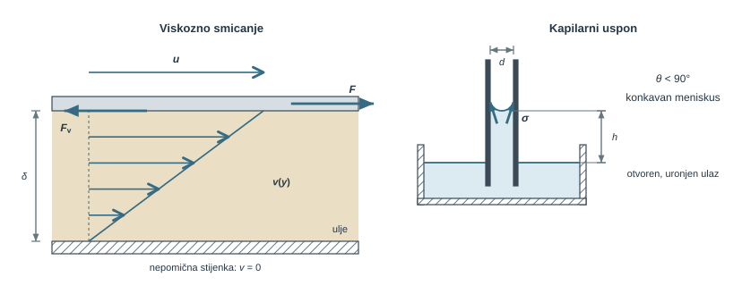
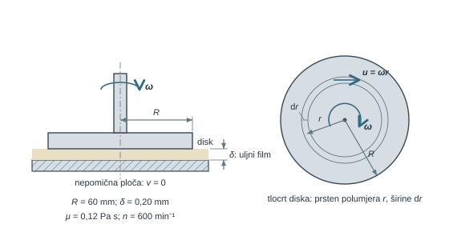
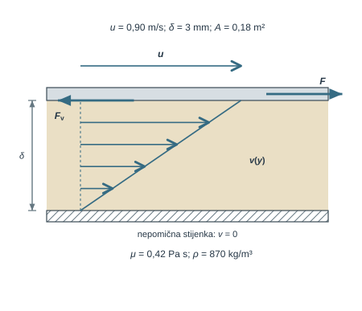
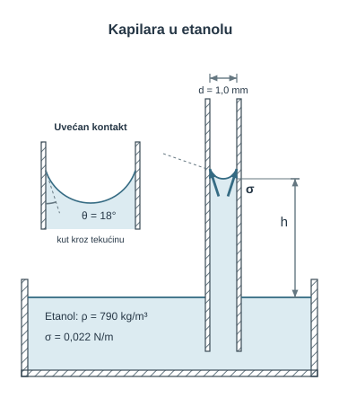
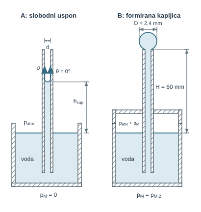
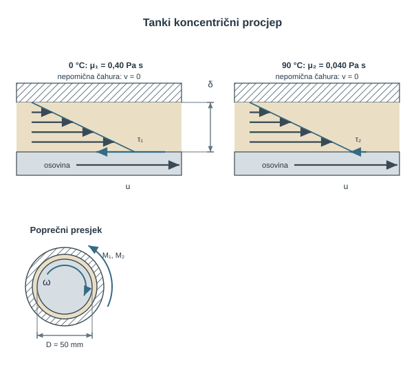
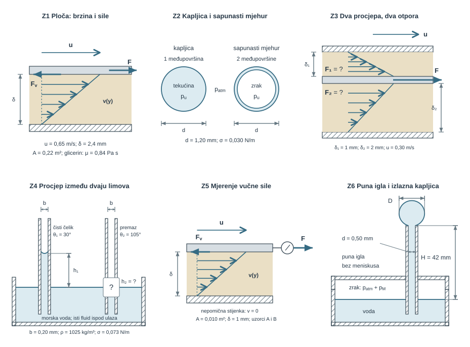

Tlak, opisan u []{.mf1-chapter-ref target="u01"}, nije jedino svojstvo koje određuje ponašanje fluida. Kad se susjedni slojevi gibaju jedan u odnosu na drugi, fluid se opire smicanju, a na granici tekućine s plinom ili krutom stijenkom djeluju sile koje oblikuju slobodnu površinu. Prva je pojava viskoznost, a druga površinska napetost. Obje u ovom poglavlju opisujemo jednostavnim modelima koji se izravno primjenjuju u inženjerskom proračunu.

Viskoznost se najjasnije vidi u stacionarnom Couetteovu sloju bez gradijenta tlaka. Fluid prianja uz obje stijenke, pa brzina fluida $v$ raste od nule na nepomičnoj donjoj stijenci do brzine ploče $u$ na gornjoj. Za newtonski fluid smično je naprezanje razmjerno gradijentu brzine, $\tau=\mu\,dv/dy$, gdje je $\mu$ dinamička viskoznost, a $\nu=\mu/\rho$ kinematička viskoznost. Taj je odnos konstitutivni model, a ne opći zakon. Viskoznost se snažno mijenja s temperaturom, pa svojstva fluida i valjanost newtonskog modela treba uspoređivati pri istoj temperaturi.

Površinska napetost $\sigma$ djeluje na granici faza kao sila po jedinici duljine kontaktne linije. U uskoj kapilari tekućina koja kvasi stijenku penje se iznad razine u posudi. Kontaktni kut $\theta$ mjeri se kroz tekućinu, a okomita komponenta površinske sile po obodu uravnotežuje težinu podignutog stupca, što daje $h=4\sigma\cos\theta/(\rho g d)$. Zakrivljena površina kapljice ili mjehura uz to podrazumijeva tlačni skok, koji opisuje Young–Laplaceov zakon. Tako se smični otpor u volumenu fluida jasno razlikuje od površinskih sila na granici faza.

Viskoznost određuje podmazivanje ležajeva, primjerice ležaja statvene cijevi brodskog osovinskog voda, i radno područje motornih i hidrauličkih ulja. Kapilarnost je važna u uskim procjepima limova brodske konstrukcije, raspršivačima i premazima. Poglavlje redom obrađuje Newtonov zakon viskoznosti, dinamičku i kinematičku viskoznost, površinsku napetost i kontaktni kut, kapilarni uspon te tlačni skok na kapljici i mjehuru. Modeli vrijede za newtonski fluid, stacionaran linearni profil i statički meniskus. Odnos inercije i gravitacije prema površinskoj napetosti iskazuju Weberov i Bondov broj u []{.mf1-chapter-ref target="u11"}, a tenzorski oblik viskoznog naprezanja obrađen je u []{.mf1-chapter-ref target="u12"}.

Slika [-@fig-uvod-u02] prikazuje obje pojave. Lijevo je ulje u procjepu debljine $\delta$ između nepomične donje stijenke, na kojoj je $v=0$, i gornje ploče koja se giba brzinom $u$; strelice profila $v(y)$ pokazuju linearan porast brzine fluida. Na gornju ploču djeluju dvije sile: $F$ je vanjska vučna sila, a $F_v$ sila ulja na ploču, usmjerena suprotno gibanju. Desno je otvorena kapilara promjera $d$ čiji je ulaz uronjen u tekućinu u posudi. Pri $\theta<90^\circ$ meniskus je konkavan, sile površinske napetosti $\sigma$ djeluju duž oboda, a $h$ je visina stupca iznad razine u posudi.

{#fig-uvod-u02 fig-align="center" fig-alt="Lijevo uljni procjep s linearnim profilom brzine i dvjema silama na gornjoj ploči, desno otvorena kapilara s konkavnim meniskusom, površinskim silama uz stijenku i kotom visine uspona."}

**Procijenjeno vrijeme rada uz priručnik:** 9 sati.

## Viskoznost

Kad se slojevi fluida gibaju relativno jedan prema drugom, pojavljuje se smično naprezanje i otpor gibanju. U newtonskom fluidu vrijedi

$$
\tau = \mu \frac{dv}{dy}
$$ {#eq-reologija-fizikalni-uvod-i-matematicki-izvod-01}

U izrazu je $\tau$ smično naprezanje, $\mu$ dinamička viskoznost, a $dv/dy$ gradijent brzine fluida $v$ po okomici $y$ na smjer gibanja. Smično je naprezanje tangencijalna sila po jedinici površine između susjednih slojeva fluida. To nije univerzalni zakon za sve fluide, nego model za one kod kojih je taj odnos linearan. U ovom poglavlju brzinu pomične krute granice (ploče, vratila) označujemo s $u$, a brzinu fluida s $v$. Dinamička viskoznost vode pri sobnoj je temperaturi reda veličine $10^{-3}\ \text{Pa s}$, dok ulja mogu imati znatno veće vrijednosti. Viskoznost ovisi o temperaturi i vrsti fluida [@white2011].

::: {.mf1-izvod}

Matematički izvod — Newtonov zakon viskoznosti u Couetteovu sloju

**Pitanje.** Kolika je sila potrebna da se gornja od dviju ravnih paralelnih ploča površine $A$ i razmaka $\delta$ giba stalnom brzinom $u$ dok donja miruje, ako je među njima newtonski fluid?

**Pretpostavke.** Stacionarno laminarno strujanje, prianjanje fluida na obje ploče ($v(0)=0$, $v(\delta)=u$), zanemarivi rubni učinci i gradijent tlaka u smjeru gibanja jednak nuli. Brzina fluida $v$ ima samo komponentu u smjeru gibanja ploče i ovisi samo o koordinati $y$ okomitoj na ploče. Pokus pokazuje da je vučna sila razmjerna površini i brzini, a obrnuto razmjerna razmaku:

$$
F \propto A\frac{u}{\delta}.
$$ {#eq-reologija-konstitutivna-motivacija-newtonov-zakon-viskozno-01}

**Bilanca.** Promatramo tanak sloj fluida između $y$ i $y+dy$. Na njegovu gornju plohu susjedni sloj djeluje smičnim naprezanjem $\tau(y+dy)$, a na donju $-\tau(y)$; tlak je u smjeru gibanja jednolik, a sloj se ne ubrzava. Ravnoteža sila u smjeru gibanja daje

$$
\tau(y+dy)\,A-\tau(y)\,A=0 \qquad\Longrightarrow\qquad \frac{d\tau}{dy}=0,
$$ {#eq-couette-bilanca-sloja}

pa je smično naprezanje jednako na svakoj visini procjepa. Ta bilanca vrijedi za svaki fluid; o vrsti fluida ovisi tek to kako je naprezanje $\tau$ povezano s gibanjem.

**Konstitutivni model.** Pokusno utvrđena proporcionalnost smičnoga naprezanja i gradijenta brzine jest **konstitutivni model** newtonskog fluida, a ne posljedica ravnoteže sila:

$$
\tau = \mu\frac{dv}{dy}.
$$ {#eq-reologija-konstitutivna-motivacija-newtonov-zakon-viskozno-04}

**Koraci.** Uvrštavanjem konstitutivnog modela u bilancu slijedi $\mu\,d^2v/dy^2=0$, pa je profil brzine linearan; uz prianjanje na objema pločama

$$
v(y)=u\,\frac{y}{\delta}, \qquad \frac{dv}{dy}=\frac{u}{\delta}.
$$ {#eq-couette-linearni-profil}

Smično naprezanje tada je jednako na obje ploče,

$$
\tau = \mu\frac{u}{\delta},
$$ {#eq-reologija-konstitutivna-motivacija-newtonov-zakon-viskozno-03}

a vučna sila na gornju ploču

$$
F = \tau A = \mu A\frac{u}{\delta}.
$$ {#eq-reologija-konstitutivna-motivacija-newtonov-zakon-viskozno-02}

**Rezultat i provjera.** Dobiveni izraz ima upravo pokusom utvrđen oblik, što određuje $\mu$ kao konstantu razmjernosti s jedinicom $\mathrm{Pa\,s}$. Za $u\to0$ sila nestaje, a tanji procjep uz istu brzinu daje veću silu. Linearan profil nije ulazna pretpostavka, nego posljedica bilance i newtonskog modela; za nenewtonski fluid u istom sloju $\tau$ je i dalje stalan po visini, ali gradijent brzine ne mora biti. U zapisu $\tau$ označuje komponentu smičnoga naprezanja s unaprijed odabranim pozitivnim smjerovima: promijene li se orijentacija normale ili smjer brzine, mijenja se i predznak te komponente, a $|\tau|$ je njezin iznos.
:::

### Dinamička i kinematička viskoznost

Dinamička i kinematička viskoznost različite su fizikalne veličine:

$$
\mu\ [\text{Pa s}]
$$ {#eq-reologija-dinamicka-i-kinematicka-viskoznost-01}

$$
\nu = \frac{\mu}{\rho}\ [\text{m}^2/\text{s}]
$$ {#eq-reologija-dinamicka-i-kinematicka-viskoznost-02}

::: {.mf1-fizikalno-znacenje}

Fizikalno značenje — Kinematička viskoznost kao difuzivnost

Kinematička viskoznost $\nu$ povezuje viskozni prijenos količine gibanja ($\mu$) s masenom inercijom ($\rho$), pa se može tumačiti kao **difuzivnost količine gibanja**. Upravo se $\nu$ pojavljuje u Reynoldsovu broju $Re=vL/\nu$. Dva nestlačiva newtonska fluida s jednakim $\nu$ imaju isti Reynoldsov broj pri istoj referentnoj brzini i duljini; isti bezdimenzijski uzorak strujanja očekuje se tek za geometrijski slične domene, jednake bezdimenzijske rubne uvjete i jednake ostale relevantne bezdimenzijske skupine.
:::

::: {.mf1-cfd title="Računalna dinamika fluida"}

**Hladno pokretanje rashladnog kruga.** Razdjelnik koji dobro radi nakon zagrijavanja može pri hladnom pokretanju pružati drukčiji otpor. Za usporedbu najprije simuliramo isti zadani protok pri dvjema temperaturama, uz pripadne gustoće i viskoznosti. CFD tada daje potrebnu razliku tlakova i podjelu protoka po kanalima. Relacija $\nu=\mu/\rho$ služi ispravnom unosu svojstava: jedinica koju program traži pokazuje unosi li se dinamička ili kinematička viskoznost. Provjera: za laminarno strujanje u jednom ravnom kanalu numerički se pad tlaka najprije uspoređuje s analitičkim Hagen–Poiseuilleovim rješenjem iz []{.mf1-chapter-ref target="u12"}; tek mreža koja ga reproducira smije se upotrijebiti za podjelu protoka po kanalima razdjelnika.

Veća viskoznost pri istom laminarnom protoku povećava potrebnu razliku tlakova. U stvarnom sustavu crpka ne mora održati taj protok: novi se protok određuje zajedno s karakteristikom crpke, kako je opisano u []{.mf1-chapter-ref target="u13"}. Ako se temperatura osjetno mijenja unutar uređaja, model se proširuje temperaturnim poljem i ovisnošću svojstava o temperaturi.
:::

::: {#ex-moment-trenja-rotirajuceg-diska .mf1-we}

Moment trenja rotirajućeg diska na uljnom filmu&nbsp;T2

**Tekst zadatka**

Disk polumjera $R = 60\ \text{mm}$ aksijalnog ležaja vrti se brzinom $n = 600\ \text{min}^{-1}$ iznad nepomične ploče. Između diska i ploče nalazi se uljni film stalne debljine $\delta = 0{,}20\ \text{mm}$, viskoznosti $\mu = 0{,}12\ \text{Pa s}$. Ulje prianja uz obje plohe, profil brzine po debljini filma je linearan, a rubni se učinci, zagrijavanje smicanjem i tlak u filmu zanemaruju.

**Traži se**

1. Odredi smično naprezanje na rubu diska.
2. Integracijom po polumjeru odredi moment trenja $M$ na disku i snagu $P$ koju pogon troši na film.
3. Usporedi $M$ s procjenom u kojoj se naprezanje sa srednjeg polumjera $R/2$ primijeni na cijelu plohu.

{#fig-u02-rotirajuci-disk fig-align="center" fig-alt="Lijevo bočni presjek s nepomičnom pločom, tankim uljnim filmom debljine δ i diskom polumjera R na vratilu koje se vrti kutnom brzinom ω; desno tlocrt diska s tankim prstenom polumjera r i obodnom brzinom u = ωr."}

**Veza s proračunom.** Obodna brzina diska raste s polumjerom, $u(r)=\omega r$, pa je Couetteov model valjan samo lokalno, za prsten polumjera $r$ i širine $dr$. Debljina filma na skici je uvećana.

**Rješenje**

Kutna brzina diska iznosi $\omega=2\pi n/60=62{,}83\ \mathrm{rad/s}$. Na polumjeru $r$ ploča diska ima obodnu brzinu $u=\omega r$, pa je uz linearni profil po debljini filma lokalno smično naprezanje

$$
\tau(r)=\mu\frac{\omega r}{\delta},\qquad
\tau(R)=0{,}12\cdot\frac{62{,}83\cdot0{,}060}{0{,}20\cdot10^{-3}}\approx2{,}26\ \text{kPa}.
$$ {#eq-reologija-kratki-primjer-pretvorba-dinamicke-u-kinematicku-01}

Naprezanje raste linearno od nule u osi do $2{,}26\ \text{kPa}$ na rubu, pa se sila ne smije računati kao jedno naprezanje puta površina. Na prsten površine $dA=2\pi r\,dr$ djeluje sila $\tau\,dA$ s krakom $r$, pa je moment

$$
\begin{aligned}
M&=\int_0^R \tau(r)\,r\,2\pi r\,dr
=\frac{2\pi\mu\omega}{\delta}\int_0^R r^3\,dr
=\frac{\pi\mu\omega R^4}{2\delta}\\
&=\frac{\pi\cdot0{,}12\cdot62{,}83\cdot0{,}060^4}{2\cdot0{,}20\cdot10^{-3}}
\approx0{,}767\ \text{N m}.
\end{aligned}
$$ {#eq-reologija-kratki-primjer-pretvorba-dinamicke-u-kinematicku-02}

Snaga utrošena na smicanje filma iznosi

$$
P=M\omega=0{,}767\cdot62{,}83\approx48{,}2\ \text{W}.
$$ {#eq-reologija-kratki-primjer-pretvorba-dinamicke-u-kinematicku-03}

Procjena s naprezanjem sa srednjeg polumjera, $\tau(R/2)=1{,}13\ \text{kPa}$, na cijeloj plohi $\pi R^2$ i s krakom $R/2$ daje $M'=\tau(R/2)\,\pi R^2\,R/2=\pi\mu\omega R^4/(4\delta)\approx0{,}384\ \text{N m}$, točno polovinu stvarnog momenta.

**Provjera i tumačenje**

Dimenzije: $[\mu\omega R^4/\delta]=\mathrm{Pa\,s\cdot s^{-1}\cdot m^4/m=N\,m}$. Moment raste s četvrtom potencijom polumjera jer s $r$ rastu i naprezanje, i površina prstena, i krak. Zato vanjska polovica polumjera ($r>R/2$) nosi $15/16$ momenta, a srednji polumjer podcjenjuje rezultat dvostruko. Isti integral po prstenima vrijedi za stožaste i pločaste viskozimetre; za ležaj s nosivim tlakom u filmu trebao bi još model podmazivanja, koji ovaj račun ne sadrži.
:::

::: {.mf1-dublje}

Dublje — Tenzor viskoznih naprezanja u trodimenzijskom strujanju

Newtonov zakon viskoznosti $\tau = \mu\,dv/dy$ uveden je za **jednodimenzijsko strujanje**, u kojem brzina ima samo jednu komponentu, a gradijent samo u jednom smjeru. U realnim trodimenzijskim strujanjima brzina ima tri komponente $v_1, v_2, v_3$ (u literaturi često $u_i$), koje se mogu mijenjati u sva tri smjera $x_1, x_2, x_3$, pa viskozno dodatno naprezanje postaje tenzor drugog reda.

Za **nestlačivi newtonski fluid** poopćeni Newtonov zakon glasi

$$
\tau_{ij} = \mu\!\left(\frac{\partial v_i}{\partial x_j} + \frac{\partial v_j}{\partial x_i}\right),
$$ {#eq-reologija-dublje-tenzor-viskoznih-naprezanja-u-trodimenzij-01}

gdje indeksi $i, j = 1, 2, 3$ označuju koordinatne smjerove. Komponenta $\tau_{ij}$ djeluje u smjeru osi $i$ na plohu okomitu na os $j$: izvandijagonalne komponente ($i\ne j$) jesu smične, a dijagonalne ($i=j$) jesu viskozna normalna dodatna naprezanja.

Tenzor je **simetričan** ($\tau_{ij} = \tau_{ji}$), što fizikalno znači da su odgovarajuće smične komponente naprezanja na međusobno okomitim plohama jednake — posljedica je to ravnoteže momenata na infinitezimalnom elementu fluida.

Iz tenzorskog oblika slijedi važan rezultat: trag tenzora (zbroj dijagonalnih elemenata) za nestlačivi fluid iščezava

$$
\tau_{11} + \tau_{22} + \tau_{33} = 2\mu\!\left(\frac{\partial v_1}{\partial x_1} + \frac{\partial v_2}{\partial x_2} + \frac{\partial v_3}{\partial x_3}\right) = 2\mu\,\nabla\cdot\vec{v} = 0,
$$ {#eq-reologija-dublje-tenzor-viskoznih-naprezanja-u-trodimenzij-02}

što znači da viskoznost ne dodaje vlastiti **izotropni dio** naprezanja — taj dio u potpunosti preuzima tlak $p$.

Skalarni jednodimenzijski oblik $\tau = \mu\,dv/dy$ služi kao radni oblik u svim $1$D problemima u ovom poglavlju. Tenzorski zakon i njegovo mjesto u Navier–Stokesovoj jednadžbi sustavno su obrađeni u []{.mf1-chapter-ref target="u12"}.
:::

::: {.mf1-cfd title="Računalna dinamika fluida"}

**Uski kanal hladne ploče.** Smanjenjem razmaka među stijenkama tekućinu dovodimo bliže površini koju želimo hladiti, ali povećavamo gradijente brzine i potrebnu pogonsku snagu. CFD iz profila brzine i viskoznosti računa smično naprezanje; Newtonov zakon daje vezu između gibanja i trenja. Prianjanje određuje brzinu na stijenci, a dovoljan broj ćelija po širini razmaka omogućuje razlučivanje profila.

Ručni račun u primjeru [-@ex-u02-smicno-naprezanje-u-tankom-uljnom-sloju-t2] daje takav test: linearni profil proizlazi iz gibanja ploče bez gradijenta tlaka. U kanalu s nepomičnim stijenkama, u kojem strujanje pokreće razlika tlakova, profil je drukčiji. Usporedba geometrija zatim povezuje otpor s raspodjelom toka, dok ocjena hlađenja zahtijeva i toplinski račun.
:::

## Površinska napetost i kontaktni kut

Na granici fluida i druge faze molekule nemaju istu okolinu kao one u unutrašnjosti fluida. Zbog toga međupovršina ima dodatnu energiju. Taj se učinak opisuje površinskom napetošću $\sigma$.

Površinska se napetost izražava u jedinicama $\text{N/m}$, kao sila po jedinici duljine kontaktne linije. Budući da vrijedi $\text{N/m}=\text{J/m}^2$, može se tumačiti i kao energija po jediničnoj površini. Za stvaranje nove površine fluida potreban je rad $\sigma\Delta A$. Pri zadanom volumenu sustav teži najmanjoj površini, pa kapljice u bestežinskom stanju i sapunasti mjehuri poprimaju sferni oblik.

Kad je fluid u dodiru sa stijenkom, presudan postaje i kontaktni kut $\theta$. Znak i iznos $\cos \theta$ odlučuju penje li se tekućina u tankoj kapilari ili se razina spušta.

::: {.mf1-izvod}

Matematički izvod — Youngova jednadžba i podrijetlo kontaktnog kuta

Vrijednost kontaktnog kuta $\theta$ nije proizvoljna, nego proizlazi iz ravnoteže triju površinskih napetosti na trofaznoj kontaktnoj liniji, na kojoj se susreću kruta stijenka, tekućina i para. Na tu liniju djeluju tri sile po jedinici duljine (indeksi slijede uobičajeni zapis u literaturi: $s$ krutina, $l$ tekućina, $v$ para):

- napetost između krutine i pare: $\sigma_{sv}$, koja vuče duž krute površine, od tekućine prema van;
- napetost između krutine i tekućine: $\sigma_{sl}$, koja vuče duž krute površine prema tekućini;
- napetost između tekućine i pare: $\sigma_{lv}$, koja vuče po slobodnoj površini tekućine pod kutom $\theta$ prema krutoj plohi.

Tangencijalna ravnoteža duž krute površine glasi

$$
\sigma_{sv} = \sigma_{sl} + \sigma_{lv}\cos\theta,
$$ {#eq-reologija-matematicki-izvod-youngova-jednadzba-i-podrijetl-01}

odakle slijedi **Youngova jednadžba**

$$
\cos\theta = \frac{\sigma_{sv} - \sigma_{sl}}{\sigma_{lv}}.
$$ {#eq-reologija-matematicki-izvod-youngova-jednadzba-i-podrijetl-02}

Veličina $\sigma$ u izrazu za kapilarni uspon i u svim formulama koje slijede zapravo je $\sigma_{lv}$ — napetost između tekućine i pare. Ako tekućina kvasi krutinu (npr. voda na čistom staklu), vrijedi $\sigma_{sv} > \sigma_{sl}$, pa je $\cos\theta > 0$ i $\theta < 90^\circ$. Ako tekućina ne kvasi krutinu (npr. živa na staklu, voda na voštanoj površini), vrijedi $\sigma_{sv} < \sigma_{sl}$, pa je $\cos\theta < 0$ i $\theta > 90^\circ$.

Kvašenje i nekvašenje stoga nisu svojstvo same tekućine, nego **svojstvo para tekućina–krutina**. Ista voda u staklenoj kapilari kvasi ($\theta \approx 0$), a u teflonskoj ne kvasi ($\theta > 90^\circ$), pa kapilarni uspon prelazi u kapilarno spuštanje razine.
:::

::: {.mf1-izvod}

Matematički izvod — Ravnoteža kapilarnog uspona

**Pitanje.** Do koje se visine $h$ tekućina penje u uskoj kružnoj kapilari promjera $d$ uronjenoj u široku posudu, ako je kontaktni kut $\theta$?

**Pretpostavke.** Ravnotežno stanje, stalan kontaktni kut duž oboda, zanemariv volumen meniskusa, zanemariva promjena njegove zakrivljenosti zbog težine te široka posuda čija se razina ne mijenja.

**Bilanca.** Površinska napetost $\sigma$ djeluje duž cijeloga oboda $\pi d$ kontaktne linije, u smjeru tangente na slobodnu površinu. Vodoravne komponente sila po obodu međusobno se poništavaju, a zbroj njihovih okomitih komponenti iznosi

$$
F_{\sigma,z} = \sigma\pi d\cos\theta.
$$ {#eq-reologija-konstitutivna-motivacija-newtonov-zakon-viskozno-05}

Težina stupca tekućine podignutoga iznad razine u posudi jest

$$
F_G = \rho gV = \rho g\frac{\pi d^2}{4}h.
$$ {#eq-reologija-konstitutivna-motivacija-newtonov-zakon-viskozno-06}

U ravnoteži mora vrijediti $F_{\sigma,z}=F_G$, pa slijedi

$$
\sigma \pi d \cos\theta = \rho g \frac{\pi d^2}{4} h.
$$ {#eq-reologija-konstitutivna-motivacija-newtonov-zakon-viskozno-07}

**Koraci.** Dijeljenjem s $\pi d$ krate se faktor $\pi$ i jedna potencija promjera:

$$
\sigma \cos\theta = \rho g \frac{d}{4} h.
$$ {#eq-reologija-razrada-koraka-01}

**Rezultat.** Izražavanjem $h$ dobiva se radni izraz kapilarnog uspona

$$
h = \frac{4\sigma \cos\theta}{\rho g d}.
$$ {#eq-reologija-razrada-koraka-02}

**Provjera.** Jedinice: $\mathrm{(N/m)/(kg\,m^{-3}\cdot m\,s^{-2}\cdot m)=m}$. Za $\theta=90^\circ$ uspona nema, za $\theta>90^\circ$ izraz daje spuštanje razine, a prepolovljenje promjera udvostručuje $h$. Za procjep između dviju paralelnih ploha ista bilanca po jedinici duljine daje faktor 2 umjesto 4 (Z4).
:::

Budući da je $h$ prema jednadžbi [-@eq-reologija-razrada-koraka-02] obrnuto razmjeran promjeru, kapilarnost je važna u tankim porama i procjepima, a obično zanemariva u cijevima centimetarskoga ili većeg promjera.

::: {.mf1-cfd title="Računalna dinamika fluida"}

**Punjenje kanala i zarobljeni zrak.** Potpuno napunjen kanal i kanal koji se tek puni dva su različita CFD problema. Pri punjenju hladne ploče tekućina istiskuje zrak, pa pratimo granicu faza i omogućujemo izlazak zraka kroz odzračnik. Površinska napetost i kontaktni kut određuju oblik meniskusa i kvašenje stijenke. U uskim prolazima mogu utjecati na to kojim putem tekućina napreduje i ostaje li zračni džep.

**Zastani i promisli.** Model točno predviđa konačnu visinu u kapilari. Potvrđuje li to i točno vrijeme punjenja kanala?

Uspoređujući različite položaje odzračnika, pratimo zaostali volumen zraka i vrijeme punjenja. Točna ravnotežna visina u kapilari ne potvrđuje vrijeme punjenja kanala: ono ovisi i o viskoznom otporu, odzračivanju i gibanju meniskusa. Za kontaktnu liniju koja se giba može trebati dodatni model kontaktnog kuta. Nakon uspješnog odzračivanja možemo prijeći na jednostavniji jednofazni model rada.
:::

::: {.mf1-interaktivno}

Numerički pokus — Kapilarni uspon

**Predvidi.** Kako prepolovljen promjer kapilare mijenja uspon, a što očekuješ pri kontaktnom kutu $90^\circ$?

**Provjeri i protumači.** Mijenjaj promjer i kut te usporedi ravnotežne visine. Razlikuj predviđanje konačne visine od vremena potrebnog da se ona dosegne.

<a class="mf1-interaktivno-veza" href="https://martibasic.github.io/MF1_udzbenik/jlite/lab/index.html?path=u02_kapilarni_uspon.ipynb">Pokreni u pregledniku</a>

:::

Na zakrivljenoj slobodnoj površini nastaje skok tlaka. On proizlazi iz iste ravnoteže sila kao kapilarni uspon, samo primijenjene na zatvorenu kapljicu ili mjehurić.

::: {.mf1-izvod}

Matematički izvod — Young–Laplaceov zakon za kapljicu i mjehurić

Promatramo sfernu kapljicu polumjera $r$ okruženu plinom. Zbog površinske napetosti tlak unutar kapljice $p_u$ veći je od tlaka u okolnom plinu $p_{ok}$. Ravnotežu sila najlakše je postaviti za vodoravnu presječnu ravninu koja prolazi ekvatorom kapljice; gornja polusfera mora ostati u ravnoteži pod djelovanjem dviju suprotno usmjerenih sila:

- sile tlačne razlike, koja tjera polusferu od ekvatora prema van — djeluje na projiciranu kružnu površinu $A_{proj} = \pi r^2$ i iznosi

$$
F_{tlak} = (p_u - p_{ok})\,\pi r^2,
$$ {#eq-reologija-matematicki-izvod-young-laplaceov-zakon-za-kaplj-01}

- sile površinske napetosti, koja gornju polusferu vuče prema dolje duž ekvatorske kružnice duljine $L = 2\pi r$:

$$
F_\sigma = \sigma \cdot 2\pi r.
$$ {#eq-reologija-matematicki-izvod-young-laplaceov-zakon-za-kaplj-02}

U ravnoteži vrijedi $F_{tlak} = F_\sigma$, odnosno

$$
(p_u - p_{ok})\,\pi r^2 = \sigma \cdot 2\pi r,
$$ {#eq-reologija-matematicki-izvod-young-laplaceov-zakon-za-kaplj-03}

odakle se kraćenjem zajedničkog faktora $\pi r$ dobiva tlačni skok

$$
\Delta p = p_u - p_{ok} = \frac{2\sigma}{r} = \frac{4\sigma}{d}.
$$ {#eq-reologija-matematicki-izvod-young-laplaceov-zakon-za-kaplj-04}

Za **sapunasti mjehur** s dvjema slobodnim površinama (unutarnjom i vanjskom stranom opne) sila površinske napetosti dvostruko je veća jer obje površine opne imaju približno isti ekvatorski obod:

$$
F_\sigma = 2\cdot\sigma\cdot 2\pi r = 4\pi r\sigma,
$$ {#eq-reologija-matematicki-izvod-young-laplaceov-zakon-za-kaplj-05}

pa je tlačni skok

$$
\Delta p = \frac{4\sigma}{r} = \frac{8\sigma}{d}.
$$ {#eq-reologija-matematicki-izvod-young-laplaceov-zakon-za-kaplj-06}

Za općenitu zakrivljenu plohu s glavnim polumjerima zakrivljenosti $R_1$ i $R_2$, opći **Young–Laplaceov zakon** glasi

$$
\Delta p = \sigma\!\left(\frac{1}{R_1} + \frac{1}{R_2}\right),
$$ {#eq-reologija-matematicki-izvod-young-laplaceov-zakon-za-kaplj-07}

pri čemu je $\Delta p=p_u-p_{ok}$, a zakrivljenosti su pozitivne za konveksnu kapljicu promatranu iz unutarnje faze. Uz drugu orijentaciju normale predznaci zakrivljenosti i tlačnoga skoka moraju se promijeniti zajedno. Za sferu ($R_1 = R_2 = r$) tako se dobiva $\Delta p = 2\sigma/r$, a za cilindar ($R_2 \to \infty$) $\Delta p = \sigma/R_1$.
:::

::: {.mf1-fizikalno-znacenje}

Fizikalno značenje — Tlačni skok na zakrivljenoj površini

Zakrivljena površina zahtijeva tlačni skok koji uravnotežuje površinsku napetost. Što je promjer manji, to su zakrivljenost i potreban skok tlaka veći. Faktor 4 za kapljicu nastaje jer sfera ima jednu granicu faza i polumjer $r=d/2$, a faktor 8 za sapunasti mjehur potječe od dviju površina opne. Isti nadtlak $2\sigma/r$ otežava rast vrlo malih mjehurića pare pri kavitaciji ([]{.mf1-chapter-ref target="u13"}).
:::

::: {.mf1-cfd title="Računalna dinamika fluida"}

**Od mirne kapljice do raspršivanja.** Kod mlaznice za raspršivanje tekućine zanima nas ostaje li mlaz povezan ili se raspada na kapljice. Prije takva nestacionarnog računa isti model međupovršine provjeravamo na mirnoj sfernoj kapljici: model mora sačuvati njezin volumen i dati skok tlaka $4\sigma/d$ bez znatnog neželjenog strujanja.

U mlaznici zatim uspoređujemo brzinu dotoka, svojstva tekućine i okolnog plina te oblik otvora. Pratimo oblik mlaza i veličine kapljica koje mreža može razlučiti. Mreža koja dobro opisuje veliki mlaz ne mora opisati najsitnije kapljice; za njih može trebati zaseban model. Time se površinska napetost povezuje s inercijom, a njihov omjer kasnije opisuje Weberov broj.
:::

::: {.mf1-granica-modela}

Granica modela — Newtonski sloj i statički meniskus

Svi računi u ovom poglavlju počivaju na četirima pretpostavkama koje treba provjeriti prije uvrštavanja. Newtonski model vrijedi samo ako je omjer $\tau$ i $dv/dy$ stalan u ispitanom rasponu i pri istoj temperaturi; suspenzije, polimerne otopine i krv pri malim gradijentima to ne zadovoljavaju (Z5). Linearni Couetteov profil zahtijeva stacionarno smicanje bez gradijenta tlaka i bez zagrijavanja smicanjem; u ležaju s ekscentricitetom ili u kanalu u kojem strujanje pokreće razlika tlakova profil je drukčiji, pa $\tau=\mu u/\delta$ daje samo procjenu. Kapilarni izrazi opisuju statički meniskus sa stalnim kontaktnim kutom; histereza kuta, hrapavost i onečišćenje stijenke mijenjaju $\theta$, a vrijeme punjenja uopće nije obuhvaćeno. U tlačnim bilancama kapljice zanemaren je hidrostatički član $\rho gD$ kroz visinu kapljice promjera $D$; kad je rezerva modela manja od te skale (Z6), ravnotežni račun nije dovoljan za odluku o stvarnom uređaju.
:::

## Riješeni primjeri

::: {#ex-u02-smicno-naprezanje-u-tankom-uljnom-sloju-t2 .mf1-we}

Smično naprezanje u tankom uljnom sloju&nbsp;T2

**Tekst zadatka**

Između paralelnih ploča nalazi se uljni sloj debljine $\delta = 3\ \text{mm}$, viskoznosti $\mu = 0{,}42\ \text{Pa s}$ i gustoće $\rho = 870\ \text{kg/m}^3$. Donja ploča miruje, a gornja, aktivne površine $A = 0{,}18\ \text{m}^2$, giba se jednoliko brzinom $u = 0{,}90\ \text{m/s}$. Uz prianjanje na stijenkama pretpostavi linearni profil brzine.

**Traži se**

1. Odredi gradijent brzine $dv/dy$.
2. Odredi smično naprezanje $\tau$.
3. Odredi silu potrebnu za jednoliko gibanje gornje ploče.
4. Odredi kinematičku viskoznost $\nu$.

{#fig-u02-viskoznost-i-kapilarnost fig-alt="Uljni sloj s linearnim profilom brzine od nule na donjoj stijenci do brzine gornje ploče, na koju djeluju vučna sila i suprotna sila ulja."}

**Veza s proračunom.** Zbog prianjanja fluid uz donju ploču miruje, a uz gornju ima njezinu brzinu. Pogonska i otporna sila djeluju na pomičnu ploču.

**Rješenje**

Najprije razmak pretvorimo u metre:

$$
\delta = 0{,}003\ \text{m}.
$$ {#eq-reologija-rijeseni-primjer-smicno-naprezanje-u-tankom-uljn-01}

Gradijent brzine tada je

$$
\frac{dv}{dy} = \frac{u}{\delta} = \frac{0{,}90}{0{,}003} = 300\ \text{s}^{-1}.
$$ {#eq-reologija-rijeseni-primjer-smicno-naprezanje-u-tankom-uljn-02}

Smično naprezanje iznosi

$$
\tau = \mu \frac{dv}{dy} = 0{,}42 \cdot 300 = 126\ \text{Pa}.
$$ {#eq-reologija-rijeseni-primjer-smicno-naprezanje-u-tankom-uljn-03}

Sila na ploči zato je

$$
F = \tau A = 126 \cdot 0{,}18 = 22{,}68\ \text{N} \approx 22{,}7\ \text{N}.
$$ {#eq-reologija-rijeseni-primjer-smicno-naprezanje-u-tankom-uljn-04}

Kinematička viskoznost iznosi

$$
\nu = \frac{\mu}{\rho} = \frac{0{,}42}{870} \approx 4{,}83 \cdot 10^{-4}\ \text{m}^2/\text{s}.
$$ {#eq-reologija-rijeseni-primjer-smicno-naprezanje-u-tankom-uljn-05}

**Provjera i tumačenje**

Energijska bilanca: snaga vučne sile $Fu=22{,}68\cdot0{,}90\approx20{,}4\ \mathrm{W}$ jednaka je viskoznoj disipaciji u sloju $\mu(u/\delta)^2A\delta=0{,}42\cdot300^2\cdot0{,}18\cdot0{,}003\approx20{,}4\ \mathrm{W}$.
:::

::: {#ex-u02-kapilarni-uspon-etanola-u-staklenoj-cjevcici-t1 .mf1-we}

Kapilarni uspon etanola u staklenoj cjevčici&nbsp;T1

**Tekst zadatka**

Staklena kapilara unutarnjeg promjera $d = 1{,}0\ \text{mm}$ uronjena je u etanol gustoće $\rho = 790\ \text{kg/m}^3$ i površinske napetosti $\sigma = 0{,}022\ \text{N/m}$. Kontaktni kut iznosi $\theta = 18^\circ$, a $g = 9{,}81\ \text{m/s}^2$. Promatra se ravnotežni meniskus.

**Traži se**

Odredi visinu kapilarnog uspona $h$.

{#fig-u02-kapilarni-uspon-etanol fig-align="center" fig-alt="Staklena kapilara uronjena u etanol s konkavnim meniskusom, kotom uspona od slobodne površine i uvećanim detaljem kuta od 18 stupnjeva."}

**Veza s proračunom.** Kontaktni kut mjeri se kroz tekućinu. Visina i promjer prikazani su u različitim mjerilima.

**Rješenje**

Promjer u metrima iznosi $d = 1{,}0 \cdot 10^{-3}\ \text{m}$, a za zadani kontaktni kut vrijedi $\cos 18^\circ \approx 0{,}951$, pa je kapilarni uspon

$$
h = \frac{4\sigma\cos\theta}{\rho g d} = \frac{4 \cdot 0{,}022 \cdot 0{,}951}{790 \cdot 9{,}81 \cdot 1{,}0 \cdot 10^{-3}} = 0{,}0108\ \text{m} \approx 1{,}08\ \text{cm}.
$$ {#eq-reologija-rijeseni-primjer-kapilarni-uspon-etanola-u-stakl-01}

**Provjera i tumačenje**

Kako je $\theta < 90^\circ$, razina raste. Pri potpunom kvašenju ($\theta=0$) uspon bi bio $11{,}4\ \mathrm{mm}$; dobiveni $10{,}8\ \mathrm{mm}$ manji je upravo za faktor $\cos18^\circ\approx0{,}951$.
:::

::: {#ex-u02-kapilarni-mikrodozator-s-izlaznom-kapljicom-t3 .mf1-ch}

Kapilarni mikrodozator s izlaznom kapljicom&nbsp;T2

**Tekst zadatka**

Uspravna staklena kapilara promjera $d=0{,}80\ \mathrm{mm}$ povezana je sa širokim spremnikom vode gustoće $\rho=998\ \mathrm{kg/m^3}$ i površinske napetosti $\sigma=0{,}072\ \mathrm{N/m}$. Izlaz je $H=60\ \mathrm{mm}$ iznad površine spremnika. Pri punjenju kontaktni je kut $\theta=0^\circ$, a zrak slobodno izlazi. Nakon punjenja promatra se sferna izlazna kapljica promjera $D=2{,}4\ \mathrm{mm}$, povezana s vodom bez unutarnjeg meniskusa. Kontaktna linija zadržana je na rubu izlaza; kut punjenja ne određuje oblik kapljice.

Kapljicu na izlazu održava pretlak $p_M$ iznad spremnika; njegov se iznos ovdje ne traži. Okolni atmosferski tlak iznosi $p_{atm}=101325\ \mathrm{Pa}$, a $g=9{,}81\ \mathrm{m/s^2}$. Oba su stanja kvazistatička. Zanemari promjenu razine spremnika te težinu i deformaciju kapljice; njezin rast i odvajanje nisu obuhvaćeni.

**Traži se**

1. Odredi prirodni kapilarni uspon $h_{cap}$ kada je spremnik otvoren i provjeri doseže li meniskus izlaz.
2. Odredi tlačni skok i apsolutni tlak u idealiziranoj kapljici.

{#fig-u02-kapilarni-mikrodozator-s-izlaznom-kapljicom fig-alt="Lijevo kapilara s konkavnim meniskusom ispod izlaza pri otvorenom spremniku, desno puna kapilara s konveksnom kapljicom na izlazu, visina H iznad slobodne površine spremnika."}

**Veza s proračunom.** Razlikuj punjenje kapilare s konkavnim meniskusom od stanja s već formiranom konveksnom kapljicom: zakrivljenost mijenja predznak tlačnog skoka. Promjer kapilare i visina stupca nisu u zajedničkom grafičkom mjerilu.

**Rješenje**

### 1. Kapilarni uspon {.unnumbered .unlisted .mf1-step}

Pri otvorenom spremniku i potpunom kvašenju vrijedi

$$
h_{cap}=\frac{4\sigma\cos\theta}{\rho gd}
=\frac{4\cdot0{,}072}{998\cdot9{,}81\cdot0{,}80\cdot10^{-3}}
\approx36{,}8\ \mathrm{mm}.
$$ {#eq-reologija-1-kapilarni-uspon-01}

Budući da je $h_{cap}\approx36{,}8\ \mathrm{mm}<H=60\ \mathrm{mm}$, sama kapilarnost ne dovodi meniskus do izlaza; za to je potreban dodatni pretlak spremnika.

### 2. Tlačni skok na kapljici {#tlacni-skok-na-kapljici .unnumbered .unlisted .mf1-step}

Za zadanu sfernu idealizaciju vrijedi

$$
\Delta p=\frac{4\sigma}{D}
=\frac{4\cdot0{,}072}{2{,}4\cdot10^{-3}}=120\ \mathrm{Pa}.
$$ {#eq-reologija-2-tlakovni-skok-na-kapljici-01}

Apsolutni tlak u kapljici prema tome iznosi

$$
p_u=p_{atm}+\Delta p=101325+120=101445\ \mathrm{Pa}
\approx101{,}45\ \mathrm{kPa}.
$$ {#eq-reologija-2-tlakovni-skok-na-kapljici-02}

**Provjera i tumačenje**

Pri punjenju je meniskus konkavan, pa je tlak vode neposredno ispod njega niži od okolnoga za $4\sigma/d=360\ \mathrm{Pa}$, što je upravo hidrostatički tlak stupca $\rho gh_{cap}\approx360\ \mathrm{Pa}$. Formirana kapljica konveksna je, pa je tlak u njoj viši od okolnoga za $120\ \mathrm{Pa}$: ista međupovršina mijenja predznak tlačnog skoka kad promijeni smjer zakrivljenosti.
:::

::: {#ex-u02-hladni-start-i-radna-temperatura-koliko-kosta .mf1-we}

Utjecaj temperature na viskozni otpor ležaja statvene cijevi&nbsp;T2

**Tekst zadatka**

Uljem podmazani koncentrični ležaj statvene cijevi manjeg plovila ima promjer osovine propelera $D = 50\ \text{mm}$, duljinu $L = 70\ \text{mm}$ i uljni procjep $\delta = 0{,}30\ \text{mm}$. Osovina se vrti brzinom $n = 2400\ \text{min}^{-1}$. Pri hladnom isplovljenju zimi ulje ima $T_1 = 0^\circ\text{C}$ i viskoznost $\mu_1 = 0{,}40\ \text{Pa s}$, a za gornju nastavnu granicu zagrijanog ulja uzmi $T_2 = 90^\circ\text{C}$ i $\mu_2 = 0{,}040\ \text{Pa s}$.

U oba stanja primijeni Couetteov model s prianjanjem i linearnim profilom; koordinata $y$ raste od čahure prema osovini, a obodna brzina osovine je $u$. Geometrija i brzina vrtnje ostaju iste. Zanemari ekscentricitet, hidrodinamički klin, rubni tok i zagrijavanje smicanjem. Ovo je usporedba utjecaja zadane viskoznosti, a ne radna karta ležaja ni propisni proračun osovinskog voda.

**Traži se**

1. Odredi obodnu brzinu osovine $u$ i gradijent brzine u procjepu.
2. Odredi smično naprezanje pri objema temperaturama.
3. Odredi zakretni moment trenja pri objema temperaturama.
4. Odredi snagu koju pogon troši samo na svladavanje viskoznog trenja u ležaju pri objema temperaturama te omjer snaga pri nižoj i višoj temperaturi.

{#fig-u02-lezaj-temperatura fig-align="center" fig-alt="Dva razmotana uljna procjepa uz nepomičnu čahuru i osovinu koja se giba udesno, pri 0 °C i 90 °C, te poprečni presjek s promjerom osovine, smjerom vrtnje i momentom trenja."}

**Veza s proračunom.** Koordinata $y$ raste od nepomične čahure prema osovini, čija obodna brzina $u$ daje brzinu fluida uz nju. Procjep je uvećan radi čitljivosti, a vektori sila nisu u zajedničkom mjerilu.

**Rješenje**

Obodna brzina osovine ne ovisi o temperaturi:

$$
u = \frac{\pi D n}{60} = \frac{\pi \cdot 0{,}050 \cdot 2400}{60} \approx 6{,}28\ \text{m/s}
$$ {#eq-reologija-rijeseni-primjer-hladni-start-i-radna-temperatur-01}

Gradijent brzine u procjepu:

$$
\frac{dv}{dy} \approx \frac{u}{\delta} = \frac{6{,}28}{0{,}30 \cdot 10^{-3}} \approx 2{,}09 \cdot 10^4\ \text{s}^{-1}
$$ {#eq-reologija-rijeseni-primjer-hladni-start-i-radna-temperatur-02}

Smično naprezanje pri hladnom isplovljenju ($T_1$):

$$
\tau_1 = \mu_1 \frac{u}{\delta} \approx 8{,}38 \cdot 10^3\ \text{Pa}
$$ {#eq-reologija-rijeseni-primjer-hladni-start-i-radna-temperatur-03}

Smično naprezanje pri zagrijanom ulju ($T_2$):

$$
\tau_2 = \mu_2 \frac{u}{\delta} \approx 838\ \text{Pa}
$$ {#eq-reologija-rijeseni-primjer-hladni-start-i-radna-temperatur-04}

Omočena površina osovine:

$$
A = \pi D L = \pi \cdot 0{,}050 \cdot 0{,}070 \approx 1{,}10 \cdot 10^{-2}\ \text{m}^2
$$ {#eq-reologija-rijeseni-primjer-hladni-start-i-radna-temperatur-05}

Sila viskoznog trenja i zakretni moment pri hladnom isplovljenju:

$$
F_1 = \tau_1 A \approx 92{,}1\ \text{N}, \qquad M_1 = F_1 \cdot \frac{D}{2} \approx 2{,}30\ \text{N m}
$$ {#eq-reologija-rijeseni-primjer-hladni-start-i-radna-temperatur-06}

Sila viskoznog trenja i zakretni moment pri zagrijanom ulju:

$$
F_2 = \tau_2 A \approx 9{,}21\ \text{N}, \qquad M_2 = F_2 \cdot \frac{D}{2} \approx 0{,}230\ \text{N m}
$$ {#eq-reologija-rijeseni-primjer-hladni-start-i-radna-temperatur-07}

Kutna brzina rotacije:

$$
\omega = \frac{2\pi n}{60} \approx 251{,}3\ \text{rad/s}
$$ {#eq-reologija-rijeseni-primjer-hladni-start-i-radna-temperatur-08}

Snaga koju pogon mora trošiti samo zbog viskoznog trenja u ležaju, izračunana iz nezaokruženih veličina:

$$
P_1 = M_1 \omega \approx 579\ \text{W}
$$ {#eq-reologija-rijeseni-primjer-hladni-start-i-radna-temperatur-09}

$$
P_2 = M_2 \omega \approx 57{,}9\ \text{W}
$$ {#eq-reologija-rijeseni-primjer-hladni-start-i-radna-temperatur-10}

Omjer snage pri hladnom isplovljenju i snage pri zagrijanom ulju:

$$
\frac{P_1}{P_2} = \frac{\mu_1}{\mu_2} = 10
$$ {#eq-reologija-rijeseni-primjer-hladni-start-i-radna-temperatur-11}

**Provjera i tumačenje**

1. Dva neovisna puta računa daju istu snagu: $F_1u\approx92{,}1\cdot6{,}28\approx579\ \text{W}=M_1\omega$. U ovom modelu sve izlazne veličine linearno ovise o $\mu$, pa faktor 10 u viskoznosti daje faktor 10 u snazi samo zato što su geometrija i brzina zadržane jednakima.
2. Dobivenih $579\ \text{W}$ nije prognoza gubitka stvarnoga osovinskog voda; u službi ulje statvene cijevi obično radi hladnije od gornje nastavne granice, a prekomjerna temperatura ležaja znak je za uzbunu, a ne radno stanje.
:::

::: {#ex-u02-mikrofluidicki-kanal-u-lab-on-chip-ure .mf1-we}

Mikrofluidički kanal u laboratoriju na čipu za dijagnostiku&nbsp;T2

**Tekst zadatka**

Uspravni kružni mikrokanal dijagnostičkog laboratorija na čipu (engl. *lab-on-chip*) promjera $d = 60\ \mu\text{m}$ puni se razrijeđenim uzorkom krvi gustoće $\rho = 1010\ \text{kg/m}^3$ i površinske napetosti $\sigma = 0{,}055\ \text{N/m}$. Obrađena površina PDMS-a ima kontaktni kut $\theta = 25^\circ$; za usporedbu razmotri hidrofobni premaz s kutom $\theta = 110^\circ$. Kut je svojstvo zadane površine, a ne univerzalna vrijednost za PDMS. Promatraj statičku ravnotežu jednofazne tekućine uz stalan kut duž stijenke, bez kinetike punjenja, histereze i promjene površinske obrade; viskoznost ne ulazi u ravnotežni račun, pa nenewtonsko ponašanje krvi ovdje nije bitno.

**Traži se**

1. Odredi maksimalnu ravnotežnu visinu kapilarnog uspona.
2. Odredi razliku tlakova na meniskusu prema Young–Laplaceovu zakonu.
3. Procijeni učinak hidrofobnog premaza kanala (promjena kontaktnog kuta na $\theta = 110^\circ$).

**Rješenje**

Ravnotežna visina kapilarnog uspona slijedi iz uvjeta ravnoteže sile površinske napetosti i težine stupca:

$$
h = \frac{4\sigma\cos\theta}{\rho g d} = \frac{4 \cdot 0{,}055 \cdot \cos 25^\circ}{1010 \cdot 9{,}81 \cdot 60 \cdot 10^{-6}}.
$$ {#eq-reologija-rijeseni-primjer-mikrofluidicki-kanal-u-lab-on-01}

Uvrštavanjem $\cos 25^\circ \approx 0{,}906$ dobiva se

$$
h = \frac{4 \cdot 0{,}055 \cdot 0{,}906}{1010 \cdot 9{,}81 \cdot 6 \cdot 10^{-5}} = \frac{0{,}1993}{0{,}5945} \approx 0{,}335\ \text{m}.
$$ {#eq-reologija-rijeseni-primjer-mikrofluidicki-kanal-u-lab-on-02}

Dakle, visina kapilarnog uspona iznosi približno

$$
h \approx 33{,}5\ \text{cm}.
$$ {#eq-reologija-rijeseni-primjer-mikrofluidicki-kanal-u-lab-on-03}

Za konkavni meniskus definiraj $\Delta p=p_{zrak}-p_{tekućina}$. Prema Young–Laplaceovu zakonu za kružni presjek:

$$
\Delta p = \frac{4\sigma\cos\theta}{d} = \frac{4 \cdot 0{,}055 \cdot 0{,}906}{60 \cdot 10^{-6}} \approx 3{,}32 \cdot 10^3\ \text{Pa} \approx 3{,}32\ \text{kPa}.
$$ {#eq-reologija-rijeseni-primjer-mikrofluidicki-kanal-u-lab-on-04}

Pri hidrofobnom premazu kanala ($\theta = 110^\circ$) vrijedi $\cos 110^\circ \approx -0{,}342$, pa rezultat postaje negativan:

$$
h_{hidrofobno} = \frac{4 \cdot 0{,}055 \cdot (-0{,}342)}{1010 \cdot 9{,}81 \cdot 6 \cdot 10^{-5}} \approx -0{,}127\ \text{m}.
$$ {#eq-reologija-rijeseni-primjer-mikrofluidicki-kanal-u-lab-on-05}

Negativna vrijednost znači kapilarnu depresiju u uspravnoj cijevi. Ako tekućina tek treba ući u suh hidrofobni kanal, isti predznak odgovara kapilarnoj ulaznoj barijeri koju vanjski nadtlak mora svladati; sam rezultat ne dokazuje da tekućina ni u kojim uvjetima neće ući.

**Provjera i tumačenje**

Dosljednost: hidrostatički tlak stupca $\rho gh=1010\cdot9{,}81\cdot0{,}335\approx3{,}32\ \mathrm{kPa}$ jednak je tlačnom skoku na meniskusu, kako i mora biti u ravnoteži. Visina od $33{,}5\ \text{cm}$ mnogo je veća od centimetarske duljine uređaja, pa gravitacija ne ograničava punjenje; brzinu punjenja ovaj račun ne daje.
:::

:::: {.mf1-samoprovjera}

Provjeri sebe

1. Zašto dinamička viskoznost nije isto što i gustoća fluida?

::: {.callout-note collapse="true"}
### Odgovor
Gustoća mjeri masu po volumenu, a viskoznost otpor smicanju.
:::

2. Zašto Newtonov zakon viskoznosti nije univerzalan za svaki fluid i svaki režim?

::: {.callout-note collapse="true"}
### Odgovor
Newtonski model zahtijeva stalan omjer smičnoga naprezanja i gradijenta brzine pri istoj temperaturi u cijelom promatranom rasponu; to se provjerava na više mjernih točaka.
:::

3. Zašto kapilarni uspon ovisi o kontaktnom kutu, a ne samo o promjeru kapilare?

::: {.callout-note collapse="true"}
### Odgovor
Kontaktni kut određuje kvasi li tekućina stijenku, pa o njemu ovise predznak i iznos kapilarnog učinka.
:::

4. Dvije kapljice iste tekućine imaju promjere 1 mm i 2 mm. U kojoj je unutarnji tlak veći? Što će se dogoditi ako ih spojiš tankom cjevčicom?

::: {.callout-note collapse="true"}
### Odgovor
U manjoj: prema Young–Laplaceovu zakonu tlačni skok $4\sigma/d$ raste sa smanjenjem promjera. Ako se kapljice spoje cjevčicom, tekućina teče iz manje u veću, pa se manja prazni umjesto da se kapljice izjednače.
:::
::::

## Zadatci za vježbu {#sec-u02-zadatci}

::::: {.mf1-vjezbe-list}

U Z1 i Z3 pretpostavi stacionarno laminarno smicanje newtonskog fluida, prianjanje uz stijenke, zanemarive rubne učinke i gradijent tlaka u smjeru gibanja jednak nuli. U Z5 tek se ispituje je li fluid newtonski. U kapilarnim računima uzmi $g=9{,}81\ \text{m/s}^2$, a svojstva fluida i kontaktni kut smatraj stalnima u zadanim uvjetima.

### Mjerenje viskoznosti kliznom pločom {#task-mjerenje-viskoznosti-kliznom-plocom .unnumbered .unlisted}

**Tekst zadatka**

Viskoznost uzorka glicerina mjeri se pločastim viskozimetrom. Između dviju paralelnih ploča nalazi se sloj uzorka debljine $\delta = 2{,}4\ \text{mm}$. Gornja ploča površine $A = 0{,}22\ \text{m}^2$ vuče se stalnom brzinom $u = 0{,}65\ \text{m/s}$, donja miruje, a dinamometar pokazuje stalnu vučnu silu $F = 50{,}0\ \text{N}$. Za čisti glicerin nastavna tablica daje $\mu = 1{,}41\ \text{Pa s}$ pri $20\ ^\circ\text{C}$, $0{,}93\ \text{Pa s}$ pri $25\ ^\circ\text{C}$ i $0{,}61\ \text{Pa s}$ pri $30\ ^\circ\text{C}$.

**Traži se**

1. Odredi gradijent brzine, smično naprezanje i dinamičku viskoznost uzorka.
2. Uz pretpostavku čistoga glicerina procijeni temperaturu uzorka i obrazloži zašto jedno mjerenje ne dokazuje da je uzorak newtonski.

:::: {.content-visible .mf1-hint-online when-format="html"}
::: {.callout-note collapse="true" data-hint-key="true"}
### Naputak
Iz $F$ i $A$ slijedi $\tau$, iz $u$ i $\delta$ gradijent brzine, a $\mu$ je njihov omjer. Temperaturu procijeni linearnom interpolacijom između dviju tabličnih vrijednosti koje omeđuju izmjereni $\mu$. Za newtonski model podsjeti se definicije i zadatka Z5.
:::
::::
:::: {.content-visible .mf1-answer-online when-format="html"}
::: {.callout-tip collapse="true" data-answer-key="true"}
### Kontrolni rezultat

$dv/dy \approx 271\ \text{s}^{-1}$; $\tau \approx 227\ \text{Pa}$; $\mu \approx 0{,}84\ \text{Pa s}$. Vrijednost leži između tabličnih $0{,}93$ i $0{,}61\ \text{Pa s}$, pa je uzorak bio između $25$ i $30\ ^\circ\text{C}$, interpolacijom oko $26\ ^\circ\text{C}$. Jedno mjerenje daje samo jedan omjer $\tau/(dv/dy)$; newtonsko ponašanje zahtijeva isti omjer pri više brzina.
:::
::::

[Razina: T1]{.mf1-task-level}

### Kapljica i sapunasti mjehur {#task-kapljica-i-sapunasti-mjehur .unnumbered .unlisted}

**Tekst zadatka**

Sferna kapljica i tankostijeni sapunasti mjehur imaju isti promjer $d = 1{,}20\ \text{mm}$. Za obje idealizirane tvorevine uzmi površinsku napetost $\sigma = 0{,}030\ \text{N/m}$. Kapljica ima jednu međupovršinu tekućina–zrak, a sapunasti film dvije, približno jednakog promjera. Zanemari deformaciju zbog težine i debljinu filma.

**Traži se**

1. Izračunaj razliku unutarnjeg i vanjskog tlaka za kapljicu i mjehur te njihov omjer.
2. Objasni zašto isti promjer i ista površinska napetost ne daju isti tlačni skok.

:::: {.content-visible .mf1-hint-online when-format="html"}
::: {.callout-note collapse="true" data-hint-key="true"}
### Naputak
Za kapljicu vrijedi $\Delta p=4\sigma/d$, a za tanki sapunasti mjehur $\Delta p=8\sigma/d$. Ta se dva slučaja razlikuju po broju međupovršina; pazi da je zadan promjer, a ne polumjer.
:::
::::
:::: {.content-visible .mf1-answer-online when-format="html"}
::: {.callout-tip collapse="true" data-answer-key="true"}
### Kontrolni rezultat
$\Delta p_k=100\ \text{Pa}$; $\Delta p_m=200\ \text{Pa}$; $\Delta p_m/\Delta p_k=2$. U oba slučaja unutarnji je tlak viši, a mjehur ima dva doprinosa površinske napetosti.
:::
::::

[Razina: T1]{.mf1-task-level}

### Ploča između dvaju uljnih procjepa {#task-ploca-izmedu-dva-procjepa .unnumbered .unlisted}

**Tekst zadatka**

Ploča klizi udesno brzinom $u = 0{,}30\ \text{m/s}$ između dviju nepomičnih paralelnih stijenki. Površina svake strane ploče u dodiru s uljem iznosi $A = 0{,}020\ \text{m}^2$. Gornji procjep ima debljinu $\delta_1 = 1{,}0\ \text{mm}$, donji $\delta_2 = 2{,}0\ \text{mm}$, a ulje u oba procjepa ima dinamičku viskoznost $\mu = 0{,}12\ \text{Pa s}$. Student zamjenjuje dva procjepa jednim razmakom $\delta_1+\delta_2$ i piše $F=\mu Au/(\delta_1+\delta_2)$.

**Traži se**

1. Izračunaj iznose smičnih naprezanja i sila na objema stranama te potrebnu ukupnu vučnu silu.
2. Odredi smjer svakog otpora i objasni pogrešku predloženog postupka.
3. Što bi se dogodilo s doprinosom donje strane kad bi donji procjep postao vrlo velik uz ostale pretpostavke modela?

:::: {.content-visible .mf1-hint-online when-format="html"}
::: {.callout-note collapse="true" data-hint-key="true"}
### Naputak
Svaki procjep ima vlastitu promjenu brzine fluida od nule do brzine ploče $u$. Izračunaj oba iznosa gradijenta zasebno. Obje sile ulja na pokretnu ploču suprotstavljaju se njezinu gibanju, pa se njihovi iznosi zbrajaju.
:::
::::
:::: {.content-visible .mf1-answer-online when-format="html"}
::: {.callout-tip collapse="true" data-answer-key="true"}
### Kontrolni rezultat
$|\tau_1|=36\ \text{Pa}$, $|\tau_2|=18\ \text{Pa}$; $F_1=0{,}72\ \text{N}$, $F_2=0{,}36\ \text{N}$, $F=1{,}08\ \text{N}$. Oba otpora djeluju ulijevo, vučna sila udesno. Pogrešan postupak daje $0{,}24\ \text{N}$: ploča dijeli dva zasebna sloja. U tom modelu doprinos donjeg procjepa teži nuli kad on postane vrlo velik.
:::
::::

[Razina: T2]{.mf1-task-level}

### Morska voda u procjepu između limova {#task-kapilarni-uspon-u-procjepu-limova .unnumbered .unlisted}

**Tekst zadatka**

U preklopnom spoju dvaju čeličnih limova brodske konstrukcije ostaje uski procjep širine $b = 0{,}20\ \text{mm}$ između dviju paralelnih ploha. Duljina procjepa duž spoja mnogo je veća od širine, a donji je rub uronjen u morsku vodu gustoće $\rho = 1025\ \text{kg/m}^3$ i površinske napetosti $\sigma = 0{,}073\ \text{N/m}$. Na očišćenom čeliku kontaktni kut iznosi $\theta_1 = 30^\circ$, a na hidrofobnom zaštitnom premazu $\theta_2 = 105^\circ$. Promatra se ravnotežno stanje uz stalan kontaktni kut; podatci su nastavni.

**Traži se**

1. Iz ravnoteže okomite komponente površinske sile i težine podignutoga stupca izvedi izraz za uspon između dviju paralelnih ploha i odredi $h_1$ za očišćeni čelik.
2. Usporedi rezultat s onim koji bi dala formula za kružnu kapilaru promjera $d=b$ i objasni odakle potječe razlika.
3. Odredi $h_2$ za premazani procjep i protumači predznak: što on znači za zadržavanje vode u spoju?

:::: {.content-visible .mf1-hint-online when-format="html"}
::: {.callout-note collapse="true" data-hint-key="true"}
### Naputak
Promatraj dio procjepa duljine $L$: dvije kontaktne linije ukupne duljine $2L$ nose stupac volumena $bLh$. Kružna kapilara ima drukčiji omjer oboda i presjeka. Negativan $h$ znači spuštanje razine, odnosno ulaznu barijeru za suh procjep.
:::
::::
:::: {.content-visible .mf1-answer-online when-format="html"}
::: {.callout-tip collapse="true" data-answer-key="true"}
### Kontrolni rezultat
$h=2\sigma\cos\theta/(\rho gb)$; $h_1\approx62{,}9\ \text{mm}$. Kružna formula s $d=b$ dala bi $125{,}7\ \text{mm}$, dvostruko više, jer kružni presjek ima dvostruko dulju kontaktnu liniju po jedinici površine presjeka. Za premaz $h_2\approx-18{,}8\ \text{mm}$: razina u procjepu spušta se ispod vanjske, a suh procjep voda ne puni bez nadtlaka od oko $189\ \text{Pa}$.
:::
::::

[Razina: T2]{.mf1-task-level}

### Može li se pretpostaviti stalna viskoznost? {#task-newtonski-model-iz-mjerenja .unnumbered .unlisted}

**Tekst zadatka**

U nastavnom pokusu ispituju se uzorci A i B između nepomične i pokretne ploče. Samo jedna strana pokretne ploče površine $A = 0{,}010\ \text{m}^2$ dodiruje uzorak; razmak ploča iznosi $\delta = 1{,}0\ \text{mm}$. Pri stalnoj temperaturi dobiveni su sljedeći sintetički podatci. Za ovu idealiziranu usporedbu zanemari mjernu nesigurnost, trenje mehanizma, klizanje uz stijenku i rubne učinke.

Smični je profil u svakom stacionarnom pokusu linearan; newtonsko ponašanje tek treba provjeriti.

| Brzina ploče $u$ (m/s) | Vučna sila uzorka A (N) | Vučna sila uzorka B (N) |
| ---: | ---: | ---: |
| 0,10 | 0,20 | 0,30 |
| 0,20 | 0,40 | 0,45 |
| 0,40 | 0,80 | 0,60 |

Za predviđanje uzmi $u_* = 0{,}30\ \text{m/s}$.

**Traži se**

1. Za svaki redak odredi iznos gradijenta brzine i naprezanja te omjer naprezanja i gradijenta brzine.
2. Za koji je uzorak prihvatljiv newtonski model sa stalnom viskoznošću u ispitanom rasponu?
3. Tim modelom predvidi silu pri brzini $u_*$.
4. Za drugi uzorak pokaži koliko bi na najvećoj mjerenoj brzini pogriješio račun sa stalnom viskoznošću određenom samo iz prvog retka.
5. Jesu li tri retka dovoljna za jedinstven izbor nenewtonskog zakona ili za zaključak o ponašanju izvan ispitanog raspona?

:::: {.content-visible .mf1-hint-online when-format="html"}
::: {.callout-note collapse="true" data-hint-key="true"}
### Naputak
Iz sile i površine izračunaj naprezanje, a iz brzine i razmaka gradijent. Njihov omjer jest prividna viskoznost. Newtonski model zahtijeva isti omjer u svim redcima pri istoj temperaturi; jedna točka nije dovoljna za tu provjeru.
:::
::::
:::: {.content-visible .mf1-answer-online when-format="html"}
::: {.callout-tip collapse="true" data-answer-key="true"}
### Kontrolni rezultat
Gradijenti su $100;\ 200;\ 400\ \text{s}^{-1}$. A: $\tau=20;\ 40;\ 80\ \text{Pa}$, $\mu=0{,}20\ \text{Pa s}$ i $F_*=0{,}60\ \text{N}$. B: $\tau=30;\ 45;\ 60\ \text{Pa}$, prividne viskoznosti $0{,}30;\ 0{,}225;\ 0{,}15\ \text{Pa s}$. Prva točka B predviđa $1{,}20\ \text{N}$ umjesto $0{,}60\ \text{N}$. Uzorak A usklađen je s newtonskim modelom u ispitanom rasponu, a uzorak B nije. Podatci ne određuju jedinstven novi zakon ni ekstrapolaciju.
:::
::::

[Razina: T3]{.mf1-task-level}

### Kapilarna igla pod tlakom {#task-u02-kapilarna-igla-unutarnjeg-promjera-spojena-je-na .unnumbered .unlisted}

**Tekst zadatka**

Kapilarna igla unutarnjeg promjera $d = 0{,}50\ \text{mm}$ spojena je na spremnik vode za koju vrijedi $\sigma = 0{,}072\ \text{N/m}$, $\rho = 998\ \text{kg/m}^3$ i $\theta = 0^\circ$. Izlaz je na visini $H = 42\ \text{mm}$ iznad široke slobodne površine spremnika. Okolni zrak je na atmosferskom tlaku. Promatraju se dva **odvojena** kvazistatička stanja:

**Stanje 1 — punjenje igle.** Igla se puni, a konkavni meniskus još je u cijevi; izlazne kapljice nema.

**Stanje 2 — formirana kapljica.** Igla je potpuno ispunjena vodom, a na izlazu je gotovo sferna kapljica nominalnog promjera $D = 1{,}8\ \text{mm}$; u igli više nema zasebnog meniskusa ni zarobljenog zraka. Kontaktna linija kapljice smatra se zadržanom na rubu izlaza.

U ovom modelu uzmi da je tlak neposredno ispod kapljice $4\sigma/D$ viši od okolnog; zanemari visinsku promjenu tlaka unutar same kapljice. U drugom stanju promjer kapljice može biti u rasponu od $D_{min}=1{,}6\ \text{mm}$ do $D_{max}=2{,}0\ \text{mm}$; to su zadane granice, a ne standardna nesigurnost.

Dostupni regulatori imaju raspone $0$–$0{,}50\ \text{kPa}$ i $0$–$0{,}60\ \text{kPa}$. Zanemari gubitke pri protoku; zaključak ograniči na ova dva stanja, bez tvrdnje o tlaku tijekom prijelaznog oblikovanja kapljice.

**Traži se**

1. Za stanje 1 odredi prirodni kapilarni uspon i najmanji nenegativni manometarski pretlak spremnika potreban da meniskus dosegne izlaz.
2. Za stanje 2 odredi potreban pretlak spremnika. Obrazloži zašto se pri formiranoj kapljici ne smije dodatno oduzeti tlak konkavnoga meniskusa.
3. Odaberi regulator koji pokriva zahtjeve obaju stanja i cijeli raspon promjera. Izračunaj najmanju tlačnu rezervu.
4. Dodatno procijeni red veličine zanemarene hidrostatičke promjene kroz kapljicu, $\rho gD_{max}$. Usporedi ga s najmanjom rezervom i objasni opravdava li idealizirani račun odabir regulatora za stvarni uređaj.

:::: {.content-visible .mf1-hint-online when-format="html"}
::: {.callout-note collapse="true" data-hint-key="true"}
### Naputak
Prvo stanje: $h_{cap}=4\sigma\cos\theta/(\rho gd)$ i $p_{M,1}=\max(0,\rho gH-4\sigma\cos\theta/d)$. Drugo stanje: $p_{M,2}=\rho gH+4\sigma/D$. Te relacije opisuju različite oblike jedne međupovršine. Za izbor regulatora provjeri oba kraja intervala promjera; hidrostatičku promjenu tlaka kroz visinu kapljice usporedi s rezervom modela.
:::
::::
:::: {.content-visible .mf1-answer-online when-format="html"}
::: {.callout-tip collapse="true" data-answer-key="true"}
### Kontrolni rezultat
$h_{cap}\approx58{,}8\ \mathrm{mm}$; $p_{M,1}=0$. Nominalno $p_{M,2}\approx0{,}571\ \mathrm{kPa}$, raspon $0{,}555$–$0{,}591\ \mathrm{kPa}$ (maksimum pri $D_{min}$). Samo regulator do $0{,}60\ \mathrm{kPa}$ pokriva model, uz rezervu $8{,}8\ \mathrm{Pa}$. Procjena $\rho gD_{max}\approx19{,}6\ \mathrm{Pa}$ veća je od rezerve: stvarni uređaj treba precizniji model. Nema dodatnog konkavnog meniskusa; prijelaz i protočni gubitci nisu provjereni.
:::
::::

[Razina: T4]{.mf1-task-level}

:::::

{#fig-u02-vjezbe fig-align="center" fig-alt="Šest panela: vučena ploča na sloju glicerina, kapljica i sapunasti mjehur, ploča između dvaju uljnih procjepa, procjep između limova s usponom u očišćenom i skrivenom razinom u premazanom dijelu, mjerenje vučne sile na uzorku te puna igla s izlaznom kapljicom."}

**Napomene uz skice.** Sile u Z1, Z3 i Z5 djeluju na pokretnu ploču; u Z3 otpori $F_1$ i $F_2$ nemaju nacrtan smjer jer se on traži. U Z4 razina u premazanom procjepu skrivena je oznakom „?”, jer je $h_2$ traženi rezultat. U Z5 uzorak dodiruje samo donju stranu ploče. U Z6 oznaka $D$ obuhvaća cijeli zadani raspon promjera kapljice.

## Sažetak

::: {.mf1-zavrsni-okvir}
- Newtonov zakon viskoznosti $\tau=\mu\,dv/dy$ konstitutivni je model, a ne opći zakon: vrijedi samo ako je omjer $\tau$ i $dv/dy$ stalan u ispitanom rasponu pri istoj temperaturi.
- U Couetteovu sloju bez gradijenta tlaka profil je linearan, pa je $\tau=\mu u/\delta$ i $F=\mu Au/\delta$; svaki procjep ima vlastiti gradijent brzine.
- Dinamička viskoznost $\mu$ u $\mathrm{Pa\,s}$ i kinematička viskoznost $\nu=\mu/\rho$ u $\mathrm{m^2/s}$ različite su veličine, a obje se snažno mijenjaju s temperaturom.
- Površinska napetost $\sigma$ sila je po jedinici duljine kontaktne linije i energija po jedinici površine; kontaktni kut mjeri se kroz tekućinu i svojstvo je para tekućina–krutina.
- Kapilarni uspon iznosi $h=4\sigma\cos\theta/(\rho gd)$ za kružnu kapilaru i $h=2\sigma\cos\theta/(\rho gb)$ za procjep širine $b$; za $\theta>90^\circ$ razina se spušta.
- Young–Laplaceov zakon daje $\Delta p=4\sigma/d$ za kapljicu i $\Delta p=8\sigma/d$ za sapunasti mjehur s dvjema površinama; predznak skoka slijedi smjer zakrivljenosti.
- Modeli opisuju stacionaran sloj i statički meniskus; zagrijavanje smicanjem, nenewtonsko ponašanje, histereza kuta, onečišćenje stijenke i vrijeme punjenja nisu obuhvaćeni.

**Najčešća pogreška.** Prenijeti formulu na drugi slučaj bez provjere broja međupovršina i geometrije: isti tlačni skok za kapljicu i mjehur, faktor 4 kružne kapilare u procjepu ili jedan gradijent za dva procjepa.

**Nakon ovoga poglavlja mora biti moguće**

1. iz mjernih podataka provjeriti vrijedi li newtonski model te izračunati smično naprezanje i silu u Couetteovu sloju;
2. odrediti kapilarni uspon ili spuštanje razine u kapilari i procjepu uz zadani kontaktni kut;
3. primijeniti Young–Laplaceov zakon na kapljicu i mjehur te razlikovati konkavnu i konveksnu međupovršinu.
:::
