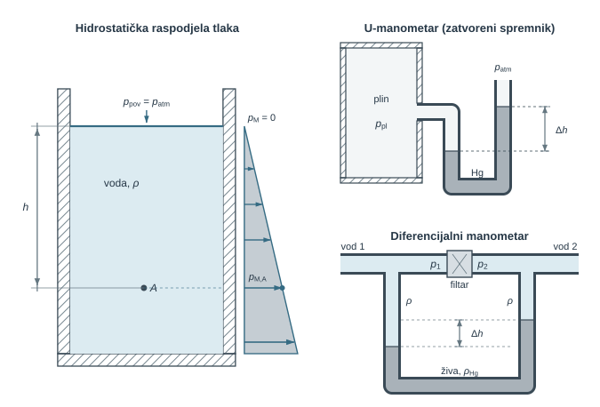
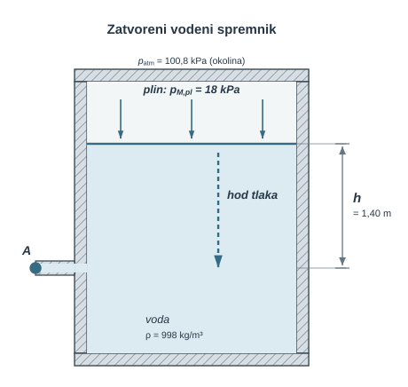
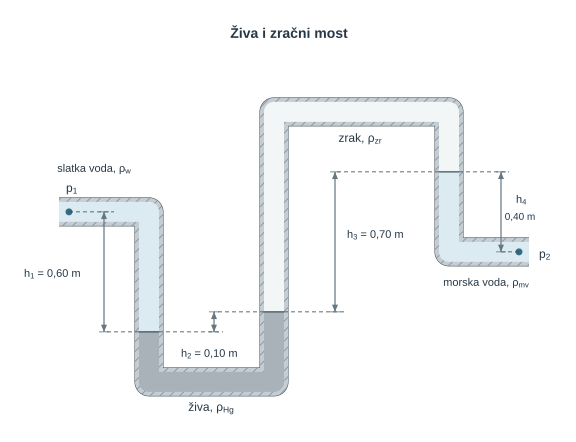
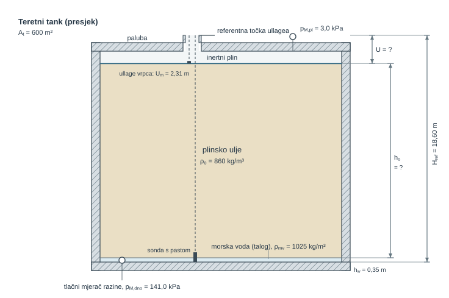
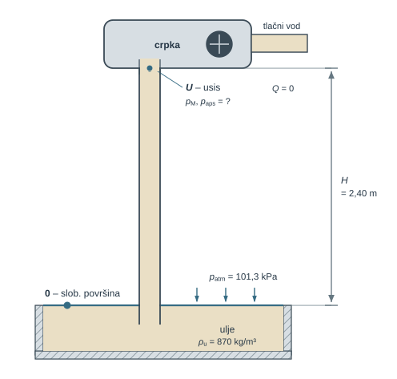
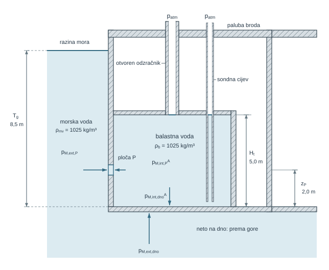
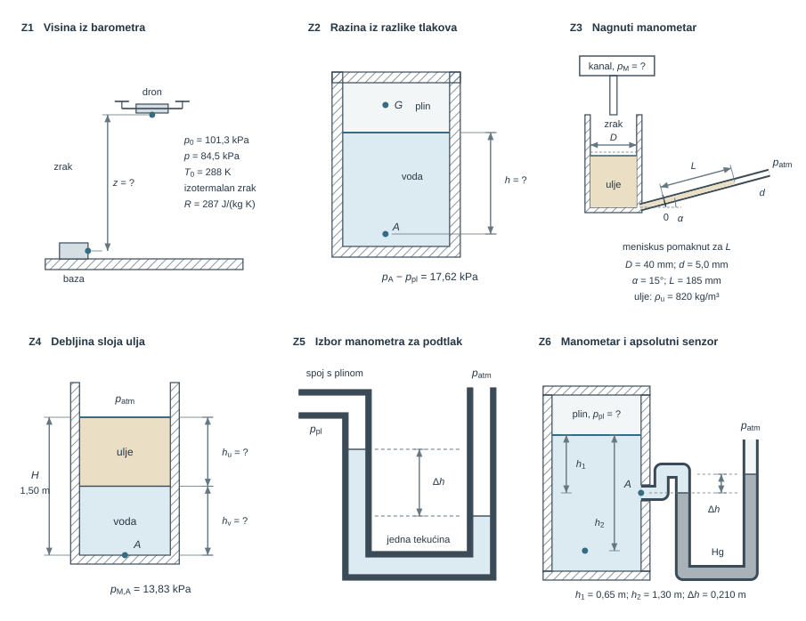
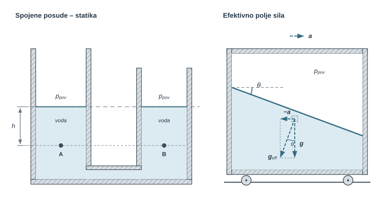

Svaki ronilac osjeća da tlak raste s dubinom. Fluid koji miruje ne preuzima smična naprezanja, pa svaki njegov sloj tlakom nosi težinu slojeva iznad sebe. Ta je ravnoteža polazište za proračun spremnika i tankova te za mjerenje tlaka stupcima tekućine. U []{.mf1-chapter-ref target="u01"} tlak je uveden kao skalarna veličina koja se prenosi kroz zatvoreni fluid; u ovom se poglavlju pokazuje kako se mijenja s visinom.

Za os $z$ usmjerenu prema gore ravnoteža tankog horizontalnog sloja daje diferencijalnu jednadžbu hidrostatike $dp/dz=-\rho g$. U homogenom fluidu, uz stalne $\rho$ i $g$, njezinim se integriranjem dobiva radni zapis $p=p_{pov}+\rho g h$. Pritom je $h$ dubina ispod slobodne površine, a $p_{pov}$ tlak na njoj: atmosferski u otvorenom, a tlak plina $p_{pl}$ u zatvorenom spremniku. Tlak dakle linearno raste s dubinom, za vodu oko $9{,}81\ \text{kPa}$ po metru, a na istoj razini istoga povezanog mirujućeg fluida tlakovi su jednaki.

Tlak se izražava prema dvjema referencama. Manometarski tlak $p_M=p-p_{atm}$ mjeri se prema lokalnom atmosferskom tlaku, a apsolutni prema vakuumu, $p_{aps}=p_{atm}+p_M$; negativan $p_M$ označuje podtlak. Manometarski se tlak može prikazati i piezometarskom visinom $h_p=p_M/(\rho g)$, do koje bi se fluid podignuo u otvorenoj cjevčici. Manometri primjenjuju istu ravnotežu kroz više spojenih stupaca: pri hodu kroz mirujući fluid silazak povećava tlak za $\rho g\Delta h$, a uspon ga smanjuje za isti iznos. Za U-manometar sa živom spojen s plinskim prostorom zatvorenog spremnika tako slijedi $p_{pl}=p_{atm}+\rho_{Hg}g\Delta h$, uz zanemariv stupac plina. Za diferencijalni manometar s jednakim visinama priključaka i istim fluidom gustoće $\rho$ u oba voda vrijedi $p_1-p_2=(\rho_{Hg}-\rho)g\Delta h$.

Takva mjerenja koriste se u spremnicima, piezometrima te za razliku tlakova preko filtra ili izmjenjivača topline. U brodogradnji se iz tlaka na dnu tanka određuje razina tereta ili balasta. Poglavlje redom izvodi jednadžbu hidrostatike, razmatra izotermalnu atmosferu, otvorene i zatvorene spremnike te manometarski lanac. Model pretpostavlja fluid koji miruje prema stijenkama i stalnu gustoću u svakom segmentu. Ubrzani i rotirajući spremnici obrađuju se u []{.mf1-chapter-ref target="u04"}, a sile tlaka na stijenke u []{.mf1-chapter-ref target="u05"}. Kad fluid struji, tlaku se pridružuju brzinski i gubitni doprinosi iz []{.mf1-chapter-ref target="u08"}.

Slika ispod prikazuje tri primjene. Lijevo je otvoreni spremnik s vodom gustoće $\rho$: na slobodnoj površini je $p_{pov}=p_{atm}$, odnosno $p_M=0$, a strelice uz stijenku prikazuju tlačno opterećenje koje linearno raste s dubinom do vrijednosti $p_{M,A}$ u točki A na dubini $h$. Gore desno U-manometar sa živom (Hg) spaja plinski prostor zatvorenog spremnika, tlaka $p_{pl}$, s atmosferom; $\Delta h$ je razlika razina žive u krakovima. Dolje desno diferencijalni manometar mjeri razliku tlakova $p_1$ u vodu 1 ispred filtra i $p_2$ u vodu 2 iza njega; kraci iznad žive gustoće $\rho_{Hg}$ ispunjeni su fluidom gustoće $\rho$, a $\Delta h$ je opet razlika razina žive.

{#fig-uvod-u03 fig-align="center" fig-alt="Pregled poglavlja: Hidrostatika, raspodjela tlaka i manometrija"}

## Hidrostatička raspodjela tlaka

Hidrostatika proučava raspodjelu tlaka u fluidu u mirovanju. Njezine se relacije primjenjuju pri analizi spremnika, piezometara, U-manometara i diferencijalnih manometara.

::: {.mf1-application}

Inženjerski kontekst

Piezometri, U-manometri i diferencijalni manometri primjenjuju hidrostatičku ravnotežu za mjerenje tlaka. Isti se princip koristi za određivanje opterećenja koja voda stvara na različitim dubinama u spremnicima, kesonima i balastnim tankovima.
:::

**Procijenjeno vrijeme rada uz priručnik:** 9 sati.

### Diferencijalna jednadžba hidrostatike

Fluid u mirovanju ne može nositi smična naprezanja povezana sa strujanjem, ali i dalje nosi raspodjelu normalnog naprezanja, odnosno tlaka. Svaki sloj fluida mora nositi težinu slojeva iznad sebe, pa tlak raste s dubinom.

Za mirujući fluid u jednolikom gravitacijskom polju osnovna lokalna relacija glasi

$$\frac{dp}{dz} = -\rho g$$ {#eq-hidrostatika-fizikalni-uvod-i-matematicki-izvod-01}

::: {.mf1-fizikalno-znacenje}

Fizikalno značenje

Lokalni gradijent tlaka uravnotežuje težinu fluida. Negativan predznak označuje smanjenje tlaka s porastom koordinate $z$. Relacija $dp/dz=-\rho(z)g$ vrijedi i pri promjenjivoj gustoći, ali se tada gustoća ne može izlučiti iz integrala. Linearni porast tlaka $\rho gh$ poseban je slučaj približno konstantnih $\rho$ i $g$.
:::

Uz konstantnu gustoću dobiva se radni zapis

$$p_2 - p_1 = \rho g (z_1 - z_2)$$ {#eq-hidrostatika-fizikalno-znacenje-01}

ili, za dubinu mjerenu od slobodne površine,

$$p = p_{pov} + \rho g h$$ {#eq-hidrostatika-fizikalno-znacenje-02}

::: {.mf1-fizikalno-znacenje}

Fizikalno značenje

Poznatom tlaku na slobodnoj površini ($p_{pov}$) dodaje se hidrostatički porast $\rho g h$ do promatrane dubine. Za vodu ($\rho \approx 1000\ \text{kg/m}^3$) svaki metar dubine donosi oko $9{,}81\ \text{kPa}$. Za živu ($\rho \approx 13600\ \text{kg/m}^3$) isti metar daje $\approx 133\ \text{kPa}$. Ista jednadžba vrijedi i unazad: iz poznatog tlaka u jednoj točki računa se tlak na svakoj drugoj visini u istom spojenom fluidu.
:::

## Matematički izvod

Promatra se tanki horizontalni sloj mirujućega fluida površine $A$ i debljine $dz$. Os $z$ usmjerena je prema gore. Na donju plohu djeluje tlačna sila $p(z)A$ prema gore, na gornju plohu tlačna sila $p(z + dz)A$ prema dolje, a dodatno prema dolje djeluje težina sloja $\rho g A dz$. Budući da je fluid u mirovanju, zbroj vertikalnih sila mora biti jednak nuli:

$$
p(z)A - p(z + dz)A - \rho g A dz = 0.
$$ {#eq-hidrostatika-matematicki-izvod-01}

Kako je za mali pomak $dz$ moguće pisati $p(z + dz) = p(z) + dp$, uvrštavanjem slijedi

$$
p(z)A - [p(z) + dp]A - \rho g A dz = 0,
$$ {#eq-hidrostatika-matematicki-izvod-02}

odnosno nakon skraćivanja s $A$

$$
-dp - \rho g dz = 0.
$$ {#eq-hidrostatika-matematicki-izvod-03}

Time se dobiva diferencijalni zakon hidrostatike

$$
\frac{dp}{dz} = -\rho g.
$$ {#eq-hidrostatika-matematicki-izvod-04}

Ako je gustoća homogena i može se smatrati konstantnom, jednadžba se integrira između dviju točaka 1 i 2:

$$
\int_{p_1}^{p_2} dp = -\rho g \int_{z_1}^{z_2} dz,
$$ {#eq-hidrostatika-matematicki-izvod-05}

pa slijedi

$$
p_2 - p_1 = -\rho g (z_2 - z_1) = \rho g (z_1 - z_2).
$$ {#eq-hidrostatika-matematicki-izvod-06}

Neka je $z_1$ visina slobodne površine, a $z_2$ visina promatrane točke, pri čemu je $z_2<z_1$. Dubina promatrane točke iznosi $h=z_1-z_2>0$, pa iz integriranoga oblika uz tlak na slobodnoj površini $p_1=p_{pov}$ slijedi praktični zapis
$$
p_2 = p_{pov} + \rho g h.
$$ {#eq-hidrostatika-razrada-koraka-01}

Dubina $h$ pozitivna je prema dolje, a $p_{pov}$ je tlak na slobodnoj površini: atmosferski u otvorenom, tlak plina $p_{pl}$ u zatvorenom spremniku.

::: {.mf1-izvod}

Matematički izvod — Vektorska generalizacija Eulerove jednadžbe hidrostatike

Promatra se infinitezimalni kvadar fluida dimenzija $dx \times dy \times dz$ s težištem u točki $(x, y, z)$. Na njega djeluju težina i sile tlaka na svih šest ploha. Sila tlaka na lijevu plohu (okomita na os $x$) iznosi $p(x - dx/2)\,dy\,dz$ u smjeru $+x$, a na desnu $p(x + dx/2)\,dy\,dz$ u smjeru $-x$. Neto sila po osi $x$ je

$$
dF_x = -\frac{\partial p}{\partial x}\,dx\,dy\,dz = -\frac{\partial p}{\partial x}\,dV.
$$ {#eq-hidrostatika-matematicki-izvod-vektorska-generalizacija-euler-01}

Analogno za osi $y$ i $z$. Ako je gravitacija usmjerena prema $-z$ ($\vec{g} = -g\hat{z}$), težina kvadra djeluje samo po osi $z$: $dF_{G,z} = -\rho g\,dV$.

Ravnoteža sila u mirujućem fluidu daje tri komponente

$$
\frac{\partial p}{\partial x} = 0, \qquad \frac{\partial p}{\partial y} = 0, \qquad \frac{\partial p}{\partial z} = -\rho g,
$$ {#eq-hidrostatika-matematicki-izvod-vektorska-generalizacija-euler-02}

što se može sažeti u vektorski oblik

$$
\nabla p = \rho \vec{g}.
$$ {#eq-hidrostatika-matematicki-izvod-vektorska-generalizacija-euler-03}

U jednolikom gravitacijskom polju bez drugih volumenskih sila komponente pokazuju da tlak ovisi **samo o visini** $z$, pa su plohe konstantnog tlaka horizontalne ravnine. U općenitom polju volumenskih sila izobare ne moraju biti horizontalne. U []{.mf1-chapter-ref target="u04"} gravitacija se za jednoliko ubrzani sustav zamjenjuje efektivnim poljem $\vec{g}_{eff}=\vec{g}-\vec{a}$.
:::

::: {.mf1-izvod}

Matematički izvod — Izotermalna atmosfera i karakteristična visina

Pretpostavka konstantne gustoće $\rho$ vrijedi za tekućine (voda, ulje, živa), ali ne za plinove u kojima se gustoća mijenja s tlakom i temperaturom. Za **izotermalnu atmosferu** uz pretpostavku $T = T_0$ = konst. može se izvesti raspodjela tlaka po visini.

Iz jednadžbe stanja idealnog plina vrijedi

$$
p = \rho R T_0 \quad\Longrightarrow\quad \rho = \frac{p}{R T_0},
$$ {#eq-hidrostatika-matematicki-izvod-izotermalna-atmosfera-i-karakt-01}

gdje je $R$ specifična plinska konstanta za zrak ($R \approx 287\ \text{J/(kg K)}$). Uvrštenjem u hidrostatičku jednadžbu $dp/dz = -\rho g$ slijedi

$$
\frac{dp}{dz} = -\frac{p\,g}{R T_0},
$$ {#eq-hidrostatika-matematicki-izvod-izotermalna-atmosfera-i-karakt-02}

što je obična diferencijalna jednadžba prvog reda u kojoj se varijable mogu razdvojiti:

$$
\frac{dp}{p} = -\frac{g}{R T_0}\,dz \quad\Longrightarrow\quad \ln p = -\frac{g}{R T_0}\,z + C.
$$ {#eq-hidrostatika-matematicki-izvod-izotermalna-atmosfera-i-karakt-03}

Uz početni uvjet $p(0) = p_{atm,0}$, atmosferski tlak na razini mora, dobiva se

$$
\boxed{p(z) = p_{atm,0}\,\exp\!\left(-\frac{z}{H}\right), \qquad H = \frac{R T_0}{g}}.
$$ {#eq-hidrostatika-matematicki-izvod-izotermalna-atmosfera-i-karakt-04}

Veličina $H$ naziva se **karakteristična visina atmosfere**. Za $T_0 = 288\ \text{K}$ (standardna prizemna temperatura) i $g = 9{,}81\ \text{m/s}^2$ slijedi

$$
H = \frac{287 \cdot 288}{9{,}81} \approx 8400\ \text{m} \approx 8{,}4\ \text{km}.
$$ {#eq-hidrostatika-matematicki-izvod-izotermalna-atmosfera-i-karakt-05}

U ovom izotermalnom modelu tlak pada za faktor $e\approx2{,}72$ nakon porasta visine za jednu karakterističnu visinu, ovdje oko $8{,}4\ \text{km}$. Na $z\approx8{,}8\ \text{km}$ model daje oko $35\ \text{kPa}$, odnosno približno trećinu tlaka na razini mora. Stvarna atmosfera nije izotermalna: za pouzdan atmosferski podatak koristi se odgovarajući standardni ili izmjereni profil temperature i tlaka, dok je ovaj izvod samo model reda veličine [@anderson2021].
:::

::: {.mf1-cfd title="Računalna dinamika fluida"}

**Spremnik prije uključivanja crpke.** U otvorenom spremniku rashladnog sustava najprije uspostavimo mirnu tekućinu zadane razine. Zadajemo gustoću, gravitaciju i atmosferski tlak na slobodnoj površini, a početni tlak raspodijelimo hidrostatički. Provjera je jasna: tlak mora rasti s dubinom, a brzina ostati blizu nule. Tako ispitujemo ravnotežu težine i tlačnih sila prije složenijeg računa.

Zatim možemo uključiti usis crpke i pratiti snižavanje razine ili vrtlog iznad usisa. Za uvlačenje zraka treba pratiti i granicu vode i zraka. Uspoređujemo položaj usisa i razinu punjenja te tražimo uvjete pri kojima zrak dospijeva u vod. Hidrostatika daje početno stanje i graničnu provjeru; pojava vrtloga zahtijeva opis gibanja kroz vrijeme.
:::

## Otvoreni i zatvoreni spremnici

Kod otvorenog spremnika tlak na slobodnoj površini jednak je atmosferskom tlaku. Zato je često praktično prijeći na manometarski tlak i atmosferu uzeti kao nultu razinu.

Kod zatvorenog spremnika tlak na slobodnoj površini različit je od atmosferskog, pa raspodjela nije samo $\rho g h$, nego

$$p = p_{pov} + \rho g h$$ {#eq-hidrostatika-otvoreni-i-zatvoreni-spremnici-01}

Najčešća pogreška jest uzeti atmosferu kao nulu i kad za to nema fizikalnog opravdanja. Iz manometarskog tlaka $p_M$ (ista oznaka u cijelom priručniku) odmah se čita piezometarska visina

$$
h_p = \frac{p_M}{\rho g},
$$ {#eq-hidrostatika-otvoreni-i-zatvoreni-spremnici-02}

::: {.mf1-fizikalno-znacenje}

Fizikalno značenje

Piezometarska visina geometrijski je prikaz tlaka: pokazuje do koje bi se visine voda (ili drugi fluid) podignula u otvorenoj cjevčici pričvršćenoj na to mjesto. Manometarski pretlak od $10\ \text{kPa}$ u vodi odgovara piezometarskoj visini oko $1{,}02\ \text{m}$. Piezometri zato daju izravno i pregledno mjerenje u spremnicima, geotehničkim istraživanjima i distribucijskim mrežama kada su ispunjeni njihovi mjerni uvjeti.
:::

Ni piezometar ni manometar nisu novi zakon, nego instrumentacijski zapis iste hidrostatičke ravnoteže kroz jedan ili više spojenih stupaca fluida. U praksi je dovoljno držati se jednoga slijeda: odabrati jednu referentnu točku ili jednu poznatu vrijednost tlaka, kretati se kroz stupce fluida jednim dosljednim smjerom, pri silasku dodavati $\rho g \Delta h$, pri penjanju oduzimati isti član te na istoj horizontalnoj razini istog mirujućeg fluida izjednačiti tlak.

::: {.mf1-cfd title="Računalna dinamika fluida"}

**Balastni tank prije početka balastiranja.** Inženjersko pitanje glasi: daje li CFD model bočnog balastnog tanka iz @ex-u03-balastni-tank-broda-tlak-iznutra-i-izvana ispravno neto opterećenje zajedničke oplate prije nego što uključimo punjenje? Fizikalni model jest mirujuća morska voda u tanku i uz oplatu, s gravitacijom te atmosferskim tlakom na vodnoj liniji i na odzračniku. Podatci su gustoća $1025\ \text{kg/m}^3$, gaz, visina tanka i početna razina; izlazi su tlak na dnu i na ploči `P` s obiju strana oplate te brzina u svakoj ćeliji.

Provjera ima tri koraka. Tlak mora rasti linearno s dubinom, brzina ostati blizu nule, a neto tlak na oplatu punog tanka biti jednak ručnom računu $\rho_{mv} g(T_g-H_t)$. Rješavači koji pohranjuju $p_{rgh}=p-\rho g h$, tlak bez hidrostatičkog doprinosa, moraju u mirnoj vodi dati konstantan $p_{rgh}$; s mjeračem se uspoređuje tek obnovljeni $p$. Odluka: punjenje tanka i gibanje broda simuliraju se tek kad je ovaj statički test prošao, jer se pogrešna referenca tlaka ili neuravnotežen početni uvjet poslije više ne mogu razlučiti od stvarnog odziva.
:::

::: {.mf1-interaktivno}

Interaktivni prikaz — Diferencijalni manometar

**Predvidi.** Kako udvostručenje razlike razina mijenja razliku tlakova? Što očekuješ kada su gustoće gotovo jednake?

**Provjeri i protumači.** Usporedi formulu s hodom po stupcima. Promijeni predznak očitanja i objasni osjetljivost instrumenta uz isti dogovor o smjeru razlike tlakova.

<a class="mf1-interaktivno-veza" href="https://martibasic.github.io/MF1_udzbenik/jlite/lab/index.html?path=u03_diferencijalni_manometar.ipynb">Pokreni u pregledniku</a>

:::

Nedosljedna promjena referentnoga smjera ili zanemarivanje promjene fluida uzrokuje pogrešan predznak u manometarskoj jednadžbi. Jednako je važno razlikovati apsolutni, manometarski i vakuumski tlak; veza je uvijek

$$p_{aps} = p_{atm} + p_M$$ {#eq-hidrostatika-interaktivni-prikaz-diferencijalni-manometar-01}

::: {.mf1-fizikalno-znacenje}

Fizikalno značenje

Apsolutni tlak mjeri se u odnosu na idealni vakuum ($p=0$), dok je manometarski tlak razlika prema lokalnom atmosferskom tlaku. Vakuumski tlak opisuje koliko je apsolutni tlak ispod atmosferskoga ($p_{vak}=p_{atm}-p_{aps}$). Negativan rezultat za apsolutni tlak u uobičajenom modelu kapljevine ili plina nije „veći podtlak”, nego znak da su pretpostavke računa napuštene; kavitacijski se kriterij pritom uspoređuje s tlakom zasićene pare, a ne s nulom. Zamjena referenci jedna je od najtipičnijih pogrešaka u manometriji.
:::

Za podtlak vrijedi i relacija

$$p_{vak} = p_{atm} - p_{aps} = -p_M \qquad (p_M<0)$$ {#eq-hidrostatika-fizikalno-znacenje-03}

::: {.mf1-granica-modela}

Granica modela — Kada hidrostatički lanac prestaje vrijediti

Sve relacije ovog poglavlja pretpostavljaju fluid koji miruje u odnosu na stijenke, stalnu gustoću u svakom segmentu i poznat tlak u jednoj referentnoj točki. Model prestaje vrijediti čim fluid struji: tada se javljaju brzinski i gubitni doprinosi iz []{.mf1-chapter-ref target="u08"} i []{.mf1-chapter-ref target="u13"}. Pri promjenjivoj gustoći, kao u atmosferi, gustoća ostaje pod integralom; stupac plina zanemaruje se samo kad je $\rho_{pl} g \Delta h$ zanemariv prema traženoj točnosti. Ubrzani ili rotirajući spremnik zahtijeva efektivno polje sila iz []{.mf1-chapter-ref target="u04"}, a kapilarni učinci u uskim cjevčicama korekciju iz []{.mf1-chapter-ref target="u02"}. Manometarski i apsolutni tlak moraju se voditi s istom referencom do kraja računa.
:::

::: {.mf1-cfd title="Računalna dinamika fluida"}

**Zastani i promisli.** CFD na usisu pokazuje negativan manometarski tlak, a senzor pozitivan apsolutni tlak. Moraju li se rezultati razlikovati?

**Što znači nizak tlak na usisu?** Negativan manometarski tlak u CFD-u i pozitivan apsolutni tlak senzora mogu opisivati isto stanje. Prije zaključka o neslaganju usporedi njihove reference. Neki rješavači pohranjuju tlak podijeljen gustoćom, a neki izdvajaju hidrostatički doprinos, kao OpenFOAMov $p_{rgh}$ [@openfoam-hydrostatic]. Prije usporedbe s mjeračem treba obnoviti tlak u paskalima i njegovu referencu.

Za opterećenje stijenke važna je razlika tlakova s njezinih strana. Za mogućnost nastanka pare važan je apsolutni tlak pri radnoj temperaturi. Ručni @ex-u03-tlak-na-usisu-pumpe-za-cirkulaciju-ulja razmatra mirujući stupac: prije procjene tlaka pare obnavlja apsolutni tlak. Negativan manometarski tlak sam ne dokazuje kavitaciju. Taj će se usisni problem nastaviti uz crpku u []{.mf1-chapter-ref target="u13"}.
:::

## Riješeni primjeri

::: {#ex-u03-tlak-u-prikljucku-zatvorenog-vodenog-spremnika-t1 .mf1-we}

Tlak u priključku zatvorenog vodenog spremnika&nbsp;T1

**Tekst zadatka**

Zatvoreni spremnik s mirujućom vodom gustoće $\rho_v = 998\ \text{kg/m}^3$ ima plinski pretlak $p_{M,pl} = 18\ \text{kPa}$. Priključak `A` nalazi se na dubini $h = 1{,}40\ \text{m}$ ispod slobodne površine. Lokalni atmosferski tlak iznosi $p_{atm} = 100{,}8\ \text{kPa}$.

**Traži se**

1. Odredi apsolutni tlak u plinskom prostoru spremnika.
2. Odredi apsolutni tlak u točki `A`.
3. Odredi manometarski tlak u točki `A`.

{#fig-u03-zatvoreni-spremnik-tlak fig-align="center" fig-alt="Zatvoreni vodeni spremnik: plinski pretlak i dubina priključka A."}

**Veza s proračunom.** Referentna točka je plinski prostor; do `A` se silazi kroz vodu, a plinski pretlak i hidrostatički doprinos prate se odvojeno.

**Rješenje**

Apsolutni tlak u plinskom prostoru jednak je

$$
p_{pl} = p_{atm} + p_{M,pl} = 100{,}8 + 18{,}0 = 118{,}8\ \text{kPa} = 118800\ \text{Pa}.
$$ {#eq-hidrostatika-rijeseni-primjer-tlak-u-prikljucku-zatvorenog-vo-01}

Tlak u točki `A` dobiva se silaskom kroz vodu za dubinu $h$:

$$
p_A = p_{pl} + \rho_v g h = 118800 + 998 \cdot 9{,}81 \cdot 1{,}40 = 132506{,}532\ \text{Pa} \approx 132{,}5\ \text{kPa}.
$$ {#eq-hidrostatika-rijeseni-primjer-tlak-u-prikljucku-zatvorenog-vo-02}

Manometarski tlak u točki `A` zato iznosi

$$
p_{M,A} = p_A - p_{atm} = 132506{,}532 - 100800 = 31706{,}532\ \text{Pa} \approx 31{,}7\ \text{kPa}.
$$ {#eq-hidrostatika-rijeseni-primjer-tlak-u-prikljucku-zatvorenog-vo-03}

**Provjera i tumačenje**

Razlika $p_{M,A}-p_{M,pl}=13{,}7\ \text{kPa}$ jednaka je hidrostatičkom doprinosu $\rho_v gh$; referenca tlaka ne mijenja tu razliku.
:::

::: {#ex-u03-diferencijalni-manometar-izme-u-slatke-i-morske .mf1-we}

Diferencijalni manometar između slatke i morske vode&nbsp;T3

**Tekst zadatka**

Diferencijalni manometar povezuje vod slatke vode gustoće $\rho_v = 1000\ \text{kg/m}^3$ i vod morske vode gustoće $\rho_{mv} = 1035\ \text{kg/m}^3$. Sadrži živu gustoće $\rho_{Hg} = 13600\ \text{kg/m}^3$ i zračni most gustoće $\rho_{zr} = 1{,}2\ \text{kg/m}^3$.

Put od $p_1$ do $p_2$ prema skici čine silazak kroz slatku vodu $h_1 = 0{,}60\ \text{m}$, uspon kroz živu $h_2 = 0{,}10\ \text{m}$, neto uspon kroz zrak $h_3 = 0{,}70\ \text{m}$ i silazak kroz morsku vodu $h_4 = 0{,}40\ \text{m}$. Fluidi u manometru miruju.

**Traži se**

1. Odredi razliku tlakova $p_1 - p_2$.
2. Odredi kolika je pogreška ako se stupac zraka zanemari.

{#fig-u03-diferencijalni-manometar fig-alt="Diferencijalni manometar"}

**Veza s proračunom.** Hod od $p_1$ do $p_2$ prolazi niz vodu, uz živu, neto uz zrak i niz morsku vodu; vertikalne kote imaju zajedničko mjerilo.

**Rješenje**

Krenimo od tlaka $p_1$ u lijevom vodu i pratimo sustav do tlaka $p_2$ u desnom vodu.

Ako se stupac zraka zanemari, radni zapis glasi:

1. Silazak kroz slatku vodu: $+\rho_v g h_1$.
2. Uspon kroz živu: $-\rho_{Hg} g h_2$.
3. Silazak kroz morsku vodu: $+\rho_{mv} g h_4$.

Zato vrijedi

$$
\begin{aligned}
&p_1 + \rho_v g h_1 - \rho_{Hg} g h_2 + \rho_{mv} g h_4 = p_2 \\
\Longrightarrow\quad &p_1 - p_2 = g\left(\rho_{Hg} h_2 - \rho_{mv} h_4 - \rho_v h_1\right).
\end{aligned}
$$ {#eq-hidrostatika-rijeseni-primjer-diferencijalni-manometar-izme-u-01}

Uvrštavanjem podataka:

$$
\begin{aligned}
p_1 - p_2 &= 9{,}81\left(13600 \cdot 0{,}10 - 1035 \cdot 0{,}40 - 1000 \cdot 0{,}60\right) \\
&= 3394{,}26\ \text{Pa} \approx 3{,}39\ \text{kPa}.
\end{aligned}
$$ {#eq-hidrostatika-rijeseni-primjer-diferencijalni-manometar-izme-u-02}

Sada uključimo i mali stupac zraka. Tada se pri prolazu prema gore kroz zrak tlak još dodatno smanjuje za $\rho_{zr} g h_3$, pa vrijedi

$$
\begin{aligned}
p_1 + \rho_v g h_1 - \rho_{Hg} g h_2 - \rho_{zr} g h_3 + \rho_{mv} g h_4 &= p_2, \\
p_1 - p_2 &= g\left(\rho_{Hg} h_2 + \rho_{zr} h_3 - \rho_{mv} h_4 - \rho_v h_1\right).
\end{aligned}
$$ {#eq-hidrostatika-rijeseni-primjer-diferencijalni-manometar-izme-u-03}

Numerički:

$$
\begin{aligned}
p_1 - p_2 &= 9{,}81\left(13600 \cdot 0{,}10 + 1{,}2 \cdot 0{,}70 - 1035 \cdot 0{,}40 - 1000 \cdot 0{,}60\right) \\
&\approx 3402{,}50\ \text{Pa} \approx 3{,}40\ \text{kPa}.
\end{aligned}
$$ {#eq-hidrostatika-rijeseni-primjer-diferencijalni-manometar-izme-u-04}

Pogreška zanemarivanja zraka zato iznosi $\Delta p = \rho_{zr}gh_3 \approx 8{,}24\ \text{Pa}$, a relativna pogreška je

$$
\delta \approx \frac{8{,}24}{3402{,}50} \cdot 100\% \approx 0{,}24\%.
$$ {#eq-hidrostatika-rijeseni-primjer-diferencijalni-manometar-izme-u-05}

**Provjera i tumačenje**

Član žive ($13{,}3\ \text{kPa}$) dominira, a zrak mijenja rezultat za $0{,}24\ \%$, pa je njegovo zanemarivanje opravdano. Pozitivan $p_1-p_2$ znači da je tlak veći u vodu slatke vode.
:::

Isti hod kroz slojeve u brodskoj praksi određuje razinu tereta iz tlaka na dnu tanka, pretlaka plina i sondiranja vodenog taloga.

::: {#ex-sondiranje-teretnog-tanka-s-tlacnim-mjeracem-razine .mf1-ch}

Sondiranje teretnog tanka s tlačnim mjeračem razine&nbsp;T3

**Tekst zadatka**

Teretni tank tankera za naftne proizvode ima na dnu tlačni mjerač razine, a prostor iznad tereta ispunjen je inertnim plinom. Mjerač na dnu pokazuje manometarski tlak $p_{M,dno} = 141{,}0\ \text{kPa}$, a manometar inertnog plina pretlak $p_{M,pl} = 3{,}0\ \text{kPa}$. Teret je plinsko ulje gustoće $\rho_u = 860\ \text{kg/m}^3$. Ručno sondiranje s pastom za otkrivanje vode pokazuje na dnu sloj morske vode gustoće $\rho_{mv} = 1025\ \text{kg/m}^3$ debljine $h_v = 0{,}35\ \text{m}$. Referentna točka za mjerenje ullagea, rub ullage otvora na palubi, nalazi se $H_{ref} = 18{,}60\ \text{m}$ iznad dna tanka; ullage vrpca pokazuje $U_m = 2{,}31\ \text{m}$ od referentne točke do površine ulja. Tlocrtna površina tanka iznosi $A_t = 600\ \text{m}^2$, atmosferski tlak $p_{atm} = 101{,}0\ \text{kPa}$, a gustoća inertnog plina $\rho_{pl} = 1{,}2\ \text{kg/m}^3$. Fluidi miruju, gustoće su stalne, a granica ulja i vode je ravna.

**Traži se**

1. Iz očitanja mjerača na dnu odredi visinu stupca ulja $h_u$ i ullage $U$ te ih usporedi s očitanjem vrpce.
2. Odredi apsolutni tlak na dnu tanka.
3. Odredi pogrešku visine i volumena ulja ako se vodeni talog ne sondira, nego se cijeli stupac tekućine računa kao ulje, te pogrešku ako se zaboravi pretlak inertnog plina.
4. Procijeni smije li se stupac inertnog plina zanemariti i obrazloži koji model treba ugraditi u sustav daljinskog mjerenja razine.

{#fig-sondiranje-teretnog-tanka fig-align="center" fig-alt="Presjek teretnog tanka: inertni plin iznad ulja, tanak sloj vode na dnu, ullage otvor s referentnom točkom na palubi i tlačni mjerač razine na dnu, s kotama H_ref, U, h_u i h_v."}

**Veza s proračunom.** Ullage se mjeri od referentne točke na palubi prema dolje, a sondiranje od dna prema gore. Mjerač na dnu i ullage vrpca neovisno mjere istu razinu; debljinu vode tlak sam ne može razlučiti. Visine imaju zajedničko mjerilo; širina tanka je shematska.

**Rješenje**

### 1. Visina ulja i ullage iz tlaka na dnu {.unnumbered .unlisted .mf1-step}

Hod od ullage otvora prema dnu najprije prolazi kroz inertni plin zanemarive gustoće, zatim kroz ulje i na kraju kroz vodeni talog:

$$
p_{M,dno} = p_{M,pl} + \rho_u g h_u + \rho_{mv} g h_v.
$$ {#eq-sondiranje-lanac-tlaka-na-dnu}

Doprinos vodenog taloga iznosi $\rho_{mv} g h_v = 1025 \cdot 9{,}81 \cdot 0{,}35 = 3519{,}3\ \text{Pa}$, pa je visina stupca ulja

$$
\begin{aligned}
h_u &= \frac{p_{M,dno} - p_{M,pl} - \rho_{mv} g h_v}{\rho_u g} = \frac{141000 - 3000 - 3519{,}3}{860 \cdot 9{,}81} \\
&= \frac{134480{,}7}{8436{,}6} = 15{,}940\ \text{m}.
\end{aligned}
$$ {#eq-sondiranje-visina-stupca-ulja}

Ullage slijedi iz geometrije tanka:

$$
U = H_{ref} - h_v - h_u = 18{,}60 - 0{,}35 - 15{,}940 = 2{,}310\ \text{m}.
$$ {#eq-sondiranje-ullage-iz-geometrije}

Vrpca pokazuje $U_m = 2{,}31\ \text{m}$; dva neovisna mjerenja razine slažu se unutar $1\ \text{mm}$, što je bolje od razlučivosti vrpce.

### 2. Apsolutni tlak na dnu {.unnumbered .unlisted .mf1-step}

$$
p_{aps,dno} = p_{atm} + p_{M,dno} = 101{,}0 + 141{,}0 = 242{,}0\ \text{kPa}.
$$ {#eq-sondiranje-apsolutni-tlak-dna}

Pretvornik na dnu mjeri prema atmosferi; apsolutni je tlak potreban tek ako se ugradi apsolutni pretvornik ili se tlak uspoređuje s tlakom pare tereta.

### 3. Pogreške pojednostavljenih modela {.unnumbered .unlisted .mf1-step}

Ako se cijeli stupac tekućine računa kao ulje, iz istog očitanja slijedi

$$
h' = \frac{p_{M,dno} - p_{M,pl}}{\rho_u g} = \frac{138000}{8436{,}6} = 16{,}357\ \text{m}.
$$ {#eq-sondiranje-jednofluidni-model}

Stvarni stupac ulja iznosi $15{,}940\ \text{m}$, pa jednofluidni model precjenjuje ulje za $16{,}357-15{,}940=0{,}417\ \text{m}$, odnosno za

$$
\Delta V = 0{,}417 \cdot 600 = 250\ \text{m}^3
$$ {#eq-sondiranje-pogreska-volumena-ulja}

u količini tereta. Ako se zaboravi pretlak inertnog plina, a voda se sondira, slijedi $h''=(141000-3519{,}3)/8436{,}6=16{,}296\ \text{m}$, odnosno precjenjenje za $0{,}356\ \text{m}$ ili oko $213\ \text{m}^3$.

### 4. Stupac inertnog plina i izbor modela {.unnumbered .unlisted .mf1-step}

Hidrostatički doprinos plina u ullage prostoru iznosi

$$
\rho_{pl} g U = 1{,}2 \cdot 9{,}81 \cdot 2{,}31 = 27{,}2\ \text{Pa},
$$ {#eq-sondiranje-stupac-inertnog-plina}

što je $0{,}02\ \%$ očitanja na dnu i manje od $1\ \%$ pretlaka plina; zanemaruje se. Sustav mjerenja razine mora, međutim, sadržavati pretlak inertnog plina i sondiranu debljinu vode: dvofluidni model s plinskim pretlakom.

**Provjera i tumačenje**

1. Tlak na dnu i vrpca daju isti ullage, pa se dva neovisna mjerenja međusobno potvrđuju. Oba pojednostavljenja precjenjuju ulje, jer se pretlak plina i gušća voda pripisuju stupcu ulja.
2. Stupac plina od nekoliko paskala zanemariv je, ali pretlak plina od $3\ \text{kPa}$ nije: o zanemarivanju odlučuje red veličine člana, ne vrsta fluida. Pri ljuljanju, trimu ili emulgiranoj vodi mjerenje treba ponoviti u mirnim uvjetima ili korigirati.
:::

::: {#ex-u03-tlak-na-usisu-pumpe-za-cirkulaciju-ulja .mf1-we}

Tlak na usisu crpke za cirkulaciju ulja &nbsp;T2

**Tekst zadatka**

Usis crpke nalazi se $H = 2{,}40\ \text{m}$ iznad površine otvorenog spremnika ulja gustoće $\rho_u = 870\ \text{kg/m}^3$. Atmosferski tlak iznosi $p_{atm} = 101{,}3\ \text{kPa}$, a zadani tlak pare ulja $p_v \approx 200\ \text{Pa}$. Promatraj statičku granicu bez protoka, brzinske visine i gubitaka u usisnom vodu.

**Traži se**

1. Odredi manometarski tlak na usisu crpke.
2. Odredi apsolutni tlak na usisu crpke.
3. Odredi statičku gornju granicu visine stupca pri kojoj bi apsolutni tlak pao na zadani tlak pare $p_v \approx 200\ \text{Pa}$.

{#fig-u03-pumpa-usis fig-align="center" fig-alt="Statički stupac ulja između slobodne površine i usisnog priključka crpke."}

**Veza s proračunom.** Prikazan je idealni statički stupac ulja, $Q=0$; tlak opada s usponom do crpke, a s tlakom pare uspoređuje se apsolutni tlak.

**Rješenje**

Manometarski tlak na usisu crpke (uspon od slobodne površine za $H$):

$$
p_M = -\rho_u g H = -870 \cdot 9{,}81 \cdot 2{,}40 = -20483{,}28\ \text{Pa}
$$ {#eq-hidrostatika-rijeseni-primjer-tlak-na-usisu-pumpe-za-01}

$$
p_M \approx -20{,}5\ \text{kPa}
$$ {#eq-hidrostatika-rijeseni-primjer-tlak-na-usisu-pumpe-za-02}

Apsolutni tlak na usisu:

$$
p_{aps} = p_{atm} + p_M = 101300 - 20483{,}28 = 80816{,}72\ \text{Pa} \approx 80{,}8\ \text{kPa}
$$ {#eq-hidrostatika-rijeseni-primjer-tlak-na-usisu-pumpe-za-03}

Statička granična visina stupca pri $p_{aps}=p_v$:

$$
H_{max} = \frac{p_{atm} - p_v}{\rho_u g} = \frac{101300 - 200}{870 \cdot 9{,}81} = \frac{101100}{8534{,}7} \approx 11{,}8\ \text{m}
$$ {#eq-hidrostatika-rijeseni-primjer-tlak-na-usisu-pumpe-za-04}

**Provjera i tumačenje**

$11{,}8\ \text{m}$ samo je gornja granica stupca pri nultom protoku. Za crpku u radu treba bilancu energije s brzinom i gubicima te usporedbu $NPSH_a$ s proizvođačevim $NPSH_r$, pa se iz ovoga računa ne može propisati opća „sigurna usisna visina”.

:::

::: {#ex-u03-balastni-tank-broda-tlak-iznutra-i-izvana .mf1-we}

Bočni balastni tank broda: tlak iznutra i izvana&nbsp;T2

**Tekst zadatka**

Bočni balastni tank tankera s dvostrukim trupom visok je $H_t = 5{,}0\ \text{m}$; njegova vanjska stijenka jest oplata boka, a dno oplata dna na razini kobilice. Gaz broda iznosi $T_g = 8{,}5\ \text{m}$. Promatra se ploča oplate boka `P` na visini $z_P = 2{,}0\ \text{m}$ iznad dna tanka. Izvana je more gustoće $\rho_{mv} = 1025\ \text{kg/m}^3$, a tank se balastira istom morskom vodom, $\rho_b = 1025\ \text{kg/m}^3$. Tank je odzračnom cijevi otvoren prema atmosferi; razina balasta provjerava se sondiranjem kroz sondnu cijev. Razmotri stanje A, tank pun do vrha, i stanje B, tank prazan; za usporedbu uzmi i stanje C u kojem sonda pokazuje razinu balasta $h_s = 3{,}0\ \text{m}$ iznad dna. Brod i fluidi miruju, stijenke su krute i nepropusne, gustoće stalne, a $g = 9{,}81\ \text{m/s}^2$.

**Traži se**

1. Odredi manometarski tlak mora na razini dna tanka i na razini ploče `P`.
2. Odredi manometarski tlak balasta na dnu tanka i na ploči `P` u stanju A.
3. Odredi neto manometarski tlak na dno u stanjima A i B te na ploču `P` u stanju A; navedi smjer u kojem je oplata tlačena.
4. Odredi ullage i neto tlak na dno u stanju C.

{#fig-u03-balastni-tank fig-align="center" fig-alt="Bočni balastni tank uz oplatu broda: more izvana, balastna voda iznutra, ploča oplate P, sondna cijev i otvoreni odzračnik; kote gaza, visine tanka i položaja ploče."}

**Veza s proračunom.** Neto opterećenje zajedničke oplate jest razlika vanjskog i unutarnjeg tlaka na istoj razini; vanjski se mjeri od vodne linije, unutarnji od razine balasta. Debljine stijenki su shematske.

**Rješenje**

Manometarski tlak mora na dnu tanka (dubina od vodne linije $T_g$) i na ploči `P` (dubina $T_g-z_P$):

$$
\begin{aligned}
p_{M,ext,dno} &= \rho_{mv} g T_g = 1025 \cdot 9{,}81 \cdot 8{,}5 = 85{,}47\ \text{kPa}, \\
p_{M,ext,P} &= \rho_{mv} g (T_g - z_P) = 1025 \cdot 9{,}81 \cdot 6{,}5 = 65{,}36\ \text{kPa}.
\end{aligned}
$$ {#eq-hidrostatika-rijeseni-primjer-balastni-tank-broda-tlak-iznutr-01}

### 1. Stanje A – tank pun balasta {.mf1-step .unnumbered .unlisted}

Unutarnji manometarski tlak na dnu (dubina $H_t$) i na ploči `P` (dubina $H_t-z_P$):

$$
\begin{aligned}
p_{M,int,dno}^{A} &= \rho_b g H_t = 1025 \cdot 9{,}81 \cdot 5{,}0 = 50{,}28\ \text{kPa}, \\
p_{M,int,P}^{A} &= \rho_b g (H_t - z_P) = 1025 \cdot 9{,}81 \cdot 3{,}0 = 30{,}17\ \text{kPa}.
\end{aligned}
$$ {#eq-hidrostatika-rijeseni-primjer-balastni-tank-broda-tlak-iznutr-02}

Neto tlak na dno (vani veći, dno je tlačeno prema gore, u tank) i na ploču `P` (vani veći, ploča je tlačena prema unutra):

$$
\Delta p_{dno}^{A} = 85{,}47 - 50{,}28 = 35{,}19\ \text{kPa}, \qquad \Delta p_{P}^{A} = 65{,}36 - 30{,}17 = 35{,}19\ \text{kPa}.
$$ {#eq-hidrostatika-rijeseni-primjer-balastni-tank-broda-tlak-iznutr-03}

### 2. Stanje B – tank prazan {.mf1-step .unnumbered .unlisted}

Unutarnji tlak jednak je atmosferskom, pa je manometarski nula i cijeli vanjski tlak opterećuje oplatu:

$$
\Delta p_{dno}^{B} = p_{M,ext,dno} - 0 = 85{,}47\ \text{kPa}, \qquad \Delta p_{P}^{B} = 65{,}36\ \text{kPa}.
$$ {#eq-hidrostatika-rijeseni-primjer-balastni-tank-broda-tlak-iznutr-04}

### 3. Stanje C – razina iz sondiranja {.mf1-step .unnumbered .unlisted}

Sonda pokazuje $h_s = 3{,}0\ \text{m}$, pa je ullage, udaljenost od vrha tanka do površine, $H_t - h_s = 2{,}0\ \text{m}$. Neto tlak na dno iznosi

$$
\Delta p_{dno}^{C} = p_{M,ext,dno} - \rho_b g h_s = 85{,}47 - 30{,}17 = 55{,}30\ \text{kPa}.
$$ {#eq-hidrostatika-rijeseni-primjer-balastni-tank-broda-tlak-iznutr-05}

**Provjera i tumačenje**

1. Uz jednake gustoće neto tlak na cijeloj omočenoj oplati punog tanka iznosi $\rho_{mv} g (T_g - H_t) = 1025 \cdot 9{,}81 \cdot 3{,}5 = 35{,}19\ \text{kPa}$, pa dno i ploča `P` nose isti neto tlak. Razlika stanja B i A, $50{,}28\ \text{kPa}$, jednaka je $\rho_b g H_t$, a stanje C leži između njih.
2. Prazan tank ovdje najjače opterećuje oplatu, ali mjerodavno projektno stanje određuju propisane kombinacije opterećenja i konstrukcijski model. Tlak na dnu pretvara se u razinu samo uz poznatu gustoću, kao u @ex-sondiranje-teretnog-tanka-s-tlacnim-mjeracem-razine.
:::

::: {#ex-u03-iot-tlacni-senzor-za-otkrivanje-propustanja-u .mf1-we}

Tlak u mreži iz kote vodotornja i IoT senzor za otkrivanje propuštanja&nbsp;T2

**Tekst zadatka**

Distribucijska mreža vodoopskrbe napaja se iz vodotornja. U noćnom minimumu potrošnje voda u mreži praktički miruje. IoT tlačni senzor u nižem čvoru `A` pokazuje manometarski tlak $p_{M,A} = 5{,}20\ \text{bar} = 520\ \text{kPa}$. Priključak `B` na podnožju vodotornja viši je za $\Delta z = z_B - z_A = 38\ \text{m}$, a spremnik vodotornja otvoren je prema atmosferi. Čvorove povezuje ista vodena masa gustoće $\rho_v = 998\ \text{kg/m}^3$, bez otvaranja prema atmosferi između njih. Atmosferski tlak je $p_{atm} = 101{,}3\ \text{kPa}$. Zanemari gubitke i promjenu gustoće. Za usporedbu razmotri i očitanje $4{,}70\ \text{bar}$ u `A`.

**Traži se**

1. Odredi očekivani manometarski tlak na priključku `B`.
2. Odredi apsolutni tlak na priključku `B`.
3. Odredi visinu slobodne površine vode u vodotornju iznad priključka `B`.
4. Procijeni što za stanje mreže znači ako bi senzor na `A` umjesto $5{,}20\ \text{bar}$ pokazao $4{,}70\ \text{bar}$.

**Rješenje**

Manometarski tlak na višem priključku slijedi iz hidrostatičke bilance po putu od `A` prema `B`:

$$
p_{M,B} = p_{M,A} - \rho_v g \Delta z = 520 \cdot 10^3 - 998 \cdot 9{,}81 \cdot 38.
$$ {#eq-hidrostatika-rijeseni-primjer-iot-tlacni-senzor-za-otkrivanje-01}

Drugi član iznosi $998 \cdot 9{,}81 \cdot 38 = 372{,}0 \cdot 10^3\ \text{Pa}$, pa je

$$
p_{M,B} = 520{,}0 - 372{,}0 = 148{,}0\ \text{kPa} \approx 1{,}48\ \text{bar}.
$$ {#eq-hidrostatika-rijeseni-primjer-iot-tlacni-senzor-za-otkrivanje-02}

Apsolutni tlak na `B` iznosi

$$
p_{aps,B} = p_{M,B} + p_{atm} = 148{,}0 + 101{,}3 = 249{,}3\ \text{kPa}.
$$ {#eq-hidrostatika-rijeseni-primjer-iot-tlacni-senzor-za-otkrivanje-03}

Spremnik vodotornja otvoren je prema atmosferi, pa manometarski tlak na podnožju nosi samo stupac vode iznad `B`:

$$
h_T = \frac{p_{M,B}}{\rho_v g} = \frac{147{,}97 \cdot 10^3}{998 \cdot 9{,}81} = 15{,}11\ \text{m}.
$$ {#eq-vodotoranj-razina-iz-tlaka-podnozja}

Tlak u mreži zato određuje kota slobodne površine vodotornja, $z_B + h_T = z_A + 53{,}1\ \text{m}$, a ne duljina ni promjer vodova dok voda miruje.

Ako bi senzor na `A` izvijestio o tlaku od $4{,}70\ \text{bar}$ umjesto očekivanih $5{,}20\ \text{bar}$, pad od $\Delta p = 50\ \text{kPa}$ predstavlja gubitak piezometarske visine od

$$
\Delta h = \frac{\Delta p}{\rho_v g} = \frac{50 \cdot 10^3}{998 \cdot 9{,}81} = 5{,}11\ \text{m}.
$$ {#eq-hidrostatika-rijeseni-primjer-iot-tlacni-senzor-za-otkrivanje-04}

To odgovara padu razine u vodotornju s $15{,}11$ na $10{,}0\ \text{m}$ iznad `B`, što se izravno provjerava mjeračem razine u vodotornju. Ako je razina u tornju nepromijenjena, voda u mreži ne miruje: pad tlaka tada upućuje na potrošnju, propuštanje ili zatvoren ventil, a iz jednoga očitanja te uzroke nije moguće razlikovati.

**Provjera i tumačenje**

Bilanca se zatvara: $38 + 15{,}11 = 53{,}1\ \text{m}$ jest piezometarska visina u `A`, uz oko $9{,}8\ \text{kPa}$ po metru vodenog stupca. Alarmni prag mora proizaći iz mjerne nesigurnosti senzora, prirodne promjene razine u tornju i procjene posljedica, ne iz univerzalne vrijednosti $50\ \text{kPa}$.
:::

::: {.mf1-samoprovjera}

Provjeri sebe

1. Zašto je u spojenom mirujućem fluidu tlak na istoj dubini jednak?
2. Dva pretvornika na istoj razini u balastnom tanku pokazuju $50{,}3\ \text{kPa}$ manometarski i $151{,}6\ \text{kPa}$ apsolutno. Jesu li očitanja u suprotnosti?
3. Kada se relacija $p=p_{pov}+\rho gh$ ne smije primijeniti s jednom konstantnom gustoćom?
4. Zašto iz hidrostatičkoga računa ne slijedi automatski tlak u strujajućem sustavu?

::: {.callout-note collapse="true"}
### Odgovori

1. Kad bi tlakovi na istoj dubini bili različiti, mirujući fluid ne bi bio u ravnoteži.

2. Nisu: razlika $101{,}3\ \text{kPa}$ jest lokalni atmosferski tlak. Prije usporedbe očitanja uvijek ih svedi na istu referencu.

3. Pri promjenjivoj gustoći ili više fluida gustoća ostaje unutar odgovarajućeg integrala ili segmentnog zapisa.

4. Strujanje uvodi brzinske, gubitne i eventualno nestacionarne doprinose koji nisu sadržani u čistoj hidrostatici.
:::
:::

::: {.mf1-zavrsni-okvir}

Za ponijeti iz poglavlja

- Hidrostatički gradijent tlaka uravnotežuje težinu fluida u mirovanju.
- U homogenom mirujućem fluidu tlak raste s dubinom za približno $\rho g$ po jedinici visine.
- Manometarski i apsolutni tlak moraju se kroz cijeli račun voditi s istom referencom.
- Složeni manometarski sustavi rješavaju se praćenjem tlaka po segmentima i fluidima.
- Hidrostatički rezultat nije zamjena za energijsku bilancu u strujajućem sustavu.
:::

## Zadaci za vježbu

::::: {.mf1-vjezbe-list}

U svim zadatcima uzmi $g = 9{,}81\ \text{m/s}^2$. Fluidi miruju, gustoće su stalne, a utjecaji kapilarnosti i težine plina zanemaruju se. Granice tekućih slojeva u spremnicima su ravne. Podatci i mjerna ograničenja nastavne su pretpostavke; očitanja u Z2, Z4 i Z6 sintetička su, a ne zapisi stvarnog pokusa.

### Tlak u otvorenom spremniku {#task-u03-otvoreni-spremnik-s-vodom-ima-slobodnu-povrsinu .unnumbered .unlisted}

**Tekst zadatka**

Otvoreni spremnik s vodom ima slobodnu površinu na atmosferskom tlaku. Promatrana točka nalazi se na dubini $h = 2{,}40\ \text{m}$. Zadano je $p_{atm} = 100{,}8\ \text{kPa}$ i $\rho_v = 998\ \text{kg/m}^3$.

**Traži se**

Odredi apsolutni i manometarski tlak u promatranoj točki.

:::: {.content-visible .mf1-hint-online when-format="html"}
::: {.callout-note collapse="true" data-hint-key="true"}
### Naputak
Manometarski tlak je $p_M = \rho_v gh$, a apsolutni $p_{aps} = p_{atm} + p_M$.
:::
::::
:::: {.content-visible .mf1-answer-online when-format="html"}
::: {.callout-tip collapse="true" data-answer-key="true"}
### Kontrolni rezultat

$p_M \approx 23{,}5\ \text{kPa}$; $p_{aps} \approx 124{,}3\ \text{kPa}$.
:::
::::

[Razina: T1]{.mf1-task-level}

### Razina vode iz razlike tlakova {#task-razina-vode-iz-razlike-tlakova .unnumbered .unlisted}

**Tekst zadatka**

U zatvorenom spremniku s vodom gustoće $\rho_v = 998\ \text{kg/m}^3$ tlak se mjeri u točki `A` uz dno i u plinskom prostoru `G`. Razlika tlakova iznosi $\Delta p = p_A-p_{pl} = 17{,}62\ \text{kPa}$. Oba se tlaka odnose izravno na označene točke, bez dodatnih stupaca tekućine u mjernim vodovima.

Za usporedbu razmotri porast plinskog tlaka za $5{,}0\ \text{kPa}$.

**Traži se**

1. Odredi visinu vode $h$ iznad točke `A`.
2. Bi li se razlika tlakova promijenila pri zadanom porastu tlaka plina, uz nepromijenjene razinu i gustoću vode?

:::: {.content-visible .mf1-hint-online when-format="html"}
::: {.callout-note collapse="true" data-hint-key="true"}
### Naputak
Zapiši tlak u `A` polazeći od tlaka plina. Oduzmi $p_{pl}$ pa iz preostale hidrostatičke razlike odredi visinu.
:::
::::
:::: {.content-visible .mf1-answer-online when-format="html"}
::: {.callout-tip collapse="true" data-answer-key="true"}
### Kontrolni rezultat

$h \approx 1{,}80\ \text{m}$. Pri zadanoj promjeni tlaka plina oba tlaka porastu za $5{,}0\ \text{kPa}$, pa $\Delta p$ ostaje $17{,}62\ \text{kPa}$.
:::
::::

[Razina: T1]{.mf1-task-level}

### U-manometar s uljem i živom {#task-u03-cjevovod-s-uljem-gustoce-spojen-je-na .unnumbered .unlisted}

**Tekst zadatka**

Cjevovod s uljem gustoće $\rho_u = 860\ \text{kg/m}^3$ spojen je na otvoreni U-manometar sa živom gustoće $\rho_{Hg} = 13600\ \text{kg/m}^3$. Razlika razina žive iznosi $\Delta h = 0{,}185\ \text{m}$; razina u otvorenom kraku viša je od granice ulja i žive. Priključna točka u kraku s uljem nalazi se $0{,}12\ \text{m}$ iznad dodira ulja i žive.

**Traži se**

Odredi manometarski tlak u cjevovodu.

:::: {.content-visible .mf1-hint-online when-format="html"}
::: {.callout-note collapse="true" data-hint-key="true"}
### Naputak
Kreni od slobodne površine otvorenog kraka; niz stupce piši promjene tlaka kao $\rho g\Delta h$ uz točan znak.
:::
::::
:::: {.content-visible .mf1-answer-online when-format="html"}
::: {.callout-tip collapse="true" data-answer-key="true"}
### Kontrolni rezultat

$p_M \approx 23{,}7\ \text{kPa}$.
:::
::::

[Razina: T2]{.mf1-task-level}

### Debljina sloja ulja iz tlaka {#task-debljina-sloja-ulja-iz-tlaka .unnumbered .unlisted}

**Tekst zadatka**

U otvorenom spremniku miruju dva nemješljiva sloja: ulje gustoće $\rho_u = 850\ \text{kg/m}^3$ iznad vode gustoće $\rho_v = 1000\ \text{kg/m}^3$. Ukupna visina tekućine iznad dna iznosi $H = 1{,}50\ \text{m}$, a manometarski tlak na dnu $p_{M,A} = 13{,}83\ \text{kPa}$.

**Traži se**

1. Odredi debljine sloja ulja $h_u$ i sloja vode $h_v$ te manometarski tlak na njihovoj granici.
2. Provjeri je li dobiven raspored moguć i skiciraj kako tlak raste s dubinom: mijenja li se na granici tlak ili samo njegov nagib?

:::: {.content-visible .mf1-hint-online when-format="html"}
::: {.callout-note collapse="true" data-hint-key="true"}
### Naputak
Debljine slojeva moraju dati ukupnu visinu. Tlak na dnu dobiva se zbrajanjem dvaju hidrostatičkih doprinosa. Kao provjeru usporedi zadani tlak s tlakovima koje bi dala ista ukupna visina čistog ulja i čiste vode.
:::
::::
:::: {.content-visible .mf1-answer-online when-format="html"}
::: {.callout-tip collapse="true" data-answer-key="true"}
### Kontrolni rezultat

$h_u \approx 0{,}601\ \text{m}$; $h_v \approx 0{,}899\ \text{m}$; $p_{M,granica} \approx 5{,}015\ \text{kPa}$. Obje su debljine pozitivne, a $12{,}508 < 13{,}830 < 14{,}715\ \text{kPa}$. Tlak je na ravnoj granici kontinuiran; nagib $dp/dh$ raste s $8{,}339$ na $9{,}810\ \text{kPa/m}$ pri ulasku iz ulja u vodu.
:::
::::

[Razina: T2]{.mf1-task-level}

### Izbor manometra za podtlak {#task-izbor-manometra-za-podtlak .unnumbered .unlisted}

**Tekst zadatka**

U-manometrom otvorenim prema atmosferi treba mjeriti podtlak plina od nule do $p_{vak,max} = 6{,}00\ \text{kPa}$. Lokalni atmosferski tlak iznosi $p_{atm} = 98{,}6\ \text{kPa}$. Razmatraju se tri odvojene izvedbe ispunjene uljem gustoće $\rho_u = 860\ \text{kg/m}^3$, vodom gustoće $\rho_v = 998\ \text{kg/m}^3$ ili živom gustoće $\rho_{Hg} = 13600\ \text{kg/m}^3$. Najveća dopuštena **okomita razlika razina** iznosi $\Delta h_{max} = 0{,}650\ \text{m}$.

Zajamčena pogreška očitanja te razlike jest najviše $\varepsilon_h = 1{,}0\ \text{mm}$; to je pogreška već očitane razlike, ne svakog kraka zasebno. Pripadna pogreška izračunanog podtlaka ne smije premašiti $\varepsilon_{p,max} = 20\ \text{Pa}$. Gustoće i $g$ u ovom se proračunu smatraju točnima.

**Traži se**

1. Za svaku izvedbu odredi potrebnu razliku razina pri najvećem podtlaku i granicu tlačne pogreške.
2. Izaberi izvedbu koja zadovoljava oba uvjeta.
3. Koji je krak viši i koliki je apsolutni tlak plina pri najvećem podtlaku?
4. Objasni zašto najkraći stupac nije nužno najbolji izbor.
5. Ocijeni samo zadane mjerne zahtjeve.

:::: {.content-visible .mf1-hint-online when-format="html"}
::: {.callout-note collapse="true" data-hint-key="true"}
### Naputak
Kreni od atmosferskog tlaka i penjanja kroz manometarsku tekućinu prema strani podtlaka. Ista gustoća određuje i potrebnu visinu za zadani tlak i promjenu tlaka pri pogrešci visine. Provjeri oba ograničenja za svaki fluid.
:::
::::
:::: {.content-visible .mf1-answer-online when-format="html"}
::: {.callout-tip collapse="true" data-answer-key="true"}
### Kontrolni rezultat

Za ulje, vodu i živu redom: $\Delta h \approx 0{,}711$; $0{,}613$; $0{,}04497\ \text{m}$, a granice tlačne pogreške su $8{,}44$; $9{,}79$; $133{,}42\ \text{Pa}$. Bira se **voda**: ulje traži preveliku razliku razina, a živa daje preveliku tlačnu pogrešku. Razina je viša u kraku spojenom s plinom; $p_{pl} \approx 92{,}6\ \text{kPa}$ (aps.). Veća gustoća skraćuje stupac, ali pri istoj pogrešci očitanja povećava tlačnu pogrešku.
:::
::::

[Razina: T3]{.mf1-task-level}

### Tlak plina iz manometarskog mjerenja {#task-u03-zatvoreni-spremnik-s-vodom-ima-plinski-prostor .unnumbered .unlisted}

**Tekst zadatka**

Zatvoreni spremnik s vodom ima plinski prostor nepoznatog apsolutnog tlaka. Bočni priključak na dubini $h_1 = 0{,}65\ \text{m}$ spojen je na otvoreni U-manometar sa živom gustoće $\rho_{Hg} = 13600\ \text{kg/m}^3$, pri čemu je razlika razina žive $\Delta h = 0{,}210\ \text{m}$, a razina žive na strani spremnika niža.

Spojni vod od priključka do žive potpuno je ispunjen vodom; granica vode i žive nalazi se **na istoj visini kao priključak**. Dublja točka leži $h_2=1{,}30\ \text{m}$ ispod slobodne površine vode. Uzmi $\rho_v = 998\ \text{kg/m}^3$ i $p_{atm} = 100{,}9\ \text{kPa}$. Za izbor apsolutnoga pretvornika tlaka uzmi tolerancije $\Delta h\pm2\ \text{mm}$, $h_1\pm5\ \text{mm}$, $h_2\pm5\ \text{mm}$ i $p_{atm}\pm0{,}4\ \text{kPa}$.

Tolerancije su zajamčeni granični intervali, ne standardne nesigurnosti; dopuštena je svaka kombinacija njihovih vrijednosti. Geometrijski uvjet jednake visine priključka i granice vode i žive vrijedi u svim tim kombinacijama.

**Traži se**

1. Odredi apsolutni tlak plina u spremniku i apsolutni tlak u dubljoj točki.
2. Odredi konzervativni najveći očekivani tlak u dubljoj točki i izaberi mjerno područje $0$--$140\ \text{kPa}$ ili $0$--$160\ \text{kPa}$ ako puna skala mora biti barem $5\ \%$ veća od najvećega očekivanog tlaka.

:::: {.content-visible .mf1-hint-online when-format="html"}
::: {.callout-note collapse="true" data-hint-key="true"}
### Naputak
Iz otvorenog manometra najprije odredi tlak u priključku, zatim se penjanjem kroz vodu vrati na plinski prostor, a silaskom na dubinu $h_2$ dobij tlak u traženoj točki. Za konzervativnu gornju granicu istodobno uzmi najveće $p_{atm}$, $\Delta h$ i $h_2$, a najmanje $h_1$. Nakon toga primijeni zahtijevanu rezervu na mjerno područje; nominalna vrijednost sama nije dovoljna za izbor senzora.
:::
::::
:::: {.content-visible .mf1-answer-online when-format="html"}
::: {.callout-tip collapse="true" data-answer-key="true"}
### Kontrolni rezultat

$p_{pl} \approx 122{,}6\ \text{kPa}$ (aps.); na dubini $1{,}30\ \text{m}$: $p \approx 135{,}3\ \text{kPa}$. Konzervativna gornja granica iznosi $p_{max}\approx136{,}05\ \text{kPa}$, pa uz rezervu od $5\ \%$ treba puna skala od najmanje $142{,}85\ \text{kPa}$. Pretvornik $0$--$140\ \text{kPa}$ nije dostatan; bira se područje $0$--$160\ \text{kPa}$.
:::
::::

[Razina: T4]{.mf1-task-level}

:::::

{#fig-u03-vjezbe fig-align="center" fig-alt="Skice uz Z1–Z6: otvoreni spremnik, određivanje razine iz razlike tlakova, uljni U-manometar, slojevi ulja i vode, mjerenje podtlaka i izbor apsolutnog senzora."}

**Napomene uz skice.** Tlakovi se odnose na označene točke; u Z3 viša je razina u otvorenom kraku. U Z4 između ulja i vode nema krute pregrade, a granica slojeva nacrtana je shematski. Z5 prikazuje jednu od triju odvojenih izvedbi. U Z6 točka A i granica vode i žive na istoj su visini. Dvostrane strelice označuju kote, a tlakovi su skalarne oznake; skice nisu u mjerilu.

Kao most prema []{.mf1-chapter-ref target="u04"} usporedimo ravnotežu tlaka u spojenim posudama s efektivnim poljem sila.

{#fig-u03-staticka-zamjena-za-ravnotezu-tlaka-i-efektivno fig-alt="Ravnoteža tlaka i efektivno polje sila"}

**Tumačenje skice.** U spojenim posudama isti mirujući fluid na istoj dubini ima jednak tlak: $p_A=p_B=p_{pov}+\rho gh$. U ubrzanom spremniku slobodna površina okomita je na efektivno polje $\vec g_{\mathrm{eff}}=\vec g-\vec a$. Za vodoravno ubrzanje vrijede $\tan\theta=a/g$ i $g_{\mathrm{eff}}=\sqrt{g^2+a^2}$, što povezuje hidrostatiku s relativnim mirovanjem u sljedećem poglavlju.

## Sažetak

U fluidu u mirovanju gradijent tlaka uravnotežuje volumne sile. Za jednoliko gravitacijsko polje usmjereno prema dolje vrijedi $dp/dz=-\rho g$. Kada je gustoća konstantna, tlakovi u dvjema točkama povezani su relacijom $p_2-p_1=\rho g(z_1-z_2)$, odnosno $p=p_{pov}+\rho gh$ za dubinu $h$ mjerenu od slobodne površine prema dolje.

U otvorenome je spremniku tlak na slobodnoj površini atmosferski, dok u zatvorenome spremniku tlak na slobodnoj površini određuje stanje plinskoga prostora. Apsolutni tlak mjeri se u odnosu na idealni vakuum, manometarski tlak u odnosu na lokalni atmosferski tlak, a vakuumski tlak opisuje sniženje apsolutnoga tlaka ispod atmosferskoga.

Manometrija se temelji na istoj hidrostatičkoj ravnoteži. Pri prolazu kroz stupac pojedinoga fluida tlak se pri silasku povećava za $\rho g\Delta h$, a pri usponu smanjuje za isti iznos. Za svaki segment koristi se gustoća pripadnoga fluida. Jednostavni hidrostatički model vrijedi za fluid u mirovanju; pri značajnom strujanju, promjenjivoj gustoći ili ubrzanome gibanju sustava potreban je širi model.
