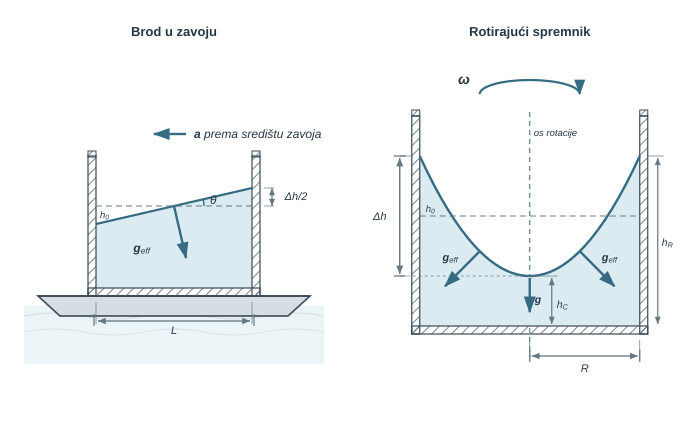
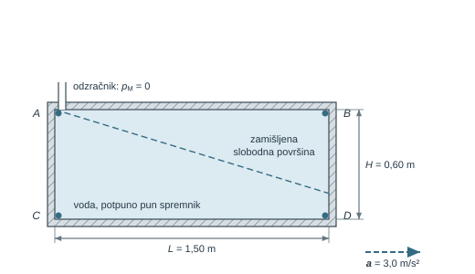
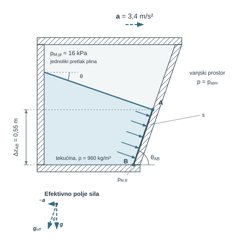
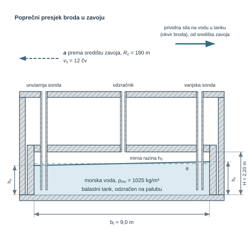
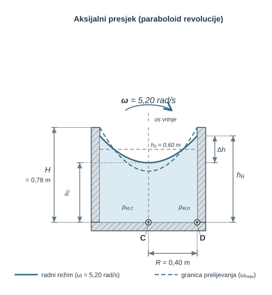
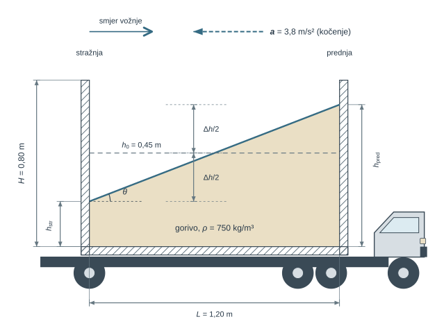
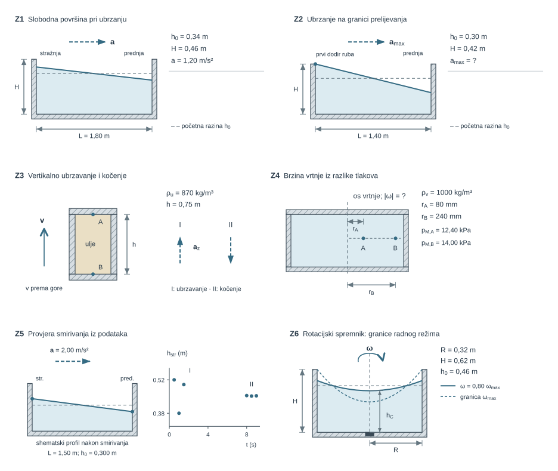

Kad autocisterna koči, brod plovi u zavoju ili centrifuga rotira, tekućina se nakon prolaznog zapljuskivanja smiri u nagnutom ili zakrivljenom položaju. Tada se giba sa spremnikom kao kruto tijelo, bez smičnih naprezanja, pa u sustavu vezanom uz spremnik problem ostaje statički, uz gravitaciju i prividnu (inercijsku) silu. O obliku slobodne površine ovise potrebna slobodna visina, opterećenje stijenki i položaj usisa.

U sustavu koji se giba stalnim translatornim ubrzanjem fluid miruje pod djelovanjem efektivnog polja $\vec g_{eff}=\vec g-\vec a$, pa ravnoteža elementa daje $\nabla p=\rho\vec g_{eff}$. Slobodna površina okomita je na to polje. Za vodoravno ubrzanje površina se naginje tako da vrijedi $\tan\theta=a/g$, a razlika razina na krajevima spremnika duljine $L$ iznosi $\Delta h=aL/g$. Isti model opisuje spremnik broda u zavoju uz centripetalno ubrzanje $a=v_s^2/R_z$, što lokalno vrijedi kada je duljina spremnika mnogo manja od polumjera zavoja $R_z$. Površina se tada podiže na vanjskoj strani zavoja.

Pri stalnoj vrtnji kutnom brzinom $\omega$ oko okomite osi centrifugalno ubrzanje $\omega^2r$ raste s udaljenošću od osi i oblikuje paraboloid $h(r)=h_C+\omega^2r^2/(2g)$, gdje je $h_C$ visina površine na osi. Za spremnik polumjera $R$ razlika razina između stijenke i osi iznosi $\Delta h=\omega^2R^2/(2g)$. Za okomitu dubinu $h$ ispod slobodne površine i bez okomitog ubrzanja ostaje $p=p_{pov}+\rho gh$, kao u klasičnoj hidrostatici iz []{.mf1-chapter-ref target="u03"}. Model se primjenjuje na separatore, centrifuge, procesne kade i lijevanje pod rotacijom, a u brodogradnji na spremnike goriva i tekućeg tereta pri manevrima.

Poglavlje najprije izvodi ravnotežu u neinercijskom sustavu i nagib površine pri translatornom ubrzanju, uključujući okomitu komponentu, a zatim paraboloid pri krutoj vrtnji i razine koje zbog očuvanja volumena zadovoljavaju $(h_C+h_R)/2=h_0$. Izrazi vrijede samo uz stalno ubrzanje ili stalnu kutnu brzinu. Prije primjene treba provjeriti prelijevanje i ogoljavanje dna jer nakon prvog praga formule za punu površinu više ne vrijede. Integraciju raspodijeljenog tlaka u silu na stijenku obrađuje []{.mf1-chapter-ref target="u05"}, a utjecaj pomaka tekućine na stabilitet broda razmatra se u []{.mf1-chapter-ref target="u06"}.

Slika [-@fig-uvod-u04] prikazuje oba slučaja. Lijevo je poprečni presjek broda u zavoju sa spremnikom duljine $L$: ubrzanje $\vec a$ usmjereno je prema središtu zavoja, pa je $\vec g_{eff}$ otklonjeno prema vanjskoj strani. Površina okomita na to polje zatvara s mirnom razinom $h_0$ kut $\theta$ te se na vanjskoj strani podiže za $\Delta h/2$, a na unutarnjoj za isto toliko spušta. Desno je otvoreni spremnik polumjera $R$ koji se vrti kutnom brzinom $\omega$ oko svoje osi. Polje $\vec g_{eff}$ okomito je na lokalnu paraboloidnu površinu, a na osi se svodi na $\vec g$. Površina je na osi na visini $h_C$, uz stijenku na visini $h_R$, a razlika tih visina iznosi $\Delta h$.

{#fig-uvod-u04 fig-align="center" fig-alt="Lijevo poprečni presjek broda u zavoju s tankom čija je površina viša na vanjskoj strani, desno otvoreni spremnik u krutoj vrtnji s paraboloidnom površinom i strelicama polja okomitima na nju."}

**Procijenjeno vrijeme rada uz priručnik:** 8 sati.

## Translatorno ubrzanje

Ako se spremnik giba stalnim translatornim ubrzanjem, a fluid se nakon prolaznih oscilacija smiri u odnosu na stijenke, problem se može promatrati kao hidrostatika u neinercijskom sustavu. U tom sustavu na fluid djeluje efektivno polje sila, rezultanta gravitacije i prividne (inercijske) sile.

Fluid se tada giba zajedno sa spremnikom kao kruto tijelo, bez relativnog klizanja slojeva i smičnih naprezanja: to je statički problem u promijenjenom polju sila.

Kada se spremnik giba ubrzanjem $a$ udesno, slobodna površina ostaje okomita na $\vec g_{eff}$, pa za bočni presjek pravokutnog spremnika vrijedi radna relacija

$$\Delta h = \frac{aL}{g}$$ {#eq-relativno-mirovanje-fizikalni-uvod-i-matematicki-izvod-01}

Pritom je $\Delta h$ razlika razina slobodne površine na krajevima spremnika. Relacija vrijedi dok nema prelijevanja ni ogoljavanja dna, a smjer efektivnog polja određuje geometriju površine, lokalnu dubinu i raspodjelu tlaka.

Promatramo spremnik koji se giba stalnim translatornim ubrzanjem $\vec a$ i koordinatni sustav vezan uz njega. U tom neinercijskom sustavu mirujući fluid mora zadovoljavati ravnotežu između gradijenta tlaka, gravitacije i inercijskoga člana. Po jedinici volumena vrijedi

$$
-\nabla p + \rho\vec g - \rho\vec a = 0,
$$ {#eq-relativno-mirovanje-matematicki-izvod-01}

odnosno

$$
\nabla p = \rho(\vec g - \vec a) = \rho\vec g_{eff}.
$$ {#eq-relativno-mirovanje-matematicki-izvod-02}

::: {.mf1-fizikalno-znacenje}
<p class="mf1-box-label">Fizikalno značenje</p>
Efektivno polje sila $\vec g_{eff}$ vektorski je zbroj gravitacijskog i inercijskog člana. Slobodna površina u ubrzanom spremniku okomita je na $\vec g_{eff}$. U slobodnom padu, kada je $\vec a=\vec g$, vrijedi $\vec g_{eff}=0$, pa nestaje hidrostatički gradijent tlaka.
:::

Za translatorno gibanje spremnika s komponentama ubrzanja $a_x$ i $a_z$, uz vodoravnu os $x$ i os $z$ usmjerenu prema gore, slijede komponente gradijenta tlaka

$$\frac{\partial p}{\partial x} = -\rho a_x, \qquad \frac{\partial p}{\partial z} = -\rho(g+a_z)$$ {#eq-relativno-mirovanje-fizikalno-znacenje-01}

Klasična hidrostatika iz []{.mf1-chapter-ref target="u03"} poseban je slučaj za $a_x = a_z = 0$. U najčešćem slučaju vodoravnog ubrzanja udesno vrijedi $a_x = a$ i $a_z = 0$, pa se relacija svodi na poznati zapis

$$\frac{\partial p}{\partial x} = -\rho a, \qquad \frac{\partial p}{\partial z} = -\rho g$$ {#eq-relativno-mirovanje-fizikalno-znacenje-02}

Na slobodnoj površini tlak je konstantan, pa diferencijal tlaka duž same površine mora biti jednak nuli:

$$dp = \frac{\partial p}{\partial x}dx + \frac{\partial p}{\partial z}dz = 0$$ {#eq-relativno-mirovanje-fizikalno-znacenje-03}

Uvrštavanjem parcijalnih derivacija dobiva se

$$-\rho a_x\,dx - \rho (g+a_z)\,dz = 0$$ {#eq-relativno-mirovanje-fizikalno-znacenje-04}

odnosno nakon skraćivanja s $\rho$

$$\frac{dz}{dx} = -\frac{a_x}{g+a_z}$$ {#eq-relativno-mirovanje-fizikalno-znacenje-05}

Za čisti vodoravni slučaj ponovno slijedi

$$\frac{dz}{dx} = -\frac{a}{g}$$ {#eq-relativno-mirovanje-fizikalno-znacenje-06}

što znači da je slobodna površina okomita na vektor $\vec g_{eff}$. Za pravokutni spremnik duljine $L$ integracija nagiba preko cijele duljine daje

$$
\Delta h = \frac{aL}{g}.
$$ {#eq-relativno-mirovanje-fizikalno-znacenje-07}

Razlika razina raste s ubrzanjem i duljinom spremnika, dok gravitacija vraća površinu prema vodoravnom položaju.

::: {.mf1-cfd title="Računalna dinamika fluida"}

**Cisterna u jednoliko ubrzanom vozilu.** Želimo procijeniti raspodjelu tlaka i potrebnu slobodnu visinu iznad tekućine. U modelu vezanom uz cisternu stijenke miruju, a na svaku ćeliju djeluju gravitacija i inercijski doprinos suprotan ubrzanju vozila. Zadamo volumen tekućine i stalno ubrzanje. Nakon smirivanja CFD treba dati nagib slobodne površine $dz/dx=-a/g$ za os $x$ u smjeru ubrzanja i sačuvati početni volumen.

To je jednostavan test prije simulacije stvarne vožnje: uspoređujemo razine uz krajeve i tlakove na stijenkama s ručnim računom. U modelu koji prati gibanje spremnika u nepomičnom okviru taj inercijski doprinos ne dodajemo ponovno. Izbor okvira mijenja zapis problema, ali oba dosljedna opisa trebaju predvidjeti isto fizikalno stanje.
:::

## Kruta vrtnja oko okomite osi

::: {.mf1-izvod}
<p class="mf1-box-label">Matematički izvod — Paraboloidna slobodna površina pri krutoj vrtnji</p>

Pitanje je kakav oblik poprima slobodna površina kad spremnik i fluid rotiraju stalnom kutnom brzinom $\omega$ oko okomite osi. U stanju relativnog mirovanja fluid se opet giba kao kruto tijelo, pa u cilindričnim koordinatama tlak radijalno raste prema stijenci, a po visini i dalje opada zbog gravitacije:

$$
\frac{\partial p}{\partial r} = \rho \omega^2 r, \qquad \frac{\partial p}{\partial z} = -\rho g
$$ {#eq-relativno-mirovanje-cjeloviti-zadatak-rotirajuci-cilindricni-spremni-01}

::: {.mf1-fizikalno-znacenje}
<p class="mf1-box-label">Fizikalno značenje</p>
Prva jednadžba pokazuje da zbog centrifugalne prividne sile tlak raste s porastom $r$, odnosno prema stijenci. Druga opisuje hidrostatičku raspodjelu po visini. Zajedno određuju raspodjelu tlaka u dvama smjerovima: tlak raste s radijusom, a pada s visinom.
:::

Na slobodnoj površini tlak je stalan, pa vrijedi $dp = 0$:

$$
0 = \frac{\partial p}{\partial r}\,dr + \frac{\partial p}{\partial z}\,dz = \rho\omega^2 r\,dr - \rho g\,dz.
$$ {#eq-relativno-mirovanje-razrada-koraka-01}

Dijeljenje s $\rho g$ i premještanje članova daje nagib površine

$$
\frac{dz}{dr} = \frac{\omega^2 r}{g}.
$$ {#eq-relativno-mirovanje-razrada-koraka-02}

Integracijom od osi ($r = 0$, $z = h_C$) do radijusa $r$ dobivamo

$$
z(r) = h_C + \frac{\omega^2}{g}\int_0^r r'\,dr' = h_C + \frac{\omega^2 r^2}{2g}.
$$ {#eq-relativno-mirovanje-razrada-koraka-03}

Slobodna površina i druge plohe stalnog tlaka zato više nisu ravnine nego paraboloidi revolucije; u aksijalnom presjeku površina je parabola

$$
h(r) = h_C + \frac{\omega^2 r^2}{2g}
$$ {#eq-relativno-mirovanje-fizikalno-znacenje-08}

gdje je $r$ udaljenost od osi vrtnje, a $h_C$ visina površine na osi. Provjera: za $\omega = 0$ površina je ravna, a razlika razina između stijenke polumjera $R$ i osi iznosi $\Delta h = \omega^2R^2/(2g)$ i raste kvadratno i s $\omega$ i s $R$.
:::

::: {.mf1-izvod}
<p class="mf1-box-label">Matematički izvod — Očuvanje volumena u rotirajućem spremniku</p>

Rotirajući cilindrični spremnik polumjera $R$ ispunjen je vodom do početne visine $h_0$, a fluid je dosegnuo krutu vrtnju. Dok nema prelijevanja ni ogoljavanja dna, površina je paraboloid opisan jednadžbom [-@eq-relativno-mirovanje-fizikalno-znacenje-08]. Visine $h_C$ i $h_R$ (uz stijenku) povezuje zakon očuvanja volumena vode prije i poslije početka vrtnje.

Volumen vode u rotirajućem spremniku računa se integralom

$$
V = \int_0^R 2\pi r \cdot h(r)\,dr = \int_0^R 2\pi r\!\left(h_C + \frac{\omega^2 r^2}{2g}\right)dr.
$$ {#eq-relativno-mirovanje-matematicki-izvod-volumno-ocuvanje-paraboloida-e-01}

Integracija po članovima daje

$$
V = 2\pi\!\left[\frac{h_C r^2}{2} + \frac{\omega^2 r^4}{8g}\right]_0^R = \pi R^2 h_C + \frac{\pi \omega^2 R^4}{4g}.
$$ {#eq-relativno-mirovanje-matematicki-izvod-volumno-ocuvanje-paraboloida-e-02}

Volumen vode u mirovanju iznosi $V_0 = \pi R^2 h_0$, a zakon očuvanja $V = V_0$ daje

$$
\pi R^2 h_C + \frac{\pi \omega^2 R^4}{4g} = \pi R^2 h_0,
$$ {#eq-relativno-mirovanje-matematicki-izvod-volumno-ocuvanje-paraboloida-e-03}

odakle slijedi visina u središtu

$$
h_C = h_0 - \frac{\omega^2 R^2}{4g}.
$$ {#eq-relativno-mirovanje-matematicki-izvod-volumno-ocuvanje-paraboloida-e-04}

Iz definicije paraboloida $h_R = h_C + \omega^2 R^2/(2g)$ izravno se dobiva visina uz stijenku

$$
h_R = h_0 + \frac{\omega^2 R^2}{4g}.
$$ {#eq-relativno-mirovanje-matematicki-izvod-volumno-ocuvanje-paraboloida-e-05}

Zato je $(h_C + h_R)/2 = h_0$: porast razine uz stijenku jednak je padu razine u središtu.

Granični uvjet **ogoljavanja dna** dolazi iz $h_C = 0$:

$$
\omega_{ogol}^2 R^2 = 4 g h_0 \quad\Longrightarrow\quad \omega_{ogol} = \frac{2\sqrt{g h_0}}{R},
$$ {#eq-relativno-mirovanje-matematicki-izvod-volumno-ocuvanje-paraboloida-e-06}

dok granični uvjet **prelijevanja** preko ruba spremnika visine $H$ slijedi iz $h_R = H$:

$$
\omega_{prel} = \frac{2\sqrt{g(H - h_0)}}{R}.
$$ {#eq-relativno-mirovanje-matematicki-izvod-volumno-ocuvanje-paraboloida-e-07}

Prva se javlja pojava s manjom kritičnom kutnom brzinom. Budući da se uspoređuju $h_0$ i $H-h_0$, vrijedi: za $h_0<H/2$ prvo se ogoljava dno, za $h_0>H/2$ prvo nastupa prelijevanje, a za $h_0=H/2$ pragovi se podudaraju. Nakon prvoga praga mijenja se domena fluida ili volumen u spremniku, pa gornje formule za puni paraboloid više ne vrijede bez nove geometrijske bilance.
:::

::: {.mf1-izvod}
<p class="mf1-box-label">Matematički izvod — Zašto Coriolisova sila nestaje u relativnom mirovanju</p>

Kad spremnik rotira, puni izraz za prividne sile u neinercijskom (rotirajućem) okviru sadrži tri člana: centrifugalnu silu $-\rho\vec{\omega}\times(\vec{\omega}\times\vec{r})$, Eulerovu silu $-\rho\dot{\vec{\omega}}\times\vec{r}$ (koja iščezava pri konstantnoj kutnoj brzini) i **Coriolisovu silu** $-2\rho\vec{\omega}\times\vec{v}_{rel}$, koja djeluje samo kad fluid ima brzinu u rotirajućem okviru.

U stanju relativnog mirovanja $\vec{v}_{rel} = 0$, pa Coriolisov član iščezava:

$$
-2\rho\vec{\omega}\times\vec{v}_{rel} = 0.
$$ {#eq-relativno-mirovanje-matematicki-izvod-coriolisova-sila-u-relativnom-01}

Ravnoteža sila po jedinici volumena svodi se zato na

$$
\nabla p = \rho\vec g_{eff} = \rho\vec{g} - \rho\vec{\omega}\times(\vec{\omega}\times\vec{r}),
$$ {#eq-relativno-mirovanje-matematicki-izvod-coriolisova-sila-u-relativnom-02}

a centrifugalni član u cilindričnim koordinatama (kutna brzina $\vec{\omega} = \omega\hat{z}$, vektor položaja $\vec{r} = r\hat{r}$) daje radijalnu komponentu efektivnog ubrzanja $a_{cf} = \omega^2 r$, kakvu je koristio izvod paraboloida. Coriolisova sila ponovno se pojavljuje čim fluid ima relativnu brzinu u rotirajućem okviru, primjerice pri radijalnom toku u turbostroju. Tada je ona jedan od članova koji oblikuju zakretanje relativnoga toka, a odvajanje toka i učinkovitost ovise i o gradijentu tlaka, geometriji, viskoznosti, turbulenciji i drugim trodimenzijskim učincima.
:::

::: {.mf1-cfd title="Računalna dinamika fluida"}

**Pokretanje rotirajućeg spremnika.** Paraboloid iz ovog izvoda opisuje stanje nakon što tekućina poprimi krutu vrtnju. CFD simulacija pokretanja uvodi vrijeme i trenje: zadamo porast brzine vrtnje stijenke te pratimo kako se gibanje prenosi u unutrašnjost i kako se površina oblikuje. Cilj može biti vrijeme potrebno da se razina uz rub približi konačnoj vrijednosti.

U konačnom stanju relativna brzina u okviru spremnika jednaka je nuli, dok je laboratorijska brzina $\omega r$. Ravnotežu provjeravamo izračunanim volumenom, oblikom paraboloida i tlakom na dnu. Tijekom pokretanja postoji relativno strujanje; rotirajući opis tada mora uključiti odgovarajuće prividne (inercijske) članove, uključujući doprinos promjene brzine vrtnje. Ista se razlika između okvira ponovno javlja kod rotora u []{.mf1-chapter-ref target="u14"}.
:::

::: {.mf1-interaktivno}
<p class="mf1-box-label">Interaktivni prikaz — Paraboloidna slobodna površina</p>

**Predvidi.** Kako udvostručenje kutne brzine mijenja razliku razina? Hoće li se prvo ogoliti dno ili dosegnuti rub?

**Provjeri i protumači.** Pokreni ćelije, mijenjaj brzinu i punjenje te prati razine i očuvanje volumena do prve granice modela. Objasni zašto ravnotežni prikaz ne daje vrijeme uspostavljanja vrtnje. Prvo pokretanje traži mrežnu vezu i 1–2 minute.

<div class="mf1-interaktivno-akcija">
<a class="mf1-interaktivno-veza" href="https://martibasic.github.io/MF1_udzbenik/jlite/lab/index.html?path=u04_paraboloidna_povrsina.ipynb">Pokreni u pregledniku</a>
<a class="mf1-interaktivno-veza" href="https://colab.research.google.com/github/martibasic/MF1_udzbenik/blob/main/notebooks/u04_paraboloidna_povrsina.ipynb" target="_blank" rel="noopener">Pričuvno: otvori u Colabu</a>

</div>

:::

::: {.mf1-granica-modela}
<p class="mf1-box-label">Granica modela — Kruta vrtnja i translacija bez relativnog strujanja</p>

Relacije ovog poglavlja vrijede za fluid koji u odnosu na spremnik miruje: ubrzanje ili kutna brzina stalni su, prolazno zapljuskivanje prigušeno je, a relativna brzina $\vec v_{rel}$ jednaka je nuli. Pri promjenjivom ubrzanju, pokretanju vrtnje ili protoku kroz spremnik javljaju se Eulerov i Coriolisov član te smična naprezanja, pa je potreban nestacionarni ili strujni model. Izrazi za nagib i paraboloid vrijede samo do prvog praga (prelijevanja ili ogoljavanja dna); nakon njega mijenja se volumen ili domena fluida i potrebna je nova geometrijska bilanca. Površinska napetost zanemaruje se u spremnicima znatno širima od kapilarne duljine iz []{.mf1-chapter-ref target="u02"}.
:::

::: {#cfd-cisterna-kocenje .mf1-cfd title="Računalna dinamika fluida"}

**Kočenje cisterne s pregradama i bez njih.** Sada je pitanje hoće li prvi val udariti u pokrov i koliko će opteretiti prednju stijenku. Polazište je @ex-u04-nagib-goriva-u-spremniku-autocisterne-pri-kocenju. Njegov ravnotežni model proširujemo vremenskim tijekom kočenja i praćenjem granice tekućine i zraka. Uspoređujemo praznu unutrašnjost s izvedbom koja ima pregrade i otvore kroz koje tekućina može prolaziti.

**Zastani i promisli.** Pri stalnom kočenju CFD daje očekivani konačni nagib, ali je prvi val viši od ravnotežne razine. Dokazuje li to pogrešan račun?

Prvi val viši od ravnotežne razine sam po sebi ne znači da je CFD račun pogrešan: ravnotežni nagib provjerava tek smireno stanje pri stalnom ubrzanju. Pratimo visinu vala, ukupnu silu i vrijeme smirivanja; pregrada pritom prima vlastito opterećenje. Prolazne vrhove provjeravamo profinjenjem mreže i vremenskog koraka te pokusom (postupak u odjeljku [-@sec-cfd-vv-paketi]). Integraciju tlaka u silu obrađuje sljedeće poglavlje.
:::

## Riješeni primjeri

<span id="ex-u04-otvoreni-spremnik-na-laboratorijskim-kolicima-t2"></span>

::: {#ex-zatvoreni-puni-spremnik-odzracnik-ubrzanje .mf1-we}
<p class="mf1-box-label">Zatvoreni puni spremnik s odzračnikom pri ubrzanju&nbsp;<span class="mf1-level">T2</span></p>

**Tekst zadatka**

Zatvoreni pravokutni spremnik duljine $L = 1{,}50\ \text{m}$ i visine $H = 0{,}60\ \text{m}$ potpuno je ispunjen vodom gustoće $\rho = 1000\ \text{kg/m}^3$; u gornjem stražnjem kutu $A$ ima odzračnik otvoren prema atmosferi. Spremnik se na vozilu ubrzava prema naprijed stalnim ubrzanjem $a = 3{,}0\ \text{m/s}^2$, a voda u odnosu na njega miruje. Kutove označi s $A$ (gore straga), $B$ (gore sprijeda), $C$ (dolje straga) i $D$ (dolje sprijeda). Zanemari volumen odzračnika i stlačivost vode.

**Traži se**

1. Odredi manometarske tlakove u kutovima $B$, $C$ i $D$.
2. Odredi položaj zamišljene slobodne površine i objasni gdje je tlak negativan.
3. Odredi ubrzanje pri kojem manometarski tlak u $D$ pada na nulu te tlakove u kutovima kad bi se odzračnik nalazio u kutu $B$.

{#fig-u04-zatvoreni-puni-spremnik fig-align="center" fig-alt="Zatvoreni pravokutni spremnik pun vode s odzračnikom u gornjem stražnjem kutu A, kutovima B, C i D, isprekidanom zamišljenom slobodnom površinom koja kroz A pada prema prednjoj stijenci te strelicom ubrzanja udesno."}

**Veza s proračunom.** Nema stvarne slobodne površine: referencu tlaka daje odzračnik, a zamišljena slobodna površina je ploha $p_M=0$ kroz $A$, okomita na $\vec g_{eff}$. Ubrzanje je prema naprijed, u smjeru od $A$ prema $B$.

**Rješenje**

Gradijent tlaka u relativnom mirovanju ima dvije komponente, $\partial p/\partial x=-\rho a$ u smjeru ubrzanja i $\partial p/\partial z=-\rho g$. Polazeći od odzračnika, gdje je $p_{M,A}=0$, tlak prema naprijed pada, a prema dolje raste:

$$
\begin{aligned}
p_{M,B}&=-\rho aL=-1000\cdot3{,}0\cdot1{,}50=-4{,}50\ \text{kPa},\\
p_{M,C}&=\rho gH=1000\cdot9{,}81\cdot0{,}60=5{,}89\ \text{kPa},
\end{aligned}
$$ {#eq-relativno-mirovanje-rijeseni-primjer-otvoreni-spremnik-na-laboratori-01}

$$
p_{M,D}=\rho gH-\rho aL=5{,}89-4{,}50=1{,}39\ \text{kPa}.
$$ {#eq-relativno-mirovanje-rijeseni-primjer-otvoreni-spremnik-na-laboratori-02}

Zamišljena slobodna površina prolazi kroz $A$ i nagnuta je za $\tan\theta=a/g=0{,}306$, odnosno $\theta\approx17{,}0^\circ$; na prednjoj stijenci leži

$$
\frac{aL}{g}=\frac{3{,}0\cdot1{,}50}{9{,}81}=0{,}459\ \text{m}
$$ {#eq-relativno-mirovanje-rijeseni-primjer-otvoreni-spremnik-na-laboratori-03}

ispod gornjeg ruba, dakle unutar spremnika. Iznad te plohe, u prednjem gornjem dijelu, voda je pod podtlakom: najniži je u $B$, gdje apsolutni tlak iznosi oko $96{,}8\ \text{kPa}$. Tlak u $D$ pada na nulu kad zamišljena površina dosegne dno uz prednju stijenku, $aL=gH$, odnosno pri

$$
a_D=\frac{gH}{L}=\frac{9{,}81\cdot0{,}60}{1{,}50}=3{,}92\ \text{m/s}^2.
$$ {#eq-relativno-mirovanje-rijeseni-primjer-otvoreni-spremnik-na-laboratori-04}

Kad bi odzračnik bio u $B$, referenca $p_M=0$ bila bi u prednjem gornjem kutu, pa bi tlakovi iznosili $p_{M,A}=+4{,}50$, $p_{M,C}=10{,}39$ i $p_{M,D}=5{,}89\ \text{kPa}$: sve su razlike iste, a razina tlaka pomaknuta je za $\rho aL$.

**Provjera i tumačenje**

Razlike tlakova ovise samo o polju $\vec g_{eff}$ i udaljenostima: $p_C-p_A=p_D-p_B=\rho gH$ i $p_A-p_B=p_C-p_D=\rho aL$. Položaj odzračnika određuje samo zajedničku razinu, pa odzračnik na prednjoj strani uklanja podtlak. Pri usporavanju se predznak člana $\rho aL$ obrće. Model vrijedi dok voda potpuno ispunjava spremnik; da se odzračnik našao ispod zamišljene površine, kroz njega bi ušao zrak i nastala bi stvarna slobodna površina.
:::

::: {#ex-u04-zatvoreni-servisni-modul-s-kosom-inspekcijskom-stijenkom .mf1-we}
<p class="mf1-box-label">Zatvoreni servisni modul s kosom inspekcijskom stijenkom&nbsp;<span class="mf1-level">T2</span></p>

**Tekst zadatka**

Zatvoreni modul s tekućinom gustoće $\rho = 960\ \text{kg/m}^3$ ubrzava se vodoravno ubrzanjem $a = 3{,}4\ \text{m/s}^2$. Jednoliki plinski pretlak iznad tekućine iznosi $p_{M,pl} = 16\ \text{kPa}$. Vanjsku stijenku $AB$ treba postaviti okomito na slobodnu površinu. Slobodna površina dodiruje stijenku u točki $A$, a donji kraj stijenke, točka $B$, nalazi se okomito niže za $\Delta z_{AB} = 0{,}55\ \text{m}$.

Vanjska strana stijenke izložena je atmosferi; njezin gornji nastavak zatvara plinski prostor do poklopca. Zanemari prolazne oscilacije i promjenu gustoće plina.

**Traži se**

1. Odredi kut $\theta_{AB}$ pod kojim stijenku $AB$ treba postaviti prema vodoravnici.
2. Odredi duljinu stijenke $AB$.
3. Odredi raspodjelu manometarskog tlaka duž stijenke $AB$ i tlak u točki $B$.

{#fig-u04-zatvoreni-servisni-modul-s-kosom-inspekcijskom-stijenkom fig-alt="Ubrzani zatvoreni modul s plinskim pretlakom iznad nagnute slobodne površine, kosom stijenkom AB okomitom na tu površinu, strelicama tlaka okomitima na stijenku i kutovima θ i θ_AB."}

**Veza s proračunom.** Stijenka je usporedna s efektivnim poljem; strelice tlaka okomite su na nju i rastu od $A$ prema $B$. Integraciju te raspodjele u silu i hvatište obrađuje []{.mf1-chapter-ref target="u05"}.

**Rješenje**

Najprije odredimo kut nagiba slobodne površine iz osnovne relacije relativnog mirovanja:

$$
\tan\theta = \frac{a}{g} = \frac{3{,}4}{9{,}81} = 0{,}3466 \quad \Longrightarrow \quad \theta = \arctan(0{,}3466) \approx 19{,}1^\circ.
$$ {#eq-relativno-mirovanje-rijeseni-primjer-zatvoreni-servisni-modul-s-koso-01}

Ako slobodna površina mora biti okomita na stijenku $AB$, tada stijenka mora zatvarati s vodoravnicom kut

$$
\theta_{AB} = 90^\circ - \theta = 90^\circ - 19{,}1^\circ = 70{,}9^\circ \approx 71^\circ.
$$ {#eq-relativno-mirovanje-rijeseni-primjer-zatvoreni-servisni-modul-s-koso-02}

Duljina stijenke slijedi iz zadane okomite projekcije $\Delta z_{AB}$:

$$
s = \frac{\Delta z_{AB}}{\sin\theta_{AB}} = \frac{0{,}55}{\sin 70{,}9^\circ} \approx 0{,}582\ \text{m}.
$$ {#eq-relativno-mirovanje-rijeseni-primjer-zatvoreni-servisni-modul-s-koso-03}

Efektivna težina po jedinici mase iznosi

$$
g_{eff} = \sqrt{g^2 + a^2} = \sqrt{9{,}81^2 + 3{,}4^2} \approx 10{,}38\ \text{m/s}^2.
$$ {#eq-relativno-mirovanje-rijeseni-primjer-zatvoreni-servisni-modul-s-koso-04}

Stijenka je usporedna s $\vec g_{eff}$, pa duž nje tlak raste jednako kao s dubinom mjerenom u smjeru efektivnog polja. Na udaljenosti $y$ od točke $A$, mjereno po stijenci, manometarski tlak iznosi

$$
p_M(y) = p_{M,pl} + \rho g_{eff}\, y, \qquad \rho g_{eff} = 960 \cdot 10{,}38 = 9967\ \text{Pa/m}.
$$ {#eq-tlak-uzduz-kose-stijenke-g-eff}

U točki $B$, za $y = s$, slijedi

$$
p_{M,B} = p_{M,pl} + \rho g_{eff}\, s = 16000 + 960 \cdot 10{,}38 \cdot 0{,}582 \approx 21{,}8\ \text{kPa}.
$$ {#eq-tlak-dna-kose-stijenke}

Isti se rezultat dobiva po komponentama: $B$ je $\Delta z_{AB}$ niže i $s\cos\theta_{AB} = 0{,}191\ \text{m}$ pomaknut prema stražnjoj strani modula, pa je $p_{M,B} = p_{M,pl} + \rho\,(g\,\Delta z_{AB} + a\, s\cos\theta_{AB}) = 16000 + 960\,(9{,}81 \cdot 0{,}55 + 3{,}4 \cdot 0{,}191) \approx 21{,}8\ \text{kPa}$. U računu se koriste nezaokružene vrijednosti $s$ i $g_{eff}$.

**Provjera i tumačenje**

Budući da je $a < g$, kut $\theta_{AB}$ mora biti veći od $45^\circ$. Gradijent $\rho g_{eff}$ duž $AB$ veći je od $\rho g$ jer stijenka slijedi efektivno polje, a ne okomicu; plinski pretlak ovdje nosi veći dio opterećenja nego tekućina.
:::

::: {#ex-tank-broda-u-kruznom-zavoju .mf1-we}
<p class="mf1-box-label">Balastni tank broda u kružnom zavoju&nbsp;<span class="mf1-level">T2</span></p>

**Tekst zadatka**

Brod plovi stalnom brzinom $v_s = 12\ \text{čv} = 6{,}17\ \text{m/s}$ ustaljenim kružnim zavojem polumjera $R_z = 180\ \text{m}$. Poprečni balastni tank širine $b_t = 9{,}0\ \text{m}$ i visine $H = 2{,}20\ \text{m}$ djelomično je ispunjen morskom vodom gustoće $\rho_{mv} = 1025\ \text{kg/m}^3$ do mirne razine $h_0 = 1{,}60\ \text{m}$; odzračen je prema palubi, a uz obje bočne stijenke ima sondnu cijev. Brod plovi bez nagiba, a voda u tanku u odnosu na brod miruje.<span id="ex-u04-rotirajuci-cilindricni-spremnik-bez-prelijevanja-t2"></span>

**Traži se**

1. Odredi centripetalno ubrzanje tanka i kut nagiba slobodne površine.
2. Odredi razliku razina između vanjske i unutarnje strane zavoja te očitanja obiju sondi.
3. Provjeri prelijevanje i odredi brzinu pri kojoj bi površina u istom zavoju dosegnula vrh tanka.
4. Procijeni opravdanost lokalne aproksimacije $a = v_s^2/R_z$ za širinu tanka.

{#fig-tank-broda-u-kruznom-zavoju fig-align="center" fig-alt="Poprečni presjek broda koji skreće: balastni tank širine b_t s vodom čija je površina viša na vanjskoj strani zavoja, dvije sondne cijevi, kote h_unu i h_van, strelica prema središtu zavoja i smjer prividne sile."}

**Veza s proračunom.** U okviru broda prividna (inercijska) sila djeluje od središta zavoja, pa se površina podiže na vanjskoj strani; sonde mjere lokalne visine od dna. Visine i širina nacrtane su u istom mjerilu, bez uvećanja nagiba.

**Rješenje**

Centripetalno ubrzanje i nagib površine:

$$
a = \frac{v_s^2}{R_z} = \frac{6{,}17^2}{180} = 0{,}2115\ \text{m/s}^2, \qquad \tan\theta = \frac{a}{g} = 0{,}02156 \quad\Longrightarrow\quad \theta \approx 1{,}24^\circ.
$$ {#eq-brod-u-zavoju-ubrzanje-i-nagib}

Razlika razina preko širine tanka te razine uz vanjsku stijenku $h_{van}$ i unutarnju stijenku $h_{unu}$:

$$
\begin{aligned}
\Delta h &= \frac{a\, b_t}{g} = \frac{0{,}2115 \cdot 9{,}0}{9{,}81} = 0{,}194\ \text{m}, \\
h_{van} &= h_0 + \frac{\Delta h}{2} = 1{,}697\ \text{m}, \qquad h_{unu} = h_0 - \frac{\Delta h}{2} = 1{,}503\ \text{m}.
\end{aligned}
$$ {#eq-brod-u-zavoju-razine-uz-stijenke}

Vanjska sonda pokazuje $1{,}70\ \text{m}$, a unutarnja $1{,}50\ \text{m}$; već sama razlika očitanja, $0{,}19\ \text{m}$, mjera je ubrzanja u zavoju.

Prelijevanje: $h_{van} = 1{,}697\ \text{m} < H = 2{,}20\ \text{m}$, pa ga nema. Vrh tanka dosegnuo bi se pri $\Delta h_{max} = 2(H-h_0) = 1{,}20\ \text{m}$, odnosno pri

$$
\begin{aligned}
a_{max} &= \frac{g\,\Delta h_{max}}{b_t} = \frac{9{,}81 \cdot 1{,}20}{9{,}0} = 1{,}308\ \text{m/s}^2, \\
v_{max} &= \sqrt{a_{max} R_z} = \sqrt{1{,}308 \cdot 180} = 15{,}3\ \text{m/s} \approx 29{,}8\ \text{čv},
\end{aligned}
$$ {#eq-brod-u-zavoju-granica-prelijevanja}

daleko iznad brzine broda; u ustaljenom zavoju tank se ne prelijeva.

Lokalna aproksimacija: ubrzanje $v_s^2/r$ mijenja se preko tanka za $b_t/R_z = 5\ \%$. Točan račun u rotirajućem okviru daje paraboloid $z = \omega^2 r^2/(2g)$ s $\omega = v_s/R_z$, pa je razlika razina između polumjera $R_z \pm b_t/2$

$$
\Delta h = \frac{\omega^2}{2g}\left[\left(R_z + \tfrac{b_t}{2}\right)^2 - \left(R_z - \tfrac{b_t}{2}\right)^2\right] = \frac{\omega^2 R_z b_t}{g} = \frac{v_s^2 b_t}{R_z g},
$$ {#eq-brod-u-zavoju-paraboloid-provjera}

identično linearnom rezultatu. Zakrivljenost pomiče srednju razinu za $\omega^2 b_t^2/(24g) \approx 0{,}4\ \text{mm}$, zanemarivo prema razlučivosti sonde.

**Provjera i tumačenje**

1. Srednja razina sondi ostaje $h_0$: $(1{,}697+1{,}503)/2 = 1{,}600\ \text{m}$. Nagib od $1{,}24^\circ$ malen je, ali preko $9\ \text{m}$ širine daje $19\ \text{cm}$ razlike.
2. U stvarnom zavoju brod se osim toga nagne, pa se u okviru tanka tom kutu dodaje ili od njega oduzima kut nagiba broda, ovisno o tome naginje li se brod prema van ili prema unutra; pomak tekućine pritom mijenja stabilitet, što obrađuje []{.mf1-chapter-ref target="u06"}.
:::

::: {#ex-u04-rotirajuci-cilindricni-spremnik-s-granicom-prelijevanja-t3 .mf1-ch}
<p class="mf1-box-label">Rotirajući cilindrični spremnik s granicom prelijevanja&nbsp;<span class="mf1-level">T3</span></p>

**Tekst zadatka**

Otvoreni cilindrični spremnik polumjera $R = 0{,}40\ \text{m}$ i visine $H = 0{,}78\ \text{m}$ sadrži vodu gustoće $\rho_v = 1000\ \text{kg/m}^3$, početne visine $h_0 = 0{,}60\ \text{m}$. Pri kutnoj brzini $\omega = 5{,}20\ \text{rad/s}$ voda je u relativnom mirovanju i rotira kao kruto tijelo. Zanemari površinsku napetost, zapljuskivanje i otpor zraka. Volumen je stalan do prvog prelijevanja.

**Traži se**

1. Odredi razliku razina slobodne površine $\Delta h$ između stijenke i osi spremnika.
2. Odredi dubinu vode $h_C$ na osi spremnika i $h_R$ uz stijenku.
3. Odredi manometarski tlak na dnu u središnjoj točki $C$ i u rubnoj točki $D$.
4. Odredi graničnu kutnu brzinu $\omega_{max}$ pri kojoj prema geometrijskom modelu počinje prelijevanje te pripadnu brzinu vrtnje $n_{max}$ u $\mathrm{min^{-1}}$.

{#fig-u04-rotirajuci-cilindricni-spremnik fig-alt="Aksijalni presjek otvorenog spremnika s punom parabolom radnog režima, isprekidanom parabolom granice prelijevanja, mirnom razinom h_0 i točkama C i D na dnu."}

**Veza s proračunom.** Dubine se mjere od dna do paraboloida; točka $C$ leži na dnu u osi, a točka $D$ na dnu uz stijenku.

**Rješenje**

Oblik slobodne površine daje @eq-relativno-mirovanje-fizikalno-znacenje-08, a očuvanje volumena bez prelijevanja daje vezu $(h_C + h_R)/2 = h_0$.

### 1. Razlika razina slobodne površine {.unnumbered .unlisted .mf1-step}

Iz izraza za paraboloidnu slobodnu površinu razlika između stijenke i osi spremnika iznosi

$$
\Delta h = h_R - h_C = \frac{\omega^2 R^2}{2g} = \frac{5{,}20^2 \cdot 0{,}40^2}{2 \cdot 9{,}81} = 0{,}2205\ \text{m} \approx 22{,}1\ \text{cm}.
$$ {#eq-relativno-mirovanje-1-razlika-razina-slobodne-povrsine-01}

### 2. Dubina na osi i uz stijenku {.unnumbered .unlisted .mf1-step}

Uz $h_R - h_C = \Delta h$ slijedi

$$
h_C = h_0 - \frac{\Delta h}{2} = 0{,}60 - \frac{0{,}2205}{2} = 0{,}4897\ \text{m} \approx 0{,}490\ \text{m},
$$ {#eq-relativno-mirovanje-2-dubina-na-osi-i-uz-stijenku-01}

$$
h_R = h_0 + \frac{\Delta h}{2} = 0{,}60 + \frac{0{,}2205}{2} = 0{,}7103\ \text{m} \approx 0{,}710\ \text{m}.
$$ {#eq-relativno-mirovanje-2-dubina-na-osi-i-uz-stijenku-02}

### 3. Tlak na dnu u točkama $C$ i $D$ {.unnumbered .unlisted .mf1-step}

Na dnu spremnika lokalni manometarski tlak dobiva se iz lokalne dubine ispod slobodne površine. U osi spremnika vrijedi

$$
p_{M,C} = \rho_v g h_C = 1000 \cdot 9{,}81 \cdot 0{,}4897 = 4804\ \text{Pa} \approx 4{,}80\ \text{kPa}.
$$ {#eq-relativno-mirovanje-3-tlak-na-dnu-u-tockama-c-01}

Uz stijenku je dubina veća, pa je

$$
p_{M,D} = \rho_v g h_R = 1000 \cdot 9{,}81 \cdot 0{,}7103 = 6968\ \text{Pa} \approx 6{,}97\ \text{kPa}.
$$ {#eq-relativno-mirovanje-3-tlak-na-dnu-u-tockama-c-02}

### 4. Granica prelijevanja {.unnumbered .unlisted .mf1-step}

Do prelijevanja dolazi kada slobodna površina uz stijenku dosegne rub spremnika, odnosno kada je

$$
h_R = H
$$ {#eq-relativno-mirovanje-4-granica-prelijevanja-01}

Kako za rotaciju bez gubitka volumena vrijedi $h_R = h_0 + \omega^2 R^2/(4g)$, granična kutna brzina zadovoljava $H = h_0 + \omega_{max}^2 R^2/(4g)$, pa je

$$
\omega_{max} = \sqrt{\frac{4g(H-h_0)}{R^2}} = \sqrt{\frac{4 \cdot 9{,}81 \cdot (0{,}78-0{,}60)}{0{,}40^2}} = 6{,}64\ \text{rad/s}.
$$ {#eq-relativno-mirovanje-4-granica-prelijevanja-02}

Brzina vrtnje tada iznosi

$$
n_{max} = \frac{60\omega_{max}}{2\pi} = \frac{60 \cdot 6{,}64}{2\pi} = 63{,}4\ \mathrm{min^{-1}}.
$$ {#eq-relativno-mirovanje-4-granica-prelijevanja-03}

**Provjera i tumačenje**

Pri radnom režimu $h_R = 0{,}710\ \text{m} < H$, pa se spremnik ne prelijeva, a zbog $h_C > 0$ dno ostaje pokriveno. Budući da je $h_0 > H/2$, pri povećanju brzine prvo nastupa prelijevanje, a ne ogoljavanje; za $\omega = 0$ izrazi se vraćaju na $h_C = h_R = h_0$.
:::

::: {#ex-u04-nagib-goriva-u-spremniku-autocisterne-pri-kocenju .mf1-we}
<p class="mf1-box-label">Nagib goriva u spremniku autocisterne pri kočenju&nbsp;<span class="mf1-level">T2</span></p>

**Tekst zadatka**

Idealizirani otvoreni spremnik goriva na vozilu dug je $L = 1{,}20\ \text{m}$ u smjeru vožnje i visok $H = 0{,}80\ \text{m}$. Početna razina goriva gustoće $\rho = 750\ \text{kg/m}^3$ iznosi $h_0 = 0{,}45\ \text{m}$. Vozilo koči stalnim usporenjem $a = 3{,}8\ \text{m/s}^2$. Promatraj ustaljenu relativnu ravnotežu bez prolaznih valova i istjecanja, uz stalan volumen do prelijevanja.

**Traži se**

1. Odredi razliku razina između prednje i stražnje stijenke.
2. Odredi visinu goriva uz svaku stijenku.
3. Provjeri hoće li doći do prelijevanja ili ogoljavanja dna.

{#fig-u04-autocisterna-kocenje fig-align="center" fig-alt="Pravokutni spremnik na vozilu koje koči, s gorivom višim uz prednju stijenku, kotama H, h_0 i Δh/2 te strelicama smjera vožnje i ubrzanja unatrag."}

**Veza s proračunom.** Pri kočenju ubrzanje je usmjereno unatrag, pa prednja razina raste, a stražnja pada. Presjek je nacrtan u jedinstvenom mjerilu; prvi prolazni val može se razlikovati od prikazane ravnoteže.

**Rješenje**

Razlika razina (pri kočenju razina goriva viša je uz prednju stijenku):

$$
\Delta h = \frac{aL}{g} = \frac{3{,}8 \cdot 1{,}20}{9{,}81} = 0{,}465\ \text{m}
$$ {#eq-relativno-mirovanje-rijeseni-primjer-nagib-goriva-u-spremniku-autoci-01}

Visina uz prednju stijenku (povišena razina):

$$
h_{pred} = h_0 + \frac{aL}{2g} \approx 0{,}682\ \text{m}
$$ {#eq-relativno-mirovanje-rijeseni-primjer-nagib-goriva-u-spremniku-autoci-02}

Visina uz stražnju stijenku (snižena razina):

$$
h_{str} = h_0 - \frac{aL}{2g} \approx 0{,}218\ \text{m}
$$ {#eq-relativno-mirovanje-rijeseni-primjer-nagib-goriva-u-spremniku-autoci-03}

**Provjera i tumačenje**

Budući da je $0 < h_{str} < h_{pred} < H$, nema ni prelijevanja ni ogoljavanja. Iz uvjeta $h_{pred}=H$ slijedi početak prelijevanja pri $a\approx5{,}72\ \text{m/s}^2$, a iz $h_{str}=0$ formalni prag ogoljavanja bez gubitka volumena bio bi $a\approx7{,}36\ \text{m/s}^2$. Prvo nastupa prelijevanje; nakon njega za ogoljavanje treba novi račun s promijenjenim volumenom. To su geometrijski pragovi relativnog mirovanja, ne operativna ograničenja autocisterne pri prolaznom kočenju.

:::

::: {#ex-centrifugalni-separator-goriva .mf1-we}
<p class="mf1-box-label">Centrifugalni separator goriva: tlak u bubnju i položaj razdjelnice&nbsp;<span class="mf1-level">T3</span></p>

**Tekst zadatka**

Brodski centrifugalni separator odvaja vodu iz teškog goriva. Bubanj se vrti brzinom $n = 7200\ \mathrm{min^{-1}}$; unutarnji polumjer bubnja iznosi $r_2 = 120\ \text{mm}$. Pročišćeno gorivo izlazi na polumjeru $r_u = 45\ \text{mm}$, a voda preko gravitacijskog diska na polumjeru $r_v = 47\ \text{mm}$; oba su izlaza otvorena prema istom tlaku. Pri temperaturi separacije gustoća goriva iznosi $\rho_u = 930\ \text{kg/m}^3$, a vode $\rho_v = 960\ \text{kg/m}^3$. Protok goriva iznosi $Q = 1500\ \text{L/h}$, a djelotvorna visina bubnja $H_b = 0{,}15\ \text{m}$. Tekućine u bubnju modeliraj kao fluid u relativnom mirovanju s cilindričnom razdjelnicom; gravitaciju zanemari.<span id="ex-u04-laboratorijska-centrifuga-za-odvajanje-plazme-od-eritrocita"></span>

**Traži se**

1. Odredi kutnu brzinu i centrifugalno ubrzanje na obodu bubnja u jedinicama $g$.
2. Odredi razliku tlakova u gorivu između izlaza $r_u$ i oboda $r_2$.
3. Odredi polumjer razdjelnice goriva i vode $r_i$ i protumači što se događa ako gustoća goriva naraste na $950\ \text{kg/m}^3$.
4. Procijeni je li pretpostavka relativnog mirovanja opravdana pri zadanom protoku.

**Rješenje**

### 1. Kutna brzina i ubrzanje {.unnumbered .unlisted .mf1-step}

$$
\omega = \frac{2\pi n}{60} = \frac{2\pi \cdot 7200}{60} = 754{,}0\ \text{rad/s}, \qquad \frac{\omega^2 r_2}{g} = \frac{754{,}0^2 \cdot 0{,}120}{9{,}81} \approx 6950.
$$ {#eq-separator-kutna-brzina-i-ubrzanje}

Gravitacija je oko $7000$ puta slabija od centrifugalnog ubrzanja na obodu, pa je njezino zanemarivanje opravdano.

### 2. Tlak u gorivu {.unnumbered .unlisted .mf1-step}

Integracija radijalnog gradijenta $\partial p/\partial r = \rho_u\omega^2 r$ od $r_u$ do $r_2$ daje

$$
\begin{aligned}
\Delta p &= \frac{1}{2}\rho_u\omega^2\left(r_2^2 - r_u^2\right) = \frac{1}{2} \cdot 930 \cdot 754{,}0^2 \cdot \left(0{,}120^2 - 0{,}045^2\right) \\
&\approx 3{,}27 \cdot 10^6\ \text{Pa} \approx 32{,}7\ \text{bar}.
\end{aligned}
$$ {#eq-separator-razlika-tlakova-u-gorivu}

### 3. Razdjelnica goriva i vode {.unnumbered .unlisted .mf1-step}

Na razdjelnici polumjera $r_i$ tlak je isti s obje strane. Integriramo tlak od izlaza goriva kroz gorivo i od izlaza vode kroz vodu; budući da na oba izlaza vlada isti tlak, slijedi

$$
\begin{aligned}
&\frac{1}{2}\rho_u\omega^2\left(r_i^2 - r_u^2\right) = \frac{1}{2}\rho_v\omega^2\left(r_i^2 - r_v^2\right) \\
\Longrightarrow\quad &r_i^2 = \frac{\rho_v r_v^2 - \rho_u r_u^2}{\rho_v - \rho_u}.
\end{aligned}
$$ {#eq-separator-ravnoteza-razdjelnice}

Kutna se brzina krati: položaj razdjelnice ovisi samo o gustoćama i polumjerima izlaza. Uvrštavanjem dobivamo

$$
\begin{aligned}
r_i^2 &= \frac{960 \cdot 0{,}047^2 - 930 \cdot 0{,}045^2}{960 - 930} = \frac{2{,}1206 - 1{,}8833}{30} = 7{,}91 \cdot 10^{-3}\ \text{m}^2 \\
&\Longrightarrow\quad r_i \approx 89\ \text{mm}.
\end{aligned}
$$ {#eq-separator-polumjer-razdjelnice}

Razdjelnica leži između izlaza i oboda ($r_v < r_i < r_2$), pa voda tvori prsten uz obod, a gorivo izlazi čisto. Za $\rho_u = 950\ \text{kg/m}^3$ nazivnik pada na $10$, pa je $r_i \approx 140\ \text{mm} > r_2$: vodeni prsten nestaje i gorivo probija prema izlazu vode. Gravitacijski disk, odnosno $r_v$, zato se bira prema gustoći goriva.

### 4. Granica pretpostavke relativnog mirovanja {.unnumbered .unlisted .mf1-step}

Volumen tekućine u bubnju i vrijeme zadržavanja iznose

$$
V = \pi\left(r_2^2 - r_u^2\right)H_b = 5{,}83 \cdot 10^{-3}\ \text{m}^3, \qquad t_z = \frac{V}{Q} = \frac{5{,}83 \cdot 10^{-3}}{4{,}17 \cdot 10^{-4}} \approx 14\ \text{s}.
$$ {#eq-separator-vrijeme-zadrzavanja}

Srednja radijalna brzina na razdjelnici $v_{rel} = Q/(2\pi r_i H_b) \approx 5 \cdot 10^{-3}\ \text{m/s}$ zanemariva je prema obodnoj brzini $\omega r_i \approx 67\ \text{m/s}$, a Coriolisov član $2\omega v_{rel} \approx 7{,}5\ \text{m/s}^2$ iznosi tek $1{,}5 \cdot 10^{-4}$ centrifugalnog ubrzanja $\omega^2 r_i \approx 5{,}1 \cdot 10^4\ \text{m/s}^2$. Polje tlaka i položaj razdjelnice zato se smiju računati kao za relativno mirovanje.

**Provjera i tumačenje**

1. Razdjelnica mora ležati izvan oba izlaza i unutar oboda ($47 < 89 < 120\ \text{mm}$); inače separator ne radi. Zato je osjetljivost položaja razdjelnice na gustoću goriva stvaran kriterij pri izboru gravitacijskog diska.
2. Relativno mirovanje opravdano je za polje tlaka, ali ne i za samo odvajanje: brzinu taloženja kapljica, broj tanjura i viskoznost ovaj model ne obuhvaća.
:::

::: {.mf1-samoprovjera}
<p class="mf1-box-label">Provjeri sebe</p>

1. Zašto fluid može mirovati u odnosu na spremnik koji se ubrzava?

::: {.callout-note collapse="true"}
### Odgovor
U neinercijskom opisu ravnotežu daje zbroj gravitacije i prividne (inercijske) volumenske sile, pa fluid može mirovati u odnosu na spremnik.
:::

2. Zašto slobodna površina ostaje okomita na efektivno polje sila?

::: {.callout-note collapse="true"}
### Odgovor
Slobodna se površina postavlja tako da je tangencijalna komponenta efektivnog polja na njoj jednaka nuli.
:::

3. Zašto tlak u rotirajućem fluidu raste s radijusom?

::: {.callout-note collapse="true"}
### Odgovor
Na većem polumjeru centrifugalno je ubrzanje veće, pa je za ravnotežu potreban i veći gradijent tlaka.
:::

4. Dva senzora tlaka u rotirajućoj posudi nalaze se na istom polumjeru, ali na različitim visinama. Ovisi li njihova razlika tlakova o kutnoj brzini?

::: {.callout-note collapse="true"}
### Odgovor
Ne. Na istom polumjeru centrifugalni je doprinos jednak, pa razliku daje samo $\rho g\,\Delta z$; kutna brzina mijenja samo razliku tlakova po polumjeru.
:::
:::

## Zadatci za vježbu {#sec-u04-zadatci}

::::: {.mf1-vjezbe-list}

Uzmi $g = 9{,}81\ \text{m/s}^2$ i, gdje nije drukčije zadano, gustoću vode $\rho_v = 1000\ \text{kg/m}^3$. U Z1–Z4 i Z6 promatraju se ustaljena stanja relativnog mirovanja, bez protoka kroz spremnik; Z5 provjerava opravdanost te pretpostavke. Gustoće i geometrija smatraju se stalnima, a površinska napetost zanemaruje se. Očitanja u Z4 i Z5 sintetički su nastavni podatci.

### Slobodna površina pri ubrzanju {#task-u04-otvoreni-pravokutni-spremnik-duljine-i-pocetne-dubine .unnumbered .unlisted}

**Tekst zadatka**

Otvoreni pravokutni spremnik duljine $L = 1{,}80\ \text{m}$ i početne dubine vode $h_0 = 0{,}34\ \text{m}$ giba se vodoravno stalnim ubrzanjem $a = 1{,}20\ \text{m/s}^2$. Visina boka je $H = 0{,}46\ \text{m}$.

**Traži se**

Odredi razliku razina između krajeva spremnika, lokalne dubine uz stražnju i prednju stijenku te provjeri dolazi li do prelijevanja.

:::: {.content-visible .mf1-hint-online when-format="html"}
::: {.callout-note collapse="true" data-hint-key="true"}
### Naputak
$\Delta h = aL/g$; zatim $h_{str} = h_0 + \Delta h/2$ i $h_{pred} = h_0 - \Delta h/2$; usporedi $h_{str}$ s $H$.
:::
::::
:::: {.content-visible .mf1-answer-online when-format="html"}
::: {.callout-tip collapse="true" data-answer-key="true"}
### Kontrolni rezultat

$\Delta h \approx 0{,}22\ \text{m}$; $h_{str} \approx 0{,}45\ \text{m}$, $h_{pred} \approx 0{,}23\ \text{m}$; nema prelijevanja jer je $h_{str} < H$.
:::
::::

[Razina: T1]{.mf1-task-level}

<span id="task-u04-otvoreni-spremnik-duljine-napunjen-je-do-visine"></span>

### Spremnik na dizalici s vodoravnim i okomitim ubrzanjem {#task-spremnik-na-dizalici-dva-ubrzanja .unnumbered .unlisted}

**Tekst zadatka**

Otvoreni pravokutni spremnik duljine $L = 2{,}00\ \text{m}$ i visine $H = 1{,}20\ \text{m}$ s vodom gustoće $\rho_v=1000\ \text{kg/m}^3$ do mirne razine $h_0 = 0{,}80\ \text{m}$ visi na lučkoj dizalici. Kolica dizalice ubrzavaju vodoravno ubrzanjem $a_x = 1{,}5\ \text{m/s}^2$ u smjeru duljine spremnika, a vitlo istodobno ubrzava teret prema gore ubrzanjem $a_z = 1{,}2\ \text{m/s}^2$. Spremnik se ne njiše, a voda u odnosu na njega miruje.

**Traži se**

1. Odredi nagib slobodne površine, razliku razina na krajevima spremnika i dubine uz stražnju i prednju stijenku.
2. Odredi manometarski tlak na dnu uz stražnju stijenku te usporedi rezultate s računom koji okomito ubrzanje zanemaruje.
3. Ponovi račun nagiba, dubina i tlaka za trenutak kad vitlo, još dižući teret, usporava istim iznosom ubrzanja; provjeri prelijevanje u oba stanja.

:::: {.content-visible .mf1-hint-online when-format="html"}
::: {.callout-note collapse="true" data-hint-key="true"}
### Naputak
Iz $\nabla p=\rho\vec g_{eff}$ slijedi $\tan\theta=a_x/(g+a_z)$ i $\partial p/\partial z=-\rho(g+a_z)$; očuvanje volumena daje $h_{str}=h_0+\Delta h/2$. Pri usporavanju dizanja $a_z$ je negativan iako je brzina prema gore.
:::
::::
:::: {.content-visible .mf1-answer-online when-format="html"}
::: {.callout-tip collapse="true" data-answer-key="true"}
### Kontrolni rezultat

Dizanje ubrzano: $\tan\theta=0{,}136$, $\theta\approx7{,}8^\circ$, $\Delta h\approx0{,}272\ \text{m}$, $h_{str}\approx0{,}936\ \text{m}$, $h_{pred}\approx0{,}664\ \text{m}$; $p_{M}=\rho_v(g+a_z)h_{str}\approx10{,}3\ \text{kPa}$. Bez $a_z$: $\Delta h\approx0{,}306\ \text{m}$, $p_M\approx9{,}35\ \text{kPa}$, dakle nagib precijenjen, a tlak podcijenjen za oko $9\,\%$. Usporavanje dizanja ($a_z=-1{,}2\ \text{m/s}^2$): $\tan\theta=0{,}174$, $\Delta h\approx0{,}348\ \text{m}$, $h_{str}\approx0{,}974\ \text{m}$, $p_M\approx8{,}39\ \text{kPa}$. U oba stanja $h_{str}<H$, nema prelijevanja.
:::
::::

[Razina: T2]{.mf1-task-level}

### Tlak pri okomitom ubrzanju {#task-u04-zatvoreni-vertikalni-cilindar-potpuno-ispunjen-uljem-gustoce .unnumbered .unlisted}

**Tekst zadatka**

Zatvoreni uspravni cilindar potpuno ispunjen uljem gustoće $\rho_u = 870\ \text{kg/m}^3$ ima visinu stupca fluida $h = 0{,}75\ \text{m}$. **Stanje 1.** Sustav se ubrzava prema gore ubrzanjem $a_z = 2{,}3\ \text{m/s}^2$. **Stanje 2.** Cilindar se i dalje giba prema gore, ali usporava: ubrzanje iznosa $2{,}3\ \text{m/s}^2$ usmjereno je prema dolje.

**Traži se**

1. Za stanje 1 odredi razliku tlakova između dna $B$ i vrha $A$ cilindra te usporedi rezultat sa stanjem mirovanja.
2. Odredi razliku tlakova u stanju 2. Objasni određuje li je smjer brzine ili smjer ubrzanja.

:::: {.content-visible .mf1-hint-online when-format="html"}
::: {.callout-note collapse="true" data-hint-key="true"}
### Naputak
Koristi efektivnu težinu fluida: $\Delta p = \rho_u (g+a_z)h$; za usporedbu u mirovanju uzmi $\Delta p_0 = \rho_u gh$. Os $z$ usmjeri prema gore; pri kočenju je $a_z<0$ iako je brzina još pozitivna.
:::
::::
:::: {.content-visible .mf1-answer-online when-format="html"}
::: {.callout-tip collapse="true" data-answer-key="true"}
### Kontrolni rezultat

$\Delta p \approx 7{,}90\ \text{kPa}$; u mirovanju $\Delta p_0 \approx 6{,}40\ \text{kPa}$ — oko 23 % više. Pri gibanju prema gore uz kočenje $a_z=-2{,}3\ \text{m/s}^2$ dobiva se $\Delta p \approx 4{,}90\ \text{kPa}$. Gradijent ovisi o ubrzanju, a ne o smjeru brzine.
:::
::::

[Razina: T1]{.mf1-task-level}

<span id="task-u04-ubrzani-otvoreni-spremnik-sirine-stijenke-i-duljine"></span>

### Brzina vrtnje iz razlike tlakova {#task-vrtnja-iz-radijalne-razlike-tlakova .unnumbered .unlisted}

**Tekst zadatka**

Zatvorena cilindrična posuda potpuno je ispunjena vodom gustoće $\rho_v = 1000\ \text{kg/m}^3$ i vrti se stalnom brzinom oko okomite osi. Voda je dosegnula vrtnju krutoga tijela. Dva senzora u točkama $A$ i $B$ nalaze se na istoj visini, na polumjerima $r_A = 80\ \text{mm}$ i $r_B = 240\ \text{mm}$.

Senzori mjere manometarske tlakove $p_{M,A} = 12{,}40\ \text{kPa}$ i $p_{M,B} = 14{,}00\ \text{kPa}$ prema istoj referenci; očitanja se odnose izravno na označene točke.

Razmotri i zajednički pomak reference koji oba očitanja poveća za $3{,}0\ \text{kPa}$.

**Traži se**

1. Odredi iznos kutne brzine i brzinu vrtnje u $\mathrm{min^{-1}}$.
2. Bi li se izračun promijenio pri zadanom zajedničkom pomaku reference?
3. Može li se iz tih dvaju tlakova odrediti smjer vrtnje?

:::: {.content-visible .mf1-hint-online when-format="html"}
::: {.callout-note collapse="true" data-hint-key="true"}
### Naputak
Na istoj visini poništava se gravitacijski doprinos. Integriraj radijalni gradijent tlaka između $r_A$ i $r_B$, vodeći računa o kvadratu polumjera i pretvorbi milimetara u metre.
:::
::::
:::: {.content-visible .mf1-answer-online when-format="html"}
::: {.callout-tip collapse="true" data-answer-key="true"}
### Kontrolni rezultat

$p_B-p_A = 1{,}60\ \text{kPa}$; $|\omega| \approx 7{,}91\ \text{rad/s}$; $n \approx 75{,}5\ \mathrm{min^{-1}}$. Zajednički pomak reference ne mijenja razliku tlakova ni rezultat. Smjer vrtnje ne može se odrediti jer tlak ovisi o $\omega^2$.
:::
::::

[Razina: T2]{.mf1-task-level}

<span id="task-u04-cilindricna-posuda-radijusa-s-pocetnom-dubinom-vode"></span>

### Je li se fluid smirio nakon ubrzanja? {#task-provjera-smirivanja-ubrzanog-fluida .unnumbered .unlisted}

**Tekst zadatka**

Otvoreni pravokutni spremnik na vozilu ima duljinu $L = 1{,}50\ \text{m}$, početnu dubinu vode $h_0 = 0{,}300\ \text{m}$ i visinu boka $H = 0{,}550\ \text{m}$. Nakon pokretanja vozilo se ubrzava udesno stalnim ubrzanjem $a = 2{,}00\ \text{m/s}^2$. Sintetička očitanja za dva vremenska niza prikazana su u tablici.

```{=typst}
#block(breakable: false)[
```

| Niz | Vrijeme $t$ (s) | $h_{str}$ (m) | $h_{pred}$ (m) |
| --- | ---: | ---: | ---: |
| I | 0,5 | 0,520 | 0,080 |
| I | 1,0 | 0,380 | 0,220 |
| I | 1,5 | 0,500 | 0,100 |
| II | 8,0 | 0,454 | 0,146 |
| II | 8,5 | 0,452 | 0,148 |
| II | 9,0 | 0,453 | 0,147 |

```{=typst}
]
```

Za ovu nastavnu provjeru niz se smatra sukladnim približnom relativnom mirovanju samo ako **svako očitanje** odstupa od pripadne računske dubine za najviše $\varepsilon_h = 5\ \text{mm}$ i ako raspon očitanja uz **svaku stijenku** (najveće minus najmanje) ne premašuje $4\ \text{mm}$. To su zadani kriteriji ove vježbe, ne univerzalni pragovi smirivanja.

**Traži se**

1. Za stanje bez gubitka vode izračunaj dubine uz stražnju i prednju stijenku koje predviđa relativno mirovanje.
2. Usporedi model s oba mjerna niza. Za svaki niz odredi najveće odstupanje od modela i veći od dvaju raspona očitanja te donesi odluku.
3. Jamči li stacionarni račun da pri naglom pokretanju nije bilo prelijevanja? Je li prolazak ove provjere dokaz da cijeli fluid miruje u odnosu na spremnik?

:::: {.content-visible .mf1-hint-online when-format="html"}
::: {.callout-note collapse="true" data-hint-key="true"}
### Naputak
Najprije upotrijebi nagib slobodne površine i očuvanje volumena. Zatim odvojeno provjeri odstupanje od predviđenih razina i promjenjivost očitanja kroz vrijeme; jedna podudarna točka ili prosjek nisu dovoljni.
:::
::::
:::: {.content-visible .mf1-answer-online when-format="html"}
::: {.callout-tip collapse="true" data-answer-key="true"}
### Kontrolni rezultat

Referentne dubine: $h_{str}\approx0{,}45291$ m, $h_{pred}\approx0{,}14709$ m. Niz I: najveće odstupanje 72,91 mm, raspon 140 mm; ne prolazi. Niz II: najveće odstupanje 1,095 mm, raspon 2,0 mm; zadovoljava oba kriterija. Referentni profil ostaje ispod vrha boka. Očitanja ipak ne dokazuju mirovanje cijelog fluida ni izostanak prolaznog prelijevanja; treba pratiti slobodnu površinu i relativno gibanje kroz vrijeme.
:::
::::

[Razina: T3]{.mf1-task-level}

### Rotirajući spremnik i prelijevanje {#task-u04-otvoreni-cilindricni-spremnik-polumjera-i-visine-ispunjen .unnumbered .unlisted}

**Tekst zadatka**

Otvoreni cilindrični spremnik polumjera $R = 0{,}32\ \text{m}$ i visine $H = 0{,}62\ \text{m}$ ispunjen je vodom do početne srednje visine $h_0 = 0{,}46\ \text{m}$. Za ovu geometrijsku provjeru središnji je usis zatvoren, pa nema protoka. Pretvarač frekvencije može stvarnu brzinu vrtnje povisiti do $5\ \%$ iznad zadane, a u ustaljenom stanju dubina iznad usisa u osi mora iznositi najmanje $0{,}350\ \text{m}$.

Tih 5 % zadana je gornja granica odstupanja brzine, a ne standardna nesigurnost. Zaključak ne proširuj na usis tijekom protoka ili prijelaznog pokretanja vrtnje.

Radni režim zadan je uvjetom $\omega = 0{,}80\,\omega_{max}$.

**Traži se**

1. Odredi najveću kutnu brzinu pri kojoj još nema prelijevanja.
2. Zatim za zadani radni režim odredi dubinu vode u osi i uz stijenku te manometarske tlakove na dnu u tim dvjema točkama.
3. Provjeri zadani režim pri najnepovoljnijem dopuštenom odstupanju, odredi najveći dopušteni zadani omjer $k=\omega_{zad}/\omega_{max}$ i preporuči radnu postavku za taj model.

:::: {.content-visible .mf1-hint-online when-format="html"}
::: {.callout-note collapse="true" data-hint-key="true"}
### Naputak
U graničnom stanju vrijedi $h_R = H = h_0 + \omega_{max}^2 R^2/(4g)$; za radni režim najprije nađi $\Delta h = \omega^2 R^2/(2g)$, zatim dubinu u osi $h_C$ i uz stijenku $h_R$, a tlakove iz $p_M = \rho_v gh$. U provjeri tolerancije koristi $\omega=1{,}05k\omega_{max}$ i iz uvjeta $h_C\ge0{,}350\ \text{m}$ riješi gornju granicu za $k$.
:::
::::
:::: {.content-visible .mf1-answer-online when-format="html"}
::: {.callout-tip collapse="true" data-answer-key="true"}
### Kontrolni rezultat

$\omega_{max}\approx7{,}83$ rad/s. Za $k=0{,}80$: dubine (os, rub) ≈ (0,3576; 0,5624) m, tlakovi ≈ (3,51; 5,52) kPa. Uz +5 % brzine: omjer 0,84, dubine ≈ (0,3471; 0,5729) m; nema prelijevanja, ali dubina u osi nije dovoljna. $k_{max}\approx0{,}790$. Preporuka $k=0{,}78$: pri najvećem odstupanju dubine ≈ (0,35268; 0,56732) m, rezerva 2,68 mm. Vrijedi za ustaljeni model sa zatvorenim usisom.
:::
::::

[Razina: T4]{.mf1-task-level}

:::::

{#fig-u04-vjezbe fig-align="center" fig-alt="Šest panela: spremnik s nagnutom površinom, spremnik obješen o kolica dizalice s vodoravnim i okomitim ubrzanjem, zatvoreni cilindar s brzinom i ubrzanjima, zatvorena posuda s dvama senzorima, spremnik s grafom očitanja i rotirajući spremnik sa zatvorenim usisom u osi."}

**Napomene uz skice.** Nagnute površine u Z1, Z2 i Z5 i radni paraboloid u Z6 shematski su i ne prikazuju traženi rezultat. U Z2 oba ubrzanja odnose se na spremnik koji visi bez njihanja. U Z4 smjer vrtnje nije zadan. U Z5 točke su očitanja, a referentni model nije ucrtan. Z6 prikazuje zatvoren usis bez protoka.

## Sažetak

::: {.mf1-zavrsni-okvir}
- Fluid u relativnom mirovanju ne giba se u odnosu na ubrzani ili rotirajući spremnik, pa se u sustavu vezanom uz spremnik opisuje hidrostatikom u efektivnom polju $\vec g_{eff}=\vec g-\vec a$, uz $\nabla p=\rho\vec g_{eff}$.
- Slobodna površina okomita je na $\vec g_{eff}$; pri vodoravnom ubrzanju to je ravnina nagiba $\tan\theta=a/g$, a razlika razina na krajevima spremnika duljine $L$ iznosi $\Delta h=aL/g$.
- Okomito ubrzanje mijenja efektivnu težinu fluida, $\partial p/\partial z=-\rho(g+a_z)$; gradijent ovisi o smjeru ubrzanja, a ne o smjeru brzine.
- Pri stalnoj vrtnji tlak raste s udaljenošću od osi, a slobodna površina poprima oblik paraboloida $h(r)=h_C+\omega^2r^2/(2g)$.
- Očuvanje volumena određuje visine u osi i uz stijenku, $(h_C+h_R)/2=h_0$; izrazi za punu površinu vrijede samo do prvog praga, prelijevanja ili ogoljavanja dna.
- Model pretpostavlja stalno ubrzanje ili stalnu kutnu brzinu i zanemarive prolazne oscilacije i relativno strujanje; pri promjenjivom ubrzanju, pokretanju vrtnje ili protoku potrebna je nestacionarna analiza.

**Najčešća pogreška.** Smjer prividne sile odrediti iz smjera brzine umjesto iz smjera ubrzanja, pa se viša razina pojavi na pogrešnoj strani spremnika.

**Nakon ovoga poglavlja mora biti moguće**

1. odrediti efektivno polje sila te iz njega nagib slobodne površine i raspodjelu tlaka u translatorno ubrzanom spremniku;
2. odrediti paraboloidnu površinu, dubine u osi i uz stijenku te tlakove pri krutoj vrtnji uz očuvanje volumena;
3. provjeriti prelijevanje i ogoljavanje dna te procijeniti vrijedi li pretpostavka relativnog mirovanja.
:::
