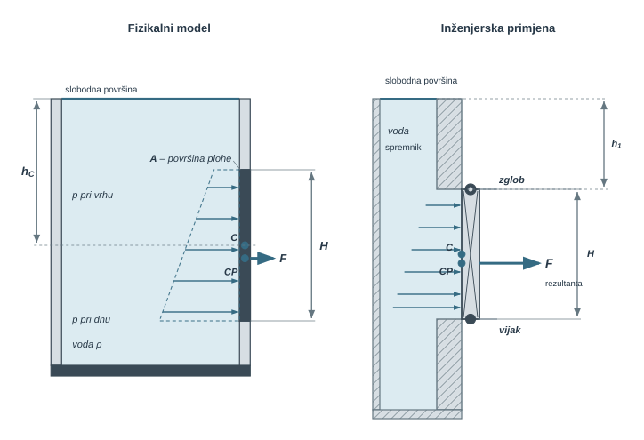
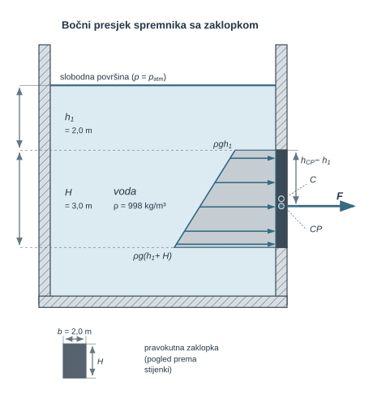
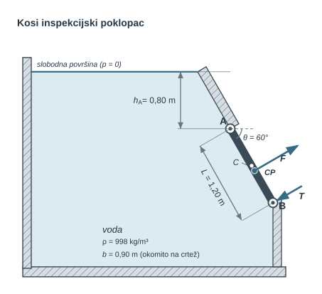
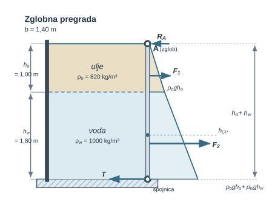
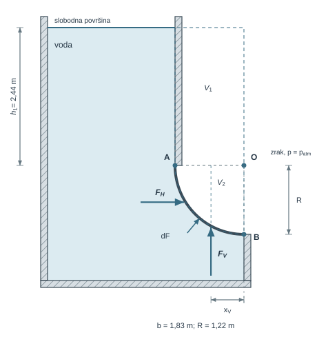
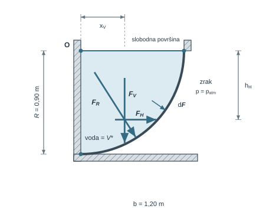
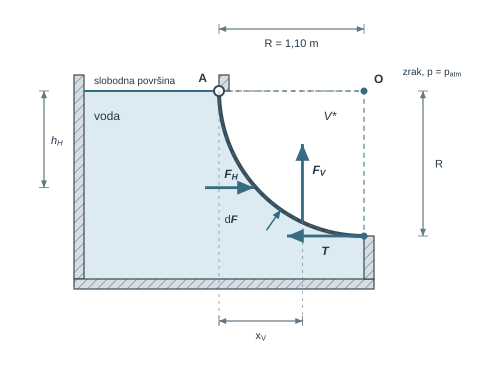
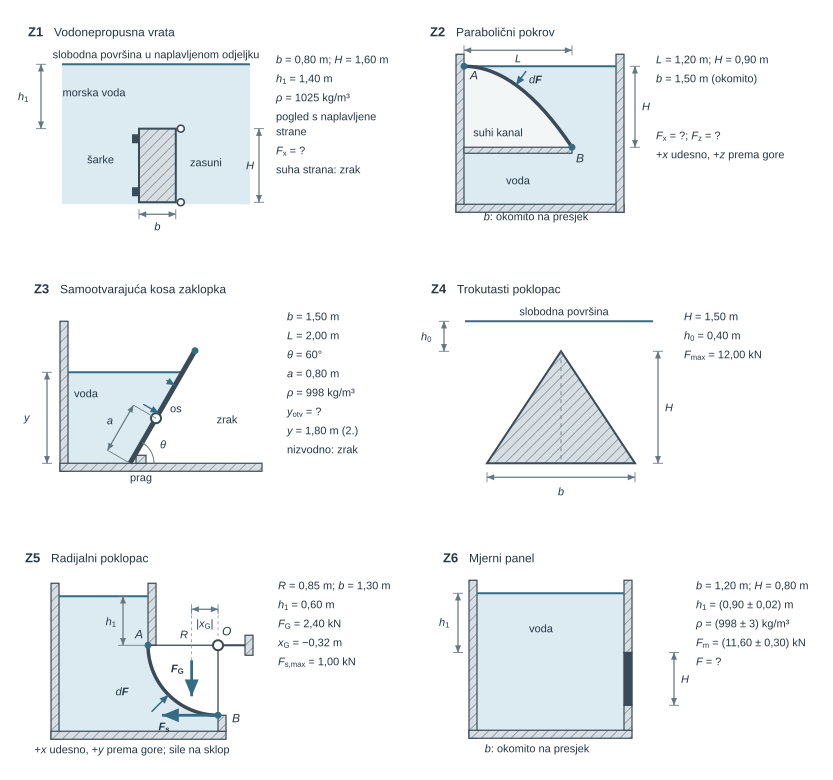

Fluid koji miruje djeluje na plohu samo okomitim tlakom, a taj tlak raste s dubinom. Za dimenzioniranje vrata, poklopca ili pregrade potrebni su iznos, smjer i pravac djelovanja rezultantne sile, jer o njima ovise reakcije u zglobovima, vijcima i osloncima. Polazište je raspodjela tlaka izvedena u []{.mf1-chapter-ref target="u03"}, a u ovom se poglavlju ta raspodjela integrira po plohi.

Na ravnoj plohi sve lokalne tlačne sile imaju isti smjer, pa je rezultanta $F=\rho gAh_C$: tlak u težištu množi se površinom $A$. Za okomitu plohu visine $H$ čiji je gornji rub na dubini $h_1$ težište je na dubini $h_C=h_1+H/2$. Rezultanta ne djeluje u težištu, nego u centru tlaka na dubini $h_{CP}=h_C+I_G/(Ah_C)$, gdje je $I_G$ drugi moment površine oko težišne osi. Za pravokutnik širine $b$ iznosi $bH^3/12$, za trokut s osnovicom $b$ i visinom $H$ iznosi $bH^3/36$, a za krug promjera $d$ iznosi $\pi d^4/64$. Budući da tlak raste s dubinom, centar tlaka CP leži ispod težišta C, a razmak $I_G/(Ah_C)$ to je manji što je ploha dublje.

Na zakrivljenoj plohi lokalne normale mijenjaju smjer, pa se rezultanta traži po komponentama. Iznos vodoravne komponente jednak je sili na okomitu projekciju plohe, $|F_H|=\rho gA_xh_{Cx}$, a iznos okomite komponente težini fluida u pomoćnom volumenu između plohe i razine slobodne površine, $|F_V|=\rho gV^*$. Smjer svake komponente određuje jedinična normala $\vec n_f$ usmjerena iz stvarnog fluida prema stijenci. Jednoliki tlak plina $p_{pl}$ koji se s druge strane plohe ne poništava mijenja i silu i položaj njezina hvatišta.

Poglavlje redom obrađuje izbor referentnog tlaka i smjera sile, rezultantu i centar tlaka na okomitoj i nagnutoj ravnoj plohi te komponente sile na zakrivljenoj plohi. Model pretpostavlja mirujući fluid, homogene slojeve stalne gustoće, jednoliko gravitacijsko polje i zanemarive kapilarne učinke. Hidrostatika pritom daje opterećenje konstrukcije, ne i njezinu čvrstoću. Isti se postupak primjenjuje na brodske pregrade i vodonepropusna vrata, brane, ustave i taložnike. Uzgon kao rezultanta tlaka po zatvorenoj plohi obrađuje se u []{.mf1-chapter-ref target="u06"}, a tlak uz ustavu ispod koje voda struji u []{.mf1-chapter-ref target="u15"}.

Slika [-@fig-u05-pregled-sila-na-plohe] povezuje model i primjenu. Lijevo je okomita ploha površine $A$ i visine $H$ u stijenci spremnika s vodom gustoće $\rho$. Trapezna raspodjela tlaka okomita je na plohu i raste od vrha prema dnu, a rezultanta $F$ djeluje u centru tlaka CP, ispod težišta C na dubini $h_C$. Desno je inspekcijski poklopac s gornjim zglobom i donjim vijkom na stijenci spremnika; gornji mu je rub na dubini $h_1$, a s vanjske je strane zrak. Na prikazanoj plohi tlak raste s dubinom, pa je CP ispod C, a donji vijak prenosi veću komponentu reakcije od gornjeg zgloba.

{#fig-u05-pregled-sila-na-plohe fig-align="center" fig-alt="Dva panela: lijevo trapezni dijagram tlaka na okomitoj plohi u stijenci spremnika s težištem C, centrom tlaka CP i silom F, desno poklopac na stijenci spremnika sa zglobom gore, vijkom dolje i rezultantom F."}

**Procijenjeno vrijeme rada uz priručnik:** 11 sati.

## Hidrostatičke sile na plohe {#hidrostatske-sile-na-plohe}

Tlak je lokalna veličina, dok je opterećenje poklopca, vrata ili stijenke određeno njegovom raspodjelom po cijeloj plohi. Hidrostatička analiza zato odgovara na dva pitanja:

1. koliki su iznos i smjer rezultantne sile;
2. kojim pravcem ta sila djeluje.

Na ravnoj plohi sve lokalne tlačne sile imaju isti smjer, pa se integracijom traže iznos i centar tlaka. Na zakrivljenoj plohi lokalne normale mijenjaju smjer, pa je pouzdanije najprije odrediti vodoravnu i okomitu komponentu. Oba slučaja proizlaze iz istoga temeljnog zapisa

$$
d\vec F=p\,\vec n_f\,dA,
$$ {#eq-sile-plohe-od-lokalnog-tlaka-do-sile-na-plohu-01}

gdje je $\vec n_f$ jedinična normala usmjerena **iz stvarnog fluida prema stijenci**. Ta definicija normale nije formalnost: ona određuje predznak svake komponente sile.

## Referentni tlak i smjer sile

Prije integriranja treba nacrtati obje strane plohe. Neto tlak je razlika tlakova koji djeluju s njezinih dviju strana. Ako je spremnik otvoren i atmosfera djeluje i na slobodnu površinu i na vanjsku stranu poklopca, atmosferski se doprinos poništava. Tada je najjednostavnije rabiti manometarski tlak

$$
p=\rho gh.
$$ {#eq-sile-plohe-referentni-tlak-i-smjer-sile-01}

Ako se jednoliki tlak plina $p_{pl}$ iznad slobodne površine (npr. nadtlak u zatvorenom spremniku) **ne poništava**, neto raspodjela glasi

$$
p_{\mathrm{net}}(h)=p_{pl}+\rho gh.
$$ {#eq-sile-plohe-referentni-tlak-i-smjer-sile-02}

Jednoliki član mijenja i silu i položaj njezina hvatišta. Zato se formula za centar tlaka izvedena samo za $p=\rho gh$ ne smije automatski primijeniti na zatvoren spremnik s plinskim nadtlakom.

## Ravna ploha: rezultanta i centar tlaka

::: {.mf1-izvod}

Matematički izvod — Rezultanta na ravnoj plohi

**Pitanje.** Kolika je sila neto tlaka na ravnu plohu i o čemu ovisi? Na ravnoj plohi normala je stalna. Zato se vektorska integracija svodi na određivanje iznosa

$$
F=\int_A p\,dA.
$$ {#eq-sile-plohe-ravna-ploha-rezultanta-i-centar-tlaka-01}

Za otvoren spremnik i neto manometarski tlak $p=\rho gh$ vrijedi

$$
F=\rho g\int_A h\,dA=\rho gAh_C,
$$ {#eq-u05-sila-ravna-ploha}

gdje je $A$ površina plohe, a $h_C$ dubina njezina težišta ispod slobodne površine. Rezultanta djeluje okomito na plohu, od fluida prema stijenci. Zapis $F=p_C A$ valjan je zato što je u homogenom fluidu tlak linearna funkcija dubine, pa je srednji tlak jednak tlaku u težištu plohe.

Za okomiti pravokutni pojas širine $b$, od dubine $h_a$ do $h_b$, isti se rezultat dobiva izravno:

$$
F=\rho gb\int_{h_a}^{h_b}h\,dh
=\frac{\rho gb}{2}\left(h_b^2-h_a^2\right).
$$ {#eq-sile-plohe-ravna-ploha-rezultanta-i-centar-tlaka-02}

Rastavljanjem razlike kvadrata ponovno se dobiva $F=\rho gA(h_a+h_b)/2$. Integralni i težišni zapis nisu dvije različite metode, nego dva oblika iste bilance.

**Provjera.** Za pojas koji počinje na slobodnoj površini ($h_a=0$) integral daje $F=\rho gbh_b^2/2=\rho gA\,(h_b/2)$, što je upravo $\rho gAh_C$ uz $h_C=h_b/2$.
:::

### Centar tlaka

::: {.mf1-izvod}

Matematički izvod — Centar tlaka

**Pitanje.** Kroz koju točku prolazi rezultanta? Pravac djelovanja rezultante dobiva se iz jednakosti momenata. Za okomitu koordinatu $h$ mjerenu od slobodne površine prema dolje,

$$
Fh_{CP}=\int_A h\,p\,dA=\rho g\int_A h^2\,dA.
$$ {#eq-sile-plohe-centar-tlaka-01}

Za neto polje $p=\rho gh$ slijedi

$$
h_{CP}=\frac{I_O}{Ah_C}
=h_C+\frac{I_G}{Ah_C},
$$ {#eq-u05-centar-tlaka-vertikalna}

gdje je $I_G$ drugi moment površine oko težišne osi paralelne sa slobodnom površinom, a $I_O=I_G+Ah_C^2$. Na plohi koja nije vodoravna i na koju djeluje pozitivni manometarski tlak centar tlaka nalazi se dublje od težišta. To nije opće pravilo za svaku moguću raspodjelu: za vodoravnu plohu ili jednoliki neto tlak hvatište je u težištu, a za kombinaciju $p_{pl}+\rho gh$ moment treba računati iz cijele raspodjele.

Ako je $p_{pl}$ jednoliki neto doprinos, opći zapis za dubinu hvatišta jest

$$
h_{CP}=\frac{\int_A h\,(p_{pl}+\rho gh)\,dA}
{(p_{pl}+\rho gh_C)A}.
$$ {#eq-sile-plohe-centar-tlaka-02}

Taj je oblik pouzdaniji od pamćenja posebnih korekcija jer zahtijeva da se sila i moment računaju iz iste raspodjele tlaka.

**Provjera.** Uz $p_{pl}\to0$ izraz za $h_{CP}$ prelazi u jednadžbu [-@eq-u05-centar-tlaka-vertikalna]; uz $\rho g\to0$ (samo jednoliki tlak) daje $h_{CP}=h_C$.
:::

::: {.mf1-fizikalno-znacenje}

Fizikalno značenje

Centar tlaka nije težište plohe, nego težište dijagrama tlaka. Omjer $I_G/(Ah_C)$ smanjuje se s dubinom težišta, pa se na duboko uronjenom poklopcu hvatište približava težištu i opterećenje je gotovo jednoliko; na plitkom poklopcu koji počinje na slobodnoj površini (trokutni dijagram) donja trećina nosi 5/9 sile, više od polovice. Za konstrukciju to znači: iznos sile određuje nosivost ploče, a položaj hvatišta raspodjelu reakcija na zglob, zasune i vijke.
:::

### Nagnuta ploha i jasno definiran kut

::: {.mf1-izvod}

Matematički izvod — Nagnuta ploha

**Pitanje.** Kako nagib plohe mijenja silu i hvatište ako je dubina težišta ista?

Neka je $y$ koordinata duž linije najvećeg pada po plohi (ovdje nije okomita os koordinatnog sustava), a $\theta$ kut te linije prema **vodoravnici**, $0\leq\theta\leq90^\circ$. Ako je početna točka osi $y$ na dubini $h_0$, tada je

$$
h(y)=h_0+y\sin\theta.
$$ {#eq-sile-plohe-nagnuta-ploha-i-jasno-definiran-kut-01}

Za potpuno uronjenu ravnu plohu i $p_{pl}=0$ rezultanta ostaje

$$
F=\rho gAh_C,
$$ {#eq-sile-plohe-nagnuta-ploha-i-jasno-definiran-kut-02}

ali to znači jednaku silu samo za plohe jednake površine i jednake dubine težišta. Nagib nije nestao iz geometrije: određuje dubine rubova, smjer normale i krak sile prema zglobu.

Moment oko težišne osi paralelne sa slobodnom površinom daje položaj centra tlaka duž plohe

$$
y_{CP}=y_C+\frac{I_G\sin\theta}{Ah_C},
$$ {#eq-sile-plohe-nagnuta-ploha-i-jasno-definiran-kut-03}

a njegova dubina ispod slobodne površine iznosi

$$
h_{CP}=h_C+\frac{I_G\sin^2\theta}{Ah_C}.
$$ {#eq-u05-centar-tlaka-nagnuta}

**Provjera.** Za $\theta=90^\circ$ dobiva se okomita ploha. Kada $\theta\to0$, tlak po vodoravnoj plohi postaje jednolik i $h_{CP}\to h_C$.
:::

::: {.mf1-interaktivno}

Numerički pokus — Ravna ploha

**Predvidi.** Kako se mijenjaju $F$ i $h_{CP}-h_C$ kada cijelu plohu spustiš dublje?

**Provjeri i protumači.** Usporedi numeričku integraciju tlaka s analitičkim izrazima. Zatim pri istoj dubini težišta promijeni nagib i objasni razliku u hvatištu sile.

<a class="mf1-interaktivno-veza" href="https://martibasic.github.io/MF1_udzbenik/jlite/lab/index.html?path=u05_sila_na_ravnu_plohu.ipynb">Pokreni u pregledniku</a>

:::

::: {#cfd-ustava-opterecenje .mf1-cfd title="Računalna dinamika fluida"}

**Zatvorena ustava i njezin pogon.** Za nagnutu ustavu gradskoga kanala želimo znati silu vode i moment oko osi vrtnje koji mora uravnotežiti pogon ili prag. Fizikalni model je mirujući fluid, kao u zadatku Z3 ovoga poglavlja: ulazi su širina i nagib ustave, razina vode i položaj osi vrtnje; izlazi su vektor sile i moment oko te osi. Tlak izračunan CFD-om integriramo po cijeloj plohi, a svaki doprinos momentu množimo njegovim krakom prema osi ustave. Provjera: sila i krak njezina hvatišta prema osi iz Z3 moraju se poklopiti s integriranim izlazima, uključujući dubinu pri kojoj moment mijenja predznak; za slojeviti fluid isti je postupak proveden u primjeru [-@ex-u05-pregrada-ulje-voda]. Odluka se odnosi na potreban moment pogona i raspodjelu reakcija na zglob i prag. Zapis iste integracije u CFD-u, s normalom iz tijela u fluid i zato s negativnim predznakom, navodi tablica u odjeljku [-@sec-cfd-mapa].

Zatim možemo istražiti djelomično otvaranje: pojavljuje se mlaz ispod ustave, pa hidrostatička raspodjela uz otvor više nije dovoljan opis. CFD tada povezuje položaj ustave, protok i opterećenje pogona. Točna ukupna sila ne jamči točan moment, a tlak u jednoj točki ne opisuje cijelu plohu. Isti se postupak primjenjuje na stijenku cisterne iz prethodnog poglavlja; nizvodni mlaz i skok pratimo u []{.mf1-chapter-ref target="u15"}.
:::

## Riješeni primjeri: ravne plohe

::: {#ex-u05-vertikalna-pravokutna-zaklopka .mf1-we}

Okomita pravokutna zaklopka T1

**Tekst zadatka**

Kruta pravokutna zaklopka širine $b=2{,}0\ \mathrm{m}$ i visine $H=3{,}0\ \mathrm{m}$ potpuno je uronjena u mirujuću vodu gustoće $\rho=998\ \mathrm{kg/m^3}$. Gornji joj je rub na dubini $h_1=2{,}0\ \mathrm{m}$. Vanjska strana i slobodna površina vode izložene su atmosferi. Zanemari deformaciju zaklopke.

**Traži se**

Odredi rezultantnu silu i centar tlaka.

{#fig-u05-vertikalna-pravokutna-zaklopka fig-align="center" fig-alt="Bočni presjek spremnika s vodom i pogled na zaklopku, uz trapezni dijagram tlaka od ρgh1 do ρg(h1 + H) i rezultantu F na dubini centra tlaka."}

**Rješenje**

Površina i dubina težišta su

$$
A=bH=6{,}0\ \mathrm{m^2},\qquad
h_C=h_1+\frac H2=3{,}5\ \mathrm{m}.
$$ {#eq-sile-plohe-rijeseni-primjer-vertikalna-pravokutna-zaklopka-01}

Stoga je

$$
F=\rho gAh_C
=998\cdot9{,}81\cdot6{,}0\cdot3{,}5
=205{,}6\ \mathrm{kN}.
$$ {#eq-sile-plohe-rijeseni-primjer-vertikalna-pravokutna-zaklopka-02}

Za vodoravnu težišnu os pravokutnika

$$
I_G=\frac{bH^3}{12}=4{,}50\ \mathrm{m^4},
$$ {#eq-sile-plohe-rijeseni-primjer-vertikalna-pravokutna-zaklopka-03}

pa je

$$
h_{CP}=3{,}5+\frac{4{,}50}{6{,}0\cdot3{,}5}
=3{,}714\ \mathrm{m}.
$$ {#eq-sile-plohe-rijeseni-primjer-vertikalna-pravokutna-zaklopka-04}

Centar tlaka je $1{,}714\ \mathrm{m}$ ispod gornjeg ruba.

**Provjera i tumačenje**

Tlak na rubovima iznosi $19{,}58$ i $48{,}95\ \mathrm{kPa}$; umnožak srednje vrijednosti $34{,}27\ \mathrm{kPa}$ i površine $6{,}0\ \mathrm{m^2}$ ponovno daje $205{,}6\ \mathrm{kN}$. Hvatište je između težišta ($3{,}5\ \mathrm{m}$) i donjeg ruba ($5{,}0\ \mathrm{m}$).
:::

::: {#ex-u05-kosi-poklopac .mf1-we}

Kosi poklopac sa spojnicom T2

**Tekst zadatka**

Pravokutni poklopac širine $b=0{,}90\ \mathrm{m}$ i duljine $L=1{,}20\ \mathrm{m}$ zglobno je vezan na gornjem rubu $A$, na dubini $h_A=0{,}80\ \mathrm{m}$. Ploha je nagnuta za $\theta=60^\circ$ prema vodoravnici, a spojnica na donjem rubu djeluje okomito na nju. Voda miruje, a atmosferski se tlak poništava. Zanemari težinu poklopca i trenje zgloba.

**Traži se**

Odredi hidrostatičku silu, njezin krak prema zglobu i silu spojnice.

{#fig-u05-kosi-poklopac fig-align="center" fig-alt="Poklopac nagnut za 60 stupnjeva u vodi, sa zglobom A na gornjem rubu, točkama C i CP, silom vode F i silom spojnice okomitom na poklopac u donjem rubu B."}

**Veza s proračunom.** Širina $b$ mjeri se okomito na skicu. Dubina u vodi i udaljenost duž poklopca nisu ista veličina.

**Rješenje**

Površina i dubina težišta su

$$
A=bL=1{,}08\ \mathrm{m^2},\qquad
h_C=h_A+\frac L2\sin\theta=1{,}3196\ \mathrm{m}.
$$ {#eq-sile-plohe-rijeseni-primjer-kosi-poklopac-sa-spojnicom-t2-01}

Zato je

$$
F=\rho gAh_C=13{,}95\ \mathrm{kN}.
$$ {#eq-sile-plohe-rijeseni-primjer-kosi-poklopac-sa-spojnicom-t2-02}

Koordinata $y$ mjeri se od zgloba niz plohu. Budući da je $h(y)=h_A+y\sin\theta$, jednakost momenata daje

$$
y_{CP}=
\frac{h_A L^2/2+(\sin\theta)L^3/3}
{h_A L+(\sin\theta)L^2/2}
=0{,}679\ \mathrm{m}.
$$ {#eq-sile-plohe-rijeseni-primjer-kosi-poklopac-sa-spojnicom-t2-03}

Moment tlaka oko zgloba iznosi $M_A=Fy_{CP}=9{,}47\ \mathrm{kN\,m}$. Spojnica ima krak $L$, pa

$$
F_s=\frac{M_A}{L}=7{,}89\ \mathrm{kN}.
$$ {#eq-sile-plohe-rijeseni-primjer-kosi-poklopac-sa-spojnicom-t2-04}

**Provjera i tumačenje**

Centar tlaka mora duž plohe biti niže od težišta jer tlak raste s dubinom: $0{,}600<y_{CP}<1{,}200\ \mathrm{m}$. Bilanca momenata potvrđuje $F_sL=Fy_{CP}$.
:::

::: {#ex-u05-pregrada-ulje-voda .mf1-we}

Zglobna pregrada s uljem iznad vode T3

**Tekst zadatka**

Okomita pregrada širine $b=1{,}40\ \mathrm{m}$ zglobno je vezana na slobodnoj površini. S jedne strane zadržava ulje gustoće $\rho_u=820\ \mathrm{kg/m^3}$ i visine $h_u=1{,}00\ \mathrm{m}$ iznad vode gustoće $\rho_v=1000\ \mathrm{kg/m^3}$ i visine $h_v=1{,}80\ \mathrm{m}$. Druga je strana izložena atmosferi. Donji rub pridržava vodoravna spojnica. Fluidi miruju i ne miješaju se; zglob i spojnica su idealni.

**Traži se**

Odredi silu, centar tlaka i statičke reakcije.

{#fig-u05-pregrada-ulje-voda fig-align="center" fig-alt="Pregrada sa zglobom A na vrhu i spojnicom na dnu, sloj ulja iznad vode s dijagramom tlaka koji na razdjelnici mijenja nagib, sile F1 i F2 te reakcije spojnice i zgloba."}

**Veza s proračunom.** Sile $F_1$ i $F_2$ djeluju na pregradu, a $F_s$ i $R_A$ su reakcije spojnice i zgloba. Širina $b$ okomita je na skicu; duljine strelica nisu u mjerilu.

**Rješenje**

Na uljnom polju dijagram tlaka je trokut, pa je

$$
F_1=\frac12\rho_u gb h_u^2=5{,}631\ \mathrm{kN}.
$$ {#eq-sile-plohe-rijeseni-primjer-zglobna-pregrada-s-uljem-iznad-01}

Na vodenom polju djeluju pravokutni doprinos uljnog stupca i trokutni doprinos vode:

$$
F_{2,r}=\rho_u gbh_uh_v=20{,}271\ \mathrm{kN},
$$ {#eq-sile-plohe-rijeseni-primjer-zglobna-pregrada-s-uljem-iznad-02}

$$
F_{2,t}=\frac12\rho_vgbh_v^2=22{,}249\ \mathrm{kN}.
$$ {#eq-sile-plohe-rijeseni-primjer-zglobna-pregrada-s-uljem-iznad-03}

Ukupna sila iznosi

$$
F=F_1+F_{2,r}+F_{2,t}=48{,}151\ \mathrm{kN}.
$$ {#eq-sile-plohe-rijeseni-primjer-zglobna-pregrada-s-uljem-iznad-04}

Momenti oko gornjeg zgloba računaju se preko težišta svakog dijela dijagrama tlaka:

$$
M_A=
F_1\frac{2h_u}{3}
+F_{2,r}\left(h_u+\frac{h_v}{2}\right)
+F_{2,t}\left(h_u+\frac{2h_v}{3}\right)
=91{,}218\ \mathrm{kN\,m}.
$$ {#eq-sile-plohe-rijeseni-primjer-zglobna-pregrada-s-uljem-iznad-05}

Zato su

$$
h_{CP}=\frac{M_A}{F}=1{,}894\ \mathrm{m},
$$ {#eq-sile-plohe-rijeseni-primjer-zglobna-pregrada-s-uljem-iznad-06}

$$
F_s=\frac{M_A}{h_u+h_v}=32{,}578\ \mathrm{kN},\qquad
R_A=F-F_s=15{,}574\ \mathrm{kN}.
$$ {#eq-sile-plohe-rijeseni-primjer-zglobna-pregrada-s-uljem-iznad-07}

**Provjera i tumačenje**

Tlak je kontinuiran na razdjelnici: vodeno polje počinje s tlakom $\rho_u gh_u$, a ne s nulom; bez doprinosa $F_{2,r}$ to ne bi vrijedilo. Bilance $R_A+F_s=F$ i $F_s(h_u+h_v)=M_A$ zatvorene su.
:::

## Zakrivljena ploha: projekcija i pomoćni volumen

Na zakrivljenoj plohi lokalne normale nisu paralelne. Izravni vektorski integral i dalje je temelj,

$$
\vec F=\int_A p\,\vec n_f\,dA,
$$ {#eq-sile-plohe-zakrivljena-ploha-projekcija-i-pomocni-volumen-01}

ali se za često korištene cilindrične i dvodimenzijske geometrije rezultat preglednije nalazi po komponentama.

### Vodoravna komponenta {#horizontalna-komponenta}

::: {.mf1-izvod}

Matematički izvod — Vodoravna komponenta

**Pitanje.** Zašto vodoravnu komponentu daje sila na okomitu projekciju? Za odabrani vodoravni smjer $x$ vrijedi

$$
F_x=\int_A p\,n_{f,x}\,dA.
$$ {#eq-sile-plohe-horizontalna-komponenta-01}

Predznačeni element $n_{f,x}dA$ jednak je projekciji elementa na ravninu okomitu na $x$. Ako se predznak normale ne mijenja i projekcija je jednoznačna, iznos vodoravne komponente jednak je sili na **okomitu projekciju** zakrivljene plohe:

$$
|F_H|=\rho gA_xh_{Cx}.
$$ {#eq-u05-zakrivljena-horizontalna}

Pravac djelovanja prolazi centrom tlaka te okomite projekcije. Ako ploha ima pregib ili prevjes ili ako $n_{f,x}$ mijenja predznak, površinu treba podijeliti, a komponente predznačeno zbrojiti; jedna ukupna „sjena” tada nije dovoljna.

**Provjera.** Izraz prelazi u jednadžbu [-@eq-u05-sila-ravna-ploha] kad je ploha ravna i okomita, jer je tada projekcija sama ploha.
:::

### Okomita komponenta i njezin smjer {#vertikalna-komponenta-i-njezin-smjer}

::: {.mf1-izvod}

Matematički izvod — Okomita komponenta iz bilance stupca fluida

**Pitanje.** Zašto je iznos okomite komponente jednak težini pomoćnog volumena? Za okomitu komponentu vrijedi

$$
F_V=\int_A p\,n_{f,z}\,dA.
$$ {#eq-sile-plohe-vertikalna-komponenta-i-njezin-smjer-01}

U otvorenom spremniku, s manometarskim tlakom jednakim nuli na slobodnoj površini, iznos se može dobiti iz ravnoteže pomoćnog volumena $V^*$ omeđenog zakrivljenom plohom, okomitim bočnim plohama i vodoravnom zatvarajućom plohom:

$$
|F_V|=\rho gV^*.
$$ {#eq-u05-zakrivljena-vertikalna}

**Bilanca.** Promatramo fluid (stvarni ili zamišljeni, istoga tlačnog polja) u volumenu $V^*$. Na njega djeluju težina $\rho gV^*$ prema dolje, tlak na vodoravnoj zatvarajućoj plohi (nula za manometarski tlak na slobodnoj površini), tlakovi na okomitim bočnim plohama (vodoravni, bez okomitog doprinosa) i reakcija zakrivljene plohe, jednaka $-F_V$. Iz $\sum F_z=0$ slijedi $|F_V|=\rho gV^*$, a iz jednakosti momenata slijedi da pravac djelovanja prolazi težištem toga volumena. Formula daje **iznos**, ne automatski smjer. Smjer se određuje ovim redoslijedom:

1. označi stvarnu stranu na kojoj fluid dodiruje plohu;
2. nacrtaj lokalnu strelicu $p\vec n_f$ od fluida prema stijenci;
3. pročitaj predznak njezine okomite komponente.

Fluid iznad konkavne plohe u pravilu je opterećuje prema dolje. Fluid koji kvasi konveksnu donju stranu može djelovati prema gore. Položaj nacrtanog pomoćnog volumena sam po sebi nije kriterij smjera jer taj volumen ne mora biti stvarni fluid.

Ako je tlak na vodoravnoj zatvarajućoj plohi različit od nule ili se ne poništava tlak s druge strane, njegov doprinos treba dodati predznačeno. U složenoj geometriji rezultat je najsigurnije provjeriti izravnim integralom $\int p n_{f,z}\,dA$.

Kad su predznačene komponente određene,

$$
F_R=\sqrt{F_H^2+F_V^2},\qquad
\theta_R=\operatorname{atan2}(F_V,F_H).
$$ {#eq-sile-plohe-vertikalna-komponenta-i-njezin-smjer-02}

Kut $\theta_R$ rezultante mjeri se od vodoravnice; indeks $R$ razlikuje ga od kuta nagiba ravne plohe $\theta$. Funkcija $\operatorname{atan2}$ zadržava kvadrant; obični $\arctan(F_V/F_H)$ može sakriti pogrešan predznak. Na kružnom luku u ravninskom presjeku sve lokalne tlačne sile prolaze središtem zakrivljenosti, pa kroz njega prolazi i rezultanta. To geometrijsko svojstvo ne vrijedi za proizvoljnu zakrivljenu plohu: normale parabolične ili eliptične plohe nemaju zajedničku točku, pa moment oko bilo koje osi treba računati iz obiju komponenata i njihovih krakova (zadatak Z2).

**Provjera.** Za četvrtinu valjka koja počinje na slobodnoj površini izravna integracija daje $F_H=\rho gbR^2/2$ i $|F_V|=\rho gb\pi R^2/4$, što je upravo projekcija i pomoćni volumen.
:::

::: {.mf1-granica-modela}

Granica modela — Što hidrostatički račun sile na plohu ne obuhvaća

- Fluid miruje, slojevi su homogeni, a jednoliki tlak plina $p_{pl}$ ulazi samo ako se ne poništava s druge strane plohe. Čim se ustava otvori ili fluid struji, tlak uz plohu više nije $\rho gh$ (mlaz i skok u []{.mf1-chapter-ref target="u15"}).
- Pomoćni volumen daje iznos $|F_V|$ samo za otvoreni manometarski slučaj s vodoravnom zatvarajućom plohom na razini slobodne površine; za zatvoren spremnik treba dodati predznačeni doprinos tlaka na toj plohi.
- Rezultanta prolazi središtem zakrivljenosti samo za kružni luk; za drugu zakrivljenost moment se računa iz komponenata.
- Račun daje opterećenje, ali ne obuhvaća čvrstoću, zamor, brtvljenje, deformaciju, valove, udare ni normativnu prihvatljivost.
:::

::: {.mf1-interaktivno}

Numerički pokus — Zakrivljena ploha

**Predvidi.** Prije računanja iznosa odredi smjer $F_V$ prema strani koju fluid kvasi.

**Provjeri i protumači.** Mijenjaj dubinu i polumjer te usporedi numeričke komponente s projekcijom i pomoćnim volumenom. Objasni zašto rezultanta kružnog luka prolazi središtem zakrivljenosti.

<a class="mf1-interaktivno-veza" href="https://martibasic.github.io/MF1_udzbenik/jlite/lab/index.html?path=u06_zakrivljena_ploha.ipynb">Pokreni u pregledniku</a>

:::

::: {.mf1-cfd title="Računalna dinamika fluida"}

**Zakrivljeni zatvarač: oblik mijenja smjer opterećenja.** Za zakrivljeni zatvarač kanala CFD zbraja vektore $p_i\vec n_{f,i}A_i$ po plohama mreže. Normala ide iz fluida u zatvarač, pa rezultat daje silu fluida na konstrukciju. U mirovanju vodoravnu i okomitu komponentu provjeravamo projekcijom i pomoćnim volumenom, a pritom uzimamo u obzir tlakove na svim opterećenim stranama.

**Zastani i promisli.** Dvije raspodjele tlaka daju jednaku silu na ustavu, ali različit moment oko istog zgloba. Daju li jednako opterećenje pogona?

Ručni proračun u primjeru [-@ex-u05-zglobni-cetvrtcilindricni-poklopac] pokazuje zašto moment računamo oko zgloba $A$, a ne oko središta zakrivljenosti $O$. Jednake rezultante dviju raspodjela tlaka ne jamče jednak moment: usporedi njihove krakove prema istoj osi. Pogon zato provjeravamo i silom i momentom. Nakon otvaranja dodaju se strujanje i viskozna naprezanja. Tada mreža mora vjerno opisati zakrivljenost, a konačan izlaz čine komponente sile i moment, povezane s konkretnim položajem zatvarača.
:::

## Riješeni primjeri: zakrivljene plohe

::: {#ex-u05-potopljena-cetvrtina-kruga .mf1-we}

Potopljena četvrtina kruga, sila prema gore T2

**Tekst zadatka**

Četvrtcilindrična ploha ima polumjer $R=1{,}22\ \mathrm{m}$, širinu $b=1{,}83\ \mathrm{m}$ i gornju točku na dubini $h_1=2{,}44\ \mathrm{m}$. Voda gustoće $998\ \mathrm{kg/m^3}$ kvasi konveksnu vanjsku i donju stranu. Atmosferski se tlak poništava, a rubni se učinci zanemaruju. Pozitivni okomiti smjer je prema gore.

**Traži se**

Odredi komponente, pravce djelovanja i rezultantu.

{#fig-u05-potopljena-cetvrtcilindricna-ploha fig-align="center" fig-alt="Četvrtina kruga sa središtem O i krajevima A i B ispod slobodne površine, voda uz konveksnu vanjsku i donju stranu luka, pomoćni volumen V1 i V2 na suhoj strani te komponente FH i FV."}

**Veza s proračunom.** Pomoćni volumen $V^*=V_1+V_2$ leži na suhoj strani i nije stvarna tekućina; $V_1$ je njegov pravokutni dio.

**Rješenje**

Za okomitu projekciju vrijedi

$$
A_x=Rb=2{,}233\ \mathrm{m^2},\qquad
h_{Cx}=h_1+\frac R2=3{,}05\ \mathrm{m}.
$$ {#eq-sile-plohe-rijeseni-primjer-potopljena-cetvrtina-kruga-sila-01}

Zato je

$$
F_H=\rho gA_xh_{Cx}=66{,}67\ \mathrm{kN}.
$$ {#eq-sile-plohe-rijeseni-primjer-potopljena-cetvrtina-kruga-sila-02}

Za projekciju je $I_G=bR^3/12=0{,}277\ \mathrm{m^4}$, pa vodoravna komponenta djeluje na dubini

$$
h_H=h_{Cx}+\frac{I_G}{A_xh_{Cx}}=3{,}091\ \mathrm{m}.
$$ {#eq-sile-plohe-rijeseni-primjer-potopljena-cetvrtina-kruga-sila-03}

Pomoćni volumen sastoji se od pravokutnog i četvrtcilindričnog dijela:

$$
V^*=h_1Rb+\frac{\pi R^2}{4}b
=5{,}448+2{,}139=7{,}587\ \mathrm{m^3}.
$$ {#eq-sile-plohe-rijeseni-primjer-potopljena-cetvrtina-kruga-sila-04}

Iznos okomite komponente je

$$
|F_V|=\rho gV^*=74{,}28\ \mathrm{kN}.
$$ {#eq-sile-plohe-rijeseni-primjer-potopljena-cetvrtina-kruga-sila-05}

Stvarna voda kvasi donju konveksnu stranu, pa lokalne tlačne strelice imaju okomitu komponentu prema gore: $F_V=+74{,}28\ \mathrm{kN}$. Vodoravni položaj pravca djelovanja, mjeren od okomice kroz središte kružnice $O$ (ta okomica prolazi i donjom točkom $B$), dobiva se iz težišta složenog volumena,

$$
x_V=\frac{(h_1Rb)(R/2)+[(\pi R^2/4)b][4R/(3\pi)]}{V^*}
=0{,}584\ \mathrm{m}.
$$ {#eq-sile-plohe-rijeseni-primjer-potopljena-cetvrtina-kruga-sila-06}

Rezultanta je

$$
F_R=\sqrt{66{,}67^2+74{,}28^2}=99{,}81\ \mathrm{kN},
$$ {#eq-sile-plohe-rijeseni-primjer-potopljena-cetvrtina-kruga-sila-07}

pod kutom $48{,}1^\circ$ iznad vodoravnice.

**Provjera i tumačenje**

Lokalna normala na donjoj strani koju voda kvasi ima pozitivnu okomitu komponentu, neovisno o tome gdje je nacrtan $V^*$. Budući da je ploha kružni luk, rezultanta prolazi kroz $O$, pa moment komponenata oko $O$ mora biti nula: $F_H(h_H-h_1)=66{,}67\cdot0{,}651=43{,}4\ \mathrm{kN\,m}$ i $F_Vx_V=74{,}28\cdot0{,}584=43{,}4\ \mathrm{kN\,m}$, što potvrđuje oba kraka.
:::

::: {#ex-u05-cetvrtcilindar-prema-dolje .mf1-we}

Četvrtcilindrični poklopac u spremniku s nadtlakom plina T3

**Tekst zadatka**

Četvrtcilindrični poklopac širine $b=1{,}20\ \mathrm{m}$ i polumjera $R=0{,}90\ \mathrm{m}$ počinje na slobodnoj površini vode u zatvorenom spremniku. Iznad vode je plin s manometarskim tlakom $p_{pl}=20{,}0\ \mathrm{kPa}$, a s druge strane poklopca zrak na atmosferskom tlaku. Voda gustoće $\rho=998\ \mathrm{kg/m^3}$ miruje i kvasi stranu prikazanu na skici: normale od fluida prema stijenci imaju okomite komponente prema dolje.

**Traži se**

Odredi komponente sile na poklopac i njihove pravce djelovanja te rezultantu. Usporedi hvatišta s otvorenim spremnikom ($p_{pl}=0$).

{#fig-u05-cetvrtcilindricni-poklopac-slobodna-povrsina fig-align="center" fig-alt="Četvrtina kruga koja počinje na slobodnoj površini zatvorenog spremnika, plin s nadtlakom iznad vode, voda iznad luka ispunjava pomoćni volumen V*, zrak ispod, a komponenta FV usmjerena je prema dolje."}

**Veza s proračunom.** Pozitivna os $z$ usmjerena je prema gore. Pomoćni volumen $V^*$ ispunjava stvarna voda, a plinski nadtlak djeluje na cijelu plohu jednoliko.

**Rješenje**

Neto tlak na poklopac je $p_{\mathrm{net}}=p_{pl}+\rho gh$, jer se nadtlak plina ne poništava s atmosferom na suhoj strani. Svaka se komponenta zato sastoji od jednolikoga plinskog i hidrostatičkog dijela. Za okomitu projekciju vrijedi

$$
\begin{aligned}
A_x&=Rb=1{,}08\ \mathrm{m^2},\\
F_{H,h}&=\rho gA_x\frac R2=4{,}758\ \mathrm{kN},\qquad
F_{H,p}=p_{pl}A_x=21{,}60\ \mathrm{kN}.
\end{aligned}
$$ {#eq-sile-plohe-rijeseni-primjer-cetvrtcilindricni-poklopac-uz-s-01}

Hidrostatički dio djeluje na dubini $2R/3=0{,}600\ \mathrm{m}$, a jednoliki plinski dio u težištu projekcije, na $R/2=0{,}450\ \mathrm{m}$. Iz jednakosti momenata oko slobodne površine slijedi

$$
F_H=26{,}36\ \mathrm{kN},\qquad
h_H=\frac{21{,}60\cdot0{,}450+4{,}758\cdot0{,}600}{26{,}36}=0{,}477\ \mathrm{m}.
$$ {#eq-sile-plohe-rijeseni-primjer-cetvrtcilindricni-poklopac-uz-s-02}

Okomita komponenta ima hidrostatički dio jednak težini stvarne vode u četvrtini valjka i plinski dio jednak $p_{pl}$ na vodoravnoj projekciji $Rb$:

$$
\begin{aligned}
V^*&=\frac{\pi R^2}{4}b=0{,}7634\ \mathrm{m^3},\\
F_{V,h}&=\rho gV^*=7{,}474\ \mathrm{kN},\qquad
F_{V,p}=p_{pl}Rb=21{,}60\ \mathrm{kN}.
\end{aligned}
$$ {#eq-sile-plohe-rijeseni-primjer-cetvrtcilindricni-poklopac-uz-s-03}

Obje djeluju prema dolje, pa je

$$
F_V=-(7{,}474+21{,}60)=-29{,}07\ \mathrm{kN}.
$$ {#eq-sile-plohe-rijeseni-primjer-cetvrtcilindricni-poklopac-uz-s-04}

Hidrostatički dio prolazi težištem četvrtine kruga, $4R/(3\pi)=0{,}382\ \mathrm{m}$ od okomite stijenke, a plinski dio sredinom projekcije, $R/2=0{,}450\ \mathrm{m}$, pa je pravac djelovanja udaljen od stijenke

$$
x_V=\frac{21{,}60\cdot0{,}450+7{,}474\cdot0{,}382}{29{,}07}=0{,}432\ \mathrm{m}.
$$ {#eq-sile-plohe-rijeseni-primjer-cetvrtcilindricni-poklopac-uz-s-05}

Rezultanta je

$$
F_R=\sqrt{26{,}36^2+29{,}07^2}=39{,}24\ \mathrm{kN},\qquad
\theta_R=\operatorname{atan2}(-29{,}07,\,26{,}36)=-47{,}8^\circ.
$$ {#eq-sile-plohe-rijeseni-primjer-cetvrtcilindricni-poklopac-uz-s-06}

**Provjera i tumačenje**

Na kružnom luku sve tlačne normale prolaze kroz $O$ za bilo koju raspodjelu tlaka, pa moment komponenata oko $O$ mora iščeznuti: $F_Hh_H=26{,}36\cdot0{,}477=12{,}58\ \mathrm{kN\,m}$ i $|F_V|x_V=29{,}07\cdot0{,}432=12{,}58\ \mathrm{kN\,m}$. Uz $p_{pl}=0$ ostaju samo hidrostatički dijelovi, $F_H=4{,}758\ \mathrm{kN}$ na $0{,}600\ \mathrm{m}$ i $F_V=-7{,}474\ \mathrm{kN}$ na $0{,}382\ \mathrm{m}$, s omjerom $|F_V|/F_H=\pi/2$ koji daje izravna integracija po luku. Nadtlak od $20\ \mathrm{kPa}$, oko dva metra vodenog stupca, povećava silu četiri do pet puta i pomiče oba hvatišta prema težištima projekcija. Zato se formula $h_{CP}=h_C+I_G/(Ah_C)$, izvedena samo za $p=\rho gh$, u zatvorenom spremniku ne smije primijeniti; moment se računa iz cijele raspodjele, kako je najavljeno u odjeljku o referentnom tlaku.
:::

::: {#ex-u05-zglobni-cetvrtcilindricni-poklopac .mf1-we}

Zglobni poklopac s okomitom silom prema gore T3

**Tekst zadatka**

Kruti četvrtcilindrični poklopac širine $b=1{,}40\ \mathrm{m}$ i polumjera $R=1{,}10\ \mathrm{m}$ ima zglob u gornjoj točki $A$ na slobodnoj površini vode. Donji rub pridržava vodoravna spojnica. Voda miruje i kvasi konveksnu donju i lijevu stranu; atmosferski se tlak poništava. Zanemari težinu poklopca i trenje zgloba. Pozitivni okomiti smjer je prema gore.

**Traži se**

Odredi komponente i statičku silu spojnice.

{#fig-u05-zglobni-cetvrtcilindricni-poklopac fig-align="center" fig-alt="Četvrtina kruga sa zglobom A na slobodnoj površini i središtem O, voda ispod i lijevo od luka, pomoćni volumen V* na suhoj strani, komponenta FV prema gore i vodoravna spojnica na donjem rubu."}

**Veza s proračunom.** $O$ je središte kružnice, a os poklopca je u zglobu $A$. Sile djeluju na poklopac; spojnica je izvan presjeka širine $b$. Pomoćni volumen $V^*$ leži na suhoj strani.

**Rješenje**

Vodoravna komponenta i njezin krak prema zglobu su

$$
F_H=\rho g(Rb)\frac R2=8{,}292\ \mathrm{kN},\qquad
h_H=\frac{2R}{3}=0{,}733\ \mathrm{m}.
$$ {#eq-sile-plohe-rijeseni-primjer-zglobni-poklopac-s-vertikalnom-01}

Pomoćni volumen je

$$
V^*=\frac{\pi R^2}{4}b=1{,}3305\ \mathrm{m^3},
$$ {#eq-sile-plohe-rijeseni-primjer-zglobni-poklopac-s-vertikalnom-02}

pa je iznos okomite komponente

$$
|F_V|=\rho gV^*=13{,}026\ \mathrm{kN}.
$$ {#eq-sile-plohe-rijeseni-primjer-zglobni-poklopac-s-vertikalnom-03}

Voda kvasi donju konveksnu stranu, stoga je $F_V$ **prema gore**. Njezin je vodoravni krak prema zglobu

$$
x_V=R-\frac{4R}{3\pi}=0{,}633\ \mathrm{m}.
$$ {#eq-sile-plohe-rijeseni-primjer-zglobni-poklopac-s-vertikalnom-04}

Rezultanta iznosi $F_R=15{,}441\ \mathrm{kN}$ i usmjerena je pod kutom $57{,}52^\circ$ iznad vodoravnice. Za prikazane smjerove obje komponente daju moment otvaranja oko $A$. Ravnoteža momenata zato zahtijeva

$$
F_sR=F_Hh_H+F_Vx_V,
$$ {#eq-sile-plohe-rijeseni-primjer-zglobni-poklopac-s-vertikalnom-05}

odnosno

$$
F_s=\frac{8{,}292\cdot0{,}733+13{,}026\cdot0{,}633}{1{,}10}
=13{,}026\ \mathrm{kN}.
$$ {#eq-sile-plohe-rijeseni-primjer-zglobni-poklopac-s-vertikalnom-06}

**Provjera i tumačenje**

Za ovu posebnu geometriju

$$
F_Hh_H=\rho gbR^3/3,
$$ {#eq-sile-plohe-rijeseni-primjer-zglobni-poklopac-s-vertikalnom-07}

$$
F_Vx_V=\rho gbR^3\left(\frac\pi4-\frac13\right).
$$ {#eq-sile-plohe-rijeseni-primjer-zglobni-poklopac-s-vertikalnom-08}

Zbroj je $\rho gb\pi R^3/4=F_VR$, pa je $F_s=F_V=13{,}026\ \mathrm{kN}$. Isto slijedi iz svojstva kružnog luka: rezultanta prolazi kroz $O$, koji leži na vodoravnici kroz $A$ na udaljenosti $R$, pa je $M_A=F_V\cdot R$. Jednakost vrijedi za ovu geometriju, ne općenito.
:::

::: {.mf1-samoprovjera}

Provjeri sebe

1. Zašto je pri računanju hidrostatičke sile važno razlikovati neto tlak od apsolutnog tlaka?

::: {.callout-note collapse="true"}
### Odgovor
Jednoliki referentni tlak može se poništiti samo ako djeluje s obiju strana na isti način; u suprotnom mijenja i silu i hvatište.
:::

2. Zašto je centar tlaka na uronjenoj ravnoj plohi niže od težišta plohe kada tlak raste s dubinom?

::: {.callout-note collapse="true"}
### Odgovor
Na dublje dijelove djeluje veći tlak, pa oni povlače rezultantu prema dolje.
:::

3. Zašto je za zakrivljenu plohu često sigurnije rastaviti silu na vodoravnu i okomitu komponentu?

::: {.callout-note collapse="true"}
### Odgovor
Na zakrivljenoj plohi normale mijenjaju smjer, a komponente se lakše vežu uz projekciju i težinu zamišljenog stupca fluida.
:::

4. Zašto u izrazu za dubinu centra tlaka nagnute plohe stoji $\sin^2\theta$, a u izrazu za položaj duž plohe samo $\sin\theta$?

::: {.callout-note collapse="true"}
### Odgovor
Pomak hvatišta duž plohe iznosi $I_G\sin\theta/(Ah_C)$; njegova okomita projekcija donosi još jedan faktor $\sin\theta$. Za vodoravnu plohu oba pomaka iščezavaju jer je tlak po njoj jednolik.
:::
:::

## Zadatci za vježbu {#sec-u05-zadatci}

U svim zadatcima uzmi $g=9{,}81\ \mathrm{m/s^2}$. Ako nije drukčije navedeno, voda ima $\rho=998\ \mathrm{kg/m^3}$, atmosferski tlak djeluje s obiju strana (gdje je prisutan), pa se računa neto manometarski tlak. Skica sa stranom koju fluid kvasi, normalom i pozitivnim smjerovima dio je postavljanja modela.

::::: {.mf1-vjezbe-list}

### Vodonepropusna vrata naplavljenog odjeljka {#task-vodonepropusna-vrata-naplavljenog-odjeljka .unnumbered .unlisted}

**Tekst zadatka**

Poprečna pregrada broda dijeli naplavljeni odjeljak od suhoga. U njoj su okomita pravokutna vodonepropusna vrata širine $b=0{,}80\ \mathrm{m}$ i visine $H=1{,}60\ \mathrm{m}$, sa šarkama duž lijevog okomitog ruba i zasunima duž desnoga. Morska voda gustoće $\rho=1025\ \mathrm{kg/m^3}$ naplavila je odjeljak tako da je gornji rub vrata $h_1=1{,}40\ \mathrm{m}$ ispod njezine slobodne površine; suha strana i slobodna površina na atmosferskom su tlaku. Rub vrata uz zasune krut je i oslanja se na dva zasuna, jedan u visini gornjega i jedan u visini donjega ruba vrata. Uzmi $+x$ od naplavljene prema suhoj strani.

**Traži se**

Odredi predznačenu rezultantnu silu vode na vrata, dubinu centra tlaka, moment te sile oko osi šarki, ukupnu silu koju preuzimaju zasuni i silu donjega zasuna.

:::: {.content-visible when-format="html"}
:::: {.content-visible .mf1-hint-online when-format="html"}
::: {.callout-note collapse="true" data-hint-key="true"}
### Naputak
Najprije izračunaj $A$ i $h_C$, zatim $h_{CP}=h_C+I_G/(Ah_C)$ s $I_G=bH^3/12$. Tlak ne ovisi o vodoravnom položaju, pa rezultanta djeluje na sredini širine: šarke i zasuni preuzimaju po polovinu sile. Udio donjega zasuna slijedi iz momenta oko gornjega zasuna s krakom $h_{CP}-h_1$.
:::
::::
::::

:::: {.content-visible .mf1-answer-online when-format="html"}
::: {.callout-tip collapse="true" data-answer-key="true"}
### Kontrolni rezultat

$F_x=+28{,}31\ \mathrm{kN}$; $h_{CP}=2{,}297\ \mathrm{m}$ ($0{,}897\ \mathrm{m}$ ispod gornjeg ruba); $M_{\text{šarke}}=Fb/2=11{,}33\ \mathrm{kN\,m}$; zasuni ukupno $F/2=14{,}16\ \mathrm{kN}$, od čega donji zasun $7{,}94\ \mathrm{kN}$, a gornji $6{,}22\ \mathrm{kN}$.
:::
::::

[Razina: T1]{.mf1-task-level}

### Parabolični pokrov suhog kanala {#task-parabolicni-pokrov-suhog-kanala .unnumbered .unlisted}

**Tekst zadatka**

Uz okomitu stijenku otvorenog bazena nalazi se suhi instalacijski kanal na atmosferskom tlaku, pokriven krutim zakrivljenim pokrovom širine $b=1{,}50\ \mathrm{m}$ (okomito na presjek). Presjek pokrova je parabola s tjemenom $A$ na slobodnoj površini uz stijenku i vodoravnom tangentom u $A$; pokrov završava u točki $B$ na vodoravnoj udaljenosti $L=1{,}20\ \mathrm{m}$ od stijenke i dubini $H=0{,}90\ \mathrm{m}$, gdje se spaja s dnom kanala. Voda gustoće $\rho=998\ \mathrm{kg/m^3}$ kvasi gornju (konveksnu) stranu pokrova; atmosferski se tlak poništava. Uzmi $+x$ od stijenke prema vodi, $+z$ prema gore i pozitivan moment suprotno kazaljci na satu.

**Traži se**

Odredi predznačene komponente $F_x$ i $F_z$ sile vode na pokrov, dubinu pravca djelovanja vodoravne i udaljenost pravca djelovanja okomite komponente od stijenke, rezultantu i moment sile vode oko $A$.

:::: {.content-visible when-format="html"}
:::: {.content-visible .mf1-hint-online when-format="html"}
::: {.callout-note collapse="true" data-hint-key="true"}
### Naputak
Za parabolu $z=-H(x/L)^2$ površina između pokrova i slobodne površine iznosi $HL/3$, a njezino je težište na $3L/4$ od stijenke. Vodoravnu komponentu daje okomita projekcija visine $H$ s hvatištem na $2H/3$. Voda je iznad pokrova, pa je $V^*$ stvarna voda. Moment oko $A$ dobij zbrajanjem doprinosa obiju komponenata: pravci normala parabole nemaju zajedničku točku.
:::
::::
::::

:::: {.content-visible .mf1-answer-online when-format="html"}
::: {.callout-tip collapse="true" data-answer-key="true"}
### Kontrolni rezultat

$F_x=-5{,}948\ \mathrm{kN}$ (prema stijenci) na dubini $0{,}600\ \mathrm{m}$; $F_z=-5{,}287\ \mathrm{kN}$ (prema dolje) na $0{,}900\ \mathrm{m}$ od stijenke; $F_R=7{,}958\ \mathrm{kN}$; $M_A=-8{,}327\ \mathrm{kN\,m}$. Provjera: za razliku od kružnog luka, normale parabole nemaju zajedničku točku, pa ne postoji unaprijed poznata točka s nultim momentom; $M_A$ zato treba računati iz obiju komponenata i njihovih krakova.
:::
::::

[Razina: T2]{.mf1-task-level}

### Samootvarajuća kosa zaklopka kanala {#task-samootvarajuca-kosa-zaklopka .unnumbered .unlisted}

**Tekst zadatka**

Pravokutna zaklopka širine $b=1{,}50\ \mathrm{m}$ i duljine $L=2{,}00\ \mathrm{m}$, mjereno uzduž ploče, zatvara ispust kanala. Nagnuta je za $\theta=60^\circ$ prema vodoravnici tako da joj je gornji rub nizvodno, a donji rub naliježe na prag na dnu kanala. Zaklopka se okreće oko vodoravne osi koja je $a=0{,}80\ \mathrm{m}$ od donjeg ruba, mjereno uzduž ploče. Uzvodno je voda gustoće $\rho=998\ \mathrm{kg/m^3}$ dubine $y$ iznad dna, a nizvodno zrak na atmosferskom tlaku. Zanemari težinu zaklopke i trenje u osi. Dok hvatište sile vode leži ispod osi, voda pritišće donji rub na prag; kad se hvatište podigne iznad osi, zaklopka se zakrene i otvori ispust.

**Traži se**

1. Odredi dubinu vode $y_{otv}$ pri kojoj se zaklopka sama otvara i provjeri je li tada potpuno uronjena.
2. Za dubinu $y=1{,}80\ \mathrm{m}$ odredi silu vode, položaj njezina hvatišta uzduž ploče od donjeg ruba i silu kojom prag pridržava donji rub.
3. Obrazloži što bi dao proračun u kojem se sila vode smjesti u težište ploče.

:::: {.content-visible when-format="html"}
:::: {.content-visible .mf1-hint-online when-format="html"}
::: {.callout-note collapse="true" data-hint-key="true"}
### Naputak
Za dubinu manju od $L\sin\theta$ omočen je samo dio ploče, a hvatište je na trećini omočene duljine od dna; provjeri je li uvjet „hvatište u osi” u tom području uopće ostvariv. Za potpuno uronjenu ploču koristi $y_{CP}-y_C=I_G\sin\theta/(Ah_C)$ s koordinatom uzduž ploče i $h_C=y-(L/2)\sin\theta$, pa uvjet $L/2-(y_{CP}-y_C)=a$ riješi po $h_C$. Moment oko osi računaj s krakom uzduž ploče.
:::
::::
::::

:::: {.content-visible .mf1-answer-online when-format="html"}
::: {.callout-tip collapse="true" data-answer-key="true" data-key-full="true"}
### Kontrolni rezultat

Djelomično uronjena ploča otvorila bi se tek pri omočenoj duljini $3a=2{,}40\ \mathrm{m}>L$, pa je pri otvaranju potpuno uronjena: $h_C=L^2\sin\theta/[12(L/2-a)]=1{,}443\ \mathrm{m}$, $y_{otv}=2{,}309\ \mathrm{m}$, gornji rub $0{,}577\ \mathrm{m}$ ispod površine. Pri $y=1{,}80\ \mathrm{m}$: $F=27{,}43\ \mathrm{kN}$, hvatište $0{,}691\ \mathrm{m}$ od donjeg ruba, dakle ispod osi; moment oko osi $2{,}99\ \mathrm{kN\,m}$; sila praga $R=3{,}74\ \mathrm{kN}$ okomito na ploču. Sila u težištu, $1{,}00\ \mathrm{m}$ od donjeg ruba i iznad osi, dala bi otvaranje pri svakoj dubini; smjer momenta određuje hvatište u centru tlaka, ne težište.
:::
::::

[Razina: T2]{.mf1-task-level}

### Širina trokutastog poklopca {#task-sirina-trokutastog-poklopca .unnumbered .unlisted}

**Tekst zadatka**

Okomiti poklopac ima oblik jednakokračnog trokuta s vrhom gore, visinom $H=1{,}50\ \mathrm{m}$ i vodoravnom osnovicom širine $b$. Vrh je na dubini $h_0=0{,}40\ \mathrm{m}$ ispod slobodne površine vode; s druge je strane zrak na atmosferskom tlaku. Dopuštena rezultantna sila iznosi $F_{\max}=12{,}00\ \mathrm{kN}$.

Visina i dubina vrha ostaju zadane pri promjeni širine; provjerava se samo navedeni uvjet sile, ne čvrstoća konstrukcije.

Ponuđeni poklopac ima širinu $1{,}20\ \mathrm{m}$.

**Traži se**

1. Odredi najveću širinu $b_{\max}$ i dubinu centra tlaka.
2. Zadovoljava li ponuđeni poklopac ovaj uvjet?

:::: {.content-visible when-format="html"}
:::: {.content-visible .mf1-hint-online when-format="html"}
::: {.callout-note collapse="true" data-hint-key="true"}
### Naputak
Za trokut s vrhom gore vrijedi $A=bH/2$, $h_C=h_0+2H/3$ i $I_G=bH^3/36$ oko vodoravne težišne osi. Upotrijebi $F\le F_{\max}$; zatim provjeri ovisi li $h_{CP}$ o širini.
:::
::::
::::

:::: {.content-visible .mf1-answer-online when-format="html"}
::: {.callout-tip collapse="true" data-answer-key="true"}
### Kontrolni rezultat

$b_{\max}=1{,}1673\ \mathrm{m}$; $h_{CP}=1{,}4893\ \mathrm{m}$. Za $b=1{,}20\ \mathrm{m}$ sila je $F=12{,}336\ \mathrm{kN}>F_{\max}$, pa ponuđena širina ne zadovoljava. Pri zadanim $H$ i $h_0$ dubina $h_{CP}$ ne ovisi o $b$.
:::
::::

[Razina: T1]{.mf1-task-level}

### Radijalni poklopac s težinom {#task-radijalni-poklopac-s-tezinom .unnumbered .unlisted}

**Tekst zadatka**

Kruti sklop četvrtcilindričnog poklopca i njegovih krakova okreće se oko osi kroz središte kružnice $O$, a ne oko kraja luka. Voda kvasi konveksnu lijevu i donju stranu, a s druge je strane zrak na atmosferskom tlaku.

U presjeku s ishodištem u $O$, $+x$ udesno i $+y$ prema gore, krajevi su $A=(-R,0)$ i $B=(0,-R)$; $R=0{,}85\ \mathrm{m}$ i širina $b=1{,}30\ \mathrm{m}$. Os $O$ nalazi se $h_1=0{,}60\ \mathrm{m}$ ispod slobodne površine. Težina cijelog sklopa iznosi $F_G=2{,}40\ \mathrm{kN}$ i djeluje na pravcu $x_G=-0{,}32\ \mathrm{m}$. Vodoravna spojnica u $B$ može samo vući ulijevo, i to najviše silom $F_{s,\max}=1{,}00\ \mathrm{kN}$.

Krakovi i spojnica nalaze se na suhoj strani ili izvan širine presjeka; njihovo dodatno hidrostatičko opterećenje zanemari. Zanemari trenje osi; pozitivan je moment suprotno kazaljci na satu.

**Traži se**

1. Odaberi potreban model i odredi predznačene komponente sile vode, njezin moment oko $O$, silu spojnice i komponente reakcije osi na sklop.
2. Može li spojnica održati ravnotežu?
3. Obrazloži mijenja li porast $h_1$ potrebnu silu spojnice dok cijeli luk ostaje uronjen.

:::: {.content-visible when-format="html"}
:::: {.content-visible .mf1-hint-online when-format="html"}
::: {.callout-note collapse="true" data-hint-key="true"}
### Naputak
Nacrtaj jednu lokalnu tlačnu normalu i provjeri njezin pravac prema $O$. Za ravnotežu izdvoji cijeli kruti sklop; tek nakon jednadžbe momenata postavi ravnotežu sila. Zasebno provjeri predznak i kapacitet spojnice.
:::
::::
::::

:::: {.content-visible .mf1-answer-online when-format="html"}
::: {.callout-tip collapse="true" data-answer-key="true"}
### Kontrolni rezultat

$F_x=+11{,}089\ \mathrm{kN}$; $F_y=+13{,}713\ \mathrm{kN}$; $M_{O,\mathrm{voda}}=0$. $F_s=0{,}904\ \mathrm{kN}$ ulijevo, manje od $F_{s,\max}$; $R_{Ox}=-10{,}185\ \mathrm{kN}$, $R_{Oy}=-11{,}313\ \mathrm{kN}$. Sve tlačne normale prolaze kroz $O$; $F_s=F_G|x_G|/R$ ne ovisi o $h_1$ u zadanom modelu.
:::
::::

[Razina: T3]{.mf1-task-level}

### Nesigurnost sile na mjerni panel {#task-u05-nesigurnost-modela-i-mjerenja .unnumbered .unlisted}

**Tekst zadatka**

Pravokutni mjerni panel ima točno poznate dimenzije $b=1{,}20\ \mathrm{m}$ i $H=0{,}80\ \mathrm{m}$. Gornji je rub na izmjerenoj dubini $h_1=0{,}90\ \mathrm{m}$ sa standardnom nesigurnošću $s(h_1)=0{,}020\ \mathrm{m}$, a gustoća je $\rho=998\ \mathrm{kg/m^3}$ uz $s(\rho)=3\ \mathrm{kg/m^3}$. Neovisna mjerna ćelija daje $F_m=11{,}60\ \mathrm{kN}$ uz $s(F_m)=0{,}30\ \mathrm{kN}$. Standardnu nesigurnost veličine $x$ označujemo sa $s(x)$, kao u ostatku priručnika. Pretpostavi neovisne ulaze i primijeni linearnu propagaciju nesigurnosti.

**Traži se**

1. Izračunaj predviđanje $F$, njegovu standardnu nesigurnost i normirano odstupanje $z=|\Delta|/s_\Delta$, gdje je $\Delta=F-F_m$, a $s_\Delta=\sqrt{s(F)^2+s(F_m)^2}$.
2. Obrazloži podupiru li podatci tvrdnju o neslaganju na razini $2s$.

:::: {.content-visible when-format="html"}
:::: {.content-visible .mf1-hint-online when-format="html"}
::: {.callout-note collapse="true" data-hint-key="true"}
### Naputak
Za $F=\rho gbH(h_1+H/2)$ relativna nesigurnost zbog dvaju nesigurnih ulaza iznosi $s(F)/F=\sqrt{[s(\rho)/\rho]^2+[s(h_1)/(h_1+H/2)]^2}$.
:::
::::
::::

:::: {.content-visible .mf1-answer-online when-format="html"}
::: {.callout-tip collapse="true" data-answer-key="true"}
### Kontrolni rezultat

$F=12{,}218\ \mathrm{kN}$; $s(F)=0{,}192\ \mathrm{kN}$; kombinirana nesigurnost razlike $s_\Delta=0{,}356\ \mathrm{kN}$; $z=1{,}74$. Budući da je $z<2$, ovaj skup podataka ne pokazuje neslaganje na zadanoj razini, ali time model nije općenito potvrđen.
:::
::::

[Razina: T4]{.mf1-task-level}

:::::

{#fig-u05-vjezbe-skice fig-align="center" fig-alt="Šest panela s kotama i stvarnom vodom, u kojima su tražene sile vode označene upitnikom umjesto strelicom; kosa zaklopka u Z3 ima os između donjeg ruba na pragu i gornjeg ruba, a os radijalnog poklopca u Z5 leži u središtu kružnice O."}

**Napomene uz skice.** Tražene sile vode nisu nacrtane: u Z1, Z2 i Z6 označene su s „?”. Z1 i Z4 pogledi su okomito na plohu, pa sila djeluje okomito na crtež. U Z2 je ispod pokrova suhi kanal, a nacrtana je samo jedna lokalna tlačna sila $d\vec F$. U Z3 dubina vode $y$ nije u mjerilu tražene dubine otvaranja; os i prag nacrtani su u mjerilu uzduž ploče. U Z5 os je u $O$, a spojnica izvan presjeka. U Z6 oznaka $\pm$ znači standardnu nesigurnost.

## Sažetak

::: {.mf1-zavrsni-okvir}
- Prije integriranja nacrtaju se obje strane plohe: računa se neto tlak, a jednoliki tlak plina koji se ne poništava mijenja i silu i hvatište.
- Za ravnu plohu pri $p=\rho gh$ vrijedi $F=\rho gAh_C$; ista sila na nagnutoj plohi znači samo jednaku površinu i jednaku dubinu težišta.
- Centar tlaka slijedi iz momenta **iste** raspodjele: $h_{CP}=h_C+I_G/(Ah_C)$ leži ispod težišta, a za nagnutu plohu kut se mjeri prema vodoravnici i u dubini stoji $\sin^2\theta$.
- Za zakrivljenu plohu $F_H$ se dobiva iz sile na okomitu projekciju, a $|F_V|$ iz težine pomoćnog volumena u otvorenom manometarskom slučaju.
- Smjer $F_V$ određuje stvarna strana koju fluid kvasi i normala $\vec n_f$, a ne položaj nacrtanog $V^*$.
- Rezultanta prolazi središtem zakrivljenosti samo za kružni luk; inače se moment računa iz komponenata i njihovih krakova.
- Hidrostatički račun daje opterećenje mirujućeg fluida, ne čvrstoću konstrukcije ni tlak uz ustavu ispod koje voda struji.

**Najčešća pogreška.** Smjestiti hvatište sile u težište plohe ili predznak $F_V$ odrediti iz položaja nacrtanog pomoćnog volumena umjesto iz strane koju fluid stvarno kvasi.

**Nakon ovoga poglavlja mora biti moguće**

1. odrediti predznačenu rezultantu i centar tlaka na okomitoj, nagnutoj i slojevitoj ravnoj plohi;
2. rastaviti silu na zakrivljenu plohu na projekciju i pomoćni volumen te smjer svake komponente odrediti iz normale;
3. postaviti ravnotežu momenata oko zgloba ili osi i iz nje izračunati silu spojnice ili reakciju;
4. procijeniti vrijedi li hidrostatički model i koliko nesigurnost ulaza utječe na izračunanu silu.
:::
