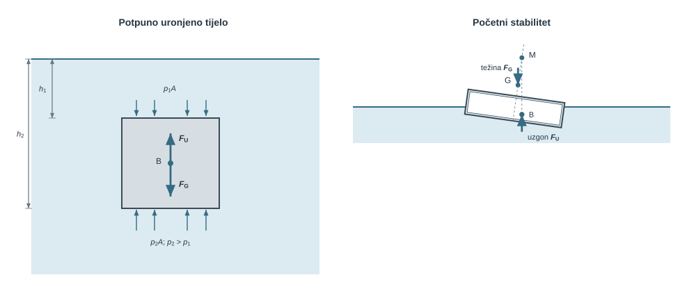
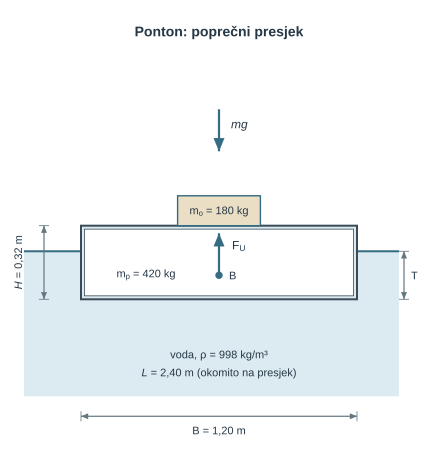
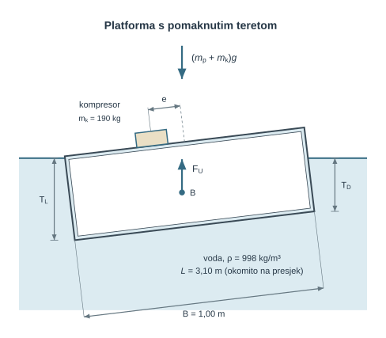
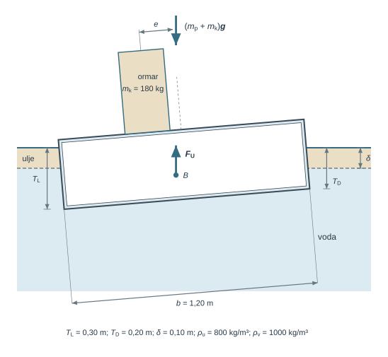
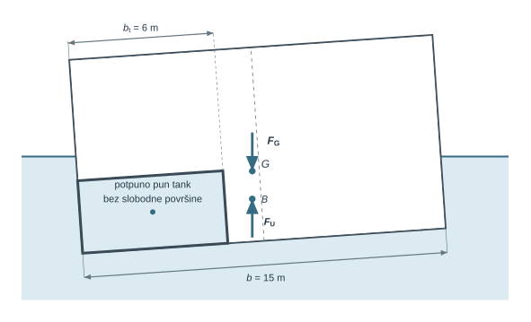
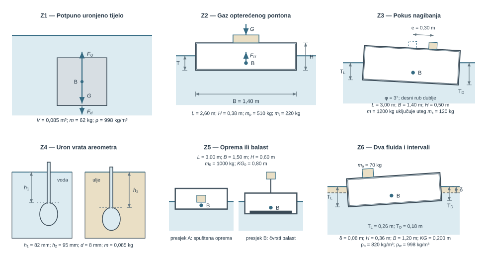

Čelični brod pluta, a čelična kugla jednake mase tone. Razliku ne određuje materijal, nego volumen fluida koji tijelo istisne. Uronjeno tijelo preuzima tlakove fluida s cijele oplakane površine, a kako tlak raste s dubinom, donja strana prima veću tlačnu silu od gornje. Tlačne sile na pojedine ravne i zakrivljene plohe određene su u []{.mf1-chapter-ref target="u05"}; uzgon je njihova rezultanta po zatvorenoj plohi tijela.

Prema Arhimedovu zakonu uzgon $F_U=\rho gV_{ist}$ jednak je težini fluida koji bi ispunio istisnuti volumen $V_{ist}$. Jednoliki tlak na slobodnoj površini poništava se, pa uzgon ne ovisi o atmosferskom tlaku. Budući da je $F_U$ rezultanta tlakova na tijelo, ne dodaje se još jednom ako su tlačne sile već zbrojene. Pravac uzgona prolazi kroz centar uzgona $B$, težište istisnutoga volumena, a težina $F_G=mg$ kroz težište tijela $G$.

Za plivajuće tijelo ravnoteža sila u okomitom smjeru daje $\rho gV_{ist}=F_G=mg$, odnosno $V_{ist}=m/\rho$. Ta ravnoteža određuje gaz, ali ne i nagib, pa težinu, istisnuti volumen i momentni raspored sila treba promatrati odvojeno. Pri malom nagibu centar uzgona pomiče se prema uronjenijoj strani, a okomica kroz njega siječe os simetrije u metacentru $M$, udaljenom $BM=I_T/V_{ist}$ od $B$. Ako je metacentar $M$ iznad $G$, odnosno $GM=KB+BM-KG>0$, moment pri malom nagibu vraća tijelo prema uspravnom položaju.

Na tim se odnosima temelje proračun gaza i nadvođa pontona, raspored opreme i balasta na plovilu ili plutajućoj platformi, pokus nagibanja i mjerenje gustoće areometrom. Poglavlje redom izvodi Arhimedov zakon, uvjet plivanja i metacentarski radijus, uključujući plutanje na granici dvaju fluida, a zatim uvodi krivulju stabiliteta $GZ(\varphi)$ i učinak slobodne površine u tanku. Metacentarska teorija vrijedi samo za mali nagib oko uspravnoga položaja; veliki nagibi, valovi i oštećenja traže punu krivulju $GZ$ i posebne kriterije. Ovim poglavljem završava statika fluida, a gibanje fluida uvodi se u []{.mf1-chapter-ref target="u07"}.

Slika [-@fig-uvod-u07] prikazuje obje razine analize. Lijevo je potpuno uronjeno tijelo s gornjom plohom na dubini $h_1$ i donjom na dubini $h_2$: fluid djeluje na gornju plohu silom $p_1A$ prema dolje, a na donju većom silom $p_2A$ prema gore jer je $p_2>p_1$. Njihova je razlika uzgon $F_U$ kroz centar uzgona $B$ u težištu istisnine; uz njega je ucrtana težina $F_G$, a $F_U$ se ne zbraja ponovno s prikazanim tlačnim silama. Desno je kruto plivajuće tijelo nagnuto udesno, uz vodoravnu vodnu liniju. Centar uzgona $B$ pomaknut je prema uronjenijoj strani, težište $G$ leži na nagnutoj osi, a metacentar $M$, sjecište pravca uzgona i te osi, nalazi se iznad $G$. Težina $F_G$ kroz $G$ i jednako velik uzgon $F_U$ kroz $B$ tvore par koji pri prikazanom malom nagibu djeluje povratno, suprotno nagibu.

{#fig-uvod-u07 fig-align="center" fig-alt="Dva panela: lijevo uronjeni blok s tlačnim silama na gornju i donju plohu, desno nagnuto plivajuće tijelo s točkama B, G i M."}

**Procijenjeno vrijeme rada uz priručnik:** 10 sati.

## Sila uzgona

Za tijelo koje miruje u fluidu sila uzgona jednaka je težini istisnutog fluida:

$$F_U = \rho g V_{ist}$$ {#eq-uzgon-stabilitet-fizikalni-uvod-i-matematicki-izvod-01}

Za plivajuće tijelo u ravnoteži ta sila mora biti jednaka ukupnoj težini tijela i svih tereta na njemu. Drugi je korak geometrija: gdje djeluju težina i uzgon i kakav moment nastaje ako je teret bočno pomaknut. Kod prizmatičnih tijela s ravnim dnom često se može odvojiti srednji gaz od nagiba:

- srednji gaz dolazi iz ukupne težine
- razlika gazova po širini dolazi iz momentne ravnoteže

To je razdvajanje temelj početnih zadataka o plivanju i stabilitetu.

## Matematički izvod

Najjednostavniji put prema Arhimedovu zakonu polazi od potpuno uronjenoga prizmatičnog tijela s vodoravnim plohama površine $A$. Neka na slobodnoj površini djeluje tlak $p_{pov}$. Na gornju plohu na dubini $h_1$ djeluje sila

$$
F_1 = p_1A = (p_{pov} + \rho gh_1)A
$$ {#eq-uzgon-stabilitet-matematicki-izvod-01}

prema dolje, a na donju plohu na dubini $h_2$ sila

$$
F_2 = p_2A = (p_{pov} + \rho gh_2)A
$$ {#eq-uzgon-stabilitet-matematicki-izvod-02}

prema gore. Neto okomita hidrostatička sila zato iznosi

$$
F_U = F_2 - F_1 = \rho g(h_2-h_1)A.
$$ {#eq-uzgon-stabilitet-matematicki-izvod-03}

Budući da je $(h_2-h_1)A = V_{ist}$ istisnuti volumen fluida, slijedi opći zapis uzgona

$$
F_U = \rho gV_{ist}.
$$ {#eq-uzgon-stabilitet-matematicki-izvod-04}

::: {.mf1-fizikalno-znacenje}

Fizikalno značenje

U jednolikom gravitacijskom polju uzgon ovisi o istisnutom volumenu i gustoći fluida, a ne izravno o materijalu tijela. Dva potpuno uronjena tijela jednakoga vanjskog volumena imaju jednak uzgon; njihove se težine mogu razlikovati, pa jedno može tonuti, a drugo se dizati. Jedan kilogram čelika i jedan kilogram pluta nemaju jednak volumen, pa nisu primjer jednakoga uzgona. Uzgon djeluje suprotno gravitaciji i prolazi kroz težište istisnutoga volumena, a ne nužno kroz težište tijela.
:::

::: {#ex-u07-uzgon-na-potonulo-pumpno-kuciste-pri-ispitivanju .mf1-we}

Uzgon na potonulo kućište crpke pri ispitivanju &nbsp;T1

**Tekst zadatka**

Kućište crpke mase $m = 85\ \text{kg}$ i istisnutog volumena $V_{ist} = 0{,}045\ \text{m}^3$ potpuno je uronjeno u mirnu morsku vodu gustoće $\rho = 1025\ \text{kg/m}^3$, bez dodira s dnom.

**Traži se**

1. Odredi silu uzgona na kućište.
2. Odredi neto silu i silu držanja (iznos i smjer) potrebnu da kućište potpuno uronjeno miruje.

{#fig-u07-pumpno-kuciste-uzgon fig-align="center" fig-alt="Kućište u morskoj vodi odmaknuto od dna, sa strelicom uzgona prema gore i dužom strelicom težine prema dolje."}

**Veza s proračunom.** Sile djeluju na kućište, uz pozitivnu os $z$ prema gore. Skica prikazuje samo uzgon i težinu; silu držanja treba odrediti, a njezin predznak slijedi iz usporedbe uzgona i težine, pa smjer djelovanja držača ne treba unaprijed pretpostaviti.

**Rješenje**

$$
F_U = \rho g V_{ist} = 1025 \cdot 9{,}81 \cdot 0{,}045 = 452{,}5\ \text{N} \approx 0{,}453\ \text{kN}
$$ {#eq-uzgon-stabilitet-rijeseni-primjer-uzgon-na-potonulo-pumpno-kucist-01}

Težina kućišta:
$$
F_G = mg = 85 \cdot 9{,}81 = 833{,}9\ \text{N} \approx 0{,}834\ \text{kN}
$$ {#eq-uzgon-stabilitet-rijeseni-primjer-uzgon-na-potonulo-pumpno-kucist-02}

Neto sila (prema dolje; kućište samo tone):
$$
F_{neto} = F_G - F_U = 833{,}9 - 452{,}5 = 381{,}4\ \text{N}
$$ {#eq-uzgon-stabilitet-rijeseni-primjer-uzgon-na-potonulo-pumpno-kucist-03}

Kućište tone i bez dodatne sile prema dolje. Da bi ga se statički pridržalo ili ravnomjerno podizalo dok je potpuno uronjeno, potrebna je sila od približno 381 N prema gore.

**Provjera i tumačenje**

Prosječna gustoća kućišta, $m/V_{ist}\approx1889\ \text{kg/m}^3$, veća je od gustoće mora, pa kućište tone. Sam materijal stijenke nije dovoljan za taj zaključak jer šuplje hermetičko tijelo može imati mnogo manju prosječnu gustoću.
:::

::: {.mf1-interaktivno}

Numerički pokus — Gaz plivajućeg tijela

**Predvidi.** Hoće li isti blok imati veći gaz u slatkoj ili morskoj vodi? Što se mijenja ako masa poraste za 10 %?

**Provjeri i protumači.** Usporedi formulu s numeričkom nulom bilance sila. Prepoznaj granicu kad gaz dosegne punu visinu bloka; ovaj pokus gaza ne provjerava stabilitet.

<a class="mf1-interaktivno-veza" href="https://martibasic.github.io/MF1_udzbenik/jlite/lab/index.html?path=u07_gaz_plivajuceg_tijela.ipynb">Pokreni u pregledniku</a>

:::

Isti rezultat vrijedi i za proizvoljan oblik tijela: neto hidrostatička sila jednaka je težini fluida koji bi ispunio istisnuti volumen. Pravac djelovanja te sile prolazi kroz centar uzgona, tj. kroz težište istisnutoga volumena. Obrazloženje je kratko: zamislimo da istisnuti volumen ispunjava isti fluid u mirovanju; na njega djeluju isti okolni tlakovi kao na tijelo, a on je u ravnoteži pod vlastitom težinom, pa rezultanta tlakova mora biti jednaka toj težini i prolaziti njezinim težištem.

Iz toga odmah slijedi i prvo pravilo stabiliteta. Kod potpuno uronjenog tijela stabilan je onaj položaj u kojem je težište tijela $G$ ispod centra uzgona $B$; ako se te dvije točke poklope, ravnoteža je neutralna, a ako je $G$ iznad $B$, mali poremećaj daje prevrtni moment. Kod plivajućeg tijela slika je drukčija jer se pri malom nagibu oblik istisnutoga volumena mijenja, pa se i centar uzgona pomiče. Tada se uvodi metacentar $M$, a znak metacentarske visine $GM$ odlučuje o početnom stabilitetu: $GM > 0$ znači povratni moment, $GM = 0$ neutralnu ravnotežu u linearnoj aproksimaciji, a $GM < 0$ nestabilan položaj.

Za plivajuće tijelo ravnoteža sila u okomitom smjeru tada daje

$$
\rho gV_{ist} = F_G = mg
$$ {#eq-uzgon-stabilitet-interaktivni-prikaz-gaz-plivajuceg-tijela-01}

odnosno

$$
V_{ist} = \frac{m}{\rho}.
$$ {#eq-uzgon-stabilitet-interaktivni-prikaz-gaz-plivajuceg-tijela-02}

::: {.mf1-fizikalno-znacenje}

Fizikalno značenje

Plivajuće tijelo uranja toliko da masa istisnutog fluida bude jednaka masi tijela. Volumen istisnine $V_{ist}$ nije stalni geometrijski volumen tijela: isti brod u moru (približno 1025 kg/m³) istisne manji volumen nego u slatkoj vodi (približno 998 kg/m³), pa plovi nešto više.
:::

::: {#cfd-ponton-gaz-stabilitet .mf1-cfd title="Računalna dinamika fluida"}

**Ponton s baterijskim spremnikom na palubi.** Najprije tražimo gaz u mirnoj vodi. U CFD modelu zadamo oblik trupa, masu i položaj težišta, a okomito gibanje tijela povežemo sa silama fluida. Uzgon nastaje integracijom tlaka po trupu; ne dodajemo ga još jednom kao zasebnu silu $\rho gV_{ist}$. Ručni @ex-u07-koliki-gaz-ima-radni-ponton-pri-simetricnom provjerava gaz uz simetričan teret i uspravan ponton.

**Zastani i promisli.** Isti je teret na pontonu podignut više, a uspravni gaz ostao je jednak. Je li time potvrđen i jednak početni stabilitet?

Isti gaz nakon podizanja tereta ne potvrđuje isti stabilitet. Za isti trup i masu viši $KG$ smanjuje $GM$, premda uspravna slika ostaje jednaka. Zato sljedeći račun dopušta naginjanje: uspoređujemo momente i gibanje, odvojeno od ravnotežnog gaza.
:::

To je tek prvi dio fizikalne slike. Jednoliki tlak na slobodnoj površini potpuno se poništio između gornje i donje plohe, pa uzgon ne ovisi o atmosferskom ni o apsolutnom tlaku, nego samo o razlici dubina. Sam $V_{ist}$ ne određuje nagib: ako težište sustava ne leži na istoj okomici kao centar uzgona, pojavljuje se moment koji tijelo zakreće, pa mora biti zadovoljena i ravnoteža momenata.

::: {.mf1-izvod}

Matematički izvod — Bočni pomak centra uzgona pri linearnoj promjeni gaza

Promatra se pravokutni ponton duljine $L$ i širine $b$ koji u nagnutom (ili nesimetrično opterećenom) položaju ima različite gazove na lijevoj i desnoj strani: $T_L$ uz lijevu i $T_D$ uz desnu stijenku, a srednji je gaz $T_m = (T_L + T_D)/2$.

Poprečni presjek istisnutoga volumena trapez je s okomitim stranicama duljina $T_L$ i $T_D$ na razmaku $b$. Taj se trapez razlaže na pravokutnik visine $T_D$ i trokut kateta $(T_L - T_D)$ i $b$ smješten uz lijevu stijenku. Pripadne površine i položaji težišta u poprečnom presjeku (mjereno od lijevog ruba) iznose

$$
A_1 = T_D b, \qquad \bar{x}_1 = \frac{b}{2},
$$ {#eq-uzgon-stabilitet-matematicki-izvod-bocni-pomak-centra-uzgona-pri-01}

$$
A_2 = \frac{1}{2}(T_L - T_D) b, \qquad \bar{x}_2 = \frac{b}{3}.
$$ {#eq-uzgon-stabilitet-matematicki-izvod-bocni-pomak-centra-uzgona-pri-02}

Težište cijelog trapeza, mjereno od lijevog ruba, dobiva se prvim momentom

$$
\bar{x} = \frac{A_1 \bar{x}_1 + A_2 \bar{x}_2}{A_1 + A_2} = \frac{T_D b \cdot \tfrac{b}{2} + \tfrac{1}{2}(T_L - T_D)b \cdot \tfrac{b}{3}}{b T_m}
= \frac{b(T_L + 2T_D)}{6 T_m}.
$$ {#eq-uzgon-stabilitet-matematicki-izvod-bocni-pomak-centra-uzgona-pri-03}

Bočni pomak centra uzgona od centra pontona (od ravnine simetrije, mjereno prema strani s većim gazom) iznosi

$$
y_B = \frac{b}{2} - \bar{x} = \frac{b}{2} - \frac{b(T_L + 2T_D)}{6 T_m}
= \frac{b\,(T_L - T_D)}{12\, T_m}.
$$ {#eq-uzgon-stabilitet-matematicki-izvod-bocni-pomak-centra-uzgona-pri-04}

Provjera: pri simetričnom gazu $T_L = T_D = T_m$ dobiva se $y_B = 0$, što znači da centar uzgona ostaje u središnjoj okomici. Pri tipičnoj razlici gazova $T_L - T_D = 0{,}05\ \text{m}$ na pontonu širine $b = 1{,}2\ \text{m}$ sa srednjim gazom $T_m = 0{,}2\ \text{m}$ pomak centra uzgona iznosi $y_B = 1{,}2 \cdot 0{,}05/(12 \cdot 0{,}2) = 0{,}025\ \text{m}$, dakle $2{,}5\ \text{cm}$.

Ta je veličina **geometrijski pomak centra uzgona u koordinatama tijela**, a nije sama po sebi poluga stabiliteta $GZ$ ni razmak pravaca djelovanja uzgona i ukupne težine. Trapez s okomitim stranicama slika je prvoga reda: kruti nagnuti pravokutnik ima i nagnute bokove, a razlika višeg reda u kutu obrađena je u okviru o granici modela. Iz geometrije rubnih gazova vrijedi

$$
\tan\varphi=\frac{T_L-T_D}{b},
$$ {#eq-uzgon-stabilitet-matematicki-izvod-bocni-pomak-centra-uzgona-pri-05}

a za pravokutnu vodnu liniju

$$
BM=\frac{b^2}{12T_m},\qquad y_B=BM\tan\varphi.
$$ {#eq-uzgon-stabilitet-matematicki-izvod-bocni-pomak-centra-uzgona-pri-06}

Položaj ukupnoga težišta ulazi zasebno preko $GM=KB+BM-KG$, a veza pomaka tereta i nagiba, $m_k e=\Delta\,GM\tan\varphi$, izvodi se u sljedećem okviru iz povratnog momenta (@eq-uzgon-stabilitet-matematicki-izvod-bocni-pomak-centra-uzgona-pri-07). Bez podatka o $KG$ rubni gazovi zato ne određuju jednoznačno položaj pomaknutoga tereta.
:::

::: {.mf1-izvod}

Matematički izvod — Metacentarski radijus $BM = I_T / V_{ist}$

Promatra se plivajuće tijelo nagnuto za mali kut $\varphi$ oko uzdužne osi koja prolazi kroz njegovu vodnu liniju (presjek tijela s mirnom slobodnom površinom). Istisnuti volumen ostaje konstantan jer se masa tijela nije promijenila: pri nagibu jedna strana tijela dublje uranja, a druga izranja.

Geometrijski to znači da se s jedne strane osi rotacije pojavljuje klin dodatne istisnine (točke na udaljenosti $y > 0$ uranjaju za $y\varphi$ dublje), a s druge strane nestaje jednak klin istisnine ($y < 0$, voda se povlači za $|y|\varphi$). Pomak centra uzgona $B \to B'$ u vodoravnom smjeru računa se prvim momentom preraspodjele volumena:

$$
V_{ist}\cdot BB' = \int_{A_{vl}} y \cdot (y\varphi)\, dA = \varphi \int_{A_{vl}} y^2\, dA = \varphi\, I_T,
$$ {#eq-uzgon-stabilitet-matematicki-izvod-metacentarski-radijus-01}

gdje je $A_{vl}$ površina vodne linije, a

$$
I_T = \int_{A_{vl}} y^2\, dA
$$ {#eq-uzgon-stabilitet-matematicki-izvod-metacentarski-radijus-02}

drugi moment površine vodne linije oko osi rotacije. Odatle slijedi pomak centra uzgona

$$
BB' = \frac{I_T\, \varphi}{V_{ist}}.
$$ {#eq-uzgon-stabilitet-matematicki-izvod-metacentarski-radijus-03}

Metacentar $M$ definiran je kao točka u kojoj se sijeku okomica kroz novi centar uzgona $B'$ i prvotna os simetrije tijela. Za male kutove geometrijski vrijedi

$$
BB' = BM \cdot \varphi,
$$ {#eq-uzgon-stabilitet-matematicki-izvod-metacentarski-radijus-04}

pa izjednačavanjem dvaju izraza nastaje središnja relacija stabiliteta

$$
\boxed{BM = \frac{I_T}{V_{ist}}}.
$$ {#eq-uzgon-stabilitet-matematicki-izvod-metacentarski-radijus-05}

Za pravokutnu vodnu liniju širine $b$ i duljine $L$ vrijedi $I_T = L b^3/12$, pa je

$$
BM = \frac{L b^3}{12\, V_{ist}}.
$$ {#eq-uzgon-stabilitet-matematicki-izvod-metacentarski-radijus-06}

Za pravokutne, geometrijski usporedive vodne linije pri **stalnim** $L$ i $V_{ist}$ vrijedi $BM\propto b^3$. Šira vodna linija tada snažno povećava metacentarski radijus. To samo po sebi nije potpuna tvrdnja o stabilitetu broda: konačni $GM$ ovisi i o visini težišta, obliku trupa, istisnini i stanju opterećenja.

**Dva fluida.** Ako tijelo pluta u sloju lakšeg fluida gustoće $\rho_u$ i debljine $\delta$ iznad težeg fluida gustoće $\rho_v$, a dno mu je u težem fluidu, pri nagibu nastaju dva para klinova: na slobodnoj površini klin lakšeg fluida s momentom $\rho_u I_T\varphi$ i na razdjelnici klin u kojem teži fluid zamjenjuje lakši, s momentom $(\rho_v-\rho_u)I_T\varphi$. Zbroj je $\rho_v I_T\varphi$, pa uz masu istisnine $\Delta=\rho_uV_u+\rho_vV_v$ vrijedi

$$
BM_{eq}=\frac{\rho_v I_T}{\rho_uV_u+\rho_vV_v}.
$$ {#eq-metacentarski-radijus-dva-fluida}

Gustoća gornjeg sloja ulazi samo preko $\Delta$: za $\rho_u\to\rho_v$ izraz prelazi u $I_T/V_{ist}$, a za $\rho_u\to0$ u $I_T/V_v$, kao da tijelo pluta samo u težem fluidu. Pripadni $KB_{eq}$ visina je težišta istisnute mase, pri čemu se volumeni slojeva ponderiraju njihovim gustoćama, a $GM_{eq}=KB_{eq}+BM_{eq}-KG$. Model se primjenjuje u primjeru [-@ex-u07-plutajuca-servisna-platforma-na-granici-ulja-i] i u zadatku Z6.

Pouzdan geometrijski zapis metacentarske visine jest

$$
GM=KM-KG
=KB+BM-KG.
$$ {#eq-uzgon-stabilitet-matematicki-izvod-metacentarski-radijus-07}

Ako se $G$ nalazi iznad $B$, isti se odnos može zapisati kao $GM=BM-BG$. Zapis s $KM-KG$ ostaje jednoznačan i kada je $G$ ispod $B$.

**Ravnoteža pri pomaku tereta.** Pri malom nagibu $\varphi$ uzgon $\Delta g$ djeluje okomito kroz $B'$, a težina $\Delta g$ kroz $G$; vodoravni razmak tih pravaca jest poluga stabiliteta $GZ=GM\sin\varphi$, pa povratni moment iznosi $M_{pov}=\Delta g\,GM\sin\varphi$. Ako se teret mase $m_k$ pomakne poprečno za $e$ bez promjene visine, nastaje nagibni moment $m_kg\,e\cos\varphi$. Izjednačavanje daje

$$
\begin{aligned}
&m_k e\cos\varphi=\Delta\,GM\sin\varphi\\
&\quad\Longrightarrow\quad \boxed{m_k e=\Delta\,GM\tan\varphi},
\end{aligned}
$$ {#eq-uzgon-stabilitet-matematicki-izvod-bocni-pomak-centra-uzgona-pri-07}

gdje je $\Delta=\rho V_{ist}$ masa istisnine, jednaka ukupnoj masi sustava, a $g$ se pokratio. Isti zapis vrijedi za pokus nagibanja: izmjereni $\varphi$ uz poznate $m_k$, $e$ i $\Delta$ daje $GM$. Izjednačavanje $\Delta y_B=m_ke$ bilo bi dopušteno samo u posebnom slučaju $KG=KB$, odnosno $BG=0$, kada je $GM=BM$.

Predznak $GM$ odlučuje o **početnom** stabilitetu uspravnoga položaja. Pri $GM>0$ mali nagib stvara povratni moment, pri $GM=0$ linearni je član neutralan, a pri $GM<0$ uspravni je položaj početno nestabilan. Negativan početni $GM$ ne dokazuje sam po sebi konačno prevrtanje: tijelo može prijeći u drugi ravnotežni položaj, što se provjerava punom krivuljom $GZ$ i geometrijom otvora.
:::

::: {.mf1-granica-modela}

Granica modela — Koliko je „mali” kut za pravokutni ponton?

Za trup s okomitim bokovima, dok je dno uronjeno i paluba suha, pomak centra uzgona može se izračunati točno: vodoravno $BM\tan\varphi$, a okomito $\tfrac12BM\tan^2\varphi$. Poluga stabiliteta tada glasi

$$
GZ=\left(GM+\tfrac12BM\tan^2\varphi\right)\sin\varphi,
$$ {#eq-poluga-okomiti-bokovi}

pa je relativna pogreška linearne aproksimacije $GZ\approx GM\sin\varphi$ jednaka $\tfrac12BM\tan^2\varphi/GM$. Za platformu iz primjera [-@ex-u07-plutajuca-servisna-platforma-s-pomaknutim-kompresorom-t2] ($GM=0{,}245\ \text{m}$, $BM=0{,}298\ \text{m}$, $\varphi=6{,}84^\circ$) korekcija iznosi $0{,}0021\ \text{m}$, oko $0{,}9\ \%$ od $GM$; pri $\varphi=5^\circ$ pada ispod $0{,}5\ \%$, što je razlog zadane granice $|\varphi|\le5^\circ$ u zadatcima Z3 i Z6. Granica stoga nije univerzalna: ovisi o omjeru $BM/GM$ i prestaje vrijediti čim rub palube uroni ili dno izroni. Za druge oblike trupa i veće kutove treba krivulja $GZ(\varphi)$ iz stvarne geometrije.
:::

::: {.mf1-cfd title="Računalna dinamika fluida"}

**Vraća li se ponton i koliko se dugo njiše?** Dvije izvedbe pontona s istom masom, ali različitom visinom težišta, najprije držimo na malom zadanom nagibu. Nakon smirivanja vode iz tlaka dobijemo moment i usporedimo ga s početnim $GM$. To je statička provjera smjera i jačine vraćanja.

Zatim ponton pustimo iz tog nagiba i pratimo kut kroz vrijeme. Uz masu i težište sada trebamo moment tromosti tijela; voda dodaje pridruženu masu (dodatnu tromost fluida koji se giba s tijelom) i prigušenje, pa mijenja odziv. Iz zapisa procjenjujemo period i prigušenje njihanja. Sam pozitivan $GM$ ne određuje ni jedno ni drugo. Za odziv na valove dodajemo dolazni val i granice koje ne vraćaju neželjene odraze. Prijenos pokusa s manjega modela na stvarni ponton razmatra se u []{.mf1-chapter-ref target="u11"}.
:::

::: {.mf1-izvod}

Matematički izvod — Krivulja stabiliteta $GZ(\varphi)$ i konačni nagib

Metacentarski radijus $BM$ izveden je za **infinitezimalni nagib**. Za konačan nagib koristi se **krivulja statičkog stabiliteta** $GZ(\varphi)$.

Pri nagibu $\varphi$ centar uzgona pomakne se u $B_\varphi$ prema **stvarnoj geometriji uronjenoga dijela**, dok $G$ ostaje nepomičan u tijelu. Poluga stabiliteta $GZ$ vodoravna je udaljenost od $G$ do okomice kroz $B_\varphi$ i za svaki se konačni kut ponovno računa iz hidrostatičke geometrije. Veza s početnom teorijom glasi

$$
GZ(0)=0,\qquad \left.\frac{dGZ}{d\varphi}\right|_{\varphi=0}=GM,
$$ {#eq-uzgon-stabilitet-matematicki-izvod-krivulja-stabilnosti-i-finitni-01}

pa je za dovoljno mali kut $GZ\approx GM\sin\varphi\approx GM\varphi$.

Povratni moment para težine i uzgona iznosi

$$
M_{povratni}(\varphi) = \rho g V_{ist}\cdot GZ(\varphi),
$$ {#eq-uzgon-stabilitet-matematicki-izvod-krivulja-stabilnosti-i-finitni-02}

a prvi kut nakon pozitivnoga područja pri kojem $GZ$ ponovno postane nula naziva se **kut nestajanja stabiliteta** $\varphi_v$. Stvarno uporabljivo područje može završiti ranije, primjerice kutom naplavljivanja kroz nezaštićeni otvor.

Krivulja $GZ(\varphi)$ za određeno stanje opterećenja ima sljedeća osnovna svojstva:

- pri $\varphi = 0$ vrijedi $GZ = 0$ (uspravni položaj);
- nagib krivulje u ishodištu jednak je $GM$ — poveznica s metacentarskom teorijom;
- položaj i iznos maksimuma ovise o geometriji, otvorima i stanju opterećenja;
- pri $\varphi_v$ krivulja siječe nulu, ako naplavljivanje ili druga granica nije nastupila ranije.

**Integral ispod krivulje**

$$
A = \int_0^{\varphi_v} GZ(\varphi)\,d\varphi
$$ {#eq-uzgon-stabilitet-matematicki-izvod-krivulja-stabilnosti-i-finitni-03}

ima dimenziju $\text{m rad}$ i odgovara energiji **normiranoj težinom istisnine** $\Delta g$. Stvarni kvazistatički rad povratnoga momenta između dvaju kutova jest

$$
W=\rho gV_{ist}\int_{\varphi_1}^{\varphi_2}GZ(\varphi)\,d\varphi.
$$ {#eq-uzgon-stabilitet-matematicki-izvod-krivulja-stabilnosti-i-finitni-04}

Za brodove na koje se primjenjuju opći kriteriji IMO-ova *2008 Intact Stability Codea* provjerava se skup uvjeta, među ostalim: površina najmanje $0{,}055\ \text{m rad}$ do $30^\circ$; najmanje $0{,}09\ \text{m rad}$ do $40^\circ$ ili kuta naplavljivanja ako je manji; najmanje $0{,}03\ \text{m rad}$ između $30^\circ$ i te gornje granice; $GZ\ge0{,}20\ \text{m}$ pri kutu od najmanje $30^\circ$; maksimum $GZ$ pri kutu ne manjem od $25^\circ$; te početni $GM_0\ge0{,}15\ \text{m}$ [@imo-is-code-2008]. Primjenjivost, dodatni kriteriji i iznimke ovise o vrsti broda i mjerodavnoj administraciji, pa sami kriteriji površina ne dokazuju usklađenost.

Metacentarska teorija opisuje samo početni odziv oko uspravnoga položaja. Stabilitet pri konačnom nagibu, na valovima ili nakon oštećenja zahtijeva odgovarajuću krivulju $GZ$, otvore i kut naplavljivanja, dinamičke utjecaje te posebne kriterije za neoštećeni ili oštećeni brod [@imo-damage-stability].
:::

::: {.mf1-dublje}

Dublje — Učinak slobodne površine u tanku

Ako tank nije pun, tekućina se u njemu pri nagibu prelijeva prema nižoj strani i njezino se težište pomiče jednako kao centar uzgona u klinu vodne linije. Taj pomak djeluje kao prividno podizanje težišta sustava za

$$
\delta GM=-\frac{\rho_t\,i_t}{\rho\,V_{ist}},
$$ {#eq-ucinak-slobodne-povrsine}

gdje je $i_t$ drugi moment slobodne površine tanka oko njegove uzdužne osi, $\rho_t$ gustoća tekućine u tanku, a $\rho V_{ist}=\Delta$ masa istisnine. Učinak ne ovisi o količini tekućine u tanku dok slobodna površina postoji, nego o njezinoj širini na treću potenciju. Da je tank iz primjera [-@ex-u07-izolirani-puni-bocni-tank-kao-dodana-masa] napola pun morem, vrijedilo bi $i_t=L_tb_t^3/12=15\cdot6^3/12=270\ \text{m}^4$ i, pri istoj istisnini, $\delta GM=-270/4172\approx-0{,}065\ \text{m}$: $GM$ bi pao s $4{,}23$ na oko $4{,}16\ \text{m}$. Na malom pontonu s tankom preko cijele širine isti izraz može poništiti cijeli $GM$; zato se tankovi drže punima ili praznima, a slobodne površine ograničavaju uzdužnim pregradama.
:::

## Riješeni primjeri

::: {#ex-u07-koliki-gaz-ima-radni-ponton-pri-simetricnom .mf1-we}

Koliki gaz ima radni ponton pri simetričnom opterećenju&nbsp;T1

**Tekst zadatka**

Pravokutni ponton duljine $L = 2{,}40\ \text{m}$, širine $b = 1{,}20\ \text{m}$, visine boka $H = 0{,}32\ \text{m}$ i mase $m_p = 420\ \text{kg}$ nosi simetrično postavljenu opremu mase $m_o = 180\ \text{kg}$. Pluta bez nagiba u mirnoj vodi gustoće $\rho = 998\ \text{kg/m}^3$.

**Traži se**

1. Odredi istisnuti volumen vode u ravnotežnom položaju.
2. Odredi srednji gaz pontona $T$.
3. Odredi koliku dodatnu masu još može primiti prije nego što gornji rub dođe do razine vode.

{#fig-u07-ponton-i-gaz-pri-simetricnom-opterecenju fig-alt="Poprečni presjek uspravnog pontona s opremom na sredini palube, vodnom linijom i kotama gaza i visine boka."}

**Veza s proračunom.** Duljina $L$ okomita je na presjek; pri simetričnom opterećenju težina i uzgon imaju isti pravac djelovanja.

**Rješenje**

Ukupna masa sustava iznosi

$$
m = m_p + m_o = 420 + 180 = 600\ \text{kg}.
$$ {#eq-uzgon-stabilitet-rijeseni-primjer-koliki-gaz-ima-radni-ponton-01}

Za plivanje u ravnoteži vrijedi $\rho g V_{ist} = mg$, pa je istisnuti volumen

$$
V_{ist} = \frac{m}{\rho} = \frac{600}{998} \approx 0{,}601\ \text{m}^3.
$$ {#eq-uzgon-stabilitet-rijeseni-primjer-koliki-gaz-ima-radni-ponton-02}

Za pravokutni ponton vrijedi $V_{ist} = LbT$, odakle slijedi srednji gaz

$$
T = \frac{V_{ist}}{Lb} = \frac{0{,}601}{2{,}40 \cdot 1{,}20} \approx 0{,}209\ \text{m} \approx 20{,}9\ \text{cm}.
$$ {#eq-uzgon-stabilitet-rijeseni-primjer-koliki-gaz-ima-radni-ponton-03}

Granični slučaj prije zalijevanja palube dobiva se kad je gaz jednak ukupnoj visini boka, tj. $T = H = 0{,}32\ \text{m}$. Tada je najveći mogući istisnuti volumen

$$
V_{max} = LbH = 2{,}40 \cdot 1{,}20 \cdot 0{,}32 \approx 0{,}922\ \text{m}^3,
$$ {#eq-uzgon-stabilitet-rijeseni-primjer-koliki-gaz-ima-radni-ponton-04}

pa odgovarajuća ukupna masa iznosi

$$
m_{max} = \rho V_{max} = 998 \cdot 0{,}922 \approx 920\ \text{kg}.
$$ {#eq-uzgon-stabilitet-rijeseni-primjer-koliki-gaz-ima-radni-ponton-05}

Zato je dodatna masa koju ponton još može primiti

$$
\Delta m = m_{max} - m = 920 - 600 = 320\ \text{kg} \approx 3{,}2 \cdot 10^2\ \text{kg}.
$$ {#eq-uzgon-stabilitet-rijeseni-primjer-koliki-gaz-ima-radni-ponton-06}

**Provjera i tumačenje**

Gaz $0{,}209\ \text{m}<H=0{,}32\ \text{m}$, pa ponton ima nadvođe $0{,}111\ \text{m}$. Dodatnih $320\ \text{kg}$ samo je geometrijska, a ne dopuštena rezerva.
:::

::: {#ex-u07-plutajuca-servisna-platforma-s-pomaknutim-kompresorom-t2 .mf1-we}

Plutajuća servisna platforma s pomaknutim kompresorom&nbsp;T2

**Tekst zadatka**

Kruta pravokutna platforma duljine $L = 3{,}10\ \text{m}$ i širine $b = 1{,}00\ \text{m}$ ima masu $m_p = 676\ \text{kg}$ i težište $KG_p = 0{,}14\ \text{m}$ iznad dna. Na nju je bočno postavljen kompresor mase $m_k = 190\ \text{kg}$, s težištem $KG_k = 0{,}38\ \text{m}$ iznad dna. U vodi gustoće $\rho = 998\ \text{kg/m}^3$ izmjereni su gazovi rubova $T_L = 0{,}34\ \text{m}$ i $T_D = 0{,}22\ \text{m}$. Dno je ravno, bokovi okomiti, a nagib dovoljno malen za početnu metacentarsku teoriju (granicu kvantificiramo u provjeri).

**Traži se**

1. Odredi ukupni istisnuti volumen vode u ravnotežnom položaju.
2. Odredi $KB$, $BM$, $KG$ i početni $GM$ sustava te udaljenost $e$ težišta kompresora od uzdužne osi simetrije platforme.
3. Odredi za koliko je srednji gaz platforme veći nego prije postavljanja kompresora.

{#fig-u07-plutajuca-platforma-s-pomaknutim-kompresorom fig-alt="Nagnuta pravokutna platforma s kompresorom pomaknutim ulijevo od osi, uz uzgon i ukupnu težinu sklopa na istom pravcu."}

**Veza s proračunom.** $B$ označuje centar uzgona; uzgon i ukupna težina djeluju na cijeli sklop.

**Rješenje**

Srednji gaz iznosi

$$
T_m = \frac{T_L + T_D}{2} = \frac{0{,}34 + 0{,}22}{2} = 0{,}28\ \text{m},
$$ {#eq-uzgon-stabilitet-rijeseni-primjer-plutajuca-servisna-platforma-s-01}

pa je istisnuti volumen

$$
V_{ist} = L b T_m = 3{,}10 \cdot 1{,}00 \cdot 0{,}28 = 0{,}868\ \text{m}^3.
$$ {#eq-uzgon-stabilitet-rijeseni-primjer-plutajuca-servisna-platforma-s-02}

To odgovara istisnutoj masi vode od približno $998 \cdot 0{,}868 \approx 866\ \text{kg}$, što je u skladu s ukupnom masom platforme i kompresora.

Za pravokutnu platformu s linearnom promjenom gaza po širini bočni pomak centra uzgona glasi

$$
y_B = \frac{b(T_L - T_D)}{12T_m} = \frac{1{,}00\,(0{,}34 - 0{,}22)}{12 \cdot 0{,}28} \approx 0{,}0357\ \text{m}.
$$ {#eq-uzgon-stabilitet-rijeseni-primjer-plutajuca-servisna-platforma-s-03}

Razlika rubnih gazova daje $\tan\varphi=(T_L-T_D)/b=0{,}12$, odnosno $\varphi\approx6{,}84^\circ$. Za pravokutnu istisninu vrijedi

$$
KB=\frac{T_m}{2}=0{,}140\ \text{m},\qquad
BM=\frac{b^2}{12T_m}=0{,}2976\ \text{m}.
$$ {#eq-uzgon-stabilitet-rijeseni-primjer-plutajuca-servisna-platforma-s-04}

Ukupno težište nakon postavljanja kompresora nalazi se na visini

$$
KG=\frac{m_pKG_p+m_kKG_k}{m_p+m_k}
=\frac{676\cdot0{,}14+190\cdot0{,}38}{866}
\approx0{,}1927\ \text{m},
$$ {#eq-uzgon-stabilitet-rijeseni-primjer-plutajuca-servisna-platforma-s-05}

pa je početna metacentarska visina

$$
GM=KB+BM-KG\approx0{,}140+0{,}2976-0{,}1927
=0{,}2450\ \text{m}.
$$ {#eq-uzgon-stabilitet-rijeseni-primjer-plutajuca-servisna-platforma-s-06}

Momentna ravnoteža maloga nagiba $m_k e=(m_p+m_k)GM\tan\varphi$ sada daje

$$
e=\frac{m_p+m_k}{m_k}\,GM\tan\varphi
=\frac{866}{190}\cdot0{,}2450\cdot0{,}12
\approx0{,}134\ \text{m}.
$$ {#eq-uzgon-stabilitet-rijeseni-primjer-plutajuca-servisna-platforma-s-07}

Povećanje srednjeg gaza nakon postavljanja kompresora uzrokuje samo njegova masa, pa je

$$
\Delta T_m = \frac{m_k}{\rho L b} = \frac{190}{998 \cdot 3{,}10 \cdot 1{,}00} \approx 0{,}0614\ \text{m} \approx 6{,}14\ \text{cm}.
$$ {#eq-uzgon-stabilitet-rijeseni-primjer-plutajuca-servisna-platforma-s-08}

**Provjera i tumačenje**

1. $BM\tan\varphi=0{,}0357\ \text{m}=y_B$ samo potvrđuje konzistentnost modela, a nije neovisna provjera; poluga početnog stabiliteta određena je s $GM$, ne s $BM$. Neovisnu kontrolu daje točan izraz za okomite bokove, @eq-poluga-okomiti-bokovi: $e=\dfrac{m_p+m_k}{m_k}\left(GM+\tfrac12BM\tan^2\varphi\right)\tan\varphi=0{,}1352\ \text{m}$, $0{,}9\ \%$ više od linearnog rezultata — nagib od $6{,}84^\circ$ još je unutar početne teorije.
2. Pomak ukupnoga težišta $(m_k/(m_p+m_k))e\approx0{,}0294\ \text{m}$ jednak je $GM\tan\varphi$, a $e<b/2$, pa je položaj kompresora geometrijski moguć.
:::

::: {#ex-u07-plutajuca-servisna-platforma-na-granici-ulja-i .mf1-ch}

Plutajuća servisna platforma na granici ulja i vode&nbsp;T4

**Tekst zadatka**

Hermetička pravokutna platforma duljine $L = 3{,}00\ \text{m}$, širine $b = 1{,}20\ \text{m}$, visine boka $H = 0{,}34\ \text{m}$ i mase $m_p = 648\ \text{kg}$ nosi ormar mase $m_k = 180\ \text{kg}$ na nepoznatoj bočnoj udaljenosti $e$. Težišta su na visinama $KG_p=0{,}12\ \text{m}$ i $KG_k=0{,}54\ \text{m}$ iznad dna.

Platforma pluta u ulju gustoće $\rho_u = 800\ \text{kg/m}^3$ i debljine $\delta = 0{,}10\ \text{m}$ iznad vode gustoće $\rho_v = 1000\ \text{kg/m}^3$. Gazovi rubova od površine ulja iznose $T_L = 0{,}30\ \text{m}$ i $T_D = 0{,}20\ \text{m}$. Kruto ravno dno i okomiti bokovi daju linearnu promjenu gaza. Primijeni ekvivalentni dvofluidni model za mali nagib; ne provodi se normativna provjera stabiliteta.

**Traži se**

1. Odredi srednji gaz $T_m$ i ukupni istisnuti volumen $V_{ist}$.
2. Odredi koliki se dio istisnine nalazi u ulju, a koliki u vodi.
3. Odredi bočni pomak rezultantnog centra uzgona $y_B$.
4. Odredi ekvivalentne $KB$, $BM$ i $GM$ za zadani dvofluidni model te udaljenost $e$ težišta ormara od osi simetrije platforme.
5. Odredi za koliko je srednji gaz veći nego prije postavljanja ormara.

{#fig-u07-plutajuca-platforma-na-granici-ulja-i-vode fig-alt="Nagnuta platforma s ormarom na palubi koja presijeca sloj ulja iznad vode, s kotama rubnih gazova i debljine sloja."}

**Veza s proračunom.** $B$ označuje centar uzgona ponderiran uzgonskim doprinosima ulja i vode, a ne geometrijski centar ukupnog istisnutog volumena. Gazovi se mjere od površine ulja.

**Rješenje**

Srednji gaz aritmetička je sredina izmjerenih rubnih gazova:

$$
T_m = \frac{T_L + T_D}{2} = \frac{0{,}30 + 0{,}20}{2} = 0{,}25\ \text{m}.
$$ {#eq-uzgon-stabilitet-cjeloviti-zadatak-plutajuca-servisna-platforma-n-01}

Ukupni istisnuti volumen zato je

$$
V_{ist} = L b T_m = 3{,}00 \cdot 1{,}20 \cdot 0{,}25 = 0{,}900\ \text{m}^3.
$$ {#eq-uzgon-stabilitet-cjeloviti-zadatak-plutajuca-servisna-platforma-n-02}

Kako su oba ruba uronjena više od debljine uljnog sloja $\delta = 0{,}10\ \text{m}$, platforma cijelom tlocrtnom površinom presijeca uljni sloj debljine $\delta$. Zato je volumen istisnine u ulju

$$
V_u = L b \delta = 3{,}00 \cdot 1{,}20 \cdot 0{,}10 = 0{,}360\ \text{m}^3,
$$ {#eq-uzgon-stabilitet-cjeloviti-zadatak-plutajuca-servisna-platforma-n-03}

a volumen istisnine u vodi

$$
V_v = L b (T_m - \delta) = 3{,}00 \cdot 1{,}20 \cdot (0{,}25 - 0{,}10) = 0{,}540\ \text{m}^3.
$$ {#eq-uzgon-stabilitet-cjeloviti-zadatak-plutajuca-servisna-platforma-n-04}

Provjera ravnoteže sila u okomitom smjeru sada glasi

$$
\Delta=\rho_u V_u + \rho_v V_v = 800 \cdot 0{,}360 + 1000 \cdot 0{,}540 = 288 + 540 = 828\ \text{kg},
$$ {#eq-uzgon-stabilitet-cjeloviti-zadatak-plutajuca-servisna-platforma-n-05}

što se točno slaže s ukupnom masom sustava

$$
m_p + m_k = 648 + 180 = 828\ \text{kg}.
$$ {#eq-uzgon-stabilitet-cjeloviti-zadatak-plutajuca-servisna-platforma-n-06}

Ravnoteža sila u okomitom smjeru dakle je zadovoljena.

Za bočni pomak centra uzgona bitan je samo vodeni dio ispod razdjelnice jer je uljni dio simetričan po širini i ne daje bočni moment. Vodene dubine lijevo i desno iznose

$$
\begin{aligned}
T_{v,L} &= T_L - \delta = 0{,}30 - 0{,}10 = 0{,}20\ \text{m}, \\
T_{v,D} &= T_D - \delta = 0{,}20 - 0{,}10 = 0{,}10\ \text{m},
\end{aligned}
$$ {#eq-uzgon-stabilitet-cjeloviti-zadatak-plutajuca-servisna-platforma-n-07}

pa je srednja vodena dubina

$$
T_{v,m} = T_m - \delta = 0{,}15\ \text{m}.
$$ {#eq-uzgon-stabilitet-cjeloviti-zadatak-plutajuca-servisna-platforma-n-08}

Centar uzgona vodenog dijela za linearni nagib pravokutnog presjeka nalazi se na udaljenosti

$$
y_{B,v} = \frac{b(T_{v,L} - T_{v,D})}{12 T_{v,m}} = \frac{1{,}20(0{,}20 - 0{,}10)}{12 \cdot 0{,}15} \approx 0{,}0667\ \text{m}
$$ {#eq-uzgon-stabilitet-cjeloviti-zadatak-plutajuca-servisna-platforma-n-09}

od osi simetrije platforme, prema dublje uronjenoj strani.

Kako je samo vodeni dio asimetričan, rezultantni bočni pomak ukupnog centra uzgona dobiva se ponderiranjem uzgonskim doprinosima:

$$
y_B = \frac{\rho_v V_v}{\rho_u V_u + \rho_v V_v} y_{B,v} = \frac{540}{828} \cdot 0{,}0667 \approx 0{,}0435\ \text{m} \approx 4{,}35\ \text{cm}.
$$ {#eq-uzgon-stabilitet-cjeloviti-zadatak-plutajuca-servisna-platforma-n-10}

Pomak $y_B$ nije poluga stabiliteta, pa se ne smije pisati $(m_p+m_k)g y_B=m_kge$ bez poznavanja visine težišta $G$. Neka je $K$ na dnu platforme. Visine centara uzgonskih doprinosa iznad dna jesu $z_{B,u}=T_m-\delta/2=0{,}20\ \text{m}$ za uljni sloj i $z_{B,v}=(T_m-\delta)/2=0{,}075\ \text{m}$ za vodeni dio. Ekvivalentni $KB$ zato iznosi

$$
KB_{eq}=\frac{\rho_uV_uz_{B,u}+\rho_vV_vz_{B,v}}
{\rho_uV_u+\rho_vV_v}
=\frac{288\cdot0{,}20+540\cdot0{,}075}{828}
\approx0{,}1185\ \text{m}.
$$ {#eq-uzgon-stabilitet-cjeloviti-zadatak-plutajuca-servisna-platforma-n-11}

Prema jednadžbi [-@eq-metacentarski-radijus-dva-fluida] klinovi na površini i na razdjelnici zajedno daju moment $\rho_vI_T\varphi$, pa za $I_T=Lb^3/12=0{,}432\ \text{m}^4$ slijedi

$$
BM_{eq}=\frac{\rho_v I_T}{\rho_uV_u+\rho_vV_v}
=\frac{1000\cdot0{,}432}{828}
\approx0{,}5217\ \text{m}.
$$ {#eq-uzgon-stabilitet-cjeloviti-zadatak-plutajuca-servisna-platforma-n-12}

Konzistentnost modela: $BM_{eq}\tan\varphi=0{,}5217(0{,}10/1{,}20)=0{,}0435\ \text{m}=y_B$, što je identitet po konstrukciji, a ne neovisna provjera. Visina ukupnoga težišta iznosi

$$
KG=\frac{m_pKG_p+m_kKG_k}{m_p+m_k}
=\frac{648\cdot0{,}12+180\cdot0{,}54}{828}
\approx0{,}2113\ \text{m},
$$ {#eq-uzgon-stabilitet-cjeloviti-zadatak-plutajuca-servisna-platforma-n-13}

pa je početna ekvivalentna metacentarska visina

$$
GM_{eq}=KB_{eq}+BM_{eq}-KG
\approx0{,}1185+0{,}5217-0{,}2113
=0{,}4289\ \text{m}.
$$ {#eq-uzgon-stabilitet-cjeloviti-zadatak-plutajuca-servisna-platforma-n-14}

Budući da je $\tan\varphi=(T_L-T_D)/b=0{,}08333$, ispravna momentna ravnoteža maloga nagiba daje

$$
e=\frac{m_p+m_k}{m_k}\,GM_{eq}\tan\varphi
=\frac{828}{180}\cdot0{,}4289\cdot0{,}08333
\approx0{,}164\ \text{m}=16{,}4\ \text{cm}.
$$ {#eq-uzgon-stabilitet-cjeloviti-zadatak-plutajuca-servisna-platforma-n-15}

Prije postavljanja ormara platforma je bila simetrično opterećena, pa je i tada bila u ravnoteži bez nagiba. Neka je tadašnji srednji gaz $T_0$. Budući da je platforma i tada potpuno presijecala uljni sloj, vrijedi

$$
\rho_u L b \delta + \rho_v L b (T_0 - \delta) = m_p,
$$ {#eq-uzgon-stabilitet-cjeloviti-zadatak-plutajuca-servisna-platforma-n-16}

odnosno $800 \cdot 3{,}00 \cdot 1{,}20 \cdot 0{,}10 + 1000 \cdot 3{,}00 \cdot 1{,}20 \cdot (T_0 - 0{,}10) = 648$, što daje $288 + 3600(T_0 - 0{,}10) = 648$, pa je

$$
T_0 = 0{,}20\ \text{m}.
$$ {#eq-uzgon-stabilitet-cjeloviti-zadatak-plutajuca-servisna-platforma-n-17}

Povećanje srednjeg gaza nakon postavljanja ormara zato iznosi

$$
\Delta T_m = T_m - T_0 = 0{,}25 - 0{,}20 = 0{,}05\ \text{m} = 5{,}0\ \text{cm}.
$$ {#eq-uzgon-stabilitet-cjeloviti-zadatak-plutajuca-servisna-platforma-n-18}

**Provjera i tumačenje**

Pomak $y_B=4{,}35\ \text{cm}$ zbog $KG\ne KB_{eq}$ nije poluga momenta težine i uzgona. Neovisna kontrola točnim izrazom za okomite bokove (@eq-poluga-okomiti-bokovi) daje $e=0{,}165\ \text{m}$, $0{,}4\ \%$ više od linearnog rezultata, uz nagib $\varphi=4{,}8^\circ$ unutar granice $5^\circ$. Oba ruba presijecaju uljni sloj ($T_D>\delta$), a $e<b/2=0{,}60\ \text{m}$.
:::

::: {#ex-u07-izolirani-puni-bocni-tank-kao-dodana-masa .mf1-ch}

Izolirani puni bočni tank metodom dodane težine: gaz, nagib i početni stabilitet&nbsp;T4

**Tekst zadatka**

Kruti pravokutni trup duljine $L = 80\ \text{m}$, širine $b = 15\ \text{m}$ i visine $H = 8\ \text{m}$ ima početnu masu $m_b = 4000\ \text{t}$. Početno težište leži na osi simetrije, na visini $KG_b = 3{,}0\ \text{m}$ iznad kobilice. More miruje, gustoća mu je $\rho_{mv} = 1025\ \text{kg/m}^3$, a $g = 9{,}81\ \text{m/s}^2$.

Bočni tank u sredini trupa, uz lijevu stijenku, dug je $L_t = 15\ \text{m}$, širok $b_t = 6{,}0\ \text{m}$ i visok $H_t = 3{,}0\ \text{m}$ od kobilice. Napunjen je morem i potpuno izoliran, bez slobodne površine. Primijeni metodu dodane težine: vodu smatraj ukrcanom masom s težištem u središtu volumena tanka. Trup je neoštećen: uzgon i vodna linija pripadaju cijelom trupu. Pretpostavi mali bočni nagib. Model ne opisuje otvoreno naplavljivanje, gubitak uzgona ni preživljavanje oštećenja.

**Traži se**

1. Odredi volumen i masu morske vode koja je ušla u tank.
2. Odredi pomak težišta cijelog sustava (brod + voda u tanku): bočni pomak $e_G$ od osi simetrije i novu visinu težišta $KG'$.
3. Odredi novi srednji gaz $T_1$ ako bi brod ostao u uspravnom položaju te porast gaza $\Delta T = T_1 - T_0$.
4. Odredi metacentarsku visinu $GM$ i donesi zaključak samo o početnom stabilitetu idealiziranoga modela.
5. Odredi ravnotežni kut poprečnog nagiba $\varphi$ (uz pretpostavku malog kuta).
6. Provedi geometrijsku provjeru spuštanja bočnoga ruba palube unutar istoga pravokutnog modela.

{#fig-u07-poplavljen-tank fig-align="center" fig-alt="Poprečni presjek trupa nagnutog ulijevo s punim zatvorenim tankom uz lijevi bok i točkama B i G."}

**Veza s proračunom.** Voda u tanku ulazi u ukrcanu masu i zajedničko težište $G$; $B$ ostaje centar vanjske istisnine. Skica ne prikazuje $L$, $L_t$, $H$, $H_t$ ni ekscentricitet tanka $e_t$ (definiran u koraku 2).

**Rješenje**

### 1. Volumen i masa ukrcane vode. {.mf1-step .unnumbered .unlisted}

$$
V_v = L_t b_t H_t = 15 \cdot 6 \cdot 3 = 270\ \text{m}^3,
$$ {#eq-uzgon-stabilitet-cjeloviti-zadatak-izolirani-puni-bocni-tank-kao-01}

$$
m_v = \rho_{mv} V_v = 1025 \cdot 270 \approx 277\,000\ \text{kg} \approx 277\ \text{t}.
$$ {#eq-uzgon-stabilitet-cjeloviti-zadatak-izolirani-puni-bocni-tank-kao-02}

### 2. Pomak težišta sustava. {.mf1-step .unnumbered .unlisted}

Težište vode u punom tanku nalazi se $b_t/2=3{,}0$ m od lijeve stijenke broda, odnosno $e_t=b/2-b_t/2=4{,}5$ m lijevo od osi simetrije; $e_t$ je ekscentricitet tanka. Po visini je na $H_t/2=1{,}5$ m iznad kobilice.

Bočni pomak težišta cijelog sustava (ponderiran masama):

$$
e_G = \frac{m_v \cdot e_t}{m_b + m_v} = \frac{277 \cdot 4{,}5}{4000 + 277} = \frac{1247}{4277} \approx 0{,}291\ \text{m}.
$$ {#eq-uzgon-stabilitet-cjeloviti-zadatak-izolirani-puni-bocni-tank-kao-03}

Nova visina težišta sustava iznad kobilice:

$$
KG' = \frac{m_b \cdot KG_b + m_v \cdot (H_t/2)}{m_b + m_v} = \frac{4000 \cdot 3{,}0 + 277 \cdot 1{,}5}{4277} \approx 2{,}90\ \text{m}.
$$ {#eq-uzgon-stabilitet-cjeloviti-zadatak-izolirani-puni-bocni-tank-kao-04}

### 3. Novi gaz (uspravan položaj). {.mf1-step .unnumbered .unlisted}

Brod pluta kad je uzgon jednak ukupnoj težini, tj. kad je istisnina $V_{ist} = (m_b + m_v)/\rho_{mv}$. Za pravokutni trup $V_{ist} = L \cdot b \cdot T$, pa:

$$
T_1 = \frac{m_b + m_v}{\rho_{mv} L b} = \frac{4277 \cdot 10^3}{1025 \cdot 80 \cdot 15} \approx 3{,}477\ \text{m}.
$$ {#eq-uzgon-stabilitet-cjeloviti-zadatak-izolirani-puni-bocni-tank-kao-05}

Početni gaz (samo $m_b$): $T_0 = m_b / (\rho_{mv} L b) = 4000\cdot 10^3 / (1{,}23 \cdot 10^6) \approx 3{,}252\ \text{m}$.

$$
\Delta T = T_1 - T_0 \approx 0{,}225\ \text{m}.
$$ {#eq-uzgon-stabilitet-cjeloviti-zadatak-izolirani-puni-bocni-tank-kao-06}

### 4. Metacentarska visina. {.mf1-step .unnumbered .unlisted}

Drugi moment površine vodne linije za pravokutni presjek:

$$
I_T = \frac{L b^3}{12} = \frac{80 \cdot 15^3}{12} = 22\,500\ \text{m}^4.
$$ {#eq-uzgon-stabilitet-cjeloviti-zadatak-izolirani-puni-bocni-tank-kao-07}

Volumen istisnine:

$$
V_{ist} = \frac{m_b + m_v}{\rho_{mv}} = \frac{4277 \cdot 10^3}{1025} \approx 4172\ \text{m}^3.
$$ {#eq-uzgon-stabilitet-cjeloviti-zadatak-izolirani-puni-bocni-tank-kao-08}

Metacentarski radijus (razmak centra uzgona $B$ od metacentra $M$):

$$
BM = \frac{I_T}{V_{ist}} = \frac{22\,500}{4172} \approx 5{,}39\ \text{m}.
$$ {#eq-uzgon-stabilitet-cjeloviti-zadatak-izolirani-puni-bocni-tank-kao-09}

Visina centra uzgona iznad kobilice ($T_1/2$):

$$
KB = T_1/2 \approx 1{,}74\ \text{m}.
$$ {#eq-uzgon-stabilitet-cjeloviti-zadatak-izolirani-puni-bocni-tank-kao-10}

Razmak težišta od centra uzgona:

$$
BG = KG' - KB \approx 2{,}90 - 1{,}74 \approx 1{,}16\ \text{m}.
$$ {#eq-uzgon-stabilitet-cjeloviti-zadatak-izolirani-puni-bocni-tank-kao-11}

Metacentarska visina:

$$
GM = BM - BG \approx 5{,}39 - 1{,}16 \approx 4{,}23\ \text{m}.
$$ {#eq-uzgon-stabilitet-cjeloviti-zadatak-izolirani-puni-bocni-tank-kao-12}

Kako je $GM>0$, uspravni položaj ovoga idealiziranog modela dodane težine ima povratni moment pri dovoljno malim nagibima.

### 5. Ravnotežni kut nagiba. {.mf1-step .unnumbered .unlisted}

Za male kutove vrijedi:

$$
\tan\varphi = \frac{e_G}{GM} = \frac{0{,}291}{4{,}23} \approx 0{,}0689 \quad \Rightarrow \quad \varphi \approx 3{,}94^\circ.
$$ {#eq-uzgon-stabilitet-cjeloviti-zadatak-izolirani-puni-bocni-tank-kao-13}

### 6. Provjera bočnog ruba palube. {.mf1-step .unnumbered .unlisted}

Nadvođe pri uspravnom položaju s novim gazom:

$$
f = H - T_1 \approx 8 - 3{,}477 \approx 4{,}52\ \text{m}.
$$ {#eq-uzgon-stabilitet-cjeloviti-zadatak-izolirani-puni-bocni-tank-kao-14}

Spuštanje lijevog ruba palube zbog nagiba:

$$
\Delta z = (b/2) \sin\varphi \approx 7{,}5 \cdot \sin 3{,}94^\circ \approx 7{,}5 \cdot 0{,}0687 \approx 0{,}515\ \text{m}.
$$ {#eq-uzgon-stabilitet-cjeloviti-zadatak-izolirani-puni-bocni-tank-kao-15}

Preostalo nadvođe na lijevom rubu palube:

$$
f_L = f - \Delta z \approx 4{,}52 - 0{,}52 \approx 4{,}00\ \text{m}.
$$ {#eq-uzgon-stabilitet-cjeloviti-zadatak-izolirani-puni-bocni-tank-kao-16}

Granični kut pri kojem rub palube dosegne razinu mora slijedi iz uvjeta $f\cos\varphi=(b/2)\sin\varphi$, jer se trup s okomitim bokovima pri stalnoj istisnini okreće oko sredine vodne linije:

$$
\tan\varphi_{lim} = \frac{2f}{b} = \frac{2\cdot4{,}52}{15} \approx 0{,}603, \qquad \varphi_{lim} \approx 31{,}1^\circ.
$$ {#eq-uzgon-stabilitet-cjeloviti-zadatak-izolirani-puni-bocni-tank-kao-17}

Vrijednost $31{,}1^\circ$ samo je geometrijska ekstrapolacija krutoga pravokutnika koji se zakreće oko uspravnoga položaja. Pri tako velikom kutu metacentarska aproksimacija za male kutove više nije dostatna, a stvarnu uronjenost ruba i kut naplavljivanja treba dobiti ponovnim određivanjem vodne linije, centra uzgona i stvarnih otvora za svaki kut.

**Provjera i tumačenje**

1. Bilanca: $\Delta T=m_v/(\rho_{mv}Lb)\approx0{,}225\ \text{m}$ i $e_G=GM\tan\varphi$ potvrđuju ravnotežu sila u okomitom smjeru i ravnotežu momenata; nagib od oko $4^\circ$ ostavlja približno $4\ \text{m}$ nadvođa na nižem rubu.
2. To je početna ravnoteža idealiziranoga trupa metodom dodane težine. Stabilitet oštećenoga broda može zahtijevati metodu izgubljenoga uzgona, propusnost prostora, progresivno naplavljivanje i probabilističke scenarije; ništa od toga ovdje nije obuhvaćeno. Da tank nije pun, slobodna površina smanjila bi $GM$ (vidi blok „Učinak slobodne površine u tanku”).
:::

::: {#ex-u07-plutajuci-vjetroagregat-tipa-cilindricne-plovne-osnove-t3 .mf1-we}

Plutajući vjetroagregat tipa cilindrične plovne osnove &nbsp;T3

**Tekst zadatka**

Uspravna cilindrična plovna osnova (spar) promjera $D = 12{,}0\ \text{m}$ i duljine $H = 100\ \text{m}$ nosi vjetroagregat iznad mora. Ukupna masa sustava s čvrstim balastom u dnu iznosi $m_{uk} = 9\,000\ \text{t} = 9{,}00 \cdot 10^6\ \text{kg}$, a gustoća mora $\rho_{mv} = 1\,025\ \text{kg/m}^3$. Promatraj mirnu vodu bez vjetra i valova; vodna je linija kružna.

**Traži se**

1. Odredi površinu poprečnog presjeka i istisnuti volumen u ravnoteži.
2. Odredi gaz $T$ i nadvođe $f$ plovne osnove te promjenu gaza za $\pm5\,\%$ mase.
3. Odredi $KB$, $BM$ i $KM$ te uvjet za visinu težišta $KG$. Obrazloži koji član daje stabilitet ove plovne osnove i zašto balast mora biti u dnu.

**Rješenje**

### 1. Presjek i istisnina. {.mf1-step .unnumbered .unlisted}

$$
A = \frac{\pi D^2}{4} = \frac{\pi \cdot 12{,}0^2}{4} \approx 113{,}1\ \text{m}^2,\qquad
V_{ist} = \frac{m_{uk}}{\rho_{mv}} = \frac{9{,}00 \cdot 10^6}{1\,025} \approx 8\,780\ \text{m}^3.
$$ {#eq-uzgon-stabilitet-rijeseni-primjer-plutajuci-vjetroagregat-tipa-ci-01}

### 2. Gaz i nadvođe. {.mf1-step .unnumbered .unlisted}

$$
T = \frac{V_{ist}}{A} = \frac{8\,780}{113{,}1} \approx 77{,}6\ \text{m},\qquad
f = H - T = 100 - 77{,}6 \approx 22{,}4\ \text{m}.
$$ {#eq-uzgon-stabilitet-rijeseni-primjer-plutajuci-vjetroagregat-tipa-ci-02}

Promjena mase za $\pm 5\,\%$ (naslage i led, odnosno ispuštanje balasta) mijenja gaz linearno:

$$
T_{+5\%} \approx 1{,}05 \cdot 77{,}64 \approx 81{,}5\ \text{m}, \qquad
T_{-5\%} \approx 0{,}95 \cdot 77{,}64 \approx 73{,}8\ \text{m}.
$$ {#eq-uzgon-stabilitet-rijeseni-primjer-plutajuci-vjetroagregat-tipa-ci-03}

### 3. Metacentar i uvjet za težište. {.mf1-step .unnumbered .unlisted}

Za uspravni valjak centar uzgona nalazi se na polovici gaza, a drugi moment kružne vodne linije iznosi $I_T=\pi D^4/64$:

$$
\begin{aligned}
KB &= \frac{T}{2} \approx 38{,}8\ \text{m}, \\
BM &= \frac{I_T}{V_{ist}} = \frac{\pi \cdot 12{,}0^4/64}{8\,780} = \frac{1\,018}{8\,780} \approx 0{,}116\ \text{m}, \\
KM &= KB + BM \approx 38{,}9\ \text{m}.
\end{aligned}
$$ {#eq-uzgon-stabilitet-rijeseni-primjer-plutajuci-vjetroagregat-tipa-ci-04}

Početni stabilitet zahtijeva $GM=KM-KG>0$, dakle $KG<38{,}9\ \text{m}$. Budući da je $BM$ zanemariv u odnosu na $KB$, uvjet se praktički svodi na $KG<KB$: težište mora ležati ispod centra uzgona. Gondola i rotor nalaze se visoko iznad vrha plovne osnove (reda $100\ \text{m}$ iznad mora), pa bez balasta težište sustava leži visoko (npr. $KG=45\ \text{m}$ daje $GM\approx-6{,}1\ \text{m}$). Čvrsti balast u dnu spušta $KG$: uz $KG=32\ \text{m}$ dobiva se $GM\approx6{,}9\ \text{m}$.

$$
\begin{aligned}
GM(KG=45\ \text{m})&\approx38{,}9-45=-6{,}1\ \text{m}, \\
GM(KG=32\ \text{m})&\approx38{,}9-32=6{,}9\ \text{m}.
\end{aligned}
$$ {#eq-uzgon-stabilitet-rijeseni-primjer-plutajuci-vjetroagregat-tipa-ci-05}

**Provjera i tumačenje**

Gaz od oko $78\ \text{m}$ i nadvođe od oko $22\ \text{m}$ odgovaraju redu veličine izvedenih plovnih osnova tipa spar. Izbor modela: kod pontona stabilitet daje široka vodna linija (velik $BM$), a kod spara uska vodna linija ne daje gotovo ništa ($BM\approx0{,}1\ \text{m}$) i cijeli stabilitet dolazi iz razmaka $KB-KG$, kao kod njihala. Zato spar bez balasta nije stabilan ni u mirnoj vodi. Za stvarnu plovnu osnovu treba još analizirati krivulju $GZ$, hidrodinamički odziv, sidrenje i konstrukcijska opterećenja.
:::

::: {.mf1-samoprovjera}

Provjeri sebe

1. Što govori Arhimedov zakon o ovisnosti sile uzgona o materijalu i obliku tijela?

::: {.callout-note collapse="true"}
### Odgovor
U zadanom jednolikom gravitacijskom polju sila uzgona ovisi o istisnutom volumenu i gustoći fluida, a ne izravno o materijalu, masi ni unutarnjoj građi tijela. Tijela jednakoga istisnutog volumena u istom fluidu imaju jednak uzgon; za šuplje tijelo važno je može li fluid prodrijeti u njegovu unutrašnjost.
:::

2. Dva pontona imaju jednak $GM$, ali jedan ima velik $BM$ i visok $KG$, a drugi malen $BM$ i nizak $KG$. Hoće li jednako reagirati na isti pomak tereta?

::: {.callout-note collapse="true"}
### Odgovor
Pri vrlo malim kutovima da: nagib slijedi iz $m_ke=\Delta GM\tan\varphi$ i ovisi samo o $GM$. Pri većem kutu razlikuju se: član $\tfrac12BM\tan^2\varphi$ brže povećava polugu pontona s velikim $BM$, a gubitak nadvođa i uronjenje ruba palube nastupaju pri različitim kutovima. Jednak $GM$ jamči samo jednak početni odziv.
:::

3. Kako se mijenja gaz istog broda pri prelasku iz slatke u slanu vodu?

::: {.callout-note collapse="true"}
### Odgovor
Gustoća slane vode veća je od gustoće slatke vode, pa je za istu masu broda potreban manji istisnuti volumen i brod u slanoj vodi plovi s manjim gazom. Dopuštena masa tereta ipak se ne određuje samo gustoćom trenutačne vode, nego linijama opterećenja, uvjetima plovidbe, čvrstoćom i stabilitetom; iz samog Arhimedova zakona ne slijedi dopuštenje za ukrcaj dodatnoga tereta.
:::

4. Vrijedi li Arhimedov zakon i u ulju ili plinu, ili samo u vodi?

::: {.callout-note collapse="true"}
### Odgovor
Vrijedi u bilo kojem fluidu, uključujući plinove. U zraku je sila uzgona obično mala zbog male gustoće zraka, ali je treba uračunati za balone, dirižable i precizna mjerenja mase u zraku. U idealnom vakuumu nema fluida ni uzgona. U uljnim sustavima Arhimedov se zakon primjenjuje pri proračunu uzgona kliznih elemenata i u višefaznim separatorima.
:::
:::

## Zadatci za vježbu {#sec-u06-zadatci}

U svim zadatcima uzmi $g=9{,}81\ \text{m/s}^2$. Plovci su nepropusni, fluidi miruju, a uzgon i težina označuju sile na promatrano tijelo.

::::: {.mf1-vjezbe-list}

### Promjena gaza broda između mora i rijeke {#task-promjena-gaza-broda-more-rijeka .unnumbered .unlisted}

**Tekst zadatka**

Brod istisnine $\Delta = 12\,000\ \text{t}$ uplovljava iz mora gustoće $\rho_{mv} = 1025\ \text{kg/m}^3$ u riječnu luku s vodom gustoće $\rho_{rij} = 998\ \text{kg/m}^3$. Površina vodne linije iznosi $A_{vl} = 2400\ \text{m}^2$ i u promatranom rasponu gaza smatra se stalnom; brod ostaje bez trima i nagiba.

**Traži se**

1. Odredi istisnuti volumen u moru i u rijeci te promjenu gaza pri uplovljavanju.
2. Odredi masu tereta koju bi trebalo iskrcati da gaz u rijeci ostane jednak gazu u moru.
3. Odredi masu koja u moru mijenja gaz za $1\ \text{cm}$ i obrazloži zašto se ta vrijednost razlikuje u rijeci.

:::: {.content-visible .mf1-hint-online when-format="html"}
::: {.callout-note collapse="true" data-hint-key="true"}
### Naputak
Masa istisnine jednaka je masi broda u obje vode, $\rho V_{ist}=\Delta$; razlika istisnutih volumena podijeljena površinom vodne linije daje promjenu gaza. Za jednak gaz istisnuti volumen mora ostati isti, pa se mijenja masa.
:::
::::
:::: {.content-visible .mf1-answer-online when-format="html"}
::: {.callout-tip collapse="true" data-answer-key="true"}
### Kontrolni rezultat

$V_{mv}\approx11\,707\ \text{m}^3$, $V_{rij}\approx12\,024\ \text{m}^3$; gaz u rijeci veći je za $\Delta T\approx0{,}132\ \text{m}$. Za isti gaz treba iskrcati $\Delta(1-\rho_{rij}/\rho_{mv})\approx316\ \text{t}$. Masa po centimetru gaza $\rho A_{vl}\cdot0{,}01\ \text{m}$ iznosi $24{,}6\ \text{t/cm}$ u moru i $24{,}0\ \text{t/cm}$ u rijeci jer je lakšoj vodi za istu masu potreban veći volumen.
:::
::::

[Razina: T1]{.mf1-task-level}

### Plutanje homogenog drvenog bloka {#task-plutanje-homogenog-bloka-stabilitet .unnumbered .unlisted}

**Tekst zadatka**

Homogeni drveni blok duljine $L = 2{,}00\ \text{m}$, širine $b = 0{,}70\ \text{m}$ i visine $h = 0{,}50\ \text{m}$ te gustoće $\rho_d = 650\ \text{kg/m}^3$ pluta u mirnoj vodi gustoće $\rho = 998\ \text{kg/m}^3$ s većom stranicom presjeka vodoravno. Nagib je malen, a bokovi okomiti.

**Traži se**

1. Odredi gaz $T$ i nadvođe bloka.
2. Odredi $KB$, $BM$, $KG$ i početnu metacentarsku visinu $GM$ te zaključi je li uspravni položaj početno stabilan.
3. Izvedi uvjet stabilnosti homogenog pravokutnog bloka u obliku omjera $b/h$ i relativne gustoće $s=\rho_d/\rho$ te odredi najmanju širinu $b_{min}$ za zadanu visinu i gustoću.
4. Obrazloži bi li blok iste geometrije, ali gustoće $900\ \text{kg/m}^3$, bio početno stabilniji ili manje stabilan.

:::: {.content-visible .mf1-hint-online when-format="html"}
::: {.callout-note collapse="true" data-hint-key="true"}
### Naputak
Za homogeni blok je $T=sh$, $KB=T/2$, $KG=h/2$ i $BM=b^2/(12T)$. Uvjet $GM\ge0$ sredi po $b^2$; dobiva se izraz koji ovisi samo o $h$ i $s$. U 4. zahtjevu usporedi kako se mijenjaju $KB$ i $BM$ kad gaz raste.
:::
::::
:::: {.content-visible .mf1-answer-online when-format="html"}
::: {.callout-tip collapse="true" data-answer-key="true" data-key-full="true"}
### Kontrolni rezultat

$T=0{,}326\ \text{m}$, nadvođe $0{,}174\ \text{m}$; $KB=0{,}163$, $BM=0{,}125$, $KG=0{,}250$, $GM=+0{,}038\ \text{m}$: početno stabilan, ali s malom rezervom. Uvjet $GM\ge0$ daje $b/h\ge\sqrt{6s(1-s)}$, ovdje $b_{min}\approx0{,}584\ \text{m}$. Za $\rho_d=900\ \text{kg/m}^3$: $T=0{,}451$, $KB=0{,}225$, $BM=0{,}091$, $GM=+0{,}066\ \text{m}$, dakle stabilniji; dublji uron više podiže $KB$ nego što smanjuje $BM$, a najmanju rezervu ima blok sa $s\approx0{,}5$.
:::
::::

[Razina: T2]{.mf1-task-level}

### Metacentarska visina iz pokusa nagibanja {#task-metacentarska-visina-iz-pokusa-nagibanja .unnumbered .unlisted}

**Tekst zadatka**

Zatvoreni pravokutni ponton, balastiran u dnu, u mirnoj vodi stoji uspravno, s utegom na osi simetrije. Duljina je $L=3{,}00\ \text{m}$, širina $b=1{,}40\ \text{m}$ i visina boka $H=0{,}50\ \text{m}$. Ukupna masa, uključujući uteg, iznosi $m=1200\ \text{kg}$, a gustoća vode $\rho=998\ \text{kg/m}^3$.

Uteg mase $m_k=120\ \text{kg}$ pomakne se vodoravno $e=0{,}30\ \text{m}$ udesno, bez promjene svoje visine. Izmjeren je nagib $\varphi=3{,}00^\circ$ udesno. Zanemari mjernu nesigurnost. Zadana granica početnog modela jest $|\varphi|\le5^\circ$; to nije univerzalna granica stabiliteta.

**Traži se**

1. Odredi srednji gaz, $GM$ iz pokusa i ukupni $KG$.
2. Provjeri da je desni rub dublje uronjen, da dno ostaje potpuno uronjeno i da paluba ostaje iznad vode.

:::: {.content-visible .mf1-hint-online when-format="html"}
::: {.callout-note collapse="true" data-hint-key="true"}
### Naputak
Iz momentne ravnoteže $m_k e=mGM\tan\varphi$ najprije odredi izmjereni $GM$. Zatim primijeni $KG=KB+BM-GM$, uz $KB=T_m/2$ i $BM=b^2/(12T_m)$. U linearnom modelu rubni su gazovi $T_m\pm(b/2)\tan\varphi$.
:::
::::
:::: {.content-visible .mf1-answer-online when-format="html"}
::: {.callout-tip collapse="true" data-answer-key="true"}
### Kontrolni rezultat

$T_m=0{,}2863\ \text{m}$; $GM=0{,}5724\ \text{m}$; $KG=0{,}1412\ \text{m}$. Gazovi su $T_L=0{,}2496\ \text{m}$ i $T_D=0{,}3230\ \text{m}$: oba su između $0$ i $H$. Kut $3^\circ<5^\circ$ zadovoljava zadani kriterij; pozitivan $GM$ dokazuje samo početni stabilitet.
:::
::::

[Razina: T2]{.mf1-task-level}

### Gustoća otopine iz očitanja areometra {#task-u07-areometar-mase-s-cilindricnim-vratom-promjera-pluta .unnumbered .unlisted}

**Tekst zadatka**

Areometar mase $m = 0{,}085\ \text{kg}$ s cilindričnim vratom promjera $d = 8\ \text{mm}$ pluta u referentnoj vodi gustoće $\rho_v=1000\ \text{kg/m}^3$ tako da je uronjena duljina cilindričnog vrata $h_1 = 82\ \text{mm}$, a u vodenoj otopini nepoznate gustoće $\rho_x$ iznosi $h_2 = 95\ \text{mm}$. Obje duljine mjere se od istog spoja vrata s potpuno uronjenim tijelom areometra do slobodne površine. Zanemari kapilarne sile.

**Traži se**

Odredi gustoću otopine $\rho_x$ i protumači zašto je uron u otopini veći nego u vodi.

:::: {.content-visible .mf1-hint-online when-format="html"}
::: {.callout-note collapse="true" data-hint-key="true"}
### Naputak
U oba fluida vrijedi $\rho gV_{ist} = mg$; razlika je samo u uronjenom volumenu vrata i tijela areometra.
:::
::::
:::: {.content-visible .mf1-answer-online when-format="html"}
::: {.callout-tip collapse="true" data-answer-key="true"}
### Kontrolni rezultat

$\rho_x \approx 992{,}4\ \text{kg/m}^3$; uron je veći jer otopina ima manju gustoću od referentne vode, pa je za istu težinu potreban veći istisnuti volumen.
:::
::::

[Razina: T1]{.mf1-task-level}

### Spuštanje opreme ili dodavanje balasta {#task-spustanje-opreme-ili-dodavanje-balasta .unnumbered .unlisted}

**Tekst zadatka**

Za zatvoreni pravokutni ponton s nadgrađem i visoko postavljenom opremom razmotri dva zasebna plana povećanja početnog stabiliteta. Oprema i balast postavljaju se simetrično; ponton miruje uspravno. Ponton ima $L=3{,}00\ \text{m}$, $b=1{,}50\ \text{m}$, visinu boka $H=0{,}60\ \text{m}$, početnu ukupnu masu $m_0=1000\ \text{kg}$ i $KG_0=0{,}80\ \text{m}$; gustoća vode je $\rho=998\ \text{kg/m}^3$.

Plan A spušta postojeću opremu mase $150\ \text{kg}$ s visine $1{,}10\ \text{m}$ na $0{,}30\ \text{m}$ iznad dna. Plan B zadržava tu opremu i dodaje $600\ \text{kg}$ čvrstog balasta s težištem na $0{,}05\ \text{m}$ iznad dna. Vanjska geometrija pontona ostaje ista; nema djelomično punih tankova. Prihvati samo plan koji istodobno daje $GM\ge0{,}20\ \text{m}$ i nadvođe najmanje $0{,}25\ \text{m}$.

Navedeni uvjeti pripadaju nastavnom modelu i nisu propisana provjera plovila.

**Traži se**

1. Odaberi potrebne bilance i za početno stanje te svaki plan odredi gaz, nadvođe, $KG$ i $GM$.
2. Objasni zašto niže težište samo po sebi ne jamči prihvatljiv plan.

:::: {.content-visible .mf1-hint-online when-format="html"}
::: {.callout-note collapse="true" data-hint-key="true"}
### Naputak
Za svaki plan ponovno izračunaj ukupnu masu i njezin moment $m\,KG$ s obzirom na dno. Spuštanje opreme čuva masu; dodani balast mijenja i istisninu, $KB$ i $BM$. Dva uvjeta provjeri zasebno.
:::
::::
:::: {.content-visible .mf1-answer-online when-format="html"}
::: {.callout-tip collapse="true" data-answer-key="true"}
### Kontrolni rezultat

Početno: $(T,f,KG,GM)=(0{,}2227;0{,}3773;0{,}8000;0{,}1534)\ \text{m}$. Plan A: $(0{,}2227;0{,}3773;0{,}6800;0{,}2734)\ \text{m}$, prihvatljiv. Plan B: $(0{,}3563;0{,}2437;0{,}5188;0{,}1857)\ \text{m}$, ne zadovoljava oba uvjeta. Balast snižava $KG$, ali smanjuje i $BM$ te nadvođe $f=H-T$.
:::
::::

[Razina: T3]{.mf1-task-level}

### Platforma na granici ulja i vode {#task-u07-pravokutna-servisna-platforma-duljine-i-sirine-pluta .unnumbered .unlisted}

**Tekst zadatka**

Pravokutna servisna platforma duljine $L = 2{,}80\ \text{m}$ i širine $b = 1{,}20\ \text{m}$ pluta na granici između sloja ulja gustoće $\rho_u = 820\ \text{kg/m}^3$ i debljine $\delta = 0{,}08\ \text{m}$ te vode gustoće $\rho_v = 998\ \text{kg/m}^3$. Nakon pomaka akumulatora lijevi rub uronjen je $T_L = 0{,}26\ \text{m}$, a desni $T_D = 0{,}18\ \text{m}$. Akumulator ima $m_k=70\ \text{kg}$, a ukupno težište nalazi se na $KG=0{,}200\ \text{m}$ iznad dna.

Za rubne gazove zadane su granice pogreške $\pm3\ \text{mm}$, a za ostale veličine vrijedi $\rho_v=998\pm3\ \text{kg/m}^3$, $m_k=70\pm1\ \text{kg}$ i $KG=0{,}200\pm0{,}005\ \text{m}$; navedeni intervali zajamčene su granice, a ne standardne nesigurnosti. Visina boka je $H=0{,}36\ \text{m}$; ostale podatke uzmi kao točne.

Zadana granica modela jest $|\varphi|\le5^\circ$, a montažni koridor dopušta udaljenost akumulatora najviše $0{,}34\ \text{m}$ od osi.

**Traži se**

1. Ukupnu masu platforme s opremom procijeni iz izmjerene istisnine u svakom računu. Odredi srednji gaz, volumene istisnine u ulju i vodi, bočni pomak rezultantnoga centra uzgona, ekvivalentne $KB$, $BM$ i $GM$ te udaljenost akumulatora od osi simetrije.
2. Provjeri da oba ruba presijecaju cijeli sloj ulja, ostaju ispod palube i zadovoljavaju granicu nagiba.
3. Konzervativno procijeni najveću moguću udaljenost akumulatora provjerom rubnih kombinacija ulaza i odluči stane li u zadani montažni koridor.

:::: {.content-visible .mf1-hint-online when-format="html"}
::: {.callout-note collapse="true" data-hint-key="true"}
### Naputak
Najprije uzmi $T_m=(T_L+T_D)/2$ i $\Delta=\rho_uV_u+\rho_vV_v$. Za položaje uzgonskih doprinosa vrijedi $z_{B,u}=T_m-\delta/2$ i $z_{B,v}=(T_m-\delta)/2$, pa izračunaj $KB_{eq}$ ponderiranjem uzgonskim doprinosima. U ovom modelu $BM_{eq}=\rho_v I_T/\Delta$, gdje je $I_T=Lb^3/12$, a $GM_{eq}=KB_{eq}+BM_{eq}-KG$. Tek zatim primijeni $m_k e=\Delta GM_{eq}\tan\varphi$ i $\tan\varphi=(T_L-T_D)/b$. Za konzervativni omotač izračunaj svih $2^5=32$ rubnih kombinacija pet nesigurnih skalarnih ulaza.
:::
::::
:::: {.content-visible .mf1-answer-online when-format="html"}
::: {.callout-tip collapse="true" data-answer-key="true"}
### Kontrolni rezultat

$T_m=0{,}220\ \text{m}$; $(V_u,V_v)=(0{,}269;0{,}470)\ \text{m}^3$; $\Delta=689{,}9\ \text{kg}$; $y_B=0{,}0389\ \text{m}$. $(KB_{eq},BM_{eq},GM_{eq})=(0{,}105;0{,}583;0{,}488)\ \text{m}$. $e=0{,}321\ \text{m}$ ulijevo; $e_{max}=0{,}3546\ \text{m}>0{,}34\ \text{m}$: raspored se ne prihvaća. Sve rubne kombinacije imaju $\delta<T_L,T_D<H$ i $|\varphi|<5^\circ$.
:::
::::

[Razina: T4]{.mf1-task-level}

:::::

{#fig-u07-vjezbe fig-align="center" fig-alt="Šest panela: presjek broda s vodnim linijama u moru i rijeci, plutajući homogeni blok s težištem, nagnuti ponton s pomaknutim utegom, dva areometra, dva presjeka pontona i nagnuta platforma u dva fluida."}

**Napomene uz skice.** U Z1 razmak vodnih linija nije u mjerilu tražene promjene gaza. U Z2, Z3 i Z5 vodne su linije shematske jer se gazovi traže; u Z2 centar uzgona nije nacrtan jer se traži $KB$. U Z6 položaj akumulatora nije u mjerilu udaljenosti $e$, a centar uzgona nije nacrtan jer se traži.

## Sažetak

::: {.mf1-zavrsni-okvir}
- Uzgon $F_U=\rho gV_{ist}$ rezultanta je tlakova po oplakanoj plohi: ovisi o istisnutom volumenu i gustoći fluida, a ne o materijalu tijela, i ne dodaje se ponovno uz već zbrojene tlačne sile.
- Srednji gaz dolazi iz ukupne težine, a nagib iz ravnoteže momenata.
- Iz rubnih gazova najprije se dobiva $\tan\varphi$; za položaj tereta zatim trebaju $KB$, $BM$, $KG$ i $GM=KB+BM-KG$.
- Za težinu i centar uzgona rabi se isti koordinatni smjer; predznak momenta mora odgovarati strani pomaknutog tereta.
- Dobiveni pomak tereta mora biti geometrijski moguć, a nagib unutar granice početne teorije; za veće nagibe treba krivulja $GZ(\varphi)$.
- Slobodna površina u djelomično punom tanku smanjuje $GM$.

**Najčešća pogreška.** Izjednačiti geometrijski pomak centra uzgona $y_B=BM\tan\varphi$ s polugom stabiliteta: položaj tereta slijedi tek iz $m_k e=\Delta GM\tan\varphi$, nakon što je poznat $KG$.

**Nakon ovoga poglavlja mora biti moguće**

1. povezati Arhimedov zakon sa stvarnim istisnutim volumenom;
2. odvojiti ravnotežu sila u okomitom smjeru od ravnoteže momenata plivajućeg tijela;
3. izračunati $GM=KB+BM-KG$ i iz nagiba odrediti pomak tereta, bez pretpostavke $BG=0$;
4. procijeniti granicu malog kuta i prepoznati kada je potrebna krivulja $GZ$.
:::
