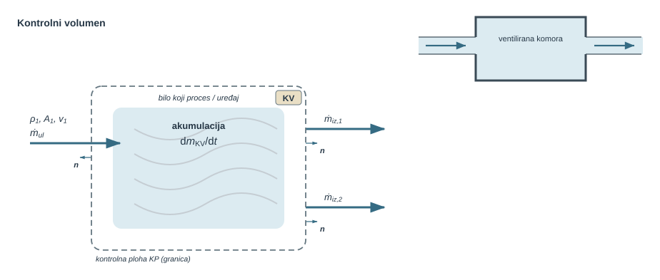
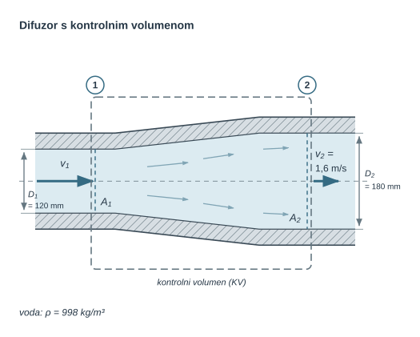
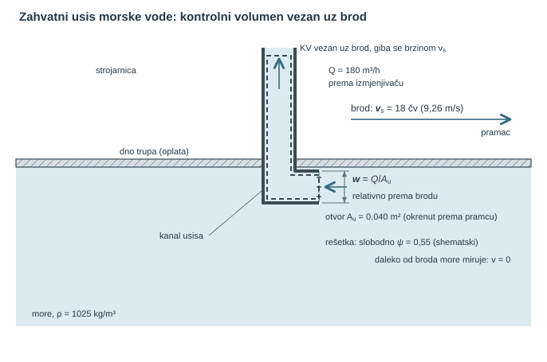
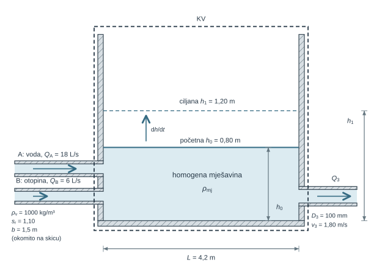
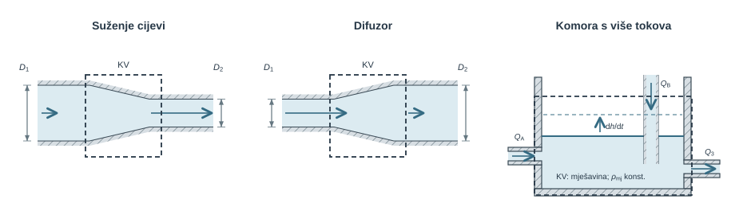
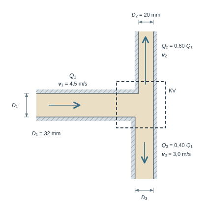
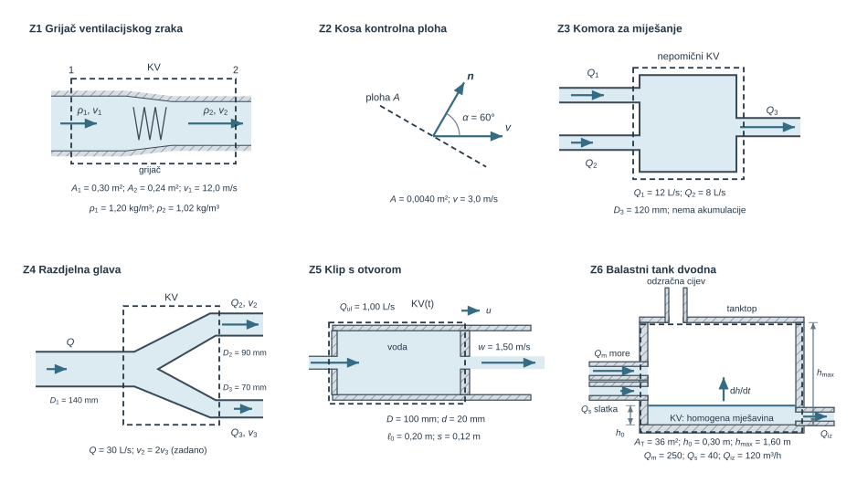

U statici je fluid mirovao, pa je bilo dovoljno poznavati raspodjelu tlaka. Čim fluid struji, najprije treba opisati kako se giba i koliko ga prolazi kroz pojedine presjeke; tek tada se mogu računati tlakovi, sile i energija. Kinematika strujanja to čini na dva načina: Lagrangeov opis prati pojedinu česticu fluida, a Eulerov opis zadaje polje brzine $\vec v(x,y,z,t)$ u nepomičnim točkama prostora. U inženjerskim se proračunima pretežno primjenjuje Eulerov opis jer daje stanje na odabranom mjestu, primjerice u presjeku cijevi ili na ulazu u crpku.

Poglavlje najprije iz polja brzine izvodi strujnicu, trajektoriju i strujnu cijev, razlikuje stacionarno i nestacionarno strujanje te materijalnom derivacijom rastavlja ubrzanje čestice na lokalni i konvektivni član. Stvarni profil brzine u presjeku zatim zamjenjuje srednjom normalnom brzinom $\bar v_n=Q/A$, uz volumenski protok $Q=\int_A\vec v\cdot\vec n\,dA$. Na tom jednodimenzijskom modelu počiva integralna analiza u nastavku knjige.

Kontrolni volumen (KV) odabrani je dio prostora u kojem pratimo ulaz, izlaz i akumulaciju mase. Omeđuje ga kontrolna ploha (KP), zamišljena granica preko koje se računa tok mase, a $\vec n$ njezina je vanjska jedinična normala. Opća bilanca mase glasi $\sum\dot m_{ul}-\sum\dot m_{iz}=dm_{KV}/dt$, uz $\dot m=\rho Q$ i $Q=Av$. Zapis $A_1v_1=A_2v_2$ samo je poseban slučaj te bilance, odnosno jednadžbe kontinuiteta: vrijedi za stacionaran tok jednoga fluida stalne gustoće kroz jedan ulaz i jedan izlaz. Vezu između sustava i kontrolnog volumena uspostavlja Reynoldsov transportni teorem, iz kojeg slijedi i diferencijalni oblik kontinuiteta $\partial\rho/\partial t+\nabla\cdot(\rho\vec v)=0$.

Takvom se bilancom analiziraju rashladni razdjelnici, ventilacijske komore strojarnice, balastni tankovi pri punjenju i pražnjenju te zahvatni usis broda u plovidbi, kroz čiju kontrolnu plohu fluid prolazi relativnom brzinom. Isti se teorem primjenjuje na energiju u []{.mf1-chapter-ref target="u08"} i na količinu gibanja u []{.mf1-chapter-ref target="u10"}.

Slika [-@fig-uvod-u08] prikazuje kontrolni volumen u dva oblika. Lijevo je apstraktni uređaj koji zamjenjuje bilo koji proces, a ne krutu ovojnicu: u kontrolni volumen KV ulazi struja gustoće $\rho_1$, presjeka $A_1$ i brzine $v_1$ s masenim protokom $\dot m_{ul}$, iz njega izlaze dvije struje $\dot m_{iz,1}$ i $\dot m_{iz,2}$, a unutar njega se masa akumulira brzinom $dm_{KV}/dt$. Isprekidana crta prikazuje kontrolnu plohu KP; kratke strelice $\vec n$ vanjske su jedinične normale, na ulazu suprotne toku, a na izlazima u smjeru toka. Strelice označuju tokove, a oznaka akumulacije nije brzina fluida. Desno gore je ventilirana komora: njezine krute stijenke imaju dva stvarno otvorena priključka, a zrak u komori i priključcima isti je fluid.

{#fig-uvod-u08 fig-align="center" fig-alt="Isprekidana kontrolna ploha oko apstraktnog uređaja sa strelicama ulazne i dviju izlaznih struja, kratkim vanjskim normalama i oznakom akumulacije, a desno gore komora krutih stijenki s dvama priključcima."}

**Procijenjeno vrijeme rada uz priručnik:** 10 sati.

## Kinematika strujanja

Strujanje se opisuje dvama pristupima koji se međusobno nadopunjuju:

- **Lagrangeov opis** prati pojedinu česticu fluida te njezin položaj i brzinu u vremenu.
- **Eulerov opis** određuje brzinu fluida u nepomičnim točkama prostora u funkciji vremena.

### Polje brzine

U Eulerovu pogledu brzina je **polje** — vektor pridružen svakoj točki prostora i svakom trenutku:

$$
\vec{v} = \vec{v}(x, y, z, t).
$$ {#eq-kinematika-kv-polje-brzine-01}

To je središnja veličina cijele dinamike fluida: iz njega se određuje protok, a uz tlak i svojstva fluida računaju se sile i gubitci.

::: {.mf1-fizikalno-znacenje}

Fizikalno značenje

Polje brzine nije brzina jedne čestice, nego „snimka” brzina svih čestica odjednom. Ako u presjeku cijevi izmjerimo brzinu u svakoj točki, dobivamo dio polja brzine u tom trenutku. Zato senzor na nepomičnom mjestu (Eulerov pogled) mjeri kako se mijenja brzina *tamo*, a ne što se događa s jednom određenom česticom koja je već prošla pokraj senzora.
:::

### Strujnica, trajektorija i strujna cijev

Iz polja brzine izvode se dvije krivulje koje se lako zamijene:

- **Strujnica** (linija strujanja) je krivulja koja je u **jednom trenutku** u svakoj svojoj točki tangentna na vektor brzine. To je trenutna „slika smjera” strujanja.
- **Trajektorija** (putanja) je stvarni put koji **jedna čestica** fluida prijeđe **tijekom vremena**, skup njezinih uzastopnih položaja $P(t_0)$, $P(t_1)$, $P(t_2)$, …

::: {.mf1-fizikalno-znacenje}

Fizikalno značenje

U **stacionarnom** strujanju polje brzine ne mijenja se s vremenom, pa čestica koja krene po strujnici zauvijek ostaje na njoj — strujnica i trajektorija **podudaraju se**. U **nestacionarnom** strujanju polje se mijenja dok čestica putuje, pa njezina trajektorija općenito ne prati trenutnu strujnicu i dvije se krivulje ne moraju podudarati. U ovom priručniku gotovo uvijek radimo sa stacionarnim strujanjem, pa smijemo govoriti jednostavno o „strujnici”.
:::

Skup strujnica koje prolaze rubom neke male zatvorene krivulje tvori **strujnu cijev**. U stacionarnom strujanju fluid ne prolazi kroz njezin plašt jer je brzina na njega tangentna; tako dobivamo zamišljenu cijev omeđenu strujnicama. Upravo je strujna cijev geometrijska podloga za kontinuitet i za Bernoullijevu jednadžbu u []{.mf1-chapter-ref target="u08"}.

::: {.mf1-cfd title="Računalna dinamika fluida"}

**Zadržava li se tekućina u kutu razdjelnika?** Vraćamo se rashladnom krugu i promatramo ulaznu komoru hladne ploče. *Pitanje:* postoji li u kutu komore područje u kojem tekućina kruži i dugo se zadržava. *Model:* stacionarno nestlačivo strujanje; računalo daje Eulerov opis, polje brzine u čvorovima mreže. *Podatci:* geometrija komore, položaj ulaza, ukupni protok (reda desetaka litara u minuti) i svojstva tekućine. *Izlazi:* strujnice te putanje zamišljenih čestica koje puštamo s ulaza i pomičemo kroz izračunano polje; za svaku bilježimo vrijeme do izlaza, tj. vrijeme zadržavanja. *Provjera:* zbroj izlaznih protoka jednak je ulaznome, a u stacionarnom polju putanje se moraju poklopiti sa strujnicama. Pri pulsirajućem dotoku polje se mijenja, trenutna strujnica više nije putanja, pa vrijeme zadržavanja računamo isključivo iz putanja.

*Odluka:* usporedbom dvaju položaja ulaza biramo onaj s užom raspodjelom vremena zadržavanja. Dug boravak upozorava na slabu izmjenu tekućine; za zaključak o lokalnom pregrijavanju treba i toplinski model, pa ovdje biramo samo geometriju koja ga čini manje vjerojatnim.
:::

### Stacionarno i nestacionarno strujanje

Strujanje je **stacionarno** ako se polje brzine (i tlak, gustoća…) u svakoj *nepomičnoj točki* ne mijenja s vremenom:

$$
\frac{\partial \vec{v}}{\partial t} = 0 \quad (\text{u svakoj točki prostora}).
$$ {#eq-kinematika-kv-stacionarno-i-nestacionarno-strujanje-01}

Pozor: stacionarno **ne znači** da se čestica ne ubrzava. Voda u suženju ustaljeno struji (slika se ne mijenja), ali se svaka čestica koja uđe u suženje ubrzava jer prelazi u područje veće brzine. Nestacionarno strujanje javlja se pri pokretanju i zaustavljanju crpke, zatvaranju ventila te pri punjenju i pražnjenju spremnika, kada član akumulacije $dm_{KV}/dt$ nije jednak nuli.

### Od stvarnog profila do srednje brzine (1D model)

U potpuno razvijenom strujanju kroz ravnu kružnu cijev brzina nije jednaka po presjeku: uz stijenku pada na nulu zbog uvjeta prianjanja, a najveća je u osi. U općem presjeku profil ne mora biti osnosimetričan niti mu maksimum mora ležati u osi. Predznačeni volumenski protok kroz orijentiranu plohu računa se iz **normalne komponente** brzine:

$$
Q = \int_A \vec v\cdot\vec n\,dA = \int_A v_n\,dA .
$$ {#eq-kinematika-kv-od-stvarnog-profila-do-srednje-brzine-1d-01}

Da ne bismo u svakom zadatku integrirali cijeli profil, uvodi se **srednja (1D) brzina** — jedna brzina koja kroz isti presjek daje isti protok:

$$
\bar v_n = \frac{Q}{A} = \frac{1}{A}\int_A \vec v\cdot\vec n\,dA .
$$ {#eq-kinematika-kv-od-stvarnog-profila-do-srednje-brzine-1d-02}

Time složeni dvo- ili trodimenzijski profil zamjenjujemo jednim brojem po presjeku. To je **jednodimenzijski (1D) model** na kojem počiva cijela integralna analiza u ovom priručniku: kad god pišemo $Q = A\bar v$ ili $A_1\bar v_1 = A_2\bar v_2$, podrazumijevamo da je presjek okomit na glavni smjer strujanja i koristimo srednju normalnu, a ne vršnu brzinu. U nastavku se, radi kraćeg zapisa, crtica nad srednjom brzinom izostavlja.

::: {#ex-u08-srednja-brzina-iz-profila-brzine-t2 .mf1-we}

Srednja brzina iz profila brzine&nbsp;T2

**Tekst zadatka**

U cijevi polumjera $R = 25\ \text{mm}$ zadano je stacionarno osnosimetrično strujanje s profilom $v(r) = v_{max}\left(1 - (r/R)^2\right)$ i najvećom brzinom $v_{max} = 3{,}0\ \text{m/s}$.

**Traži se**

1. Odredi srednju brzinu $v$ i njezin odnos prema $v_{max}$.
2. Odredi volumenski protok $Q$.

**Rješenje**

Protok se dobiva integracijom profila po presjeku:

$$
Q = \int_0^R v_{max}\left(1 - \frac{r^2}{R^2}\right) 2\pi r\, dr = 2\pi v_{max}\left[\frac{R^2}{2} - \frac{R^2}{4}\right] = v_{max}\,\frac{\pi R^2}{2}.
$$ {#eq-kinematika-kv-rijeseni-primjer-srednja-brzina-iz-profila-brzin-01}

Srednja brzina je protok podijeljen površinom $A = \pi R^2$:

$$
v = \frac{Q}{A} = \frac{v_{max}\,\pi R^2/2}{\pi R^2} = \frac{v_{max}}{2} = 1{,}5\ \text{m/s}.
$$ {#eq-kinematika-kv-rijeseni-primjer-srednja-brzina-iz-profila-brzin-02}

Uz $A = \pi R^2 = \pi \cdot 0{,}025^2 = 1{,}963 \cdot 10^{-3}\ \text{m}^2$ slijedi

$$
Q = vA = 1{,}5 \cdot 1{,}963 \cdot 10^{-3} \approx 2{,}95 \cdot 10^{-3}\ \text{m}^3/\text{s} = 2{,}95\ \text{L/s}.
$$ {#eq-kinematika-kv-rijeseni-primjer-srednja-brzina-iz-profila-brzin-03}

**Provjera i tumačenje**

Za parabolični profil srednja je brzina točno polovina vršne; da smo uzeli $v_{max}$, protok bismo precijenili dvostruko.
:::

### Materijalna derivacija: ubrzanje čestice

Kad nas zanima ubrzanje **čestice** (a ono ulazi u Newtonov zakon i u sve dinamičke jednadžbe), ne smijemo samo derivirati polje po vremenu u nepomičnoj točki. Čestica se ubrzava iz dva razloga: jer se polje s vremenom mijenja i jer čestica putuje u područje druge brzine. Oba doprinosa spaja **materijalna (supstancijalna) derivacija**:

$$
\vec{a} = \frac{D\vec{v}}{Dt} = \underbrace{\frac{\partial \vec{v}}{\partial t}}_{\text{lokalno}} + \underbrace{(\vec{v}\cdot\nabla)\vec{v}}_{\text{konvektivno}} .
$$ {#eq-kinematika-kv-materijalna-derivacija-ubrzanje-cestice-01}

::: {.mf1-fizikalno-znacenje}

Fizikalno značenje

**Lokalni** član $\partial\vec{v}/\partial t$ opisuje ubrzanje zbog promjene brzine s vremenom u promatranoj točki (npr. pri pokretanju crpke). **Konvektivni** član $(\vec{v}\cdot\nabla)\vec{v}$ opisuje ubrzanje jer čestica putuje u područje druge brzine — točno ono što se događa u suženju u kojem je strujanje stacionarno ($\partial\vec{v}/\partial t = 0$), a čestica se ipak ubrzava. Zato se voda u mlaznici ubrzava iako je „slika” strujanja nepromjenjiva: sav doprinos dolazi iz konvektivnog člana.
:::

U ovom poglavlju materijalnu derivaciju uvodimo samo kao pojam. Eulerova jednadžba pojavljuje se u []{.mf1-chapter-ref target="u08"}, integralna bilanca količine gibanja u []{.mf1-chapter-ref target="u10"}, a puni lokalni izvod u []{.mf1-chapter-ref target="u12"}.

## Kontrolni volumen i bilanca mase

U sustavu, odnosno kontrolnoj masi, pratimo uvijek istu količinu tvari, bez prijelaza mase preko granice. U kontrolnom volumenu pratimo odabrani dio prostora kroz koji fluid može ulaziti, izlaziti i po potrebi se akumulirati. Za difuzore, komore miješanja i spremnike prirodniji je drugi pogled jer su ulazi, izlazi i akumulacija važniji od identiteta pojedine čestice. Formalnu vezu između tih dvaju pogleda daje Reynoldsov transportni teorem, a kontinuitet je njegova masena bilanca.

Najopćenitiji je zapis

$$\sum \dot m_{ul} - \sum \dot m_{iz} = \frac{dm_{KV}}{dt}$$ {#eq-kinematika-kv-fizikalni-uvod-i-matematicki-izvod-01}

::: {.mf1-fizikalno-znacenje}

Fizikalno značenje

Brzina promjene mase u kontrolnom volumenu jednaka je razlici ulaznog i izlaznog masenog protoka. Ako ulazi više nego što izlazi, razina raste; ako izlazi više, volumen se prazni. Bez akumulacije masa koja uđe mora i izaći.
:::

Ovdje ne smijemo pomiješati dvije različite veličine. Maseni protok $\dot m$ mjeri koliko mase prođe u sekundi i na njemu se uvijek temelji osnovni zapis kontinuiteta, dok volumenski protok $Q$ mjeri koliko volumena prođe u sekundi. Povezuje ih relacija

$$
\dot m = \rho Q,
\qquad
Q = Av.
$$ {#eq-kinematika-kv-fizikalno-znacenje-02}

Tek kad je riječ o istom nestlačivom fluidu kroz sve presjeke i kad je gustoća praktički ista, masena bilanca može se podijeliti s $\rho$ i prijeći u volumensku bilancu. Zato je u običnoj cijevi prirodno pisati $Q_1 = Q_2$, ali pri miješanju dviju struja različitih gustoća najprije treba postaviti masenu bilancu, pa tek iz nje odrediti gustoću ili volumenski protok mješavine.

::: {.mf1-granica-modela}

Granica modela — Kada kontinuitet prestaje biti jednostavan

Zapis $A_1 v_1 = A_2 v_2$ vrijedi samo za stacionaran tok jednoga fluida stalne gustoće kroz jedan ulaz i jedan izlaz, uz srednje normalne brzine. Promjena gustoće (zagrijani zrak u Z1), više grana, akumulacija u spremniku ili pomična kontrolna ploha (klip u Z5, brod u plovidbi u P2) vraćaju punu masenu bilancu. Jednodimenzijska srednja brzina ne govori ništa o obliku profila, vrtloženju ni tlaku: za njih su potrebne bilance energije ([]{.mf1-chapter-ref target="u08"}) i količine gibanja ([]{.mf1-chapter-ref target="u10"}) ili lokalni opis ([]{.mf1-chapter-ref target="u12"}).
:::

::: {.mf1-interaktivno}

Numerički pokus — Kontinuitet u suženju cijevi

**Predvidi.** Kako prepolovljen promjer pri istom protoku mijenja brzinu? Hoće li se razina u spremniku približavati ravnoteži?

**Provjeri i protumači.** Nakon suženja prijeđi na nestacionarni spremnik. Mijenjaj vremenski korak te zasebno usporedi bilancu mase i točnost tijeka razine.

<a class="mf1-interaktivno-veza" href="https://martibasic.github.io/MF1_udzbenik/jlite/lab/index.html?path=u08_kontinuitet_suzenje.ipynb">Pokreni u pregledniku</a>

:::

::: {.mf1-izvod}

Matematički izvod — Reynoldsov transportni teorem

**Fizikalno pitanje.** Zakoni mehanike (očuvanje mase, Newtonov zakon, prvi zakon termodinamike) napisani su za *sustav*, tj. uvijek istu masu. Inženjer pak promatra *kontrolni volumen* (KV), dio prostora kroz koji masa prolazi. Kako se brzina promjene ekstenzivne veličine sustava $B$ (masa, količina gibanja, energija) izražava veličinama u kontrolnom volumenu? Neka je $\eta = dB/dm$ pripadna specifična veličina, pa je $B_{sustav} = \int_{sustav} \rho\eta\,dV$.

**Bilanca na dva trenutka.** Odaberemo kontrolni volumen koji se u trenutku $t$ poklapa sa sustavom. Tijekom $\Delta t$ sustav se pomakne: dio njegove mase izađe kroz kontrolnu plohu (KP) u *izlazni rubni volumen* $V_{iz}$, a masa koja je u trenutku $t$ bila izvan njega ulazi iz *ulaznoga rubnog volumena* $V_{ul}$. Kontrolna ploha smije se gibati; rubni volumeni mjere se relativno prema njoj. U trenutku $t+\Delta t$ sustav zauzima $KV + V_{iz} - V_{ul}$, pa je

$$
B_{sustav}(t+\Delta t) = B_{KV}(t+\Delta t) + B_{iz} - B_{ul},
\qquad
B_{sustav}(t) = B_{KV}(t).
$$ {#eq-rtt-dva-trenutka}

**Limes.** Oduzimanjem, dijeljenjem s $\Delta t$ i prijelazom $\Delta t \to 0$ prvi član daje $dB_{KV}/dt$. Kroz element plohe $dA$ s vanjskom normalom $\vec n$ u vremenu $\Delta t$ prođe masa $\rho\,[(\vec v-\vec v_{KP})\cdot\vec n]\,dA\,\Delta t$: pozitivna gdje fluid izlazi, negativna gdje ulazi. Tako se oba rubna volumena sažimaju u jedan površinski integral:

$$
\frac{d}{dt}\int_{sustav} \rho\eta\,dV
= \frac{d}{dt}\int_{KV(t)} \rho\eta\,dV
+ \int_{KP(t)} \rho\eta\bigl[(\vec v-\vec v_{KP})\cdot\vec n\bigr]\,dA.
$$ {#eq-kinematika-kv-matematicki-izvod-reynoldsov-transportni-teorem-01}

To je **Reynoldsov transportni teorem (RTT)**: promjena veličine sustava jednaka je akumulaciji u kontrolnom volumenu i neto izlaznom toku kroz kontrolnu plohu. U članu toka uvijek stoji brzina **relativna prema plohi**: za nepomičnu plohu $\vec v_{KP}=0$, a za volumen vezan uz lopaticu ili klip brzine $\vec u$ relativna je brzina $\vec v-\vec u$.

**Provjera predznaka.** Promotrimo cijev s jednim ulaznim presjekom 1 i izlaznim presjekom 2, uz nepomičan KV i $\eta = 1$. Na ulazu je brzina $\vec v$ suprotna vanjskoj normali, pa je $\vec v\cdot\vec n = -v_1$; na izlazu je $\vec v\cdot\vec n = +v_2$. Površinski integral daje $-\rho_1 A_1 v_1 + \rho_2 A_2 v_2 = \dot m_{iz} - \dot m_{ul}$. Masa sustava ne može se mijenjati, pa je lijeva strana jednaka nuli i slijedi $dm_{KV}/dt = \dot m_{ul} - \dot m_{iz}$. Predznak vanjske normale sam razlikuje ulaz od izlaza; isti račun u Z2 vrijedi i za kosu plohu.

**Tri zakona iz istog teorema.**

- **Masa** ($\eta = 1$): $d/dt\int_{sustav}\rho\,dV = 0$ daje jednadžbu kontinuiteta, izvedenu u nastavku.
- **Količina gibanja** ($\eta = \vec v$): $d/dt\int_{sustav}\rho\vec v\,dV = \sum\vec F$ daje integralni zakon iz []{.mf1-chapter-ref target="u10"}.
- **Energija** ($\eta = e$, ukupna specifična energija): $d/dt\int_{sustav}\rho e\,dV = \dot Q - \dot W$; energijska jednadžba kontrolnog volumena izvodi se iz RTT-a u []{.mf1-chapter-ref target="u08"}, a Bernoullijeva jednadžba njezin je poseban slučaj.

Član relativnoga toka presudan je za pokretne lopatice u []{.mf1-chapter-ref target="u14"}, a već u ovom poglavlju za zahvatni usis broda u plovidbi (@ex-zahvatni-usis-morske-vode-u-plovidbi) i za klip u Z5.
:::

::: {.mf1-izvod}

Matematički izvod — Bilanca mase u kontrolnom volumenu

Uvrstimo li u RTT $\eta = 1$, lijeva je strana promjena mase sustava, a ona je jednaka nuli. Preostaje integralni zapis očuvanja mase na kontrolnom volumenu $KV(t)$ omeđenom kontrolnom plohom $KP(t)$ s vanjskom normalom $\vec n$. Ako se kontrolna ploha lokalno giba brzinom $\vec v_{KP}$, masa je presijeca relativnom brzinom $\vec v-\vec v_{KP}$:

$$
\frac{d}{dt}\int_{KV(t)} \rho\,dV
+ \int_{KP(t)} \rho\bigl[(\vec v-\vec v_{KP})\cdot\vec n\bigr]\,dA = 0.
$$ {#eq-kinematika-kv-matematicki-izvod-bilanca-mase-u-kontrolnom-volu-01}

Prvi je član brzina promjene mase unutar trenutačnoga kontrolnog volumena. Drugi je član neto tok mase **kroz njegovu granicu**, a predznak mu određuje skalarni produkt relativne brzine i vanjske normale. Za nepomičnu kontrolnu plohu vrijedi $\vec v_{KP}=0$, pa dobivamo oblik koji se primjenjuje na spremnike i nepomične cijevne elemente:

$$
\frac{d}{dt}\int_{KV} \rho\,dV + \int_{KP} \rho(\vec v\cdot\vec n)\,dA=0.
$$ {#eq-kinematika-kv-matematicki-izvod-bilanca-mase-u-kontrolnom-volu-02}

Ako se kontrolna ploha rastavi na konačan broj presjeka na kojima se profil može opisati jednodimenzijski, površinski integral prelazi u zbroj članova

$$
\sum_k \rho_k A_k v_{n,k}.
$$ {#eq-kinematika-kv-matematicki-izvod-bilanca-mase-u-kontrolnom-volu-03}

Tada se opći zakon može zapisati kao

$$
\frac{dm_{KV}}{dt} + \sum \dot m_{iz} - \sum \dot m_{ul} = 0,
$$ {#eq-kinematika-kv-matematicki-izvod-bilanca-mase-u-kontrolnom-volu-04}

odnosno u poznatijem obliku

$$
\sum \dot m_{ul} - \sum \dot m_{iz} = \frac{dm_{KV}}{dt}.
$$ {#eq-kinematika-kv-matematicki-izvod-bilanca-mase-u-kontrolnom-volu-05}

Kad je tok stacionaran, član akumulacije nestaje pa slijedi

$$
\sum \dot m_{ul} = \sum \dot m_{iz}.
$$ {#eq-kinematika-kv-matematicki-izvod-bilanca-mase-u-kontrolnom-volu-06}

Tek ako je fluid pritom nestlačiv i ako postoji samo jedan ulazni i jedan izlazni presjek, maseni protoci prelaze u volumenske, pa se dobiva poseban slučaj

$$
\rho A_1v_1 = \rho A_2v_2
\qquad \Longrightarrow \qquad
A_1v_1 = A_2v_2.
$$ {#eq-kinematika-kv-matematicki-izvod-bilanca-mase-u-kontrolnom-volu-07}

:::

::: {.mf1-cfd title="Računalna dinamika fluida"}

**Klip koji potiskuje tekućinu.** U modelu hidrauličke komore iz []{.mf1-chapter-ref target="u01"} zadani pomak klipa smanjuje prostor dostupan tekućini. Računske se ćelije mogu pomicati i mijenjati volumen, pa bilanca mora uključiti i to gibanje. Kroz pomičnu plohu fluid prolazi relativnom brzinom $\vec v-\vec v_{KP}$; na nepropusnom klipu fluid i ploha imaju istu normalnu brzinu.

Za nestlačivu tekućinu u jednostavnoj komori smanjenje volumena mora odgovarati neto istjecanju kroz otvor. Time se račun provjerava prije nego što se dodaju stlačivost ili gibanje opterećenoga klipa. Ako ukupna masa odstupa pri samom pomicanju mreže, numerički opis stvara lažan izvor ili ponor. Ista bilanca pokretnih granica potrebna je i pri gibanju pontona ili lopatica.
:::

::: {.mf1-izvod}

Matematički izvod — Diferencijalni oblik kontinuiteta iz teorema o divergenciji

Integralni oblik kontinuiteta vrijedi za **proizvoljan** kontrolni volumen. Iz toga slijedi i **lokalni (diferencijalni) oblik**, koji vrijedi u svakoj točki fluida i polazna je jednadžba svake CFD analize.

Polazi se od integralnog zapisa za **nepomičan** kontrolni volumen

$$
\frac{d}{dt}\int_{KV}\rho\,dV + \int_{KP}\rho(\vec{v}\cdot\vec{n})\,dA = 0.
$$ {#eq-kinematika-kv-matematicki-izvod-diferencijalni-oblik-kontinuit-01}

Kako granice ne ovise o vremenu, derivacija po vremenu smije ući pod volumenski integral kao parcijalna derivacija $\partial\rho/\partial t$; za pomičan volumen taj korak ne bi bio dopušten. Primjenom **teorema o divergenciji** površinski integral pretvara se u volumenski:

$$
\int_{KP}\rho(\vec{v}\cdot\vec{n})\,dA = \int_{KV}\nabla\cdot(\rho\vec{v})\,dV.
$$ {#eq-kinematika-kv-matematicki-izvod-diferencijalni-oblik-kontinuit-02}

Spajanjem dvaju članova pod jedan integral dobiva se

$$
\int_{KV}\!\left[\frac{\partial\rho}{\partial t} + \nabla\cdot(\rho\vec{v})\right]dV = 0.
$$ {#eq-kinematika-kv-matematicki-izvod-diferencijalni-oblik-kontinuit-03}

Kako ovaj integral mora iščeznuti za svaki kontrolni volumen, podintegralna funkcija mora biti jednaka nuli u svakoj točki:

$$
\frac{\partial\rho}{\partial t} + \nabla\cdot(\rho\vec{v}) = 0.
$$ {#eq-kinematika-kv-matematicki-izvod-diferencijalni-oblik-kontinuit-04}

To je **diferencijalna jednadžba kontinuiteta** u najopćenitijem obliku — vrijedi i za stlačive i za nestlačive fluide. Za **nestlačivi fluid** ($\rho = \text{konst.}$, pa $\partial\rho/\partial t = 0$ i $\nabla\rho = 0$) ona se svodi na

$$
\nabla\cdot\vec{v} = 0.
$$ {#eq-kinematika-kv-matematicki-izvod-diferencijalni-oblik-kontinuit-05}

Isti zakon sada primijenimo na mnogo povezanih kontrolnih volumena.
:::

U primjerima koji slijede najprije, prije bilo koje jednadžbe, biramo kontrolni volumen, a zatim provjeravamo piše li se masena ili volumenska bilanca, je li problem stacionaran te postoji li jedna grana ili više ulaza i izlaza.

::: {.mf1-cfd title="Računalna dinamika fluida"}

**Zašto mreža od tisuću ćelija poštuje istu bilancu kao spremnik?** Bilanca „akumulacija + neto izlaz = 0” vrijedi za spremnik i za svaku malu ćeliju. **Diskretizacija** kontinuiranu domenu dijeli na konačan broj područja i aproksimira tokove kroz njihove plohe. U metodi konačnih volumena (FVM) jedan mogući zapis za nepomičnu ćeliju $i$ bez izvora mase glasi

$$
\frac{(\rho V)_i^{n+1}-(\rho V)_i^n}{\Delta t}
+\sum_{f\in\partial i}\dot m_f^{n+1}=0,
\qquad \dot m_f\approx\rho_f(\vec v_f\cdot\vec n_f)A_f.
$$ {#eq-celijska-bilanca-mase}

Indeks $n$ označuje vremensku razinu, a $f$ plohu s vanjskom normalom. Za stacionaran tok prvi član iščezava. Brzine na plohama povezuju susjedne nepoznanice: zajedno s bilancom količine gibanja dobiva se velik sustav algebarskih jednadžbi. Za Venturijevu cijev numerička je domena fluid unutar cijevi omeđen ulazom, grlom i stijenkom, mreža je skup povezanih ćelija i ploha, a iz izračunanog polja brzine dobiva se protok kroz bilo koji presjek.

**Provjera i primjena.** Isti tok kroz zajedničku plohu ulazi u dvije ćelije sa suprotnim predznacima. Zbrajanjem lokalnih bilanca unutarnji se tokovi poništavaju, pa ostaju samo tokovi kroz granice domene i ukupna akumulacija. Pri stacionarnom strujanju kroz Venturijevu cijev ulazni i izlazni maseni protok moraju biti jednaki. Tlak i energiju istoga problema povezuje sljedeće poglavlje, a postupak rješavanja opisan je u odjeljku [-@sec-realni-tok-cfd].
:::

## Riješeni primjeri

::: {#ex-u08-voda-struji-kroz-difuzor-t2 .mf1-we}

Voda struji kroz difuzor&nbsp;T2

**Tekst zadatka**

Voda gustoće $\rho = 998\ \text{kg/m}^3$ stacionarno struji kroz difuzor ulaznog promjera $D_1 = 120\ \text{mm}$ i izlaznog promjera $D_2 = 180\ \text{mm}$. Srednja izlazna brzina iznosi $v_2 = 1{,}6\ \text{m/s}$. Vodu smatraj nestlačivom; difuzor nema drugih priključaka.

**Traži se**

1. Odredi srednju brzinu na ulazu $v_1$.
2. Odredi volumenski protok $Q$.
3. Odredi maseni protok $\dot{m}$.

{#fig-u08-difuzor-i-kontinuitet fig-alt="Difuzor koji se širi od promjera 120 mm na 180 mm, s isprekidanom kontrolnom granicom preko presjeka 1 i 2 i kraćom strelicom brzine na izlazu."}

**Veza s proračunom.** Kontinuitet određuje brzine i protok, ali ne određuje tlak ni gubitak u difuzoru.

**Rješenje**

Za stacionarni tok nestlačivog fluida vrijedi $Q_1 = Q_2$, odnosno $A_1 v_1 = A_2 v_2$. Površine presjeka su

$$
A_1 = \frac{\pi D_1^2}{4} = \frac{\pi \cdot 0{,}12^2}{4} \approx 0{,}01131\ \text{m}^2,
$$ {#eq-kinematika-kv-rijeseni-primjer-voda-struji-kroz-difuzor-t2-01}

$$
A_2 = \frac{\pi D_2^2}{4} = \frac{\pi \cdot 0{,}18^2}{4} \approx 0{,}02545\ \text{m}^2.
$$ {#eq-kinematika-kv-rijeseni-primjer-voda-struji-kroz-difuzor-t2-02}

Iz kontinuiteta slijedi ulazna brzina

$$
v_1 = \frac{A_2}{A_1} v_2 = \left(\frac{0{,}18}{0{,}12}\right)^2 \cdot 1{,}6 = 3{,}6\ \text{m/s}.
$$ {#eq-kinematika-kv-rijeseni-primjer-voda-struji-kroz-difuzor-t2-03}

Volumenski protok sada se može izračunati iz bilo kojeg presjeka, a najjednostavnije iz izlaznoga:

$$
Q = A_2 v_2 = 0{,}02545 \cdot 1{,}6 \approx 0{,}0407\ \text{m}^3/\text{s} = 40{,}7\ \text{L/s}.
$$ {#eq-kinematika-kv-rijeseni-primjer-voda-struji-kroz-difuzor-t2-04}

Maseni protok zato iznosi

$$
\dot{m} = \rho Q = 998 \cdot 0{,}0407 \approx 40{,}6\ \text{kg/s}.
$$ {#eq-kinematika-kv-rijeseni-primjer-voda-struji-kroz-difuzor-t2-05}

**Provjera i tumačenje**

Omjer brzina jednak je kvadratu omjera promjera, $(180/120)^2 = 2{,}25$, pa je brzina veća u užem ulaznom presjeku; brzine od 1,6 do 3,6 m/s uobičajene su za vodu u cijevima.
:::

Sljedeći primjer veže kontrolni volumen uz brod koji plovi: kroz pomičnu kontrolnu plohu masu nosi samo relativna brzina.

::: {#ex-zahvatni-usis-morske-vode-u-plovidbi .mf1-we}

Zahvatni usis morske vode na brodu u plovidbi&nbsp;T2

**Tekst zadatka**

Brod plovi stalnom brzinom $v_s = 18\ \text{čv}$ kroz mirno more gustoće $\rho = 1025\ \text{kg/m}^3$. Rashladna morska voda ulazi kroz zahvatni usis ispod vodne linije: otvor površine $A_u = 0{,}040\ \text{m}^2$ okrenut je prema pramcu, a zaštitna rešetka ostavlja slobodan udio $\psi = 0{,}55$ te površine. Mjerač protoka u rashladnom sustavu pokazuje volumenski protok $Q = 180\ \text{m}^3/\text{h}$. Model je jednodimenzijski i stacionaran u odnosu na brod; brzine su srednje po presjeku.

**Traži se**

1. Odaberi kontrolni volumen i napiši bilancu mase kroz pomičnu ulaznu plohu.
2. Odredi maseni protok u rashladni sustav te srednju brzinu vode relativno prema brodu u otvoru usisa i u slobodnim otvorima rešetke.
3. Odredi apsolutnu brzinu vode (u odnosu na more) u ravnini otvora i objasni zašto ona ne smije ući u bilancu mase.
4. Što se od toga mijenja kad brod stoji na sidru, a ista crpka vuče isti protok?

{#fig-zahvatni-usis-morske-vode fig-alt="Presjek dna trupa s otvorom zahvatnog usisa okrenutim prema pramcu, usisnim kanalom prema rashladnom sustavu i isprekidanim kontrolnim volumenom koji se giba s brodom; označene su brzina broda i relativna brzina vode u otvoru."}

**Veza s proračunom.** Kontrolni volumen giba se s brodom prema pramcu; ulazna je ploha otvor usisa, a izlazna presjek cijevi prema izmjenjivaču. Isprekidana granica nije stijenka.

**Rješenje**

### 1. Kontrolni volumen i bilanca mase {.mf1-step .unnumbered .unlisted}

Os $x$ usmjerimo prema pramcu. Kontrolna ploha giba se brzinom $\vec v_{KP} = v_s\,\vec i$, a na ulaznom otvoru vanjska normala pokazuje prema pramcu, $\vec n = \vec i$. Prema jednadžbi [-@eq-kinematika-kv-matematicki-izvod-bilanca-mase-u-kontrolnom-volu-01] bez akumulacije vrijedi

$$
\int_{KP} \rho\bigl[(\vec v - \vec v_{KP})\cdot\vec n\bigr]\,dA = 0
\quad\Longrightarrow\quad
\rho A_u w = \rho Q,
$$ {#eq-zahvatni-usis-bilanca-mase}

gdje je $w$ srednja brzina vode **relativno prema brodu**, usmjerena u usis. Protok koji crpka vuče određuje $w$; brzina plovidbe u bilancu mase ne ulazi.

### 2. Maseni protok i relativne brzine {.mf1-step .unnumbered .unlisted}

$$
Q = \frac{180}{3600} = 0{,}0500\ \text{m}^3/\text{s},
\qquad
\dot m = \rho Q = 1025 \cdot 0{,}0500 = 51{,}3\ \text{kg/s}.
$$ {#eq-zahvatni-usis-maseni-protok}

$$
w = \frac{Q}{A_u} = \frac{0{,}0500}{0{,}040} = 1{,}25\ \text{m/s},
\qquad
w_r = \frac{Q}{\psi A_u} = \frac{0{,}0500}{0{,}55 \cdot 0{,}040} = 2{,}27\ \text{m/s}.
$$ {#eq-zahvatni-usis-relativne-brzine}

### 3. Apsolutna brzina u otvoru {.mf1-step .unnumbered .unlisted}

Brzina broda iznosi $v_s = 18 \cdot 1852/3600 = 9{,}26\ \text{m/s}$. Relativna brzina u otvoru je $\vec v - \vec v_{KP} = -w\,\vec i$, pa je apsolutna brzina

$$
\vec v = \vec v_{KP} - w\,\vec i = (9{,}26 - 1{,}25)\,\vec i = 8{,}01\ \text{m/s}\ \vec i .
$$ {#eq-zahvatni-usis-apsolutna-brzina}

Voda se u ravnini otvora giba prema pramcu gotovo brzinom broda jer ju je usis zahvatio i ubrzao. Da smo u bilancu uvrstili apsolutnu brzinu, dobili bismo $\rho A_u v = 1025 \cdot 0{,}040 \cdot 8{,}01 \approx 328\ \text{kg/s}$ „prema van”, šest puta više od stvarnog protoka i suprotnog smjera. Kroz pomičnu plohu masu nosi samo relativna brzina.

### 4. Brod na sidru {.mf1-step .unnumbered .unlisted}

Uz $v_s = 0$ relativna i apsolutna brzina jednake su: $w = 1{,}25\ \text{m/s}$ u usis i $\dot m = 51{,}3\ \text{kg/s}$. Bilanca mase ne razlikuje plovidbu od sidrenja; razlikuje ih tlak koji nastrujavanje stvara na otvoru, a to je pitanje energijske bilance u []{.mf1-chapter-ref target="u08"}.

**Provjera i tumačenje**

Budući da je $w$ znatno manji od $v_s$, usis zahvaća samo mali dio vode koja nailazi na otvor, a ostatak se razdvaja oko trupa. Isti postupak s $\vec v - \vec u$ vrijedi za klip u Z5 i lopaticu u []{.mf1-chapter-ref target="u14"}.
:::

::: {#ex-u08-mijesajuci-izjednacni-spremnik-s-porastom-razine-t3 .mf1-ch}

Izjednačni spremnik s miješanjem i porastom razine&nbsp;T3

**Tekst zadatka**

U pravokutni spremnik duljine $L = 4{,}2\ \text{m}$ i širine $b = 1{,}5\ \text{m}$ dotječu voda gustoće $\rho_v = 1000\ \text{kg/m}^3$, protokom $Q_A = 18\ \text{L/s} = 0{,}018\ \text{m}^3/\text{s}$, i slana otopina relativne gustoće $s_r = 1{,}10$, protokom $Q_B = 6\ \text{L/s} = 0{,}006\ \text{m}^3/\text{s}$. Izlazni vod promjera $D_3 = 100\ \text{mm}$ ima srednju brzinu $v_3 = 1{,}80\ \text{m/s}$.

Protoci su stalni, volumeni se pri miješanju zbrajaju, a sadržaj je dobro izmiješan. Početni sadržaj ima sastav spojenih dotoka. Promatra se porast razine od $h_0 = 0{,}80\ \text{m}$ do $h_1 = 1{,}20\ \text{m}$.

**Traži se**

1. Odredi izlazni volumenski protok $Q_3$.
2. Odredi gustoću $\rho_{mj}$ homogenizirane mješavine u spremniku i izlaznom vodu.
3. Odredi brzinu porasta razine $dh/dt$.
4. Odredi vrijeme potrebno da razina poraste od $h_0$ do $h_1$.
5. Odredi masu tekućine koja se akumulira u spremniku tijekom tog porasta.

{#fig-u08-mijesajuci-izjednacni-spremnik fig-alt="Pravokutni spremnik s dvama uronjenim dovodima vode i slane otopine, izlaznim vodom ispod razine te početnom i isprekidanom ciljnom razinom mjerenima od dna."}

**Veza s proračunom.** Širina $b$ mjeri se okomito na ravninu skice. Masena bilanca određuje gustoću mješavine, a neto volumenski dotok promjenu razine.

**Rješenje**

Najprije iz relativne gustoće dobivamo gustoću slane otopine:

$$
\rho_B = s_r \rho_v = 1{,}10 \cdot 1000 = 1100\ \text{kg/m}^3.
$$ {#eq-kinematika-kv-cjeloviti-zadatak-mijesajuci-izjednacni-spremnik-01}

Površina izlaznog presjeka iznosi

$$
A_3 = \frac{\pi D_3^2}{4} = \frac{\pi \cdot 0{,}10^2}{4} \approx 7{,}854 \cdot 10^{-3}\ \text{m}^2,
$$ {#eq-kinematika-kv-cjeloviti-zadatak-mijesajuci-izjednacni-spremnik-02}

pa je izlazni volumenski protok

$$
Q_3 = A_3 v_3 = 7{,}854 \cdot 10^{-3} \cdot 1{,}80 \approx 1{,}414 \cdot 10^{-2}\ \text{m}^3/\text{s} \approx 14{,}1\ \text{L/s}.
$$ {#eq-kinematika-kv-cjeloviti-zadatak-mijesajuci-izjednacni-spremnik-03}

Za homogeniziranu mješavinu najprije postavljamo masenu bilancu dviju ulaznih struja. Ukupni ulazni maseni protok iznosi

$$
\dot{m}_{ul} = \rho_v Q_A + \rho_B Q_B = 1000 \cdot 0{,}018 + 1100 \cdot 0{,}006 = 18 + 6{,}6 = 24{,}6\ \text{kg/s}.
$$ {#eq-kinematika-kv-cjeloviti-zadatak-mijesajuci-izjednacni-spremnik-04}

Ukupni ulazni volumenski protok iznosi

$$
Q_{ul} = Q_A + Q_B = 0{,}018 + 0{,}006 = 0{,}024\ \text{m}^3/\text{s},
$$ {#eq-kinematika-kv-cjeloviti-zadatak-mijesajuci-izjednacni-spremnik-05}

pa je gustoća homogenizirane mješavine

$$
\rho_{mj} = \frac{\dot{m}_{ul}}{Q_{ul}} = \frac{24{,}6}{0{,}024} = 1025\ \text{kg/m}^3.
$$ {#eq-kinematika-kv-cjeloviti-zadatak-mijesajuci-izjednacni-spremnik-06}

Tlocrtna površina spremnika iznosi

$$
A_T = Lb = 4{,}2 \cdot 1{,}5 = 6{,}30\ \text{m}^2.
$$ {#eq-kinematika-kv-cjeloviti-zadatak-mijesajuci-izjednacni-spremnik-07}

Za volumensku akumulaciju vrijedi $Q_A + Q_B - Q_3 = A_T \,dh/dt$, odnosno

$$
\frac{dh}{dt} = \frac{0{,}024 - 0{,}01414}{6{,}30} \approx 1{,}57 \cdot 10^{-3}\ \text{m/s} \approx 0{,}094\ \text{m/min}.
$$ {#eq-kinematika-kv-cjeloviti-zadatak-mijesajuci-izjednacni-spremnik-08}

Porast razine iznosi

$$
\Delta h = h_1 - h_0 = 1{,}20 - 0{,}80 = 0{,}40\ \text{m},
$$ {#eq-kinematika-kv-cjeloviti-zadatak-mijesajuci-izjednacni-spremnik-09}

pa je akumulirani volumen

$$
\Delta V = A_T \Delta h = 6{,}30 \cdot 0{,}40 = 2{,}52\ \text{m}^3.
$$ {#eq-kinematika-kv-cjeloviti-zadatak-mijesajuci-izjednacni-spremnik-10}

Vrijeme potrebno za takav porast razine iznosi

$$
t = \frac{\Delta V}{Q_A + Q_B - Q_3} = \frac{2{,}52}{0{,}024 - 0{,}01414} \approx 255\ \text{s} \approx 4{,}26\ \text{min}.
$$ {#eq-kinematika-kv-cjeloviti-zadatak-mijesajuci-izjednacni-spremnik-11}

Masa koja se u tom intervalu akumulira u spremniku iznosi

$$
\Delta m = \rho_{mj} \Delta V = 1025 \cdot 2{,}52 \approx 2583\ \text{kg} \approx 2{,}58\ \text{t}.
$$ {#eq-kinematika-kv-cjeloviti-zadatak-mijesajuci-izjednacni-spremnik-12}

**Provjera i tumačenje**

Gustoća od 1025 kg/m³ leži između gustoća dotoka. Masena provjera: $\rho_{mj} Q_3 + \rho_{mj} A_T\,dh/dt = 1025 \cdot (0{,}01414 + 0{,}00986) = 24{,}6\ \text{kg/s} = \dot m_{ul}$.
:::

Sljedeća skica uspoređuje tri tipična slučaja: suženje, difuzor i kontrolni volumen s više tokova.

{#fig-u08-staticka-zamjena-za-kontrolni-volumen-i-kontinuitet fig-alt="Tri panela: cijev sa suženjem i cijev s proširenjem u omjeru promjera 2 : 1 sa strelicama brzine u omjeru 1 : 4 te spremnik s dvama dotocima, odvodom i isprekidanom budućom razinom."}

**Tumačenje skice.** Kroz suženje ili difuzor vrijedi $v_2=v_1(D_1/D_2)^2$: prepolovljenje promjera učetverostručuje brzinu. U komori s dvama dotocima i homogenom mješavinom stalne gustoće vrijedi $\rho_AQ_A+\rho_BQ_B-\rho_{mj}Q_3=\rho_{mj}A_T\,dh/dt$, gdje je $\rho_{mj}$ gustoća mješavine. Kontrolne granice presijecaju otvorene presjeke i nisu krute stijenke.

::: {#ex-u08-kontinuitet-kroz-razvodni-t-komad-hidraulicnog-sustava .mf1-we}

Kontinuitet kroz razvodni T-komad hidrauličkog sustava&nbsp;T2

**Tekst zadatka**

T-komad dijeli stacionarni tok ulja gustoće $\rho = 870\ \text{kg/m}^3$ iz ulazne cijevi promjera $D_1 = 32\ \text{mm}$, pri brzini $v_1 = 4{,}5\ \text{m/s}$. Ogranak radnog cilindra promjera $D_2 = 20\ \text{mm}$ prima $60\%$ protoka. Ogranak hladnjaka prima preostalih $40\%$ i treba imati brzinu $v_3 = 3{,}0\ \text{m/s}$. Ulje smatraj nestlačivim.

**Traži se**

1. Odredi volumenski protok $Q_1$ na ulazu.
2. Odredi protoke $Q_2$ i $Q_3$ u ograncima.
3. Odredi brzinu $v_2$ u ogranku 2 i potrebni promjer $D_3$ ako je $v_3 = 3{,}0\ \text{m/s}$.

{#fig-u08-t-komad-hidraulika fig-align="center" fig-alt="Ulazni vod promjera D1 grana se u gornji ogranak D2 i donji ogranak D3, a isprekidana kontrolna granica presijeca sva tri voda sa strelicama srednjih brzina."}

**Veza s proračunom.** Udjeli protoka su zadani; kontinuitet ih ne predviđa iz samih promjera.

**Rješenje**

$$
A_1 = \frac{\pi D_1^2}{4} = \frac{\pi \cdot 0{,}032^2}{4} = 8{,}042 \cdot 10^{-4}\ \text{m}^2
$$ {#eq-kinematika-kv-rijeseni-primjer-kontinuitet-kroz-razvodni-t-kom-01}

$$
Q_1 = A_1 v_1 = 8{,}042 \cdot 10^{-4} \cdot 4{,}5 = 3{,}619 \cdot 10^{-3}\ \text{m}^3/\text{s} = 3{,}62\ \text{L/s}
$$ {#eq-kinematika-kv-rijeseni-primjer-kontinuitet-kroz-razvodni-t-kom-02}

$$
Q_2 = 0{,}60 \cdot Q_1 = 2{,}17\ \text{L/s}, \quad Q_3 = 0{,}40 \cdot Q_1 = 1{,}45\ \text{L/s}
$$ {#eq-kinematika-kv-rijeseni-primjer-kontinuitet-kroz-razvodni-t-kom-03}

$$
A_2 = \frac{\pi \cdot 0{,}020^2}{4} = 3{,}142 \cdot 10^{-4}\ \text{m}^2, \quad v_2 = \frac{Q_2}{A_2} = \frac{2{,}17 \cdot 10^{-3}}{3{,}142 \cdot 10^{-4}} = 6{,}9\ \text{m/s}
$$ {#eq-kinematika-kv-rijeseni-primjer-kontinuitet-kroz-razvodni-t-kom-04}

$$
A_3 = \frac{Q_3}{v_3} = \frac{1{,}45 \cdot 10^{-3}}{3{,}0} = 4{,}83 \cdot 10^{-4}\ \text{m}^2 \Rightarrow D_3 = \sqrt{\frac{4 A_3}{\pi}} = 24{,}8\ \text{mm}
$$ {#eq-kinematika-kv-rijeseni-primjer-kontinuitet-kroz-razvodni-t-kom-05}

**Provjera i tumačenje**

Bilanca: $Q_2 + Q_3 = 2{,}17 + 1{,}45 = 3{,}62\ \text{L/s} = Q_1$. Ako je cilj brzina ispod 6 m/s, povećanje promjera $D_2$ na 22 mm pri istom protoku daje $v_2 \approx 5{,}7\ \text{m/s}$.
:::

Na razdjelnik rashladnog kruga primjenjuje se ista višegranska bilanca, uz dodatno pitanje začepljenja jedne grane.

::: {#ex-u08-rashladni-krug-baterijskog-paketa-elektricnog-vozila-t2 .mf1-we}

Rashladni krug baterijskog paketa električnog vozila&nbsp;T2

**Tekst zadatka**

Rashladni kolektor ima glavni vod promjera $D_1 = 20\ \text{mm}$ i $n = 16$ jednakih paralelnih kanala promjera $d = 6\ \text{mm}$. Ukupni protok nestlačivog medija iznosi $Q = 25\ \text{L/min}$ i ne mijenja se ni nakon zatvaranja jednog kanala. U oba stacionarna stanja protok se jednoliko dijeli na aktivne kanale jednakog otpora. Temperatura ćelija i upravljanje crpkom nisu dio modela.

**Traži se**

1. Odredi srednju brzinu rashladnog medija u glavnom vodu.
2. Odredi srednju brzinu u jednom paralelnom kanalu.
3. Procijeni što se događa s brzinom u preostalim kanalima ako se jedan začepi.

**Rješenje**

Pretvorba protoka u SI jedinice:

$$
Q = 25\ \text{L/min} = \frac{25 \cdot 10^{-3}}{60} = 4{,}167 \cdot 10^{-4}\ \text{m}^3/\text{s}.
$$ {#eq-kinematika-kv-rijeseni-primjer-rashladni-krug-baterijskog-pake-01}

Površina glavnog voda:

$$
A_1 = \frac{\pi D_1^2}{4} = \frac{\pi \cdot 0{,}020^2}{4} \approx 3{,}142 \cdot 10^{-4}\ \text{m}^2.
$$ {#eq-kinematika-kv-rijeseni-primjer-rashladni-krug-baterijskog-pake-02}

Srednja brzina u glavnom vodu:

$$
v_1 = \frac{Q}{A_1} = \frac{4{,}167 \cdot 10^{-4}}{3{,}142 \cdot 10^{-4}} \approx 1{,}326\ \text{m/s}.
$$ {#eq-kinematika-kv-rijeseni-primjer-rashladni-krug-baterijskog-pake-03}

Površina pojedinog kanala:

$$
A_d = \frac{\pi d^2}{4} = \frac{\pi \cdot 0{,}006^2}{4} \approx 2{,}827 \cdot 10^{-5}\ \text{m}^2.
$$ {#eq-kinematika-kv-rijeseni-primjer-rashladni-krug-baterijskog-pake-04}

Ukupna površina svih paralelnih kanala:

$$
A_{n} = n \cdot A_d = 16 \cdot 2{,}827 \cdot 10^{-5} \approx 4{,}524 \cdot 10^{-4}\ \text{m}^2.
$$ {#eq-kinematika-kv-rijeseni-primjer-rashladni-krug-baterijskog-pake-05}

Srednja brzina u pojedinom kanalu:

$$
v_d = \frac{Q}{A_{n}} = \frac{4{,}167 \cdot 10^{-4}}{4{,}524 \cdot 10^{-4}} \approx 0{,}921\ \text{m/s}.
$$ {#eq-kinematika-kv-rijeseni-primjer-rashladni-krug-baterijskog-pake-06}

Pri začepljenju jednog od kanala broj aktivnih kanala pada na $n' = 15$, ukupna površina iznosi $A_{n}' = 15 \cdot 2{,}827 \cdot 10^{-5} = 4{,}241 \cdot 10^{-4}\ \text{m}^2$, a brzina u preostalim kanalima raste na

$$
v_d' = \frac{Q}{A_{n}'} = \frac{4{,}167 \cdot 10^{-4}}{4{,}241 \cdot 10^{-4}} \approx 0{,}982\ \text{m/s},
$$ {#eq-kinematika-kv-rijeseni-primjer-rashladni-krug-baterijskog-pake-07}

što je porast od približno $6{,}6\,\%$.

**Provjera i tumačenje**

Porast od 6,6 % jednak je $16/15-1$. Iz toga se ne smije zaključiti da je kvar toplinski prihvatljiv: začepljena grana nema protok, a za temperaturu je potrebna toplinska bilanca.
:::

::: {#cfd-razdjelnik-podjela-protoka .mf1-cfd title="Računalna dinamika fluida"}

**Dobivaju li svi rashladni kanali jednak protok?** Ručni račun u primjeru [-@ex-u08-rashladni-krug-baterijskog-paketa-elektricnog-vozila-t2] pretpostavlja jednaku podjelu i stalan ukupni protok čak i nakon začepljenja kanala. Za provjeru podjele u CFD-u zadamo ukupni dotok i nizvodne otpore, a pojedinačne protoke izračunamo. Ako kanali završavaju u istom sabirniku, njegov tlak nije nužno jednak tlaku neposredno na svakom izlazu iz razdjelnika: između njih postoji otpor kanala. CFD izračunava raspodjelu, a $Q=\int_A\vec v\cdot\vec n\,dA$ daje protok svake grane.

**Zastani i promisli.** Zbroj izlaznih protoka razdjelnika jednak je ulaznome. Dokazuje li to da svaki rashladni kanal dobiva točan protok?

Točan zbroj izlaznih protoka još ne potvrđuje podjelu: odstupanja pojedinih grana mogu se poništiti. Uz ukupnu bilancu usporedimo udjele grana pri promjeni oblika komore ili položaja ulaza. Najveća brzina na slici ne govori koji kanal prima najviše tekućine; važan je integral preko cijelog presjeka. Za promjenjivu gustoću istu provjeru provodimo masenim protocima.
:::

::: {.mf1-samoprovjera}

Provjeri sebe

1. U kojem slučaju vrijedi pojednostavljeni oblik $A_1 v_1 = A_2 v_2$, a kada ga treba zamijeniti općim integralnim oblikom bilance mase?

::: {.callout-note collapse="true"}
### Odgovor
Pojednostavljeni oblik vrijedi za stacionarno strujanje jednog nestlačivog fluida kroz jedan ulaz i jedan izlaz uz uporabu srednjih normalnih brzina po presjecima. U slučaju više ulaza i izlaza, akumulacije u kontrolnom volumenu ili miješanja fluida različitih gustoća, treba primijeniti opću masenu bilancu $\sum \dot{m}_{ul} = \sum \dot{m}_{iz} + dm_{KV}/dt$.
:::

2. Po čemu se masena bilanca razlikuje od volumenske i kada ta razlika postaje važna?

::: {.callout-note collapse="true"}
### Odgovor
Masena bilanca zbraja masene protoke $\dot{m} = \rho Q$, dok volumenska bilanca izravno uspoređuje $Q$. Pri nestlačivom strujanju jednog fluida obje su jednakovrijedne, ali pri miješanju fluida različitih gustoća (slatka i slana voda, ulje i voda) ili pri različitim gustoćama na ulazu i izlazu treba najprije postaviti masenu bilancu; zbrajanje volumenskih protoka zahtijeva dodatne pretpostavke.
:::

3. Što fizikalno znači član $dm_{KV}/dt$ u općem zakonu kontinuiteta?

::: {.callout-note collapse="true"}
### Odgovor
To je brzina promjene ukupne mase fluida unutar kontrolnog volumena. Ako je član veći od nule, masa se akumulira (spremnik se puni); ako je manji od nule, masa se u kontrolnom volumenu smanjuje; ako je jednak nuli, nema neto akumulacije mase, što samo po sebi ne dokazuje da je cijelo strujanje stacionarno.
:::

4. Kontrolna ploha giba se zajedno s klipom ili s brodom. Koja brzina ulazi u maseni tok kroz tu plohu i što bi dala apsolutna brzina?

::: {.callout-note collapse="true"}
### Odgovor
Normalna komponenta brzine relativne prema plohi, $(\vec v-\vec v_{KP})\cdot\vec n$. Apsolutna brzina broji i masu koju ploha svojim gibanjem „prebriše”, a ta masa ne prolazi kroz nju: u primjeru [-@ex-zahvatni-usis-morske-vode-u-plovidbi] dala bi šest puta prevelik protok pogrešnog smjera. Za nepomičnu plohu obje su brzine jednake.
:::
:::

## Zadatci za vježbu {#sec-u07-zadatci}

U nepomičnoj komori Z3 tok je stacionaran, voda nestlačiva i gustoće $\rho=998\ \text{kg/m}^3$, a brzine su srednje po presjeku. U Z1 se gustoća zraka mijenja, u Z4 se srednja brzina tek određuje iz izmjerenog profila, u Z5 se kontrolna ploha giba, a u Z6 je fluid mješavina.

::::: {.mf1-vjezbe-list}

### Grijač ventilacijskog zraka strojarnice {#task-grijac-ventilacijskog-zraka-strojarnice .unnumbered .unlisted}

**Tekst zadatka**

Zrak gustoće $\rho_1 = 1{,}20\ \text{kg/m}^3$ ulazi u grijač ventilacijskog kanala strojarnice srednjom brzinom $v_1 = 12{,}0\ \text{m/s}$ kroz presjek površine $A_1 = 0{,}30\ \text{m}^2$. Zagrijani zrak gustoće $\rho_2 = 1{,}02\ \text{kg/m}^3$ izlazi kroz presjek površine $A_2 = 0{,}24\ \text{m}^2$. Strujanje je stacionarno; nema drugih priključaka ni akumulacije.

**Traži se**

Odredi maseni protok, izlaznu srednju brzinu te volumenske protoke na ulazu i izlazu. Objasni zašto ovdje ne vrijedi $A_1 v_1 = A_2 v_2$.

:::: {.content-visible .mf1-hint-online when-format="html"}
::: {.callout-note collapse="true" data-hint-key="true"}
### Naputak
Masena bilanca $\rho_1 A_1 v_1 = \rho_2 A_2 v_2$ vrijedi uvijek; volumenska $Q_1 = Q_2$ samo kad je gustoća ista na oba presjeka.
:::
::::
:::: {.content-visible .mf1-answer-online when-format="html"}
::: {.callout-tip collapse="true" data-answer-key="true"}
### Kontrolni rezultat

$\dot m = 4{,}32\ \text{kg/s}$; $v_2 \approx 17{,}6\ \text{m/s}$; $Q_1 = 3{,}60\ \text{m}^3/\text{s}$, $Q_2 \approx 4{,}24\ \text{m}^3/\text{s}$. Volumenski protok raste jer gustoća pada; jednak je samo maseni protok.
:::
::::

[Razina: T2]{.mf1-task-level}

### Protok kroz kosu kontrolnu plohu {#task-protok-kroz-kosu-kontrolnu-plohu .unnumbered .unlisted}

**Tekst zadatka**

U širokom toku vode odabrana je nepomična zamišljena ravna ploha površine $A=0{,}0040\ \text{m}^2$. Brzina vode jednolika je na toj plohi i iznosi $v=3{,}0\ \text{m/s}$. Kut između brzine i odabrane jedinične normale $\vec n$ iznosi $\theta=60^\circ$, a gustoća vode je $\rho=998\ \text{kg/m}^3$. Ploha nije kruta stijenka i ne ometa strujanje.

**Traži se**

1. Odredi predznačeni volumenski i maseni protok kroz plohu.
2. Što se mijenja ako istu plohu orijentiramo suprotnom normalom?

:::: {.content-visible .mf1-hint-online when-format="html"}
::: {.callout-note collapse="true" data-hint-key="true"}
### Naputak
Protok određuje normalna komponenta brzine: $Q=Av\cos\theta$. Kut je zadan prema normali, a ne prema samoj plohi.
:::
::::
:::: {.content-visible .mf1-answer-online when-format="html"}
::: {.callout-tip collapse="true" data-answer-key="true"}
### Kontrolni rezultat

$v_n=1{,}50\ \text{m/s}$; $Q=+6{,}00\ \text{L/s}$; $\dot m=+5{,}988\ \text{kg/s}$. Za suprotnu normalu protoci su $-6{,}00\ \text{L/s}$ i $-5{,}988\ \text{kg/s}$; fizikalni tok ostaje isti.
:::
::::

[Razina: T1]{.mf1-task-level}

### Bilanca komore za miješanje {#task-u08-u-komoru-za-mijesanje-ulaze-dvije-vodene .unnumbered .unlisted}

**Tekst zadatka**

U stacionarnu komoru ulaze dvije vodene struje protoka $Q_1=12\ \text{L/s}$ i $Q_2=8\ \text{L/s}$. Jedini izlaz ima promjer $D_3=120\ \text{mm}$. Nema akumulacije ni drugih priključaka.

**Traži se**

Odredi izlaznu srednju brzinu i napiši masenu bilancu.

:::: {.content-visible .mf1-hint-online when-format="html"}
::: {.callout-note collapse="true" data-hint-key="true"}
### Naputak
Za stacionarnu komoru za miješanje vrijedi $\dot m_1 + \dot m_2 = \dot m_3$; za vodu je dovoljno računati preko volumenskih protoka.
:::
::::
:::: {.content-visible .mf1-answer-online when-format="html"}
::: {.callout-tip collapse="true" data-answer-key="true"}
### Kontrolni rezultat

$Q_3 = 20\ \text{L/s}$; $v_3 \approx 1{,}77\ \text{m/s}$.
:::
::::

[Razina: T1]{.mf1-task-level}

### Protok iz izmjerenog profila brzine u kanalu {#task-protok-iz-izmjerenog-profila-brzine .unnumbered .unlisted}

**Tekst zadatka**

U kružnom ventilacijskom kanalu promjera $D = 300\ \text{mm}$ Pitotovom je sondom izmjeren osnosimetrični profil brzine zraka gustoće $\rho = 1{,}20\ \text{kg/m}^3$. Očitanja na polumjerima od osi do stijenke prikazana su u tablici; na stijenci je brzina nula. Strujanje je stacionarno, a podatci su sintetički.

| $r$ (mm) | 0 | 37,5 | 75,0 | 112,5 | 135,0 | 145,0 | 150,0 |
| --- | ---: | ---: | ---: | ---: | ---: | ---: | ---: |
| $v$ (m/s) | 10,0 | 9,6 | 9,1 | 8,2 | 7,2 | 6,2 | 0 |

**Traži se**

1. Odredi volumenski protok numeričkom integracijom $Q=\int_A v\,dA$ po prstenima između mjernih polumjera te srednju brzinu u kanalu.
2. Odredi omjer srednje i vršne brzine te maseni protok.
3. Za koliko bi se postotaka protok precijenio kad bi se očitanje u osi uzelo kao srednja brzina?
4. Objasni zašto najveću nesigurnost unosi prsten uz stijenku i usporedi dobiveni omjer s vrijednošću $0{,}817$ koju daje potencijski profil $v=v_{max}(1-r/R)^{1/7}$.

:::: {.content-visible .mf1-hint-online when-format="html"}
::: {.callout-note collapse="true" data-hint-key="true"}
### Naputak
Element površine je prsten $dA=2\pi r\,dr$, pa integriraj funkciju $2\pi r\,v(r)$, primjerice trapeznim pravilom između susjednih mjernih točaka. Srednja brzina je $Q/A$, a maseni protok $\rho Q$. Uz stijenku brzina pada s $6{,}2\ \text{m/s}$ na nulu na samo $5\ \text{mm}$, a prsten ondje ima najveći opseg.
:::
::::
:::: {.content-visible .mf1-answer-online when-format="html"}
::: {.callout-tip collapse="true" data-answer-key="true" data-key-full="true"}
### Kontrolni rezultat

Trapezno pravilo daje $Q\approx0{,}561\ \text{m}^3/\text{s}$ i $v=Q/A\approx7{,}94\ \text{m/s}$; $v/v_{max}\approx0{,}79$, $\dot m\approx0{,}673\ \text{kg/s}$. S vršnom brzinom bilo bi $Q=0{,}707\ \text{m}^3/\text{s}$, oko $26\,\%$ previše. Vanjski prsten nosi najveći opseg, a profil u njemu nije linearan, pa trapez ondje podcjenjuje tok; potencijski profil daje $0{,}817$, oko $3\,\%$ više od izmjerene diskretizacije.
:::
::::

[Razina: T2]{.mf1-task-level}

### Klip s protočnim otvorom {#task-klip-s-protocnim-otvorom .unnumbered .unlisted}

**Tekst zadatka**

Vodom ispunjena vodoravna dozirna komora ima nepomični cilindar i klip koji se pomiče udesno. Voda ulazi kroz nepomični lijevi priključak, a izlazi kroz središnji otvor u klipu. Klip brtvi uz cilindar; nema drugih tokova ni zračnog džepa. Unutarnji promjer cilindra iznosi $D=100\ \text{mm}$, promjer otvora $d=20\ \text{mm}$, stalni dotok $Q_{ul}=1{,}00\ \text{L/s}$, a gustoća vode $\rho=998\ \text{kg/m}^3$.

Srednja izlazna brzina vode u odnosu na klip održava se na $w=1{,}50\ \text{m/s}$ udesno. Početna duljina vodene komore je $\ell_0=0{,}20\ \text{m}$, a raspoloživi hod klipa $s=0{,}12\ \text{m}$. Model je jednodimenzijski, voda nestlačiva, a debljinu klipa pri računanju volumena komore zanemarujemo. Ne računaju se sile potrebne za gibanje ili zaustavljanje.

**Traži se**

1. Odaberi kontrolni volumen omeđen nepomičnim cilindrom i pomičnim klipom.
2. Iz bilance mase odredi brzinu klipa $u$, apsolutnu izlaznu brzinu, vrijeme do kraja hoda i porast mase u komori.
3. Objasni zašto se na izlazu koristi brzina relativna prema klipu.
4. Ako klip zaustavimo uz isti dotok, kolika bi morala postati relativna izlazna brzina da se nestlačivi model i dalje može održati?

:::: {.content-visible .mf1-hint-online when-format="html"}
::: {.callout-note collapse="true" data-hint-key="true"}
### Naputak
Promjenjivi volumen komore je $V=A_p\ell(t)$, gdje je $A_p=\pi D^2/4$. Kroz izlaznu plohu vezanu uz klip prolazi $Q_{iz,rel}=A_o w$, uz $A_o=\pi d^2/4$. Postavi bilancu mase s akumulacijom u komori, a zatim poveži apsolutnu i relativnu brzinu. Za zaustavljeni klip akumulacija mora nestati.
:::
::::
:::: {.content-visible .mf1-answer-online when-format="html"}
::: {.callout-tip collapse="true" data-answer-key="true"}
### Kontrolni rezultat

$Q_{iz,rel}=0{,}4712\ \text{L/s}$; $u=0{,}06732\ \text{m/s}$ udesno; $v_{iz}=1{,}5673\ \text{m/s}$. Vrijeme hoda $t=1{,}7824\ \text{s}$; porast mase $\Delta m=0{,}9406\ \text{kg}$. Za $u=0$ nužno je $w=3{,}1831\ \text{m/s}$; isti dotok i prvotna vrijednost $w$ ne mogu se zadržati bez promjene modela.
:::
::::

[Razina: T3]{.mf1-task-level}

### Balastni tank dvodna: miješanje i odzračnik {#task-balastni-tank-dvodna-mijesanje-i-odzracnik .unnumbered .unlisted}

**Tekst zadatka**

Balastni tank dvodna ima stalnu tlocrtnu površinu $A_T = 36{,}0\ \text{m}^2$. Odzračna cijev počinje na visini $h_{max} = 1{,}60\ \text{m}$ iznad dna tanka, a početna razina je $h_0 = 0{,}30\ \text{m}$. Balastna crpka dovodi morsku vodu gustoće $\rho_{mv} = 1025\ \text{kg/m}^3$ protokom $Q_{mv} = 250\ \text{m}^3/\text{h}$, sustav za ispiranje slatku vodu gustoće $\rho_v = 1000\ \text{kg/m}^3$ protokom $Q_v = 40\ \text{m}^3/\text{h}$, a crpka za pretakanje istodobno odvodi homogenu mješavinu u susjedni tank protokom $Q_{iz} = 120\ \text{m}^3/\text{h}$.

Volumeni su aditivni, miješanje savršeno, početni sadržaj ima sastav spojenih dotoka, a protoci su stalni. Mjerači protoka imaju zajamčene granice pogreške $\pm4\ \%$ za $Q_{mv}$, $\pm5\ \%$ za $Q_v$ i $\pm6\ \%$ za $Q_{iz}$; dopuštene su sve kombinacije. Operacija je planirana na $t = 15\ \text{min}$ bez nadzora razine. Kad razina dosegne odzračnu cijev, voda izlazi na palubu i linearni model prestaje vrijediti. Nastavni model ne zamjenjuje plan upravljanja balastom.

**Traži se**

1. Odredi gustoću mješavine, brzinu porasta razine, razinu nakon 15 min i masu akumuliranu u tanku, sve za nominalne protoke.
2. Konzervativno procijeni najveću razinu nakon 15 min i najdulje trajanje bez nadzora prije dosezanja odzračne cijevi. Smije li se planirana operacija provesti bez nadzora?

:::: {.content-visible .mf1-hint-online when-format="html"}
::: {.callout-note collapse="true" data-hint-key="true"}
### Naputak
Masena bilanca ulaza daje gustoću mješavine; akumulaciju izrazi preko $Q_{mv} + Q_v - Q_{iz} = A_T\,dh/dt$. Kriterij: razina nakon 15 min mora ostati ispod $h_{max}$ za svaku dopuštenu kombinaciju protoka.
:::
::::
:::: {.content-visible .mf1-answer-online when-format="html"}
::: {.callout-tip collapse="true" data-answer-key="true"}
### Kontrolni rezultat

$\rho_{mj} \approx 1021{,}6\ \text{kg/m}^3$; $dh/dt = 1{,}312\ \text{mm/s}$; nominalno $h(15\ \text{min}) \approx 1{,}48\ \text{m}$ i $\Delta m \approx 43{,}4\ \text{t}$. Konzervativno $dh/dt_{max} = 1{,}460\ \text{mm/s}$ i $h(15\ \text{min}) \approx 1{,}61\ \text{m} > 1{,}60\ \text{m}$; odzračnik se doseže za $890\ \text{s} \approx 14{,}8\ \text{min}$. Nominalni plan prolazi, ali ne uz zajamčene granice: treba skratiti operaciju, uvesti nadzor razine ili smanjiti nesigurnost mjerača.
:::
::::

[Razina: T4]{.mf1-task-level}

:::::

{#fig-u08-vjezbe fig-align="center" fig-alt="Šest panela: kanal grijača s kontrolnom granicom, zamišljena kosa ploha s normalom, komora s dvama ulazima, kružni kanal s izmjerenim profilom brzine po polumjeru, klip s otvorom u cilindru i dvodni tank s odzračnom cijevi."}

**Napomene uz skice.** U Z1 izlazni zrak ima manju gustoću od ulaznoga. U Z2 kut je zadan prema normali zamišljene plohe. U Z4 duljine strelica slijede izmjerene brzine, a traženi protok nije nacrtan; u Z5 je $w$ izlazna brzina u odnosu na klip. U Z6 odzračna cijev određuje najvišu dopuštenu razinu, a strelice protoka prikazuju samo poredak $Q_{mv} > Q_{iz} > Q_v$.

## Sažetak

::: {.mf1-zavrsni-okvir}
- Eulerov opis zadaje polje brzine u nepomičnim točkama; strujnica i trajektorija podudaraju se samo u stacionarnom strujanju.
- Stacionarno strujanje ne znači da se čestica ne ubrzava: u suženju sav doprinos daje konvektivni član materijalne derivacije.
- Srednja normalna brzina $\bar v_n=Q/A$ zamjenjuje profil u 1D modelu, ali ne govori ništa o obliku profila, vrtloženju ni tlaku.
- Opća bilanca mase glasi $\sum\dot m_{ul}-\sum\dot m_{iz}=dm_{KV}/dt$; maseni protok je osnovni zapis, a volumenski samo kad je gustoća ista.
- Zapis $A_1v_1=A_2v_2$ vrijedi samo za stacionaran tok jednoga fluida stalne gustoće kroz jedan ulaz i jedan izlaz.
- Ako se kontrolna ploha giba (klip, brod u plovidbi), u tok mase ulazi samo brzina relativna prema plohi.

**Najčešća pogreška.** Preskočiti izbor kontrolnog volumena i poseban slučaj jedne cijevi primijeniti na spremnik, komoru za miješanje ili višegranski sustav.

**Nakon ovoga poglavlja mora biti moguće**

1. nacrtati nepomičan ili pomični kontrolni volumen prije bilo koje jednadžbe;
2. odabrati ispravan oblik bilance mase;
3. razlikovati suženje jedne cijevi od višegranskog ili nestacionarnog problema.
:::
