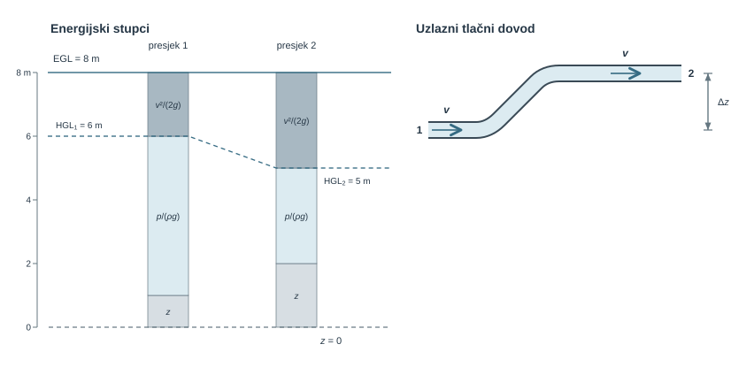
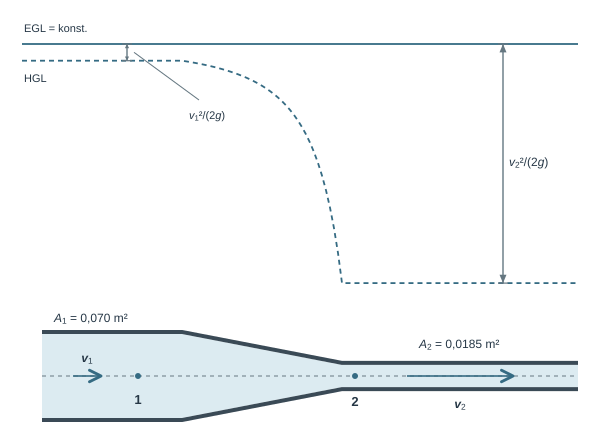
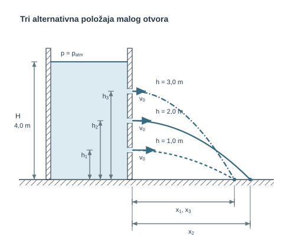
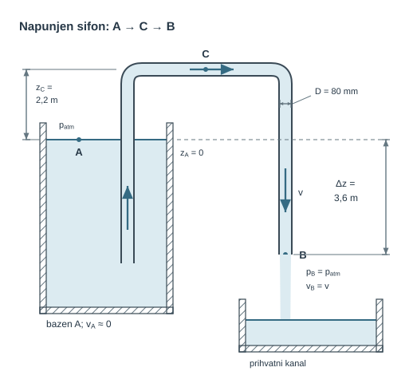
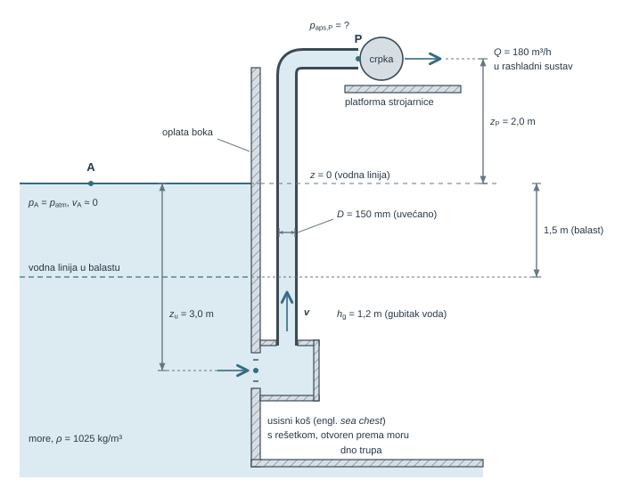
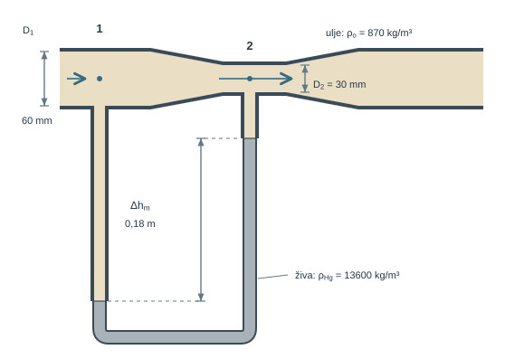
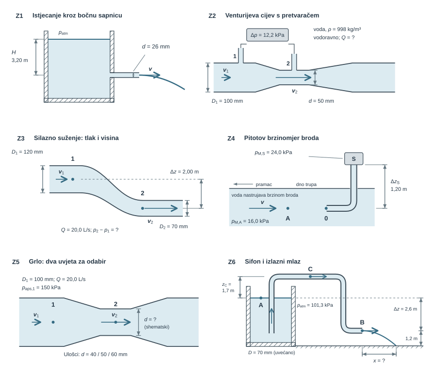

Kad voda prolazi kroz suženje cijevi, ubrzava se, a tlak na stijenci pada. Kad se ista voda uspinje kroz cijev stalnog presjeka, brzina joj se ne mijenja, a tlak ipak pada. Obje pojave posljedica su iste bilance: mehanička energija fluida premješta se između tlaka, brzine i geodetske visine. U ovom poglavlju tu bilancu zapisujemo kao Bernoullijevu jednadžbu i kao opću energijsku jednadžbu kontrolnog volumena, iz koje Bernoulli slijedi kao poseban slučaj.

Za stacionaran nestlačiv tok duž iste strujnice, bez gubitaka i strojnog rada između presjeka, vrijedi $p/(\rho g)+v^2/(2g)+z=\mathrm{konst}$. Svaki je član visina u metrima fluida: tlačna, brzinska i geodetska. Iz tih članova grade se dvije crte za prikaz energije toka. Piezometarska visina (piezometarska crta, HGL) je $HGL=z+p/(\rho g)$, a ukupna energijska visina (energijska crta, EGL) $EGL=HGL+v^2/(2g)$. Bernoullijeva jednadžba izvodi se iz Eulerove jednadžbe duž strujnice i, neovisno, iz teorema rada i energije. Opća energijska jednadžba, izvedena iz Reynoldsova transportnog teorema, dodaje joj visinu dobave crpke $H_p$, visinu turbine $H_t$, gubitak visine $h_g$ i korekcijski faktor kinetičke energije $\alpha$.

Zajedno s bilancom mase iz []{.mf1-chapter-ref target="u07"} Bernoullijeva jednadžba objašnjava rad Venturijeve cijevi, Pitotove sonde, slobodnog mlaza i sifona. Na brodu se njome procjenjuje tlak na ulazu u rashladnu crpku morske vode i rezerva prema tlaku pare, a u strojarstvu se njome mjere protok ulja i brzina zraka. Poglavlje redom obrađuje mehaničku energiju idealnog toka i crte HGL i EGL, dva izvoda Bernoullijeve jednadžbe te opću energijsku jednadžbu, a zatim ih primjenjuje u riješenim primjerima.

Model ne sadrži trenje, rad strojeva ni nestacionarne članove, a daje srednji tlak u presjeku, ne lokalni minimum. Gubitci i rad crpke brojčano se obrađuju u []{.mf1-chapter-ref target="u13"}, a stlačivost plina pri Machovu broju iznad oko 0,3 opisuje se u []{.mf1-chapter-ref target="u09"}.

Slika u nastavku prikazuje obje pojave. Lijevo su energijski stupci za presjeke 1 i 2, složeni od geodetske visine $z$, tlačne visine $p/(\rho g)$ i brzinske visine $v^2/(2g)$ iznad referentne razine $z=0$. Prikazani stupci ilustrativni su i imaju zajedničko mjerilo. U oba presjeka zbroj doseže istu energijsku crtu, $EGL=8\ \text{m}$, a isprekidana piezometarska crta pada od presjeka 1 prema presjeku 2 jer ondje raste brzinska visina. Desno je uzlazni tlačni dovod stalnog presjeka između točaka 1 i 2 s visinskom razlikom $\Delta z$. Brzina je u oba presjeka ista, pa porast geodetske visine prati pad tlačne visine, $p_2-p_1=-\rho g\Delta z$.

{#fig-uvod-u09 fig-align="center" fig-alt="Pregled poglavlja: energijska jednadžba i Bernoulli."}

## Energijska jednadžba i Bernoullijeva jednadžba

Uz bilancu mase Bernoullijeva jednadžba omogućuje analizu Venturijeve cijevi, slobodnoga mlaza, Pitotove sonde i usisnog voda crpke. Opća energijska jednadžba kontrolnog volumena, iz koje Bernoulli slijedi kao poseban slučaj, izvodi se u ovom poglavlju iz Reynoldsova transportnog teorema.

::: {.mf1-application}

Inženjerski kontekst

Bernoullijeva jednadžba povezuje tlak i brzinu u Venturijevoj cijevi, Pitotovoj sondi, mlaznici, sifonu i usisnom vodu brodske crpke. Za svaki primjer najprije odabiremo referentne presjeke i referencu tlaka te provjeravamo mogu li se gubitci zanemariti.
:::

**Procijenjeno vrijeme rada uz priručnik:** 10 sati.

## Mehanička energija idealnoga toka

Bernoullijeva jednadžba bilanca je mehaničke energije po jedinici težine u idealiziranom strujanju, sa zbrojem tlačne visine $p/(\rho g)$, brzinske visine $v^2/(2g)$ i geodetske visine $z$:

$$
\frac{p}{\rho g} + \frac{v^2}{2g} + z = \text{konst.}
$$ {#eq-energijska-bilanca-fizikalni-uvod-i-matematicki-izvod-01}

Za dvije točke na istoj strujnici jednadžba poprima oblik

$$
\frac{p_1}{\rho g} + \frac{v_1^2}{2g} + z_1 = \frac{p_2}{\rho g} + \frac{v_2^2}{2g} + z_2
$$ {#eq-energijska-bilanca-fizikalni-uvod-i-matematicki-izvod-02}

::: {.mf1-interaktivno}

Interaktivni prikaz — Venturijeva cijev

**Predvidi.** Kako se mijenja protok ako se izmjerena razlika tlakova učetverostruči?

**Provjeri i protumači.** Usporedi račun i predviđanje, zatim povećaj nesigurnost promjera grla. Objasni treba li poboljšati mjerenje promjera ili tlaka. Bilježnica odvaja uljni primjer iz knjige od zasebnoga kalibracijskog slučaja s vodom.

<a class="mf1-interaktivno-veza" href="https://martibasic.github.io/MF1_udzbenik/jlite/lab/index.html?path=u09_venturi.ipynb">Pokreni u pregledniku</a>

:::

Ako jedan član raste, barem jedan od preostala dva mora pasti; to je fizikalna srž Venturijeve cijevi, Pitotove sonde, mlaza i sifona bez gubitaka. Iz istih članova proizlaze dvije crte za prikaz energije toka. Piezometarska crta ili `HGL` jednaka je zbroju tlačne i geodetske visine,

$$
HGL = \frac{p}{\rho g} + z,
$$ {#eq-energijska-bilanca-interaktivni-prikaz-venturijeva-cijev-01}

dok energijska crta ili `EGL` sadrži i brzinski član,

$$
EGL = \frac{p}{\rho g} + \frac{v^2}{2g} + z.
$$ {#eq-energijska-bilanca-interaktivni-prikaz-venturijeva-cijev-02}

::: {.mf1-fizikalno-znacenje}

Fizikalno značenje

`HGL` (piezometarska crta) prikazuje piezometarsku visinu $z+p/(\rho g)$, a `EGL` (energijska crta) iznad nje leži za brzinsku visinu $v^2/(2g)$. Pri crtanju otvorenih vodnih sustava obično se koristi **manometarski tlak**, pa slobodna površina otvorenog spremnika leži na HGL-u. U idealnom toku `EGL` je horizontalna, a `HGL` pada ondje gdje se fluid ubrzava i raste ondje gdje se usporava. Ako je HGL ispod osi cijevi, manometarski je tlak negativan, ali apsolutni tlak i dalje može biti daleko iznad tlaka zasićene pare. Kavitacija je moguća tek kad lokalni **apsolutni** tlak dosegne tlak zasićene pare pri promatranoj temperaturi.
:::

Tlak zadan u paskalima ili kilopaskalima u Bernoullijevoj se jednadžbi izražava tlačnom visinom $p/(\rho g)$ u metrima fluida; umnožak $\rho g$ specifična je težina $\gamma$ iz []{.mf1-chapter-ref target="u01"}, ali u ovoj knjizi Bernoullijeve članove pišemo s $\rho g$:

$$
\frac{p}{\rho g} = \frac{p}{\gamma}\quad[\text{m}].
$$ {#eq-energijska-bilanca-fizikalno-znacenje-01}

Za vodu je $1\ \text{m}$ tlačne visine oko $9{,}81\ \text{kPa}$, a $10\ \text{kPa}$ približno $1{,}02\ \text{m}$ vodenog stupca; pad statičkog tlaka $\Delta p$ u horizontalnom vodu ujedno je pad `HGL` za $\Delta p/(\rho g)$. Pri pretvorbi visine u tlak mora biti jasno je li visina apsolutna ili manometarska; atmosferski se tlak dodaje samo pri prijelazu na apsolutnu referencu.

::: {#cfd-venturi-mjerenje-gubitak .mf1-cfd title="Računalna dinamika fluida"}

**Venturi u rashladnom vodu: mjerenje i gubitak.** Mjerač iz []{.mf1-chapter-ref target="u03"} sužava tok i tako povećava brzinu u grlu. CFD daje statički tlak na priključcima i brzinu u presjecima. Za nestlačiv tok, koji ovdje pretpostavljamo, ukupni je tlak $p_t=p+\rho v^2/2$; na različitim kotama u mehaničku energiju ulazi i gravitacijski član. Bočni priključak i idealna Pitotova sonda zato ne očitavaju istu veličinu.

**Zastani i promisli.** Statički tlak pada prema grlu Venturija. Smijemo li cijeli pad proglasiti gubitkom energije?

Pad statičkog tlaka do grla nije sam dokaz gubitka: dio tlačne energije prelazi u kinetičku i može se vratiti u difuzoru. Provjeri ukupnu mehaničku energiju prije cijelog mjerača i poslije njega. Tako odvoji koristan mjerni signal od trajnog opterećenja crpke.
:::

::: {.mf1-izvod}

Matematički izvod — Eulerova jednadžba duž strujnice iz Newtonova zakona

Bernoullijeva jednadžba nije zaseban zakon, nego integrirani oblik Eulerove jednadžbe — Newtonova drugoga zakona primijenjenoga na element fluida koji se giba duž strujnice u idealnom (neviskoznom, nestlačivom, stacionarnom) strujanju.

Promatramo element strujne cijevi duljine $ds$ i poprečnog presjeka $A$ koji se giba duž strujnice brzinom $v$ u smjeru $s$. Masa elementa je $dm = \rho A\,ds$. Na njega djeluju tri vrste sila u smjeru osi $s$:

- sila tlaka na ulaznoj plohi: $p A$ u smjeru $+s$;
- sila tlaka na izlaznoj plohi: $-(p + dp) A$ u smjeru $+s$ (predznak: tlak gura natrag);
- komponenta težine duž osi $s$: $-\rho g A\,ds \cdot \sin\theta$, gdje je $\theta$ kut između strujnice i horizontalne ravnine. Uz $\sin\theta = dz/ds$ (porast visine po duljini strujnice) tu komponentu zapisujemo kao $-\rho g A\,ds \cdot dz/ds$.

Ako se presjek duž elementa mijenja za $dA$, bočni tlak na plaštu daje u smjeru $s$ doprinos $p\,dA$, koji se do prvog reda poništava s dodatnim članom $-p\,dA$ iz izlazne plohe $(p+dp)(A+dA)$; zato element smijemo promatrati uz stalan $A$.

Zbroj sila na element iznosi

$$
dF_s = pA - (p + dp)A - \rho g A\,ds\,\frac{dz}{ds} = -A\,dp - \rho g A\,dz.
$$ {#eq-energijska-bilanca-matematicki-izvod-eulerova-jednadzba-duz-strujni-01}

Newtonov drugi zakon povezuje taj zbroj s ubrzanjem $a_s = dv/dt$. U stacionarnom strujanju materijalna derivacija svodi se na $dv/dt = v\,dv/ds$ (ostaje samo konvektivni član, jer je $\partial v/\partial t = 0$), pa je

$$
dm \cdot a_s = \rho A\,ds \cdot v\,\frac{dv}{ds} = -A\,dp - \rho g A\,dz.
$$ {#eq-energijska-bilanca-matematicki-izvod-eulerova-jednadzba-duz-strujni-02}

Kraćenjem s $A$ i dijeljenjem s $ds$ slijedi **Eulerova jednadžba duž strujnice**

$$
\rho v\,\frac{dv}{ds} = -\frac{dp}{ds} - \rho g\,\frac{dz}{ds},
$$ {#eq-energijska-bilanca-matematicki-izvod-eulerova-jednadzba-duz-strujni-03}

odnosno u kompaktnijem zapisu

$$
\rho\,v\,dv + dp + \rho g\,dz = 0.
$$ {#eq-energijska-bilanca-matematicki-izvod-eulerova-jednadzba-duz-strujni-04}

Integriranjem ovoga diferencijalnog oblika uz pretpostavku konstantne gustoće dobiva se Bernoullijeva jednadžba, što je tema sljedećeg izvoda.
:::

::: {.mf1-izvod}

Matematički izvod — Bernoullijeva jednadžba iz Eulerove

**Pitanje.** Koliko mehaničke energije po jedinici težine nosi čestica idealnog fluida duž strujnice i mijenja li se taj iznos? Polazimo od jednadžbe [-@eq-energijska-bilanca-matematicki-izvod-eulerova-jednadzba-duz-strujni-04] za stacionarno, nestlačivo i neviskozno strujanje. Dijeljenjem s $\rho$ slijedi

$$
v\,dv + \frac{dp}{\rho} + g\,dz = 0.
$$ {#eq-energijska-bilanca-numericki-trag-01}

Svaki je član totalni diferencijal: $v\,dv = d(v^2/2)$, $g\,dz = d(gz)$, a za stalnu gustoću $dp/\rho = d(p/\rho)$. Integriranjem između točaka 1 i 2 dobiva se

$$
\int_{v_1}^{v_2} v\,dv + \int_{p_1}^{p_2} \frac{dp}{\rho} + g\int_{z_1}^{z_2} dz = 0.
$$ {#eq-energijska-bilanca-razrada-koraka-04}

Za nestlačiv fluid gustoća je konstantna, pa integracija daje

$$
\frac{v_2^2-v_1^2}{2} + \frac{p_2-p_1}{\rho} + g(z_2-z_1) = 0,
$$ {#eq-energijska-bilanca-razrada-koraka-05}

odnosno

$$
\frac{p_1}{\rho} + \frac{v_1^2}{2} + gz_1 = \frac{p_2}{\rho} + \frac{v_2^2}{2} + gz_2 = \text{konst.}
$$ {#eq-energijska-bilanca-razrada-koraka-06}

Dijeljenjem s $g$ nastaje klasični Bernoullijev oblik u metrima fluida:

$$
\frac{p}{\rho g} + \frac{v^2}{2g} + z = \text{konst.}
$$ {#eq-energijska-bilanca-razrada-koraka-07}

::: {.mf1-fizikalno-znacenje}

Fizikalno značenje

Ova jednadžba kaže da mehanička energija po jedinici težine ostaje konstantna duž strujnice idealnog fluida — ona se samo premješta između tlačne visine, brzinske visine i geodetske visine. Tlačni član ne opisuje komprimiranje nestlačivoga fluida, nego mehanički doprinos **tlačnog rada** okolnog fluida. Kad se cijev sužava i brzina raste, energija dolazi od pada tlaka; kad se tok uspori, dio kinetičke energije može se vratiti u tlak. Bernoulli je zakon o preraspodjeli, a ne o stvaranju energije.
:::
:::

## Kada se trenje može zanemariti

Eulerove jednadžbe opisuju tok bez viskoznih sila. Dovoljne su za tlak i brzinu u glatkom suženju s malim gubitcima, ali ne i za otpor duge cijevi ili silu trenja na stijenci: izostavile bi upravo pojavu koju želimo izračunati.

::: {.mf1-izvod}

Matematički izvod — Alternativni izvod Bernoullijeve jednadžbe iz rada i energije

Bernoullijeva jednadžba može se izvesti i iz **teorema rada i energije**. U stacionarnom, nestlačivom i neviskoznom strujanju rad sila tlaka i sile teže povezuje se s promjenom kinetičke energije elementa fluida. Pretpostavljamo da između promatranih točaka nema strojnog rada.

Promatramo cilindrični element strujne cijevi duljine $ds$, poprečnog presjeka $A$ i mase $dm = \rho A\,ds$ koji se duž strujnice giba brzinom $v$. Tijekom diferencijalnog vremena $dt$ element prijeđe udaljenost $ds = v\,dt$ i pritom se podigne za visinski element $dz = \sin\theta\,ds$.

Na element djeluju dvije vrste sila koje obavljaju rad:

- **Sile tlaka** na ulaznoj i izlaznoj plohi. Rad neto sile tlaka u smjeru gibanja iznosi

$$
dW_{tlak} = pA\,ds - (p+dp)\,A\,ds = -A\,dp\,ds = -\frac{dp}{\rho}\,dm.
$$ {#eq-energijska-bilanca-matematicki-izvod-alternativni-izvod-bernoullija-01}

- **Sila teže**, koja djeluje vertikalno prema dolje i pri uspinjanju obavlja negativan rad:

$$
dW_{grav} = -dm\,g\,dz.
$$ {#eq-energijska-bilanca-matematicki-izvod-alternativni-izvod-bernoullija-02}

Promjena kinetičke energije elementa je

$$
dE_k = d\!\left(\frac{1}{2}\,dm\,v^2\right) = dm\,v\,dv.
$$ {#eq-energijska-bilanca-matematicki-izvod-alternativni-izvod-bernoullija-03}

Teorem rada i energije ($\sum dW = dE_k$) daje

$$
-\frac{dp}{\rho}\,dm - dm\,g\,dz = dm\,v\,dv,
$$ {#eq-energijska-bilanca-matematicki-izvod-alternativni-izvod-bernoullija-04}

odakle se nakon dijeljenja s $dm$ dobiva diferencijalni oblik

$$
\frac{dp}{\rho} + g\,dz + v\,dv = 0.
$$ {#eq-energijska-bilanca-matematicki-izvod-alternativni-izvod-bernoullija-05}

Za nestlačivi fluid ($\rho$ = konst.) ova se jednadžba integrira između dviju točaka duž iste strujnice:

$$
\frac{p_1 - p_2}{\rho} + g(z_1 - z_2) + \frac{v_1^2 - v_2^2}{2} = 0,
$$ {#eq-energijska-bilanca-matematicki-izvod-alternativni-izvod-bernoullija-06}

što se preraspodjelom svodi na **Bernoullijevu jednadžbu**

$$
\frac{p}{\rho g} + \frac{v^2}{2g} + z = \text{konst.}
$$ {#eq-energijska-bilanca-matematicki-izvod-alternativni-izvod-bernoullija-07}

Ovaj izvod potvrđuje da je **Bernoullijeva jednadžba zakon očuvanja mehaničke energije po jedinici težine fluida**: $p/(\rho g)$ je tlačni rad okolnog fluida, $v^2/(2g)$ kinetička, a $z$ gravitacijska potencijalna energija po jedinici težine. Prvi izvod polazi od **bilance sila**, drugi od **bilance rada i kinetičke energije**. Opća energijska jednadžba koja slijedi dodaje toj bilanci rad crpke i turbine te gubitak $h_g$.
:::

::: {.mf1-izvod}

Matematički izvod — Energijska jednadžba iz Reynoldsova transportnog teorema

**Fizikalno pitanje.** Bernoullijeva jednadžba vrijedi za česticu idealnog fluida. Što se događa s mehaničkom energijom kad fluid prolazi kroz crpku ili turbinu i kad trenje dio te energije nepovratno pretvara u toplinu? Odgovor daje prvi zakon termodinamike primijenjen na kontrolni volumen pomoću Reynoldsova transportnog teorema iz []{.mf1-chapter-ref target="u07"}.

**Bilanca.** Za sustav vrijedi $dE/dt = \dot Q - \dot W$: dovedena toplina umanjena za rad koji sustav obavlja na okolini. Uz specifičnu ukupnu energiju $e = e_u + v^2/2 + gz$ (unutarnja $e_u$, kinetička i potencijalna) Reynoldsov transportni teorem s $\eta = e$ daje za nepomičan kontrolni volumen

$$
\dot Q - \dot W = \frac{d}{dt}\int_{KV}\rho e\,dV + \int_{KP}\rho e\,(\vec v\cdot\vec n)\,dA .
$$ {#eq-energijska-jednadzba-rtt}

Rad $\dot W$ ima dva dijela: rad vratila $\dot W_s$ (crpka ga dovodi fluidu, turbina odvodi) i rad tlačnih sila kojim fluid na kontrolnoj plohi gura okolni fluid ili okolni fluid gura njega, $\dot W_p = \int_{KP} p\,(\vec v\cdot\vec n)\,dA$. Viskozni rad na stijenkama iščezava zbog prianjanja, a na ulaznom i izlaznom presjeku ga zanemarujemo.

**Koraci.** U stacionarnom toku akumulacija je nula. Tlačni rad prebacimo na desnu stranu i spojimo ga s $e$ pod isti integral:

$$
\dot Q - \dot W_s = \int_{KP}\rho\left(\frac{p}{\rho} + e_u + \frac{v^2}{2} + gz\right)(\vec v\cdot\vec n)\,dA .
$$ {#eq-energijska-jednadzba-tok}

Za jedan ulazni presjek 1 i jedan izlazni presjek 2 s jednolikim $p$, $e_u$ i $z$ integral prelazi u razliku izlaz − ulaz pomnoženu s masenim protokom $\dot m$. Samo kinetički član zahtijeva pozornost: stvarni profil brzine nije jednolik, pa tok kinetičke energije nije jednak $\dot m\,\bar v^2/2$. Razliku pokriva **korekcijski faktor kinetičke energije**

$$
\alpha = \frac{1}{A\,\bar v^{3}}\int_A v^3\,dA ,
\qquad
\int_A \rho\,\frac{v^2}{2}\,v\,dA = \alpha\,\dot m\,\frac{\bar v^2}{2}.
$$ {#eq-korekcijski-faktor-kineticke-energije}

Za jednolik profil $\alpha = 1$, za razvijeni laminarni parabolični profil $\alpha = 2$, a u turbulentnim cijevnim tokovima obično $1{,}03$–$1{,}1$. Dijeljenjem s $\dot m g$ i uvođenjem visina

$$
H_p = \frac{\dot W_{crpka}}{\dot m g},\qquad
H_t = \frac{\dot W_{turbina}}{\dot m g},\qquad
h_g = \frac{(e_{u,2} - e_{u,1}) - \dot Q/\dot m}{g}
$$ {#eq-energijska-jednadzba-visine-definicije}

dobiva se **energijska jednadžba kontrolnog volumena** u metrima fluida:

$$
\frac{p_1}{\rho g} + \alpha_1\frac{v_1^2}{2g} + z_1 + H_p
= \frac{p_2}{\rho g} + \alpha_2\frac{v_2^2}{2g} + z_2 + H_t + h_g .
$$ {#eq-energijska-jednadzba-kv}

Član $h_g$ je **gubitak visine**: mehanička energija koju trenje nepovratno pretvara u unutarnju energiju i toplinu, pa je prema drugom zakonu termodinamike $h_g \ge 0$.

**Rezultat.** Bernoullijeva jednadžba poseban je slučaj jednadžbe [-@eq-energijska-jednadzba-kv] za $H_p = H_t = h_g = 0$ i $\alpha_1 = \alpha_2 = 1$. U ovom se poglavlju računa upravo tako; brojčana uporaba $\alpha \ne 1$, gubitaka i rada crpke pripada []{.mf1-chapter-ref target="u13"}, a @ex-usisni-vod-rashladne-crpke-morske-vode i Z6 koriste zadani $h_g$ kao prvi korak prema njemu.

**Provjera.** Svi članovi imaju dimenziju duljine. Za $h_g > 0$ energijska crta (EGL) pada u smjeru toka; crpka je podiže za $H_p$, a turbina spušta za $H_t$. Za nejednolik profil $\alpha > 1$, pa zanemarivanje korekcije podcjenjuje kinetičku energiju toka.
:::

Uz izvod treba jasno navesti i pretpostavke modela. U ovom poglavlju Bernoullijeva jednadžba vrijedi samo kad su dovoljno dobro opravdane sljedeće pretpostavke:

- strujanje je stacionarno
- fluid se može uzeti nestlačivim
- viskozni gubitci su zanemarivi
- između promatranih točaka nema strojnog rada ni druge vanjske mehaničke dobave energije
- dvije točke leže na istoj strujnici

Posljednja pretpostavka često se primjenjuje šire nego što izgleda. Kad jedna točka leži na mirnoj površini velikog spremnika, sve strujnice koje iz njega izlaze nose istu ukupnu visinu $p_{atm}/(\rho g) + z_A$; zato smijemo spojiti površinu s bilo kojim presjekom cijevi ili mlaza, iako ne znamo koja strujnica vodi do koje točke presjeka. Isto vrijedi za bezvrtložno strujanje, u kojem je Bernoullijeva konstanta jednaka u cijelom polju.

::: {.mf1-granica-modela}

Granica modela — što Bernoulli ne opisuje

Bernoullijeva jednadžba ne sadrži trenje, rad strojeva ni nestacionarne članove: čim gubitci mjerljivo smanjuju tlak (dugi vodovi, ventili, nagla proširenja), čim je u sustavu crpka ili turbina ili se protok mijenja u vremenu, treba primijeniti jednadžbu [-@eq-energijska-jednadzba-kv] ili modele iz []{.mf1-chapter-ref target="u13"}. Jednadžba daje srednji tlak u presjeku, ne lokalni minimum na unutarnjem radijusu koljena ili na lopatici, pa je zaključak o kavitaciji iz nje samo nužan, ne i dovoljan uvjet. Pri Machovu broju iznad oko 0,3 stlačivost više nije zanemariva ([]{.mf1-chapter-ref target="u09"}).
:::

::: {.mf1-cfd title="Računalna dinamika fluida"}

**Što ručni račun može provjeriti u CFD-u, a što CFD dodaje?** *Pitanje:* koliko difuzor iza Venturijeva grla troši mehaničke energije i je li kratko naglo proširenje prihvatljivo umjesto duljeg postupnog. *Model:* najprije idealni (neviskozni) tok; u njemu odnos tlaka i brzine duž strujnice i očuvanje protoka moraju reproducirati Bernoullijevu relaciju, što povezuje lokalne jednadžbe s ovim poglavljem. Zatim uključimo viskoznost i prianjanje na stijenci: pojavljuju se trenje i mogući povratni tok u difuzoru. *Podatci:* geometrija obiju izvedbi, protok, svojstva fluida i tlak na izlazu. *Izlazi:* polja brzine i tlaka, iz njih tok mehaničke energije kroz ulazni i izlazni presjek (prosjek ukupnog tlaka ponderiran masenim protokom, ne obični površinski prosjek) te gubitak $h_g$ između njih; za nejednolik izlazni profil izračunani $\alpha$. *Provjera:* razlika prema idealnom rješenju je promjena fizikalnog modela, a numeričku pogrešku procjenjujemo zasebno sustavnim profinjenjem mreže uz iste pretpostavke. *Odluka:* kraći uređaj biramo samo ako ušteda prostora vrijedi više od crpne snage potrebne za dodatni gubitak. Odvajanje toka podrobnije opisuje []{.mf1-chapter-ref target="u12"}, a cijeli postupak od granica domene do usporedbe s mjerenjem @sec-cfd-venturi.

[]{#provjera-cfd-a-analitickim-rjesenjem}
:::

## Riješeni primjeri

::: {#ex-u09-pad-statickog-tlaka-u-konfuzoru-ventilacijskog-kanala .mf1-we}

Pad statičkog tlaka u konfuzoru ventilacijskog kanala&nbsp;T2

**Tekst zadatka**

Zrak stalne gustoće $\rho = 1{,}2\ \text{kg/m}^3$ struji masenim protokom $\dot{m} = 0{,}68\ \text{kg/s}$ kroz horizontalni konfuzor. Ulazna površina je $A_1 = 0{,}07\ \text{m}^2$, a izlazna $A_2 = 0{,}0185\ \text{m}^2$. Strujanje je stacionarno; zanemari gubitke.

**Traži se**

Odredi pad statičkog tlaka $\Delta p$ između presjeka 1 i 2.

{#fig-u09-staticka-zamjena-za-egl-i-hgl fig-alt="Horizontalni konfuzor: otvoreni presjeci, stalni EGL i pad HGL-a pri ubrzanju zraka."}

**Veza s proračunom.** Razmak EGL–HGL jednak je brzinskoj visini; energijske visine imaju zajedničko mjerilo, a apsolutni položaj EGL-a proizvoljan je jer ulazni tlak nije zadan.

**Rješenje**

Najprije iz masenog protoka dobivamo volumenski protok:

$$
Q = \frac{\dot{m}}{\rho} = \frac{0{,}68}{1{,}2} \approx 0{,}5667\ \text{m}^3/\text{s}.
$$ {#eq-energijska-bilanca-rijeseni-primjer-pad-statickog-tlaka-u-konfuzoru-01}

Iz toga slijede brzine u oba presjeka:

$$
v_1 = \frac{Q}{A_1} = \frac{0{,}5667}{0{,}07} \approx 8{,}10\ \text{m/s},
$$ {#eq-energijska-bilanca-rijeseni-primjer-pad-statickog-tlaka-u-konfuzoru-02}

$$
v_2 = \frac{Q}{A_2} = \frac{0{,}5667}{0{,}0185} \approx 30{,}63\ \text{m/s}.
$$ {#eq-energijska-bilanca-rijeseni-primjer-pad-statickog-tlaka-u-konfuzoru-03}

Kako je kanal horizontalan, vrijedi $z_1 = z_2$. U idealnom modelu bez gubitaka Bernoullijeva jednadžba daje

$$
\frac{p_1}{\rho g} + \frac{v_1^2}{2g} = \frac{p_2}{\rho g} + \frac{v_2^2}{2g} \quad \Rightarrow \quad p_1 - p_2 = \frac{\rho}{2}(v_2^2 - v_1^2).
$$ {#eq-energijska-bilanca-rijeseni-primjer-pad-statickog-tlaka-u-konfuzoru-04}

Uvrštavanjem brojeva dobiva se

$$
\Delta p = \frac{1{,}2}{2}(30{,}63063^2 - 8{,}09524^2) \approx 523{,}62\ \text{Pa} \approx 0{,}524\ \text{kPa}.
$$ {#eq-energijska-bilanca-rijeseni-primjer-pad-statickog-tlaka-u-konfuzoru-05}

**Provjera i tumačenje**

Predznak: u užem presjeku brzina je veća, pa statički tlak mora biti niži ($p_1 > p_2$). Pad od oko 0,5 kPa malen je u usporedbi s atmosferskim tlakom, pa je pretpostavka stalne gustoće zraka opravdana.
:::

U slobodnom mlazu ista bilanca najprije daje izlaznu brzinu, a račun se zatim nastavlja kinematikom čestice.

::: {#ex-u09-domet-slobodnog-mlaza-iz-velikog-spremnika-t2 .mf1-we}

Domet slobodnog mlaza iz velikog spremnika&nbsp;T2

**Tekst zadatka**

Slobodna površina velikog otvorenog spremnika vode nalazi se $H = 4{,}0\ \text{m}$ iznad tla. Kroz mali bočni otvor istječe vodoravni mlaz. Usporedi otvore na visinama $h_1 = 1{,}0\ \text{m}$, $h_2 = 2{,}0\ \text{m}$ i $h_3 = 3{,}0\ \text{m}$ iznad tla. Površina i mlaz izloženi su atmosferi; zanemari brzinu površine, gubitke i otpor zraka.

**Traži se**

1. Izračunaj domete mlaza $x_1$, $x_2$ i $x_3$ za sva tri zadana položaja otvora.
2. Odredi položaj otvora koji daje najveći domet.

{#fig-u09-domet-slobodnog-mlaza fig-alt="Domet slobodnog mlaza"}

**Veza s proračunom.** Tri otvora alternativne su izvedbe, ne istodobni mlazovi. Visine i dometi imaju zajedničko mjerilo; otvori su uvećani radi čitljivosti.

**Rješenje**

Iz Bernoullijeve jednadžbe između slobodne površine i otvora slijedi $v_0 = \sqrt{2g(H-h)}$, a vrijeme pada mlaza s visine $h$ do tla iznosi $t = \sqrt{2h/g}$, pa je horizontalni domet

$$
x = v_0 t = \sqrt{2g(H-h)}\,\sqrt{\frac{2h}{g}} = 2\sqrt{h(H-h)}.
$$ {#eq-energijska-bilanca-rijeseni-primjer-domet-slobodnog-mlaza-iz-veliko-01}

Sada izračunajmo domet za tri zadana položaja.

Za $h_1 = 1{,}0\ \text{m}$:

$$
x_1 = 2\sqrt{1{,}0(4{,}0 - 1{,}0)} = 2\sqrt{3} \approx 3{,}46\ \text{m}.
$$ {#eq-energijska-bilanca-rijeseni-primjer-domet-slobodnog-mlaza-iz-veliko-02}

Za $h_2 = 2{,}0\ \text{m}$:

$$
x_2 = 2\sqrt{2{,}0(4{,}0 - 2{,}0)} = 2\sqrt{4} = 4{,}00\ \text{m}.
$$ {#eq-energijska-bilanca-rijeseni-primjer-domet-slobodnog-mlaza-iz-veliko-03}

Za $h_3 = 3{,}0\ \text{m}$:

$$
x_3 = 2\sqrt{3{,}0(4{,}0 - 3{,}0)} = 2\sqrt{3} \approx 3{,}46\ \text{m}.
$$ {#eq-energijska-bilanca-rijeseni-primjer-domet-slobodnog-mlaza-iz-veliko-04}

Vidimo da je domet najveći kad je otvor postavljen na polovicu visine slobodne površine iznad tla, odnosno za $h = H/2$. Tada vrijedi $x_{max} = H$, pa je u ovom primjeru maksimalni domet jednak

$$
x_{max} = 4{,}0\ \text{m}.
$$ {#eq-energijska-bilanca-rijeseni-primjer-domet-slobodnog-mlaza-iz-veliko-05}

**Provjera i tumačenje**

Nizak otvor daje veliku brzinu, ali kratko vrijeme leta; visok otvor daje obrnuto. Položaji $h$ i $H-h$ daju isti domet jer u izrazu stoji njihov umnožak, što potvrđuju jednaki dometi $x_1 = x_3$ za 1 m i 3 m.
:::

::: {#ex-u09-privremeni-sifon-za-praznjenje-servisnog-bazena-t2 .mf1-we}

Privremeni sifon za pražnjenje servisnog bazena&nbsp;T2

**Tekst zadatka**

Napunjen sifon stalnog promjera $D = 80\ \text{mm}$ odvodi vodu iz velikog otvorenog bazena `A`. Ulaz je uronjen, a otvoreni izlaz `B` završava slobodnim mlazom $\Delta z = 3{,}6\ \text{m}$ ispod površine bazena, iznad prihvatnog kanala. Vrh `C` je $z_C = 2{,}2\ \text{m}$ iznad površine bazena. Atmosferska tlačna visina iznosi $10{,}2\ \text{m}$, a visina tlaka pare $0{,}25\ \text{m}$ vodenog stupca. Promatraj kvazistacionarni trenutak; zanemari gubitke i brzinu površine bazena.

**Traži se**

1. Odredi brzinu strujanja $v$ u sifonskoj cijevi.
2. Odredi volumenski protok $Q$.
3. Odredi manometarsku tlačnu visinu $p_{M,C}/(\rho g)$ u najvišoj točki `C` i idealiziranu razliku apsolutne tlačne visine prema zadanoj visini tlaka pare.

{#fig-u09-idealni-sifon-izme-u-dviju-razina fig-alt="Napunjen sifon: ulaz je uronjen u bazen A, vrh je C, a izlaz B otvoren prema atmosferi."}

**Veza s proračunom.** Kote se odnose na os cijevi; visine imaju zajedničko mjerilo, a promjer je uvećan.

**Rješenje**

Referentne točke biramo tamo gdje znamo najviše: `A` je mirna površina bazena (poznat tlak, brzina zanemariva), a `B` slobodni izlaz (poznat tlak, nepoznata brzina). Sve strujnice izlaze iz mirnog bazena s istom ukupnom visinom, pa ih smijemo spojiti. Bernoullijeva jednadžba između `A` i `B` daje

$$
\frac{p_A}{\rho g} + \frac{v_A^2}{2g} + z_A = \frac{p_B}{\rho g} + \frac{v_B^2}{2g} + z_B.
$$ {#eq-energijska-bilanca-rijeseni-primjer-privremeni-sifon-za-praznjenje-01}

Kako su $p_A = p_B = p_{atm}$, $v_A \approx 0$ i $v_B=v$, ostaje $z_A - z_B = v^2/(2g) = \Delta z$, pa je brzina u sifonskoj cijevi

$$
v = \sqrt{2g\Delta z} = \sqrt{2 \cdot 9{,}81 \cdot 3{,}6} \approx 8{,}40\ \text{m/s}.
$$ {#eq-energijska-bilanca-rijeseni-primjer-privremeni-sifon-za-praznjenje-02}

Površina presjeka cijevi iznosi

$$
A = \frac{\pi D^2}{4} = \frac{\pi \cdot 0{,}08^2}{4} \approx 5{,}03 \cdot 10^{-3}\ \text{m}^2,
$$ {#eq-energijska-bilanca-rijeseni-primjer-privremeni-sifon-za-praznjenje-03}

zato je volumenski protok

$$
Q = Av = 5{,}03 \cdot 10^{-3} \cdot 8{,}40 \approx 4{,}22 \cdot 10^{-2}\ \text{m}^3/\text{s} \approx 42{,}2\ \text{L/s}.
$$ {#eq-energijska-bilanca-rijeseni-primjer-privremeni-sifon-za-praznjenje-04}

Sada zapišimo Bernoullijevu jednadžbu između slobodne površine bazena `A` i vrha sifona `C`. Uzmimo $z_A = 0$, pa je $z_C = 2{,}2\ \text{m}$:

$$
\frac{p_{atm}}{\rho g} = \frac{p_{aps,C}}{\rho g} + \frac{v^2}{2g} + z_C.
$$ {#eq-energijska-bilanca-rijeseni-primjer-privremeni-sifon-za-praznjenje-05}

Ako radimo s manometarskim tlakom u odnosu na atmosferu, jednadžba prelazi u $0 = p_{M,C}/(\rho g) + 3{,}6 + 2{,}2$, pa je

$$
\frac{p_{M,C}}{\rho g} = -5{,}8\ \text{m}.
$$ {#eq-energijska-bilanca-rijeseni-primjer-privremeni-sifon-za-praznjenje-06}

Manometarska tlačna visina u C iznosi $-5{,}8\ \text{m}$. Piezometarska crta uključuje i geodetsku visinu: $HGL_C=z_C+p_{M,C}/(\rho g)=2{,}2-5{,}8=-3{,}6\ \text{m}$, pa leži 3,6 m ispod slobodne površine bazena. Tlačna visina mjeri se od osi cijevi, a HGL od odabrane referentne ravnine.

To znači da je apsolutna tlačna visina u točki `C`

$$
\frac{p_{aps,C}}{\rho g} = 10{,}2 - 5{,}8 = 4{,}4\ \text{m}.
$$ {#eq-energijska-bilanca-rijeseni-primjer-privremeni-sifon-za-praznjenje-07}

Ako rezultat želimo izraziti tlakom, slijedi

$$
p_{M,C} = \rho g \cdot (-5{,}8) = 1000 \cdot 9{,}81 \cdot (-5{,}8) \approx -56{,}9\ \text{kPa},
$$ {#eq-energijska-bilanca-rijeseni-primjer-privremeni-sifon-za-praznjenje-08}

te apsolutni tlak

$$
p_{aps,C} = \rho g \cdot 4{,}4 = 1000 \cdot 9{,}81 \cdot 4{,}4 \approx 43{,}2\ \text{kPa}.
$$ {#eq-energijska-bilanca-rijeseni-primjer-privremeni-sifon-za-praznjenje-09}

Kako je visina tlaka pare $p_v/(\rho g)=0{,}25\ \text{m}$, idealni model daje razliku $4{,}4-0{,}25=4{,}15\ \text{m}$ vodenog stupca prema tom lokalnom kriteriju.

**Provjera i tumačenje**

Provjera energije u C: $z_C + p_{M,C}/(\rho g) + v^2/(2g) = 2{,}2 - 5{,}8 + 3{,}6 = 0$, kao na površini A. Razlika 4,15 m prema tlaku pare pripada idealnom modelu; stvarna provjera mora uključiti gubitke ([]{.mf1-chapter-ref target="u13"}), temperaturu i otopljene plinove.
:::

::: {#ex-usisni-vod-rashladne-crpke-morske-vode .mf1-ch}

Usisni vod rashladne crpke morske vode: tlak na ulazu u crpku&nbsp;T3

**Tekst zadatka**

Crpka rashladne morske vode pomoćnih strojeva smještena je na platformi strojarnice tako da je os njezina usisnog priključka $z_P = 2{,}0\ \text{m}$ iznad vodne linije. Voda ulazi kroz usisnu košaru (engl. *sea chest*) u boku broda, čiji je otvor $z_u = 3{,}0\ \text{m}$ ispod vodne linije, i uspinje se usisnim vodom promjera $D = 150\ \text{mm}$. Crpka daje protok $Q = 180\ \text{m}^3/\text{h}$ morske vode gustoće $\rho = 1025\ \text{kg/m}^3$ i tlaka pare $p_v = 2{,}3\ \text{kPa}$; atmosferski tlak je $p_{atm} = 101{,}3\ \text{kPa}$. Gubitak visine usisnog voda (rešetka, ventil, filtar, koljena i cijev) zadan je kao $h_g = 1{,}2\ \text{m}$ pri tom protoku. More je mirno i brod ne plovi; tok je stacionaran, brzine su srednje po presjeku.

**Traži se**

1. Odaberi referentne presjeke i referencu tlaka te obrazloži izbor.
2. Odredi brzinu u usisnom vodu i apsolutni tlak na ulazu u crpku; usporedi ga s idealnim modelom bez gubitaka.
3. Odredi raspoloživu visinu iznad tlaka pare na ulazu u crpku i teorijsku najveću visinu crpke iznad vodne linije pri kojoj bi tlak na ulazu pao na tlak pare.
4. Što se mijenja kad brod u balastu plovi s vodnom linijom $1{,}5\ \text{m}$ niže?

{#fig-usisni-vod-rashladne-crpke fig-alt="Presjek boka broda s vodnom linijom, usisnom košarom ispod vodne linije, usisnim vodom koji se uspinje do crpke iznad vodne linije i označenim kotama z_u i z_P."}

**Veza s proračunom.** Referenca $z = 0$ je vodna linija; crpka nije unutar odabranoga kontrolnog volumena. Visine imaju zajedničko mjerilo, a promjer cijevi je uvećan.

**Rješenje**

### 1. Referentni presjeci i referenca tlaka {.mf1-step .unnumbered .unlisted}

Presjek A je mirna površina mora: $p_A = p_{atm}$, $v_A \approx 0$, $z_A = 0$. Sve strujnice koje ulaze u košaru dolaze iz tog mirnog spremnika i nose istu ukupnu visinu $p_{atm}/(\rho g)$, pa smijemo spojiti površinu s bilo kojim presjekom voda. Presjek P je ulaz u crpku: $z_P = 2{,}0\ \text{m}$, brzina $v$, tlak $p_P$ nepoznat. Dubina otvora košare $z_u$ ne ulazi u bilancu između A i P; ona samo osigurava da otvor ostane uronjen pri ljuljanju. Tlak računamo apsolutno jer ga uspoređujemo s tlakom pare.

### 2. Brzina i tlak na ulazu u crpku {.mf1-step .unnumbered .unlisted}

$$
\begin{aligned}
Q &= \frac{180}{3600} = 0{,}0500\ \text{m}^3/\text{s}, \\
v &= \frac{4Q}{\pi D^2} = \frac{4 \cdot 0{,}0500}{\pi \cdot 0{,}150^2} = 2{,}83\ \text{m/s}, \\
\frac{v^2}{2g} &= 0{,}408\ \text{m}.
\end{aligned}
$$ {#eq-usisni-vod-brzina}

Energijska jednadžba [-@eq-energijska-jednadzba-kv] između A i P bez stroja ($H_p = H_t = 0$, $\alpha = 1$) glasi

$$
\frac{p_{atm}}{\rho g} = \frac{p_{aps,P}}{\rho g} + \frac{v^2}{2g} + z_P + h_g .
$$ {#eq-usisni-vod-energijska}

Uz $p_{atm}/(\rho g) = 101\,300/(1025 \cdot 9{,}81) = 10{,}07\ \text{m}$ slijedi

$$
\begin{aligned}
\frac{p_{aps,P}}{\rho g} &= 10{,}07 - 0{,}408 - 2{,}0 - 1{,}2 = 6{,}47\ \text{m}, \\
p_{aps,P} &= 6{,}47 \cdot 1025 \cdot 9{,}81 \approx 65{,}0\ \text{kPa},
\end{aligned}
$$ {#eq-usisni-vod-tlak}

odnosno manometarski $p_{M,P} = 65{,}0 - 101{,}3 = -36{,}3\ \text{kPa}$. Idealni model ($h_g = 0$) dao bi $7{,}67\ \text{m}$, tj. $77{,}1\ \text{kPa}$: gubitci snižavaju tlak na ulazu za $12{,}1\ \text{kPa}$.

### 3. Visina iznad tlaka pare i teorijska granica {.mf1-step .unnumbered .unlisted}

Visina tlaka pare iznosi $p_v/(\rho g) = 2300/(1025 \cdot 9{,}81) = 0{,}229\ \text{m}$. Raspoloživa visina iznad tlaka pare na ulazu u crpku, uključujući brzinsku visinu, jest

$$
\frac{p_{aps,P} - p_v}{\rho g} + \frac{v^2}{2g} = 6{,}47 - 0{,}229 + 0{,}408 = 6{,}65\ \text{m}.
$$ {#eq-usisni-vod-npsh}

Upravo tu veličinu []{.mf1-chapter-ref target="u13"} naziva raspoloživom neto pozitivnom usisnom visinom $NPSH_a$ i uspoređuje je s potrebnom $NPSH_r$ iz karakteristike crpke. Tlak na ulazu pao bi na tlak pare pri visini crpke

$$
z_{P,max} = \frac{p_{atm} - p_v}{\rho g} - \frac{v^2}{2g} - h_g = 10{,}07 - 0{,}229 - 0{,}408 - 1{,}2 = 8{,}24\ \text{m}.
$$ {#eq-usisni-vod-granica}

To je teorijska granica modela, ne projektna: stvarna crpka kavitira mnogo prije, kad $NPSH_a$ padne ispod $NPSH_r$, a lokalni minimumi tlaka u radnom kolu niži su od srednjeg tlaka na priključku.

### 4. Brod u balastu {.mf1-step .unnumbered .unlisted}

Vodna linija $1{,}5\ \text{m}$ niže znači $z_P = 3{,}5\ \text{m}$ uz isti $h_g$:

$$
\frac{p_{aps,P}}{\rho g} = 10{,}07 - 0{,}408 - 3{,}5 - 1{,}2 = 4{,}97\ \text{m},\qquad
p_{aps,P} \approx 49{,}9\ \text{kPa},
$$ {#eq-usisni-vod-balast}

a visina iznad tlaka pare pada na $5{,}15\ \text{m}$. Gaz broda izravno utječe na usisne uvjete crpke; pri plovidbi bi se dodatno promijenio i tlak na otvoru košare (@ex-zahvatni-usis-morske-vode-u-plovidbi u []{.mf1-chapter-ref target="u07"}).

**Provjera i tumačenje**

Bilanca u metrima: $6{,}47 + 0{,}408 + 2{,}0 + 1{,}2 \approx 10{,}07$. Da smo presjek A postavili na otvor košare, trebali bismo ondje poznavati tlak, koji zbog ubrzavanja prema otvoru nije hidrostatički.
:::

::: {#ex-u09-venturijeva-cijev-za-mjerenje-protoka-ulja-t2 .mf1-we}

Venturijeva cijev za mjerenje protoka ulja&nbsp;T2

**Tekst zadatka**

Horizontalna Venturijeva cijev ulaznog promjera $D_1 = 60\ \text{mm}$ i promjera grla $D_2 = 30\ \text{mm}$ provodi ulje gustoće $\rho_u = 870\ \text{kg/m}^3$. Diferencijalni manometar sa živom gustoće $\rho_{Hg} = 13600\ \text{kg/m}^3$ pokazuje razliku razina $\Delta h_m = 0{,}18\ \text{m}$. Strujanje je stacionarno; zanemari gubitke.

**Traži se**

Odredi volumenski protok ulja $Q$.

{#fig-u09-venturijeva-cijev fig-align="center" fig-alt="Venturijeva cijev i spojeni živin manometar za mjerenje razlike tlakova."}

**Veza s proračunom.** Kroz manometar nema protoka; živa je niže na strani većeg tlaka. Promjeri i razlika razina žive imaju zajedničko mjerilo.

**Rješenje**

Razliku tlakova između presjeka 1 i 2 daje diferencijalni manometar:
$$
\Delta p = (\rho_{Hg} - \rho_u)\,g\,\Delta h_m = (13600 - 870) \cdot 9{,}81 \cdot 0{,}18 \approx 22{,}479\ \text{kPa}
$$ {#eq-energijska-bilanca-rijeseni-primjer-venturijeva-cijev-za-mjerenje-p-01}

Za horizontalnu cijev ($z_1 = z_2$) Bernoullijeva jednadžba daje
$$
\Delta p = \frac{\rho_u}{2}(v_2^2 - v_1^2)
$$ {#eq-energijska-bilanca-rijeseni-primjer-venturijeva-cijev-za-mjerenje-p-02}

Iz jednadžbe kontinuiteta slijedi $v_2 = v_1(A_1/A_2) = v_1(D_1/D_2)^2 = 4 v_1$, pa je

$$
\Delta p = \frac{\rho_u}{2}(16 v_1^2 - v_1^2) = \frac{15\rho_u}{2} v_1^2
$$ {#eq-energijska-bilanca-rijeseni-primjer-venturijeva-cijev-za-mjerenje-p-03}

$$
v_1 = \sqrt{\frac{2\Delta p}{15\rho_u}} = \sqrt{\frac{2 \cdot 22478{,}634}{15 \cdot 870}} \approx \sqrt{3{,}445} \approx 1{,}856\ \text{m/s}
$$ {#eq-energijska-bilanca-rijeseni-primjer-venturijeva-cijev-za-mjerenje-p-04}

$$
Q = A_1 v_1 = \frac{\pi D_1^2}{4}v_1 \approx 0{,}005248\ \text{m}^3/\text{s} = 5{,}248\ \text{L/s}
$$ {#eq-energijska-bilanca-rijeseni-primjer-venturijeva-cijev-za-mjerenje-p-05}

**Provjera i tumačenje**

Brzina u grlu iznosi $v_2=7{,}424\ \text{m/s}$, a `HGL` je ondje za $\Delta p/(\rho g)=2{,}634\ \text{m}$ niže nego na ulazu. Diferencijalni manometar daje samo razliku tlakova: bez apsolutnog ulaznog tlaka, temperature i tlaka pare ulja iz ovoga računa ne može se zaključiti postoji li kavitacijska rezerva.

::: {.mf1-cfd title="Računalna dinamika fluida"}

**Nastavak istog mjernog problema.** Ovaj primjer pretpostavlja tok bez gubitaka; zato služi kao referenca za idealni odnos tlaka i brzine, a ne kao procjena stvarnog otpora uređaja. U odjeljku [-@sec-cfd-venturi] dodaju se geometrija difuzora, polja brzine i tlaka te provjere gubitka. Isti uređaj tako povezuje očitanje manometra, bilancu mase i energijsku cijenu mjerenja.
:::

:::

Pitotovom sondom brzina se određuje iz razlike zaustavnog (stagnacijskog) i statičkog tlaka.

::: {#ex-u09-pitot-staticka-sonda-na-bespilotnoj-letjelici-za .mf1-we}

Pitot-statička sonda na bespilotnoj letjelici za mjerenje brzine leta&nbsp;T2

**Tekst zadatka**

Pitot-statička sonda na letjelici mjeri razliku zaustavnog i statičkog tlaka $\Delta p = p_0 - p_{\infty} = 380\ \text{Pa}$. Letjelica leti na visini oko $900\ \text{m}$, gdje su tlak $p = 91{,}3\ \text{kPa}$ i temperatura $12^\circ\text{C}$, pa je gustoća zraka iz jednadžbe stanja $\rho = p/(RT) = 1{,}115\ \text{kg/m}^3$, a kinematička viskoznost $\nu = 1{,}5 \cdot 10^{-5}\ \text{m}^2/\text{s}$. Otvor sonde ima promjer $D_s = 5\ \text{mm}$. Za usporedbu uzmi i gustoću $\rho = 1{,}25\ \text{kg/m}^3$ uz isti $\Delta p$.

Os sonde poravnata je sa strujanjem. Pretpostavi stacionaran, nestlačiv tok na stalnoj visini, bez viskoznih učinaka na sondi; u čeonoj zaustavnoj točki brzina je nula.

**Traži se**

1. Odredi brzinu leta letjelice prema očitanju sonde.
2. Procijeni kako bi se promijenila preračunata brzina u gušćem zraku ($\rho = 1{,}25\ \text{kg/m}^3$) uz isti $\Delta p$.
3. Procijeni red veličine Reynoldsova broja sonde i objasni što se iz njega smije zaključiti.

**Rješenje**

Bernoullijeva jednadžba između neporemećene struje i zaustavne točke daje:

$$
p_{\infty} + \frac{\rho v^2}{2} = p_0.
$$ {#eq-energijska-bilanca-rijeseni-primjer-pitot-staticka-sonda-na-bespilo-01}

Iz toga slijedi izraz za brzinu leta:

$$
v = \sqrt{\frac{2\,\Delta p}{\rho}} = \sqrt{\frac{2 \cdot 380}{1{,}115}}.
$$ {#eq-energijska-bilanca-rijeseni-primjer-pitot-staticka-sonda-na-bespilo-02}

Redom računamo $2 \cdot 380 = 760$ i $760/1{,}115 \approx 681{,}6$:

$$
v = \sqrt{681{,}6} \approx 26{,}1\ \text{m/s}.
$$ {#eq-energijska-bilanca-rijeseni-primjer-pitot-staticka-sonda-na-bespilo-03}

U gušćem zraku, uz $\rho = 1{,}25\ \text{kg/m}^3$ i isti izmjereni $\Delta p$, brzina bi se preračunala na $v'$:

$$
v' = \sqrt{\frac{2 \cdot 380}{1{,}25}} = \sqrt{608} \approx 24{,}7\ \text{m/s}.
$$ {#eq-energijska-bilanca-rijeseni-primjer-pitot-staticka-sonda-na-bespilo-04}

Razlika u izračunatoj brzini iznosi približno $1{,}45\ \text{m/s}$ ili $5{,}5\,\%$ od $26{,}1\ \text{m/s}$ — znatna pogreška ako se ne primijeni korekcija prema lokalnoj gustoći zraka.

Reynoldsov broj sonde iznosi

$$
Re_s = \frac{v\,D_s}{\nu} = \frac{26{,}1 \cdot 0{,}005}{1{,}5 \cdot 10^{-5}} \approx 8\,700.
$$ {#eq-energijska-bilanca-rijeseni-primjer-pitot-staticka-sonda-na-bespilo-05}

Vrijednost $Re_s$ reda $10^4$ samo pokazuje omjer inercijskih i viskoznih učinaka za odabranu karakterističnu duljinu. Granice $2300/4000$ vrijede za razvijeno strujanje u kružnoj cijevi i ne smiju se prenijeti na vanjsko strujanje oko Pitotove sonde. Sam $Re_s$ zato ne dokazuje ni „turbulentnost sonde” ni točnost mjerenja; za to su potrebni geometrija, kut nastrujavanja i kalibracijska karakteristika sonde.

**Provjera i tumačenje**

Brzina od $26{,}1\ \text{m/s}$ odgovara približno $94\ \text{km/h}$. Promjena gustoće od oko $12\,\%$ mijenja brzinu za oko $5{,}5\,\%$ jer je $v \propto \rho^{-1/2}$. Pri maloj brzini dinamički tlak pada s $v^2$, pa se odnos signala i šuma pogoršava.
:::

::: {.mf1-samoprovjera}

Provjeri sebe

1. Pod kojim uvjetima vrijedi klasična Bernoullijeva jednadžba u obliku iz ovog poglavlja?

::: {.callout-note collapse="true"}
### Odgovor
Vrijedi za stacionarno strujanje, nestlačivi fluid (gustoća konstantna), neviskozno strujanje (bez disipacije), bez strojnog rada (bez crpke ili turbine) i između točaka na istoj strujnici. Ako neki od tih uvjeta nije zadovoljen, treba primijeniti energijsku jednadžbu [-@eq-energijska-jednadzba-kv]; gubitci i strojni rad brojčano se obrađuju u []{.mf1-chapter-ref target="u13"}.
:::

2. Sifon prazni bazen. Zašto se Bernoullijeva jednadžba piše između mirne površine i izlaza, a ne između usisnog otvora i izlaza, i koju referencu tlaka treba uzeti za vrh sifona?

::: {.callout-note collapse="true"}
### Odgovor
Na mirnoj površini poznati su i tlak (atmosferski) i brzina (zanemariva), a sve strujnice iz mirnog bazena nose istu ukupnu visinu. Na usisnom otvoru brzina i tlak nisu poznati jer se voda prema otvoru već ubrzava. Za vrh sifona tlak se računa manometarski, ali se s tlakom pare uspoređuje tek nakon pretvorbe u apsolutni tlak.
:::

3. Zašto se Torricellijeva formula $v = \sqrt{2gH}$ izvodi izravno iz Bernoullijeve jednadžbe?

::: {.callout-note collapse="true"}
### Odgovor
Postavimo li Bernoullijevu jednadžbu između slobodne površine velikog spremnika (brzina nula, tlak atmosferski, visina $H$) i izlaznog presjeka male sapnice (tlak atmosferski, visina nula), jednaki se tlačni članovi poništavaju, pa razlika geodetskih visina daje $v^2/(2g) = H$, odakle slijedi $v = \sqrt{2gH}$.
:::

4. Kad se Bernoullijeva jednadžba primijeni na istjecanje, je li dobiveni rezultat za $v$ pretežno gornja ili donja granica stvarne brzine?

::: {.callout-note collapse="true"}
### Odgovor
Gornja granica. Stvarna je brzina manja jer u idealnom modelu nisu uračunati gubitci trenja, lokalne disipacije na ulazu u sapnicu i mogući viskozni profil brzina. Pri računanju protoka primjenjuje se koeficijent istjecanja $C_d < 1$, koji obuhvaća i smanjenje brzine i kontrakciju mlaza. Zato taj koeficijent ne treba automatski tumačiti kao omjer stvarne i idealne brzine.
:::
:::

## Zadaci za vježbu

Za sve vježbe uzmi $g=9{,}81\ \text{m/s}^2$.

::::: {.mf1-vjezbe-list}

### Istjecanje iz otvorenog spremnika {#task-u09-veliki-otvoreni-spremnik-sadrzi-vodu-do-visine .unnumbered .unlisted}

**Tekst zadatka**

Veliki otvoreni spremnik sadrži vodu do visine $H = 3{,}20\ \text{m}$ iznad osi male bočne sapnice promjera $d = 26\ \text{mm}$. Za vodu uzmi $\rho=998\ \text{kg/m}^3$. Promatraj kvazistacionarni trenutak dok se razina velikog spremnika zanemarivo mijenja. Zanemari gubitke.

**Traži se**

Odredi izlaznu brzinu mlaza, volumenski protok i maseni protok vode.

:::: {.content-visible .mf1-hint-online when-format="html"}
::: {.callout-note collapse="true" data-hint-key="true"}
### Naputak
Između slobodne površine i izlaza vrijedi Torricellijeva formula $v = \sqrt{2gH}$; nakon toga $Q = Av$ i $\dot m = \rho Q$.
:::
::::
:::: {.content-visible .mf1-answer-online when-format="html"}
::: {.callout-tip collapse="true" data-answer-key="true"}
### Kontrolni rezultat

$v \approx 7{,}92\ \text{m/s}$; $Q \approx 4{,}21\ \text{L/s}$; $\dot m \approx 4{,}20\ \text{kg/s}$.
:::
::::

[Razina: T1]{.mf1-task-level}

### Venturijeva cijev u cjevovodu rashladne vode {#task-venturijeva-cijev-rashladne-vode .unnumbered .unlisted}

**Tekst zadatka**

Vodoravna Venturijeva cijev ulaznog promjera $D_1 = 100\ \text{mm}$ i promjera grla $d = 50\ \text{mm}$ ugrađena je u vod rashladne vode gustoće $\rho = 998\ \text{kg/m}^3$. Diferencijalni pretvarač između ulaza i grla očitava $\Delta p = p_1 - p_2 = 12{,}2\ \text{kPa}$. Pretpostavi stacionaran nestlačiv tok bez gubitaka i jednolike brzine u presjecima.

**Traži se**

Odredi volumenski protok, brzinu u grlu i za koliko piezometarska crta u grlu leži niže nego na ulazu.

:::: {.content-visible .mf1-hint-online when-format="html"}
::: {.callout-note collapse="true" data-hint-key="true"}
### Naputak
Iz jednadžbe kontinuiteta slijedi $v_2 = (D_1/d)^2 v_1 = 4v_1$; za vodoravnu cijev bez gubitaka vrijedi $\Delta p = \rho(v_2^2 - v_1^2)/2$.
:::
::::
:::: {.content-visible .mf1-answer-online when-format="html"}
::: {.callout-tip collapse="true" data-answer-key="true"}
### Kontrolni rezultat

$v_1 \approx 1{,}28\ \text{m/s}$, $v_2 \approx 5{,}11\ \text{m/s}$; $Q \approx 10{,}0\ \text{L/s}$; pad piezometarske crte $\Delta p/(\rho g) \approx 1{,}25\ \text{m}$.
:::
::::

[Razina: T1]{.mf1-task-level}

### Tlak u silaznom suženju {#task-tlak-u-silaznom-suzenju .unnumbered .unlisted}

**Tekst zadatka**

Voda gustoće $\rho=1000\ \text{kg/m}^3$ stacionarno teče kroz glatko silazno suženje. U vodoravnom ulaznom presjeku 1 promjer je $D_1=120\ \text{mm}$, a u vodoravnom izlaznom presjeku 2 $D_2=70\ \text{mm}$. Os presjeka 1 nalazi se $z_1-z_2=2{,}00\ \text{m}$ iznad osi presjeka 2. Volumenski protok je $Q=20{,}0\ \text{L/s}$. Zanemari gubitke i pretpostavi jednolike brzine u referentnim presjecima.

**Traži se**

1. Odredi obje brzine te razliku $p_2-p_1$.
2. Provjeri tvrdnju: „U svakom suženju tlak mora pasti.”

:::: {.content-visible .mf1-hint-online when-format="html"}
::: {.callout-note collapse="true" data-hint-key="true"}
### Naputak
Najprije iz protoka odredi obje brzine. U Bernoullijevoj jednadžbi zadrži razliku geodetskih visina. Usporedi doprinos spuštanja s doprinosom ubrzanja; tlak i HGL nisu ista veličina.
:::
::::
:::: {.content-visible .mf1-answer-online when-format="html"}
::: {.callout-tip collapse="true" data-answer-key="true"}
### Kontrolni rezultat

$v_1\approx1{,}768\ \text{m/s}$; $v_2\approx5{,}197\ \text{m/s}$; $p_2-p_1\approx+7{,}680\ \text{kPa}$. Tlak raste jer doprinos spuštanja $19{,}620\ \text{kPa}$ nadmašuje doprinos ubrzanja $11{,}940\ \text{kPa}$. Tvrdnja nije općenito točna: u ovom idealnom toku pada HGL, dok statički tlak raste.
:::
::::

[Razina: T2]{.mf1-task-level}

### Pitotov brzinomjer riječnog broda {#task-pitot-s-izdignutim-senzorom .unnumbered .unlisted}

**Tekst zadatka**

Pitotova cijev brzinomjera riječnog putničkog broda izvučena je kroz dno trupa u slatku vodu gustoće $\rho=1000\ \text{kg/m}^3$, s otvorom okrenutim prema pramcu. U sustavu vezanom uz brod voda jednoliko nastrujava brzinom broda. U neporemećenoj struji A, na visini otvora cijevi, statički manometarski tlak iznosi $p_{M,A}=16{,}0\ \text{kPa}$. Cijev je potpuno ispunjena mirujućom vodom i spojena na senzor S u trupu, $\Delta z_S=1{,}20\ \text{m}$ iznad otvora. Senzor očitava $p_{M,S}=24{,}0\ \text{kPa}$ prema istoj atmosferskoj referenci.

Zanemari gubitke pri zaustavljanju struje, kapilarne učinke i utjecaj graničnog sloja trupa; u mjernom vodu nema zraka ni protoka.

**Traži se**

1. Odredi zaustavni tlak na otvoru i brzinu broda prema vodi, u m/s i u čvorovima.
2. Koliku bi brzinu dao račun koji zanemari visinsku razliku senzora?

:::: {.content-visible .mf1-hint-online when-format="html"}
::: {.callout-note collapse="true" data-hint-key="true"}
### Naputak
Očitanje u S prvo hidrostatički prenesi na visinu otvora. Tek tada oduzmi statički tlak u A i primijeni Bernoullijevu jednadžbu između neporemećene struje i zaustavne točke; brzina nastrujavanja jednaka je brzini broda prema vodi.
:::
::::
:::: {.content-visible .mf1-answer-online when-format="html"}
::: {.callout-tip collapse="true" data-answer-key="true"}
### Kontrolni rezultat

Zaustavni manometarski tlak je $p_{M,0}=35{,}772\ \text{kPa}$, a razlika prema statičkom tlaku $19{,}772\ \text{kPa}$. Brzina broda prema vodi je $v\approx6{,}288\ \text{m/s}\approx12{,}2\ \text{čv}$. Zanemarivanje visine senzora dalo bi $v_{pog}=4{,}000\ \text{m/s}$, odnosno podcijenjenu brzinu.
:::
::::

[Razina: T2]{.mf1-task-level}

### Odabir grla prema tlaku i mjernom signalu {#task-odabir-grla-prema-tlaku .unnumbered .unlisted}

**Tekst zadatka**

Kroz vodoravni mjerni sklop prolazi zadani stalni protok vode $Q=20{,}0\ \text{L/s}$ pri gustoći $\rho=1000\ \text{kg/m}^3$. Ulazni promjer je $D_1=100\ \text{mm}$, a apsolutni ulazni tlak $p_{aps,1}=150\ \text{kPa}$. Glatki zamjenjivi ulošci imaju promjere grla $d=40$, $50$ ili $60\ \text{mm}$. U idealnom modelu bez gubitaka potrebno je istodobno ostvariti apsolutni tlak u grlu (presjek 2) $p_{aps,2}\ge60\ \text{kPa}$ i razliku statičkih tlakova za mjerenje $p_1-p_2\ge40\ \text{kPa}$.

Pretpostavi jednolike brzine u referentnim presjecima; zadani protok i ulazni tlak održavaju se za svaki uložak. Tlačni prag je zadani pogonski kriterij, a ne tlak pare vode.

**Traži se**

Izvedi dopušteni interval promjera grla, odaberi uložak i provjeri oba uvjeta za sve tri ponuđene izvedbe.

:::: {.content-visible .mf1-hint-online when-format="html"}
::: {.callout-note collapse="true" data-hint-key="true"}
### Naputak
Pomoću jednadžbe kontinuiteta izrazi brzinu u grlu i tako prijeđi s promjera na pad tlaka. Minimalni apsolutni tlak ograničava najveći dopušteni pad, a minimalni mjerni signal najmanji pad. Tek nakon određivanja obaju rubova intervala usporedi ponuđene promjere.
:::
::::
:::: {.content-visible .mf1-answer-online when-format="html"}
::: {.callout-tip collapse="true" data-answer-key="true"}
### Kontrolni rezultat

Dopušteno je $43{,}183\ \text{mm}\le d\le52{,}328\ \text{mm}$, pa odgovara uložak od $50\ \text{mm}$. Za promjere $40$, $50$ i $60\ \text{mm}$ apsolutni tlakovi u grlu redom su $26{,}591$, $101{,}366$ i $128{,}225\ \text{kPa}$, a padovi tlaka $123{,}409$, $48{,}634$ i $21{,}775\ \text{kPa}$. Uložak od 40 mm krši tlačni prag, a onaj od 60 mm nema dovoljan mjerni signal. Granice su zaokružene; odluka se provjerava izvornim nejednakostima.
:::
::::

[Razina: T3]{.mf1-task-level}

### Sifon i putanja izlaznog mlaza {#task-u09-idealni-sifon-promjera-prazni-otvoreni-spremnik-tako .unnumbered .unlisted}

**Tekst zadatka**

Sifon je prethodno napunjen vodom, a ulaz je uronjen. Promatraj kvazistacionarni trenutak i uzmi gustoću vode $\rho=1000\ \text{kg/m}^3$. Idealni sifon promjera $D = 70\ \text{mm}$ prazni otvoreni spremnik tako da je izlaz vodoravan i nalazi se $\Delta z = 2{,}6\ \text{m}$ ispod slobodne površine. Vrh sifona je $z_C = 1{,}7\ \text{m}$ iznad slobodne površine, a izlaz se nalazi $1{,}2\ \text{m}$ iznad tla. Atmosferski tlak je $p_{atm} = 101{,}3\ \text{kPa}$.

Zatim primijeni energijsku jednadžbu [-@eq-energijska-jednadzba-kv] s $\alpha=1$ i gubitkom visine $h_g=\zeta v^2/(2g)$. Za izvedeni sustav ukupni koeficijent gubitaka od spremnika do izlaza iznosi $\zeta_\Sigma=2{,}0\pm0{,}5$, a do vrha sifona $\zeta_C=1{,}2\pm0{,}3$; oba su definirana uz brzinu u sifonu. Oznake ± ovdje daju zajamčene intervale, ne standardne nesigurnosti; dopuštene su sve njihove kombinacije. Primijeni bilance $\Delta z=(1+\zeta_\Sigma)v^2/(2g)$ i $p_{aps,C}=p_{atm}-\rho g[z_C+(1+\zeta_C)v^2/(2g)]$.

Sustav treba zajamčiti $Q\ge15{,}0\ \text{L/s}$ i apsolutni tlak $p_{aps,C}\ge30\ \text{kPa}$.

**Traži se**

1. Najprije zanemari gubitke i odredi brzinu i volumenski protok u sifonu, apsolutni tlak u vrhu sifona te vodoravni domet mlaza nakon izlaza.
2. Odredi nominalni protok prema modelu s gubitcima i konzervativne granice protoka i tlaka u vrhu.
3. Može li se zajamčiti ispunjenje obaju zadanih zahtjeva?

:::: {.content-visible .mf1-hint-online when-format="html"}
::: {.callout-note collapse="true" data-hint-key="true"}
### Naputak
Bernoullijevom jednadžbom između slobodne površine i izlaza odredi idealni $v$, a između slobodne površine i vrha sifona odredi tlak. Domet mlaza izračunaj prema modelu vodoravnog hica s visine $1{,}2\ \text{m}$. Za izvedeni sustav koristi $v=\sqrt{2g\Delta z/(1+\zeta_\Sigma)}$ i $p_{aps,C}=p_{atm}-\rho g[z_C+(1+\zeta_C)v^2/(2g)]$. Najmanji protok daje najveći $\zeta_\Sigma$; najmanji tlak u vrhu provjeri rubnim kombinacijama zadanih intervala, ne samo nominalnim koeficijentima.
:::
::::
:::: {.content-visible .mf1-answer-online when-format="html"}
::: {.callout-tip collapse="true" data-answer-key="true"}
### Kontrolni rezultat

Idealno: $v\approx7{,}14$ m/s, $Q\approx27{,}5$ L/s, $p_{aps,C}\approx59{,}1$ kPa, $x\approx3{,}53$ m. Uz gubitke nominalno je $Q\approx15{,}9$ L/s i $p_{aps,C}\approx65{,}9$ kPa; intervali su $Q\in[14{,}7;17{,}4]$ L/s i $p_{aps,C}\in[59{,}1;70{,}8]$ kPa. Tlačni zahtjev prolazi, ali protok od 15,0 L/s nije zajamčen. Treba smanjiti gubitke, povećati promjer ili mjerenjem suziti interval.
:::
::::

[Razina: T4]{.mf1-task-level}

:::::

{#fig-u09-vjezbe fig-align="center" fig-alt="Skice vježbi: istjecanje, Venturijeva cijev, silazno suženje, brodski Pitotov brzinomjer, izbor grla i sifon s mlazom."}

**Napomene uz skice.** U Z1 promjer sapnice uvećan je radi čitljivosti. U Z2 priključci pretvarača nalaze se na ulazu i u grlu. U Z4 mjerni vod ispunjen je mirujućom vodom bez zračnih džepova, pramac je lijevo, a voda ispod dna trupa nastrujava brzinom broda. U Z5 promjer grla nacrtan je shematski i ne odgovara nijednom ponuđenom ulošku; strelice brzine prate samo nacrtanu geometriju. U Z6 kote visina imaju zajedničko mjerilo, a putanja mlaza i domet $x$ shematski su.

::: {.mf1-zavrsni-okvir}

Za ponijeti iz poglavlja

**Sažeta provjera prije računa**

- Odaberi referentne točke tamo gdje su tlak i brzina poznati (mirna površina, slobodni mlaz).
- Prije Bernoullijeve jednadžbe postavi jednadžbu kontinuiteta ako se presjek mijenja.
- Odluči vrijedi li idealni model ili treba energijska jednadžba s gubitcima i radom crpke.
- Tlak koji se uspoređuje s tlakom pare izrazi apsolutno.
- Ako jedan član energije raste, provjeri koji mora pasti.

**Najčešća pogreška**

Mehaničko prepisivanje Bernoullijeve jednadžbe bez provjere pretpostavki i bez razlikovanja manometarske i apsolutne reference tlaka.

**Nakon ovoga poglavlja mora biti moguće**

1. odabrati referentne presjeke i referencu tlaka te provjeriti pretpostavke idealnog modela;
2. čitati tlak, brzinu i visinu kao tri oblika iste mehaničke energije;
3. povezati jednadžbu kontinuiteta i Bernoullijevu jednadžbu u problemu promjene presjeka;
4. prepoznati kad zadatak traži energijsku jednadžbu s gubitcima.
:::
