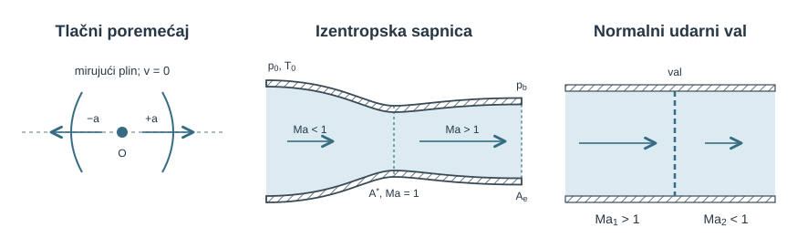
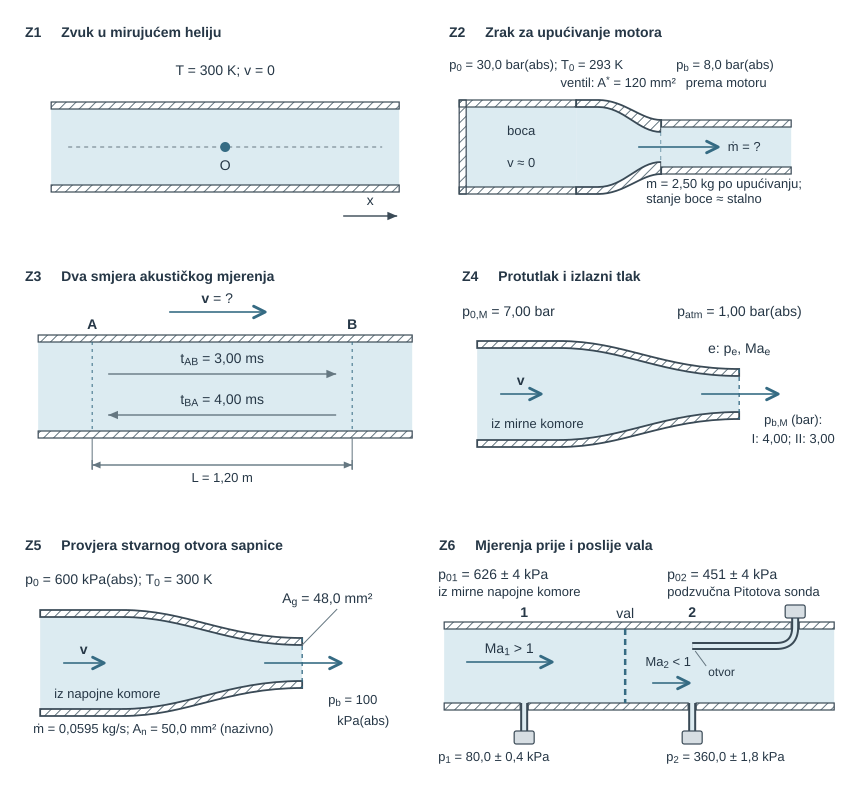

{#fig-kompresibilni-pregled fig-align="center" fig-alt="Kompresibilni tok povezuje širenje tlačnog vala, zagušenje u sapnici i skok veličina kroz udarni val."}

**Tumačenje skice.** Tlačni poremećaj širi se relativno prema plinu; u mirujućem plinu brzine su $-a$ i $+a$. U izentropskoj konvergentno-divergentnoj sapnici pri zagušenju grlo $A^*$ doseže $Ma=1$, a izlazni presjek $A_e$ i protutlak $p_b$ određuju što se događa u divergentnom dijelu. Sapnica je nacrtana kao osnosimetrična, s omjerom površina izlaza i grla $A_e/A^*=1{,}6$ iz @ex-kd-sapnica-rezim; omjer nacrtanih promjera zato je $\sqrt{1{,}6}\approx1{,}26$. Kroz normalni udarni val nadzvučni tok prelazi u podzvučni: statički tlak raste, $p_2>p_1$, zaustavni tlak pada, $p_{02}<p_{01}$, dok zaustavna temperatura ostaje ista, $T_{02}=T_{01}$.

## Kompresibilnost fluida {#sec-kompresibilni-motivacija}

U sporom toku kapljevine promjena tlaka gotovo ne mijenja gustoću, pa je model konstantne gustoće izvrstan. Kod plina pri velikoj brzini ili velikoj promjeni tlaka isti korak više nije dopušten: dio energije toka pohranjuje se u stlačivanje i zagrijavanje plina. Tada uz masu, količinu gibanja i energiju treba pratiti i vezu između tlaka, gustoće i temperature [@anderson2021].

::: {.mf1-application}

Inženjerski kontekst

Kompresibilnost je važna za odziv pneumatskog aktuatora, protok kroz sigurnosni ventil, upućivanje brodskog dizelskog motora stlačenim zrakom i širenje tlačnog vala kroz plinovod. U ovom poglavlju naučit ćeš prepoznati granicu nestlačivog modela i postaviti temeljni jednodimenzijski račun kompresibilnog toka.
:::

**Procijenjeno vrijeme rada uz priručnik:** 9 sati.

## Brzina zvuka {#sec-brzina-zvuka}

Promatra se vrlo malen tlačni poremećaj koji se kroz fluid širi bez značajne izmjene topline s okolinom. Za takav brzi, gotovo reverzibilni poremećaj vrijedi lokalna izentropska veza

$$
a^2=\left(\frac{\partial p}{\partial \rho}\right)_s,
$$ {#eq-brzina-zvuka-opca}

gdje je $a$ brzina zvuka, a indeks $s$ označuje konstantnu entropiju. Jednadžba kaže da je brzina vala veća što tlak snažnije raste pri malom povećanju gustoće.

::: {.mf1-izvod}

Matematički izvod — Brzina zvuka iz bilance preko tankog vala

**Pitanje.** Kojom brzinom $a$ putuje slab tlačni poremećaj kroz mirujući fluid?

**Bilanca.** Promatra se kontrolni volumen koji putuje zajedno s ravnim valom. U njegovu sustavu val miruje, fluid ulazi brzinom $a$ sa stanjem $p$, $\rho$, a izlazi brzinom $a-\mathrm{d}v$ sa stanjem $p+\mathrm{d}p$, $\rho+\mathrm{d}\rho$. Presjek je stalan, trenje i izmjena topline zanemarivi su.

**Koraci.** Kontinuitet daje $\rho a=(\rho+\mathrm{d}\rho)(a-\mathrm{d}v)$, a nakon odbacivanja produkta diferencijala

$$
\rho\,\mathrm{d}v=a\,\mathrm{d}\rho.
$$ {#eq-izvod-zvuk-kontinuitet}

Zakon količine gibanja za isti volumen glasi $p-(p+\mathrm{d}p)=\rho a\bigl[(a-\mathrm{d}v)-a\bigr]$, odnosno

$$
\mathrm{d}p=\rho a\,\mathrm{d}v.
$$ {#eq-izvod-zvuk-kolicina-gibanja}

Uvrštavanjem @eq-izvod-zvuk-kontinuitet slijedi $\mathrm{d}p=a^2\,\mathrm{d}\rho$.

**Rezultat.** $a^2=\mathrm{d}p/\mathrm{d}\rho$; budući da je poremećaj malen i brz, derivacija se uzima duž izentrope, što je @eq-brzina-zvuka-opca.

**Provjera.** Za nestlačiv model $\mathrm{d}\rho\to0$ pri konačnom $\mathrm{d}p$, pa $a\to\infty$: to je upravo idealizacija trenutačnog prijenosa tlaka iz hidrostatike.
:::

Za kalorički savršen plin vrijedi $p=\rho RT$ i $p/\rho^\kappa=\text{konst.}$ duž izentrope. Ovdje je $R$ specifična plinska konstanta, a $\kappa=c_p/c_v$ izentropski eksponent, bezdimenzijski omjer specifičnih toplinskih kapaciteta koji se uzima konstantnim. Oznaka $\gamma$ u ovoj knjizi ostaje rezervirana za specifičnu težinu $\rho g$. Diferenciranjem slijedi

$$
\frac{dp}{d\rho}=\kappa\frac{p}{\rho}=\kappa RT,
$$ {#eq-kompresibilni-tok-brzina-zvuka-mali-poremecaj-konacno-vrijeme-sec-01}

pa je

$$
a=\sqrt{\kappa RT}.
$$ {#eq-brzina-zvuka-plin}

Za kapljevinu se često koristi $a=\sqrt{K/\rho}$, gdje je $K$ izentropski volumni modul. Stijenka elastične cijevi dodatno smanjuje brzinu tlačnog vala; zato se vodeni udar ne smije računati samo svojstvima vode kada je deformacija cijevi važna.

::: {.mf1-granica-modela}

Granica modela — Pascalov zakon i konačna brzina zvuka

Pascalov zakon opisuje novu statičku ravnotežu nestlačivog modela; ne tvrdi da stvarni poremećaj putuje beskonačnom brzinom. Informacija o promjeni tlaka u stvarnom fluidu putuje konačnom brzinom $a$.
:::

::: {#ex-akusticko-vrijeme .mf1-we}

Vrijeme odziva pneumatskog voda T1

**Tekst zadatka**

Mirujući zrak temperature $T=293\ \text{K}$ ispunjava vod duljine $L=85\ \text{m}$. Uzmi $\kappa=1{,}4$ i plinsku konstantu $R=287\ \text{J/(kg K)}$.

**Traži se**

Procijeni najkraće vrijeme u kojem promjena ventila može biti opažena na drugom kraju.

**Rješenje**

$$
a=\sqrt{1{,}4\cdot287\cdot293}=343\ \text{m/s},\qquad
t_a=\frac{L}{a}=0{,}248\ \text{s}.
$$ {#eq-kompresibilni-tok-rijeseni-primjer-vrijeme-odziva-pneumatskog-voda-01}

**Provjera i tumačenje**

$0{,}248\ \text{s}$ samo je kauzalna donja granica; stvarni odziv tlaka i protoka sporiji je zbog refleksija, trenja, spremnika i dinamike ventila.
:::

## Machov broj i kriterij nestlačivosti {#sec-machov-broj}

Machov broj uspoređuje brzinu toka i brzinu širenja malog tlačnog poremećaja:

$$
Ma=\frac{v}{a}.
$$ {#eq-mach}

Kriterij $Ma<0{,}3$ korisna je inženjerska heuristika, a ne univerzalni zakon. U izentropskom toku kaloričkoga savršenog plina relativna promjena gustoće pri $Ma=0{,}3$ iznosi oko 5 %, a pri manjem $Ma$ još manje. I pri malom Machovu broju gustoća može snažno varirati zbog grijanja, kemijske reakcije ili velike hidrostatičke razlike; kriterij se zato uvijek provjerava zajedno s termodinamičkim uvjetima.

::: {#ex-odabir-modela-kompresibilnosti .mf1-we}

Usisni vod kompresora turbopuhala T1

**Tekst zadatka**

Zrak temperature $20\ ^\circ\text{C}$ ulazi u kompresor turbopuhala pomoćnog dizelskog motora kroz usisni vod promjera $D=80\ \text{mm}$ protokom $Q=0{,}42\ \text{m}^3/\text{s}$. Pri punom opterećenju motora protok je veći za 30 %.

**Traži se**

1. Odredi srednju brzinu i Machov broj te procijeni opravdanost modela konstantne gustoće.
2. Ponovi procjenu za protok veći za 30 %.

**Rješenje**

Površina je $A=\pi D^2/4=5{,}027\cdot10^{-3}\ \text{m}^2$, pa je

$$
v=\frac{Q}{A}=83{,}6\ \text{m/s},\qquad Ma=\frac{83{,}6}{343}=0{,}244.
$$ {#eq-kompresibilni-tok-rijeseni-primjer-dovod-zraka-baterijskom-kompres-01}

Model konstantne gustoće može biti početna procjena ako su zagrijavanje i pad tlaka mali. Poveća li se protok za 30 %, dobiva se $Ma=0{,}317$, izvan uobičajenog područja te procjene; tada treba provjeriti promjenu gustoće kompresibilnim modelom.

**Provjera i tumačenje**

Pri $Ma=0{,}3$ izentropska promjena gustoće iznosi oko 5 %; u ventilacijskim vodovima ($10$–$20\ \text{m/s}$) pitanje se ne postavlja. Odluku treba donijeti prema lokalnom maksimumu brzine, a ne srednjoj brzini u najvećem presjeku.
:::

::: {.mf1-cfd title="Računalna dinamika fluida"}

**Zračna sapnica za čišćenje hladne ploče.** Za mlaz stlačenog zraka zanima nas potrošnja zraka i stanje mlaza na izlazu. Za razliku od ranijega tekućinskog kruga, u sapnici se gustoća i temperatura mogu znatno promijeniti. CFD zato zajedno rješava masu, količinu gibanja i energiju, uz jednadžbu stanja. Tlak u $p=\rho RT$ mora biti apsolutan, a temperatura u kelvinima.

Zadamo stanje dovodnoga spremnika, geometriju sapnice i uvjete okoline. Pratimo maseni protok, lokalni Machov broj i temperaturu. Mali Machov broj u širokom dovodu nije dovoljan da cijeli model proglasimo nestlačivim: u grlu tok snažno ubrzava. Time ista geometrijska ideja suženja dobiva dodatnu fiziku koja u vodenom Venturiju nije bila potrebna. Odluka o sapnici donosi se iz potrošnje zraka i stanja mlaza, a ne iz samog ulaznog $Ma$.
:::

## Zaustavne veličine u izentropskom toku {#sec-stagnacijske-velicine}

Za stacionarni, adijabatski tok idealnog plina bez rada vratila i uz zanemarivu promjenu potencijalne energije energijska jednadžba po jedinici mase glasi

$$
h+\frac{v^2}{2}=h_0=\text{konst.}
$$ {#eq-kompresibilni-tok-stagnacijske-velicine-u-izentropskom-toku-sec-st-01}

Za kalorički savršen plin $h=c_pT$, pa slijedi

$$
T_0=T+\frac{v^2}{2c_p}.
$$ {#eq-kompresibilni-tok-stagnacijske-velicine-u-izentropskom-toku-sec-st-02}

Zaustavna temperatura $T_0$ (sinonim: stagnacijska temperatura) jest temperatura koju bi tok dosegnuo kad bi se adijabatski usporio do mirovanja. Indeks $0$ u cijelom poglavlju označuje zaustavne veličine. Uvrštavanjem $a^2=\kappa RT$ i $c_p=\kappa R/(\kappa-1)$ dobiva se

$$
\frac{T_0}{T}=1+\frac{\kappa-1}{2}Ma^2.
$$ {#eq-t0-t}

Ako je usporavanje i reverzibilno, iz izentropskih relacija slijede

$$
\frac{p_0}{p}=\left(1+\frac{\kappa-1}{2}Ma^2\right)^{\kappa/(\kappa-1)},
\qquad
\frac{\rho_0}{\rho}=\left(1+\frac{\kappa-1}{2}Ma^2\right)^{1/(\kappa-1)}.
$$ {#eq-stagnacijski-omjeri}

Zaustavna temperatura ostaje konstantna i kroz adijabatski udarni val, ali zaustavni tlak pada jer je udarni val ireverzibilan.

::: {#ex-stagnacijski-zrak .mf1-we}

Pitotova sonda u brzom strujanju zraka T1

**Tekst zadatka**

Zrak ispred Pitotove sonde ima statičku temperaturu $T=260\ \text{K}$, statički tlak $p=55\ \text{kPa}$ i Machov broj $Ma=0{,}80$. Uzmi $\kappa=1{,}4$ i izentropsko zaustavljanje.

**Traži se**

Odredi zaustavnu temperaturu i zaustavni tlak pri izentropskom zaustavljanju zraka.

**Rješenje**

$$
\frac{T_0}{T}=1+0{,}2(0{,}8)^2=1{,}128,
\qquad T_0=293{,}3\ \text{K},
$$ {#eq-kompresibilni-tok-rijeseni-primjer-pitotova-sonda-u-brzom-strujanj-01}

$$
\frac{p_0}{p}=1{,}128^{3{,}5}=1{,}524,
\qquad p_0=83{,}8\ \text{kPa}.
$$ {#eq-kompresibilni-tok-rijeseni-primjer-pitotova-sonda-u-brzom-strujanj-02}

**Provjera i tumačenje**

Nestlačivi izraz $p_0-p=\rho v^2/2$ više nije zadani model. Uz $\rho=p/(RT)=0{,}737\ \text{kg/m}^3$ i $v=Ma\,a=0{,}8\cdot323{,}2=258{,}6\ \text{m/s}$ on bi dao $\rho v^2/2=24{,}6\ \text{kPa}$, dok kompresibilni račun daje $p_0-p=28{,}8\ \text{kPa}$: nestlačiva procjena podcjenjuje razliku za oko 15 %. Kada $Ma\to0$, binomni razvoj kompresibilne relacije vraća nestlačivu dinamičku tlačnu skalu.
:::

::: {.mf1-cfd title="Računalna dinamika fluida"}

**Što zadati na granicama zračne sapnice?** U velikom dovodnom spremniku brzina je mala, pa njegovo stanje opisujemo zaustavnim tlakom i temperaturom. Za podzvučni ulaz u sapnicu često zadamo te veličine i smjer toka, a na podzvučnom izlazu statički tlak. Brzina i statička temperatura proizlaze iz rješenja; proizvoljno dodatno zadavanje masenog protoka moglo bi preodrediti problem [@nasa-wind-boundaries].

Tako možemo usporediti dvije sapnice pri istom dovodnom stanju i vidjeti koju potrošnju zraka traže. Ako je cilj udar mlaza u predmet, domena mora obuhvatiti i vanjski mlaz do predmeta: sama izlazna brzina ne daje raspodjelu opterećenja. Broj i vrsta rubnih podataka pritom ovise o lokalnom režimu i smjeru širenja poremećaja.
:::

## Sapnica i zagušenje protoka {#sec-sapnica-prigusenje}

Za stacionarni kvazijednodimenzijski tok vrijedi $\rho Av=\text{konst.}$, pa diferenciranjem

$$
\frac{d\rho}{\rho}+\frac{dA}{A}+\frac{dv}{v}=0.
$$ {#eq-kompresibilni-tok-sapnica-i-prigusenje-protoka-sec-sapnica-priguse-01}

Za izentropski tok bez značajne promjene visine Eulerova jednadžba glasi $dp+\rho v\,dv=0$. Uz $dp=a^2\,d\rho$ slijedi $d\rho/\rho=-Ma^2\,dv/v$. Uvrštavanjem u kontinuitet dobiva se ključna relacija

$$
\boxed{\frac{dA}{A}=(Ma^2-1)\frac{dv}{v}}.
$$ {#eq-area-brzina}

Za podzvučni tok ubrzavanje zahtijeva suženje; za nadzvučni tok ubrzavanje zahtijeva širenje. Pri glatkom prijelazu kroz $Ma=1$ vrijedi $dA/dx=0$; u konvergentno-divergentnoj sapnici to je grlo. Samo postojanje grla ne jamči zvučni tok: važan je i nizvodni tlak.

**Kritično stanje.** Stanje u kojem je $Ma=1$ označuje se zvjezdicom. Uvrštavanjem $Ma=1$ u @eq-t0-t i @eq-stagnacijski-omjeri slijede kritični omjeri

$$
\frac{T^*}{T_0}=\frac{2}{\kappa+1},\qquad
\frac{p^*}{p_0}=\left(\frac{2}{\kappa+1}\right)^{\kappa/(\kappa-1)},\qquad
\frac{\rho^*}{\rho_0}=\left(\frac{2}{\kappa+1}\right)^{1/(\kappa-1)},
$$ {#eq-kriticni-omjeri}

koji za zrak ($\kappa=1{,}4$) iznose $0{,}833$, $0{,}528$ i $0{,}634$. Kritični omjer tlaka $0{,}528$ granica je ispod koje konvergentna sapnica više ne može slijediti protutlak.

::: {.mf1-izvod}

Matematički izvod — Omjer površina $A/A^*$ i zagušeni maseni protok

**Pitanje.** Koliki presjek $A$ treba izentropski tok iz spremnika stanja $p_0$, $T_0$ da bi u njemu vladao zadani $Ma$, i koliki je najveći maseni protok kroz grlo $A^*$?

**Bilanca.** Maseni protok jednak je u svakom presjeku, pa i u kritičnom: $\rho vA=\rho^*a^*A^*$.

**Koraci.** Omjer površina raspiše se preko zaustavnog stanja:

$$
\frac{A}{A^*}=\frac{\rho^*}{\rho}\frac{a^*}{v}
=\frac{\rho^*}{\rho_0}\frac{\rho_0}{\rho}\sqrt{\frac{T^*}{T_0}\frac{T_0}{T}}\frac{1}{Ma},
$$ {#eq-izvod-omjer-povrsina-korak}

gdje je iskorišteno $a^*/v=a^*/(Ma\,a)=\sqrt{T^*/T}/Ma$. Uvrštavanjem @eq-stagnacijski-omjeri i @eq-kriticni-omjeri te zbrajanjem eksponenata $1/(\kappa-1)+1/2=(\kappa+1)/(2(\kappa-1))$ dobiva se

$$
\boxed{\frac{A}{A^*}=\frac{1}{Ma}\left[\frac{2}{\kappa+1}\left(1+\frac{\kappa-1}{2}Ma^2\right)\right]^{\frac{\kappa+1}{2(\kappa-1)}}}.
$$ {#eq-omjer-povrsina}

Za maseni protok kroz grlo vrijedi $\dot m=\rho^*a^*A^*$ s $\rho^*=\rho_0(\rho^*/\rho_0)$, $\rho_0=p_0/(RT_0)$ i $a^*=\sqrt{\kappa RT^*}=\sqrt{\kappa RT_0\cdot2/(\kappa+1)}$; sređivanjem

$$
\dot m_{max}=A^*\frac{p_0}{\sqrt{T_0}}
\sqrt{\frac{\kappa}{R}}
\left(\frac{2}{\kappa+1}\right)^{\frac{\kappa+1}{2(\kappa-1)}}.
$$ {#eq-priguseni-protok}

**Rezultat.** Relacija @eq-omjer-povrsina ima za svaki $A/A^*>1$ dva rješenja, podzvučno i nadzvučno; @eq-priguseni-protok daje gornju granicu masenog protoka kroz zadano grlo pri zadanom zaustavnom stanju.

**Provjera.** Za $Ma=1$ uglata zagrada jednaka je jedinici pa je $A/A^*=1$. Za $Ma\to0$ i $Ma\to\infty$ omjer raste bez granice, što odgovara minimumu površine u grlu. Uvrštavanjem jedinica u jednadžbu [-@eq-priguseni-protok] dobiva se $\text{m}^2\cdot\text{Pa}\cdot\text{K}^{-1/2}\cdot(\text{J/(kg K)})^{-1/2}=\text{kg/s}$.
:::

Kada je nizvodni tlak dovoljno nizak, maseni protok dostiže granicu iz jednadžbe [-@eq-priguseni-protok] i daljnje snižavanje nizvodnog tlaka više ga ne povećava uz iste $p_0$, $T_0$ i površinu grla: tok je **zagušen** (engl. *choked*). Zagušenje treba razlikovati od prigušenja, namjernog smanjenja tlaka ventilom.

::: {#ex-priguseni-ventil .mf1-we}

Gornja granica protoka sigurnosnog otvora T2

**Tekst zadatka**

Spremnik zraka ima zaustavni tlak $p_0=600\ \text{kPa(abs)}$ i temperaturu $T_0=300\ \text{K}$. Idealizirani otvor ima površinu $A^*=50\ \text{mm}^2$. Uzmi $\kappa=1{,}4$ i $R=287\ \text{J/(kg K)}$.

**Traži se**

Odredi najveći idealni maseni protok i granični nizvodni tlak pri kojem nastupa zagušenje.

**Rješenje**

$$
\dot m_{max}=50\cdot10^{-6}\frac{600000}{\sqrt{300}}
\sqrt{\frac{1{,}4}{287}}\left(\frac{2}{2{,}4}\right)^3
=0{,}0700\ \text{kg/s}.
$$ {#eq-kompresibilni-tok-rijeseni-primjer-gornja-granica-protoka-sigurnos-01}

Prema @eq-kriticni-omjeri granični nizvodni tlak iznosi

$$
p^*=0{,}528\,p_0=317\ \text{kPa(abs)}.
$$ {#eq-kompresibilni-tok-rijeseni-primjer-gornja-granica-protoka-sigurnos-02}

**Provjera i tumačenje**

Odluka o režimu traži apsolutne tlakove: s manometarskim $p_0=499\ \text{kPa}$ (uz $p_{atm}=101\ \text{kPa}$) granica bi pogrešno ispala $263\ \text{kPa}$. Stvarni ventil traži koeficijent istjecanja i normirani proračun kapaciteta; vrijednost nije sigurnosna certifikacija.
:::

::: {#cfd-sapnica-prigusenje .mf1-cfd title="Računalna dinamika fluida"}

**Zašto dodatno snižavanje izlaznog tlaka prestaje povećavati protok?** Za istu idealnu sapnicu zadržimo $p_0$, $T_0$ i grlo, a postupno snižavajmo nizvodni tlak. CFD treba pokazati porast masenog protoka do zagušenja i približavanje graničnoj vrijednosti iz jednadžbe [-@eq-priguseni-protok] za 1D model. Protok i lokalni $Ma$ zajedno pokazuju ograničenje dovoda zraka.

U konvergentno-divergentnoj sapnici daljnja promjena nizvodnih uvjeta može mijenjati raspodjelu tlaka i položaj udarnog vala, iako je grlo već zagušeno. Na potpuno nadzvučnom izlazu ne namećemo neovisan tlak; za utjecaj okolnog zraka proširujemo domenu tako da obuhvati odgovarajuće prijelaze [@nasa-wind-boundaries]. Tako razlikujemo najveći protok od pitanja kakav mlaz izlazi iz uređaja.
:::

## Normalni udarni val: Hugoniotov uvjet {#sec-normalni-udarni-val}

Udarni val je vrlo tanak ireverzibilni prijelaz. Za stacionarni normalni val u adijabatskom kanalu konstantne površine bilance su

$$
\rho_1v_1=\rho_2v_2,
$$ {#eq-kompresibilni-tok-normalni-udarni-val-hugoniotov-uvjet-sec-normaln-01}

$$
p_1+\rho_1v_1^2=p_2+\rho_2v_2^2,
$$ {#eq-kompresibilni-tok-normalni-udarni-val-hugoniotov-uvjet-sec-normaln-02}

$$
h_1+\frac{v_1^2}{2}=h_2+\frac{v_2^2}{2}.
$$ {#eq-kompresibilni-tok-normalni-udarni-val-hugoniotov-uvjet-sec-normaln-03}

Eliminacija brzina iz tih triju bilanci daje Hugoniotovu relaciju $h_2-h_1=\tfrac12(p_2-p_1)(1/\rho_1+1/\rho_2)$, koja povezuje samo termodinamička stanja ispred i iza vala, neovisno o plinu. Za kalorički savršen plin iz istih bilanci slijede praktični omjeri.

::: {.mf1-izvod}

Matematički izvod — Prandtlova relacija, $Ma_2(Ma_1)$ i porast entropije

**Pitanje.** Kakvo stanje mora vladati iza normalnog vala ako je ispred njega $Ma_1$, i zašto je dopušten samo prijelaz iz nadzvučnog u podzvučni tok?

**Bilanca.** Tri bilance iznad, uz $h=c_pT=a^2/(\kappa-1)$.

**Koraci.** Energijska bilanca kaže da je zaustavna entalpija ista s obje strane; izražena preko kritične brzine zvuka $a^*$ (stanje u kojem bi tok imao $Ma=1$) glasi

$$
\frac{a^2}{\kappa-1}+\frac{v^2}{2}=\frac{\kappa+1}{2(\kappa-1)}a^{*2},
\qquad\text{pa je}\qquad
a^2=\frac{\kappa+1}{2}a^{*2}-\frac{\kappa-1}{2}v^2.
$$ {#eq-izvod-udar-energija}

Podijeli li se bilanca količine gibanja s $\rho_1v_1=\rho_2v_2$ i iskoristi $p/\rho=a^2/\kappa$, dobiva se

$$
\frac{1}{\kappa}\left(\frac{a_1^2}{v_1}-\frac{a_2^2}{v_2}\right)=v_2-v_1.
$$ {#eq-izvod-udar-kolicina-gibanja}

Uvrštavanjem @eq-izvod-udar-energija za $a_1^2$ i $a_2^2$ i sređivanjem lijeva strana postaje $(v_2-v_1)\bigl[\tfrac{\kappa+1}{2\kappa}\tfrac{a^{*2}}{v_1v_2}+\tfrac{\kappa-1}{2\kappa}\bigr]$. Za pravi val $v_2\ne v_1$, pa dijeljenjem s $(v_2-v_1)$ slijedi Prandtlova relacija

$$
\boxed{v_1v_2=a^{*2}}.
$$ {#eq-prandtlova-relacija}

Uz $Ma^{*2}=v^2/a^{*2}=(\kappa+1)Ma^2/\bigl(2+(\kappa-1)Ma^2\bigr)$ relacija glasi $Ma_1^*Ma_2^*=1$; nadzvučni ulaz ($Ma_1^*>1$) nužno daje podzvučni izlaz. Rješavanjem po $Ma_2$ i uvrštavanjem u bilancu količine gibanja dobivaju se

$$
\begin{aligned}
Ma_2^2&=\frac{1+\tfrac{\kappa-1}{2}Ma_1^2}{\kappa Ma_1^2-\tfrac{\kappa-1}{2}},\qquad \frac{p_2}{p_1}=1+\frac{2\kappa}{\kappa+1}(Ma_1^2-1), \\
\frac{T_2}{T_1}&=\frac{p_2}{p_1}\,\frac{2+(\kappa-1)Ma_1^2}{(\kappa+1)Ma_1^2}.
\end{aligned}
$$ {#eq-normalni-skok}

**Rezultat.** Promjena specifične entropije kaloričkoga savršenog plina iznosi

$$
\Delta s=c_p\ln\frac{T_2}{T_1}-R\ln\frac{p_2}{p_1}.
$$ {#eq-entropija-udar}

Za $Ma_1=2$ i zrak: $T_2/T_1=1{,}688$, $p_2/p_1=4{,}50$, pa je $\Delta s=1004{,}5\ln1{,}688-287\ln4{,}50=+94\ \text{J/(kg K)}$. Obrnuti prijelaz (iz $Ma=0{,}577$ u $Ma=2$) zadovoljava iste tri bilance, ali bi dao $\Delta s=-94\ \text{J/(kg K)}$, što drugi zakon termodinamike isključuje.

**Provjera.** Sve relacije @eq-normalni-skok za $Ma_1=1$ daju jedinicu: val nestaje. Zaustavni tlak iza vala, $p_{02}=p_2\,(p_{02}/p_2)$, uvijek je manji od $p_{01}$ jer je $p_{02}/p_{01}=\exp(-\Delta s/R)$.
:::

::: {#ex-normalni-udar .mf1-we}

Udarni val u ispitnoj sapnici T2

**Tekst zadatka**

Zrak ispred normalnog udarnog vala ima Machov broj $Ma_1=2{,}0$. Izentropski eksponent iznosi $\kappa=1{,}4$.

**Traži se**

Odredi Machov broj iza normalnog udarnog vala i omjer tlakova iza i ispred vala.

**Rješenje**

$$
Ma_2=\sqrt{\frac{1+0{,}2\cdot4}{1{,}4\cdot4-0{,}2}}=0{,}577,
$$ {#eq-kompresibilni-tok-rijeseni-primjer-udarni-val-u-ispitnoj-sapnici-01}

$$
\frac{p_2}{p_1}=1+\frac{2\cdot1{,}4}{2{,}4}(4-1)=4{,}50.
$$ {#eq-kompresibilni-tok-rijeseni-primjer-udarni-val-u-ispitnoj-sapnici-02}

**Provjera i tumačenje**

Prandtlova relacija potvrđuje rezultat: $Ma_1^*=1{,}633$ i $Ma_2^*=0{,}612$ daju $Ma_1^*Ma_2^*=1{,}000$. Zabranjen je samo obrnuti skok; postupno izentropsko ubrzanje u nadzvučni tok kroz sapnicu ostaje dopušteno.
:::

::: {#ex-kd-sapnica-rezim .mf1-we}

Režim rada konvergentno-divergentne sapnice T3

**Tekst zadatka**

Ispitna osnosimetrična konvergentno-divergentna sapnica (shema na @fig-kompresibilni-pregled) ima grlo $A^*=100\ \text{mm}^2$ i izlazni presjek $A_e=160\ \text{mm}^2$. Napaja se zrakom iz mirne komore stanja $p_0=500\ \text{kPa(abs)}$ i $T_0=300\ \text{K}$; uzmi $\kappa=1{,}4$ i $R=287\ \text{J/(kg K)}$. Tok do eventualnog udarnog vala i iza njega smatraj izentropskim; val, ako postoji, smatraj normalnim.

**Traži se**

1. Odredi oba izentropska rješenja za izlazni Machov broj $Ma_e$ pri zagušenom grlu i pripadne izlazne tlakove.
2. Odredi protutlak pri kojem normalni val stoji točno u izlaznom presjeku.
3. Za protutlakove $p_b=100\ \text{kPa(abs)}$ i $p_b=350\ \text{kPa(abs)}$ odluči o režimu: potpuno nadzvučni izlaz ili val unutar divergentnog dijela. Odredi maseni protok u oba slučaja.

**Veza s proračunom.** Na skici je $A^*$ grlo, a $A_e$ izlazni presjek; za osnosimetričnu sapnicu omjer površina $1{,}6$ odgovara omjeru promjera $1{,}26$. Protutlak $p_b$ djeluje izvan izlaza i nije nužno jednak izlaznom tlaku $p_e$.

**Rješenje**

### 1. Dva izentropska rješenja za $A_e/A^*=1{,}6$ {.mf1-step .unnumbered .unlisted}

Jednadžba @eq-omjer-povrsina s $A_e/A^*=1{,}6$ nema zatvoreno rješenje po $Ma$; rješava se pokušajem ili iz tablice. Podzvučna grana daje $Ma_{e}=0{,}397$ (provjera: $\tfrac{1}{0{,}397}\bigl[\tfrac{1{,}0315}{1{,}2}\bigr]^{3}=1{,}600$), a nadzvučna $Ma_{e}=1{,}935$ (provjera: $\tfrac{1}{1{,}935}\bigl[\tfrac{1{,}749}{1{,}2}\bigr]^{3}=1{,}600$). Pripadni izlazni tlakovi iz @eq-stagnacijski-omjeri jesu

$$
p_{e,\mathrm{I}}=\frac{500}{1{,}0315^{3{,}5}}=448{,}5\ \text{kPa},\qquad
p_{e,\mathrm{III}}=\frac{500}{1{,}749^{3{,}5}}=70{,}7\ \text{kPa}.
$$ {#eq-kd-sapnica-izlazni-tlakovi}

Prvi je najviši protutlak pri kojem je grlo zagušeno uz posve podzvučni divergentni dio; treći je projektni protutlak potpuno nadzvučnog, izentropskog izlaza.

### 2. Normalni val u izlaznom presjeku {.mf1-step .unnumbered .unlisted}

Ispred vala vlada nadzvučno stanje $Ma_1=1{,}935$, $p_1=70{,}7\ \text{kPa}$. Iz @eq-normalni-skok slijede $Ma_2=0{,}589$ i $p_2/p_1=4{,}20$, pa je

$$
p_{e,\mathrm{II}}=4{,}20\cdot70{,}7=297\ \text{kPa}.
$$ {#eq-kd-sapnica-val-na-izlazu}

### 3. Odluka o režimu i maseni protok {.mf1-step .unnumbered .unlisted}

Za $p_b=100\ \text{kPa}$ vrijedi $p_{e,\mathrm{III}}<p_b<p_{e,\mathrm{II}}$: divergentni dio ostaje potpuno nadzvučan, a mlaz izlazi s $p_e=70{,}7\ \text{kPa}<p_b$ (preekspandiran) i prilagođava se protutlaku kosim valovima izvan sapnice. Za $p_b=350\ \text{kPa}$ vrijedi $p_{e,\mathrm{II}}<p_b<p_{e,\mathrm{I}}$: normalni val stoji unutar divergentnog dijela, iza njega tok je podzvučan i izlazi s $p_e=p_b$. U oba slučaja grlo je zagušeno, pa @eq-priguseni-protok daje isti protok

$$
\dot m=100\cdot10^{-6}\frac{500000}{\sqrt{300}}\sqrt{\frac{1{,}4}{287}}\left(\frac{2}{2{,}4}\right)^{3}=0{,}117\ \text{kg/s}.
$$ {#eq-kd-sapnica-maseni-protok}

**Provjera i tumačenje**

Redoslijed $p_{e,\mathrm{III}}<p_{e,\mathrm{II}}<p_{e,\mathrm{I}}<p_0$ mora vrijediti za svaku sapnicu. Za $p_b=350\ \text{kPa}$ iteracija (izvan ispitne razine) smješta val u presjek $A_x/A^*=1{,}39$ (ispred njega $Ma_1=1{,}75$); on smanjuje zaustavni tlak na $0{,}833\,p_0$, pa podzvučni ostatak izlazi upravo s $350\ \text{kPa}$: položaj vala određuje protutlak. Iznad $448{,}5\ \text{kPa}$ grlo više nije zagušeno.
:::

::: {#cfd-sapnica-udarni-val .mf1-cfd title="Računalna dinamika fluida"}

**Zastani i promisli.** Iza adijabatskog normalnog udara statički tlak raste, zaustavni tlak pada, a $T_0$ ostaje isti. Je li takav rezultat proturječan?

**Udarni val unutar sapnice.** Pri promjeni nizvodnog tlaka val se može pomaknuti kroz divergentni dio i promijeniti tlakove na stijenci. Za svaki radni uvjet pratimo njegov položaj, stanja prije i poslije te gubitak zaustavnog tlaka. Rast statičkog tlaka uz pad zaustavnog tlaka nije proturječje: adijabatski val povisuje entropiju, a čuva zaustavnu temperaturu.

Ručni @ex-normalni-udar daje referentne skokove za normalan adijabatski val, a @ex-kd-sapnica-rezim karakteristične protutlakove sapnice: uspoređujemo stanja izvan prijelaza uz iste ulazne podatke. CFD obično raspodijeli val preko nekoliko ćelija; ta numerička širina nije njegova fizička debljina. Omjere uspoređujemo izvan razmazanog prijelaza, a položaj vala provjeravamo profinjenjem. Za nestacionarni račun važan je i vremenski korak prema najvećoj brzini širenja signala $|v|+a$ (Courant–Friedrichs–Lewyjev, CFL uvjet). Time provjeravamo može li simulacija poduprijeti odluku o radnom području sapnice.
:::

::: {.mf1-granica-modela}

Granica modela — Idealni jednodimenzijski kompresibilni tok

Sve relacije ovog poglavlja pretpostavljaju kalorički savršen plin sa stalnim $\kappa$, jednolike veličine po presjeku, zanemarivo trenje i izmjenu topline te, osim samog vala, izentropski tok. Zanemareni su granični sloj uz stijenku, koji smanjuje efektivni presjek grla, interakcija vala s graničnim slojem, koja razmazuje i naginje stvarni val, te realna svojstva plina pri visokim temperaturama. Iz modela se ne smije zaključiti o kapacitetu stvarnog ventila bez koeficijenta istjecanja ni o opterećenju konstrukcije mlazom bez vanjske domene.
:::

## Postupak analize kompresibilnoga toka {#sec-kompresibilni-ritual}

1. Odredi apsolutne tlakove i temperaturno stanje.
2. Procijeni lokalni najveći Machov broj $Ma$, ne samo ulaznu srednju vrijednost.
3. Odluči je li proces približno izentropski, adijabatski s gubitcima ili s izmjenom topline.
4. Napiši kontinuitet, energiju i jednadžbu stanja; količinu gibanja dodaj kad postoji sila ili udarni val.
5. Provjeri zagušenje, smjer porasta entropije i granični slučaj $Ma\to0$.

::: {.mf1-samoprovjera}

Provjeri sebe

1. Zašto Pascalov zakon ne znači trenutačan prijenos poremećaja?
2. Može li tok s $Ma=0{,}1$ ipak imati važnu promjenu gustoće? Navedi mehanizam.
3. Zašto se nadzvučni tok ubrzava u divergentnom dijelu sapnice?
4. Zašto se maseni protok zagušene sapnice ne može povećati daljnjim snižavanjem protutlaka, a može povišenjem zaustavnog tlaka?

::: {.callout-note collapse="true"}
### Odgovori
1. Poremećaj putuje konačnom brzinom zvuka.

2. Da; snažno grijanje ili velika promjena osnovnog tlaka može promijeniti gustoću i pri maloj brzini.

3. Za $Ma>1$ relacija površina–brzina daje $dA>0$ kada je $dv>0$.

4. Kroz zvučno grlo informacija o nizvodnom tlaku ne može putovati uzvodno, pa protok ovisi samo o $p_0$, $T_0$ i $A^*$; prema @eq-priguseni-protok on raste proporcionalno s $p_0$.
:::
:::

## Zadaci za vježbu {#sec-kompresibilni-zadaci}

{#fig-vjezbe-kompresibilni-tok fig-align="center" fig-alt="Šest skica s otvorenim prolazima. Z2 prikazuje bocu stlačenog zraka, ventil s kritičnim presjekom i vod prema motoru. Z3 razlikuje prijenos zvuka uzvodno i nizvodno. Z4 označuje izlaz sapnice i zaseban protutlak. Z6 prikazuje normalni val u otvorenom kanalu, statičke priključke i podzvučnu Pitotovu sondu."}

**Napomene uz skice.** U Z1 skica prikazuje samo točku poremećaja O i os $x$; smjerove širenja ucrtaj sam. U Z2 ventil je idealiziran kao kritični presjek $A^*$ između boce i voda prema motoru; stanje boce uzima se kao zaustavno. U Z4 izlaz konvergentne sapnice njezin je najmanji presjek; vanjski tok nije prikazan. U Z5 $A_g$ označuje izmjereni slobodni otvor, različit od nazivne površine $A_n$. U Z6 svi označeni tlakovi su apsolutni.

U zadatcima plin promatraj kao kalorički savršen. Brzina zvuka odnosi se na plin, a brzine i vremena prijelaza između nepomičnih točaka na laboratorij. Duljina strelice ne zadaje iznos, a oznaka „?” označuje traženu veličinu; isprekidana crta označuje presjek ili val, ne stijenku.

::::: {.mf1-vjezbe-list}

### Brzina zvuka u heliju {#task-brzina-zvuka-helium .unnumbered .unlisted}

**Tekst zadatka**

Helij miruje pri $T=300\ \text{K}$. Uzmi $\kappa=1{,}667$ i $R=2077\ \text{J/(kg K)}$. Vrlo malen tlačni poremećaj nastaje u točki O.

**Traži se**

1. Izračunaj brzinu zvuka.
2. Ucrtaj na skicu oba uzdužna smjera njegova širenja i označi predznake brzina prema osi $x$.

:::: {.content-visible .mf1-hint-online when-format="html"}
::: {.callout-note collapse="true" data-hint-key="true"}
### Naputak

Temperatura u relaciji za brzinu zvuka mora biti apsolutna. Plin miruje, pa je laboratorij ujedno sustav mirovanja plina; smjer širenja nije zadan smjerom nekoga srednjeg toka.
:::
::::
:::: {.content-visible .mf1-answer-online when-format="html"}
::: {.callout-tip collapse="true" data-answer-key="true"}
### Kontrolni rezultat

$a\approx1019\ \text{m/s}$; poremećaj se širi u oba smjera: udesno brzinom $+a$, ulijevo $-a$. Srednja brzina helija ostaje $v=0$; ucrtane strelice prikazuju širenje poremećaja, ne tok plina.
:::
::::

[Razina: T1]{.mf1-task-level}

### Zrak za upućivanje brodskog dizelskog motora {#task-zrak-za-upucivanje-motora .unnumbered .unlisted}

**Tekst zadatka**

Boca stlačenog zraka za upućivanje brodskog dizelskog motora sadrži zrak stanja $p_0=30{,}0\ \text{bar(abs)}$ i $T_0=293\ \text{K}$. Pri upućivanju zrak teče kroz ventil čiji je najmanji slobodni presjek $A^*=120\ \text{mm}^2$ u vod prema motoru u kojem vlada tlak $p_b=8{,}0\ \text{bar(abs)}$. Za jedno upućivanje motor treba masu zraka $m=2{,}50\ \text{kg}$. Uzmi $\kappa=1{,}4$ i $R=287\ \text{J/(kg K)}$, ventil smatraj idealnim otvorom bez gubitaka, a stanje boce tijekom upućivanja približno stalnim.

**Traži se**

1. Provjeri je li tok kroz ventil zagušen.
2. Odredi maseni protok zraka.
3. Procijeni trajanje jednog upućivanja.

:::: {.content-visible .mf1-hint-online when-format="html"}
::: {.callout-note collapse="true" data-hint-key="true"}
### Naputak

Usporedi omjer apsolutnih tlakova $p_b/p_0$ s kritičnim omjerom $0{,}528$. Ako je tok zagušen, maseni protok daje @eq-priguseni-protok s podatcima boce kao zaustavnim stanjem, a trajanje je $t=m/\dot m$. Pad tlaka boce tijekom upućivanja produljuje stvarno vrijeme.
:::
::::
:::: {.content-visible .mf1-answer-online when-format="html"}
::: {.callout-tip collapse="true" data-answer-key="true"}
### Kontrolni rezultat

$p_b/p_0=0{,}267<0{,}528$: tok je zagušen i protok ne ovisi o tlaku u vodu. $\dot m\approx0{,}850\ \text{kg/s}$; $t\approx2{,}94\ \text{s}$ uz stalno stanje boce, što je donja granica trajanja.
:::
::::

[Razina: T1]{.mf1-task-level}

### Akustičko mjerenje brzine i temperature {#task-akusticko-mjerenje-toka .unnumbered .unlisted}

**Tekst zadatka**

U ravnom vodu zrak stacionarno i jednoliko struji od A prema B. Nepomične akustičke mjerne točke udaljene su $L=1{,}20\ \text{m}$. Malen signal putuje iz A u B za $t_{AB}=3{,}00\ \text{ms}$, a iz B u A za $t_{BA}=4{,}00\ \text{ms}$. To su vremena samog putovanja nakon korekcije kašnjenja elektronike. Zanemari refleksije i raspršenje te uzmi $\kappa=1{,}4$ i $R=287\ \text{J/(kg K)}$.

**Traži se**

1. Odredi brzinu toka $v$, brzinu zvuka $a$, statičku temperaturu $T$ i $Ma$.
2. Objasni zašto je uzvodni prijenos moguć i zašto $L/t_{AB}$ nije sama brzina zvuka.

:::: {.content-visible .mf1-hint-online when-format="html"}
::: {.callout-note collapse="true" data-hint-key="true"}
### Naputak

U laboratoriju nizvodni signal ima brzinu $v+a$, a uzvodni $v-a<0$. Zato je $L/t_{AB}=a+v$ i $L/t_{BA}=a-v$. Zbrajanjem i oduzimanjem razdvoji $a$ i $v$, pa tek onda iz zvučne brzine odredi temperaturu.
:::
::::
:::: {.content-visible .mf1-answer-online when-format="html"}
::: {.callout-tip collapse="true" data-answer-key="true"}
### Kontrolni rezultat

$v=50{,}0\ \text{m/s}$, $a=350\ \text{m/s}$, $T\approx304{,}9\ \text{K}$ i $Ma\approx0{,}143$. Laboratorijske brzine signala jesu $+400$ i $-300\ \text{m/s}$. Uzvodni signal stiže jer je $v<a$; nizvodno ga tok prenosi zajedno sa širenjem relativno prema plinu.
:::
::::

[Razina: T2]{.mf1-task-level}

### Protutlak i zagušenje konvergentne sapnice {#task-priguseni-protok .unnumbered .unlisted}

**Tekst zadatka**

Velika mirna komora napaja konvergentnu sapnicu fiksne geometrije. Manometarski tlak komore jest $p_{0,M}=7{,}00\ \text{bar}$, a atmosferski $p_{atm}=1{,}00\ \text{bar(abs)}$. Razmotri dvije stacionarne postavke manometarskog protutlaka: $p_{b,M}^{(I)}=4{,}00\ \text{bar}$ i $p_{b,M}^{(II)}=3{,}00\ \text{bar}$. Za zrak uzmi $\kappa=1{,}4$; tok do izlaza smatraj izentropskim. Kapacitet se ne traži.

**Traži se**

1. Odredi kritični apsolutni tlak $p^*$, režim u oba slučaja te izlazne $p_e$ i $Ma_e$.
2. Objasni može li se protok dalje povećavati snižavanjem protutlaka u slučaju II uz iste zaustavne uvjete.

:::: {.content-visible .mf1-hint-online when-format="html"}
::: {.callout-note collapse="true" data-hint-key="true"}
### Naputak

Omjere tvori iz apsolutnih tlakova. Najmanji presjek konvergentne sapnice jest izlaz. Ako je $p_b>p^*$, vrijedi $p_e=p_b$ i Machov broj slijedi iz izentropskog omjera $p_0/p_e$. Pri zagušenju izlaz ima $Ma_e=1$ i $p_e=p^*$; daljnja prilagodba protutlaku odvija se izvan sapnice.
:::
::::
:::: {.content-visible .mf1-answer-online when-format="html"}
::: {.callout-tip collapse="true" data-answer-key="true"}
### Kontrolni rezultat

$p_0=8{,}00\ \text{bar(abs)}$, $p^*\approx4{,}226\ \text{bar(abs)}$. I: $p_b=p_e=5{,}00\ \text{bar(abs)}$, $Ma_e\approx0{,}848$, nezagušen tok. II: $p_b=4{,}00\ \text{bar(abs)}$, $p_e=p^*$, $Ma_e=1$, zagušen tok. Dodatno snižavanje $p_b$ u II ne povećava protok pri istim $p_0,T_0$ i geometriji.
:::
::::

[Razina: T2]{.mf1-task-level}

### Geometrija ili koeficijent protoka? {#task-sapnica-model .unnumbered .unlisted}

**Tekst zadatka**

Za nastavnu provjeru konvergentne sapnice zadani su sintetički podatci: $p_0=600\ \text{kPa(abs)}$, $T_0=300\ \text{K}$, $p_b=100\ \text{kPa(abs)}$ i $\dot m=0{,}0595\ \text{kg/s}$. Nazivna površina izlaza jest $A_n=50{,}0\ \text{mm}^2$, a neovisno optičko mjerenje stvarnog slobodnog presjeka daje $A_g=48{,}0\ \text{mm}^2$. U ovom zadatku zanemari mjerne nesigurnosti. Za zrak uz $\kappa=1{,}4$ i $R=287\ \text{J/(kg K)}$ koristi model $\dot m=C_d\dot m_{ideal}(A_g,p_0,T_0)$.

**Traži se**

1. Provjeri uvjet zagušenja i odredi produkt $C_dA_g$ koji slijedi iz protoka.
2. Bi li samo manji stvarni otvor uz $C_d=1$ objasnio podatke?
3. Izračunaj idealni protok kroz izmjereni otvor i pripadajući $C_d$.
4. Objasni što bi se moglo zaključiti bez optičkog mjerenja i zašto zamjena nazivnim otvorom sama ne jamči idealni protok.

:::: {.content-visible .mf1-hint-online when-format="html"}
::: {.callout-note collapse="true" data-hint-key="true"}
### Naputak

Najprije usporedi $p_b/p_0$ s kritičnim omjerom. Napiši zagušeni protok kao $\dot m=C_dA_g\,(\dot m_{max}/A^*)$, gdje omjer $\dot m_{max}/A^*$ prema @eq-priguseni-protok ovisi samo o $p_0$ i $T_0$. Protok određuje produkt; odvojeno mjerenje stvarne površine omogućuje procjenu koeficijenta. Nazivna površina nije mjerenje stvarnog prolaza.
:::
::::
:::: {.content-visible .mf1-answer-online when-format="html"}
::: {.callout-tip collapse="true" data-answer-key="true"}
### Kontrolni rezultat

$p_b/p_0=0{,}167<0{,}528$; $C_dA_g\approx42{,}50\ \text{mm}^2$. Za $A_g=48{,}0\ \text{mm}^2$: $\dot m_{ideal}\approx0{,}0672\ \text{kg/s}$ i $C_d\approx0{,}885$. Sama razlika površine ne objašnjava manji protok. Bez optike poznat je samo produkt, ne svaki faktor. Veći otvor sam ne jamči $C_d=1$.
:::
::::

[Razina: T3]{.mf1-task-level}

### Provjera podataka o udarnom valu {#task-udarni-val-podaci .unnumbered .unlisted}

**Tekst zadatka**

U nastavnom skupu sintetičkih podataka za stacionarni normalni val u zračnom kanalu statički priključci prije i poslije vala daju $p_1=80{,}0\pm0{,}4\ \text{kPa(abs)}$ i $p_2=360{,}0\pm1{,}8\ \text{kPa(abs)}$. Zaustavni tlak prije vala dobiva se neovisnim mjerenjem u velikoj mirnoj napojnoj komori: $p_{01}=626\pm4\ \text{kPa(abs)}$. Pretpostavi izentropski put od komore do presjeka 1, bez ranijeg vala.

Podzvučna Pitotova sonda u presjeku 2, otvorom okrenuta uzvodno, daje $p_{02}=451\pm4\ \text{kPa(abs)}$. Zanemari poremećaj glavnog toka sondom i gubitke u mjernim vodovima. Sve oznake $\pm$ označuju male, međusobno neovisne standardne nesigurnosti mjerenja; standardnu nesigurnost veličine $x$ označujemo sa $s(x)$. $\kappa=1{,}4$ smatraj točnim.

**Traži se**

1. Iz omjera $p_2/p_1$ odredi $Ma_1$ i njegovu standardnu nesigurnost linearnom propagacijom nesigurnosti uz korijen zbroja kvadrata doprinosa (RSS).
2. Izračunaj teorijski omjer zaustavnih tlakova $\Lambda=p_{02}/p_{01}$ i njegovu nesigurnost, usporedi ga s izravno mjerenim omjerom $\Lambda_{mj}$ te odluči jesu li konzistentni prema kriteriju $|\Lambda-\Lambda_{mj}|\leqs(\Lambda-\Lambda_{mj})$.
3. Izračunaj normiranu razliku.
4. Objasni zašto sami statički tlakovi ne predstavljaju neovisnu mjernu potvrdu pada zaustavnog tlaka i zašto obična nekorigirana Pitotova sonda ispred vala ne bi izravno dala $p_{01}$.

:::: {.content-visible .mf1-hint-online when-format="html"}
::: {.callout-note collapse="true" data-hint-key="true"}
### Naputak

Izoliraj $Ma_1$ iz statičkog omjera. Za omjer $p_2/p_1$ vrijedi $s(p_2/p_1)/(p_2/p_1)=\sqrt{(s(p_1)/p_1)^2+(s(p_2)/p_2)^2}$. Analogno računaj $s(\Lambda_{mj})$. Relaciju za $Ma_2$ poveži s lokalnim zaustavnim omjerima i dobij $\Lambda(Ma_1)$. Primijeni $s(\Lambda)=|\Lambda'(Ma_1)|\,s(Ma_1)$ te $s(\Lambda-\Lambda_{mj})=\sqrt{s(\Lambda)^2+s(\Lambda_{mj})^2}$; derivaciju smiješ procijeniti središnjom razlikom.
:::
::::
:::: {.content-visible .mf1-answer-online when-format="html"}
::: {.callout-tip collapse="true" data-answer-key="true"}
### Kontrolni rezultat

$Ma_1=2{,}000\pm0{,}007$; $\Lambda=0{,}7209\pm0{,}0032$; $\Lambda_{mj}=0{,}7204\pm0{,}0079$; $s(\Lambda-\Lambda_{mj})=0{,}0085$. Normirana razlika $0{,}050<1$: podatci su konzistentni. Statički tlakovi sami daju modelsku procjenu, ne neovisno mjerenje gubitka zaustavnog tlaka. Nadzvučna Pitotova sonda stvara vlastiti val i bez korekcije ne daje $p_{01}$.
:::
::::

[Razina: T4]{.mf1-task-level}

:::::

::: {.mf1-numerika}

Numerički pokus — od nestlačivog do zagušenog toka

**Predvidi.** Skiciraj maseni protok pri snižavanju protutlaka. Gdje očekuješ plato?

**Provjeri i protumači.** Usporedi nestlačivu i izentropsku procjenu pri malom padu tlaka, zatim prati zagušenje. Objasni zašto plato predstavlja fizikalno ograničenje modela, a ne zasićenje numeričkog računa.

<a class="mf1-interaktivno-veza" href="https://martibasic.github.io/MF1_udzbenik/jlite/lab/index.html?path=u09_kompresibilna_sapnica.ipynb">Pokreni u pregledniku</a>

:::

::: {.mf1-zavrsni-okvir}

Za ponijeti iz poglavlja

- Brzina zvuka mjeri termodinamičku krutost fluida i postavlja konačnu brzinu prijenosa informacije.
- Machov broj služi početnom odabiru modela, ali ne zamjenjuje provjeru grijanja i ukupne promjene tlaka.
- Izentropske zaustavne relacije vrijede samo bez ireverzibilnih gubitaka.
- Omjer površina $A/A^*$ ima podzvučno i nadzvučno rješenje; koje vrijedi, odlučuje protutlak.
- Zagušenje ograničuje maseni protok; snižavanje nizvodnog tlaka nakon toga ne povećava protok.
- Udarni val čuva masu, količinu gibanja i zaustavnu entalpiju, ali povećava entropiju i smanjuje zaustavni tlak.
:::
