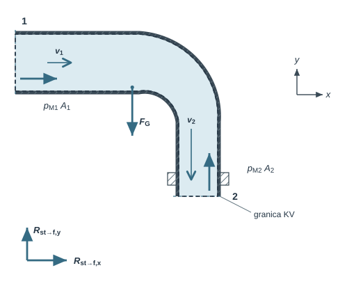
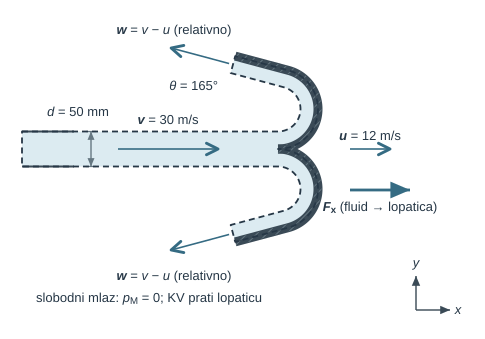
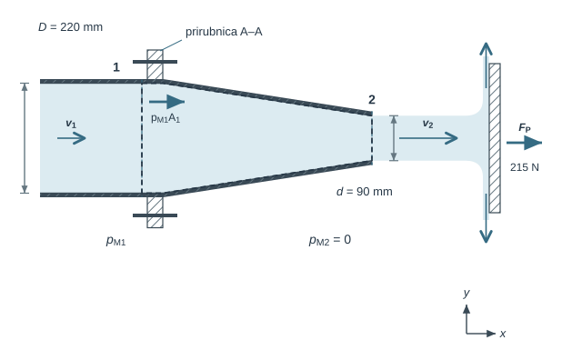
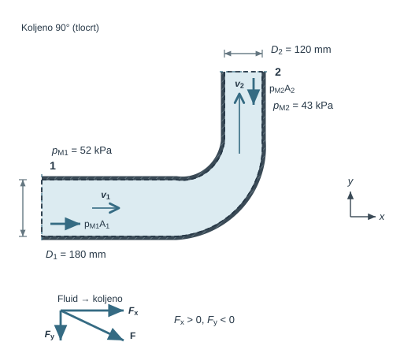
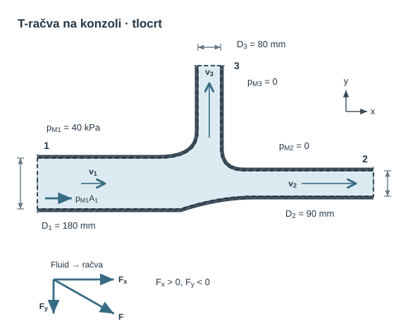
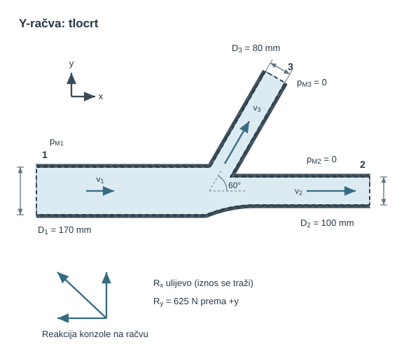
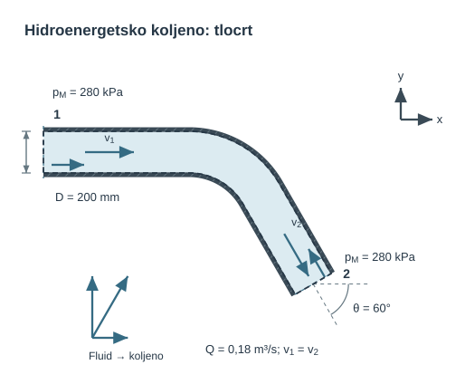
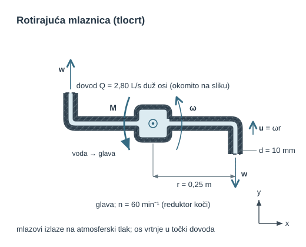
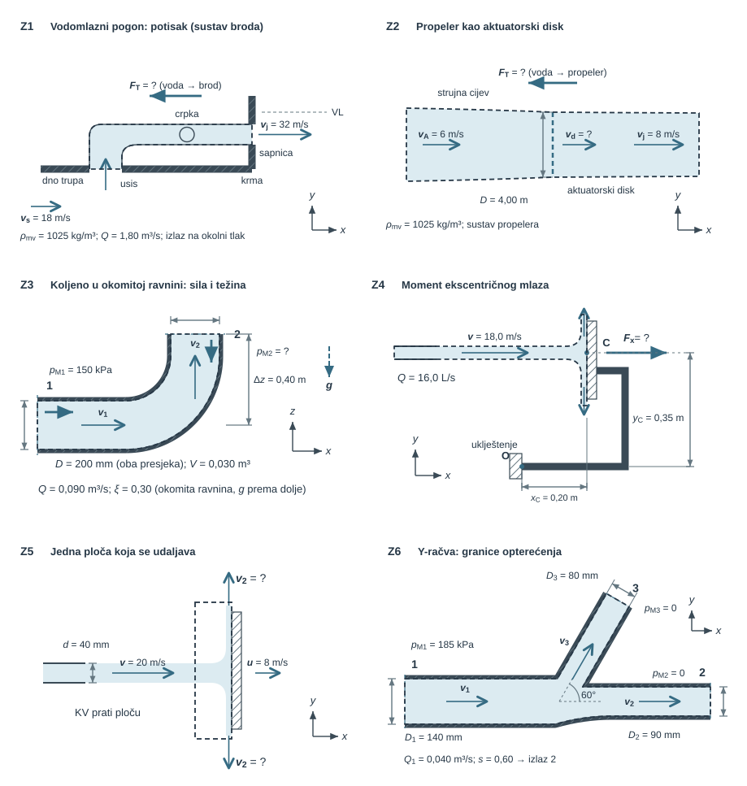

Kada fluid struji kroz koljeno, mlaznicu ili račvu, mijenja mu se iznos ili smjer brzine, a za to su potrebne sile. Fluid ih dobiva od stijenki i od susjednog fluida na ulaznim i izlaznim presjecima, a prema trećem Newtonovu zakonu suprotnom silom opterećuje cijev, prirubnicu i nosač. Kontinuitet iz []{.mf1-chapter-ref target="u07"} i Bernoullijeva jednadžba iz []{.mf1-chapter-ref target="u08"} daju brzine i tlakove, ali ne i tu silu. Zato drugi Newtonov zakon primjenjujemo na kontrolni volumen.

Za stacionaran tok kroz nepomičan kontrolni volumen zbroj svih vanjskih sila na fluid jednak je promjeni toka količine gibanja: $\vec F_p+\vec F_G+\vec R_{st\to f}=\sum_{\mathrm{iz}}\dot m\vec v-\sum_{\mathrm{ul}}\dot m\vec v$. Lijevo su rezultanta tlačnih sila na presjecima $\vec F_p$, težina fluida u kontrolnom volumenu $\vec F_G$ i sila stijenke na fluid $\vec R_{st\to f}$. Tlačna sila na presjeku $i$ jest $\vec F_{p,i}=-p_{M,i}A_i\vec n_i$, gdje je $\vec n_i$ vanjska normala, pa pri pretlaku potiskuje fluid u kontrolni volumen. Za jedan ulaz i jedan izlaz maseni je protok isti na oba presjeka, $\dot m=\rho_1A_1v_1=\rho_2A_2v_2$. Brzine i sile zbrajaju se vektorski.

Sila kojom fluid djeluje na stijenku ima suprotan smjer, $\vec F=-\vec R_{st\to f}$, a reakcija nosača $\vec R$ slijedi tek iz ravnoteže samog elementa, uz njegovu težinu i ostale priključne sile. Zato uz svaku silu treba reći na koje tijelo djeluje. Isti zakon, zapisan u sustavu tijela koje se giba stalnom brzinom, opisuje mlaz na lopaticu ili ploču te potisak vodomlaznog pogona i propelera. Vektorskim množenjem položajem $\vec r$ prelazi u zakon momenta količine gibanja, kojim se računaju rotirajuće mlaznice, raspršivači i rotori.

Poglavlje redom obrađuje integralni zakon, silu na cijevno koljeno, pomični kontrolni volumen s mlaznim pogonom i aktuatorskim diskom te moment količine gibanja. Primjene su koljena i račve u brodskim strojarnicama, vodomlazni pogon, brodski vijak i stroj za pranje tankova. Radni model pretpostavlja stacionaran tok i jednolike profile brzine na presjecima ($\beta=1$); prolazne pojave poput vodenog udara traže i član akumulacije. Lokalni oblik zakona vodi do Navier–Stokesove jednadžbe u []{.mf1-chapter-ref target="u12"}, a Eulerova turbinska jednadžba i stvarni propeler obrađuju se u []{.mf1-chapter-ref target="u14"}.

Slika ispod prikazuje sile na fluid u koljenu koje skreće tok za $90°$. Fluid ulazi kroz presjek 1 vodoravno, brzinom $\vec v_1$ u smjeru osi $x$, a izlazi kroz presjek 2 prema dolje brzinom $\vec v_2$. Granica KV obuhvaća fluid u koljenu i siječe tok na oba presjeka. Na presjecima djeluju tlačne sile $p_{M1}A_1$ i $p_{M2}A_2$ usmjerene u kontrolni volumen, a u sredini težina $\vec F_G$. Strelice $R_{st\to f,x}$ i $R_{st\to f,y}$ u donjem lijevom kutu pokazuju pretpostavljene pozitivne smjerove komponenata sile stijenke na fluid; stvarne predznake određuje račun.

{#fig-uvod-u11 fig-align="center" fig-alt="Pregled poglavlja: količina i moment količine gibanja."}

## Količina i moment količine gibanja

Zakon količine gibanja povezuje protok, tlak i reakciju konstrukcije. Pri strujanju kroz mlaznicu, koljeno ili račvu promjena brzine fluida, zajedno s tlakovima na ulaznim i izlaznim presjecima, određuje opterećenje vijaka, prirubnice ili nosača. Isti zakon daje potisak vodomlaznog pogona i propelera, a njegov momentni oblik zakretni moment rotirajuće mlaznice i rotora.

::: {.mf1-application}

Inženjerski kontekst

Koljeno, T-račva ili mlaznica prenosi silu na prirubnicu i nosač. U pumpnim stanicama, brodskim strojarnicama i protupožarnim monitorima to opterećenje određujemo iz tlačnih sila i promjene količine gibanja fluida. Vodomlazni pogon, propeler i stroj za pranje tankova iste bilance čitaju kao potisak i moment.
:::

**Procijenjeno vrijeme rada uz priručnik:** 10 sati.

## Integralni zakon količine gibanja

Za stacionarni tok osnovni zapis ostaje

$$
\sum \vec{F} = \dot{m}(\vec{v}_{iz} - \vec{v}_{ul}),
$$ {#eq-momentum-fizikalni-uvod-i-matematicki-izvod-01}

gdje je $\vec v$ vektor brzine fluida, a indeksi ul i iz označuju ulazni i izlazni presjek. Komponente pišemo $v_x$, $v_y$.

::: {.mf1-fizikalno-znacenje}

Fizikalno značenje

Za stacionarni tok rezultantna vanjska sila na fluid u nepomičnom kontrolnom volumenu jednaka je razlici izlaznog i ulaznog toka količine gibanja. Promjena iznosa ili smjera brzine zato zahtijeva djelovanje sila. Ako fluid skrene za $90°$ u koljenu, sile tlaka i stijenke mijenjaju smjer njegove količine gibanja. Prema trećem Newtonovu zakonu fluid na stijenku djeluje silom jednakog iznosa i suprotnog smjera od sile stijenke na fluid. To opterećenje mora preuzeti konstrukcija.
:::

Pritom se zbroj sila ne smije svesti samo na reakciju stijenke. U tipičnom cijevnom elementu treba odvojeno prepoznati:

- tlakove na ulaznim i izlaznim presjecima
- težinu fluida ako ima komponentu u promatranom smjeru
- silu stijenke ili konstrukcije na fluid

Tek nakon toga može se odrediti sila fluida na konstrukciju. Bernoulli i kontinuitet daju raspodjelu protoka i tlaka, ali ne i reakciju konstrukcije; samo vektorski zapis istodobno daje njezin smjer, predznak i iznos.

Za kontrolni volumen $KV(t)$ omeđen kontrolnom plohom $KP(t)$ koja se lokalno giba brzinom $\vec v_{KP}$ integralni zakon količine gibanja u inercijskom referentnom okviru glasi

$$
\frac{\mathrm{d}}{\mathrm{d}t}\int_{KV(t)} \rho \vec{v}\,\mathrm{d}V
+ \int_{KP(t)} \rho \vec{v}\bigl[(\vec v-\vec v_{KP})\cdot \vec{n}\bigr]\,\mathrm{d}S
= \sum \vec{F}.
$$ {#eq-momentum-fizikalno-znacenje-01}

::: {.mf1-cfd title="Računalna dinamika fluida"}

**Koljeno rashladnog voda i njegov nosač.** Tok kroz zavoj mijenja smjer, pa fluid opterećuje cijev i njezine oslonce. Ručni račun obuhvaća cijelo koljeno jednim kontrolnim volumenom. CFD postavlja istu bilancu za svaku ćeliju: akumulacija i prijenos količine gibanja odgovaraju tlačnim, viskoznim i volumenskim silama. Time dobivamo i raspodjelu tlaka unutar zavoja.

Za zadani dotok i odgovarajući izlazni tlak možemo usporediti oštro i postupnije koljeno. Usporedba obuhvaća komponente sile na cijev te gubitak iz prethodne energijske analize; povoljan otpor ne jamči jednako opterećenje nosača. U stacionarnom modelu nema akumulacije, ali prijenos količine gibanja kroz otvore ostaje jer se tok skreće.

[]{#ista-bilanca-za-mnogo-malih-dijelova-fluida}
:::

Prvi član predstavlja akumulaciju količine gibanja unutar odabranoga volumena, a drugi prijenos kroz njegovu granicu relativnom brzinom. Za nepomični kontrolni volumen $\vec v_{KP}=0$. Ako je tok usto stacionaran, prvi član nestaje pa preostaje ravnoteža između vanjskih sila i neto toka količine gibanja kroz granicu.

Ako se ulazni i izlazni presjeci mogu čitati jednodimenzijski, za jedan ulaz i jedan izlaz slijedi pojednostavljenje

$$
\sum \vec F = \dot m(\vec v_2 - \vec v_1).
$$ {#eq-momentum-numericki-trag-01}

::: {.mf1-izvod}

Matematički izvod — Koeficijent količine gibanja $\beta$ i nejednoliki profil brzine

Prelazak iz integralnog oblika $\int_A \rho\,\vec{v}(\vec{v}\cdot\vec{n})\,dA$ na pojednostavljeni zapis $\dot{m}\,\vec{v}$ implicitno pretpostavlja **jednoliki profil brzine** preko cijelog presjeka. Za stvarne profile (laminarni parabolični profil, turbulentni profil $1/7$) pravu vrijednost integrala daje korekcijski **koeficijent količine gibanja**

$$
\beta = \frac{1}{v^2 A}\int_A v_{lok}^2\,dA,
$$ {#eq-momentum-matematicki-izvod-koeficijent-kolicine-gibanja-i-01}

gdje je $v = Q/A$ srednja brzina presjeka, a $v_{lok}$ lokalna brzina. Točan integralni oblik zatim se piše kao

$$
\int_A \rho v_{lok}^2\,dA = \beta \rho v^2 A = \beta \dot{m} v.
$$ {#eq-momentum-matematicki-izvod-koeficijent-kolicine-gibanja-i-02}

Za **laminarni parabolični profil** $v_{lok}(r)=v_{max}(1-(r/R)^2)$ analitički je $\beta=4/3\approx1{,}33$. Idealizirani razvijeni turbulentni profil s eksponentom $1/7$ daje $\beta\approx1{,}02{-}1{,}03$. Uporaba $\beta\approx1$ odluka je o modelu profila, a ne univerzalno pravilo [@white2011]; u @ex-u11-servisno-koljeno-na-sidrenom-nosacu-t2 brojčano je pokazano koliko ta odluka mijenja silu.

Ovaj koeficijent analogan je **Coriolisovu koeficijentu $\alpha$**, koji u energijskoj bilanci korigira kinetičku energiju zbog nejednolikog profila: $\alpha$ stoji uz $v^2/(2g)$, a $\beta$ uz $\dot m v$. Za nenegativan jednosmjerni profil vrijedi $\alpha\ge\beta^{3/2}$, pa su oba veća od jedan ako profil nije jednolik. Za laminarni parabolični profil analitički je $\alpha=2$ i $\beta=4/3$. Kod povratnoga toka ili drukčije definiranih presjeka te se nejednakosti ne smiju primijeniti bez ponovne integracije.
:::

No taj oblik nije dovoljan dok se vanjske sile ne rastave na stvarne doprinose. Za tipičan cijevni element vrijedi

$$
\vec F_p + \vec F_G + \vec R_{st\to f} = \dot m(\vec v_2 - \vec v_1),
$$ {#eq-momentum-matematicki-izvod-koeficijent-kolicine-gibanja-i-03}

gdje je $\vec F_p$ rezultanta tlačnih sila na presjecima, $\vec F_G$ težina fluida unutar kontrolnog volumena, a $\vec R_{st\to f}$ sila stijenke ili konstrukcije na fluid. Iz toga odmah slijedi sila fluida na konstrukciju

$$
\vec F = -\vec R_{st\to f} = \vec F_p + \vec F_G - \dot m(\vec v_2 - \vec v_1).
$$ {#eq-momentum-matematicki-izvod-koeficijent-kolicine-gibanja-i-04}

U cijelom poglavlju $\vec F$ označuje silu fluida na element, $\vec R_{st\to f}$ silu stijenke na fluid, a $\vec R$ reakciju nosača ili oslonca na element; za element bez vlastite težine i drugih priključnih sila vrijedi $\vec R=-\vec F$.

Tlačni članovi otpadaju tek kad su relevantni presjeci otvoreni atmosferi ili kad se njihova rezultanta doista poništi geometrijom kontrolnog volumena. Član $\dot m\vec v$ opisuje tok količine gibanja, a $pA$ silu na zamišljenom presjeku; njihov zbroj na jednom presjeku, **impulsna funkcija** $I=pA+\dot m v$, u @ex-u11-sila-na-koljeno-tlacnog-voda-male-hidroelektrane sažima silu na koljeno stalnog promjera.

## Provjera sile na cijevno koljeno

::: {.mf1-cfd title="Računalna dinamika fluida"}

**Provjera opterećenja nosača dvama postupcima.** U CFD-u silu fluida na koljeno prvo dobijemo integracijom tlaka i viskoznih naprezanja po unutarnjoj stijenci. Neovisno je provjerimo bilancom kontrolnog volumena: uključimo tokove količine gibanja, tlakove na otvorima, težinu i, kod promjenjivoga toka, akumulaciju. Ručni @ex-u11-servisno-koljeno-na-sidrenom-nosacu-t2 polazi od zadanih tlakova i srednjih brzina. Za usporedbu s CFD-om uskladi presjeke i korekcije nejednolikih profila.

**Zastani i promisli.** Uz iste osi CFD daje silu fluida na koljeno suprotnu ručno izračunanoj sili koljena na fluid. Dokazuje li to pogrešku predznaka?

Suprotni predznaci sile stijenke na fluid i sile fluida na stijenku nisu neslaganje: prvo uskladi tijelo na koje se rezultat odnosi. Za nosač zatim sastavi ravnotežu same cijevi, uz njezinu težinu i ostale priključne sile. Pri profinjenju prati komponente ukupnog opterećenja.
:::

::: {.mf1-interaktivno}

Interaktivni prikaz — Sila na koljeno

**Predvidi.** Nacrtaj sile na fluid i na koljeno prije računanja komponenti. Što očekuješ u graničnom slučaju ravne cijevi jednakih promjera i tlakova?

**Provjeri i protumači.** Mijenjaj kut koljena $\theta$ i usporedi komponente sile. Odvoji tlačni doprinos od promjene toka količine gibanja te provjeri tijelo na koje sila djeluje.

<a class="mf1-interaktivno-veza" href="https://martibasic.github.io/MF1_udzbenik/jlite/lab/index.html?path=u11_sila_na_koljeno.ipynb">Pokreni u pregledniku</a>

**Pitanja za samostalno istraživanje:** (a) Pri $\theta = 90°$, koje su vrijednosti $F_x$ i $F_y$ i kako mora biti orijentiran nosač? (b) Zašto je $\theta \to 180°$ slučaj najveće sile pri istom $Q$ i $D$? (c) Kada u impulsnoj funkciji $I=pA+\dot m v$ prevladava impulsni dio $\dot m v$, a kada tlačni $pA$?

:::

::: {.callout-note}
## Postupak rješenja
Korak: od integralnog zakona → radni zapis $\sum\vec{F} = \dot{m}(\vec{v}_2 - \vec{v}_1)$

Integralni zakon za stacionarno strujanje ($d/dt = 0$):
$$
\int_{KP} \rho \vec{v}(\vec{v}\cdot\vec{n})\,dS = \sum \vec{F}.
$$ {#eq-momentum-razrada-koraka-01}
Za presjeke s jednodimenzijskim profilom brzine ($v = $ konst. po presjeku):
- na ulazu: $\vec{v}\cdot\vec{n} = -v_1$ (normala je usmjerena prema van, a brzina prema unutra), taj član daje $-\dot{m}\vec{v}_1$
- na izlazu: $\vec{v}\cdot\vec{n} = +v_2$, daje $+\dot{m}\vec{v}_2$

Ukupno:
$$
\dot{m}\vec{v}_2 - \dot{m}\vec{v}_1 = \sum\vec{F} \quad\Rightarrow\quad \sum\vec{F} = \dot{m}(\vec{v}_2 - \vec{v}_1).
$$ {#eq-momentum-razrada-koraka-02}
Sile $\sum\vec{F}$ uključuju: tlačne sile na presjecima ($\vec{F}_p$), težinu fluida ($\vec{F}_G$) i silu stijenke na fluid ($\vec{R}_{st\to f}$). Sila fluida na stijenku je $-\vec{R}_{st\to f}$ (Newton III).
:::

::: {.mf1-granica-modela}

Granica modela — Stacionarna bilanca s jednolikim presjecima

Radni zapis $\sum\vec F=\dot m(\vec v_2-\vec v_1)$ vrijedi uz četiri prešutne pretpostavke koje treba provjeriti prije svakog računa:

- **jednoliki profili na presjecima** ($\beta=1$): za laminarni ulaz impulsni član raste za trećinu, pa presjeke treba birati tamo gdje je profil poznat;
- **manometarski tlak** smije zamijeniti apsolutni samo ako atmosfera djeluje po cijeloj vanjskoj plohi elementa; za uronjene ili zatvorene sustave rezultanta okolnog tlaka ne poništava se sama;
- **viskozna naprezanja na otvorima** zanemarena su, što vrijedi kad su presjeci okomiti na tok i daleko od zavoja; trenje na stijenci unutar KV nije zanemareno, ono je dio $\vec R_{st\to f}$;
- **slobodni mlaz bez gravitacije** između sapnice i ploče zadržava brzinu i presjek; za duge ili spore mlazove to prestaje vrijediti.

Stacionarna bilanca ne opisuje prolazne pojave, vodeni udar ni brzu promjenu protoka: tada se vraća član akumulacije iz @eq-momentum-fizikalno-znacenje-01.
:::

::: {.mf1-dublje}

Dublje — Lokalni oblik zakona količine gibanja

Integralni zakon vrijedi za bilo koji kontrolni volumen. Teorem o divergenciji pretvara površinske integrale tokova, tlaka i viskoznih naprezanja $\boldsymbol\tau$ u volumenske, a proizvoljnost volumena daje lokalnu bilancu u svakoj točki:

$$
\frac{\partial(\rho\vec v)}{\partial t}
+\nabla\cdot(\rho\,\vec{v}\otimes\vec{v})
= \rho\,\vec{g} - \nabla p + \nabla\cdot\boldsymbol{\tau}.
$$ {#eq-momentum-dublje-lokalni-oblik-zakona-kolicine-gibanja-05}

Uz konstantnu gustoću i newtonski fluid iz nje slijede Eulerova i Navier–Stokesova jednadžba; izvod, pretpostavke i kanonska rješenja daje @sec-navier-stokes u []{.mf1-chapter-ref target="u12"}.
:::

## Pomični kontrolni volumen, mlazni pogon i aktuatorski disk

Kada kontrolni volumen prati lopaticu, ploču ili brod koji se giba stalnom brzinom $\vec u$, zapis @eq-momentum-fizikalno-znacenje-01 ostaje valjan u sustavu toga tijela jer je on inercijski. Kroz pomičnu granicu masa prolazi relativnom brzinom $\vec w=\vec v-\vec u$, pa je dotok mase $\dot m_{rel}=\rho A w$; u toku količine gibanja ulazi brzina mjerena u sustavu tijela. Taj se model, uveden u []{.mf1-chapter-ref target="u07"}, ovdje primjenjuje na lopaticu, ploču i mlazni pogon.

**Mlazni pogon.** U sustavu broda koji plovi brzinom $v_s$ voda ulazi u usis vodomlaznog pogona brzinom $v_s$ i napušta sapnicu brzinom $v_j$ relativno prema brodu. Uz atmosferski tlak na ulazu i izlazu kontrolnog volumena koji obuhvaća pogon, sila kojom voda djeluje na brod, potisak, iznosi

$$
F_T=\dot m\,(v_j-v_s),\qquad \dot m=\rho A_j v_j.
$$ {#eq-potisak-mlaznog-pogona}

Korisna snaga potiska jest $F_Tv_s$, dok ukupna kinetička snaga predana vodi iznosi $\dot m(v_j^2-v_s^2)/2$; njihov omjer $2v_s/(v_j+v_s)$ idealna je propulzijska korisnost.

::: {.mf1-izvod}

Matematički izvod — Propeler kao aktuatorski disk

**Pitanje.** Koliki potisak daje propeler ako se umjesto lopatica promatra tanki disk površine $A_d$ koji vodi skokovito povisuje tlak?

**Bilanca.** U sustavu propelera voda nailazi brzinom napredovanja $v_A$, prolazi kroz disk brzinom $v_d$ i daleko iza njega ima brzinu $v_j$ u mlazu površine $A_j$; tlak daleko ispred i iza jednak je okolnom. Strujna cijev koja obuhvaća disk zatvara kontrolni volumen.

**Koraci.** Zakon količine gibanja za strujnu cijev daje $F_T=\dot m(v_j-v_A)$ s $\dot m=\rho A_dv_d$. Isti potisak jednak je skoku tlaka na disku, $F_T=\Delta p\,A_d$. Bernoulli vrijedi odvojeno ispred i iza diska, pa je $\Delta p=\rho(v_j^2-v_A^2)/2$. Izjednačavanjem

$$
\rho A_dv_d(v_j-v_A)=\frac{\rho}{2}A_d(v_j-v_A)(v_j+v_A)
\quad\Rightarrow\quad
v_d=\frac{v_A+v_j}{2}.
$$ {#eq-aktuatorski-disk-brzina}

**Rezultat.** Potisak i idealna korisnost aktuatorskog diska jesu

$$
F_T=\rho A_d\,\frac{v_A+v_j}{2}\,(v_j-v_A),\qquad
\eta_i=\frac{F_Tv_A}{F_Tv_d}=\frac{v_A}{v_d}=\frac{2v_A}{v_A+v_j}.
$$ {#eq-aktuatorski-disk-potisak}

**Provjera.** Za $v_j\to v_A$ potisak nestaje, a $\eta_i\to1$: mali prirast brzine velike mase vode najkorisniji je, što objašnjava velike promjere sporohodnih brodskih propelera. Stvarni propeler ima rotaciju mlaza, trenje lopatica i nejednoliko opterećenje, što se obrađuje u []{.mf1-chapter-ref target="u14"}.
:::

## Moment količine gibanja

::: {.mf1-temelj}

Temelj — Moment količine gibanja za kontrolni volumen

Vektorskim množenjem bilance količine gibanja položajem $\vec r$ prema odabranom polu $O$ dobiva se, za stacionarni tok kroz nepomični kontrolni volumen s jednolikim presjecima,

$$
\boxed{\sum \vec M_O=\sum_{\mathrm{iz}}\dot m\,(\vec r\times\vec v)-\sum_{\mathrm{ul}}\dot m\,(\vec r\times\vec v)}.
$$ {#eq-moment-kolicine-gibanja}

Lijeva strana sadrži momente svih vanjskih sila na fluid oko $O$: tlačnih sila na presjecima, težine i momenta kojim stijenka, krak ili vratilo djeluje na fluid. Desna strana jest neto tok momenta količine gibanja kroz granicu.

- **Izbor pola.** Pol se bira na osi vrtnje; tada osni dotok i tlačne sile na osno simetričnim presjecima nemaju moment oko osi, pa ostaje samo moment stijenke i tangencijalne komponente brzine na izlazu.
- **Predznak.** Pozitivan smjer momenta jest smjer pozitivne osi $z$ (u tlocrtu suprotno od kazaljke na satu). Moment fluida na konstrukciju suprotan je momentu stijenke na fluid.
- **Rotor.** Za presjeke na radijusima $r_1$ i $r_2$ s tangencijalnim komponentama apsolutne brzine $v_{t1}$, $v_{t2}$ osna komponenta glasi $M_z=\dot m(r_2v_{t2}-r_1v_{t1})$; pomnožena kutnom brzinom daje snagu. To je Eulerova turbinska jednadžba, koja se izvodi u []{.mf1-chapter-ref target="u14"}.
:::

::: {.mf1-fizikalno-znacenje}

Fizikalno značenje

Sila kaže hoće li se nosač pomaknuti, moment kaže hoće li se zavrtjeti. Dva mlaza koji se silama poništavaju mogu zajedno stvarati moment ako im krakovi nisu jednaki ili su usmjereni suprotno. Zato se rotirajuća mlaznica, raspršivač i rotor računaju momentom, a ne silom.
:::

::: {.mf1-cfd title="Računalna dinamika fluida"}

**Zakretni moment raspršivača.** Dvije savijene mlaznice na rotirajućoj ruci mogu stvarati moment i kada se dio ukupnih sila međusobno poništi. Za zadani dovod i brzinu vrtnje CFD određuje izlazne brzine i naprezanja na stijenkama. Moment provjeravamo tokom $\vec r\times\vec v$ kroz granice prema @eq-moment-kolicine-gibanja, uz isti položaj osi i iste predznake; ručni @ex-rotirajuca-mlaznica-pranje-tanka daje referentni moment za zadanu brzinu vrtnje.

Ako se ruka slobodno zalijeće, dodajemo jednadžbu njezina gibanja, moment tromosti i otpor ležajeva. Pratimo promjenu brzine vrtnje, a u fluidu i akumulaciju momenta količine gibanja. Time razlikujemo moment pri zadanoj brzini od predviđanja same brzine. Veza momenta s potrebnom ili dobivenom snagom nastavlja se na rotoru u []{.mf1-chapter-ref target="u14"}.
:::

## Riješeni primjeri

::: {#ex-peltonova-lopatica-u-gibanju .mf1-we}

Peltonova lopatica u gibanju&nbsp;T2

**Tekst zadatka**

Vodeni mlaz promjera $d = 50\ \text{mm}$ i brzine $v = 30\ \text{m/s}$ udara u lopaticu Peltonove turbine koja se u smjeru mlaza giba stalnom brzinom $u = 12\ \text{m/s}$. Lopatica skreće relativni tok simetrično za $\theta = 165^\circ$, tako da relativna izlazna brzina zatvara kut od $15^\circ$ s dolaznim mlazom. Gustoća vode je $\rho = 998\ \text{kg/m}^3$; zanemari trenje na lopatici, težinu i razliku visina. Slobodni presjeci mlaza izloženi su atmosferskom tlaku.

**Traži se**

1. Odaberi kontrolni volumen koji prati lopaticu i odredi maseni protok koji doseže jednu lopaticu.
2. Odredi silu fluida na lopaticu u smjeru gibanja i snagu predanu lopatici.
3. Provjeri snagu iz promjene toka kinetičke energije uz apsolutne brzine.
4. Za kolo s nizom lopatica, koje presreće sav mlaz, odredi silu, snagu i brzinu lopatice pri kojoj je snaga najveća.

{#fig-peltonova-lopatica-u-gibanju fig-alt="Peltonova lopatica u gibanju"}

**Veza s proračunom.** Kontrolna granica giba se s lopaticom, pa je u njezinu sustavu tok stacionaran; izlazne strelice prikazuju relativne brzine. Sila $F_x$ djeluje na lopaticu.

**Rješenje**

### 1. Pomični kontrolni volumen i dotok mase {.mf1-step .unnumbered .unlisted}

Površina mlaza je $A=\pi d^2/4=1{,}963\cdot10^{-3}\ \text{m}^2$. Kontrolni volumen giba se s lopaticom brzinom $u$, pa kroz njegovu ulaznu granicu voda prolazi relativnom brzinom

$$
\begin{aligned}
w &= v - u = 30 - 12 = 18\ \text{m/s}, \\
\dot m_{rel} &= \rho A w = 998\cdot1{,}963\cdot10^{-3}\cdot18 = 35{,}3\ \text{kg/s}.
\end{aligned}
$$ {#eq-pelton-lopatica-relativni-dotok}

Ostatak protoka sapnice, $\rho A u$, produljuje slobodni mlaz između sapnice i lopatice koja se udaljava.

### 2. Sila i snaga za jednu lopaticu {.mf1-step .unnumbered .unlisted}

U sustavu lopatice relativna brzina ulazi s komponentom $+w$ u smjeru $x$ i izlazi s komponentom $w\cos\theta$. Sila lopatice na fluid u smjeru $x$ iznosi $R_{st\to f,x}=\dot m_{rel}(w\cos\theta-w)$, pa je sila fluida na lopaticu

$$
\begin{aligned}
F_x &= \dot m_{rel}\,w\,(1-\cos\theta) = 35{,}3\cdot18\cdot(1-\cos165^\circ) \\
&= 35{,}3\cdot18\cdot1{,}966 = 1248\ \text{N}.
\end{aligned}
$$ {#eq-pelton-lopatica-sila}

Snaga predana lopatici koja se giba brzinom $u$:

$$
P = F_x u = 1248\cdot12 = 14{,}98\ \text{kW}.
$$ {#eq-pelton-lopatica-snaga}

### 3. Energetska provjera {.mf1-step .unnumbered .unlisted}

Apsolutna izlazna brzina vode ima komponente $v_{2x}=u+w\cos\theta=12-17{,}39=-5{,}39\ \text{m/s}$ i $v_{2y}=\pm w\sin\theta=\pm4{,}66\ \text{m/s}$, pa je $v_2=7{,}12\ \text{m/s}$. Tok kinetičke energije kroz pomični volumen smanjuje se za

$$
\dot m_{rel}\,\frac{v^2-v_2^2}{2} = 35{,}3\,\frac{30^2-7{,}12^2}{2} = 14{,}98\ \text{kW},
$$ {#eq-pelton-lopatica-energija}

što je jednako $F_xu$: bez trenja sva izgubljena kinetička energija vode postaje mehanički rad na lopatici.

### 4. Kolo s nizom lopatica {.mf1-step .unnumbered .unlisted}

Kod kola lopatice slijede jedna drugu, pa sav protok sapnice $\dot m=\rho Av=58{,}8\ \text{kg/s}$ nailazi na neku lopaticu, i dalje relativnom brzinom $w$:

$$
\begin{aligned}
F_x &= \dot m\,(v-u)(1-\cos\theta) = 58{,}8\cdot18\cdot1{,}966 = 2080\ \text{N}, \\
P &= F_xu = 24{,}96\ \text{kW}.
\end{aligned}
$$ {#eq-pelton-kolo-sila-snaga}

Snaga kola $P=\rho Av\,u(v-u)(1-\cos\theta)$ najveća je kada je $u(v-u)$ najveće, dakle pri $u=v/2=15\ \text{m/s}$, gdje iznosi $P_{max}=58{,}8\cdot15\cdot15\cdot1{,}966=26{,}0\ \text{kW}$.

**Provjera i tumačenje**

Granice: za $u=0$ sila je najveća, ali snaga je nula; za $u=v$ voda ne doseže lopaticu. Jedna lopatica (dotok $\rho A(v-u)$) ima optimum pri $u=v/3$, kolo (dotok $\rho Av$) pri $u=v/2$. Sila raste s $(1-\cos\theta)$: okomita ploča ($\theta=90^\circ$) dala bi upola manju silu, a $\theta=180^\circ$ nije izvediv jer bi izlazna voda udarala u sljedeću lopaticu.
:::

::: {#ex-u11-kalibracijska-mlaznica-na-prirubnici-t2 .mf1-we}

Kalibracijska mlaznica na prirubnici&nbsp;T2

**Tekst zadatka**

Horizontalna mlaznica ima ulazni promjer $D = 220\ \text{mm}$ i izlazni promjer $d = 90\ \text{mm}$. Vodeni mlaz gustoće $\rho = 998\ \text{kg/m}^3$ okomito udara u mjernu ploču silom $F_P = 215\ \text{N}$ te se razlijeva bez aksijalne komponente brzine. Pretpostavi stacionaran tok, jednolike profile i atmosferski tlak u slobodnom mlazu; zanemari gubitke. Presjek prirubničkih vijaka označen je s `A-A`.

**Traži se**

1. Odredi protok $Q$ kroz mlaznicu.
2. Odredi pretlak $p_{M1}$ u presjeku 1 neposredno uz prirubnicu.
3. Odredi koliku vlačnu silu $F_v$ moraju preuzeti vijci u presjeku `A-A`.

{#fig-u11-kalibracijska-mlaznica-na-prirubnici fig-alt="Kalibracijska mlaznica na prirubnici"}

**Veza s proračunom.** Slobodni mlaz prema ploči i unutarnji kontrolni volumen mlaznice dva su odvojena kontrolna volumena; vijci u presjeku `A-A` prenose silu fluida na mlaznicu.

**Rješenje**

Površina izlaznog presjeka iznosi

$$
A_2 = \frac{\pi d^2}{4} = \frac{\pi \cdot 0{,}09^2}{4} = 6{,}36 \cdot 10^{-3}\ \text{m}^2.
$$ {#eq-momentum-rijeseni-primjer-kalibracijska-mlaznica-na-priru-01}

Za mlaz koji udara okomito u ravnu ploču vrijedi $F_P = \dot{m} v_2 = \rho A_2 v_2^2$, pa je izlazna brzina

$$
v_2 = \sqrt{\frac{F_P}{\rho A_2}} = \sqrt{\frac{215}{998 \cdot 6{,}36 \cdot 10^{-3}}} = 5{,}82\ \text{m/s},
$$ {#eq-momentum-rijeseni-primjer-kalibracijska-mlaznica-na-priru-02}

odakle slijedi protok

$$
Q = A_2 v_2 = 6{,}36 \cdot 10^{-3} \cdot 5{,}82 \approx 0{,}0370\ \text{m}^3/\text{s} = 37{,}0\ \text{L/s}.
$$ {#eq-momentum-rijeseni-primjer-kalibracijska-mlaznica-na-priru-03}

Površina ulaznog presjeka je

$$
A_1 = \frac{\pi D^2}{4} = \frac{\pi \cdot 0{,}22^2}{4} = 3{,}80 \cdot 10^{-2}\ \text{m}^2,
$$ {#eq-momentum-rijeseni-primjer-kalibracijska-mlaznica-na-priru-04}

pa je brzina u presjeku 1 jednaka

$$
v_1 = \frac{Q}{A_1} = \frac{0{,}0370}{3{,}80 \cdot 10^{-2}} = 0{,}974\ \text{m/s}.
$$ {#eq-momentum-rijeseni-primjer-kalibracijska-mlaznica-na-priru-05}

Kako je presjek 2 otvoren prema atmosferi, u zapisu s pretlakom vrijedi $p_{M2} = 0$. Bernoullijeva jednadžba između 1 i 2 zato daje $p_{M1} + \tfrac{\rho v_1^2}{2} = \tfrac{\rho v_2^2}{2}$, pa je

$$
p_{M1} = \frac{\rho}{2}(v_2^2 - v_1^2) = \frac{998}{2}(5{,}82^2 - 0{,}974^2) \approx 1{,}64 \cdot 10^4\ \text{Pa} = 16{,}4\ \text{kPa}.
$$ {#eq-momentum-rijeseni-primjer-kalibracijska-mlaznica-na-priru-06}

Za silu u vijcima sada promatramo kontrolni volumen unutar mlaznice. Maseni protok iznosi

$$
\dot{m} = \rho Q = 998 \cdot 0{,}0370 = 36{,}95\ \text{kg/s}.
$$ {#eq-momentum-rijeseni-primjer-kalibracijska-mlaznica-na-priru-07}

U osi $x$ jednadžba količine gibanja glasi $p_{M1} A_1 + R_{st\to f,x} = \dot{m}(v_2 - v_1)$, gdje je $R_{st\to f,x}$ sila stijenke mlaznice na fluid. Zato sila fluida na mlaznicu, a time i vlačna sila koju moraju preuzeti vijci, glasi

$$
\begin{aligned}
F_v = F_x = -R_{st\to f,x} &= p_{M1} A_1 - \dot{m}(v_2 - v_1) \\
&= 1{,}64 \cdot 10^4 \cdot 3{,}80 \cdot 10^{-2} - 36{,}95(5{,}82 - 0{,}974) \approx 445\ \text{N},
\end{aligned}
$$ {#eq-momentum-rijeseni-primjer-kalibracijska-mlaznica-na-priru-08}

pa vijci u presjeku `A-A` rade na vlak.

**Provjera i tumačenje**

Mlaznica ubrzava tok, pa je pretlak u presjeku 1 pozitivan. Vijci rade na vlak jer ulazna tlačna sila ($623\ \text{N}$) nadmašuje porast toka količine gibanja ($179\ \text{N}$); sila na ploču ($215\ \text{N}$) nije sila u vijcima.
:::

::: {#ex-u11-servisno-koljeno-na-sidrenom-nosacu-t2 .mf1-we}

Servisno koljeno na sidrenom nosaču&nbsp;T2

**Tekst zadatka**

Horizontalno koljeno od $90^\circ$ skreće tok vode gustoće $\rho = 998\ \text{kg/m}^3$ iz osi $x$ u os $y$. Ulazni promjer je $D_1 = 180\ \text{mm}$, izlazni $D_2 = 120\ \text{mm}$, a protok $Q = 0{,}045\ \text{m}^3/\text{s}$. Zadani su pretlakovi $p_{M1} = 52\ \text{kPa}$ i $p_{M2} = 43\ \text{kPa}$. Tok je stacionaran, profili jednoliki. Tlakovi i protok zadani su neovisno: gubitci nisu nula. Računaj horizontalne komponente, bez vertikalnog doprinosa težine.

**Traži se**

1. Odredi brzine $v_1$ i $v_2$.
2. Odredi komponente sile fluida na koljeno.
3. Odredi iznos rezultantne sile koju mora preuzeti sidreni nosač.

{#fig-u11-horizontalno-koljeno-i-reakcija-nosaca fig-alt="Horizontalno koljeno i reakcija nosača"}

**Veza s proračunom.** Tlačne sile na presjecima djeluju prema unutrašnjosti kontrolnog volumena; izdvojeni dijagram prikazuje silu fluida na koljeno, a reakcija nosača joj je suprotna.

**Rješenje**

Površine presjeka su

$$
A_1 = \frac{\pi D_1^2}{4} = \frac{\pi \cdot 0{,}18^2}{4} = 2{,}545 \cdot 10^{-2}\ \text{m}^2,
$$ {#eq-momentum-rijeseni-primjer-servisno-koljeno-na-sidrenom-no-01}

$$
A_2 = \frac{\pi D_2^2}{4} = \frac{\pi \cdot 0{,}12^2}{4} = 1{,}131 \cdot 10^{-2}\ \text{m}^2.
$$ {#eq-momentum-rijeseni-primjer-servisno-koljeno-na-sidrenom-no-02}

Iz kontinuiteta slijede brzine

$$
v_1 = \frac{Q}{A_1} = \frac{0{,}045}{2{,}545 \cdot 10^{-2}} = 1{,}77\ \text{m/s},
$$ {#eq-momentum-rijeseni-primjer-servisno-koljeno-na-sidrenom-no-03}

$$
v_2 = \frac{Q}{A_2} = \frac{0{,}045}{1{,}131 \cdot 10^{-2}} = 3{,}98\ \text{m/s}.
$$ {#eq-momentum-rijeseni-primjer-servisno-koljeno-na-sidrenom-no-04}

Maseni protok iznosi

$$
\dot{m} = \rho Q = 998 \cdot 0{,}045 = 44{,}9\ \text{kg/s}.
$$ {#eq-momentum-rijeseni-primjer-servisno-koljeno-na-sidrenom-no-05}

Za os $x$ jednadžba količine gibanja glasi $p_{M1}A_1 + R_{st\to f,x} = \dot{m}(0 - v_1)$ (na izlazu nema komponente brzine u smjeru $x$). Uvrštavanjem dobiva se

$$
\begin{aligned}
R_{st\to f,x} &= \dot{m}(0 - v_1) - p_{M1}A_1 \\
&= 44{,}9 \cdot (-1{,}77) - 52\,000 \cdot 2{,}545 \cdot 10^{-2} \\
&= -79 - 1323 = -1402\ \text{N}.
\end{aligned}
$$ {#eq-momentum-rijeseni-primjer-servisno-koljeno-na-sidrenom-no-06}

To je sila stijenke na fluid. Zato fluid na koljeno u osi $x$ djeluje silom $F_x = +1402\ \text{N}$, odnosno udesno.

Za os $y$ vrijedi $-p_{M2}A_2 + R_{st\to f,y} = \dot{m}(v_2 - 0)$, pa slijedi

$$
\begin{aligned}
R_{st\to f,y} &= \dot{m} v_2 + p_{M2}A_2 = 44{,}9 \cdot 3{,}98 + 43\,000 \cdot 1{,}131 \cdot 10^{-2} \\
&= 179 + 486 = 665\ \text{N}.
\end{aligned}
$$ {#eq-momentum-rijeseni-primjer-servisno-koljeno-na-sidrenom-no-07}

To znači da fluid na koljeno u osi $y$ djeluje silom $F_y = -665\ \text{N}$, odnosno prema dolje u tlocrtu.

Rezultanta sile fluida na koljeno zato je

$$
F = \sqrt{F_x^2 + F_y^2} = \sqrt{1402^2 + 665^2} \approx 1552\ \text{N} = 1{,}55\ \text{kN}.
$$ {#eq-momentum-rijeseni-primjer-servisno-koljeno-na-sidrenom-no-08}

Sidreni nosač mora preuzeti jednaku i suprotnu silu, $\vec R=-\vec F$: ulijevo i prema gore.

**Provjera i tumačenje**

Zadani tlakovi odgovaraju gubitku $p_{M1}+\rho v_1^2/2-p_{M2}-\rho v_2^2/2\approx2{,}7\ \text{kPa}$, odnosno $\xi\approx0{,}34$ prema izlaznoj brzini, što je uobičajeno za koljeno sa suženjem. Odluka o profilu malo mijenja rezultat: $\beta=1{,}02$ daje $R_{st\to f,x}=-1404\ \text{N}$ i $R_{st\to f,y}=669\ \text{N}$, a tek laminarni ulaz s $\beta=4/3$ dao bi $-1429\ \text{N}$ i $725\ \text{N}$, jer ovdje prevladavaju tlačni članovi koje $\beta$ ne mijenja.

::: {.mf1-numerika .kompakt}

Numerička perspektiva

Za računalni proračun istoga koljena ova bilanca daje neovisnu provjeru integrirane sile; postupak je opisan u [provjeri sile na koljeno](#provjera-sile-na-cijevno-koljeno).
:::

:::

::: {#ex-u11-t-racva-na-sidrenoj-konzoli-t3 .mf1-ch}

T-račva na sidrenoj konzoli&nbsp;T3

**Tekst zadatka**

Horizontalna T-račva provodi vodu gustoće $\rho = 998\ \text{kg/m}^3$. Ulaz `1` ima promjer $D_1 = 180\ \text{mm}$ i pretlak $p_{M1} = 40\ \text{kPa}$. Ravni izlaz `2` u smjeru $x$ ima promjer $D_2 = 90\ \text{mm}$, a okomiti izlaz `3` u smjeru $y$ promjer $D_3 = 80\ \text{mm}$. Oba izlaza otvorena su prema atmosferi i na visini ulaza. Pretpostavi stacionaran tok s jednolikim profilima, bez gubitaka.

**Traži se**

1. Odredi brzinu u ulazu $v_1$ te izlazne brzine $v_2$ i $v_3$.
2. Odredi volumenske protoke $Q_1$, $Q_2$ i $Q_3$.
3. Odredi komponente sile fluida na račvu i rezultantu sile koju mora preuzeti sidrena konzola.

{#fig-u11-t-racva-na-sidrenoj-konzoli fig-alt="T-račva na sidrenoj konzoli"}

**Veza s proračunom.** Izlazi `2` i `3` otvoreni su na istoj razini, pa su im brzine jednake; različiti presjeci nose različite protoke.

**Rješenje**

Površine presjeka su

$$
A_1 = \frac{\pi D_1^2}{4} = \frac{\pi \cdot 0{,}18^2}{4} = 2{,}545 \cdot 10^{-2}\ \text{m}^2
$$ {#eq-momentum-cjeloviti-zadatak-t-racva-na-sidrenoj-konzoli-01}

$$
A_2 = \frac{\pi D_2^2}{4} = \frac{\pi \cdot 0{,}09^2}{4} = 6{,}362 \cdot 10^{-3}\ \text{m}^2
$$ {#eq-momentum-cjeloviti-zadatak-t-racva-na-sidrenoj-konzoli-02}

$$
A_3 = \frac{\pi D_3^2}{4} = \frac{\pi \cdot 0{,}08^2}{4} = 5{,}027 \cdot 10^{-3}\ \text{m}^2
$$ {#eq-momentum-cjeloviti-zadatak-t-racva-na-sidrenoj-konzoli-03}

Kako su izlazi `2` i `3` na istom tlaku i na istoj visini, iz Bernoullija između presjeka `1` i bilo kojeg izlaza slijedi

$$
\frac{p_{M1}}{\rho} + \frac{v_1^2}{2} = \frac{v_2^2}{2} = \frac{v_3^2}{2}
$$ {#eq-momentum-cjeloviti-zadatak-t-racva-na-sidrenoj-konzoli-04}

pa su izlazne brzine jednake:

$$
v_2 = v_3 = v
$$ {#eq-momentum-cjeloviti-zadatak-t-racva-na-sidrenoj-konzoli-05}

Iz kontinuiteta sada vrijedi

$$
A_1 v_1 = A_2 v + A_3 v = (A_2 + A_3)v,
$$ {#eq-momentum-cjeloviti-zadatak-t-racva-na-sidrenoj-konzoli-06}

odnosno

$$
v = \frac{A_1}{A_2 + A_3} v_1 = \frac{2{,}545 \cdot 10^{-2}}{6{,}362 \cdot 10^{-3} + 5{,}027 \cdot 10^{-3}} v_1 = 2{,}234 v_1.
$$ {#eq-momentum-cjeloviti-zadatak-t-racva-na-sidrenoj-konzoli-07}

Uvrštavanjem u Bernoullijevu relaciju dobiva se

$$
\frac{2p_{M1}}{\rho} = v^2 - v_1^2 = \left(2{,}234^2 - 1\right)v_1^2 \quad\Rightarrow\quad \frac{2 \cdot 40000}{998} = 80{,}16 = 3{,}993\, v_1^2,
$$ {#eq-momentum-cjeloviti-zadatak-t-racva-na-sidrenoj-konzoli-08}

odakle je $v_1 \approx 4{,}48\ \text{m/s}$ te zatim $v_2 = v_3 = 2{,}234 \cdot 4{,}48 \approx 10{,}01\ \text{m/s}$.

Volumenski protoci su

$$
Q_1 = A_1 v_1 = 2{,}545 \cdot 10^{-2} \cdot 4{,}48 = 0{,}1140\ \text{m}^3/\text{s},
$$ {#eq-momentum-cjeloviti-zadatak-t-racva-na-sidrenoj-konzoli-09}

$$
\begin{aligned}
Q_2 &= A_2 v_2 = 6{,}362 \cdot 10^{-3} \cdot 10{,}01 = 0{,}0637\ \text{m}^3/\text{s}, \\
Q_3 &= A_3 v_3 = 5{,}027 \cdot 10^{-3} \cdot 10{,}01 = 0{,}0503\ \text{m}^3/\text{s},
\end{aligned}
$$ {#eq-momentum-cjeloviti-zadatak-t-racva-na-sidrenoj-konzoli-10}

i provjera daje $Q_1 = Q_2 + Q_3$. Maseni protoci su zato

$$
\begin{aligned}
\dot{m}_1 &= \rho Q_1 = 998 \cdot 0{,}1140 = 113{,}8\ \text{kg/s}, \\
\dot{m}_2 &= 998 \cdot 0{,}0637 = 63{,}6\ \text{kg/s}, \\
\dot{m}_3 &= 998 \cdot 0{,}0503 = 50{,}2\ \text{kg/s}.
\end{aligned}
$$ {#eq-momentum-cjeloviti-zadatak-t-racva-na-sidrenoj-konzoli-11}

Za os $x$ jednadžba količine gibanja glasi

$$
p_{M1}A_1 + R_{st\to f,x} = \dot{m}_2 v_2 - \dot{m}_1 v_1,
$$ {#eq-momentum-cjeloviti-zadatak-t-racva-na-sidrenoj-konzoli-12}

jer samo izlaz `2` ima komponentu brzine u smjeru osi $x$. Uvrštavanjem podataka dobiva se

$$
\begin{aligned}
40000 \cdot 2{,}545 \cdot 10^{-2} + R_{st\to f,x} &= 63{,}6 \cdot 10{,}01 - 113{,}8 \cdot 4{,}48 \\
1018 + R_{st\to f,x} &= 637 - 510
\quad\Rightarrow\quad R_{st\to f,x} = -891\ \text{N}.
\end{aligned}
$$ {#eq-momentum-cjeloviti-zadatak-t-racva-na-sidrenoj-konzoli-13}

To je sila stijenke na fluid. Zato fluid na račvu djeluje silom $F_x = +891\ \text{N}$, udesno.

Za os $y$ vrijedi

$$
R_{st\to f,y} = \dot{m}_3 v_3 = 50{,}2 \cdot 10{,}01 = 503\ \text{N},
$$ {#eq-momentum-cjeloviti-zadatak-t-racva-na-sidrenoj-konzoli-14}

jer samo izlaz `3` nosi pozitivnu komponentu brzine u osi $y$. Zato fluid na račvu djeluje silom $F_y = -503\ \text{N}$, prema dolje.

Rezultanta sile fluida na račvu iznosi

$$
F = \sqrt{F_x^2 + F_y^2} = \sqrt{891^2 + 503^2} = 1023\ \text{N} \approx 1{,}02\ \text{kN}.
$$ {#eq-momentum-cjeloviti-zadatak-t-racva-na-sidrenoj-konzoli-15}

Smjer rezultante je udesno i prema dolje, pa sidrena konzola mora preuzeti jednaku i suprotnu silu $\vec R=-\vec F$: ulijevo i prema gore.

**Provjera i tumačenje**

Bilanca mase se zatvara ($Q_1=Q_2+Q_3$). Komponenta $x$ prevladava jer u njoj djeluje ulazna tlačna sila ($1018\ \text{N}$), veća od cijele neto promjene toka količine gibanja; bez Bernoullija i kontinuiteta raspodjela protoka po granama ne bi bila određena.
:::

::: {#ex-u11-y-racva-s-mjerenom-reakcijom-konzole-t4 .mf1-ch}

Y-račva s mjerenom reakcijom konzole&nbsp;T4

**Tekst zadatka**

Horizontalna Y-račva provodi vodu gustoće $\rho = 998\ \text{kg/m}^3$. Ulaz `1` promjera $D_1 = 170\ \text{mm}$ i izlaz `2` promjera $D_2 = 100\ \text{mm}$ usmjereni su duž $+x$. Izlaz `3` promjera $D_3 = 80\ \text{mm}$ zatvara kut $60^\circ$ prema $+x$, u smjeru $+y$. Oba izlaza su na atmosferi i visini ulaza. Zanemari gubitke.

Izmjerena poprečna komponenta reakcije konzole na račvu iznosi $R_y = +625\ \text{N}$, prema $+y$; u tlocrtu je to smjer prema gore. Zadani statički kriterij je $R\le1{,}0\ \text{kN}$.

**Traži se**

1. Odredi zajedničku izlaznu brzinu $v = v_2 = v_3$.
2. Odredi ulaznu brzinu $v_1$ te protoke $Q_1$, $Q_2$ i $Q_3$.
3. Odredi potreban manometarski tlak u ulazu $p_{M1}$.
4. Odredi uzdužnu komponentu reakcije konzole $R_x$ i ukupnu rezultantu koju mora preuzeti nosač.
5. Provjeri zadovoljava li izračunana rezultanta zadani statički kriterij $R\le1{,}0\ \text{kN}$.

{#fig-u11-y-racva-s-mjerenom-reakcijom-konzole fig-alt="Y-račva s mjerenom reakcijom konzole"}

**Veza s proračunom.** Strelica $R_y$ jest izmjerena reakcija konzole na račvu u tlocrtu (poprečna os $y$, ne visina); samo kosi izlaz `3` nosi komponentu brzine u toj osi.

**Rješenje**

Površine presjeka iznose

$$
A_1 = \frac{\pi D_1^2}{4} = \frac{\pi \cdot 0{,}17^2}{4} = 2{,}270 \cdot 10^{-2}\ \text{m}^2
$$ {#eq-momentum-cjeloviti-zadatak-y-racva-s-mjerenom-reakcijom-01}

$$
A_2 = \frac{\pi D_2^2}{4} = \frac{\pi \cdot 0{,}10^2}{4} = 7{,}854 \cdot 10^{-3}\ \text{m}^2
$$ {#eq-momentum-cjeloviti-zadatak-y-racva-s-mjerenom-reakcijom-02}

$$
A_3 = \frac{\pi D_3^2}{4} = \frac{\pi \cdot 0{,}08^2}{4} = 5{,}027 \cdot 10^{-3}\ \text{m}^2
$$ {#eq-momentum-cjeloviti-zadatak-y-racva-s-mjerenom-reakcijom-03}

Konzola na račvu djeluje reakcijom $R_y=+625\ \text{N}$, pa fluid na račvu djeluje jednakom silom suprotnog smjera, $F_y=-625\ \text{N}$, a sila stijenke na fluid po osi $y$ jest $R_{st\to f,y} = +625\ \text{N}$. Budući da samo izlaz `3` nosi komponentu brzine u osi $y$, iz zakona količine gibanja slijedi

$$
R_{st\to f,y} = \dot{m}_3 v_3 \sin 60^\circ = \rho A_3 v^2 \sin 60^\circ,
$$ {#eq-momentum-cjeloviti-zadatak-y-racva-s-mjerenom-reakcijom-04}

odakle se izlazna brzina vraća iz mjerene reakcije:

$$
625 = 998 \cdot 5{,}027 \cdot 10^{-3} \cdot v^2 \cdot \sin 60^\circ \quad\Rightarrow\quad v = 11{,}99\ \text{m/s} \approx 12{,}0\ \text{m/s}.
$$ {#eq-momentum-cjeloviti-zadatak-y-racva-s-mjerenom-reakcijom-05}

Kako su izlazne brzine jednake, kontinuitet $A_1 v_1 = (A_2 + A_3)v$ daje

$$
v_1 = \frac{A_2 + A_3}{A_1} v = \frac{7{,}854 \cdot 10^{-3} + 5{,}027 \cdot 10^{-3}}{2{,}270 \cdot 10^{-2}} \cdot 11{,}99 = 6{,}81\ \text{m/s}.
$$ {#eq-momentum-cjeloviti-zadatak-y-racva-s-mjerenom-reakcijom-06}

Protok u pojedinim granama zato je

$$
\begin{aligned}
Q_2 &= A_2 v = 7{,}854 \cdot 10^{-3} \cdot 11{,}99 = 0{,}0942\ \text{m}^3/\text{s}, \\
Q_3 &= A_3 v = 5{,}027 \cdot 10^{-3} \cdot 11{,}99 = 0{,}0603\ \text{m}^3/\text{s},
\end{aligned}
$$ {#eq-momentum-cjeloviti-zadatak-y-racva-s-mjerenom-reakcijom-07}

$$
Q_1 = Q_2 + Q_3 = 0{,}1545\ \text{m}^3/\text{s} \approx 155\ \text{L/s}.
$$ {#eq-momentum-cjeloviti-zadatak-y-racva-s-mjerenom-reakcijom-08}

Bernoulli između ulaza `1` i bilo kojeg izlaza sada daje

$$
\frac{p_{M1}}{\rho g} + \frac{v_1^2}{2g} = \frac{v^2}{2g}
$$ {#eq-momentum-cjeloviti-zadatak-y-racva-s-mjerenom-reakcijom-09}

pa je manometarski tlak u presjeku `1`

$$
p_{M1} = \frac{\rho}{2}\left(v^2-v_1^2\right) = \frac{998}{2}\left(11{,}99^2 - 6{,}81^2\right) = 48{,}6\ \text{kPa}
$$ {#eq-momentum-cjeloviti-zadatak-y-racva-s-mjerenom-reakcijom-10}

Maseni protoci iznose

$$
\begin{aligned}
\dot{m}_1 &= \rho Q_1 = 998 \cdot 0{,}1545 = 154{,}2\ \text{kg/s}, \\
\dot{m}_2 &= 998 \cdot 0{,}0942 = 94{,}0\ \text{kg/s}, \\
\dot{m}_3 &= 998 \cdot 0{,}0603 = 60{,}2\ \text{kg/s}.
\end{aligned}
$$ {#eq-momentum-cjeloviti-zadatak-y-racva-s-mjerenom-reakcijom-11}

Za os $x$ vrijedi jednadžba količine gibanja

$$
p_{M1}A_1 + R_{st\to f,x} = \dot{m}_2 v + \dot{m}_3 v \cos 60^\circ - \dot{m}_1 v_1,
$$ {#eq-momentum-cjeloviti-zadatak-y-racva-s-mjerenom-reakcijom-12}

odnosno numerički

$$
\begin{aligned}
48600 \cdot 2{,}270 \cdot 10^{-2} + R_{st\to f,x} &= 94{,}0 \cdot 11{,}99 \\
&\quad + 60{,}2 \cdot 11{,}99 \cdot 0{,}5 - 154{,}2 \cdot 6{,}81 \\
\Rightarrow\quad 1103 + R_{st\to f,x} &= 439,
\end{aligned}
$$ {#eq-momentum-cjeloviti-zadatak-y-racva-s-mjerenom-reakcijom-13}

pa slijedi $R_{st\to f,x} = -664\ \text{N}$. To je sila stijenke na fluid. Zato fluid na račvu djeluje silom $F_x = +664\ \text{N}$ udesno, pa konzola mora preuzeti uzdužnu reakciju $R_x = -664\ \text{N}$, ulijevo. Poprečna reakcija je već izmjerena: $R_y = +625\ \text{N}$, prema gore.

Ukupna rezultanta reakcije $\vec R=-\vec F$ koju mora preuzeti nosač zato iznosi

$$
R = \sqrt{R_x^2 + R_y^2} = \sqrt{664^2 + 625^2} = 912{,}1\ \text{N} \approx 0{,}913\ \text{kN}.
$$ {#eq-momentum-cjeloviti-zadatak-y-racva-s-mjerenom-reakcijom-14}

Smjer reakcije konzole je ulijevo i prema gore, pod kutom

$$
\theta_R = \arctan \frac{625}{664} = 43{,}3^\circ
$$ {#eq-momentum-cjeloviti-zadatak-y-racva-s-mjerenom-reakcijom-15}

iznad negativnog smjera osi $x$. Usporedba sa zadanim statičkim kriterijem rezultante daje $1{,}0\ \text{kN} - 0{,}913\ \text{kN} = 0{,}087\ \text{kN}$, pa proračunati režim zadovoljava taj kriterij za oko $87\ \text{N}$. To nije potpuna provjera konzole ni spojeva.

**Provjera i tumačenje**

Inverzni postupak iz jedne izmjerene komponente rekonstruira cijeli idealizirani režim: $v\propto\sqrt{R_y}$, pa porast reakcije za 10 % znači porast brzine za oko 5 %. Rezerva od $87\ \text{N}$ (oko 9 %) manja je od tipične nesigurnosti mjerenja sile i zanemarenih gubitaka, pa odluku treba potvrditi i stvarnim tlakom $p_{M1}$; čvrstoća, zamor i prolazna opterećenja ovim modelom nisu provjereni.
:::

::: {#ex-u11-sila-na-koljeno-tlacnog-voda-male-hidroelektrane .mf1-we}

Sila na koljeno tlačnog voda male hidroelektrane &nbsp;T2

**Tekst zadatka**

Horizontalno koljeno tlačnog voda promjera $D = 200\ \text{mm}$ zakreće tok za $\theta = 60^\circ$, od $+x$ prema $-y$. Voda gustoće $\rho = 998\ \text{kg/m}^3$ struji protokom $Q = 0{,}18\ \text{m}^3/\text{s}$ uz ulazni manometarski tlak $p_M = 280\ \text{kPa}$. Tok je stacionaran, promjer stalan, a gubitak u koljenu zanemariv, pa su ulazni i izlazni tlak jednaki. Koristi srednje brzine i računaj samo horizontalne komponente sila.

**Traži se**

1. Odredi srednju brzinu vode u tlačnom vodu.
2. Odredi komponente sile fluida na koljeno u smjeru ulaza i okomito na njega.
3. Odredi iznos rezultante i smjer djelovanja.

{#fig-hidroenergetsko-koljeno fig-align="center" fig-alt="Otvoreno koljeno stalnog unutarnjeg promjera 200 mm zakreće tok 60 stupnjeva prema minus y. Tlak na izlaznom presjeku djeluje prema kontrolnom volumenu. Rezultanta sile fluida ide prema plus x i plus y; reakcija oslonca ima suprotan smjer."}

**Veza s proračunom.** Izlaz skreće prema $-y$; tlak na izlaznom presjeku djeluje na fluid prema unutrašnjosti kontrolnog volumena, suprotno izlaznoj brzini. Ista oznaka $p_M$ stoji uz oba presjeka jer su ulazni i izlazni tlak ovdje jednaki (stalan promjer, zanemariv gubitak); kad se tlakovi razlikuju, pišu se $p_{M1}$ i $p_{M2}$.

**Rješenje**

Površina presjeka voda i brzina vode:

$$
A = \frac{\pi D^2}{4} = \frac{\pi \cdot 0{,}200^2}{4} \approx 3{,}142 \cdot 10^{-2}\ \text{m}^2,
$$ {#eq-momentum-rijeseni-primjer-sila-na-koljeno-tlacnog-voda-01}

$$
v = \frac{Q}{A} = \frac{0{,}18}{3{,}142 \cdot 10^{-2}} \approx 5{,}73\ \text{m/s}.
$$ {#eq-momentum-rijeseni-primjer-sila-na-koljeno-tlacnog-voda-02}

Neka je $\vec e_{ul}=(1,0)$ jedinični vektor ulaznog toka, a $\vec e_{iz}=(\cos\theta,-\sin\theta)$ izlaznog. Tlačne sile na fluid djeluju prema unutrašnjosti kontrolnog volumena, pa je njihova rezultanta $\vec F_p=p_MA\,\vec e_{ul}-p_MA\,\vec e_{iz}=p_MA(\vec e_{ul}-\vec e_{iz})$. Promjena toka količine gibanja uz stalan iznos brzine jest $\dot m(\vec v_2-\vec v_1)=\rho Qv(\vec e_{iz}-\vec e_{ul})$. Iz bilance $\vec F_p+\vec R_{st\to f}=\dot m(\vec v_2-\vec v_1)$ sila fluida na koljeno glasi

$$
\vec F=-\vec R_{st\to f}=\vec F_p-\dot m(\vec v_2-\vec v_1)=(p_MA+\rho Qv)(\vec e_{ul}-\vec e_{iz})=I\,(\vec e_{ul}-\vec e_{iz}),
$$ {#eq-momentum-rijeseni-primjer-sila-na-koljeno-vektorska-bilanca}

gdje je $I=p_MA+\dot mv$ impulsna funkcija presjeka, jednaka na ulazu i izlazu. Brojčano:

$$
I = \rho Q v + p_{M} A = 998 \cdot 0{,}18 \cdot 5{,}73 + 280\,000 \cdot 3{,}142 \cdot 10^{-2}.
$$ {#eq-momentum-rijeseni-primjer-sila-na-koljeno-tlacnog-voda-03}

Računaju se redom $\rho Q v \approx 1\,029\ \text{N}$ i $p_{M} A \approx 8\,798\ \text{N}$:

$$
I \approx 9\,827\ \text{N}.
$$ {#eq-momentum-rijeseni-primjer-sila-na-koljeno-tlacnog-voda-04}

Komponente sile fluida na koljeno slijede iz $\vec e_{ul}-\vec e_{iz}=(1-\cos\theta,\ \sin\theta)$:

$$
F_x = I\,(1 - \cos\theta) = 9\,827 \cdot (1 - \cos 60^\circ) = 9\,827 \cdot 0{,}5 \approx 4{,}91\ \text{kN},
$$ {#eq-momentum-rijeseni-primjer-sila-na-koljeno-tlacnog-voda-05}

$$
F_y = I\,\sin\theta = 9\,827 \cdot \sin 60^\circ = 9\,827 \cdot 0{,}866 \approx 8{,}51\ \text{kN}.
$$ {#eq-momentum-rijeseni-primjer-sila-na-koljeno-tlacnog-voda-06}

Iznos rezultante:

$$
F = \sqrt{F_x^2 + F_y^2} = \sqrt{4{,}91^2 + 8{,}51^2} \approx 9{,}83\ \text{kN}.
$$ {#eq-momentum-rijeseni-primjer-sila-na-koljeno-tlacnog-voda-07}

Smjer rezultante u odnosu na ulaznu os:

$$
\theta_F = \arctan\frac{F_y}{F_x} = \arctan\frac{8{,}51}{4{,}91} \approx 60^\circ.
$$ {#eq-momentum-rijeseni-primjer-sila-na-koljeno-tlacnog-voda-08}

**Provjera i tumačenje**

Za koljeno stalnog promjera iznos rezultante jest $2I\sin(\theta/2)$, što za $\theta=60^\circ$ daje točno $I$, a smjer je simetrala $90^\circ-\theta/2=60^\circ$. Tlačni dio impulsne funkcije ($8{,}8\ \text{kN}$) gotovo je devet puta veći od impulsnoga ($1{,}0\ \text{kN}$), pa pogreška tlaka izravno mijenja opterećenje sidrenja.
:::

::: {#ex-rotirajuca-mlaznica-pranje-tanka .mf1-we}

Rotirajuća mlaznica za pranje tanka&nbsp;T2

**Tekst zadatka**

Stroj za pranje teretnog tanka ima dvije suprotno usmjerene mlaznice promjera $d = 10\ \text{mm}$ na krajevima krakova duljine $r = 0{,}25\ \text{m}$ od osi vrtnje. Ukupni protok vode $Q = 2{,}80\ \text{L/s}$ gustoće $\rho = 998\ \text{kg/m}^3$ dovodi se duž osi, a svaki mlaz napušta mlaznicu tangencijalno, okomito na krak. Reduktor drži stalnu brzinu vrtnje $n = 60\ \text{min}^{-1}$, pri čemu se glava vrti u smjeru suprotnom od izlaznih mlazova. Zanemari trenje ležaja, razliku visina i tlačne sile na izlazu (mlazovi izlaze na atmosferski tlak).

**Traži se**

1. Odredi relativnu izlaznu brzinu $w$ i obodnu brzinu mlaznice $u$.
2. Odredi apsolutnu tangencijalnu brzinu mlaza i moment kojim voda djeluje na glavu oko osi vrtnje.
3. Odredi snagu koju reduktor mora kočiti i usporedi moment s momentom na zadržanoj glavi ($\omega=0$).
4. Odredi brzinu vrtnje pri kojoj bi moment nestao kad reduktor ne bi kočio.

{#fig-rotirajuca-mlaznica fig-align="center" fig-alt="Tlocrt glave za pranje tanka s dva kraka duljine r, mlazovima koji izlaze tangencijalno u suprotnim smjerovima i kutnom brzinom glave u suprotnom smjeru od mlazova."}

**Veza s proračunom.** Pol je na osi vrtnje, u točki dovoda; strelice $w$ su relativne izlazne brzine, a $u$ obodna brzina mlaznice. Moment $M$ djeluje od vode na glavu.

**Rješenje**

### 1. Relativna i obodna brzina {.mf1-step .unnumbered .unlisted}

Kroz svaku mlaznicu površine $A=\pi d^2/4=7{,}854\cdot10^{-5}\ \text{m}^2$ prolazi polovica protoka:

$$
\begin{aligned}
w&=\frac{Q/2}{A}=\frac{1{,}40\cdot10^{-3}}{7{,}854\cdot10^{-5}}=17{,}8\ \text{m/s}, \\
\omega&=\frac{2\pi n}{60}=6{,}28\ \text{s}^{-1},\qquad u=\omega r=1{,}57\ \text{m/s}.
\end{aligned}
$$ {#eq-rotirajuca-mlaznica-brzine}

### 2. Apsolutna brzina i moment {.mf1-step .unnumbered .unlisted}

Mlaz izlazi relativno prema kraku brzinom $w$ suprotno smjeru vrtnje, a krak ga nosi obodnom brzinom $u$ u smjeru vrtnje; apsolutna tangencijalna brzina mlaza suprotna je vrtnji i iznosi $v_t=w-u=16{,}3\ \text{m/s}$. Uz pol na osi, @eq-moment-kolicine-gibanja za fluid u glavi glasi (smjer vrtnje pozitivan)

$$
M_{st\to f}=\sum_{\mathrm{iz}}\dot m\,r\,v_t-0=2\cdot\frac{\dot m}{2}r\,(-(w-u))=-\dot m\,r\,(w-u),
$$ {#eq-rotirajuca-mlaznica-moment-na-fluid}

s $\dot m=\rho Q=2{,}79\ \text{kg/s}$. Voda na glavu djeluje suprotnim momentom, u smjeru vrtnje:

$$
M=\dot m\,r\,(w-u)=2{,}79\cdot0{,}25\cdot16{,}3=11{,}4\ \text{N m}.
$$ {#eq-rotirajuca-mlaznica-moment}

### 3. Snaga i usporedba sa zadržanom glavom {.mf1-step .unnumbered .unlisted}

Voda pogoni glavu, pa reduktor mora kočiti snagu

$$
P=M\omega=11{,}4\cdot6{,}28=71\ \text{W}.
$$ {#eq-rotirajuca-mlaznica-snaga}

Kad bi glava bila zadržana ($u=0$), moment bi iznosio $M_0=\dot m\,r\,w=12{,}4\ \text{N m}$: veći, ali bez snage.

### 4. Brzina vrtnje bez kočenja {.mf1-step .unnumbered .unlisted}

Moment nestaje kad apsolutna tangencijalna brzina mlaza padne na nulu, $u=w$:

$$
\omega_{max}=\frac{w}{r}=71\ \text{s}^{-1}\approx680\ \text{min}^{-1}.
$$ {#eq-rotirajuca-mlaznica-granicna-vrtnja}

**Provjera i tumačenje**

Sile dvaju mlazova se poništavaju, pa ležaj ne nosi poprečnu silu, a momenti se zbrajaju. Moment ovisi o apsolutnoj brzini $w-u$ i linearno pada s $\omega$. Kočena snaga ($71\ \text{W}$) mali je dio snage mlazova $\dot m(w^2-u^2)/2\approx440\ \text{W}$; ostatak odnosi mlaz prema stijenci tanka, što je i svrha uređaja.
:::

::: {.mf1-samoprovjera}

Provjeri sebe

1. Po čemu se razlikuje impulsni doprinos $\dot{m}\Delta v$ od tlačnog doprinosa $pA$ u sili na koljeno?

::: {.callout-note collapse="true"}
### Odgovor
Impulsni doprinos nastaje zbog promjene vektora brzine fluida (mijenja se smjer ili iznos) i ovisi o protoku mase i razlici brzina. Tlačni doprinos nastaje zbog statičkog tlaka na ulaznom i izlaznom presjeku kontrolnog volumena i ovisi o tlaku i površini. Koji doprinos prevladava ovisi o tlakovima, brzinama, površinama i smjerovima presjeka.
:::

2. Zašto u bilanci za koljeno s izlazom otvorenim u atmosferu tlačni član na izlazu otpada, a na ulazu ne?

::: {.callout-note collapse="true"}
### Odgovor
Atmosferski tlak djeluje po cijeloj vanjskoj plohi elementa i na slobodnom izlaznom presjeku, pa se njegov doprinos poništava; u zapisu s manometarskim tlakom izlazni član je nula. Na ulazu vlada pretlak koji atmosfera ne poništava, pa $p_{M1}A_1$ ostaje u bilanci.
:::

3. Zašto za pravilan proračun sile na koljeno treba uračunati i tlak i brzinu, a ne samo jedno od toga?

::: {.callout-note collapse="true"}
### Odgovor
Jednadžba količine gibanja sadrži oba doprinosa — tok količine gibanja i sile tlaka na presjecima. Njihov je relativni iznos ovisan o tlaku, brzini, geometriji i odabranim presjecima, pa izostavljanje jednoga nema univerzalan postotak pogreške i može promijeniti i iznos i smjer rezultante.
:::

4. Vrijedi li primjena zakona količine gibanja i ako su gubitci u koljenu nezanemarivi?

::: {.callout-note collapse="true"}
### Odgovor
Vrijedi i tada, jer zakon količine gibanja proizlazi iz Newtonovih zakona i ne zahtijeva pretpostavku idealnog (bezgubitnog) strujanja. Razlika između idealnog i realnog slučaja ulazi preko različitih tlakova na ulaznom i izlaznom presjeku — gubitci energije smanjuju tlak na izlazu, što se mora uračunati preko proširene Bernoullijeve jednadžbe ili izravnog mjerenja.
:::
:::

## Zadaci za vježbu

Za cijevne elemente i slobodne mlazove slatke vode uzmi $\rho=\rho_v=998\ \text{kg/m}^3$; za morsku vodu u Z1 i Z2 gustoća $\rho=\rho_{mv}$ zadana je u zadatku. Svugdje vrijede jednoliki profili brzine. Tlakovi označeni s $p_M$ su manometarski. Za cijevne elemente promatraju se samo komponente u horizontalnoj ravnini $xy$; težina i oslanjanje okomito na tu ravninu nisu dio traženog opterećenja. Osi i presjeci prikazani su na @fig-u11-vjezbe. Sila fluida na element označena je s $\vec F$, potisak s $F_T$, a reakcija nosača na element s $\vec R$.

::::: {.mf1-vjezbe-list}

### Potisak vodomlaznog pogona {#task-vodomlazni-potisak-broda .unnumbered .unlisted}

**Tekst zadatka**

Vodomlazni pogon brze brodice usisava morsku vodu gustoće $\rho_{mv}=1025\ \text{kg/m}^3$ kroz usis u dnu trupa i izbacuje je kroz sapnicu na krmi. U sustavu broda mlaz napušta sapnicu brzinom $v_j=32{,}0\ \text{m/s}$, a volumenski protok iznosi $Q=1{,}80\ \text{m}^3/\text{s}$. Brodica plovi stalnom brzinom $v_s=18{,}0\ \text{m/s}$ (oko 35 čvorova); u sustavu broda voda ulazi u usis brzinom $v_s$ bez gubitaka, a ulazni i izlazni presjek kontrolnog volumena izloženi su okolnom tlaku.

**Traži se**

1. Odredi maseni protok kroz pogon.
2. Odredi potisak $F_T$ kojim voda djeluje na brod.
3. Odredi korisnu snagu potiska $P_T=F_Tv_s$ i kinetičku snagu koju pogon predaje vodi; koliki dio ostaje u mlazu?

:::: {.content-visible .mf1-hint-online when-format="html"}
::: {.callout-note collapse="true" data-hint-key="true"}
### Naputak

Odaberi kontrolni volumen koji prati brod i obuhvaća cijeli pogon; u njemu je tok stacionaran. Primijeni @eq-potisak-mlaznog-pogona s brzinama mjerenima u sustavu broda. Kinetička snaga predana vodi jest $\dot m(v_j^2-v_s^2)/2$; omjer $P_T$ i te snage jest $2v_s/(v_j+v_s)$.
:::
::::
:::: {.content-visible .mf1-answer-online when-format="html"}
::: {.callout-tip collapse="true" data-answer-key="true"}
### Kontrolni rezultat

$\dot m\approx1845\ \text{kg/s}$; $F_T\approx25{,}8\ \text{kN}$ u smjeru plovidbe; $P_T\approx465\ \text{kW}$ od ukupno $\approx646\ \text{kW}$ predanih vodi, pa idealna propulzijska korisnost iznosi $0{,}72$; ostatak odnosi mlaz u tragu.
:::
::::

[Razina: T1]{.mf1-task-level}

### Propeler kao aktuatorski disk {#task-propeler-aktuatorski-disk .unnumbered .unlisted}

**Tekst zadatka**

Brodski propeler promjera $D=4{,}00\ \text{m}$ napreduje kroz morsku vodu gustoće $\rho_{mv}=1025\ \text{kg/m}^3$ brzinom napredovanja $v_A=6{,}00\ \text{m/s}$. Daleko iza propelera, u sustavu propelera, voda u mlazu ima brzinu $v_j=8{,}00\ \text{m/s}$. Propeler modeliraj kao aktuatorski disk površine jednake površini kruga promjera $D$, bez rotacije mlaza i bez gubitaka.

**Traži se**

1. Odredi brzinu vode kroz disk $v_d$ i maseni protok kroz strujnu cijev.
2. Odredi potisak $F_T$.
3. Odredi snagu potiska $P_T=F_Tv_A$ i idealnu korisnost $\eta_i=v_A/v_d$.

:::: {.content-visible .mf1-hint-online when-format="html"}
::: {.callout-note collapse="true" data-hint-key="true"}
### Naputak

Prema @eq-aktuatorski-disk-brzina brzina kroz disk srednja je vrijednost brzina daleko ispred i iza njega. Maseni protok računaj s površinom diska i $v_d$, a potisak iz @eq-aktuatorski-disk-potisak. Provjeri da isti potisak slijedi iz skoka tlaka $\rho_{mv}(v_j^2-v_A^2)/2$ pomnoženog površinom diska.
:::
::::
:::: {.content-visible .mf1-answer-online when-format="html"}
::: {.callout-tip collapse="true" data-answer-key="true"}
### Kontrolni rezultat

$v_d=7{,}00\ \text{m/s}$; $\dot m\approx9{,}02\cdot10^{4}\ \text{kg/s}$; $F_T\approx180\ \text{kN}$ (isto iz $\Delta p\,A_d$ s $\Delta p\approx14{,}35\ \text{kPa}$); $P_T\approx1{,}08\ \text{MW}$; $\eta_i=0{,}857$.
:::
::::

[Razina: T1]{.mf1-task-level}

### Sile na cijevno koljeno {#task-u11-horizontalno-koljeno-zakrece-tok-vode-za-bez .unnumbered .unlisted}

**Tekst zadatka**

Horizontalno koljeno kratkog radijusa zakreće tok iz $+x$ u $+y$ za $90^\circ$, uz stalni promjer $D=100\ \text{mm}$. Protok jest $Q=0{,}026\ \text{m}^3/\text{s}$, a zadani tlakovi su $p_{M1}=180\ \text{kPa}$ i $p_{M2}=175\ \text{kPa}$. Ne pretpostavljaj tok bez gubitaka: tlakovi su neovisno zadani. Vanjski tlak jest atmosferski.

**Traži se**

Odredi brzinu, komponente i rezultantu sile fluida na koljeno te komponente reakcije nosača.

:::: {.content-visible .mf1-hint-online when-format="html"}
::: {.callout-note collapse="true" data-hint-key="true"}
### Naputak

Brzina izlaza nema komponentu $x$, a brzina ulaza nema komponentu $y$. Tlačne sile na fluid usmjerene su prema unutrašnjosti kontrolnog volumena: u $+x$ na ulazu i u $-y$ na izlazu. Reakcija nosača na koljeno suprotna je sili fluida na koljeno.
:::
::::
:::: {.content-visible .mf1-answer-online when-format="html"}
::: {.callout-tip collapse="true" data-answer-key="true"}
### Kontrolni rezultat

$v\approx3{,}310\ \text{m/s}$; $(F_x,F_y)\approx(+1{,}500,-1{,}460)\ \text{kN}$, $|\vec F|\approx2{,}093\ \text{kN}$. Reakcija nosača je $(R_x,R_y)\approx(-1{,}500,+1{,}460)\ \text{kN}$.
:::
::::

[Razina: T2]{.mf1-task-level}

### Moment ekscentričnog mlaza {#task-moment-ekscentricnog-mlaza .unnumbered .unlisted}

**Tekst zadatka**

U horizontalnoj ravnini slobodni vodeni mlaz protoka $Q=16{,}0\ \text{L/s}$ i brzine $v=18{,}0\ \text{m/s}$ udara u nepomičnu ploču okomito na os $x$. Razlijevanje je simetrično oko osi mlaza i uklanja izlaznu komponentu brzine $x$; rezultantna sila prolazi središtem udara C. Kruti nosač ploče ukliješten je u O.

Koordinate točke C u odnosu na O jesu $x_C=0{,}20\ \text{m}$ (u smjeru $+x$) i $y_C=0{,}35\ \text{m}$ (u smjeru $+y$). Tlak slobodnog mlaza jest atmosferski; zanemari težinu sklopa i vode u zoni udara. Pozitivan moment djeluje suprotno smjeru kazaljke na satu u tlocrtu.

**Traži se**

1. Odredi silu fluida na ploču i njezin moment $M_{O,z}$ te reakcijsku silu i moment uklještenja potrebne za mirovanje.
2. Objasni koji je krak relevantan i zašto pomicanje ploče samo u smjeru $x$ ne mijenja moment pri istom mlazu.

:::: {.content-visible .mf1-hint-online when-format="html"}
::: {.callout-note collapse="true" data-hint-key="true"}
### Naputak

Količina gibanja daje $F_x=\rho Qv$, $F_y=0$. Za kruti sklop ploče i nosača upotrijebi $M_{O,z}=x_CF_y-y_CF_x$. Uklještenje prenosi i silu i moment; krak je okomita udaljenost od O do pravca djelovanja sile.
:::
::::
:::: {.content-visible .mf1-answer-online when-format="html"}
::: {.callout-tip collapse="true" data-answer-key="true"}
### Kontrolni rezultat

$F_x\approx+287{,}4\ \text{N}$, $F_y=0$; $M_{O,z}\approx-100{,}6\ \text{N m}$ (u smjeru kazaljke). Oslonac daje $R_x\approx-287{,}4\ \text{N}$, $R_y=0$ i $M_{R,z}\approx+100{,}6\ \text{N m}$. Krak je $y_C=0{,}35\ \text{m}$, a ne $\sqrt{x_C^2+y_C^2}$. Promjena $x_C$ sama ne mijenja moment jer je $F_y=0$.
:::
::::

[Razina: T2]{.mf1-task-level}

### Mlaz na ploču koja se udaljava {#task-mlaz-na-pomicnu-plocu .unnumbered .unlisted}

**Tekst zadatka**

Nepomična sapnica daje vodeni mlaz promjera $d=40\ \text{mm}$ i laboratorijske brzine $v=20{,}0\ \text{m/s}$. Jedna dovoljno velika ravna ploča, okomita na mlaz, jednoliko se udaljava brzinom $u=8{,}00\ \text{m/s}$ u smjeru $+x$. Promatraj razdoblje dok mlaz neprekidno doseže ploču. U sustavu ploče idealiziraj razlijevanje bez gubitka relativne brzine: voda izlazi tangencijalno uz ploču, simetrično u poprečnim smjerovima.

Zanemari gravitaciju u kratkoj zoni udara; slobodni presjeci su na atmosferskom tlaku.

**Traži se**

1. Odaberi kontrolni volumen koji prati ploču.
2. Odredi maseni protok koji zaista doseže ploču, silu fluida na nju i predanu mehaničku snagu.
3. Odredi laboratorijski iznos izlazne brzine vode i neovisno provjeri snagu promjenom toka kinetičke energije kroz taj pomični volumen.
4. Za isti mlaz pronađi brzinu $0<u<v$ pri kojoj je snaga predana toj jednoj ploči najveća.
5. Obrazloži zašto u bilanci kroz pomičnu granicu ne smiješ jednostavno uzeti sav maseni protok nepomične sapnice.

:::: {.content-visible .mf1-hint-online when-format="html"}
::: {.callout-note collapse="true" data-hint-key="true"}
### Naputak

Dotok kroz pomičnu granicu određuje $v-u$. Apsolutna izlazna komponenta $x$ jest $u$, a relativna izlazna brzina tangencijalna je i iznosa $v-u$. Snagu računaj kao $P=F_xu$ i kao $\dot m_{rel}(v^2-v_2^2)/2$. Maksimiziraj $u(v-u)^2$ na zadanom intervalu; provjeri i njegove rubove.
:::
::::
:::: {.content-visible .mf1-answer-online when-format="html"}
::: {.callout-tip collapse="true" data-answer-key="true"}
### Kontrolni rezultat

$\dot m_{rel}\approx15{,}05\ \text{kg/s}$, $F_x\approx180{,}6\ \text{N}$, $P\approx1{,}445\ \text{kW}$. $v_2=\sqrt{u^2+(v-u)^2}\approx14{,}42\ \text{m/s}$ daje istu snagu iz energije. Maksimum: $u=v/3\approx6{,}667\ \text{m/s}$, $P_{max}\approx1{,}486\ \text{kW}$. Relativni dotok je manji od protoka sapnice jer se slobodni mlaz između sapnice i ploče produljuje.
:::
::::

[Razina: T3]{.mf1-task-level}

### Sile na Y-račvu {#task-u11-vodoravna-y-racva-prima-vodu-kroz-ulaz .unnumbered .unlisted}

**Tekst zadatka**

Vodoravna Y-račva prima vodu u smjeru $+x$ kroz ulaznu cijev promjera $D_1=140\ \text{mm}$. Nominalni protok jest $Q_1=0{,}040\ \text{m}^3/\text{s}$, a manometarski tlak $p_{M1}=185\ \text{kPa}$. Udio $s=0{,}60$ odlazi ravno kroz $D_2=90\ \text{mm}$, a ostatak kroz $D_3=80\ \text{mm}$ pod $60^\circ$ prema $+y$ u horizontalnoj ravnini. Oba izlaza su na atmosferskom tlaku.

Izlazni udio je zadan radnim režimom; ne pretpostavljaj jednaku brzinu u granama niti tok bez gubitaka. U sintetičkom pogonskom scenariju zadane su neovisne zajamčene granice: $p_{M1}=185\pm5\ \text{kPa}$, $Q_1=0{,}040\ \text{m}^3/\text{s}\pm2\ \%$ te $s=0{,}60\pm0{,}03$. To nisu standardne nesigurnosti za RSS. Ocjenjuje se samo taj statički kriterij rezultante u ravnini.

Ponuđene nosivosti su $3{,}0\ \text{kN}$ i $3{,}5\ \text{kN}$, uz kriterij $R_{naz}\geq1{,}15F_{max}$.

**Traži se**

1. Odredi nominalne protoke, komponente sile fluida na račvu i reakciju nosača.
2. Odredi najveću rezultantu u cijelom zadanom području i provjeri gdje nastaje.
3. Odaberi manju ponuđenu nosivost koja zadovoljava zadani kriterij.

:::: {.content-visible .mf1-hint-online when-format="html"}
::: {.callout-note collapse="true" data-hint-key="true"}
### Naputak

Iz $Q_2=sQ_1$ i $Q_3=(1-s)Q_1$ odredi brzine pa projiciraj izlaz 3 s $\cos60^\circ$ i $\sin60^\circ$. Provjeri smjer promjene rezultante s $p_{M1}$, $Q_1$ i $s$ u zadanim intervalima prije uporabe samo rubnih kombinacija. Traži maksimum sile, zatim primijeni zadani faktor; reakcija nosača ima suprotne komponente.
:::
::::
:::: {.content-visible .mf1-answer-online when-format="html"}
::: {.callout-tip collapse="true" data-answer-key="true"}
### Kontrolni rezultat

$(Q_2,Q_3)=(24,16)\ \text{L/s}$; $(F_x,F_y)\approx(2835{,}8,-44{,}0)\ \text{N}$, $|\vec F|\approx2836{,}2\ \text{N}$; $\vec R=-\vec F$. Maksimum $2918{,}3\ \text{N}$ nastaje pri $p_{M1}=190\ \text{kPa}$, $Q_1=39{,}2\ \text{L/s}$, $s=0{,}57$. Zahtjev $1{,}15F_{max}=3356{,}1\ \text{N}$: odabire se $3{,}5\ \text{kN}$; $3{,}0\ \text{kN}$ ne zadovoljava. Provjeren je samo zadani statički kriterij.
:::
::::

[Razina: T4]{.mf1-task-level}

:::::

{#fig-u11-vjezbe fig-align="center" fig-alt="Šest skica s otvorenim presjecima i neprekinutim fluidom. Z1 prikazuje krmu brodice s usisom, vodomlaznim pogonom i mlazom prema krmi. Z2 prikazuje strujnu cijev kroz aktuatorski disk s brzinama ispred, na disku i iza njega. Z4 odvaja okomiti krak momenta od udaljenosti po x. Z5 razlikuje brzinu mlaza, gibanje ploče i shematski izlaz vode uz ploču. Z6 prikazuje tlocrt račve s pravom granom od 60 stupnjeva."}

**Napomene uz skice.** U Z1 brzine su u sustavu broda, a potisak djeluje na brod prema pramcu. U Z2 disk je presjek strujne cijevi, ne stijenka; promjeri strujne cijevi daleko ispred i iza diska u omjeru su zadanih brzina, a promjer na disku i strelica $v_d$ nisu u mjerilu. U Z5 kontrolni volumen prati ploču; izlazne strelice samo shematski označuju izlaz vode uz ploču, jer se apsolutna brzina $v_2$ traži. U Z6 strelice brzina jednake su duljine jer se brzine u granama traže. Oznaka „?” označuje traženu veličinu. Kote označuju promjere ili okomite krakove; duljine strelica ne zadaju iznose.

::: {.mf1-zavrsni-okvir}

Za ponijeti iz poglavlja

- Odvoji slobodni mlaz od unutarnjeg kontrolnog volumena elementa.
- U zapisu s pretlakom otvoreni presjek ima $p_M=0$; tlačni članovi na zatvorenim presjecima ostaju.
- Bilanca najprije daje $\vec R_{st\to f}$; sila na element je $\vec F=-\vec R_{st\to f}$.
- Kroz pomičnu granicu masa prolazi relativnom brzinom; u energetskoj i momentnoj provjeri stoji apsolutna brzina.
- Potisak i moment slijede iz istih bilanci kao sila na koljeno; nestacionarne pojave traže član akumulacije.

**Najčešća pogreška**

Sila na ploču poistovjeti se sa silom u vijcima, iako sila u vijcima dolazi iz drugog kontrolnog volumena s tlakom i promjenom količine gibanja.

**Nakon ovoga poglavlja mora biti moguće**

1. postaviti kontrolni volumen za cijevni element i pravilno ucrtati tlakove na presjecima.
2. spojiti kontinuitet, Bernoullija i zakon količine gibanja u jedan slijed računa.
3. izračunati silu fluida na konstrukciju i pravilno protumačiti predznak reakcije.
4. odrediti potisak mlaznog pogona ili aktuatorskog diska te moment rotirajuće mlaznice iz toka momenta količine gibanja.
:::
