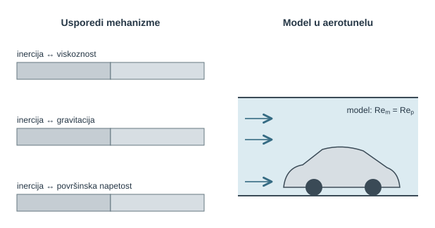
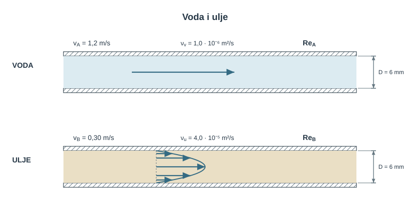
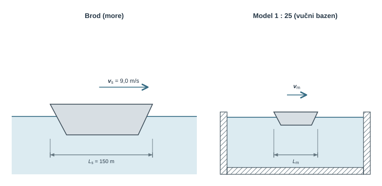
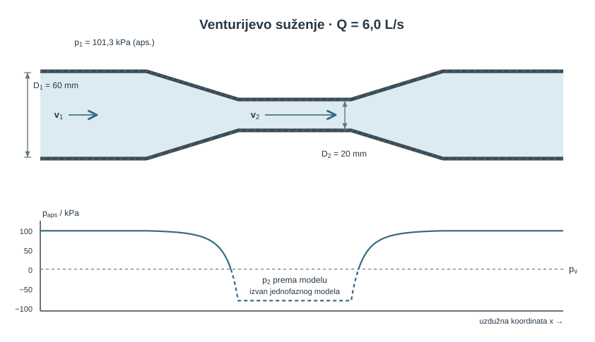
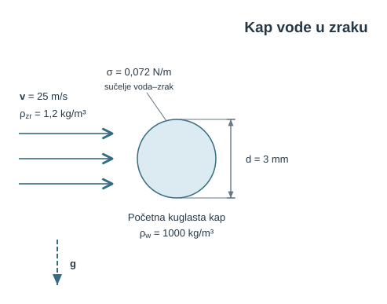
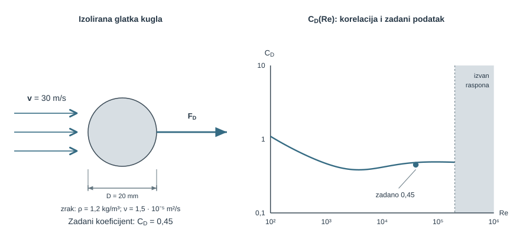
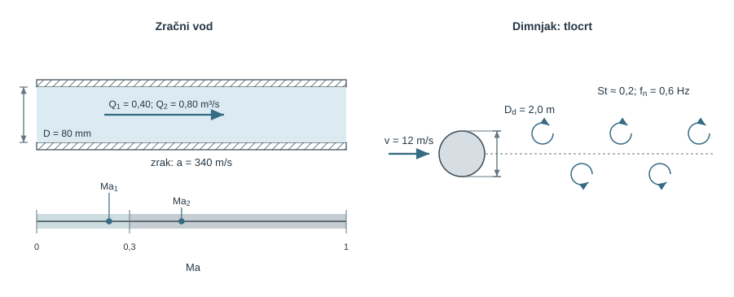
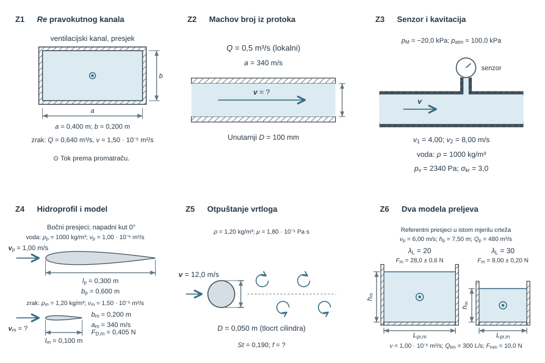

Brod se prije gradnje ispituje kao model u vučnom bazenu, a automobil ili krilo u aerotunelu. Mjerenje na modelu korisno je samo ako znamo kako ga prenijeti na prototip, a za to treba znati koji fizikalni mehanizmi određuju tok i u kakvom su međusobnom omjeru. Dimenzijska analiza odgovara na to pitanje bez rješavanja jednadžbi gibanja: veličine problema slaže u bezdimenzijske grupe i tako smanjuje broj parametara koje treba ispitati ili izračunati.

Polazište su karakteristična mjerila sila. Inercija $F_i\sim\rho v^2L^2$ prisutna je u gotovo svakom strujanju, pa služi kao referenca: Reynoldsov broj $Re=\rho vL/\mu$ uspoređuje je s viskoznošću, kvadrat Froudeova broja $Fr=v/\sqrt{gL}$ s gravitacijom, a Weberov broj $We=\rho v^2L/\sigma$ s površinskom napetošću. Eulerov broj $Eu=\Delta p/(\rho v^2)$ i kavitacijski broj $\sigma_{kav}$ normiraju tlak, Strouhalov broj $St=fL/v$ uspoređuje vremenske skale, a Machov broj $Ma=v/a$ brzinu toka i brzinu zvuka. Koeficijenti $C_p$, $C_D$ i $\lambda$ normirani su odzivi koje mjerimo ili računamo. Koliko je neovisnih grupa, kaže Buckinghamov $\Pi$ teorem: $n-k$, gdje je $n$ broj fizikalnih veličina, a $k$ rang dimenzijske matrice.

Model i prototip ponašaju se jednako u bezdimenzijskom smislu ako su geometrijski, kinematički i dinamički slični, odnosno ako su im jednaki svi mjerodavni bezdimenzijski brojevi. Jednaka vrijednost samo jedne grupe nije dovoljna: aerotunel prenosi $C_D$ pri jednakom $Re$ samo ako su i ostali relevantni uvjeti isti, primjerice relativna hrapavost, $Ma$, slobodna turbulencija i blizina stijenke. U vučnom bazenu jednak $Fr$ i jednak $Re$ u istoj vodi nisu spojivi, pa se čuva Froudeova sličnost, a viskozni otpor ispravlja se prema Froudeovoj hipotezi.

Poglavlje redom obrađuje dimenzije i mjerila sila, bezdimenzijske grupe kao omjere mehanizama, uvjete prijenosa rezultata, Buckinghamov teorem, sličnost i modelska ispitivanja te odluku o tome što bezdimenzionirati. Dimenzijska analiza pritom samo ograničava dopuštenu ovisnost; oblik funkcije daju teorija, pokus ili numerički račun. Poglavlje se oslanja na Bernoullijevu jednadžbu iz []{.mf1-chapter-ref target="u08"} i stlačivost iz []{.mf1-chapter-ref target="u09"}. Darcyjev koeficijent trenja $\lambda(Re,k_s/D)$ i kavitacija na usisu crpke nastavljaju se u []{.mf1-chapter-ref target="u13"}, propeler u []{.mf1-chapter-ref target="u14"}, a Froudeov broj i kritično strujanje u []{.mf1-chapter-ref target="u15"}.

Slika [-@fig-uvod-u14] prikazuje model automobila u aerotunelu s jednolikim dotokom, ispitan pri $Re_m=Re_p$, odnosno pri jednakom Reynoldsovu broju modela i prototipa.

{#fig-uvod-u14 fig-align="center" fig-alt="Model automobila u aerotunelu s jednolikim dotokom."}

**Procijenjeno vrijeme rada uz priručnik:** 9 sati.

## Dimenzijska analiza i sličnost

Dimenzijska analiza povezuje tlačne, viskozne, gravitacijske, inercijske i međupovršinske učinke bezdimenzijskim grupama. One mogu biti omjeri karakterističnih sila, vremenskih skala ili brzina, ali i normirane odzivne veličine. Svrha im je utvrditi mjerodavne fizikalne mehanizme promatranoga problema.

## Dimenzije, jedinice i sila inercije kao referenca

Mehaničke veličine u ovom poglavlju izražavaju se preko tri **primarne dimenzije**: mase $\mathsf{M}$, duljine $\mathsf{L}$ i vremena $\mathsf{T}$. Tako brzina ima dimenziju $\mathsf{L}\,\mathsf{T}^{-1}$, gustoća $\mathsf{M}\,\mathsf{L}^{-3}$, a tlak i naprezanje $\mathsf{M}\,\mathsf{L}^{-1}\,\mathsf{T}^{-2}$. Kada problem uključuje toplinske veličine, potrebna je i dimenzija temperature $\Theta$. Načelo **dimenzijske homogenosti** kaže da obje strane svake ispravne fizikalne jednadžbe moraju imati istu dimenziju — to je ujedno jednostavna prva provjera svakog izraza.

Bezdimenzijski broj nastaje kombiniranjem veličina tako da se dimenzije pokrate. U mehanici fluida osobito su korisna karakteristična mjerila sila jer omogućuju usporedbu fizikalnih mehanizama. Za mnoge tokove polazi se od sljedećih mjerila:

$$
\begin{aligned}
&F_i \sim \rho v^2 L^2 \quad(\text{inercija}), \\
&F_\mu \sim \mu v L \quad(\text{viskoznost}), \\
&F_g \sim \rho g L^3 \quad(\text{gravitacija}),
\end{aligned}
$$ {#eq-slicnost-dimenzije-jedinice-i-sila-inercije-kao-referenca-01}

$$
F_p \sim \Delta p\, L^2 \quad(\text{tlak}), \qquad
F_\sigma \sim \sigma L \quad(\text{površinska napetost}).
$$ {#eq-slicnost-dimenzije-jedinice-i-sila-inercije-kao-referenca-02}

Ovdje je $L$ karakteristična duljina problema (promjer cijevi, duljina trupa, promjer kapi), a $v$ karakteristična brzina. **Inercijska sila** $F_i \sim \rho v^2 L^2$ uzima se kao prirodna referenca jer je prisutna u gotovo svakom strujanju — čim se fluid giba, ima inerciju. Zato se većina važnih bezdimenzijskih brojeva može pročitati kao omjer inercijske sile prema nekoj drugoj sili.

::: {.mf1-fizikalno-znacenje}

Fizikalno značenje

Jednaka vrijednost jedne grupe nije dovoljna ako su u problemu aktivne i druge grupe.
:::

## Bezdimenzijske grupe kao omjeri mehanizama

Omjeri mjerila sila daju $Re\sim F_i/F_\mu$, $Fr^2\sim F_i/F_g$, $Eu\sim F_p/F_i$ i $We\sim F_i/F_\sigma$; Strouhalov i Machov broj, uvedeni u nastavku, tumače se omjerom vremenskih skala, odnosno brzina.

[]{#fig-u14-omjer-sila}

Pritom je $F_i$ inercijsko mjerilo, a ne dodatna vanjska sila. Navedena mjerila ne čine jednadžbu ravnoteže pojedine čestice; $L$, $v$ i $\Delta p$ moraju imati ista referentna značenja u svim omjerima.

**Reynoldsov broj** uspoređuje inerciju i viskoznost:

$$
Re = \frac{F_i}{F_\mu} = \frac{\rho v L}{\mu} = \frac{v L}{\nu}.
$$ {#eq-slicnost-bezdimenzijske-grupe-kao-omjeri-mehanizama-01}

Mali $Re$ obično znači da viskoznost snažno prigušuje poremećaje. Veliki $Re$ znači da su inercijski učinci jaki, ali **ne jamči sam po sebi turbulenciju**: prijelaz ovisi o geometriji, stabilnosti osnovnog toka, hrapavosti i ulaznim poremećajima. Razvijeno strujanje u kružnoj cijevi pri $Re\lesssim2300$ obično je laminarno, približno između 2300 i 4000 prijelazno, a iznad toga u tehničkim uvjetima najčešće turbulentno [@white2011].

**Froudeov broj** uspoređuje inerciju i gravitaciju:

$$
Fr = \frac{v}{\sqrt{gL}}, \qquad Fr^2 = \frac{F_i}{F_g}.
$$ {#eq-slicnost-bezdimenzijske-grupe-kao-omjeri-mehanizama-02}

Froudeov broj važan je kada dinamiku slobodne površine određuju gravitacijski valovi, primjerice pri plovidbi broda, u otvorenom kanalu ili na preljevu. U otvorenom kanalu, kada je za $L$ odabrana hidraulička dubina $y_h=A/T$ ($A$ je površina presjeka, a $T$ širina slobodne površine; []{.mf1-chapter-ref target="u15"}), $Fr=1$ označuje kritično strujanje: karakteristična brzina plitkovodnog vala jednaka je srednjoj brzini toka.

**Eulerov broj i koeficijent tlaka** uspoređuju tlačnu i inercijsku silu:

$$
Eu = \frac{\Delta p}{\rho v^2}, \qquad C_p = \frac{p - p_\infty}{\tfrac{1}{2}\rho v^2}.
$$ {#eq-slicnost-bezdimenzijske-grupe-kao-omjeri-mehanizama-03}

Ovdje se $Eu$ zapisuje bez faktora $\tfrac12$, dok $C_p$ normira dinamičkim tlakom $\tfrac12\rho v^2$. U literaturi se javljaju obje konvencije, pa pri usporedbi treba navesti koja je upotrijebljena. U nestlačivom, neviskoznom toku s referentnim stanjem u neporemećenoj struji Bernoullijeva jednadžba daje $C_p=1$ u zaustavnoj (stagnacijskoj) točki. U realnom ili stlačivom toku, pri drukčijem izboru referentnog tlaka ili uz gubitke, ta vrijednost nije univerzalna. Negativan $C_p$ znači samo da je statički tlak manji od odabranoga referentnog tlaka.

**Kavitacijski broj** poseban je Eulerov broj koji normira tlačnu rezervu referentnog toka iznad tlaka zasićene pare:

$$
\sigma_{kav} = \frac{p_{ref} - p_v}{\tfrac{1}{2}\rho v_{ref}^2}.
$$ {#eq-slicnost-bezdimenzijske-grupe-kao-omjeri-mehanizama-04}

Referentni tlak, brzina i kritična vrijednost moraju biti definirani za konkretnu napravu i konvenciju. Kavitacija lokalno počinje kada apsolutni tlak dosegne $p_v$; na razini cijelog propelera ili crpke to se često opisuje eksperimentalnim $\sigma_{kr}$. Zato sama brojčana vrijednost $\sigma_{kav}$ bez karakteristike uređaja nije dovoljna za tvrdnju „sigurno” ili „kavitira”.

**Weberov broj** uspoređuje inerciju i površinsku napetost:

$$
We = \frac{\rho v^2 L}{\sigma}, \qquad We = \frac{F_i}{F_\sigma}.
$$ {#eq-slicnost-bezdimenzijske-grupe-kao-omjeri-mehanizama-05}

Pri malom $We$ površinska napetost snažno se opire deformaciji, a pri velikom su inercijska naprezanja relativno veća. Prag raspada nije univerzalan: ovisi o vrsti raspada, omjeru gustoća i viskoznosti, Ohnesorgeovu broju, početnoj deformaciji i vremenu djelovanja. Vrijednost reda $We\approx12$ može služiti kao orijentir za određene režime aerodinamičkog raspada pojedinačne kapi, ali ne kao opći kriterij kvalitete atomizacije [@white2011].

**Bondov (Eötvösov) broj** uspoređuje gravitaciju i površinsku napetost:

$$
Bo = \frac{\Delta\rho\,g L^2}{\sigma}.
$$ {#eq-slicnost-bezdimenzijske-grupe-kao-omjeri-mehanizama-06}

Ovdje je $\Delta\rho$ razlika gustoća dviju faza; za granicu voda–zrak često se aproksimira gustoćom vode. Pri $Bo\sim1$ gravitacija i površinska napetost usporedive su, a kapilarna duljina glasi $L_c=\sqrt{\sigma/(\Delta\rho g)}$.

**Strouhalov broj** opisuje nestacionarno, periodičko strujanje:

$$
St = \frac{f L}{v},
$$ {#eq-slicnost-bezdimenzijske-grupe-kao-omjeri-mehanizama-07}

gdje je $f$ frekvencija pojave. To je omjer konvektivne vremenske skale $L/v$ i perioda $1/f$, a ne izravan omjer sila. Za kružni cilindar u određenom subkritičnom području Reynoldsova broja često je $St$ reda $0{,}2$; vrijednost ovisi o geometriji i režimu [@white2011].

::: {.mf1-cfd title="Računalna dinamika fluida"}

**Vibrira li nosač zbog vrtloga?** Cilindrični stup u vodi može biti izložen promjenjivoj bočnoj sili zbog otpuštanja vrtloga. U nestacionarnoj CFD simulaciji najprije računamo tok oko nepomičnog stupa pri zadanoj brzini dotoka. Iz zapisa sile određujemo srednji otpor, amplitudu i dominantnu frekvenciju; $St=fL/v$ omogućuje usporedbu različitih dimenzija i brzina pri odgovarajućem režimu.

Zapis mora obuhvatiti više perioda, a vremenski korak dovoljno razlučiti svaki period. Jednak srednji otpor ne potvrđuje točnu frekvenciju. Ako je frekvencija blizu vlastite frekvencije konstrukcije, za predviđanje vibracija treba uključiti i gibanje konstrukcije. Tako CFD daje pobudu za mehanički model, dok sama simulacija nepomičnog stupa još ne daje njegov pomak.
:::

**Machov broj** uspoređuje inerciju i stlačivost (elastičnost) fluida:

$$
Ma = \frac{v}{a}, \qquad \text{Cauchyjev broj} = \frac{\rho v^2}{K} = Ma^2,
$$ {#eq-slicnost-bezdimenzijske-grupe-kao-omjeri-mehanizama-08}

gdje je $a$ brzina zvuka, a $K$ modul stlačivosti. Za plinska strujanja bez velikog zagrijavanja i snažnih tlačnih promjena, $Ma<0{,}3$ često je uporabljiv kriterij da su promjene gustoće male. To je inženjerski prag, a ne matematička granica: iznad njega stlačivost postupno postaje važna, a i pri malom $Ma$ gustoća se može mijenjati zbog temperature ili sastava [@anderson2021].

**Koeficijenti trenja, otpora i tlaka kao bezdimenzijski rezultati.** Rezultati proračuna otpora mogu se prikazati i bezdimenzijskim koeficijentima, dobivenima normiranjem sila ili naprezanja:

$$
\lambda = \lambda\!\left(Re, \frac{k_s}{D}\right), \qquad
C_D = \frac{F_D}{\tfrac{1}{2}\rho v^2 A}.
$$ {#eq-slicnost-bezdimenzijske-grupe-kao-omjeri-mehanizama-09}

Darcyjev koeficijent trenja $\lambda$ i koeficijent otpora $C_D$ bezdimenzijski su odzivi. Jedna izmjerena krivulja smije se prenositi samo unutar iste bezdimenzijske geometrije, istih rubnih uvjeta i istog skupa relevantnih grupa; primjerice, $C_D$ osim o $Re$ može ovisiti i o hrapavosti, $Ma$, slobodnoj turbulenciji i blizini stijenke.

::: {.mf1-cfd title="Računalna dinamika fluida"}

**Može li se rezultat prenijeti na veći razdjelnik?** Za geometrijski slične rashladne razdjelnike usporedimo bezdimenzijska polja tlaka i brzine pri jednakom $Re$, uz jednak oblik ulaznog profila i jednaku relativnu hrapavost. Ako su važni isti mehanizmi, takva usporedba otkriva može li se rezultat jednog uređaja prenijeti na drugi. Bezdimenzijski tlak u oba se računa definira s istom referencom i istom skalom $\rho v^2/2$.

Jednake dimenzijske vrijednosti pada tlaka nisu uvjet sličnosti. Obrnuto, slaganje koeficijenata nema značenja ako su upotrijebljene različite referentne brzine. Za izoterman jednofazni model to može biti dovoljna hidrodinamička usporedba; prijenos rezultata hlađenja traži i toplinsku sličnost.
:::

## Kada se rezultat može prenijeti na drugi sustav

Za geometrijski slične cjevovode u nestlačivom toku jednak $Re$ uz jednaku relativnu hrapavost i jednak način ulaska omogućuje usporedbu bezdimenzijskih raspodjela brzine i tlaka; slobodna površina ili kapljice dodaju $Fr$ i $We$. Tablica sažima sve brojeve iz ovog poglavlja; u skraćenom obliku nalazi se i u dod. ASažetak formula i oznaka.

| Broj | Definicija | Fizikalno tumačenje | Prag ili uvjet | Gdje je važan |
| --- | --- | --- | --- | --- |
| $Re$ | $\rho vL/\mu=vL/\nu$ | inercija / viskoznost | granice ovise o geometriji; za cijev približno 2300–4000 | režim, otpor |
| $Fr$ | $v/\sqrt{gL}$ | $Fr^2=$ inercija / gravitacija | $Fr=1$ za kritično strujanje u otvorenom kanalu | brod, kanal, preljev |
| $Eu,\ C_p$ | $\Delta p/(\rho v^2)$; $(p-p_\infty)/(\tfrac12\rho v^2)$ | tlak / inercija; normirani tlak | $C_p=1$ samo za idealnu nestlačivu stagnaciju uz odgovarajuću referencu | raspodjela tlaka |
| $\sigma_{kav}$ | $(p_{ref}-p_v)/(\tfrac12\rho v_{ref}^2)$ | normirana tlačna rezerva | usporedba s uređajno i konvencijski definiranim $\sigma_{kr}$ | propeler, crpka |
| $We$ | $\rho v^2L/\sigma$ | inercija / površinska napetost | prag raspada ovisi o režimu i drugim grupama | kap, mlaz, sprej |
| $Bo$ | $\Delta\rho gL^2/\sigma$ | gravitacija / površinska napetost | $Bo\sim1$, $L_c=\sqrt{\sigma/(\Delta\rho g)}$ | oblik kapi i mjehura |
| $\lambda,\ C_D$ | bezdimenzijski koeficijenti | normirani odzivi otpora | vrijede uz definiranu geometriju i relevantne grupe | unutarnji i vanjski otpor |
| $St$ | $fL/v$ | omjer vremenskih skala | $St$ reda $0{,}2$ samo za određene tokove oko cilindra | vrtložno otpuštanje |
| $Ma$ | $v/a$ | omjer brzine toka i brzine zvuka; $Ma^2$ povezan s inercijom/stlačivošću | $Ma<0{,}3$ čest je, ali uvjetan prag nestlačivosti | stlačivost |

## Buckinghamov Π teorem

Dimenzijska analiza odgovara na pitanje: ako problem ovisi o $n$ fizikalnih veličina, koliko ga **neovisnih bezdimenzijskih grupa** određuje? Odgovor daje Buckinghamov $\Pi$ teorem:

$$
\text{broj } \Pi\text{-grupa} = n - k,
$$ {#eq-slicnost-buckinghamov-teorem-01}

gdje je $n$ broj fizikalnih veličina, a $k$ rang dimenzijske matrice (u mehanici fluida najčešće $k = 3$: $\mathsf{M}, \mathsf{L}, \mathsf{T}$). Postupak je uvijek isti:

1. popiši sve fizikalne veličine koje ulaze u problem i njihove dimenzije;
2. odredi $k$ — rang dimenzijske matrice;
3. izaberi $k$ **ponavljajućih varijabli** koje zajedno pokrivaju sve dimenzije i same ne tvore bezdimenzijsku grupu (tipično $\rho, v, L$);
4. svaku preostalu varijablu kombiniraj s ponavljajućima u jednu $\Pi$-grupu i odredi eksponente tako da izraz bude bezdimenzijski;
5. protumači dobivene grupe i, kada je moguće, poveži ih s poznatim brojevima (Re, Fr, …).

Tablica [-@tbl-dimenzijska-matrica-otpora-kugle] prikazuje prva dva koraka tog postupka na primjeru otpora kugle: svaki stupac sadrži eksponente primarnih dimenzija jedne veličine.

| Dimenzija | $F_D$ | $\rho$ | $v$ | $D$ | $\mu$ |
| --- | ---: | ---: | ---: | ---: | ---: |
| $\mathsf{M}$ | $1$ | $1$ | $0$ | $0$ | $1$ |
| $\mathsf{L}$ | $1$ | $-3$ | $1$ | $1$ | $-1$ |
| $\mathsf{T}$ | $-2$ | $0$ | $-1$ | $0$ | $-1$ |

: Dimenzijska matrica za silu otpora kugle. {#tbl-dimenzijska-matrica-otpora-kugle}

**Tumačenje matrice.** Za pet varijabli $F_D$, $\rho$, $v$, $D$ i $\mu$ dimenzijska matrica ima rang tri, pa dobivamo $n-k=5-3=2$ neovisne bezdimenzijske grupe. Jedan je mogući izbor $\Pi_1=F_D/(\rho v^2D^2)$ i $\Pi_2=\rho vD/\mu=Re$. Veza $\Pi_1=\Phi_1(\Pi_2)$ uz odabranu definiciju koeficijenta otpora vodi do zapisa $C_D=\Phi(Re)$, pri čemu su $\Phi$ i $\Phi_1$ nepoznate funkcije.

::: {.mf1-izvod}

Matematički izvod — Dimenzijska analiza pada tlaka u cijevi

Ukupni pad tlaka na ravnoj cijevnoj dionici može ovisiti o gustoći $\rho$, srednjoj brzini $v$, promjeru $D$, duljini $L$, viskoznosti $\mu$ i hrapavosti stijenke $k_s$. Skup od $n = 7$ veličina ($\Delta p,\rho,v,D,L,\mu,k_s$) ima $k = 3$ neovisne dimenzije, pa nastaju četiri $\Pi$-grupe.

Uz ponavljajuće varijable $\rho, v, D$ tvore se grupe:

$$
\Pi_1 = \frac{\Delta p}{\rho v^2}, \qquad
\Pi_2 = \frac{\rho v D}{\mu} = Re, \qquad
\Pi_3 = \frac{L}{D}, \qquad
\Pi_4 = \frac{k_s}{D}.
$$ {#eq-slicnost-matematicki-izvod-dimenzijska-analiza-pada-tlaka-01}

Iz teorema slijedi da su sve grupe povezane jednom funkcijom:

$$
\frac{\Delta p}{\rho v^2} = \Phi\!\left(Re, \frac{L}{D}, \frac{k_s}{D}\right).
$$ {#eq-slicnost-matematicki-izvod-dimenzijska-analiza-pada-tlaka-02}

Eksponente prve grupe određujemo iz zapisa $\Pi_1 = \Delta p\, \rho^a v^b D^c$. Dimenzije veličina jesu $[\Delta p] = \mathsf{M}\mathsf{L}^{-1}\mathsf{T}^{-2}$, $[\rho] = \mathsf{M}\mathsf{L}^{-3}$, $[v] = \mathsf{L}\mathsf{T}^{-1}$, $[D] = \mathsf{L}$. Da bi $\Pi_1$ bio bezdimenzijski, mora vrijediti:

$$
\mathsf{M}:\ 1 + a = 0,\qquad
\mathsf{T}:\ -2 - b = 0,\qquad
\mathsf{L}:\ -1 - 3a + b + c = 0.
$$ {#eq-slicnost-razrada-koraka-01}

Odatle slijedi $a = -1$, $b = -2$, $c = 0$, pa je $\Pi_1 = \Delta p/(\rho v^2)$, što je Eulerov broj.

Dimenzijska analiza sama ne određuje oblik funkcije $\Phi$ niti dokazuje linearnu ovisnost o $L$. Dodatna fizikalna pretpostavka glasi: strujanje je potpuno razvijeno u jednolikoj ravnoj cijevi, pa je srednji gradijent tlaka konstantan i jednake se dionice mogu zbrajati. Tek tada je $\Delta p\propto L$, pa se funkcija može zapisati u Darcy–Weisbachovu obliku

$$
\Delta p = \lambda\,\frac{L}{D}\,\frac{\rho v^2}{2}, \qquad \lambda = \lambda\!\left(Re, \frac{k_s}{D}\right).
$$ {#eq-slicnost-razrada-koraka-02}

Dimenzijska analiza tako ograničava dopuštenu ovisnost, a pretpostavka potpuno razvijenoga toka izdvaja $L/D$. Sama funkcija $\lambda(Re,k_s/D)$ dobiva se analitički u laminarnom toku, a empirijski ili numerički u turbulentnom.
:::

::: {.mf1-izvod}

Matematički izvod — Otpor kugle daje $C_D(Re)$

Za izoliranu glatku kuglu u jednolikoj, nestlačivoj struji daleko od stijenki, uz zanemarivu slobodnu turbulenciju i stlačivost, sila otpora $F_D$ ovisi o $\rho$, $v$, $D$ i $\mu$. Tada iz pet veličina nastaju dvije $\Pi$-grupe:

$$
\Pi_1 = \frac{F_D}{\rho v^2 D^2}, \qquad \Pi_2 = \frac{\rho v D}{\mu} = Re.
$$ {#eq-slicnost-matematicki-izvod-otpor-kugle-daje-cd-re-01}

Uz ponavljajuće varijable $\rho$, $v$, $D$ traži se $\Pi_1 = F_D\,\rho^a v^b D^c$ s $[F_D]=\mathsf{M}\mathsf{L}\mathsf{T}^{-2}$:

$$
\begin{aligned}
&\mathsf{M}:\ 1 + a = 0,\qquad
\mathsf{T}:\ -2 - b = 0,\qquad
\mathsf{L}:\ 1 - 3a + b + c = 0 \\
&\Rightarrow\quad a=-1,\ b=-2,\ c=-2.
\end{aligned}
$$ {#eq-kugla-eksponenti-pi1}

Za $\Pi_2 = \mu\,\rho^a v^b D^c$ s $[\mu]=\mathsf{M}\mathsf{L}^{-1}\mathsf{T}^{-1}$ isti sustav daje $a=b=c=-1$, pa je $\Pi_2=\mu/(\rho vD)=1/Re$; recipročna vrijednost $Re$ ravnopravan je izbor grupe.

Time je cijeli problem otpora sveden na jednu funkciju jedne varijable:

$$
\frac{F_D}{\rho v^2 D^2} = \Phi_1(Re) \quad\Longleftrightarrow\quad C_D = \frac{F_D}{\tfrac{1}{2}\rho v^2 A} = \Phi(Re).
$$ {#eq-slicnost-matematicki-izvod-otpor-kugle-daje-cd-re-02}

Unutar navedenih pretpostavki jedna krivulja $C_D(Re)$ obuhvaća Stokesov režim $C_D=24/Re$ pri vrlo malom $Re$ i područje krize otpora. Hrapavost, blizina stijenke, slobodna turbulencija ili stlačivost uveli bi dodatne parametre i promijenili krivulju.
:::

## Sličnost i modelska ispitivanja

Da bi se rezultati ispitivanja modela mogli prenijeti na stvarni objekt (prototip), mora vrijediti **sličnost** na tri razine:

- **geometrijska sličnost** — model i prototip imaju isti oblik, sve duljine u istom mjerilu $\lambda_L = L_p/L_m$ (indeks $L$ razlikuje mjerilo duljina od Darcyjeva koeficijenta trenja $\lambda$);
- **kinematička sličnost** — polja brzina geometrijski su slična (slične strujnice, brzine u istom omjeru);
- **dinamička sličnost** — sile na model i prototip u istom su omjeru, što znači da su **mjerodavni bezdimenzijski brojevi jednaki**.

Ako su jednaki svi relevantni brojevi, izmjereni koeficijenti ($C_D$, $C_p$, $\lambda$) izravno se prenose. Veličine modela nose indeks $m$, a prototipa indeks $p$; kada je prototip brod, umjesto $p$ piše se indeks $s$ ($L_s$, $v_s$, $Re_s$, $C_{F,s}$).

::: {.mf1-fizikalno-znacenje}

Fizikalno značenje

Praktična je teškoća u tome što se svi brojevi rijetko mogu izjednačiti istodobno. Za model broda u istom fluidu jednak $Fr$ traži $v_m=v_s/\sqrt{\lambda_L}$, dok jednak $Re$ traži $v_m=v_s\lambda_L$. Ti su zahtjevi za $\lambda_L\ne1$ međusobno nespojivi. Zato se u vučnom bazenu prioritetno čuva Froudeova sličnost, a viskozni se doprinos računa zasebno prema Froudeovoj hipotezi (@eq-froudeova-hipoteza). Drugi fluid ili promijenjeni tlak ili temperatura mogu približno zadovoljiti i dodatnu sličnost, ali uvode praktična ograničenja i nove provjere.
:::

Skaliranje veličina slijedi iz odabranog broja. Pri Froudeovoj sličnosti, uz jednako gravitacijsko ubrzanje i mjerilo $\lambda_L=L_p/L_m$, vrijedi:

$$
\frac{v_p}{v_m} = \sqrt{\lambda_L}, \qquad
\frac{Q_p}{Q_m} = \lambda_L^{5/2}, \qquad
\frac{F_p}{F_m} = \frac{\rho_p}{\rho_m}\lambda_L^{3}.
$$ {#eq-slicnost-fizikalno-znacenje-01}

Posljednji se izraz svodi na $\lambda_L^3$ samo kada model i prototip imaju jednaku referentnu gustoću.

**Froudeova hipoteza i korekcija viskoznog otpora.** Jednak $Fr$ ne čuva $Re$, pa se ukupni otpor broda $R_T$ rastavlja prema Froudeovoj hipotezi

$$
C_T=\frac{R_T}{\tfrac12\rho v^2 A_{opl}}=C_F(Re)+C_R(Fr),
$$ {#eq-froudeova-hipoteza}

gdje je $A_{opl}$ oplakana površina trupa, $C_F$ koeficijent otpora trenja ekvivalentne ravne ploče iste duljine i oplakane površine, a $C_R$ koeficijent preostalog, pretežno valnog otpora. Hipoteza pretpostavlja da $C_R$ ovisi samo o $Fr$, pa je jednak na modelu i brodu, dok se $C_F$ računa za svaki $Re$ zasebno korelacijskom linijom ITTC 1957

$$
C_F=\frac{0{,}075}{\left(\log_{10}Re-2\right)^2}
$$ {#eq-ittc-1957}

[@ittc]. Postupak je: iz izmjerenog otpora modela odredi $C_{T,m}$, oduzmi $C_{F,m}$, prenesi $C_R$ na brod i dodaj $C_{F,s}$ pri brodskom $Re$. Omjer snaga slijedi iz $P=R_Tv$; za dio otpora koji se prenosi Froudeovom sličnošću vrijedi

$$
\frac{P_p}{P_m}=\frac{F_p\,v_p}{F_m\,v_m}=\frac{\rho_p}{\rho_m}\,\lambda_L^{7/2},
$$ {#eq-froude-skaliranje-snage}

dok se viskozni dio otpora računa preko $C_F$ pri brodskom $Re$ i ne skalira ni faktorom $\lambda_L^3$ (sila) ni faktorom $\lambda_L^{7/2}$ (snaga).

::: {.mf1-granica-modela}

Granica modela — Froudeova hipoteza i korelacijska linija

Rastavljanje $C_T=C_F(Re)+C_R(Fr)$ radna je hipoteza, a ne zakon: trodimenzijski učinci oblika trupa (metoda ITTC 1978 zato uvodi faktor oblika $1+k$; ovdje $k$ označuje samo dodatak otpora zbog oblika trupa, a ne hrapavost $k_s$ ni turbulentnu kinetičku energiju iz []{.mf1-chapter-ref target="u12"}), hrapavost oplate, stimulatori turbulencije na modelu i utjecaj slobodne površine na trenje ne ulaze u model ravne ploče. Linija ITTC 1957 dogovorna je korelacijska krivulja za prijenos model–brod, a ne čisti zakon trenja ravne ploče. Rezultati iz vučnog bazena zato se prenose uz dokumentirane korekcije, a ne kao mjerni podatak bez pretpostavki.
:::

## Kako odlučiti što bezdimenzionirati

Srž ovog poglavlja nije zapamtiti devet formula, nego prepoznati **skup** relevantnih grupa. Najprije se definiraju izlazna veličina, geometrija, fluid te početni i rubni uvjeti; zatim se iz jednadžbi ili Buckinghamovim postupkom izdvajaju mogući mehanizmi. Procjena reda veličine pokazuje koje se grupe mogu zanemariti, a koje treba očuvati. Ako dvije važne grupe nije moguće istodobno uskladiti, odabire se prioritetna sličnost, a mjerilna se pogreška procjenjuje.

Pitanja u nastavku ne isključuju se: provjeravaju se sva, jer u istom problemu može biti aktivno više mehanizama.

::: {.mf1-decision-grid}
::: {.mf1-decision-step}
1

Postoji li slobodna površina ili valovi?

Ako da, gravitacija može biti važna → mjerodavan je **Froudeov broj** $Fr$ (brod, kanal, preljev, hidraulički skok).
:::

::: {.mf1-decision-step}
2

Je li bitan režim ili trenje uz stijenku?

Izračunaj **Reynoldsov broj** $Re$ (cijev, granični sloj, ležaj) i protumači ga za konkretnu geometriju. On mjeri relativnu važnost inercije i viskoznosti, ali sam ne određuje prijelaz bez podataka o stabilnosti toka i poremećajima.
:::

::: {.mf1-decision-step}
3

Ima li kapljica, mlaza ili mjehura?

Tada je važna površinska napetost → **Weberov broj** $We$ (inercija prema površinskoj napetosti) i **Bondov broj** $Bo$ (gravitacija prema površinskoj napetosti). Usporedi $L$ s kapilarnom duljinom $L_c$.
:::

::: {.mf1-decision-step}
4

Može li tlak pasti do tlaka zasićene pare?

U suženjima, na propeleru i na usisu crpke → **kavitacijski broj** $\sigma_{kav}$. Usporedba s kritičnom vrijednošću vrijedi samo za jednako definirane referentne veličine i odgovarajuću karakteristiku iste vrste uređaja.
:::

::: {.mf1-decision-step}
5

Postoje li periodičke sile ili vibracije?

Vrtložno otpuštanje iza tijela → **Strouhalov broj** $St$. Provjeri može li nastupiti rezonancija s konstrukcijom.
:::

::: {.mf1-decision-step}
6

Je li brzina plina velika?

Ako se $v$ približava brzini zvuka → provjeri **Machov broj** $Ma$. Za $Ma<0{,}3$ nestlačiva aproksimacija često je dobra ako nema velikih promjena temperature, tlaka ni sastava; pretpostavku ipak treba provjeriti za konkretan problem.
:::

::: {.mf1-decision-step}
7

Koju izlaznu veličinu tražiš?

Otpor tijela → **koeficijent otpora** $C_D$; pad tlaka u cijevi → **koeficijent trenja** $\lambda$; raspodjela tlaka po plohi → **koeficijent tlaka** $C_p$.
:::
:::

::: {#cfd-ponton-slicnost .mf1-cfd title="Računalna dinamika fluida"}

**Mali ponton u bazenu i stvarni ponton u valovima.** U []{.mf1-chapter-ref target="u06"} provjeravali smo gaz i početni stabilitet. Za dinamički pokus manjega pontona sada treba uskladiti geometriju, raspodjelu mase i važne bezdimenzijske uvjete. Froudeova sličnost povezuje gibanje s gravitacijskim valovima, dok Reynoldsov broj određuje odnos inercije i viskoznosti. Riješeni primjer [-@ex-u14-froudeova-slicnost-model-broda-u-vucnom-bazenu] računski pokazuje da ista voda pri promjeni mjerila ne čuva oba broja.

**Zastani i promisli.** Model broda i prototip imaju isti Froudeov broj. Smijemo li bez dodatne provjere prenijeti i viskozni otpor?

Ne: jednak Froudeov broj ne potvrđuje prijenos viskoznog otpora. CFD računi obaju mjerila mogu pokazati osjetljivost otpora i prigušenja na promijenjeni $Re$, uz zasebne numeričke provjere; sami ne uklanjaju razliku mjerila. Za kapilarne učinke dodatno provjeravamo $We$ i $Bo$. Odabir modela tako počinje procjenom mehanizama prije izrade mreže; pregled daje @sec-cfd-mapa.
:::

## Riješeni primjeri

::: {#ex-u14-reynoldsov-broj-u-dva-sustava-iste-geometrije .mf1-we}

Reynoldsov broj u dva sustava iste geometrije&nbsp;T1

**Tekst zadatka**

Kroz razvijenu ravnu kružnu cijev promjera $D = 6\ \text{mm}$ u jednom slučaju teče voda brzinom $v_A = 1{,}2\ \text{m/s}$, s $\nu_v = 1{,}0 \cdot 10^{-6}\ \text{m}^2/\text{s}$, a u drugom ulje brzinom $v_B = 0{,}30\ \text{m/s}$, s $\nu_u = 4{,}0 \cdot 10^{-5}\ \text{m}^2/\text{s}$. Za procjenu početka prijelaznog područja uzmi orijentacijsku vrijednost $Re=2300$ [@white2011].

**Traži se**

1. Odredi Reynoldsov broj i režim u oba slučaja.
2. Odredi brzinu vode koja odgovara orijentacijskoj vrijednosti $Re=2300$.

{#fig-u14-val1-reynolds fig-align="center" fig-alt="Ista kružna cijev nacrtana dvaput, s vodom i strelicom srednje brzine te s uljem i paraboličnim profilom brzine koji iščezava na stijenkama."}

**Uz skicu.** Strelica uz vodu označuje srednju brzinu; turbulentne fluktuacije nisu nacrtane. Laminarni profil brzine ulja glasi $v(r)=2v_B[1-(r/R)^2]$, uz prianjanje $v(\pm R)=0$; strelice u profilu prikazuju lokalne brzine, a ne strujnice.

**Rješenje**

Za vodu:

$$
Re_A = \frac{v_A D}{\nu_v} = \frac{1{,}2 \cdot 0{,}006}{1{,}0 \cdot 10^{-6}} = 7200 \quad (>4000 \Rightarrow \text{turbulentno}).
$$ {#eq-slicnost-rijeseni-primjer-reynoldsov-broj-u-dva-sustava-01}

Za ulje:

$$
Re_B = \frac{v_B D}{\nu_u} = \frac{0{,}30 \cdot 0{,}006}{4{,}0 \cdot 10^{-5}} = 45 \quad (\ll 2300 \Rightarrow \text{izrazito laminarno}).
$$ {#eq-slicnost-rijeseni-primjer-reynoldsov-broj-u-dva-sustava-02}

Brzina vode koja odgovara $Re=2300$:

$$
v_{kr} = \frac{Re_{kr}\,\nu_v}{D} = \frac{2300 \cdot 1{,}0 \cdot 10^{-6}}{0{,}006} \approx 0{,}383\ \text{m/s}.
$$ {#eq-slicnost-rijeseni-primjer-reynoldsov-broj-u-dva-sustava-03}

**Provjera i tumačenje**

Pri istom $D$ omjer $Re_A/Re_B=160$ potječe od $\nu_u/\nu_v=40$ i $v_A/v_B=4$: režim određuje omjer inercije i viskoznosti, a ne geometrija. Ulju bi za isti prag trebala brzina $40$ puta veća od $v_{kr}$ vode, oko $15\ \text{m/s}$.
:::

::: {#ex-u14-froudeova-slicnost-model-broda-u-vucnom-bazenu .mf1-we}

Froudeova sličnost: model broda u vučnom bazenu&nbsp;T2

**Tekst zadatka**

Brod duljine $L_s = 150\ \text{m}$ i brzine $v_s = 9{,}0\ \text{m/s}$ ispituje se geometrijski sličnim modelom u mjerilu $\lambda_L = 25$. U oba slučaja vrijede $\nu = 1{,}0 \cdot 10^{-6}\ \text{m}^2/\text{s}$ i $g = 9{,}81\ \text{m/s}^2$. Za proučavanje valnog otpora odaberi Froudeovu sličnost.

**Traži se**

1. Odredi duljinu i brzinu modela iz uvjeta $Fr_m = Fr_s$.
2. Odredi Froudeov broj te omjer Reynoldsovih brojeva broda i modela.
3. Objasni zašto se Reynoldsova sličnost ne može istodobno zadovoljiti.
4. Odredi $C_F$ prema liniji ITTC 1957 za model i brod te objasni zašto se izmjereni otpor modela ne smije pomnožiti s $\lambda_L^3$.

{#fig-u14-val2-brod fig-align="center" fig-alt="Brod (prototip) i geometrijski sličan model 1 : 25 pri jednakom Froudeovu broju."}

**Veza s proračunom.** Model i brod nacrtani su u različitim grafičkim mjerilima; stvarne dimenzije daju kote. Valovi nisu nacrtani.

**Rješenje**

Duljina modela:

$$
L_m = \frac{L_s}{\lambda_L} = \frac{150}{25} = 6{,}0\ \text{m}.
$$ {#eq-slicnost-rijeseni-primjer-froudeova-slicnost-model-broda-01}

Iz $Fr_m = Fr_s$, tj. $v_m/\sqrt{gL_m} = v_s/\sqrt{gL_s}$, slijedi $v_m = v_s/\sqrt{\lambda_L}$:

$$
v_m = \frac{v_s}{\sqrt{\lambda_L}} = \frac{9{,}0}{\sqrt{25}} = 1{,}8\ \text{m/s}.
$$ {#eq-slicnost-rijeseni-primjer-froudeova-slicnost-model-broda-02}

Froudeov broj (jednak na modelu i brodu):

$$
Fr = \frac{v_s}{\sqrt{g L_s}} = \frac{9{,}0}{\sqrt{9{,}81 \cdot 150}} \approx 0{,}235.
$$ {#eq-slicnost-rijeseni-primjer-froudeova-slicnost-model-broda-03}

Reynoldsovi brojevi: $Re_s = v_s L_s/\nu = 1{,}35 \cdot 10^{9}$, $Re_m = v_m L_m/\nu = 1{,}08 \cdot 10^{7}$, pa je

$$
\frac{Re_s}{Re_m} = \lambda_L^{3/2} = 25^{1{,}5} = 125.
$$ {#eq-slicnost-rijeseni-primjer-froudeova-slicnost-model-broda-04}

Koeficijent otpora trenja prema jednadžbi [-@eq-ittc-1957]:

$$
\begin{aligned}
C_{F,m}&=\frac{0{,}075}{(\log_{10}1{,}08\cdot10^{7}-2)^2}=\frac{0{,}075}{5{,}033^2}\approx2{,}96\cdot10^{-3}, \\
C_{F,s}&=\frac{0{,}075}{(\log_{10}1{,}35\cdot10^{9}-2)^2}=\frac{0{,}075}{7{,}130^2}\approx1{,}48\cdot10^{-3}.
\end{aligned}
$$ {#eq-slicnost-rijeseni-primjer-froudeova-slicnost-model-broda-05}

**Provjera i tumačenje**

1. Za jednak $Re$ model bi se morao gibati brzinom $v_m = v_s\,\lambda_L = 225\ \text{m/s}$, što je u bazenu neostvarivo; s istim fluidom i u ovom mjerilu ne mogu se ostvariti obje sličnosti.
2. Trenje modela po jedinici dinamičkog tlaka i oplakane površine dvostruko je veće od brodskoga ($C_{F,m}/C_{F,s}\approx2{,}0$). Kad bi se izmjereni otpor modela pomnožio s $\lambda_L^3$, viskozni bi se dio prenio s pogrešnim koeficijentom; zato se prema jednadžbi [-@eq-froudeova-hipoteza] prenosi samo $C_R$, a $C_F$ se računa za svaki $Re$ zasebno. Za dio otpora koji se prenosi Froudeovom sličnošću omjer snaga iznosi $\lambda_L^{7/2}=25^{3{,}5}\approx7{,}81\cdot10^{4}$ pri jednakoj gustoći (@eq-froude-skaliranje-snage).
:::

::: {#ex-u14-kavitacija-u-venturijevom-suzenju-t2 .mf1-we}

Kavitacija u Venturijevu suženju&nbsp;T2

**Tekst zadatka**

Vodoravni Venturijev mjerač ima ulazni promjer $D_1 = 60\ \text{mm}$ i promjer grla $D_2 = 20\ \text{mm}$. Voda gustoće $\rho = 1000\ \text{kg/m}^3$ i tlaka pare $p_v = 2340\ \text{Pa}$ struji zadanim protokom $Q = 6{,}0\ \text{L/s}$ uz apsolutni ulazni tlak $p_1 = 101{,}3\ \text{kPa}$. Primijeni jednofazni Bernoullijev model bez gubitaka i provjeri njegovu valjanost prema idealiziranom kriteriju $p_2=p_v$.

**Traži se**

1. Odredi brzine $v_1$ i $v_2$.
2. Odredi tlak u grlu prema Bernoullijevoj jednadžbi i donesi zaključak o kavitaciji.
3. Odredi kavitacijski broj (navedi referentno mjesto) i idealizirani granični protok prema uvjetu $p_2=p_v$.

{#fig-u14-val3-venturi fig-align="center" fig-alt="Venturijevo suženje s osi apsolutnog tlaka ispod geometrije, na kojoj je dio ispod tlaka pare isprekidan."}

**Uz dijagram.** Isprekidani dio krivulje ispod tlaka pare pokazuje prekoračenje valjanosti jednofaznog modela, a ne predviđanje stvarnog dvofaznog tlaka.

**Rješenje**

Površine i brzine:

$$
A_1 = \frac{\pi D_1^2}{4} = 2{,}827 \cdot 10^{-3}\ \text{m}^2, \qquad v_1 = \frac{Q}{A_1} = 2{,}12\ \text{m/s},
$$ {#eq-slicnost-rijeseni-primjer-kavitacija-u-venturijevom-suzen-01}

$$
A_2 = \frac{\pi D_2^2}{4} = 3{,}142 \cdot 10^{-4}\ \text{m}^2, \qquad v_2 = \frac{Q}{A_2} = 19{,}10\ \text{m/s}.
$$ {#eq-slicnost-rijeseni-primjer-kavitacija-u-venturijevom-suzen-02}

Tlak u grlu prema Bernoullijevoj jednadžbi:

$$
p_2 = p_1 + \tfrac{1}{2}\rho\,(v_1^2 - v_2^2) = 101\,300 + 500\,(2{,}12^2 - 19{,}10^2) \approx -78{,}8\ \text{kPa}.
$$ {#eq-slicnost-rijeseni-primjer-kavitacija-u-venturijevom-suzen-03}

Predviđeni apsolutni tlak negativan je, što je fizikalno nemoguće i jasan znak sloma jednofaznoga idealnog modela. Idealizirani granični protok prema uvjetu $p_2=p_v$ slijedi uz $v_1=(A_2/A_1)v_2$:

$$
\begin{aligned}
v_{2,\max} &= \sqrt{\frac{p_1 - p_v}{\tfrac{1}{2}\rho\,(1 - (A_2/A_1)^2)}} \approx 14{,}16\ \text{m/s}, \\
Q_{\max} &= A_2 v_{2,\max} \approx 4{,}45\ \text{L/s}.
\end{aligned}
$$ {#eq-slicnost-rijeseni-primjer-kavitacija-u-venturijevom-suzen-04}

Kavitacijski broj pri radnom protoku, uz konvenciju referentnog tlaka na ulazu ($p_{ref}=p_1$) i referentne brzine u grlu ($v_{ref}=v_2 = 19{,}10\ \text{m/s}$):

$$
\sigma_{kav} = \frac{p_1 - p_v}{\tfrac{1}{2}\rho v_2^2} = \frac{101\,300 - 2340}{500 \cdot 19{,}10^2} \approx 0{,}543.
$$ {#eq-slicnost-rijeseni-primjer-kavitacija-u-venturijevom-suzen-05}

U toj konvenciji idealizirani prag $p_2=p_v$ slijedi iz Bernoullijeve jednadžbe i jednadžbe kontinuiteta:

$$
\sigma_{kr}=1-\left(\frac{A_2}{A_1}\right)^2=1-\frac{1}{81}\approx0{,}988,
$$ {#eq-venturi-idealni-prag-kavitacije}

pa $\sigma_{kav}=0{,}543<\sigma_{kr}$ daje isti zaključak kao negativan $p_2$. S drugim referentnim mjestom (npr. $v_{ref}=v_1$) mijenjaju se vrijednosti i broja i praga, ali ne i zaključak.

**Provjera i tumačenje**

Kontrola: $Q/Q_{\max}=6{,}0/4{,}45=1{,}35$ i $(\sigma_{kr}/\sigma_{kav})^{1/2}=(0{,}988/0{,}543)^{1/2}=1{,}35$ — oba kriterija daju isto prekoračenje. Vrijednost $4{,}45\ \text{L/s}$ prag je idealiziranog kriterija, a ne dopušteni pogonski protok; za tu su provjeru potrebni gubitci, temperatura, karakteristika početka kavitacije i NPSH.
:::

::: {#ex-u14-weberov-i-bondov-broj-raspad-kapi-u .mf1-we}

Weberov i Bondov broj: raspad kapi u struji zraka&nbsp;T2

**Tekst zadatka**

Vodena kap promjera $d = 3\ \text{mm}$ giba se relativnom brzinom $v = 25\ \text{m/s}$ kroz zrak gustoće $\rho_{zr} = 1{,}2\ \text{kg/m}^3$. Gustoća vode je $\rho_v = 1000\ \text{kg/m}^3$, a površinska napetost $\sigma = 0{,}072\ \text{N/m}$. Za pojednostavljenu procjenu raspada uzmi orijentacijski prag $We_{kr}=12$. Zanemari viskoznost i vremenski razvoj deformacije.

**Traži se**

1. Odredi Weberov broj (s gustoćom zraka) i prosudi raspad.
2. Odredi Bondov broj i usporedi gravitaciju s površinskom napetošću.
3. Odredi kritičnu brzinu pri kojoj počinje raspad.

{#fig-u14-val4-kap fig-align="center" fig-alt="Kuglasta vodena kap u jednolikoj struji zraka sa strelicom relativne brzine, oznakom površinske napetosti na sučelju i gravitacijom usmjerenom prema dolje."}

**Veza s proračunom.** Brojevi se odnose na početnu kuglastu kap; $v$ je brzina zraka u odnosu na kap.

**Rješenje**

Weberov broj:

$$
We = \frac{\rho_{zr}\,v^2\,d}{\sigma} = \frac{1{,}2 \cdot 25^2 \cdot 0{,}003}{0{,}072} \approx 31{,}3.
$$ {#eq-slicnost-rijeseni-primjer-weberov-i-bondov-broj-raspad-01}

Budući da je $We>12$, zadani kriterij predviđa početak raspada.

Bondov broj:

$$
Bo = \frac{(\rho_v-\rho_{zr})g\,d^2}{\sigma}
= \frac{(1000-1{,}2)\cdot9{,}81\cdot0{,}003^2}{0{,}072}
\approx1{,}22.
$$ {#eq-slicnost-rijeseni-primjer-weberov-i-bondov-broj-raspad-02}

Kapilarna duljina $L_c=\sqrt{\sigma/[(\rho_v-\rho_{zr})g]}\approx2{,}71\ \text{mm}$ blizu je $d$, pa je $Bo$ reda jedan. Kritična brzina prema **zadanom** kriteriju $We=12$ glasi:

$$
v_{kr} = \sqrt{\frac{We_{kr}\,\sigma}{\rho_{zr}\,d}} = \sqrt{\frac{12 \cdot 0{,}072}{1{,}2 \cdot 0{,}003}} \approx 15{,}5\ \text{m/s}.
$$ {#eq-slicnost-rijeseni-primjer-weberov-i-bondov-broj-raspad-03}

**Provjera i tumačenje**

Kontrola: $v/v_{kr}=25/15{,}5=1{,}61$ i $(We/We_{kr})^{1/2}=(31{,}3/12)^{1/2}=1{,}61$. Kriterij predviđa samo početak raspada, a ne veličinu nastalih kapljica; $Bo\approx1$ znači da gravitacija još utječe na statički oblik kapi te veličine.
:::

::: {#ex-u14-buckinghamova-analiza-otpora-kugle-i-krivulja-cd .mf1-ch}

Buckinghamova analiza otpora kugle i krivulja $C_D(Re)$&nbsp;T3

**Tekst zadatka**

Glatka kugla promjera $D = 20\ \text{mm}$ nalazi se u jednolikoj ustaljenoj struji zraka brzine $v = 30\ \text{m/s}$, gustoće $\rho = 1{,}2\ \text{kg/m}^3$ i kinematičke viskoznosti $\nu = 1{,}5 \cdot 10^{-5}\ \text{m}^2/\text{s}$. Zadani izmjereni koeficijent otpora iznosi $C_D = 0{,}45$ u području $Re \sim 10^4$–$10^5$. Tok smatraj nestlačivim; ne uključuj hrapavost, blizinu stijenke ni slobodnu turbulenciju kao dodatne parametre.

**Traži se**

1. Popiši varijable i odredi broj $\Pi$-grupa prema Buckinghamovu teoremu.
2. Odredi Reynoldsov broj struje.
3. Odredi silu otpora i vrijednost grupe $\Pi_1 = F_D/(\rho v^2 D^2)$.

{#fig-u14-ch1-kugla fig-align="center" fig-alt="Kugla u jednolikoj struji uz logaritamski dijagram ilustrativne korelacije C_D(Re) koja završava prije krize otpora i zasebno označene zadane radne točke C_D = 0,45."}

**Uz dijagram.** Krivulja je ilustrativna korelacija iz povezane bilježnice za $Re\le2\cdot10^5$; izdvojena točka zadani je podatak $C_D=0{,}45$, a ne vrijednost korelacije. Kriza otpora nije prikazana.

**Rješenje**

### 1. Dimenzijska analiza {.unnumbered .unlisted .mf1-step}

Varijable $\{F_D, \rho, v, D, \mu\}$ daju $n = 5$, dimenzije $\mathsf{M}, \mathsf{L}, \mathsf{T}$ daju $k = 3$, pa nastaju $\Pi = 5 - 3 = 2$ grupe:

$$
\Pi_1 = \frac{F_D}{\rho v^2 D^2}, \qquad \Pi_2 = \frac{\rho v D}{\mu} = Re \quad\Rightarrow\quad C_D = \Phi(Re).
$$ {#eq-slicnost-1-dimenzijska-analiza-01}

### 2. Reynoldsov broj {.unnumbered .unlisted .mf1-step}

$$
Re = \frac{v D}{\nu} = \frac{30 \cdot 0{,}020}{1{,}5 \cdot 10^{-5}} = 4{,}0 \cdot 10^{4}.
$$ {#eq-slicnost-2-reynoldsov-broj-01}

### 3. Sila otpora i grupa Π₁ {.unnumbered .unlisted .mf1-step}

Čeona je površina $A = \pi D^2/4 = 3{,}142 \cdot 10^{-4}\ \text{m}^2$, pa je sila otpora:

$$
F_D = C_D\,\tfrac{1}{2}\rho v^2 A = 0{,}45 \cdot \tfrac{1}{2} \cdot 1{,}2 \cdot 30^2 \cdot 3{,}142 \cdot 10^{-4} \approx 0{,}0763\ \text{N} \approx 76{,}3\ \text{mN}.
$$ {#eq-slicnost-3-sila-otpora-i-grupa-1-01}

Vrijednost prve grupe:

$$
\Pi_1 = \frac{F_D}{\rho v^2 D^2} = \frac{0{,}0763}{1{,}2 \cdot 30^2 \cdot 0{,}020^2} \approx 0{,}177 = C_D \cdot \frac{\pi}{8}.
$$ {#eq-slicnost-3-sila-otpora-i-grupa-1-02}

**Provjera i tumačenje**

1. Kontrola: $\Pi_1/C_D=0{,}177/0{,}45=0{,}393=\pi/8$, pa su $\Pi_1$ i $C_D$ ista informacija, različito normirana. Dimenzijska analiza daje oblik $C_D=\Phi(Re)$; samu krivulju daju mjerenja.
2. Granica modela: za glatku kuglu u struji male slobodne turbulencije kriza otpora javlja se približno pri $Re$ reda nekoliko $10^5$, kada prijelaz graničnog sloja odgađa odvajanje i $C_D$ naglo pada. Položaj krize osjetljiv je na hrapavost i poremećaje, pa zadani konstantni $C_D=0{,}45$ vrijedi samo u radnom području zadatka.
:::

::: {.mf1-interaktivno}

Numerički pokus — Krivulja otpora glatke izolirane kugle

**Predvidi.** Kada isti Reynoldsov broj daje isti koeficijent otpora dviju kugli?

**Provjeri i protumači.** Usporedi radne točke i interpolaciju krivulje. Razlikuj interpolacijsku pogrešku od odstupanja korelacije; gušća tablica ne proširuje njezinu valjanost na hrapavu kuglu ili područje krize otpora.

<a class="mf1-interaktivno-veza" href="https://martibasic.github.io/MF1_udzbenik/jlite/lab/index.html?path=u14_cd_re_kugla.ipynb">Pokreni u pregledniku</a>

**Pitanja za samostalno istraživanje:** (a) Kako podesiti uvjete za vodu i zrak da postignu isti $Re$ i zašto im je tada $C_D$ jednak iako su sile otpora različite? (b) Ispod kojeg $Re$ krivulja prelazi u Stokesov režim $C_D = 24/Re$ i što to znači za taloženje sitnih čestica? (c) Zašto pri stalnom $C_D$ udvostručenje brzine daje četverostruku silu otpora?

:::

::: {#ex-u14-machov-i-strouhalov-broj-stlacivost-i-vrtlozno .mf1-we}

Machov i Strouhalov broj: stlačivost i vrtložno otpuštanje&nbsp;T2

**Tekst zadatka**

Razmotri dva neovisna slučaja. U zračnom vodu promjera $D = 80\ \text{mm}$ protoci su $Q_1 = 0{,}40\ \text{m}^3/\text{s}$ i $Q_2 = 0{,}80\ \text{m}^3/\text{s}$, a brzina zvuka $a = 340\ \text{m/s}$. Za procjenu stlačivosti upotrijebi orijentacijski prag $Ma=0{,}3$.

Dimnjak promjera $D_d = 2{,}0\ \text{m}$ izložen je vjetru brzine $v = 12\ \text{m/s}$. Uzmi $St \approx 0{,}2$ i vlastitu frekvenciju konstrukcije $f_n = 0{,}6\ \text{Hz}$. Podudaranje frekvencija ovdje služi kao upozorenje; amplituda odziva nije predmet računa.

**Traži se**

1. Odredi Machov broj pri oba protoka i granični protok za $Ma = 0{,}3$.
2. Odredi frekvenciju otpuštanja vrtloga iza dimnjaka i brzinu vjetra pri podudaranju frekvencija.

{#fig-u14-val5-mach fig-align="center" fig-alt="Lijevo otvoreni zračni vod s brojevnim pravcem Machova broja i pragom 0,3, desno tlocrt kružnog dimnjaka s naizmjeničnim vrtlozima u vjetru."}

**Veza s proračunom.** Dimnjak je prikazan u tlocrtu; razmaci naizmjeničnih vrtloga shematski su.

**Rješenje**

Površina poprečnog presjeka voda iznosi $A = \pi D^2/4 = 5{,}027 \cdot 10^{-3}\ \text{m}^2$. Brzine i Machovi brojevi:

$$
v_1 = \frac{Q_1}{A} = 79{,}6\ \text{m/s}, \quad Ma_1 = \frac{v_1}{a} = 0{,}234,
$$ {#eq-slicnost-rijeseni-primjer-machov-i-strouhalov-broj-stlaci-01}

$$
v_2 = \frac{Q_2}{A} = 159{,}2\ \text{m/s}, \quad Ma_2 = \frac{v_2}{a} = 0{,}468.
$$ {#eq-slicnost-rijeseni-primjer-machov-i-strouhalov-broj-stlaci-02}

Pri $Ma_1$ nestlačiva je aproksimacija često prihvatljiva, a pri $Ma_2$ stlačivost treba uključiti, uz navedene pretpostavke.

Granični protok za $Ma = 0{,}3$ ($v = 102\ \text{m/s}$): $Q_{lim} = A \cdot 102 \approx 0{,}513\ \text{m}^3/\text{s}$.

Frekvencija otpuštanja vrtloga iza dimnjaka:

$$
f = \frac{St\,v}{D_d} = \frac{0{,}2 \cdot 12}{2{,}0} = 1{,}2\ \text{Hz}.
$$ {#eq-slicnost-rijeseni-primjer-machov-i-strouhalov-broj-stlaci-03}

Brzina vjetra pri mogućoj rezonanciji, kada je $f = f_n$:

$$
v_{rez} = \frac{f_n\,D_d}{St} = \frac{0{,}6 \cdot 2{,}0}{0{,}2} = 6{,}0\ \text{m/s}.
$$ {#eq-slicnost-rijeseni-primjer-machov-i-strouhalov-broj-stlaci-04}

**Provjera i tumačenje**

1. $Q_1<Q_{lim}<Q_2$, u skladu s $Ma_1<0{,}3<Ma_2$; $Ma$ je kriterij za modeliranje gustoće, a ne za opću valjanost Bernoullijeve jednadžbe.
2. Rezonantna brzina $6{,}0\ \text{m/s}$ manja je od zadanih $12\ \text{m/s}$, pa dimnjak pri porastu vjetra prolazi kroz rezonantno područje; amplitudu i zaštitne mjere (spiralne trake, prigušivači) određuje tek aeroelastična provjera.
:::

::: {.mf1-samoprovjera}

Provjeri sebe

1. Zašto se inercijska sila uzima kao referenca u većini bezdimenzijskih brojeva?

::: {.callout-note collapse="true"}
### Odgovor
Inercija je prisutna u gotovo svakom gibanju fluida, pa je prirodna referenca za $Re$, $Fr^2$, $Eu$, $We$ i srodne omjere. Ipak, nije svaki broj izravan omjer sila: $St$ uspoređuje vremenske skale, $Ma$ brzine, a $C_D$ je normirani odziv.
:::

2. Duboko uronjeni hidroprofil (Z4) ispituje se modelom u zraku pri jednakom $Re$. Zašto ondje Froudeova sličnost nije potrebna i kada bi postala važna?

::: {.callout-note collapse="true"}
### Odgovor
$Fr$ mjeri odnos inercije i gravitacije preko gravitacijskih valova na slobodnoj površini. Duboko uronjeno tijelo u fluidu stalne gustoće, bez slobodne površine i bez kavitacije, ne stvara površinske valove, pa $C_D$ ovisi o $Re$ (i o $Ma$ u zraku), a ne o $Fr$. Froudeova sličnost postaje važna čim se profil približi slobodnoj površini, primjerice za hidrokrilo na maloj dubini ili pri ventilaciji, ili ako se mijenja dubina uranjanja.
:::

3. Koliko $\Pi$-grupa daje problem s 6 fizikalnih veličina i 3 neovisne dimenzije i što to znači?

::: {.callout-note collapse="true"}
### Odgovor
Daje $6-3=3$ bezdimenzijske grupe. Problem se zato može opisati funkcijom triju bezdimenzijskih parametara umjesto šest dimenzijskih varijabli. Rezultat je prenosiv samo unutar pretpostavki i raspona u kojima su odabrane varijable potpune.
:::

4. U kojem se području Machova broja strujanje smije računati kao nestlačivo i zašto je to važno za modele u ovom priručniku?

::: {.callout-note collapse="true"}
### Odgovor
Za mnoga plinska strujanja bez velikog zagrijavanja i snažnih tlačnih promjena $Ma<0{,}3$ znači da su promjene gustoće zbog brzine male, pa je nestlačiva aproksimacija često prihvatljiva. To nije dovoljan uvjet ako se gustoća znatno mijenja zbog temperature, sastava ili nametnutoga tlaka.
:::

5. Kako se odlučuje koje brojeve treba očuvati pri modelskom ispitivanju?

::: {.callout-note collapse="true"}
### Odgovor
Najprije se popišu svi mehanizmi i bezdimenzijski rubni uvjeti koji mogu utjecati na traženi rezultat. Procjenom reda veličine izdvajaju se grupe koje nisu zanemarive. Uz slobodnu površinu često je prioritetan $Fr$, u cijevi su važni $Re$ i $k_s/D$, a za kapljice uz $We$ često treba provjeriti i viskozni učinak. Jedna dominantna grupa dovoljna je samo ako su ostale doista zanemarive ili jednake.
:::
:::

## Zadatci za vježbu {#sec-u11-zadatci}

Šest zadataka povezuje osnovne bezdimenzijske brojeve, izbor karakteristične duljine i referentnih veličina, dimenzijsku homogenost empirijske jednadžbe s dimenzijskim koeficijentom, prijenos između različitih fluida, puni Buckinghamov postupak i procjenu modelskih podataka. Oznake i referentni presjeci prikazani su na slici [-@fig-u14-vjezbe].

::::: {.mf1-vjezbe-list}

### Reynoldsov broj pravokutnog ventilacijskog kanala {#task-ventilacijski-kanal-hidraulicki-promjer .unnumbered .unlisted}

**Tekst zadatka**

Ventilacijski kanal strojarnice ima pravokutni unutarnji presjek širine $a=0{,}400\ \text{m}$ i visine $b=0{,}200\ \text{m}$. Zrak kinematičke viskoznosti $\nu=1{,}50\cdot10^{-5}\ \text{m}^2/\text{s}$ struji volumenskim protokom $Q=0{,}640\ \text{m}^3/\text{s}$. Za nekružni presjek u $Re$ ulazi hidraulički promjer $D_h=4A/P$, gdje je $A$ površina presjeka, a $P$ oplakani opseg. Orijentacijska područja režima 2300–4000 iz ovog poglavlja vrijede za kružnu cijev i na pravokutni se kanal prenose samo približno.

**Traži se**

1. Odredi srednju brzinu i hidraulički promjer.
2. Odredi Reynoldsov broj i prosudi režim.
3. Koliki bi se $Re$ dobio da se umjesto $D_h$ uzme dulja stranica $a$? Objasni zašto takav broj nije usporediv s dijagramom $\lambda(Re,k_s/D)$.

:::: {.content-visible .mf1-hint-online when-format="html"}
::: {.callout-note collapse="true" data-hint-key="true"}
### Naputak

Iz $A=ab$ i $P=2(a+b)$ slijedi $D_h=2ab/(a+b)$; za kvadrat se svodi na stranicu, a za kružnu cijev na $D$. Brzina je $v=Q/A$. Usporedi $Re$ dobiven s objema duljinama.
:::
::::

:::: {.content-visible .mf1-answer-online when-format="html"}
::: {.callout-tip collapse="true" data-answer-key="true"}
### Kontrolni rezultat

$v=8{,}00\ \text{m/s}$, $D_h=0{,}2667\ \text{m}$, $Re=1{,}42\cdot10^5$: turbulentno. S duljom stranicom dobiva se $Re=2{,}13\cdot10^5$, 1,5 puta veći; dijagram $\lambda(Re,k_s/D)$ za nekružne presjeke definiran je s $D_h$, pa bi takav $Re$ dao pogrešan $\lambda$.
:::
::::

[Razina: T1]{.mf1-task-level}

### Dimenzijska homogenost Manningove jednadžbe {#task-dimenzije-manningove-jednadzbe .unnumbered .unlisted}

**Tekst zadatka**

Za uniformni tok u dugom otvorenom kanalu u []{.mf1-chapter-ref target="u15"} rabi se empirijska Manningova jednadžba $v=\dfrac{1}{n}R_h^{2/3}S^{1/2}$, gdje je $R_h=A/P$ hidraulički radijus (površina presjeka toka kroz oplakani opseg), $S$ bezdimenzijski nagib dna, a $n$ Manningov koeficijent, zadan brojčanom vrijednošću koja vrijedi u sustavu SI. Betonski pravokutni kanal ima širinu $b=2{,}00\ \text{m}$, dubinu vode $y=0{,}80\ \text{m}$, nagib dna $S=0{,}0005$ i $n=0{,}013$.

**Traži se**

1. Provjeri dimenzijsku homogenost jednadžbe i odredi dimenziju te SI jedinicu koeficijenta $n$.
2. Odredi hidraulički radijus, srednju brzinu i protok.
3. Projektant zadrži istu brojčanu vrijednost $n$, ali $R_h$ uvrsti u stopama ($1\ \text{m}=3{,}2808\ \text{ft}$) očekujući $v$ u ft/s. Odredi faktor kojim treba pomnožiti desnu stranu da jednadžba ostane valjana i koliku bi brzinu dobio bez njega.

:::: {.content-visible .mf1-hint-online when-format="html"}
::: {.callout-note collapse="true" data-hint-key="true"}
### Naputak

Napiši dimenzije obiju strana: $\mathsf{L}\,\mathsf{T}^{-1}=[n]^{-1}\,\mathsf{L}^{2/3}$, pa $[n]$ slijedi iz uvjeta da se dimenzije podudaraju. Pri prijelazu na stope mijenja se brojčana vrijednost svake veličine s dimenzijom duljine, dok $n$ ostaje ista brojka; faktor je zato potencija omjera $3{,}2808$ s istim eksponentom kao $[n]$.
:::
::::

:::: {.content-visible .mf1-answer-online when-format="html"}
::: {.callout-tip collapse="true" data-answer-key="true"}
### Kontrolni rezultat

$[n]=\mathsf{T}\,\mathsf{L}^{-1/3}$, jedinica $\text{s}/\text{m}^{1/3}$; jednadžba nije homogena bez te jedinice. $A=1{,}60\ \text{m}^2$, $P=3{,}60\ \text{m}$, $R_h=0{,}444\ \text{m}$, $v=1{,}00\ \text{m/s}$, $Q=1{,}60\ \text{m}^3/\text{s}$. Faktor je $3{,}2808^{1/3}=1{,}486$, poznat iz anglosaksonskog zapisa $v=\dfrac{1{,}486}{n}R_h^{2/3}S^{1/2}$; bez njega se dobiva $2{,}21\ \text{ft/s}$ umjesto točnih $3{,}29\ \text{ft/s}$ ($=1{,}00\ \text{m/s}$).
:::
::::

[Razina: T1]{.mf1-task-level}

### Manometarski tlak senzora i kavitacijski kriterij {#task-u14-na-referentnom-presjeku-usisa-crpke-apsolutni-tlak .unnumbered .unlisted}

**Tekst zadatka**

Na referentnom presjeku usisa crpke senzor pokazuje manometarski tlak $p_M=-20{,}0\ \text{kPa}$, odnosno podtlak od $20{,}0\ \text{kPa}$, pri atmosferskom tlaku $p_{atm}=100{,}0\ \text{kPa}$. Gustoća vode je $\rho=1000\ \text{kg/m}^3$, a tlak pare $p_v=2340\ \text{Pa}$. Prema zadanom nastavnom modelu karakteristike, početak kavitacije za oba razmatrana režima odgovara vrijednosti $\sigma_{kr}=3{,}0$, uz iste referentne veličine. Ocjenjuje se samo taj kriterij; granična jednakost ne daje dodatnu pogonsku rezervu.

Usporedi režime s brzinama $v_1=4{,}00\ \text{m/s}$ i $v_2=8{,}00\ \text{m/s}$ pri istom tlaku.

**Traži se**

1. Najprije odredi apsolutni tlak i kavitacijski broj za brzinu $v_1$.
2. Zatim prosudi režim s brzinom $v_2$ pri istom očitanju tlaka.
3. Koji bi najmanji manometarski tlak senzor morao pokazivati pri $v_2$ da bi bio zadovoljen zadani kriterij $\sigma_{kav}\geq\sigma_{kr}$?

:::: {.content-visible .mf1-hint-online when-format="html"}
::: {.callout-note collapse="true" data-hint-key="true"}
### Naputak

U brojnik kavitacijskog broja ulazi $p_{aps}-p_v$, pri čemu je $p_{aps}=p_{atm}+p_M$. Za drugu brzinu provjeri novu vrijednost nazivnika. Za granični manometarski tlak riješi $p_{atm}+p_{M,min}-p_v=\sigma_{kr}\rho v_2^2/2$.
:::
::::

:::: {.content-visible .mf1-answer-online when-format="html"}
::: {.callout-tip collapse="true" data-answer-key="true"}
### Kontrolni rezultat

$p_{aps}=80{,}0\ \text{kPa}$; $\sigma_{kav,1}\approx9{,}708>3$, a $\sigma_{kav,2}\approx2{,}427<3$. Prvi režim zadovoljava zadani kriterij, a drugi ne. Pri $v_2$ treba $p_{aps,min}=98{,}34\ \text{kPa}$, odnosno $p_{M,min}=-1{,}660\ \text{kPa}$ (podtlak najviše $1{,}660\ \text{kPa}$). To je granica kriterija bez dodatne rezerve.
:::
::::

[Razina: T2]{.mf1-task-level}

### Hidroprofil u vodi i model u zraku {#task-reynoldsova-slicnost-hidroprofila .unnumbered .unlisted}

**Tekst zadatka**

Simetričan hidroprofil tetive $l_p=0{,}300\ \text{m}$ i raspona $b_p=0{,}600\ \text{m}$ nalazi se u vodi brzine $v_p=1{,}00\ \text{m/s}$, gustoće $\rho_p=1000\ \text{kg/m}^3$ i kinematičke viskoznosti $\nu_p=1{,}00\cdot10^{-6}\ \text{m}^2/\text{s}$. Geometrijski sličan model tetive $l_m=0{,}100\ \text{m}$ i raspona $b_m=0{,}200\ \text{m}$ ispituje se u zraku s $\rho_m=1{,}20\ \text{kg/m}^3$, $\nu_m=1{,}50\cdot10^{-5}\ \text{m}^2/\text{s}$ i $a_m=340\ \text{m/s}$.

Oba profila imaju nulti napadni kut, jednaku relativnu hrapavost i usporedive bezdimenzijske uvjete dolazne struje. Hidroprofil u vodi nalazi se daleko od slobodne površine i stijenki, a kavitacije nema; utjecaj stijenki tunela zanemariv je. Uz te pretpostavke za prijenos koeficijenta otpora traži se $Re_m=Re_p$, uz provjeru maloga $Ma_m$.

U sintetičkom nastavnom pokusu pri traženoj brzini izmjerena je samo komponenta sile usporedna sa strujom, tj. otpor $F_{D,m}=0{,}405\ \text{N}$. Za $C_D$ upotrijebi referentnu površinu $A=bl$.

**Traži se**

1. Odredi brzinu modela za Reynoldsovu sličnost, provjeri Machov broj i iz jednakosti koeficijenata otpora izračunaj silu na prototipu.
2. Objasni zašto faktor $\lambda_L^3$ iz Froudeova modela nije primjenjiv na ovaj pokus.

:::: {.content-visible .mf1-hint-online when-format="html"}
::: {.callout-note collapse="true" data-hint-key="true"}
### Naputak

Za karakterističnu duljinu uzmi tetivu. Najprije izjednači $v_ml_m/\nu_m=v_pl_p/\nu_p$. Koeficijent $C_D=F_D/(\rho v^2bl/2)$ jednak je na modelu i prototipu, pa omjer sila mora uključiti gustoću, kvadrat brzine i omjer površina. Ovdje se ne nameće Froudeova sličnost.
:::
::::

:::: {.content-visible .mf1-answer-online when-format="html"}
::: {.callout-tip collapse="true" data-answer-key="true"}
### Kontrolni rezultat

$Re_p=Re_m=3{,}00\cdot10^5$; $v_m=45{,}0\ \text{m/s}$, $Ma_m\approx0{,}132$. Površine su $A_m=0{,}0200\ \text{m}^2$ i $A_p=0{,}180\ \text{m}^2$; $C_D\approx0{,}01667$, $F_{D,p}=1{,}500\ \text{N}$. Omjer sila iznosi $(\rho_p/\rho_m)(v_p/v_m)^2(A_p/A_m)$; faktor $\lambda_L^3$ ne vrijedi za ovaj izbor fluida i sličnosti.
:::
::::

[Razina: T2]{.mf1-task-level}

### Dimenzijska analiza otpuštanja vrtloga {#task-u14-frekvencija-otpustanja-vrtloga-iza-geometrijski-slicnog-tijela .unnumbered .unlisted}

**Tekst zadatka**

Frekvencija otpuštanja vrtloga $f$ iza geometrijski sličnog tijela ovisi o brzini neporemećene struje $v$, karakterističnoj duljini $D$, gustoći $\rho$ i dinamičkoj viskoznosti $\mu$. Razmatra se izolirani kružni cilindar promjera $D=0{,}050\ \text{m}$ u zraku gustoće $\rho=1{,}20\ \text{kg/m}^3$ i dinamičke viskoznosti $\mu=1{,}80\cdot10^{-5}\ \text{Pa s}$ pri $v=12{,}0\ \text{m/s}$. Zadani nastavni podatak za isti režim, geometriju i bezdimenzijske rubne uvjete iznosi $St=0{,}190$.

**Traži se**

1. Buckinghamovim postupkom, uz ponavljajuće varijable $\rho$, $v$ i $D$, odredi broj $\Pi$-grupa i pokaži da se rezultat može zapisati kao $St=\Phi(Re)$. Popiši dimenzije i izračunaj eksponente; nemoj početi uvrštavanjem gotovih definicija.
2. Za zadani cilindar odredi $Re$ i frekvenciju.
3. Objasni zašto ta brojčana vrijednost nije izvedena samom dimenzijskom analizom.

:::: {.content-visible .mf1-hint-online when-format="html"}
::: {.callout-note collapse="true" data-hint-key="true"}
### Naputak

U popis uključi i zavisnu varijablu $f$. Iz dimenzijske matrice najprije odredi rang $k$, a tek potom primijeni $n-k$. Za svaku neponavljajuću varijablu napiši umnožak s nepoznatim eksponentima uz $\rho$, $v$ i $D$. Recipročna grupa $1/Re$ valjan je alternativni izbor.
:::
::::

:::: {.content-visible .mf1-answer-online when-format="html"}
::: {.callout-tip collapse="true" data-answer-key="true"}
### Kontrolni rezultat

$n=5$, $k=3$: dvije grupe. Dobiva se $\Pi_1=fD/v=St$ i $\Pi_2=\mu/(\rho vD)=1/Re$, ili njezina recipročna vrijednost $Re$. Za zadani slučaj $Re=4{,}00\cdot10^4$ i $f=45{,}6\ \text{Hz}$. Dimenzijska analiza određuje oblik $St=\Phi(Re)$; vrijednost $St=0{,}190$ potječe iz zadanoga podatka ili odgovarajućeg modela.
:::
::::

[Razina: T3]{.mf1-task-level}

### Dva mjerila modela preljeva {#task-u14-preljev-brane-ispituje-se-vodenim-modelom-u .unnumbered .unlisted}

**Tekst zadatka**

Preljev brane ispituje se geometrijski sličnim vodenim modelima u mjerilima $\lambda_L=L_p/L_m=20$ i $30$. Gustoća i gravitacijsko ubrzanje jednaki su na modelima i prototipu. U referentnom pravokutnom presjeku prototipa zadani su $v_p=6{,}00\ \text{m/s}$, $h_p=7{,}50\ \text{m}$ i $Q_p=480\ \text{m}^3/\text{s}$. Za vodu uzmi $\nu=1{,}00\cdot10^{-6}\ \text{m}^2/\text{s}$. Modelske brzine odabiru se prema Froudeovoj sličnosti.

Sintetički podatci pokusa daju vodoravnu silu vode na preljev nakon tariranja ostalih opterećenja:

| Mjerilo $\lambda_L$ | Sila na modelu $F_m$ | Zajamčena granica pogreške |
| --- | ---: | ---: |
| 20 | $28{,}0\ \text{N}$ | $\pm0{,}6\ \text{N}$ |
| 30 | $8{,}00\ \text{N}$ | $\pm0{,}20\ \text{N}$ |

Granice su neovisne i nisu standardne nesigurnosti. Za ponavljanje pokusa laboratorij dopušta najviše $Q_{lim}=300\ \text{L/s}$ i zahtijeva da cijeli zajamčeni interval sile na odabranom modelu bude iznad $F_{min}=10{,}0\ \text{N}$.

**Traži se**

1. Odredi $v_m$, $Q_m$ i $Re_m=v_mh_m/\nu$ za oba modela.
2. Uz idealizirani zakon $F_p=\lambda_L^3F_m$ prenesi izmjerene intervale na prototip i utvrdi imaju li presjek.
3. Koje mjerilo zadovoljava oba uvjeta?
4. Objasni zašto eventualno preklapanje prenesenih intervala i veliki $Re_m$ još ne dokazuju malu pogrešku zbog nepotpune dinamičke sličnosti.

:::: {.content-visible .mf1-hint-online when-format="html"}
::: {.callout-note collapse="true" data-hint-key="true"}
### Naputak

Iz $Fr_m=Fr_p$ slijedi omjer brzina; kontinuitet i geometrijska sličnost daju omjer protoka. Interval sile množi se istim faktorom kao nominalna sila. Provjeri donju granicu očitanja, a ne samo sredinu. $Re_p/Re_m=\lambda_L^{3/2}$ pokazuje zašto Froudeov prijenos ostaje uvjetan.
:::
::::

:::: {.content-visible .mf1-answer-online when-format="html"}
::: {.callout-tip collapse="true" data-answer-key="true"}
### Kontrolni rezultat

Redom za $\lambda_L=20;\ 30$: $v_m\approx(1{,}342;1{,}095)\ \text{m/s}$, $Q_m\approx(268{,}3;97{,}37)\ \text{L/s}$, $Re_m\approx(5{,}03;2{,}74)\cdot10^5$. Prenesene sile na prototipu iznose $(224\pm4{,}8)\ \text{kN}$ i $(216\pm5{,}4)\ \text{kN}$, a presjek je $[219{,}2;221{,}4]\ \text{kN}$. Odabire se mjerilo 20: oba su protoka dopuštena, ali za 30 i gornja granica sile iznosi samo $8{,}20\ \text{N}<10\ \text{N}$. Slaganje intervala ne dokazuje malu mjerilnu pogrešku.
:::
::::

[Razina: T4]{.mf1-task-level}

:::::

{#fig-u14-vjezbe fig-align="center" fig-alt="Šest malih skica: pravokutni presjek ventilacijskog kanala, presjek pravokutnog otvorenog kanala s vodom, usis crpke s tlačnim priključkom, dva slična profila, kružni cilindar s vrtlozima i presjeci dvaju modela preljeva."}

**Napomene uz skice.** U Z1, Z2 i Z6 simbol $\odot$ označuje tok prema promatraču; u Z2 nagib dna $S$ nije vidljiv u poprečnom presjeku. U Z4 raspon $b$ okomit je na crtež. U Z5 razmak vrtloga shematski je i ne prikazuje traženu frekvenciju. U Z6 su $h_m$ i $L_{pr,m}$ dubina i širina referentnog presjeka modela; širina slijedi iz $Q=vhL_{pr}$, a oba su presjeka u istom mjerilu.

## Sažetak

::: {.mf1-zavrsni-okvir}
- Prije računa definiraj izlaznu veličinu, geometriju, rubne uvjete te dosljedno izabrane $L$ i $v$.
- Popiši sve relevantne grupe, procijeni im red veličine i obrazloži koje zanemaruješ.
- $Re$ je omjer inercije i viskoznosti, ali sam ne određuje režim u svakoj geometriji; za plin provjeri i $Ma$ te toplinske i tlačne promjene.
- Kad dvije važne grupe nije moguće očuvati (npr. $Re$ i $Fr$ za brod), bira se prioritetna sličnost, a neusklađeni se doprinos korigira (Froudeova hipoteza, ITTC 1957).
- Krivulje poput $C_D(Re)$ i $\lambda(Re,k_s/D)$ prenose se samo uz jednaku bezdimenzijsku geometriju i jednake rubne uvjete.

**Najčešća pogreška.** Pokušaj da se istodobno zadovolje dva broja koja se isključuju, pogrešna karakteristična duljina (npr. stranica umjesto $D_h$) te miješanje $C_D$ tijela s koeficijentom istjecanja $C_d$ iz []{.mf1-chapter-ref target="u08"}.

**Nakon ovoga poglavlja mora biti moguće**

1. razlikovati omjere sila, omjere vremenskih ili brzinskih skala i normirane odzive te navesti područje njihove primjene;
2. provesti Buckinghamovu analizu i dobiti $\Pi$-grupe iz popisa varijabli;
3. odlučiti koji broj treba očuvati pri modelskom ispitivanju i objasniti zašto sličnost često nije potpuna.
:::
