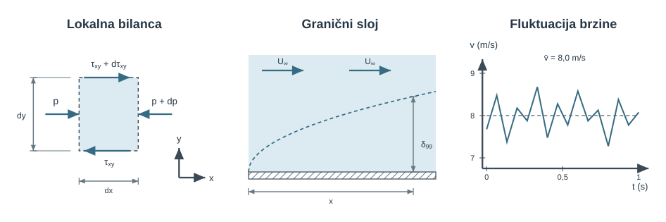
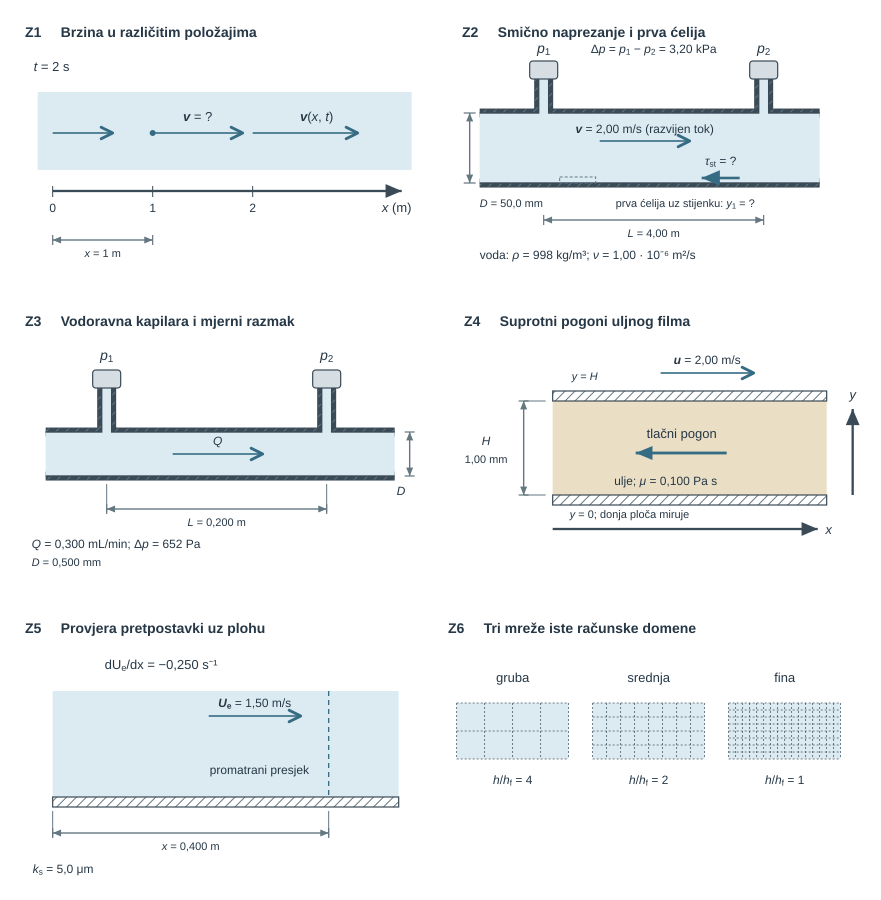

Realni fluid prianja uz svaku krutu plohu i opire se smicanju. Uz trup broda, lopaticu crpke ili stijenku cijevi brzina se zato mijenja u tankom sloju velikoga gradijenta, ondje nastaju smično naprezanje i disipacija, a pri porastu tlaka u smjeru toka tok se može odvojiti od plohe. O tim pojavama ovise otpor trenja, zagrijavanje uljnog filma u ležaju i pad tlaka u kanalu. Idealni model iz []{.mf1-chapter-ref target="u08"} ih ne sadrži, pa ih u ovom poglavlju opisujemo lokalnim bilancama.

Čestica fluida ubrzava zbog promjene polja u vremenu i zbog prelaska u područje druge brzine, što sažima materijalna derivacija $D\vec v/Dt=\partial\vec v/\partial t+(\vec v\cdot\nabla)\vec v$. Za nestlačiv fluid lokalna bilanca mase daje $\nabla\cdot\vec v=0$, a drugi Newtonov zakon za element, uz newtonsku vezu naprezanja i brzine deformacije, daje Navier–Stokesovu jednadžbu $\rho\,D\vec v/Dt=-\nabla p+\mu\nabla^2\vec v+\rho\vec b$. Njezin je najjednostavniji poseban slučaj zakon viskoznosti iz []{.mf1-chapter-ref target="u02"}. Jednadžbe određuju polje tek uz početne i rubne uvjete, prije svega uz uvjet prianjanja $\vec v=\vec 0$ na nepomičnoj stijenci.

Poglavlje redom obrađuje materijalnu derivaciju, lokalne bilance i rubne uvjete, a zatim kanonska rješenja: tok između paralelnih ploča i Hagen–Poiseuilleov tok u cijevi, iz kojega slijedi $\lambda=64/Re$. Granični sloj uvodi smično naprezanje stijenke $\tau_{st}$, Blasiusove procjene i odvajanje. Turbulentni tok opisuje se rastavom brzine na srednju vrijednost i fluktuaciju te Reynoldsovim naprezanjima, a završni odjeljak povezuje te jednadžbe s CFD-om. Reynoldsov broj nastavlja se na sličnost iz []{.mf1-chapter-ref target="u11"}, a laminarni rezultat i $\tau_{st}$ polazište su modela gubitaka u []{.mf1-chapter-ref target="u13"}.

Isti model opisuje uljni film kliznog ležaja, granični sloj na trupu modela u vučnom bazenu, rashladne kanale i ulazne uvjete ventilacijskog voda u CFD proračunu. Analitička rješenja vrijede samo uz svoje pretpostavke: newtonski fluid, konstantne $\rho$ i $\mu$ te stacionaran, potpuno razvijen laminarni tok; Blasiusove procjene traže glatku ravnu plohu bez gradijenta tlaka. Turbulencijski model zatvara nepoznate korelacije, a diskretizacija u CFD-u ne uvodi novu fiziku, pa numerička konvergencija ne zamjenjuje validaciju.

Slika ispod povezuje tri razine opisa. Lijevo je zamišljeni element fluida dimenzija $dx$ i $dy$; njegovi rubovi nisu krute stijenke, a prikazane su samo $x$-komponente naprezanja: tlak $p$ i $p+dp$ na bočnim plohama te smično naprezanje $\tau_{xy}$ i $\tau_{xy}+d\tau_{xy}$ na donjoj i gornjoj plohi. U sredini je laminarni granični sloj uz ravnu plohu bez gradijenta tlaka ($dp/dx=0$): uz vanjsku brzinu $U_\infty$ njegova debljina $\delta_{99}$ raste s udaljenošću $x$ od prednjeg ruba kao $\delta_{99}\propto\sqrt{x}$, a okomito mjerilo je uvećano. Desno je signal brzine $v(t)=\overline{v}+v'(t)$ koji fluktuira oko srednje vrijednosti $\overline{v}=8{,}0\ \text{m/s}$; to je sintetička shema, a ne mjerenje.

{#fig-realni-tok-pregled fig-align="center" fig-alt="Diferencijalni opis povezuje lokalnu bilancu količine gibanja, rast graničnog sloja i turbulentne fluktuacije."}

## Diferencijalni opis realnog toka {#sec-realni-tok-motivacija}

Integralne bilance odgovaraju na pitanje kolika je ukupna sila, protok ili snaga sustava. Ne govore izravno gdje nastaje najveće naprezanje, kada se tok odvaja od stijenke ni kako se brzina mijenja unutar graničnog sloja. Za ta pitanja bilancu treba primijeniti na proizvoljno malen element fluida.

::: {.mf1-application}

Inženjerski kontekst

Isti diferencijalni model opisuje uljni film ležaja, razvoj profila u rashladnom kanalu, otpor trupa, odvajanje iza lopatice i polje brzine koje računa program za CFD. Razlika između analitičkog rješenja i simulacije nije u temeljnim zakonima: analitički račun uvodi snažne simetrije, a numerički alat iste lokalne bilance primjenjuje na mnogo ćelija [@schlichting2017; @pope2000].
:::

**Procijenjeno vrijeme rada uz priručnik:** 10 sati.

## Materijalna derivacija {#sec-materijalna-derivacija}

Brzina je polje $\vec v(\vec x,t)$ s komponentama $v_x,v_y,v_z$; u indeksnom zapisu pišemo $v_i$ s $i=1,2,3$ za tri koordinatne osi, a ponovljeni indeks u umnošku znači zbrajanje po svim trima vrijednostima. Čestica koja se giba kroz to polje osjeća promjenu zbog vremena i zbog prelaska u područje druge brzine. Lančano pravilo daje

$$
\frac{D\vec v}{Dt}=
\underbrace{\frac{\partial\vec v}{\partial t}}_{\text{lokalno ubrzanje}}+
\underbrace{(\vec v\cdot\nabla)\vec v}_{\text{konvektivno ubrzanje}}.
$$ {#eq-materijalna-derivacija}

Stacionarno strujanje ima $\partial\vec v/\partial t=0$, ali čestica može ubrzavati zbog promjene brzine duž svojeg gibanja, primjerice u suženju ili zavoju. Nejednolik profil sam po sebi ne znači ubrzanje: u potpuno razvijenom ravnom toku $\vec v=(v_x(y),0,0)$ vrijedi $(\vec v\cdot\nabla)\vec v=v_x\,\partial\vec v/\partial x=0$, iako je $dv_x/dy$ različit od nule. U stacionarnom polju putanje čestica poklapaju se sa strujnicama.

::: {#ex-konvektivno-ubrzanje .mf1-we}

Ubrzanje u stacionarnom toku kroz suženje T1

**Tekst zadatka**

U jednodimenzijskom stacionarnom modelu brzina raste linearno, $v(x)=2+3x\ \text{m/s}$ za $x$ u metrima. Promatra se položaj $x=0{,}50\ \text{m}$.

**Traži se**

Odredi materijalno ubrzanje čestice u zadanom položaju.

**Rješenje**

U tom položaju vrijedi $v=3{,}5\ \text{m/s}$ i

$$
a_x=v\frac{dv}{dx}=3{,}5\cdot3=10{,}5\ \text{m/s}^2.
$$ {#eq-realni-tok-rijeseni-primjer-ubrzanje-kroz-mirno-suzenje-t1-01}

**Provjera i tumačenje**

Lokalni član je nula, ali konvektivni nije. Jedinice $(\text{m/s})(1/\text{s})$ daju $\text{m/s}^2$.
:::

## Lokalna bilanca mase i količine gibanja {#sec-navier-stokes}

Za kontinuum bez izvora mase lokalna bilanca mase jest

$$
\frac{\partial\rho}{\partial t}+\nabla\cdot(\rho\vec v)=0.
$$ {#eq-lokalna-kontinuitet}

Za nestlačiv fluid konstantne gustoće svodi se na $\nabla\cdot\vec v=0$.

Drugi Newtonov zakon za materijalni element (Cauchyjeva jednadžba gibanja) glasi

$$
\rho\frac{D\vec v}{Dt}=\nabla\cdot\boldsymbol\sigma+\rho\vec b,
$$ {#eq-realni-tok-lokalna-bilanca-mase-i-kolicine-gibanja-sec-01}

gdje je $\boldsymbol\sigma=-p\mathbf I+\boldsymbol\tau$ ukupni tenzor naprezanja, a $\vec b$ sila po jedinici mase. Za newtonski fluid konstantnih $\rho$ i $\mu$ s $\nabla\cdot\vec v=0$ vrijedi $\nabla\cdot\boldsymbol\tau=\mu\nabla^2\vec v$ (izvod slijedi). Dobiva se

$$
\boxed{
\rho\left(\frac{\partial\vec v}{\partial t}+(\vec v\cdot\nabla)\vec v\right)
=-\nabla p+\mu\nabla^2\vec v+\rho\vec b
}.
$$ {#eq-navier-stokes-nestlacivi}

Članovi redom znače lokalnu i konvektivnu promjenu količine gibanja, tlačnu silu, viskoznu difuziju količine gibanja i volumensku silu. Konvektivni član nije sam po sebi „izvor turbulencije”; nelinearnost omogućuje međudjelovanje skala, dok nastanak i održanje turbulencije ovise o nestabilnostima, smičnom radu, geometriji i disipaciji.

::: {.mf1-izvod}

Matematički izvod — Od Cauchyjeve jednadžbe do Navier–Stokesove

**Pitanje.** Kako iz opće bilance @eq-realni-tok-lokalna-bilanca-mase-i-kolicine-gibanja-sec-01, koja vrijedi za svaki kontinuum, nastaje jednadžba s članom $\mu\nabla^2\vec v$?

**Bilanca i konstitutivna relacija.** Fizika fluida ulazi tek vezom naprezanja i deformacije. Za newtonski fluid viskozno naprezanje linearno ovisi o tenzoru brzine deformacije $\mathbf D$:

$$
\tau_{ij}=2\mu D_{ij}=\mu\left(\frac{\partial v_i}{\partial x_j}+\frac{\partial v_j}{\partial x_i}\right),
\qquad
D_{ij}=\frac12\left(\frac{\partial v_i}{\partial x_j}+\frac{\partial v_j}{\partial x_i}\right),
$$ {#eq-newtonska-konstitutivna-relacija}

uz $\nabla\cdot\vec v=0$. Za jednostavno smicanje $\vec v=(v_x(y),0,0)$ ostaje samo $\tau_{xy}=\mu\,dv_x/dy$, što je zakon viskoznosti iz []{.mf1-chapter-ref target="u02"}.

**Koraci.** Divergencija viskoznog naprezanja po komponentama glasi

$$
\frac{\partial\tau_{ij}}{\partial x_j}
=\mu\frac{\partial^2 v_i}{\partial x_j\partial x_j}
+\mu\frac{\partial}{\partial x_i}\underbrace{\frac{\partial v_j}{\partial x_j}}_{\nabla\cdot\vec v\,=\,0}
=\mu\nabla^2 v_i,
$$ {#eq-divergencija-viskoznog-naprezanja}

pri čemu je zamjena redoslijeda derivacija dopuštena za glatko polje, a $\mu$ je konstantan. Tlačni dio daje $\nabla\cdot(-p\mathbf I)=-\nabla p$. Uvrštavanje $\nabla\cdot\boldsymbol\sigma=-\nabla p+\mu\nabla^2\vec v$ u Cauchyjevu jednadžbu daje @eq-navier-stokes-nestlacivi.

**Rezultat i provjera.** Viskozni član ima dimenziju $\mu v/L^2=\mathsf{M}\,\mathsf{L}^{-2}\,\mathsf{T}^{-2}$, jednaku dimenziji $\nabla p$ i $\rho\,D\vec v/Dt$. Svaka pretpostavka ima vidljivu posljedicu: bez $\nabla\cdot\vec v=0$ ostaje dodatni član $\mu\nabla(\nabla\cdot\vec v)$ i doprinos volumenske viskoznosti, bez konstantnog $\mu$ ostaje član s $\nabla\mu$, a nenewtonski fluid mijenja @eq-newtonska-konstitutivna-relacija.
:::

::: {.mf1-granica-modela}

Granica modela — Pretpostavke prikazanog oblika

Jednadžba [-@eq-navier-stokes-nestlacivi] pretpostavlja newtonski fluid, konstantnu viskoznost i gustoću te odsutnost dodatnih konstitutivnih učinaka. Nenewtonski fluid ne zahtijeva novi zakon količine gibanja, nego drukčiju vezu $\boldsymbol\tau(\mathbf D)$ umjesto jednadžbe [-@eq-newtonska-konstitutivna-relacija] između naprezanja i tenzora brzine deformacije $\mathbf D$ (oznaku $\mathbf D$ ne treba miješati s promjerom $D$).
:::

::: {#cfd-hladna-ploca-toplina .mf1-cfd title="Računalna dinamika fluida"}

**Od protoka u hladnoj ploči do temperature baterije.** Nastavljamo model razdjelnika: Navier–Stokesove jednadžbe povezuju tlak, prijenos količine gibanja i viskozna naprezanja u kanalima. U nestlačivom računu tlak se usklađuje s brzinom tako da bude zadovoljen kontinuitet. Takav model daje raspodjelu protoka i potreban pogon, pa možemo prepoznati slabije opskrbljene kanale.

Za pitanje o najvišoj temperaturi baterije dodajemo energijsku jednadžbu fluida i provođenje topline kroz krutu ploču. Trebaju nam ulazna temperatura, toplinska svojstva i zadano zagrijavanje baterije; na dodiru krutine i fluida usklađujemo prijenos topline. Spregnuti toplinski proračun tada omogućuje usporedbu temperature i potrebnog pada tlaka [@greenshieldsweller2022].
:::

## Rubni uvjeti i fizikalno zatvaranje problema {#sec-rubni-uvjeti}

Jednadžbe bez rubnih i početnih uvjeta ne određuju jedinstveno polje. Na nepomičnoj nepropusnoj stijenci za viskozni tok vrijedi

$$
\vec v=\vec 0,
$$ {#eq-realni-tok-rubni-uvjeti-i-fizikalno-zatvaranje-problema-sec-01}

odnosno nema prolaza kroz stijenku i nema klizanja uz nju. Na slobodnoj površini treba zadati kinematički uvjet gibanja granice i ravnotežu normalnih i tangencijalnih naprezanja. Na ulazu se zadaje konzistentan profil ili protok, a na izlazu tlak ili uvjet dovoljno udaljen od poremećaja. Pogrešan rubni uvjet može dati uredne reziduale, ali pogrešno fizikalno rješenje.

::: {.mf1-cfd title="Računalna dinamika fluida"}

**Ulaz i izlaz hladne ploče moraju opisivati ostatak kruga.** Za poznati protok zadajemo ulazni profil i odgovarajući izlazni tlak; na mirnim stijenkama vrijedi prianjanje. U odlomku *Računalna dinamika fluida* o podjeli protoka razdjelnika u []{.mf1-chapter-ref target="u07"} pojedinačni protoci proizlaze iz računa. Njihovo nametanje uklonilo bi pitanje podjele.

Za proračun cijeloga rashladnog kruga protok određuje i crpka. U zatvorenoj nestlačivoj domeni treba odabrati referencu tlaka, a ostale uvjete uskladiti s formulacijom rješavača. Primjerice, u mirovanju uz gravitaciju gradijent fizičkog tlaka $p$ okomito na stijenku uravnotežuje težinu, $\partial p/\partial n=\rho g_n$; uvjet „nulti gradijent tlaka na stijenci” vrijedi samo za tlak iz kojega je hidrostatski dio izdvojen (u OpenFOAM-u $p_{rgh}=p-\rho\,\vec g\cdot\vec x$), pa rubni uvjet treba zadati za istu varijablu koju rješavač rješava [@greenshieldsweller2022].
:::

## Kanonsko rješenje: tok između paralelnih ploča {#sec-couette-poiseuille}

Promatra se stacionarni, potpuno razvijeni, laminarni tok newtonskog fluida između ploča na $y=0$ i $y=H$. Brzina fluida je $\vec v=(v(y),0,0)$, gornja ploča giba se brzinom $u$ (oznaka $u$ ovdje je brzina krute granice, a $v$ brzina fluida), gravitacija u smjeru toka zanemariva, a gradijent tlaka konstantan. Navier–Stokesova jednadžba svodi se na

$$
0=-\frac{dp}{dx}+\mu\frac{d^2v}{dy^2}.
$$ {#eq-realni-tok-kanonsko-rjesenje-tok-izme-u-paralelnih-ploca-01}

Dvostrukom integracijom i rubnim uvjetima $v(0)=0$, $v(H)=u$ dobiva se Couette–Poiseuilleov profil

$$
v(y)=\frac{u}{H}y+\frac{1}{2\mu}\frac{dp}{dx}(y^2-Hy).
$$ {#eq-couette-poiseuille}

Prvi član opisuje doprinos gibanja gornje ploče, a drugi doprinos gradijenta tlaka. Suprotstave li se ta dva pogona, u dijelu procjepa može nastati povratni tok.

::: {#ex-uljni-film .mf1-we}

Uljni film s dva pogonska mehanizma T2

**Tekst zadatka**

Ulje viskoznosti $\mu=0{,}10\ \text{Pa s}$ stacionarno struji između ploča razmaknutih za $H=1{,}0\ \text{mm}$. Donja ploča miruje, a gornja se giba brzinom $u=2{,}0\ \text{m/s}$ u smjeru $x$. Gradijent tlaka je $dp/dx=-100\ \text{kPa/m}$.

**Traži se**

Odredi brzinu u sredini procjepa i razdvoji doprinose gibanja ploče i gradijenta tlaka.

**Rješenje**

$$
v(H/2)=\frac{u}{2}+\frac{1}{2\mu}\frac{dp}{dx}\left(-\frac{H^2}{4}\right)
=1{,}0+0{,}125=1{,}125\ \text{m/s}.
$$ {#eq-realni-tok-rijeseni-primjer-uljni-film-s-dva-pogonska-01}

**Provjera i tumačenje**

Negativan $dp/dx$ znači pad tlaka u pozitivnom $x$-smjeru i zato povećava brzinu. Model ne procjenjuje nosivost ležaja bez određivanja prostorne raspodjele tlaka.
:::

## Hagen–Poiseuilleov tok i linearni gubitak {#sec-hagen-poiseuille}

Za kružnu cijev polumjera $R$, uz $\vec v=(v(r),0,0)$ duž osi $x$, Navier–Stokesova jednadžba u cilindričnim koordinatama svodi se na

$$
\frac{\mu}{r}\frac{d}{dr}\left(r\frac{dv}{dr}\right)=\frac{dp}{dx}=\text{konst.}
$$ {#eq-poiseuille-ode}

Dvostruka integracija daje $v(r)=\frac{1}{4\mu}\frac{dp}{dx}r^2+C_1\ln r+C_2$. Konačna brzina u osi ($r=0$) zahtijeva $C_1=0$, a prianjanje $v(R)=0$ određuje $C_2$, pa je

$$
v(r)=-\frac{1}{4\mu}\frac{dp}{dx}(R^2-r^2),
$$ {#eq-realni-tok-hagen-poiseuilleov-tok-i-linearni-gubitak-sec-01}

$$
Q=-\frac{\pi R^4}{8\mu}\frac{dp}{dx},
\qquad
\Delta p=\frac{128\mu L}{\pi D^4}Q.
$$ {#eq-hagen-poiseuille}

Ovo je važan granični test cijelog modela gubitaka: pri laminarnom potpuno razvijenom toku pad tlaka raste **linearno** s $Q$. U Darcyjevu zapisu isti rezultat daje $\lambda=64/Re$; zato tvrdnja da su svi gubitci nužno proporcionalni $v^2$ nije točna.

::: {.mf1-izvod}

Matematički izvod — Od profila brzine do $\lambda=64/Re$

Protok slijedi iz integracije dobivenoga paraboličnog profila @eq-realni-tok-hagen-poiseuilleov-tok-i-linearni-gubitak-sec-01 po presjeku:

$$
Q=\int_0^R v(r)\,2\pi r\,dr
=-\frac{\pi R^4}{8\mu}\frac{dp}{dx}.
$$ {#eq-realni-tok-hagen-poiseuilleov-tok-i-linearni-gubitak-sec-02}

Uz srednju presječnu brzinu $v=Q/(\pi R^2)$ i $D=2R$ slijedi $\Delta p=-L\,dp/dx=32\mu Lv/D^2$ te $v_{max}=2v$. Izjednačavanjem s Darcyjevim zapisom

$$
\Delta p=\lambda\frac{L}{D}\frac{\rho v^2}{2}
$$ {#eq-realni-tok-izvod-od-profila-brzine-do-lambda-64-re-01}

dobiva se

$$
\lambda=\frac{64\mu}{\rho vD}=\frac{64}{Re}.
$$ {#eq-realni-tok-izvod-od-profila-brzine-do-lambda-64-re-02}

Faktor $64$ zato nije empirijska konstanta, nego posljedica stacionarnog, potpuno razvijenog laminarnog toka newtonskoga fluida u kružnoj cijevi. Izvan tih pretpostavki ovaj se rezultat ne prenosi bez provjere.
:::

::: {.mf1-cfd title="Računalna dinamika fluida"}

**Jednostavan kanal prije složene hladne ploče.** Prije računa zavoja i razdjelnika provjerimo isti laminarni model na ravnom kanalu s poznatim rješenjem. Ručni @ex-laminarni-mikrokanal pretpostavlja potpuno razvijen tok: usporedba njegova pada tlaka mora isključiti dodatni pad u ulaznom području. Za idealizirani prorez koristimo rješenje između ploča.

**Zastani i promisli.** Rezidual je malen, ali se pad tlaka mijenja pri profinjenju mreže. Koja je pogreška još nerazjašnjena?

Mali rezidual uz promjenu pada tlaka na finijoj mreži još ne potvrđuje točnost. Usporedi profil, protok i smično naprezanje s analitikom; točna brzina u osi ne jamči točno trenje. Pokus na stvarnoj hladnoj ploči zasebno provjerava fizikalni model.
:::

::: {#ex-laminarni-mikrokanal .mf1-we}

Pad tlaka u dijagnostičkom mikrokanalu T2

**Tekst zadatka**

Voda dinamičke viskoznosti $\mu=1{,}0\ \text{mPa s}$ teče kroz kružnu kapilaru promjera $D=0{,}50\ \text{mm}$ i duljine $L=0{,}20\ \text{m}$, protokom $Q=0{,}30\ \text{mL/min}=5{,}0\cdot10^{-9}\ \text{m}^3/\text{s}$. Pretpostavi potpuno razvijen laminarni tok.

**Traži se**

Odredi pad tlaka za potpuno razvijen laminarni tok i provjeri je li laminarna pretpostavka prihvatljiva.

**Rješenje**

$$
\Delta p=\frac{128(10^{-3})(0{,}20)}{\pi(5\cdot10^{-4})^4}(5\cdot10^{-9})=652\ \text{Pa}.
$$ {#eq-realni-tok-rijeseni-primjer-pad-tlaka-u-dijagnostickom-mikr-01}

**Provjera i tumačenje**

Srednja brzina je $0{,}0255\ \text{m/s}$ i $Re\approx12{,}7$, pa je laminarna pretpostavka konzistentna. Udvostručenje protoka udvostručuje $\Delta p$, a ne učetverostručuje ga.
:::

## Granični sloj, smično naprezanje i odvajanje {#sec-granicni-sloj}

Kada gotovo jednoliko strujanje naiđe na stijenku, uvjet prianjanja stvara tanko područje velikoga gradijenta brzine. Izvan njega viskozni učinak može biti malen; unutar njega određuje smično naprezanje

$$
\tau_{st}=\mu\left.\frac{\partial v_x}{\partial y}\right|_w.
$$ {#eq-realni-tok-granicni-sloj-smicno-naprezanje-i-odvajanje-sec-01}

Za laminarni granični sloj uz ravnu ploču bez gradijenta tlaka Blasiusovo rješenje daje procjene

$$
\delta_{99}\approx\frac{5x}{\sqrt{Re_x}},
\qquad
C_{f,x}\approx\frac{0{,}664}{\sqrt{Re_x}},
\qquad Re_x=\frac{U_\infty x}{\nu},
$$ {#eq-blasius-procjene}

gdje je $U_\infty$ brzina neporemećenog vanjskog toka, a $x$ udaljenost od prednjeg ruba. To nisu univerzalne formule: vrijede za glatku ravnu plohu, približno nulti gradijent tlaka i laminarni sloj.

Nepovoljan gradijent tlaka, $dp/dx>0$ u smjeru toka, usporava fluid uz stijenku. U stacionarnom dvodimenzijskom graničnom sloju nulto smično naprezanje može označiti početak odvajanja, uz pojavu lokalnog povratnog toka. Sama promjena znaka u drugoj geometriji, primjerice potpuno razvijenom toku između ploča u Z4, ne dokazuje odvajanje strujnica od plohe. Odvajanje mijenja tlak i otpor mnogo više nego sama lokalna viskozna sila; zato geometrijski blaga promjena difuzora može odlučiti radi li uređaj učinkovito.

::: {.mf1-fizikalno-znacenje}

Fizikalno značenje

Granični sloj je područje u kojem se utjecaj prianjanja širi viskoznom difuzijom (vremensko mjerilo $\delta^2/\nu$) dok ga struja istodobno nosi niz plohu (vrijeme $x/U_\infty$). Izjednačavanje tih dvaju vremena daje $\delta\sim\sqrt{\nu x/U_\infty}=x/\sqrt{Re_x}$, što je struktura Blasiusova rezultata. Nepovoljan gradijent tlaka djeluje na cijeli presjek sloja jednako, ali fluid uz stijenku ima najmanju kinetičku energiju, pa prvi zastane: odvajanje je ishod natjecanja tlaka koji koči i količine gibanja koju sloj nosi. Turbulentni sloj miješanjem dovodi količinu gibanja prema stijenci, pa se odvaja kasnije; zato se na modelu broda sloj namjerno prevodi u turbulentni (@ex-granicni-sloj-trupa-modela).
:::

::: {.mf1-cfd title="Računalna dinamika fluida"}

**Zašto se tok odvaja u kratkom difuzoru?** Vraćamo se dvjema izvedbama iza Venturijeva grla iz []{.mf1-chapter-ref target="u08"}. Pri porastu tlaka u smjeru toka sporiji fluid uz stijenku može zastati i poteći unatrag. CFD pokazuje mjesto odvajanja i područje povratnog toka, a integracija mehaničke energije daje posljedicu za gubitak.

Blasiusovo rješenje provjerava laminarni sloj bez gradijenta tlaka; ne predviđa odvajanje u difuzoru. Ondje mrežu profinjujemo uz stijenku i područje povratnog toka te pratimo mjesto odvajanja i gubitak. Usporedbu cijeloga uređaja vodi @sec-cfd-venturi.
:::

::: {#ex-granicni-sloj-trupa-modela .mf1-we}

Granični sloj na trupu modela broda T2

**Tekst zadatka**

Model broda iz @ex-u14-froudeova-slicnost-model-broda-u-vucnom-bazenu ima duljinu $L_m=6{,}0\ \text{m}$ i vuče se brzinom $v_m=1{,}8\ \text{m/s}$ u slatkoj vodi bazena kinematičke viskoznosti $\nu=1{,}0\cdot10^{-6}\ \text{m}^2/\text{s}$. Za procjenu se trup zamjenjuje glatkom ravnom pločom iste duljine uz jednolik vanjski tok brzine $U_\infty=v_m$. Brod ima $Re_s=1{,}35\cdot10^{9}$.

**Traži se**

1. Odredi $Re_x$ na udaljenosti $x_1=0{,}05L_m$ od pramca, gdje se obično ugrađuje stimulator turbulencije, i laminarnu Blasiusovu debljinu ondje; objasni zašto se stimulator ugrađuje.
2. Odredi $Re_L$ i procijeni debljinu turbulentnog sloja na krmi prema $\delta\approx0{,}37x/Re_x^{1/5}$ (aproksimacija potencijskog profila $1/7$).
3. Odredi $C_F$ prema liniji ITTC 1957 (@eq-ittc-1957) za model i brod i protumači razliku.

**Rješenje**

### 1. Pramčano područje {.unnumbered .unlisted .mf1-step}

$$
\begin{aligned}
x_1&=0{,}30\ \text{m},\qquad Re_{x_1}=\frac{1{,}8\cdot0{,}30}{1{,}0\cdot10^{-6}}=5{,}4\cdot10^{5}, \\
\delta_{B}&\approx\frac{5\cdot0{,}30}{\sqrt{5{,}4\cdot10^{5}}}=2{,}04\ \text{mm}.
\end{aligned}
$$ {#eq-granicni-sloj-trupa-modela-01}

### 2. Krma {.unnumbered .unlisted .mf1-step}

$$
Re_L=\frac{1{,}8\cdot6{,}0}{1{,}0\cdot10^{-6}}=1{,}08\cdot10^{7},\qquad
\delta\approx\frac{0{,}37\cdot6{,}0}{(1{,}08\cdot10^{7})^{1/5}}=\frac{2{,}22}{25{,}2}\approx0{,}088\ \text{m}.
$$ {#eq-granicni-sloj-trupa-modela-02}

### 3. Koeficijent trenja {.unnumbered .unlisted .mf1-step}

$$
\begin{aligned}
C_{F,m}&=\frac{0{,}075}{(\log_{10}1{,}08\cdot10^{7}-2)^2}\approx2{,}96\cdot10^{-3}, \\
C_{F,s}&=\frac{0{,}075}{(\log_{10}1{,}35\cdot10^{9}-2)^2}\approx1{,}48\cdot10^{-3}.
\end{aligned}
$$ {#eq-granicni-sloj-trupa-modela-03}

**Provjera i tumačenje**

1. $Re_{x_1}=5{,}4\cdot10^{5}$ leži u području u kojem laminarni sloj na glatkoj ploči još može opstati (prirodni prijelaz približno između $3\cdot10^{5}$ i $3\cdot10^{6}$), dok je na brodu $Re_x$ na istom mjestu 125 puta veći. Zato se prijelaz na modelu izaziva žicom, trakom s pijeskom ili klinovima; bez toga bi $C_{F,m}$ bio manji od pretpostavljenog i korekcija prema @eq-froudeova-hipoteza pogrešna.
2. $\delta/L_m\approx0{,}015\ll1$ potvrđuje aproksimaciju tankog sloja; $C_{F,m}/C_{F,s}\approx2{,}0$ pokazuje zašto se viskozni otpor ne skalira s $\lambda_L^3$. Ravna ploča zanemaruje zakrivljenost trupa, gradijent tlaka i hrapavost.
:::

## Turbulentni tok: srednja vrijednost nije cijelo polje {#sec-turbulencija}

U turbulentnom toku trenutna brzina rastavlja se na vremenski srednju vrijednost i fluktuaciju,

$$
v_i(\vec x,t)=\overline{v_i}(\vec x)+v_i'(\vec x,t),
\qquad \overline{v_i'}=0.
$$ {#eq-realni-tok-turbulentni-tok-srednja-vrijednost-nije-cijelo-p-01}

Intenzitet turbulencije za jednu (uzdužnu) komponentu može se izraziti kao

$$
I_t=\frac{v'_{rms}}{\overline{v}},
\qquad
v'_{rms}=\sqrt{\overline{v'^2}}.
$$ {#eq-realni-tok-turbulentni-tok-srednja-vrijednost-nije-cijelo-p-02}

Osrednjavanje Navier–Stokesove jednadžbe linearne članove ostavlja u istom obliku sa srednjim poljem, ali nelinearni konvektivni član daje dodatni doprinos:

$$
\overline{\frac{\partial(v_iv_j)}{\partial x_j}}
=\frac{\partial(\overline{v_i}\,\overline{v_j})}{\partial x_j}
+\frac{\partial\overline{v_i'v_j'}}{\partial x_j},
$$ {#eq-reynoldsovo-osrednjavanje}

jer je $\overline{\overline{v_i}\,v_j'}=0$, dok $\overline{v_i'v_j'}$ općenito nije nula. Taj se član prebacuje na stranu naprezanja kao Reynoldsovo naprezanje $-\rho\overline{v_i'v_j'}$ (RANS, engl. *Reynolds-averaged Navier–Stokes*). Ona nisu nova molekularna naprezanja, nego tok srednje količine gibanja koji nose fluktuacije. Turbulencijski model zatvara te nepoznate korelacije; nije numerička zamjena za Darcyjev koeficijent trenja. Najčešći su dvojednadžbeni modeli: $k$–$\varepsilon$ rješava prijenosne jednadžbe za turbulentnu kinetičku energiju $k=\tfrac12\overline{v_i'v_i'}$ i njezinu disipaciju $\varepsilon$, a $k$–$\omega$ SST (engl. *shear stress transport*) za $k$ i specifičnu disipaciju $\omega$, uz prebacivanje s $k$–$\omega$ uz stijenku na $k$–$\varepsilon$ daleko od nje. Oba vezuju Reynoldsova naprezanja uz gradijent srednje brzine preko turbulentne viskoznosti $\mu_t$ (Boussinesqova pretpostavka). Oznaka SSTm u @ex-stepenica-mjerenje-cfd inačica je $k$–$\omega$ SST modela kako ga vodi NASA-in Turbulence Modeling Resource (TMR).

CFD je način numeričkog rješavanja i laminarnog i turbulentnog modela. RANS rješava osrednjene jednadžbe uz model korelacija; LES (engl. *large eddy simulation*) razrješava velike vrtloge i modelira učinak manjih; DNS (engl. *direct numerical simulation*) razrješava sve dinamički relevantne turbulentne skale bez turbulencijskog modela. Izbor ovisi o potrebnom srednjem ili vremenskom odzivu i raspoloživoj razlučivosti, ne samo o $Re$ iz prethodnog poglavlja [@pope2000].

::: {.mf1-cfd title="Računalna dinamika fluida"}

**Srednji rad razdjelnika ili njegove pulsacije?** Pri većim brzinama tok u razdjelniku može biti turbulentan. Ako nas zanima srednja podjela protoka i pad tlaka, RANS računa osrednjeno polje, a dodatnim modelom opisuje prijenos količine gibanja zbog fluktuacija. Na ulazu zato trebamo i podatke o turbulenciji primjerene odabranom modelu; sam intenzitet jedne komponente nije dovoljan za sve veličine.

Ako je cilj promjenjivo opterećenje ili detaljno miješanje, treba odabrati vremenski i turbulencijski opis koji može prikazati tražene pojave. Nestacionarni RANS može pratiti neke promjene srednjeg toka, dok LES razrješava dio vrtložnoga gibanja uz veće zahtjeve za mrežu i vrijeme. Finija RANS mreža sama ne prelazi u takav opis. Izbor određuje izlaz koji trebamo, uz usporedbu s mjerenjem.
:::

Uz stijenku je korisna bezdimenzijska udaljenost

$$
y^+=\frac{u_\tau y}{\nu},\qquad u_\tau=\sqrt{\frac{|\tau_{st}|}{\rho}}.
$$ {#eq-realni-tok-turbulentni-tok-srednja-vrijednost-nije-cijelo-p-03}

Ovdje je $y$ udaljenost od stijenke, a $u_\tau$ nenegativna brzina trenja, definirana iznosom smičnog naprezanja. Predznak $\tau_{st}$ zasebno opisuje smjer smicanja. Položaj prve ćelije i model strujanja uz stijenku moraju biti usklađeni: izravno razrješavanje viskoznog podsloja i zidna funkcija ne traže isti $y^+$.

::: {.mf1-cfd title="Računalna dinamika fluida"}

**Mreža uz stijenku iste hladne ploče.** U turbulentnoj inačici računa odabrani model stijenke određuje gdje trebaju biti prve računske točke. Ako izravno razrješavamo viskozni podsloj, obično ciljamo $y^+\approx1$ ili niže; zidne funkcije modeliraju dio profila i imaju vlastito područje primjene. Procjena brzine trenja daje početnu visinu ćelije, a nakon računa provjeravamo stvarni $y^+$.

Provjera obuhvaća sve kanale i zavoje, jer naprezanje nije jednako posvuda. Uz $y^+$ pratimo promjenu pada tlaka i protoka po granama pri profinjenju; u toplinskom modelu i najvišu temperaturu. Prihvatljiv $y^+$ tako provjerava jednu pretpostavku obrade stijenke, a konvergencija ciljanih veličina pokazuje je li mreža dovoljna za usporedbu izvedbi.
:::

::: {#ex-intenzitet-turbulencije .mf1-we}

Od podatka anemometra do ulaznog uvjeta RANS-a T3

**Tekst zadatka**

Senzor u ventilacijskom vodu promjera $D=0{,}30\ \text{m}$ mjeri srednju brzinu $\overline{v}=8{,}0\ \text{m/s}$ i standardnu devijaciju uzdužne fluktuacije $v'_{rms}=0{,}48\ \text{m/s}$. Za RANS proračun nizvodnog difuzora s modelom $k$–$\omega$ SST na ulazu treba zadati $k$ i $\omega$; model koristi $C_\mu=0{,}09$.

**Traži se**

1. Odredi uzdužni intenzitet turbulencije.
2. Uz pretpostavku izotropne turbulencije procijeni $k$.
3. Odluči što još nedostaje za $\omega$; pokaži procjenu uz uobičajenu duljinsku skalu $\ell\approx0{,}07D$ i obrazloži zašto je ona pretpostavka, a ne mjerenje.

**Rješenje**

$$
I_t=\frac{0{,}48}{8{,}0}=0{,}060=6{,}0\ \%,
\qquad
k=\tfrac32\,(I_t\,\overline{v})^2=\tfrac32\cdot0{,}48^2\approx0{,}346\ \text{m}^2/\text{s}^2.
$$ {#eq-realni-tok-rijeseni-primjer-podatak-anemometra-a-ne-etiketa-01}

Faktor $\tfrac32$ pretpostavlja da su sve tri komponente fluktuacije jednake uzdužnoj. Specifična disipacija traži duljinsku skalu koju senzor ne daje; uz $\ell=0{,}07\cdot0{,}30=0{,}021\ \text{m}$:

$$
\omega=\frac{\sqrt{k}}{C_\mu^{1/4}\,\ell}=\frac{0{,}588}{0{,}548\cdot0{,}021}\approx51\ \text{s}^{-1},
\qquad
\varepsilon=C_\mu k\omega\approx1{,}59\ \text{m}^2/\text{s}^3.
$$ {#eq-anemometar-ulazni-uvjet-rans}

**Provjera i tumačenje**

1. Kontrola: $\varepsilon=C_\mu^{3/4}k^{3/2}/\ell=0{,}164\cdot0{,}203/0{,}021\approx1{,}59\ \text{m}^2/\text{s}^3$, isto kao $C_\mu k\omega$. Uz stijenku $v_x'\ne v_y'$, pa je izotropni $k$ gruba procjena.
2. Odluka: $k$ iz mjerenja uz izotropiju, $\omega$ iz dogovorne skale $\ell\approx0{,}07D_h$ s ispitivanjem osjetljivosti, jer prepolovljeni $\ell$ udvostručuje $\omega$; „izmjereni” $\omega$ zahtijevao bi spektar ili integralnu skalu signala.
:::

::: {#ex-stepenica-mjerenje-cfd .mf1-we}

Ponovno priljubljivanje toka: mjerenje i CFD T3

**Tekst zadatka**

U pokusu Drivera i Seegmillera dno kanala spušta se za visinu stepenice $H_{st}$, uz vodoravan gornji zid. Turbulentni zrak ($Re_{st}\approx36\,000$, prema visini stepenice) odvaja se na rubu i priljubljuje nizvodno. Koristi $X=x/H_{st}$ od ruba i $C_f=\tau_{st}/(\rho U_{ref}^2/2)$, gdje je $U_{ref}$ uzvodna brzina u sredini kanala pri $X\approx-4$. Predznak $C_f$ prati srednje zidno smicanje.

Tablica daje mjerenja i objavljeni kvazistacionarni CFD rezultat CFL3D-a s modelom turbulencije SSTm. CFD brojevi zaokruženi su iz [izvornih datoteka](../data/cfd/backstep_experiment/README.md). Eksperimentalni položaj iznosi $X_r=6{,}26\pm0{,}10$ [@driver-seegmiller1985; @tmr-backstep].

| Izvor | $X_a$ | $10^3C_{f,a}$ | $X_b$ | $10^3C_{f,b}$ |
|---|---:|---:|---:|---:|
| Mjerenje | 5,882 | −0,220 | 7,090 | 0,450 |
| CFL3D / SSTm | 6,541667 | −0,0012520 | 6,562500 | 0,013198 |

**Traži se**

1. Linearnom interpolacijom odredi nultočku $C_f$ za oba niza.
2. Usporedi CFD nultočku s objavljenim eksperimentalnim položajem i protumači što usporedba dokazuje.

**Rješenje**

Za promjenu iz negativnog u pozitivno smicanje između zadanih točaka vrijedi

$$
X_r=X_a-\frac{C_{f,a}}{C_{f,b}-C_{f,a}}(X_b-X_a).
$$ {#eq-stepenica-interpolacija-priljubljivanja}

Faktor $10^3$ poništava se u omjeru. Mjerni redci daju $X_{r,m}\approx6{,}279$ (linearna interpolacija preko razmaka $1{,}2H_{st}$ gruba je provjera, jer $C_f$ oko priljubljivanja nije linearan), a CFD redci $X_{r,CFD}\approx6{,}543$. U odnosu na objavljenu mjernu vrijednost $6{,}26$ CFD predviđa položaj približno $0{,}283H_{st}$ nizvodnije, odnosno oko $4{,}5\,\%$ veću duljinu.

**Provjera i tumačenje**

Obje nultočke leže između pripadnih zadanih položaja. Mjerna interpolacija nalazi se u objavljenom rasponu $6{,}16$–$6{,}36$, a CFD rezultat izvan njega: utvrđeno je odstupanje ove veličine, ali uzrok (mreža, ulazni sloj, model turbulencije) nije razdvojen, jer izvor ne daje potpunu studiju mrežne konvergencije. Oznaku $\pm0{,}10$ ne pretvaramo u standardnu nesigurnost ni 95-postotni interval. Za difuzor rashladnog ili brodskog ventilacijskog voda takva usporedba provjerava duljinu povratnog toka, ali ne i cijeli profil brzine ni gubitak tlaka.
:::

## Veza s CFD-om: diskretizacija nije nova fizika {#sec-realni-tok-cfd}

Navier–Stokesove jednadžbe, kontinuitet, materijalni model i rubni uvjeti određuju polje. Jednostavne simetrije omogućuju Poiseuilleovo rješenje; složen difuzor obično traži numerički račun.

**Od jednadžbe do iteracije.** Metoda konačnih volumena (FVM) integrira bilance po ćelijama prema @eq-celijska-bilanca-mase. Aproksimacije tokova, gradijenata i vremenskih promjena pretvaraju jednadžbe u spregnut, uglavnom nelinearan algebarski sustav. Računalo rješava linearizirane sustave i ažurira polja; u nestlačivom modelu tlak i brzina usklađuju se s očuvanjem mase. Iteracija nije vrijeme putovanja tlačnog vala: fizički vremenski korak pripada nestacionarnom računu.

**Primjer na Poiseuilleovu toku.** Podijelimo polumjer cijevi na $N$ prstenastih ćelija širine $\Delta r$ sa središtima $r_i$ i plohama $r_{i\pm1/2}$. Integracija @eq-poiseuille-ode po ćeliji (množenje s $r\,dr$) daje

$$
\begin{aligned}
\mu\left[\left(r\frac{dv}{dr}\right)_{i+1/2}-\left(r\frac{dv}{dr}\right)_{i-1/2}\right]
&=\frac{dp}{dx}\,r_i\,\Delta r, \\
\left(r\frac{dv}{dr}\right)_{i+1/2}&\approx r_{i+1/2}\,\frac{v_{i+1}-v_i}{\Delta r}.
\end{aligned}
$$ {#eq-poiseuille-fvm-celija}

Lijeva strana je razlika viskoznih tokova količine gibanja kroz dvije plohe ćelije, a desna izvor zbog tlaka: ista logika bilance kao @eq-celijska-bilanca-mase za masu. Svaka ćelija daje jednu linearnu jednadžbu s nepoznanicama $v_{i-1}$, $v_i$ i $v_{i+1}$; uz $v=0$ na stijenci i nulti tok kroz os nastaje tridijagonalni sustav od $N$ jednadžbi koji se rješava izravno. Bilježnica iz Numeričkog pokusa računa upravo taj sustav i uspoređuje ga s @eq-realni-tok-hagen-poiseuilleov-tok-i-linearni-gubitak-sec-01, a Z6a obrađuje protoke triju takvih mreža. U dvije i tri dimenzije isti zapis vrijedi po ćeliji, ali konvektivni član čini sustav nelinearnim, pa se rješava iterativno.

**Tlak i druge diskretizacije.** U nestlačivom modelu tlak nema vlastitu jednadžbu; algoritmi sprezanja poput SIMPLE (engl. *Semi-Implicit Method for Pressure-Linked Equations*) i PISO (engl. *Pressure-Implicit with Splitting of Operators*) iz bilance mase izvode korekciju tlaka koja brzine vraća na $\nabla\cdot\vec v=0$. Metoda konačnih elemenata (FEM) diskretizira iste jednadžbe težinskim integralima po elementima umjesto bilancama po ćelijama; izbor metode ne mijenja fiziku modela.

**Što provjeriti.** Rezidual mjeri nezadovoljenje diskretnih jednadžbi, a profinjenje ispituje promjenu traženog izlaza; Z6 pokazuje zašto uz konvergenciju protoka zasebno provjeravamo masenu bilancu. Razliku numeričke provjere i validacije mjerenjem razrađuje @sec-cfd-venturi [@nasa-cfd-vv]; @sec-cfd-polja-izlazi povezuje polja s inženjerskim veličinama, a @sec-cfd-vv-paketi donosi pripremljene podatke.

::: {.mf1-samoprovjera}

Provjeri sebe

1. Kako stacionarni tok može imati nenulto ubrzanje?
2. Koja pretpostavka omogućuje zapis $\mu\nabla^2\vec v$?
3. Zašto Hagen–Poiseuilleov rezultat mora biti test svakog općeg modela gubitaka?
4. Što fizikalno znači promjena znaka $\tau_{st}$?
5. Gruba mreža pogađa brzinu u osi cijevi. Zašto to još ne jamči točno smično naprezanje na stijenci?

::: {.callout-note collapse="true"}
### Odgovori
1. Zbog konvektivnog ubrzanja.

2. Potrebni su newtonski fluid, konstantna viskoznost i nestlačivost.

3. On daje točan laminarni granični slučaj $\Delta p\propto Q$.

4. Promjena znaka označuje promjenu smjera smicanja i lokalni povratni tok; zaključak o odvajanju zahtijeva odgovarajuću geometriju i uvjete graničnog sloja.

5. Smično naprezanje $\tau_{st}=\mu\,dv/dr|_R$ ovisi o nagibu profila u prvoj ćeliji uz stijenku, a ne o vrijednosti u osi; gruba mreža može pogoditi maksimum i protok uz pogrešan nagib. Zato se uz protok provjeravaju i $\tau_{st}$ ili $\lambda$, koji su osjetljiviji na razlučivost uz stijenku, a mrežna konvergencija provjerava se pri istom modelu.
:::
:::

## Zadaci za vježbu {#sec-realni-tok-zadaci}

{#fig-realni-tok-vjezbe fig-align="center" fig-alt="Kote H i D mjere razmak stijenki i unutarnji promjer, L je razmak tlačnih priključaka; ploče su nepropusne, a mrežne crte nisu stijenke."}

**Napomene uz skice.** Z1 prikazuje kinematičko polje pri $t=2\,\mathrm{s}$, a ne cijev; strelice pokazuju samo smjer i porast brzine niz $x$, a duljine im nisu u mjerilu traženih brzina. U Z3 promjer kapilare uvećan je u odnosu na mjernu duljinu. U Z4 $\mathrm{d}p/\mathrm{d}x>0$ znači da tlak raste udesno, pa tlačni pogon djeluje suprotno gibanju gornje ploče. U Z5 $k_s$ predstavlja ekvivalentnu hrapavost. U Z6 mrežne crte nisu krute stijenke; profinjenje ne mijenja domenu.

::::: {.mf1-vjezbe-list}

### Lokalno i konvektivno ubrzanje {#task-materijalna-derivacija .unnumbered .unlisted}

**Tekst zadatka**

Jednodimenzijsko kinematičko polje glasi $v(x,t)=at+bx^2$, gdje su $a=2\ \text{m/s}^2$ i $b=1\ \text{m}^{-1}\text{s}^{-1}$. Promatra se položaj $x=1\ \text{m}$, $t=2\ \text{s}$. Polje služi vježbi materijalne derivacije; nije zadano kao potpuno nestlačivo strujanje u cijevi.

**Traži se**

Odredi brzinu, lokalno, konvektivno i ukupno ubrzanje čestice u zadanom položaju i trenutku.

:::: {.content-visible .mf1-hint-online when-format="html"}
::: {.callout-note collapse="true" data-hint-key="true"}
### Naputak

Najprije izračunaj lokalnu brzinu. U lokalnom članu deriviraj po vremenu uz stalan položaj; u konvektivnom pomnoži brzinu s prostornom derivacijom polja.
:::
::::
:::: {.content-visible .mf1-answer-online when-format="html"}
::: {.callout-tip collapse="true" data-answer-key="true"}
### Kontrolni rezultat

$v=5\ \text{m/s}$; $a_{lok}=2\ \text{m/s}^2$, $a_{kon}=10\ \text{m/s}^2$ i $a=12\ \text{m/s}^2$.
:::
::::

[Razina: T1]{.mf1-task-level}

### Vrijeme viskozne difuzije {#task-viskozna-difuzija .unnumbered .unlisted}

**Tekst zadatka**

Gornja ploča počinje kliziti iznad mirujućeg sloja vode, a donja ostaje nepomična. Razmak ploča je $H=10\ \text{mm}$, a kinematička viskoznost $\nu=1{,}00\cdot10^{-6}\ \text{m}^2/\text{s}$.

**Traži se**

1. Procijeni vremensko mjerilo prijenosa količine gibanja viskoznom difuzijom kroz cijeli razmak.
2. Znači li ono točan trenutak uspostave stacionarnog profila?

:::: {.content-visible .mf1-hint-online when-format="html"}
::: {.callout-note collapse="true" data-hint-key="true"}
### Naputak

Usporedi redove veličine vremenskog i viskoznog člana za brzinu ploče $u$: $u/t_\nu\sim\nu u/H^2$. Prije računa pretvori milimetre u metre.
:::
::::
:::: {.content-visible .mf1-answer-online when-format="html"}
::: {.callout-tip collapse="true" data-answer-key="true"}
### Kontrolni rezultat

$t_\nu\sim H^2/\nu=100\ \text{s}$. To je karakteristično vremensko mjerilo; vrijeme približavanja stacionarnom profilu ovisi o zadanoj toleranciji odstupanja.
:::
::::

[Razina: T1]{.mf1-task-level}

### Viskoznost iz mjerenja u kapilari {#task-poiseuille-inverzni .unnumbered .unlisted}

**Tekst zadatka**

Dinamička viskoznost određuje se iz protoka i razlike tlakova između dvaju priključaka na vodoravnoj kapilari. Sintetički nastavni podatci su $Q=0{,}300\pm0{,}003\ \text{mL/min}$, $\Delta p=p_1-p_2=652\pm5\ \text{Pa}$, $L=0{,}200\pm0{,}001\ \text{m}$ i $D=0{,}500\pm0{,}005\ \text{mm}$. Znakovi $\pm$ označuju neovisne standardne nesigurnosti; standardnu nesigurnost veličine $x$ označujemo sa $s(x)$, jer je $u$ u ovom poglavlju brzina ploče. Newtonski fluid ima gustoću $\rho=998\ \text{kg/m}^3$; njezinu nesigurnost zanemari. Duljina $L$ mjeri se između tlačnih priključaka na istoj visini.

U tom dijelu kružne kapilare pretpostavi potpuno razvijen laminarni tok uz prianjanje na stijenku; pretpostavi da su ulazni učinci ograničeni na dio ispred mjernog razmaka.

**Traži se**

1. Obrnutim Poiseuilleovim računom procijeni viskoznost i Reynoldsov broj te utvrdi koji mjerni podatak najviše pridonosi nesigurnosti.
2. Procijeni $s(\mu)$ linearnom propagacijom nesigurnosti uz korijen zbroja kvadrata doprinosa (RSS) i posebno pokaži doprinos promjera.

:::: {.content-visible .mf1-hint-online when-format="html"}
::: {.callout-note collapse="true" data-hint-key="true"}
### Naputak

Invertiraj $Q=\pi D^4\Delta p/(128\mu L)$. Za neovisne standardne nesigurnosti vrijedi $[s(\mu)/\mu]^2=[4s(D)/D]^2+[s(\Delta p)/\Delta p]^2+[s(L)/L]^2+[s(Q)/Q]^2$.
:::
::::
:::: {.content-visible .mf1-answer-online when-format="html"}
::: {.callout-tip collapse="true" data-answer-key="true"}
### Kontrolni rezultat

$\mu\approx1{,}000\ \text{mPa s}$, $s(\mu)\approx0{,}042\ \text{mPa s}$ i $Re\approx12{,}7$. Sam promjer doprinosi relativnoj standardnoj nesigurnosti od $4\,\%$, pa ima najveći doprinos ukupnoj mjernoj nesigurnosti.
:::
::::

[Razina: T2]{.mf1-task-level}

### Povratni tok između ploča {#task-couette-povrat .unnumbered .unlisted}

**Tekst zadatka**

Gibanje gornje ploče i nepovoljan gradijent tlaka pokreću ulje u suprotnim smjerovima u uskom procjepu. Newtonski fluid ima $\mu=0{,}100\ \text{Pa s}$; donja ploča na $y=0$ miruje, a gornja na $y=H$ klizi u pozitivnom smjeru osi $x$ brzinom $u=2{,}00\ \text{m/s}$. Razmak je $H=1{,}00\ \text{mm}$. Za potpuno razvijeni laminarni tok i konstantan gradijent tlaka $dp/dx>0$ vrijedi $v(y)=uy/H+(dp/dx)(y^2-Hy)/(2\mu)$.

Ovdje je $\tau_0$ komponenta sile fluida na donju ploču po jedinici površine u smjeru osi $x$. Obje ploče su nepropusne, uz njih nema klizanja.

Usporedi $dp/dx=0{,}90\,(dp/dx)_{krit}$ i $dp/dx=1{,}10\,(dp/dx)_{krit}$.

**Traži se**

1. Odredi kritični gradijent $(dp/dx)_{krit}$ pri kojem $\tau_0=\mu v'(0)$ mijenja znak, zatim $\tau_0$ za oba zadana gradijenta.
2. Skiciraj profile brzine za oba zadana pogona. Razlikuj povratni tok uz ploču od prolaza kroz nju.

:::: {.content-visible .mf1-hint-online when-format="html"}
::: {.callout-note collapse="true" data-hint-key="true"}
### Naputak

Deriviraj profil i postavi $\tau_0=0$. Provjeri $v(0)=0$ i $v(H)=u$. Negativna brzina može nastati neposredno uz donju ploču; na samoj ploči ostaje nula.
:::
::::
:::: {.content-visible .mf1-answer-online when-format="html"}
::: {.callout-tip collapse="true" data-answer-key="true"}
### Kontrolni rezultat

$(dp/dx)_{krit}=4{,}00\cdot10^5\ \text{Pa/m}$. Pri $0{,}90\,(dp/dx)_{krit}$ vrijedi $\tau_0=+20{,}0\ \text{Pa}$ i $v(y)>0$ za $0<y\le H$; pri $1{,}10\,(dp/dx)_{krit}$ vrijedi $\tau_0=-20{,}0\ \text{Pa}$ i povratni tok u $0<y<H/11$. U oba profila $v(0)=0$ i $v(H)=u$; fluid ne prolazi kroz ploče.
:::
::::

[Razina: T2]{.mf1-task-level}

### Izbor modela graničnog sloja {#task-granicni-sloj-model .unnumbered .unlisted}

**Tekst zadatka**

Sintetički nastavni podatci za vodu su $\nu=1{,}00\cdot10^{-6}\ \text{m}^2/\text{s}$, $\rho=998\ \text{kg/m}^3$, $x=0{,}400\ \text{m}$, $U_e=1{,}50\ \text{m/s}$ i $dU_e/dx=-0{,}250\ \text{s}^{-1}$. Ekvivalentna hrapavost iznosi $k_s=5{,}0\ \mu\text{m}$. Vanjski tok smatraj stacionarnim, nestlačivim i približno neviskoznim, uz stalnu visinu.

**Traži se**

1. Izračunaj $Re_x$, Blasiusovu referentnu debljinu $\delta_B=5x/\sqrt{Re_x}$, $k_s/\delta_B$, lokalni eksponent vanjske brzine $m=(x/U_e)\,dU_e/dx$ (Falkner–Skanov parametar; $m=0$ je Blasiusov slučaj) te $dp_e/dx$.
2. Odluči je li Blasiusov model opravdan. Razdvoji uvjetnu referentnu procjenu od potvrđenog modela te obrazloži koje bi dodatne provjere trebale prethoditi njegovoj uporabi. Mali $k_s/\delta_B$ nemoj poistovjetiti s dokazanom hidrauličkom glatkoćom niti prijelaz proglasiti iz jednoga univerzalnog praga $Re_x$.

:::: {.content-visible .mf1-hint-online when-format="html"}
::: {.callout-note collapse="true" data-hint-key="true"}
### Naputak

Blasius zahtijeva glatku plohu, laminaran tok i nulti gradijent tlaka. U zadanom vanjskom toku vrijedi $dp_e/dx=-\rho U_e\,dU_e/dx$. Odvoji dokazano prekršen uvjet od pretpostavke koju podatci još ne potvrđuju.
:::
::::
:::: {.content-visible .mf1-answer-online when-format="html"}
::: {.callout-tip collapse="true" data-answer-key="true"}
### Kontrolni rezultat

$Re_x=6{,}00\cdot10^5$, $\delta_B\approx2{,}58\ \text{mm}$, $k_s/\delta_B\approx1{,}94\cdot10^{-3}$, $m=-0{,}0667$ i $dp_e/dx\approx+374\ \text{Pa/m}$. Uvjet nultoga gradijenta tlaka nije zadovoljen; laminarnost i hidraulička glatkoća nisu dokazane. Blasiusov model nije opravdan za predviđanje debljine sloja: $\delta_B$ je samo referenca. Potrebno je provjeriti profil brzine i prijelaz.
:::
::::

[Razina: T3]{.mf1-task-level}

### Konvergencija i izbor mreže {#task-cfd-tri-mreze .unnumbered .unlisted}

**Tekst zadatka**

**a) Izbor mreže.** Sintetički Poiseuilleov skup iz `data/cfd/poiseuille_laminar` prikazan je zaokruženo. Tri sustavno profinjene mreže imaju $h/h_f=(4;\ 2;\ 1)$, protoke $(Q_g;\ Q_{sr};\ Q_f)=(8{,}16814;\ 7{,}93252;\ 7{,}87362)\cdot10^{-6}\ \text{m}^3/\text{s}$ i masene debalanse $(0{,}040;\ 0{,}010;\ 0{,}0025)\,\%$, redom od grube do fine. Računaj s ovdje ispisanim brojevima, uz omjer koraka susjednih mreža $\lambda_h=2$ i $F_s=1{,}25$; zahtijeva se $GCI\le0{,}50\,\%$ i maseni debalans najviše $0{,}0050\,\%$.

**b) Usporedba otpora.** Za NACA 0012 pri $Re_l=6\cdot10^6$ (prema tetivi $l$), $Ma=0{,}15$ i napadnom kutu $\theta=10{,}00^\circ$ uzmi $C_{D,CFD}=0{,}01222$ (najfinija FUN3D mreža) i $C_{D,ref}=0{,}01166$ (linearna interpolacija javnih mjerenja na isti kut; podrijetlo i ograde u dodatku D). Zadane standardne nesigurnosti nastavnog scenarija jesu mjerna $s_{mj}=0{,}00020$, numerička $s_{num}=0{,}00010$ (ukupna; GCI iz dijela a) ne pribraja se) i doprinos usklađivanja uvjeta i interpolacije $s_{uv}=0{,}00010$, uz neovisne normalne doprinose centrirane na nulu nakon korekcija. To su pretpostavke za vježbu, a ne objavljene nesigurnosti NASA-ina pokusa. Usporedba je sukladna zadanom kriteriju ako $|E|\le 2s_E$, gdje je $s_E$ standardna nesigurnost razlike (dvostruka standardna nesigurnost daje približno 95 % pokrivanja). Dodatno razmotri $s_{mj}=0{,}00030$ uz ostale iste vrijednosti.

**Traži se**

1. **Dio a).** Odredi opaženi red konvergencije $n_h$, Richardsonovu ekstrapolaciju $Q_{ext}$ te $GCI_{sr}$ i $GCI_f$ srednje i fine mreže. Odaberi najgrublju mrežu koja zadovoljava zadane numeričke kriterije.
2. **Dio b).** Izračunaj $E=C_{D,CFD}-C_{D,ref}$, relativno odstupanje prema referenci i proširenu nesigurnost razlike $2s_E=2\sqrt{s_{mj}^2+s_{num}^2+s_{uv}^2}$.
3. Ponovi odluku za veći zadani $s_{mj}$, uz ostale iste vrijednosti. Objasni znači li eventualno zadovoljen kriterij točniji model i zašto rezultat dijela a) ne dokazuje valjanost profilnog modela.

:::: {.content-visible .mf1-hint-online when-format="html"}
::: {.callout-note collapse="true" data-hint-key="true"}
### Naputak

Za monotoni niz koristi $n_h=\ln[(Q_g-Q_{sr})/(Q_{sr}-Q_f)]/\ln\lambda_h$ i $Q_{ext}=Q_f+(Q_f-Q_{sr})/(\lambda_h^{n_h}-1)$. Zatim $GCI_f=F_s|(Q_f-Q_{sr})/Q_f|/(\lambda_h^{n_h}-1)$; za $GCI_{sr}$ zamijeni par $(Q_f,Q_{sr})$ parom $(Q_{sr},Q_g)$. Razlomke pretvori u postotke i provjeri oba uvjeta.

U dijelu b) sve su nesigurnosti apsolutne i bezdimenzijske, kao $C_D$. Relativno odstupanje iznosi $100E/C_{D,ref}$ u postotcima. Provjeri sadrži li interval $[E-2s_E;\ E+2s_E]$ nulu. Veća nesigurnost širi interval, ali ne mijenja središnju razliku.
:::
::::
:::: {.content-visible .mf1-answer-online when-format="html"}
::: {.callout-tip collapse="true" data-answer-key="true" data-key-full="true"}
### Kontrolni rezultat

**a)** $n_h\approx2{,}000$, $Q_{ext}\approx7{,}8540\cdot10^{-6}\ \text{m}^3/\text{s}$, $GCI_{sr}\approx1{,}237\,\%$ i $GCI_f\approx0{,}312\,\%$. Odabire se fina mreža: debalans je $0{,}0025\,\%$; srednja krši oba uvjeta, gruba maseni uvjet.

**b)** $E=+0{,}00056$, odnosno približno $+4{,}80\,\%$; CFD daje veći otpor. Za $s_{mj}=0{,}00020$ dobiva se $2s_E\approx0{,}000490$ i $|E|/(2s_E)\approx1{,}14>1$: kriterij nije zadovoljen. Za $s_{mj}=0{,}00030$ vrijedi $2s_E\approx0{,}000663$ i $|E|/(2s_E)\approx0{,}844<1$: kriterij je zadovoljen. Razlika ostaje ista; širi interval znači slabiju sposobnost razlikovanja modela od reference, a ne poboljšanje modela. To je uvjetna procjena za zadane nastavne pretpostavke: stvarna validacija traži dokumentirane reziduale, povijesti sila, masenu bilancu i stvarni budžet nesigurnosti (dodatak D). Konvergencija Poiseuilleova protoka ne potvrđuje turbulentni otpor profila.
:::
::::

[Razina: T4]{.mf1-task-level}

:::::

::: {.mf1-numerika}

Numerički pokus — profil, mreža i pogreška

**Predvidi.** Kako će profinjenje promijeniti profil, protok i pogrešku? Može li finija mreža opravdati pogrešan izbor laminarnog modela?

**Provjeri i protumači.** U laboratoriju usporedi rješenje po prstenastim ćelijama s analitikom i bilancom sila. Odvoji taj račun od integracije poznatog profila i sintetičkih podataka Z6; mali rezidual i mala pogreška nisu isto.

<a class="mf1-interaktivno-veza" href="https://martibasic.github.io/MF1_udzbenik/jlite/lab/index.html?path=u12_poiseuille_konvergencija.ipynb">Pokreni u pregledniku</a>

:::

::: {.mf1-zavrsni-okvir}

Za ponijeti iz poglavlja

- Materijalna derivacija povezuje Eulerov opis polja s ubrzanjem čestice.
- Navier–Stokesova jednadžba jest lokalna bilanca količine gibanja uz primjenu konstitutivnog zakona newtonskog fluida.
- Analitička rješenja nastaju iz jasno navedenih simetrija i rubnih uvjeta.
- Laminarni tok u cijevi daje $\Delta p\propto Q$ i zato je obvezan granični test.
- Granični sloj prenosi utjecaj uvjeta prianjanja; nepovoljan gradijent tlaka može izazvati odvajanje.
- Turbulencijski model zatvara korelacije fluktuacija; numerička konvergencija i fizikalna validacija nisu isto.
:::
