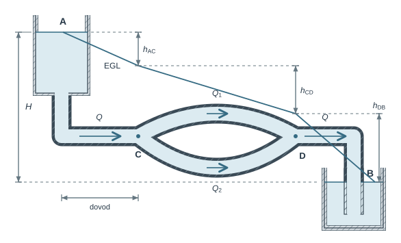
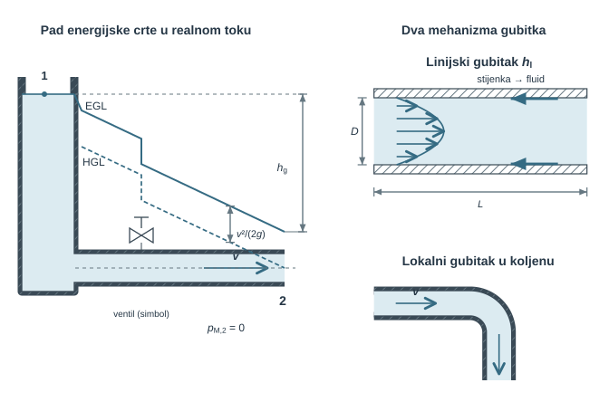
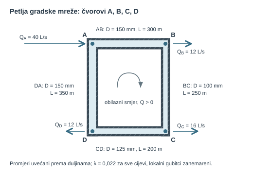
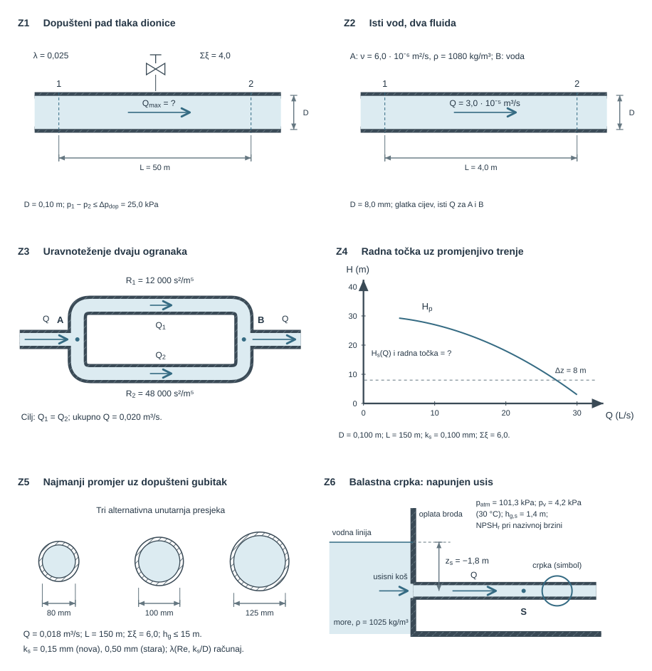

U realnom cjevovodu ukupna energijska visina fluida opada u smjeru toka: viskozna naprezanja i miješanje u ravnim cijevima, koljenima, ventilima i razdjelnicima nepovratno pretvaraju dio mehaničke energije u unutarnju. Taj gubitak $h_g$ određuje koliki protok daje zadana visinska razlika, koliku visinu dobave $H_p$ mora dati crpka i koliko električne energije sustav troši u radu. Bernoullijeva jednadžba iz []{.mf1-chapter-ref target="u08"} zato se proširuje članovima crpke, turbine i gubitaka, a lokalni opis viskoznog toka i Hagen–Poiseuilleov rezultat iz []{.mf1-chapter-ref target="u12"} sažimaju se u koeficijente gubitaka.

U svakoj dionici računaju se $v=4Q/(\pi D^2)$ i $Re=vD/\nu$, a zatim Darcyjev koeficijent trenja $\lambda(Re,k_s/D)$ i gubitak $h_g=(\lambda L/D+\sum\xi)v^2/(2g)$, gdje je $k_s$ ekvivalentna hrapavost, a $\xi$ koeficijent lokalnog gubitka. Zbroj koeficijenata $\xi$ u tom obliku pretpostavlja istu referentnu brzinu; prijelazni režim zahtijeva posebnu provjeru. Uz stalan $\lambda$ linijski je gubitak razmjeran omjeru $Q^2/D^5$, pa je promjer najjača geometrijska poluga.

Mreža se razlaže na dionice. Kroz serijske dionice prolazi isti protok $Q$ i gubitci se zbrajaju. U čvoru se protok dijeli, primjerice $Q=Q_1+Q_2$, a paralelne grane između zajedničkih čvorova imaju isti pad energije. U kvadratnom modelu $h_i=R_iQ_i^2$ otpor je približno stalan u promatranom rasponu. Za seriju vrijedi $R_{eq}=R_1+R_2$, a za dvije paralelne grane $1/\sqrt{R_{eq}}=1/\sqrt{R_1}+1/\sqrt{R_2}$. Otpori i njihove jedinice moraju pripadati istom modelu.

Poglavlje redom obrađuje realnu energijsku bilancu s energijskom i piezometarskom crtom, linijske i lokalne gubitke, put od Reynoldsova broja do koeficijenta trenja, serijske, paralelne i petljaste mreže, radnu točku crpke s lancem snaga te usisnu rezervu $NPSH_a$. Iste bilance koriste se pri projektiranju brodskih balastnih i rashladnih sustava te sustava grijanja i protupožarne zaštite. Model je jednodimenzijski i stacionaran: vodeni udar, brze promjene ventila i izrazito stlačiv tok traže proširen model, a strujanje kroz rotor crpke obrađuje se u []{.mf1-chapter-ref target="u14"}.

Slika ispod prikazuje serijsko-paralelnu mrežu između gornjeg spremnika A i donjeg spremnika B. Dovodna dionica od A do čvora C i odvodna dionica od čvora D do B spojene su serijski, pa kroz obje prolazi isti protok $Q$. U čvoru C protok se dijeli na grane, $Q=Q_1+Q_2$, a u čvoru D ponovno se spaja; paralelne grane između C i D imaju isti pad energije. Kota $H$ povezuje slobodne površine spremnika i za prikazanu mrežu jest ukupna raspoloživa visina, koja se duž energijske crte (EGL) troši u tri dijela: $H=h_{AC}+h_{CD}+h_{DB}$. Promjeri cijevi i EGL nacrtani su shematski.

{#fig-cjevovodna-mreza-pregled fig-align="center" fig-alt="Od pojedine dionice do serijsko-paralelne mreže: protok određuje brzinu i režim, a gubitci zatvaraju energijsku bilancu."}

## Gubitci, cjevovodi, crpke i mreže {#sec-cjevovodi-motivacija}

U cjevovodnom sustavu kontinuitet povezuje ulazne i izlazne protoke, a energijska bilanca povezuje visinsku razliku, rad crpke i gubitke. Radna točka nastaje ondje gdje crpka daje upravo onu energijsku visinu koju sustav zahtijeva pri tom protoku.

::: {.mf1-application}

Inženjerski kontekst

Iste bilance opisuju balastni vod broda, rashladni krug, protupožarnu mrežu i sustav grijanja. Uz protok i promjer cijevi provjeravamo radnu točku, godišnju potrošnju električne energije, osjetljivost na hrapavost i usisne uvjete crpke.
:::

**Procijenjeno vrijeme rada uz priručnik:** 12 sati.

## Realna energijska bilanca sustava {#sec-realna-energijska-bilanca}

Promatrajmo stacionarni tok nestlačivog fluida kroz kontrolni volumen s jednim ulaznim presjekom 1 i jednim izlaznim presjekom 2. Pozitivni smjer protoka ide od 1 prema 2. Crpka fluidu dodaje visinu $H_p$, turbina oduzima visinu $H_t$, a disipacija se zapisuje pozitivnim članom $h_g\ge0$. Bilanca mehaničke energije po jedinici težine glasi

$$
\underbrace{\frac{p_1}{\rho g}+z_1+\alpha_1\frac{v_1^2}{2g}}_{H_1}
+H_p
=
\underbrace{\frac{p_2}{\rho g}+z_2+\alpha_2\frac{v_2^2}{2g}}_{H_2}
+H_t+h_g .
$$ {#eq-realna-energijska-bilanca}

Svi članovi imaju jedinicu metra promatranog fluida. Tlakovi $p_1$ i $p_2$ moraju imati istu referencu: oba apsolutna ili oba manometarska. Za dvije otvorene slobodne površine atmosferski se tlakovi mogu pokratiti, ali se u NPSH računu ne smiju izostaviti jer je ondje referenca apsolutna.

Koeficijent kinetičke energije

$$
\alpha=\frac{1}{A\bar v^3}\int_A v^3\,dA
$$ {#eq-cjevovodi-1-realna-energijska-bilanca-sustava-sec-realna-01}

uzima u obzir nejednolik profil. Za potpuno razvijen laminarni tok u kružnoj cijevi vrijedi $\alpha=2$; u mnogim turbulentnim tehničkim tokovima blizu je jedinice. Aproksimacija $\alpha\approx1$ nije opći zakon, nego odluka koju treba navesti.

::: {.mf1-fizikalno-znacenje}

Fizikalno značenje — energijska i piezometarska crta

Energijska crta (EGL) prikazuje $H=p/(\rho g)+z+\alpha v^2/(2g)$, a piezometarska crta (HGL) prikazuje $p/(\rho g)+z$. U dionici bez stroja EGL pada u smjeru toka za $h_g$; preko crpke skače naviše za $H_p$. Razmak EGL–HGL jednak je korigiranoj brzinskoj visini. Zato skica tih crta često otkrije pogrešan predznak prije računa.
:::

::: {.mf1-dublje}

Fizikalni temelj — disipacija nije proizvoljan dodatak

Za stacionaran, nestlačiv newtonski tok u kojem promatrani kontrolni volumen obuhvaća cijelo područje gubitka, lokalna viskozna disipacija po jedinici volumena jest

$$
\Phi=2\mu S_{ij}S_{ij}\geq0,
\qquad
S_{ij}=\frac12\left(\frac{\partial v_i}{\partial x_j}+\frac{\partial v_j}{\partial x_i}\right).
$$ {#eq-cjevovodi-disipacija-kao-izvor-gubitka-01}

Kada se energijski tokovi na ulaznom i izlaznom presjeku vrednuju dosljedno, dio mehaničke energije označen s $h_g$ povezan je s tom nepovratnom pretvorbom:

$$
\rho gQh_g=\int_V\Phi\,dV.
$$ {#eq-cjevovodi-disipacija-kao-izvor-gubitka-02}

Zato je doprinos $h_g$ nenegativan, a u idealnom graničnom slučaju $\mu=0$ nestaje. U jednodimenzijskom računu Darcyjev i lokalni koeficijent gubitka sažimaju ovaj učinak; u RANS proračunu dio prijenosa i disipacije opisuje turbulencijski model. To tumačenje ne uklanja potrebu za mrežnom konvergencijom, validacijom i fizikalno odgovarajućim rubnim uvjetima.
:::

{#fig-energijska-crta-gubitci fig-align="center" fig-alt="U realnom toku energijska crta pada zbog linijskih i lokalnih gubitaka; lokalni element daje nagliji pad."}

**Tumačenje skice.** EGL pada zbog linijskih i lokalnih gubitaka; HGL prikazuje zbroj tlačne i geodetske visine, a uz $\alpha=1$ razmak je $EGL-HGL=v^2/(2g)$.

Bez stroja energijska bilanca glasi $H_1=H_2+h_g$, uz $h_g\ge0$. Ukupni gubitak je $h_g=h_l+\sum h_{\mathrm{loc}}$, gdje je $h_l=\lambda(L/D)v^2/(2g)$, a $h_{\mathrm{loc}}=\xi v_{\mathrm{ref}}^2/(2g)$. Svaki lokalni koeficijent mora biti vezan uz svoju referentnu brzinu. Prikazani laminarni profil zadovoljava prianjanje uz stijenke; koljeno mijenja smjer toka bez pregrade ili prekida prolaza.

::: {.mf1-granica-modela}

Granica modela

Jednadžba [-@eq-realna-energijska-bilanca] jest jednodimenzijska stacionarna bilanca. Brze promjene ventila, vodeni udar, elastičnost cijevi, plinoviti džepovi, izražena izmjena topline i snažno stlačivi tok traže proširen model. Koeficijenti gubitaka također vrijede samo za geometriju i režim za koje su određeni.
:::

## Linijski i lokalni gubitci {#sec-linijski-lokalni-gubitci}

Za ravnu kružnu cijev stalnog promjera Darcy–Weisbachov zapis glasi

$$
h_l=\lambda\frac{L}{D}\frac{v^2}{2g},
$$ {#eq-darcy-weisbach}

a za lokalni element

$$
h_{loc}=\xi\frac{v_{ref}^2}{2g}.
$$ {#eq-lokalni-gubitak}

Darcyjev koeficijent trenja $\lambda$ i lokalni koeficijent $\xi$ bezdimenzijski su. U izrazu za lokalni element mora se znati na koji se presjek odnosi $v_{ref}$. Kod naglog proširenja, redukcijskog ventila ili grananja brzine s dviju strana elementa nisu jednake, pa slijepo zbrajanje svih $\xi$ uz jednu zajedničku brzinu može biti pogrešno.

Za dionicu stalnog promjera praktičan je zapis

$$
h_g=\left(\lambda\frac{L}{D}+\sum_j\xi_j\right)\frac{v^2}{2g}.
$$ {#eq-gubitak-dionice}

Izraz u zagradi jest ukupni koeficijent otpora dionice, $\zeta=\lambda L/D+\sum\xi$, pa je $h_g=\zeta\,v^2/(2g)$; $\zeta$ se odnosi na brzinu u toj dionici i ne smije se zbrajati s koeficijentima dionica drugog promjera.

Linijski i lokalni doprinosi nisu dvije nove sile. Oba doprinosa sažimaju nepovratnu pretvorbu mehaničke energije u unutarnju energiju zbog viskoznih naprezanja i miješanja. Darcy–Weisbachova korelacija i Moodyjev dijagram standardni su prikaz otpora razvijenoga toka u kružnim cijevima [@moody1944; @white2011].

### Promjer je najjača geometrijska poluga {#sec-utjecaj-promjera}

Pri zadanom protoku $Q$ vrijedi $v=4Q/(\pi D^2)$. Uvrštavanjem u jednadžbu [-@eq-darcy-weisbach] dobiva se

$$
h_l=\frac{8\lambda L}{\pi^2g}\frac{Q^2}{D^5}.
$$ {#eq-linijski-gubitak-protok}

Ako su $Q$, $L$ i **$\lambda$ stalni**, udvostručenje promjera smanjuje linijski gubitak $2^5=32$ puta. Lokalni gubitak sa stalnim $\xi$ tada se smanjuje 16 puta jer ne sadrži dodatni faktor $L/D$. Pri stvarnoj promjeni izvedbe treba ponovno odrediti $Re$, $k_s/D$ i $\lambda$, pa konačni omjer nije nužno točno 32. Ova analiza pokazuje zašto nekoliko milimetara promjera može vrijediti više od niza manjih prilagodbi armature.

::: {.mf1-cfd title="Računalna dinamika fluida"}

**Kako CFD rezultat postaje podatak za cjevovod?** Za novi razdjelnik rashladne ploče pouzdan tablični koeficijent gubitka često ne postoji. Model je stacionarni nestlačivi RANS račun razdjelnika sa zadanim ulaznim protokom i tlakom na izlazima; podatci su geometrija, hrapavost i više radnih protoka. Izlaz je razlika tokova mehaničke energije između ulaza i svakog izlaza, uz kote i nejednolike profile ($\alpha\neq1$), iz koje se za svaki put kroz razdjelnik izvodi koeficijent $\xi$ s jasno navedenom referentnom brzinom i podjelom protoka.

Provjera: sam statički pad tlaka nije uvijek gubitak jer se u proširenju dio kinetičke energije vraća u tlak, pa se, kao u ranijem Venturijevu primjeru, zadržava cijela energijska bilanca; izvedeni $\xi$ mora u turbulentnom području biti približno neovisan o protoku. Odluka: tako dobiveni otpori ulaze u model cijeloga kruga i mogu promijeniti podjelu protoka i potrebnu visinu dobave crpke.
:::

## Od Reynoldsova broja do koeficijenta trenja {#sec-koeficijent-trenja}

Ispravan slijed jest

$$
Q\longrightarrow v=\frac{Q}{A}
\longrightarrow Re=\frac{vD}{\nu}
\longrightarrow \lambda(Re,k_s/D)
\longrightarrow h_g.
$$ {#eq-cjevovodi-3-od-reynoldsova-broja-do-koeficijenta-trenja-01}

::: {.mf1-izvod}

Matematički izvod — Darcyjev koeficijent iz ravnoteže sila i njegov račun

**Fizikalno pitanje.** Kolika sila stijenke koči potpuno razvijen tok u ravnoj kružnoj cijevi i kako se ona sažima u jedan bezdimenzijski koeficijent?

**Bilanca.** Promatra se odsječak fluida duljine $L$ koji ispunjava cijev promjera $D$. U razvijenom stacionarnom toku količina gibanja odsječka ne mijenja se, pa tlačna sila na presjecima mora uravnotežiti smičnu silu kojom stijenka djeluje na fluid, odnosno $\tau_{st}$ po omočenoj plohi $\pi DL$:

$$
\Delta p\,\frac{\pi D^2}{4}=\tau_{st}\,\pi D L
\quad\Rightarrow\quad
\tau_{st}=\frac{D}{4}\,\frac{\Delta p}{L}.
$$ {#eq-ravnoteza-odsjecka-cijevi}

Za vodoravnu cijev vrijedi $\Delta p=\rho g h_l$. Uvrštavanjem Darcy–Weisbachove jednadžbe [-@eq-darcy-weisbach] dobiva se

$$
\lambda=\frac{8\tau_{st}}{\rho v^2},
$$ {#eq-lambda-iz-smicnog-naprezanja}

dakle $\lambda$ nije ništa drugo nego bezdimenzijsko smično naprezanje stijenke. Taj zapis vrijedi za svaki režim; samo veza $\tau_{st}(v)$ ovisi o režimu.

**Koraci za laminarni tok.** Hagen–Poiseuilleov parabolični profil ima na stijenci $\tau_{st}=8\mu v/D$. Uvrštavanjem u jednadžbu [-@eq-lambda-iz-smicnog-naprezanja] slijedi

$$
\lambda=\frac{8\cdot8\mu v/D}{\rho v^2}=\frac{64\mu}{\rho vD}=\frac{64}{Re}.
$$ {#eq-lambda-laminarno}

**Rezultat.** Uvrsti li se $\lambda=64/Re$ natrag u Darcy–Weisbachovu jednadžbu, dobiva se Hagen–Poiseuilleov zapis

$$
\Delta p=\rho gh_l=\frac{128\mu L}{\pi D^4}Q.
$$ {#eq-poiseuille-u13}

**Provjera.** U laminarnom području $\Delta p\propto Q$, a ne $Q^2$: kvadratni oblik Darcyjeve formule ne dokazuje kvadratnu ovisnost jer je $\lambda\propto1/Q$. Isti zapis vrijedi i u CFD-u: integral $\tau_{st}$ po stijenci razvijene dionice mora vratiti $64/Re$, inače tok u domeni nije razvijen ili mreža nije dovoljno fina.

**Numerički korak za turbulentni tok.** U turbulentnom režimu $\tau_{st}$ ovisi i o hrapavosti. Colebrook–Whiteova implicitna jednadžba povezuje $\lambda$, $Re$ i relativnu hrapavost [@colebrook1939]:

$$
\frac{1}{\sqrt{\lambda}}
=-2\log_{10}\!\left(
\frac{k_s/D}{3{,}7}
+\frac{2{,}51}{Re\sqrt{\lambda}}
\right).
$$ {#eq-colebrook-white}

Nepoznata $\lambda$ pojavljuje se izvan i unutar logaritma, pa se odabere početna procjena, primjerice $\lambda_0=0{,}02$, i ponavlja se iteracija

$$
\lambda_{k+1}=\left[
-2\log_{10}\!\left(
\frac{k_s/D}{3{,}7}
+\frac{2{,}51}{Re\sqrt{\lambda_k}}
\right)
\right]^{-2}
$$ {#eq-cjevovodi-izvod-zasto-je-colebrookov-racun-iterativan-01}

dok razlika dviju uzastopnih vrijednosti ne postane manja od zadane tolerancije. Treba provjeriti i rezidual izvorne jednadžbe, ne samo promjenu iterata. Za ručni račun dovoljne su eksplicitne aproksimacije: Swamee–Jainova

$$
\lambda=\frac{0{,}25}{\left[\log_{10}\!\left(\frac{k_s/D}{3{,}7}+\frac{5{,}74}{Re^{0{,}9}}\right)\right]^2},
\qquad 5000<Re<10^8,
$$ {#eq-swamee-jain}

koja od Colebrookove odstupa za oko 1 %, a za hidraulički glatku cijev i $4000<Re<10^5$ Blasiusova $\lambda=0{,}3164\,Re^{-1/4}$. Koeficijent se može očitati i iz Moodyjeva dijagrama.

**Granice.** Kad $k_s/D\to0$, hrapavost nestaje iz dominantnog člana; pri vrlo velikom $Re$ i konačnoj hrapavosti viskozni član postaje malen pa $\lambda$ teži vrijednosti određenoj uglavnom omjerom $k_s/D$. U prijelaznom području približno između $Re=2300$ i $4000$ režim je osjetljiv na ulazne poremećaje, hrapavost i povijest toka; jedna univerzalna korelacija ondje nije pouzdana. Ti pragovi odnose se na unutarnji tok u kružnoj cijevi, a ne na svako strujanje.
:::

::: {.mf1-interaktivno}

Numerički pokus — od predviđanja do reziduala

**Predvidi.** Kako veća relativna hrapavost mijenja koeficijent trenja i radnu točku crpke iz Z4?

**Provjeri i protumači.** Usporedi iterativno rješenje, aproksimaciju i dijagram. U nastavku provjeri i Colebrookov i energijski rezidual: mali ostatak jedne jednadžbe ne potvrđuje drugu.

<a class="mf1-interaktivno-veza" href="https://martibasic.github.io/MF1_udzbenik/jlite/lab/index.html?path=u10_moody_dijagram.ipynb" target="_blank" rel="noopener">Pokreni u JupyterLiteu</a>

:::

::: {.mf1-cfd title="Računalna dinamika fluida"}

**Koliki dio otpora dolazi iz ravnih vodova?** Prije pripisivanja velikoga pada tlaka razdjelniku provjerimo i cijevi koje ga napajaju. U potpuno razvijenom CFD toku tlak i smično naprezanje moraju dati isti otpor, iz kojega izvodimo Darcyjev koeficijent trenja $\lambda$. Laminarni test treba vratiti $64/Re$; turbulentni uspoređujemo s odgovarajućom korelacijom pri istoj hrapavosti.

Ako su ravni vodovi dobro opisani 1D relacijom, u modelu sustava možemo ih zadržati bez prostornog CFD-a. Otporu koji je već dobiven iz naprezanja u CFD domeni ne dodajemo Colebrookovu relaciju kao novu silu. Za zidni model treba uskladiti definiciju ekvivalentne hrapavosti; ona nije automatski jednaka svakoj izmjerenoj visini neravnina.
:::

## Serijske i paralelne mreže {#sec-cjevovodne-mreze}

Mreža se najprije razlaže na dionice unutar kojih su $D$, $\lambda$ i referentna brzina jednoznačni. Tek se zatim pišu jednadžbe.

- U **seriji** kroz sve dionice prolazi isti protok, a gubitci se zbrajaju.
- U **paraleli** između zajedničkih čvorova jednak je pad ukupne energije, a protoci se zbrajaju u čvoru.

Za dionicu u području u kojem se $\lambda$ može smatrati približno stalnim korisno je uvesti

$$
h_g=RQ^2,
\qquad
R=\frac{8}{\pi^2g}
\left(\frac{\lambda L}{D^5}+\frac{\sum\xi}{D^4}\right).
$$ {#eq-hidraulicki-otpor}

Za serijski spoj tada vrijedi $R_{eq}=\sum R_i$. Za paralelne grane između čvorova A i B vrijedi

$$
Q=\sum_iQ_i,
\qquad
R_iQ_i^2=h_{AB},
\qquad
\frac{1}{\sqrt{R_{eq}}}=\sum_i\frac{1}{\sqrt{R_i}}.
$$ {#eq-paralelni-otpor}

Analogija s električnim otporom korisna je samo do određene granice: hidraulički je odnos ovdje kvadratan, a $R$ se mijenja s protokom ako se mijenja $\lambda$. Zato se za opću mrežu jednadžbe kontinuiteta u čvorovima i energijske jednadžbe po neovisnim putovima rješavaju zajedno i iterativno.

U gradskoj distribucijskoj mreži cijevi tvore zatvorene **petlje**. U svakom čvoru zbroj dotoka jednak je zbroju odljeva, a oko svake petlje zbroj predznačenih gubitaka iščezava jer se vraćamo u istu točku, dakle na istu energijsku visinu. Hardy–Crossova metoda polazi od bilo koje raspodjele protoka koja zadovoljava bilance u čvorovima i ispravlja je u svakoj petlji istim iznosom $\Delta Q$, čime čvorne bilance ostaju netaknute. Linearizacijom $R(Q+\Delta Q)|Q+\Delta Q|\approx RQ|Q|+2R|Q|\Delta Q$ dobiva se

$$
\Delta Q=-\frac{\sum_i R_iQ_i|Q_i|}{2\sum_i R_i|Q_i|},
$$ {#eq-hardy-cross}

gdje se protoci broje pozitivno u odabranom obilaznom smjeru petlje. Postupak se ponavlja dok rezidual petlje ne padne ispod zadane tolerancije; @ex-petlja-gradske-mreze pokazuje dvije iteracije.

::: {.mf1-fizikalno-znacenje}

Fizikalno značenje — što se izjednačuje?

Dvije paralelne grane počinju u istom čvoru i završavaju u istom čvoru. Zato razlika ukupne energijske visine između njihovih krajeva mora biti ista. Grana manjeg otpora pri tom zajedničkom padu prenosi veći protok. Jednaki protoci nastaju samo kao posljedica jednakih otpora, a ne kao opće pravilo paralelnog spoja.
:::

::: {.mf1-interaktivno}

Numerički pokus — paralelne grane

**Predvidi.** Koja grana preuzima najveći protok?

**Zastani i promisli.** Dvije paralelne grane imaju jednak pad energije, ali različite protoke. Je li narušen kontinuitet?

**Provjeri i protumači.** Nije: jednak pad energije slijedi iz zajedničkih krajnjih čvorova, a protoci ovise o otporima grana; kontinuitet traži samo da njihov zbroj odgovara dotoku. Promijeni promjer jedne grane i prati sve protoke, kontinuitet i gubitke između čvorova. Pokus vrijedi za turbulentne grane; nastavci zasebno obrađuju Z3 i Z6.

<a class="mf1-interaktivno-veza" href="https://martibasic.github.io/MF1_udzbenik/jlite/lab/index.html?path=u13_paralelne_grane.ipynb" target="_blank" rel="noopener">Pokreni u JupyterLiteu</a>

:::

::: {#cfd-krug-radna-tocka .mf1-cfd title="Računalna dinamika fluida"}

**Hoće li bolji razdjelnik povećati protok u stvarnom sustavu?** Ručni @ex-radna-tocka-vfd određuje protok presjecištem karakteristika crpke i sustava. Zato nakon promjene otpora razdjelnika ne zadržavamo automatski dotok iz []{.mf1-chapter-ref target="u07"}. Model cjevovodne mreže daje početne protoke i tlakove za lokalni CFD razdjelnika. Iz CFD-a vraćamo otpore grana, pa ponovno računamo raspodjelu protoka i radnu točku crpke.

Postupak po potrebi ponavljamo jer otpor ovisi o režimu i podjeli protoka. Manji lokalni gubitak pri jednakom protoku ne znači automatski jednaku uštedu električne snage: pri nepromijenjenoj brzini crpke mijenja se i radni protok. Pratimo protok svake grane, visinu dobave te snagu i učinkovitost crpke. CFD mreža ćelija opisuje unutrašnjost uređaja, a cjevovodna mreža povezanost cijeloga sustava.
:::

## Crpka, karakteristika sustava i radna točka {#sec-radna-tocka-crpke}

Između dviju velikih otvorenih površina brzine i manometarski tlakovi iščezavaju iz bilance. Potrebna visina sustava tada je

$$
H_s(Q)=\Delta z+h_g(Q).
$$ {#eq-karakteristika-sustava}

Ako se koeficijenti otpora u promatranom području malo mijenjaju, često se piše

$$
H_s(Q)=H_{stat}+RQ^2.
$$ {#eq-cjevovodi-5-crpka-karakteristika-sustava-i-radna-tocka-01}

Crpka ima vlastitu karakteristiku $H_p(Q)$ za zadanu brzinu vrtnje, radno kolo (impeler) i fluid. Radna točka nije proizvoljno odabrana kataloška točka, nego rješenje

$$
H_p(Q_{op})=H_s(Q_{op}).
$$ {#eq-radna-tocka}

Zatvaranje ventila povećava otpor sustava i pomiče radnu točku. Promjena brzine vrtnje pomiče crpkinu krivulju. Za geometrijski istu crpku i približno slične režime afinitetni zakoni daju $Q\propto n$, $H\propto n^2$ i $P\propto n^3$, ali ti odnosi opisuju međusobno slične točke na crpkinim krivuljama. **Ne smiju se slijepo prenositi na cijeli sustav sa statičkom visinom.** Novi radni protok uvijek treba dobiti iz novoga presjecišta $H_p$ i $H_s$ [@cengel2014; @white2011].

### Snaga bez miješanja energijskih razina {#sec-ledger-snage}

Crpka fluidu predaje hidrauličku snagu

$$
P_h=\rho gQH_p.
$$ {#eq-hidraulicka-snaga-crpke}

Ako je ukupna učinkovitost crpke $\eta_p$ (omjer hidrauličke i vratilne snage), vratilna snaga jest

$$
P_{vr}=\frac{P_h}{\eta_p}.
$$ {#eq-cjevovodi-snaga-bez-mijesanja-energijskih-razina-sec-ledge-01}

Ako motor i pretvarač imaju učinkovitosti $\eta_m$ i $\eta_f$, električna snaga preuzeta iz mreže jest

$$
P_{el}=\frac{P_{vr}}{\eta_m\eta_f}
=\frac{\rho gQH_p}{\eta_p\eta_m\eta_f}.
$$ {#eq-elektricna-snaga-crpke}

Redoslijed pretvorbe snage dakle je

$$
P_{el}\longrightarrow P_{vr}\longrightarrow P_h
\longrightarrow
\begin{cases}
\rho gQ\Delta z & \text{promjena potencijalne energije},\\
\rho gQh_g & \text{disipacija u sustavu}.
\end{cases}
$$ {#eq-cjevovodi-snaga-bez-mijesanja-energijskih-razina-sec-ledge-02}

Disipacija na ventilu dio je hidrauličke snage, a gubitci motora i crpke razlike su između pojedinih razina pretvorbe. Zato se snaga disipirana na ventilu ne smije izravno oduzeti od električne snage i nazvati ostatkom hidrauličke snage.

## Usis i $NPSH$: nužan, ali ne konačan kriterij {#sec-npsh}

Na usisu crpke apsolutni tlak može biti nizak zbog geodetskog uspona, brzinske visine i gubitaka. Raspoloživa neto pozitivna usisna visina definira se u referentnom usisnom presjeku kao

$$
NPSH_a=
\frac{p_{aps,s}}{\rho g}
+\frac{v_s^2}{2g}
-\frac{p_v}{\rho g},
$$ {#eq-npsha}

gdje je $p_v$ tlak zasićene pare pri radnoj temperaturi. Za usis iz otvorenog spremnika ista se veličina može zapisati kao

$$
NPSH_a=
\frac{p_{atm}}{\rho g}-z_s-h_{g,s}-\frac{p_v}{\rho g}.
$$ {#eq-npsha-spremnik}

Ovdje je $z_s$ visina referentnog usisnog presjeka iznad slobodne površine: pozitivna je kad crpka usisava iznad razine, a negativna kod napunjenog usisa, kad je presjek ispod razine. Brzinska se visina u drugom zapisu pokrati jer je već uključena u Bernoullijevu bilancu do usisnog presjeka. Ta dva zapisa moraju dati isti rezultat.

Proizvođač određuje potrebni $NPSH_r(Q,n)$ prema navedenom kriteriju i na temelju ispitivanja. Uporabna provjera zahtijeva usporedbu raspoloživog i potrebnog NPSH-a uz odgovarajuću projektnu marginu. Sam rezultat $NPSH_a>0$ ili činjenica da je srednji tlak na usisu iznad $p_v$ ne dokazuju da kavitacije neće biti: lokalni tlak u impeleru može biti niži, a dopuštena margina ovisi o crpki, režimu i kriteriju proizvođača.

::: {.mf1-granica-modela}

Granica modela — što $NPSH_a$ ne jamči

$NPSH_a$ opisuje sustav do dogovorenoga usisnog presjeka. Ne zamjenjuje proizvođačevu krivulju $NPSH_r$, ne opisuje lokalne mjehuriće u svakoj točki impelera i nije samostalna potvrda sigurnosti. Tlak pare mora odgovarati temperaturi i sastavu stvarnog fluida, a atmosferski tlak nadmorskoj visini i radnom stanju.
:::

::: {.mf1-cfd title="Računalna dinamika fluida"}

**Prazniji spremnik, toplija tekućina i kavitacija crpke.** U istom rashladnom krugu sniženje razine spremnika smanjuje raspoloživu usisnu visinu, a promjena temperature mijenja tlak pare. Usisna bilanca daje uvjete na ulazu u crpku. CFD zatim pokazuje lokalne minimume tlaka između lopatica; za procjenu nastanka pare koristimo apsolutni statički tlak pri toj temperaturi.

Uspoređujemo početno i nepovoljnije radno stanje te pratimo položaj područja niskog tlaka. Jednofazni račun upozorava na rizik, dok nastanak i razvoj parnih područja traže višefazni model s prijelazom mase. Pozitivan $NPSH_a$ sam ne potvrđuje prihvatljiv rad. Time povezujemo razinu spremnika iz hidrostatike s lokalnim tokom u rotoru, koji obrađuje sljedeće poglavlje.
:::

## Riješeni primjeri {#sec-u13-rijeseni-primjeri}

::: {#ex-gubitci-jedne-dionice .mf1-we}

Linijski i lokalni gubitci jedne dionice T1

**Tekst zadatka**

Voda gustoće $\rho=1000\ \mathrm{kg/m^3}$ struji horizontalnom cijevi promjera $D=0{,}12\ \mathrm{m}$ i duljine $L=36\ \mathrm{m}$ srednjom brzinom $v=2{,}4\ \mathrm{m/s}$. Darcyjev koeficijent trenja iznosi $\lambda=0{,}028$, a zbroj koeficijenata lokalnih gubitaka $\sum\xi=4{,}6$.

**Traži se**

Odredi linijski, lokalni i ukupni gubitak te pad tlaka.

**Rješenje**

Brzinska visina iznosi

$$
\frac{v^2}{2g}=\frac{2{,}4^2}{2\cdot9{,}81}=0{,}294\ \mathrm{m}.
$$ {#eq-cjevovodi-rijeseni-primjer-linijski-i-lokalni-gubitci-jedn-01}

Linijski i lokalni gubitak tada iznose

$$
h_l=0{,}028\frac{36}{0{,}12}(0{,}294)=2{,}47\ \mathrm{m},
$$ {#eq-cjevovodi-rijeseni-primjer-linijski-i-lokalni-gubitci-jedn-02}

$$
h_{loc}=4{,}6(0{,}294)=1{,}35\ \mathrm{m},
\qquad
h_g=3{,}82\ \mathrm{m}.
$$ {#eq-cjevovodi-rijeseni-primjer-linijski-i-lokalni-gubitci-jedn-03}

U horizontalnoj cijevi stalnog promjera promjena tlaka odgovara ukupnom gubitku:

$$
\Delta p=\rho gh_g=1000\cdot9{,}81\cdot3{,}82
=37{,}4\ \mathrm{kPa}.
$$ {#eq-cjevovodi-rijeseni-primjer-linijski-i-lokalni-gubitci-jedn-04}

**Provjera i tumačenje**

$\Delta p/(\rho g)=37\,400/(1000\cdot9{,}81)=3{,}81\ \mathrm{m}$ vraća ukupni gubitak; lokalni elementi daju trećinu ukupnog gubitka, pa se u kratkom vodu ne smiju zanemariti.
:::

::: {#ex-laminarni-rashladni-vod .mf1-we}

Laminarni vod rashladnog modula T2

**Tekst zadatka**

Rashladna smjesa gustoće $1050\ \mathrm{kg/m^3}$ i kinematičke viskoznosti $\nu=5{,}0\cdot10^{-6}\ \mathrm{m^2/s}$ teče kroz kružnu cijev promjera $D=4{,}0\ \mathrm{mm}$ i duljine $L=2{,}0\ \mathrm{m}$ protokom $Q=8{,}0\cdot10^{-6}\ \mathrm{m^3/s}$. Zanemari ulazno područje i lokalne gubitke.

**Traži se**

Odredi srednju brzinu, Reynoldsov broj, Darcyjev koeficijent trenja te linijski gubitak i pad tlaka.

**Rješenje**

Površina presjeka i srednja brzina iznose

$$
A=\frac{\pi D^2}{4}=1{,}257\cdot10^{-5}\ \mathrm{m^2},
\qquad
v=\frac QA=0{,}637\ \mathrm{m/s}.
$$ {#eq-cjevovodi-rijeseni-primjer-laminarni-vod-rashladnog-modula-01}

Reynoldsov broj potvrđuje laminarni model:

$$
Re=\frac{vD}{\nu}=509,
\qquad
\lambda=\frac{64}{Re}=0{,}1257.
$$ {#eq-cjevovodi-rijeseni-primjer-laminarni-vod-rashladnog-modula-02}

Darcy–Weisbachova jednadžba daje

$$
h_l=0{,}1257\frac{2}{0{,}004}
\frac{0{,}637^2}{2\cdot9{,}81}
=1{,}298\ \mathrm{m},
$$ {#eq-cjevovodi-rijeseni-primjer-laminarni-vod-rashladnog-modula-03}

odnosno $\Delta p=\rho gh_l=13{,}37\ \mathrm{kPa}$.

**Provjera i tumačenje**

$\mu=\rho\nu=5{,}25\cdot10^{-3}\ \mathrm{Pa\,s}$, pa jednadžba [-@eq-poiseuille-u13] daje

$$
\Delta p=\frac{128\mu LQ}{\pi D^4}=13{,}37\ \mathrm{kPa}.
$$ {#eq-cjevovodi-rijeseni-primjer-laminarni-vod-rashladnog-modula-04}

Podudaranje dvaju zapisa provjerava faktor 64 i pretvorbu protoka.
:::

::: {#ex-petlja-gradske-mreze .mf1-we}

Petlja gradske vodovodne mreže T3

**Tekst zadatka**

Dio gradske distribucijske mreže čini jedna petlja s čvorovima A, B, C i D. U čvor A ulazi $Q_A=40{,}0\ \mathrm{L/s}$, a potrošnje su $Q_B=12{,}0\ \mathrm{L/s}$, $Q_C=16{,}0\ \mathrm{L/s}$ i $Q_D=12{,}0\ \mathrm{L/s}$. Cijevi su od lijevanog željeza; za promatrani raspon Reynoldsovih brojeva uzmi stalan $\lambda=0{,}022$ i zanemari lokalne gubitke.

| cijev | $D$ [mm] | $L$ [m] |
|---|---:|---:|
| AB | 150 | 300 |
| BC | 100 | 250 |
| CD | 125 | 200 |
| DA | 150 | 350 |

**Traži se**

1. Odredi otpore $R_i$ i početnu raspodjelu protoka koja zadovoljava bilance u čvorovima.
2. Provedi dvije Hardy–Crossove iteracije i navedi protoke, gubitke te rezidual petlje.
3. Provjeri kontinuitet u svim čvorovima i razliku piezometarskih visina između A i C po obama putovima.

{#fig-petlja-gradske-mreze fig-align="center" fig-alt="Četiri čvora spojena u zatvorenu petlju; u A ulazi 40 L/s, u B, C i D izlaze potrošnje; cijevi imaju različite promjere i duljine, a strelica označuje obilazni smjer u kojem se protoci broje pozitivno."}

**Veza s proračunom.** Protok se broji pozitivno u smjeru A→B→C→D→A; promjeri cijevi nacrtani su uvećano u odnosu na duljine.

**Rješenje**

Iz jednadžbe [-@eq-hidraulicki-otpor] bez lokalnih gubitaka slijedi $R=8\lambda L/(\pi^2gD^5)$:

$$
R_{AB}=7181,\quad R_{BC}=45\,445,\quad R_{CD}=11\,913,\quad R_{DA}=8378\ \ \mathrm{s^2/m^5}.
$$ {#eq-petlja-otpori}

Početna raspodjela koja zadovoljava čvorne bilance: $Q_{AB}=22{,}0$, $Q_{BC}=10{,}0$, $Q_{CD}=-6{,}0$ i $Q_{DA}=-18{,}0\ \mathrm{L/s}$ (negativan predznak znači tok suprotno obilaznom smjeru, dakle A→D i D→C). Provjera čvora C: $10{,}0+6{,}0=16{,}0\ \mathrm{L/s}$.

Prva iteracija prema jednadžbi [-@eq-hardy-cross], s protocima u $\mathrm{m^3/s}$:

$$
\begin{aligned}
\sum R_iQ_i|Q_i|&=3{,}476+4{,}544-0{,}429-2{,}715=4{,}877\ \mathrm{m}, \\
2\sum R_i|Q_i|&=1669\ \mathrm{s/m^2},
\end{aligned}
$$ {#eq-petlja-iteracija-1}

$$
\Delta Q=-\frac{4{,}877}{1669}=-2{,}92\ \mathrm{L/s}.
$$ {#eq-petlja-korekcija-1}

Novi protoci su $19{,}08$, $7{,}08$, $-8{,}92$ i $-20{,}92\ \mathrm{L/s}$. Druga iteracija daje $\sum R_iQ_i|Q_i|=0{,}276\ \mathrm{m}$, $2\sum R_i|Q_i|=1481\ \mathrm{s/m^2}$ i $\Delta Q=-0{,}19\ \mathrm{L/s}$, pa su protoci

$$
Q_{AB}=18{,}89,\quad Q_{BC}=6{,}89,\quad Q_{CD}=-9{,}11,\quad Q_{DA}=-21{,}11\ \mathrm{L/s},
$$ {#eq-petlja-protoci}

a gubitci $h_{AB}=2{,}56$, $h_{BC}=2{,}16$, $h_{DC}=0{,}99$ i $h_{AD}=3{,}73\ \mathrm{m}$. Rezidual petlje nakon druge iteracije iznosi $2{,}56+2{,}16-0{,}99-3{,}73=0{,}00\ \mathrm{m}$ (nezaokruženo $1{,}1\ \mathrm{mm}$).

**Provjera i tumačenje**

Čvorovi: A $18{,}89+21{,}11=40{,}0$; B $18{,}89-12{,}0=6{,}89$; C $6{,}89+9{,}11=16{,}0$; D $21{,}11-12{,}0=9{,}11\ \mathrm{L/s}$. Pad od A do C iznosi $4{,}72\ \mathrm{m}$ putem B i putem D. Brzine $0{,}74$–$1{,}19\ \mathrm{m/s}$ uobičajene su za distribucijske vodove; stalan $\lambda$ pri $Re\approx0{,}9$–$1{,}8\cdot10^5$ stvarni bi projekt provjerio Swamee–Jainovom ili Colebrookovom relacijom. U mreži s više petlji cijev zajednička dvjema petljama prima obje korekcije.
:::

::: {#ex-radna-tocka-vfd .mf1-we}

Radna točka i promjena brzine vrtnje T3

**Tekst zadatka**

Karakteristike crpke pri nazivnoj brzini vrtnje i otvorenog sustava, s protokom $Q$ u $\mathrm{L/s}$, glase:

$$
H_p(Q)=25-0{,}0175Q^2,
\qquad
H_s(Q)=6+0{,}0303Q^2.
$$ {#eq-cjevovodi-rijeseni-primjer-radna-tocka-i-promjena-brzine-01}

Promjenom brzine vrtnje, bez dodatnog prigušenja, treba postići $Q_2=17{,}24\ \mathrm{L/s}$.

**Traži se**

Odredi početnu radnu točku te omjer brzina vrtnje potreban za zadani smanjeni protok.

**Rješenje**

Prvi član karakteristike sustava, $6\ \mathrm{m}$, statička je visina. Radna točka dobiva se iz jednakosti krivulja:

$$
25-0{,}0175Q^2=6+0{,}0303Q^2,
$$ {#eq-cjevovodi-rijeseni-primjer-radna-tocka-i-promjena-brzine-02}

$$
Q_{op}=19{,}94\ \mathrm{L/s},
\qquad H_{op}=18{,}04\ \mathrm{m}.
$$ {#eq-cjevovodi-rijeseni-primjer-radna-tocka-i-promjena-brzine-03}

Izvorni sustav pri tom protoku traži

$$
H_s(Q_2)=6+0{,}0303(17{,}24)^2=15{,}01\ \mathrm{m}.
$$ {#eq-cjevovodi-rijeseni-primjer-radna-tocka-i-promjena-brzine-04}

Za omjer brzina $s=n_2/n_1$ nova se idealizirana krivulja iste crpke dobiva skaliranjem

$$
H_{p,2}(Q)=s^2H_p(Q/s)=25s^2-0{,}0175Q^2.
$$ {#eq-cjevovodi-rijeseni-primjer-radna-tocka-i-promjena-brzine-05}

Uvjet nove radne točke daje

$$
25s^2-0{,}0175(17{,}24)^2=15{,}01,
\qquad s=0{,}899.
$$ {#eq-cjevovodi-rijeseni-primjer-radna-tocka-i-promjena-brzine-06}

**Provjera i tumačenje**

Omjer brzina nije jednak omjeru radnih protoka $17{,}24/19{,}94=0{,}865$ jer se statička visina od $6\ \mathrm{m}$ ne skalira s $n^2$; afinitetni bi omjer vrijedio tek uz $H_{stat}=0$.
:::

::: {#ex-energijski-ledger-hladenja .mf1-we}

Godišnja energija rashladnog kruga T2

**Tekst zadatka**

Rashladni krug radi $7000\ \mathrm{h/god}$ protokom $Q=6{,}0\ \mathrm{L/s}$ pri visini $H=12{,}0\ \mathrm{m}$. Gustoća je $1000\ \mathrm{kg/m^3}$, a učinkovitosti crpke, motora i frekvencijskog pretvarača redom $\eta_p=0{,}78$, $\eta_m=0{,}92$ i $\eta_f=0{,}97$. Nakon čišćenja izmjenjivača visina pada na $10\ \mathrm{m}$, uz isti protok, vrijeme rada i učinkovitosti.

**Traži se**

1. Odredi hidrauličku, vratilnu i električnu snagu te godišnju potrošnju električne energije.
2. Procijeni uštedu nakon čišćenja.

**Rješenje**

Hidraulička snaga predana fluidu iznosi

$$
P_h=\rho gQH
=1000\cdot9{,}81\cdot0{,}006\cdot12
=0{,}706\ \mathrm{kW}.
$$ {#eq-cjevovodi-rijeseni-primjer-godisnja-energija-rashladnog-kr-01}

Vratilna i električna snaga iznose

$$
P_{vr}=\frac{0{,}706}{0{,}78}=0{,}906\ \mathrm{kW},
$$ {#eq-cjevovodi-rijeseni-primjer-godisnja-energija-rashladnog-kr-02}

$$
P_{el}=\frac{0{,}906}{0{,}92\cdot0{,}97}
=1{,}015\ \mathrm{kW}.
$$ {#eq-cjevovodi-rijeseni-primjer-godisnja-energija-rashladnog-kr-03}

Godišnja potrošnja električne energije iznosi

$$
E_{el}=P_{el}t=1{,}015\cdot7000=7{,}10\ \mathrm{MWh/god}.
$$ {#eq-cjevovodi-rijeseni-primjer-godisnja-energija-rashladnog-kr-04}

Nakon čišćenja potrošnja pada na $5{,}92\ \mathrm{MWh/god}$, odnosno štedi se oko $1{,}18\ \mathrm{MWh/god}$.

**Provjera i tumačenje**

Omjer $P_h/P_{el}=0{,}706/1{,}015=0{,}696=\eta_p\eta_m\eta_f$ zatvara lanac pretvorbe. Ušteda je razmjerna promjeni visine samo zato što su $Q$ i učinkovitosti zadržani stalnima.
:::

::: {#ex-npsha-usisne-crpke .mf1-we}

Raspoloživi NPSH servisne crpke T3

**Tekst zadatka**

Crpka se nalazi $z_s=2{,}6\ \mathrm{m}$ iznad slobodne površine otvorenog spremnika. Voda gustoće $\rho=1000\ \mathrm{kg/m^3}$ protječe usisom promjera $D=80\ \mathrm{mm}$ i duljine $L=5{,}0\ \mathrm{m}$ protokom $Q=0{,}014\ \mathrm{m^3/s}$. Darcyjev koeficijent trenja iznosi $\lambda=0{,}030$, zbroj lokalnih koeficijenata $\sum\xi=1{,}8$, atmosferski tlak $p_{atm}=101\ \mathrm{kPa}$, a tlak pare $p_v=2{,}34\ \mathrm{kPa}$.

**Traži se**

Odredi apsolutni tlak na usisu i raspoloživi NPSH sustava.

**Rješenje**

Brzina i usisni gubitak iznose

$$
v_s=\frac{Q}{\pi D^2/4}=2{,}785\ \mathrm{m/s},
$$ {#eq-cjevovodi-rijeseni-primjer-raspolozivi-npsh-servisne-crpke-01}

$$
h_{g,s}=\left(0{,}030\frac{5}{0{,}08}+1{,}8\right)
\frac{2{,}785^2}{2\cdot9{,}81}
=1{,}453\ \mathrm{m}.
$$ {#eq-cjevovodi-rijeseni-primjer-raspolozivi-npsh-servisne-crpke-02}

Bernoullijeva bilanca od slobodne površine do usisnog presjeka daje

$$
\frac{p_{aps,s}}{\rho g}
=\frac{p_{atm}}{\rho g}-z_s-\frac{v_s^2}{2g}-h_{g,s}
=5{,}847\ \mathrm{m},
$$ {#eq-cjevovodi-rijeseni-primjer-raspolozivi-npsh-servisne-crpke-03}

odnosno $p_{aps,s}=57{,}36\ \mathrm{kPa}$. Raspoloživi NPSH iznosi

$$
NPSH_a=5{,}847+0{,}395-0{,}239=6{,}00\ \mathrm{m}.
$$ {#eq-cjevovodi-rijeseni-primjer-raspolozivi-npsh-servisne-crpke-04}

**Provjera i tumačenje**

Izravni zapis prema jednadžbi [-@eq-npsha-spremnik] daje $10{,}296-2{,}600-1{,}453-0{,}239=6{,}00\ \mathrm{m}$, isto kao račun preko $p_{aps,s}$. Za zaključak o kavitaciji potrebni su $NPSH_r$ pri istom protoku i brzini vrtnje te margina proizvođača.
:::

::: {.mf1-samoprovjera}

Konceptualna provjera

1. Zašto se svi lokalni koeficijenti ne smiju automatski množiti istom brzinskom visinom?

::: {.callout-note collapse="true"}
### Odgovor

Koeficijent je definiran prema određenoj referentnoj brzini. Ako se promjer mijenja, različiti elementi mogu imati različite brzine i svaki se gubitak mora računati s brzinom u pripadajućem presjeku.
:::

2. Zašto Darcyjev zapis s $v^2$ ne znači da je laminarni pad tlaka kvadratan u protoku?

::: {.callout-note collapse="true"}
### Odgovor

Jer je u laminarnom toku $\lambda=64/Re\propto1/v$. Umnožak $\lambda v^2$ zato je proporcionalan $v$, odnosno $Q$.
:::

3. Zašto Hardy–Crossova korekcija $\Delta Q$ ima isti iznos za sve cijevi jedne petlje?

::: {.callout-note collapse="true"}
### Odgovor

Jer se u svakom čvoru petlje isti $\Delta Q$ jednom dodaje dolaznoj i jednom odlaznoj cijevi, pa čvorne bilance ostaju zadovoljene. Mijenja se samo kruženje oko petlje, a ono se podešava dok zbroj predznačenih gubitaka ne iščezne.
:::

4. Zašto $NPSH_a=6\ \mathrm{m}$ nije dovoljan podatak za tvrdnju da crpka neće kavitirati?

::: {.callout-note collapse="true"}
### Odgovor

Nedostaju proizvođačev $NPSH_r$ pri radnoj točki i zahtijevana margina. $NPSH_a$ opisuje raspoloživu energiju sustava do referentnog presjeka, a ne najmanji lokalni tlak u impeleru.
:::
:::

## Zadaci za samostalan rad {#sec-u13-zadatci}

{#fig-cjevovodne-vjezbe fig-align="center" fig-alt="D je unutarnji promjer, L povezuje referentne presjeke. Cijevi imaju otvorene krajeve. U Z4 nacrtane su samo zadana krivulja crpke i statička visina; krivulju sustava i radnu točku treba odrediti. U Z6 usisni koš u oplati broda nalazi se ispod vodne linije, a kota mjeri dubinu referentnog usisnog presjeka crpke ispod vodne linije."}

**Napomene uz skice.** U Z1 ventil je lokalni otpor s otvorenim prolazom. U Z1 i Z2 duljina $L$ povezuje referentne presjeke, a promjeri su uvećani. Z4 prikazuje samo zadanu krivulju crpke i statičku visinu $\Delta z$; krivulja sustava i radna točka traženi su rezultat pa nisu nacrtane. Z5 prikazuje tri ponuđena unutarnja presjeka.

U Z6 oznaka S označuje referentni usisni presjek balastne crpke ispod vodne linije, a usisni koš je otvor u oplati broda. Kota prikazuje dubinu presjeka S ispod vodne linije, pa je $z_s=-1{,}8\ \mathrm{m}$. Zadana funkcija $NPSH_r(Q)$ vrijedi samo za nazivnu brzinu vrtnje.

::::: {.mf1-vjezbe-list}

### Dopušteni pad tlaka dionice {#task-dopusteni-pad-tlaka-dionice .unnumbered .unlisted}

**Tekst zadatka**

Voda gustoće $\rho=998\ \mathrm{kg/m^3}$ stacionarno protječe vodoravnom cijevi stalnog unutarnjeg promjera $D=0{,}10\ \mathrm{m}$ i duljine $L=50\ \mathrm{m}$. Zadani su Darcyjev koeficijent $\lambda=0{,}025$ i $\sum\xi=4{,}0$ za armaturu između promatranih presjeka, svi prema brzini u toj cijevi. Mjerni pretvornici dopuštaju najveći pad tlaka $\Delta p_{dop}=25{,}0\ \mathrm{kPa}$ između presjeka 1 i 2. U obama presjecima uzmi isti profil brzine.

**Traži se**

Odredi najveći dopušteni protok $Q_{max}$, pripadnu brzinu te udio linijskog gubitka u ukupnom.

:::: {.content-visible .mf1-hint-online when-format="html"}
::: {.callout-tip collapse="true" data-hint-key="true"}
### Naputak
Pretvori $\Delta p_{dop}$ u visinu $h_g$, sastavi $\zeta=\lambda L/D+\sum\xi$ i iz $h_g=\zeta v^2/(2g)$ izrazi $v$; tek zatim izračunaj $Q=vA$. Udio linijskog gubitka je $(\lambda L/D)/\zeta$.
:::
::::
:::: {.content-visible .mf1-answer-online when-format="html"}
::: {.callout-note collapse="true" data-answer-key="true"}
### Kontrolni rezultat
$h_g=2{,}554\ \mathrm{m}$, $\zeta=16{,}5$, $v=1{,}743\ \mathrm{m/s}$ i $Q_{max}=13{,}69\ \mathrm{L/s}$. Linijski gubitak čini $75{,}8\ \%$ ukupnog. Provjeri unatrag daje li $\zeta v^2/(2g)$ ponovno $h_g$.
:::
::::

[Razina: T1]{.mf1-task-level}

### Isti vod, dva fluida i dva režima {#task-dva-fluida-isti-vod .unnumbered .unlisted}

**Tekst zadatka**

Kroz vodoravnu kružnu cijev promjera $D=8{,}0\ \mathrm{mm}$ naizmjence protječu dva newtonska fluida istim protokom $Q=3{,}0\cdot10^{-5}\ \mathrm{m^3/s}$: smjesa A gustoće $\rho_A=1080\ \mathrm{kg/m^3}$ i kinematičke viskoznosti $\nu_A=6{,}0\cdot10^{-6}\ \mathrm{m^2/s}$ te voda B s $\rho_B=998\ \mathrm{kg/m^3}$ i $\nu_B=1{,}0\cdot10^{-6}\ \mathrm{m^2/s}$. Promatrani razmak $L=4{,}0\ \mathrm{m}$ nalazi se u potpuno razvijenom toku; ulazno područje i lokalne gubitke zanemari. Cijev je hidraulički glatka.

**Traži se**

1. Za svaki fluid odredi $Re$, odluči o režimu, odaberi pripadni zapis za $\lambda$ i izračunaj $\Delta p$.
2. Kako se $\Delta p$ svakog fluida promijeni pri udvostručenju protoka ako režim ostane isti?

:::: {.content-visible .mf1-hint-online when-format="html"}
::: {.callout-tip collapse="true" data-hint-key="true"}
### Naputak
Brzina je ista za oba fluida; razlikuju se samo $Re$. Za $Re<2300$ upotrijebi $\lambda=64/Re$, a za $Re>4000$ u glatkoj cijevi Blasiusov zapis $\lambda=0{,}3164\,Re^{-1/4}$. Udvostručenje $Q$ u laminarnom toku udvostručuje $\Delta p$, a u Blasiusovu području množi ga s $2^{1{,}75}$.
:::
::::
:::: {.content-visible .mf1-answer-online when-format="html"}
::: {.callout-note collapse="true" data-answer-key="true"}
### Kontrolni rezultat
$v=0{,}597\ \mathrm{m/s}$. A: $Re=796$ (laminarno), $\lambda=0{,}0804$, $\Delta p_A=7{,}73\ \mathrm{kPa}$. B: $Re=4775$ (turbulentno), $\lambda=0{,}0381$, $\Delta p_B=3{,}38\ \mathrm{kPa}$. Pri $2Q$: $\Delta p_A=15{,}5\ \mathrm{kPa}$ (ostaje laminarno, $Re=1592$), $\Delta p_B\approx11{,}4\ \mathrm{kPa}$.
:::
::::

[Razina: T1]{.mf1-task-level}

### Uravnoteženje paralelnih grana {#task-uravnotezenje-paralelnih-grana .unnumbered .unlisted}

**Tekst zadatka**

Dva rashladna ogranka između istih čvorova trebaju dobivati jednak protok. Zadani su približno stalni otpori grana bez novoga ventila: $R_1=12\,000\ \mathrm{s^2/m^5}$ i $R_2=48\,000\ \mathrm{s^2/m^5}$. Regulacija održava ukupni protok $Q=0{,}020\ \mathrm{m^3/s}$ i može osigurati potrebnu visinu. U svakom ogranku vrijedi kvadratni model $h_i=R_iQ_i^2$; novi ventil dodaje $h_v=R_vQ_i^2$ s $R_v\ge0$. Lokalni otpori postojećih spojeva već su uključeni u zadane $R_i$.

**Traži se**

1. Odredi u koju granu treba ugraditi ventil te $R_v$, oba protoka, zajednički gubitak $h_{AB}$ i doprinos samog ventila.
2. Zatim zatvori kontinuitet i usporedi gubitke na obama putovima.

:::: {.content-visible .mf1-hint-online when-format="html"}
::: {.callout-tip collapse="true" data-hint-key="true"}
### Naputak
Cilj je $Q_1=Q_2=Q/2$. Izjednači ukupne gubitke između istih čvorova uz dodatak ventila. Prigušenje otpor može samo povećati, pa $R_v$ ne smije ispasti negativan.
:::
::::
:::: {.content-visible .mf1-answer-online when-format="html"}
::: {.callout-note collapse="true" data-answer-key="true"}
### Kontrolni rezultat
Ventil ide u granu 1: $R_v=36\,000\ \mathrm{s^2/m^5}$. Vrijedi $Q_1=Q_2=10{,}00\ \mathrm{L/s}$, $h_{AB}=4{,}80\ \mathrm{m}$ i $h_v=3{,}60\ \mathrm{m}$. Provjera: $(R_1+R_v)Q_1^2=R_2Q_2^2$ i $Q_1+Q_2=Q$.
:::
::::

[Razina: T2]{.mf1-task-level}

### Radna točka hrapavog voda {#task-radna-tocka-hrapavog-voda .unnumbered .unlisted}

**Tekst zadatka**

Crpka potiskuje vodu između dvaju velikih otvorenih spremnika. Sintetička karakteristika crpke zadana je brojevnim vrijednostima $H_p=30-30\,000Q^2$, uz $Q$ u $\mathrm{m^3/s}$ i $H_p$ u metrima. Razlika visina slobodnih površina iznosi $\Delta z=8{,}0\ \mathrm{m}$. Vod ima $D=0{,}100\ \mathrm{m}$, $L=150\ \mathrm{m}$, ekvivalentnu hrapavost $k_s=0{,}100\ \mathrm{mm}$ i $\sum\xi=6{,}0$, uključujući ulaz i izlaz, prema brzini u tom vodu. Za vodu uzmi $\rho=1000\ \mathrm{kg/m^3}$ i $\nu=1{,}00\cdot10^{-6}\ \mathrm{m^2/s}$.

Zadane su ukupna učinkovitost crpke $\eta_p=0{,}76$ i učinkovitost motora $\eta_m=0{,}92$. Gubitke pretvarača zanemari.

Interval traženja radne točke jest $0{,}005\le Q\le0{,}030\ \mathrm{m^3/s}$. Energijski rezidual mora biti manji od $10^{-6}\ \mathrm{m}$, a apsolutni Colebrookov rezidual manji od $10^{-6}$.

**Traži se**

1. Numerički odredi radnu točku u zadanom intervalu; računski alat (bilježnica, tablični kalkulator ili program) ovdje je obvezan jer se $\lambda$ i radna točka određuju iterativno. U svakoj iteraciji ponovno provjeri trenje u cijevi. Upotrijebi Darcy–Weisbachov model i Colebrookovu jednadžbu; na kraju provjeri je li režim turbulentan.
2. Navedi $Q_{op}$, $H_{op}$, $Re$ i $\lambda$ te provjeri zadane granice obaju reziduala.
3. Odredi $P_h$, $P_{vr}$ i $P_{el}$.

:::: {.content-visible .mf1-hint-online when-format="html"}
::: {.callout-tip collapse="true" data-hint-key="true"}
### Naputak
Za probni $Q$ odredi $v$, $Re$ i $\lambda$, pa $H_s=\Delta z+(\lambda L/D+\sum\xi)v^2/(2g)$. Mijenjaj $Q$ dok $H_p-H_s$ ne iščezne. Provjeri i izvorni Colebrookov rezidual. Zatim $P_h=\rho gQH_p$, $P_{vr}=P_h/\eta_p$ i $P_{el}=P_{vr}/\eta_m$.
:::
::::
:::: {.content-visible .mf1-answer-online when-format="html"}
::: {.callout-note collapse="true" data-answer-key="true"}
### Kontrolni rezultat
$Q_{op}\approx19{,}030\ \mathrm{L/s}$, $H_{op}\approx19{,}136\ \mathrm{m}$, $Re\approx2{,}423\cdot10^5$ i $\lambda\approx0{,}020812$. Snage su $P_h\approx3{,}572\ \mathrm{kW}$, $P_{vr}\approx4{,}700\ \mathrm{kW}$ i $P_{el}\approx5{,}109\ \mathrm{kW}$. Oba reziduala provjeravaju se s nezaokruženim rješenjem; vrijedi $P_h<P_{vr}<P_{el}$.
:::
::::

[Razina: T2]{.mf1-task-level}

### Najmanji promjer uz dopušteni gubitak {#task-robustan-izbor-promjera .unnumbered .unlisted}

**Tekst zadatka**

Vod duljine $L=150\ \mathrm{m}$ mora prenositi vodu ($\nu=1{,}0\cdot10^{-6}\ \mathrm{m^2/s}$) protokom $Q=0{,}018\ \mathrm{m^3/s}$. Zbroj lokalnih koeficijenata iznosi $\sum\xi=6{,}0$, prema brzini u odabranom vodu. Dostupni unutarnji promjeri su 80, 100 i 125 mm, a ekvivalentna hrapavost nove cijevi $k_s=0{,}15\ \mathrm{mm}$. Dopušteni gubitak visine jest $h_g\le15\ \mathrm{m}$.

**Traži se**

1. Za svaki ponuđeni promjer odredi $Re$, provjeri režim, izračunaj $\lambda$ eksplicitnom turbulentnom korelacijom i $h_g$; odaberi najmanji promjer koji zadovoljava uvjet.
2. Obrazloži zašto se za sve promjere ne smije uzeti isti $\lambda$ i provjeri zadovoljava li odabrani promjer i nakon starenja cijevi, kada hrapavost poraste na $k_s=0{,}50\ \mathrm{mm}$.

:::: {.content-visible .mf1-hint-online when-format="html"}
::: {.callout-tip collapse="true" data-hint-key="true"}
### Naputak
Za svaki $D$: $v=4Q/(\pi D^2)$, $Re=vD/\nu$, $k_s/D$, pa $\lambda$ iz jednadžbe [-@eq-swamee-jain] i $h_g=(\lambda L/D+\sum\xi)v^2/(2g)$. I $Re$ i $k_s/D$ mijenjaju se s promjerom, pa se mijenja i $\lambda$. Odluku donesi prema najmanjem promjeru s $h_g\le15\ \mathrm{m}$, a zatim ponovi račun s većom hrapavošću.
:::
::::
:::: {.content-visible .mf1-answer-online when-format="html"}
::: {.callout-note collapse="true" data-answer-key="true"}
### Kontrolni rezultat
Nova cijev: $\lambda\approx0{,}0238/0{,}0228/0{,}0221$ i $h_g\approx33{,}1/10{,}8/3{,}56\ \mathrm{m}$ za 80/100/125 mm; svi su tokovi turbulentni ($Re\approx1{,}8$–$2{,}9\cdot10^5$). Najmanji dopušteni promjer je 100 mm. Nakon starenja ($k_s=0{,}50\ \mathrm{mm}$) za 100 mm je $\lambda\approx0{,}0309$ i $h_g\approx14{,}0\ \mathrm{m}$, još unutar granice, ali s rezervom od samo $1\ \mathrm{m}$.
:::
::::

[Razina: T3]{.mf1-task-level}

### Regulacija balastne crpke i usisna rezerva {#task-balastna-crpka-regulacija-npsh .unnumbered .unlisted}

**Tekst zadatka**

Balastna crpka broda puni balastni tank morskom vodom gustoće $\rho=1025\ \mathrm{kg/m^3}$ preko usisnog koša u oplati. Sintetičke nastavne karakteristike zadane su brojevnim vrijednostima, s $Q$ u $\mathrm{L/s}$ i visinama u metrima: pri nazivnoj brzini $H_p(Q)=22-0{,}010Q^2$, sustav s otvorenim ventilom $H_s(Q)=4+0{,}015Q^2$, a prigušeni sustav $H_{s,V}(Q)=4+0{,}026Q^2$. Ukupna učinkovitost pretvorbe električne u hidrauličku snagu pretpostavlja se jednakom $\eta=0{,}70$ u objema uspoređenim točkama; crpka radi $t=1500\ \mathrm{h/god}$. Primijeni afinitetno skaliranje iste crpke uz zadanu stalnu učinkovitost.

Pri protoku prigušenog sustava referentni usisni presjek S crpke nalazi se $1{,}8\ \mathrm{m}$ **ispod** vodne linije, tj. $z_s=-1{,}8\ \mathrm{m}$ (napunjen usis), atmosferski tlak je $p_{atm}=101{,}3\ \mathrm{kPa}$, usisni gubitak koša, filtra i armature $h_{g,s}=1{,}4\ \mathrm{m}$, a tlak pare morske vode pri $30\ \mathrm{^\circ C}$ iznosi $p_v=4{,}2\ \mathrm{kPa}$. Sintetički model potrebnog NPSH-a **pri nazivnoj brzini** jest $NPSH_r=2{,}5+0{,}004Q^2$ u metrima.

**Traži se**

1. Odredi radnu točku prigušenog sustava, odnosno $Q$ i $H_V$, te godišnju potrošnju električne energije $E_V$.
2. Za isti protok, uz ponovno otvoren ventil, odredi omjer brzina $s=n_2/n_1$, potrebnu visinu $H_s$, godišnju energiju $E_s$ i uštedu $\Delta E$.
3. Odredi $NPSH_a$ s apsolutnim tlakom i razliku $NPSH_a-NPSH_r$ za prigušeni slučaj. Zatim odluči koji podatci nedostaju da bi se usis proglasio prihvatljivim za oba načina regulacije i u balastnom stanju broda, kad je presjek S samo $0{,}4\ \mathrm{m}$ ispod vodne linije ($z_s=-0{,}4\ \mathrm{m}$); zadani $NPSH_r$ nemoj nekritički prenijeti na sniženu brzinu.

:::: {.content-visible .mf1-hint-online when-format="html"}
::: {.callout-tip collapse="true" data-hint-key="true"}
### Naputak
Model: presjecište $H_p=H_{s,V}$, afinitetno skaliranje $H_{p,2}(Q)=s^2H_p(Q/s)$ pri istom $Q$, $P_{el}=\rho gQH/\eta$ (s $Q$ u $\mathrm{m^3/s}$) i usisna bilanca prema jednadžbi [-@eq-npsha-spremnik] uz $z_s<0$ (napunjen usis). Kriterij: $NPSH_a-NPSH_r$ uz marginu proizvođača; potrebni NPSH vrijedi samo pri nazivnoj brzini.
:::
::::
:::: {.content-visible .mf1-answer-online when-format="html"}
::: {.callout-note collapse="true" data-answer-key="true" data-key-full="true"}
### Kontrolni rezultat
$Q\approx22{,}36\ \mathrm{L/s}$; $(H_V,H_s)\approx(17{,}00;11{,}50)\ \mathrm{m}$ i $s\approx0{,}866$. $(E_V,E_s,\Delta E)\approx(8{,}19;5{,}54;2{,}65)\ \mathrm{MWh/god}$. Pri nazivnoj brzini $(NPSH_a,NPSH_r,NPSH_a-NPSH_r)\approx(10{,}06;4{,}50;5{,}56)\ \mathrm{m}$; u balastnom stanju $NPSH_a\approx8{,}66\ \mathrm{m}$. Za odluku nedostaju kriterij margine proizvođača, $NPSH_r(q,n_2)$ za sniženu brzinu, stvarni porast $h_{g,s}$ zbog zaprljanog filtra te provjera uvlačenja zraka pri njihanju i trimu, što NPSH ne opisuje.
:::
::::

[Razina: T4]{.mf1-task-level}

:::::

## Sažetak {#sec-u13-zakljucak}

::: {.mf1-zavrsni-okvir}

Sažeta mapa modela

1. Nacrtaj sustav, presjeke i referencu tlaka; napiši kontinuitet i realnu energijsku bilancu prije odabira korelacija.
2. Za svaku dionicu idi redom $Q\to v\to Re\to\lambda\to h_g$.
3. U seriji zbrajaj gubitke; u paraleli izjednači pad energije; u petlji ispravljaj protoke istim $\Delta Q$.
4. Radnu točku odredi presjecištem karakteristika crpke i sustava; statička visina ne slijedi afinitetne zakone.
5. Odvojeno vodi $P_h$, $P_{vr}$ i $P_{el}$; na usisu koristi apsolutni tlak i usporedi $NPSH_a$ s $NPSH_r$.

**Najčešća pogreška.** Zbrajanje lokalnih koeficijenata s različitim referentnim brzinama ili primjena afinitetnih zakona na cijeli sustav sa statičkom visinom.
:::
