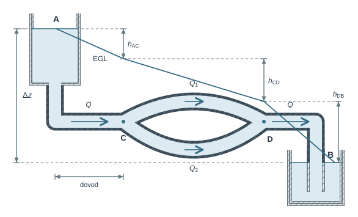
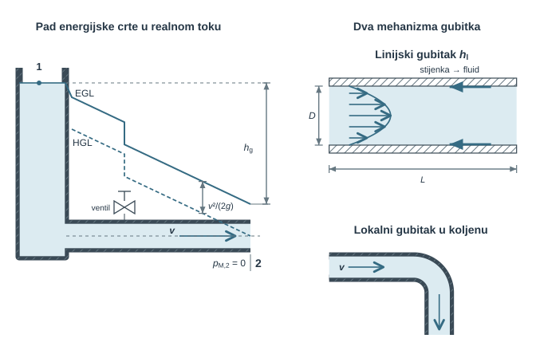
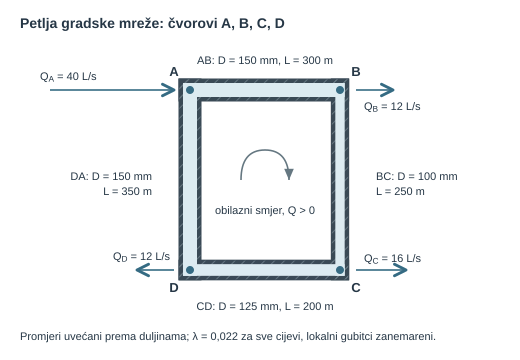
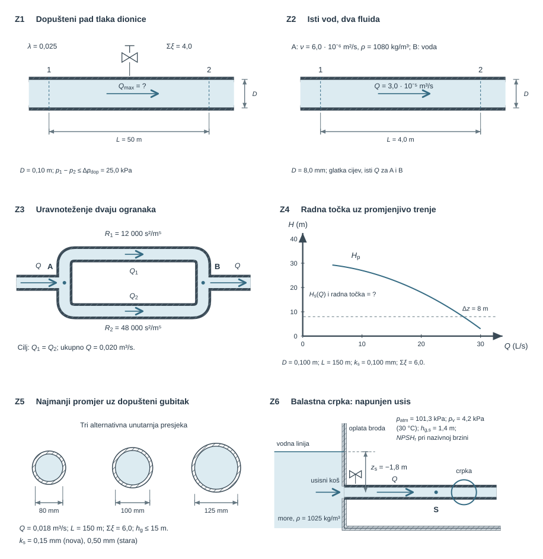

U realnom cjevovodu ukupna energijska visina fluida opada u smjeru toka: viskozna naprezanja i miješanje u ravnim cijevima, koljenima, ventilima i razdjelnicima nepovratno pretvaraju dio mehaničke energije u unutarnju. Taj gubitak $h_g$ određuje koliki protok daje zadana visinska razlika, koliku visinu dobave $H_p$ mora dati crpka i koliko električne energije sustav troši u radu. Bernoullijeva jednadžba iz []{.mf1-chapter-ref target="u08"} zato se proširuje članovima crpke, turbine i gubitaka, a lokalni opis viskoznog toka i Hagen–Poiseuilleov rezultat iz []{.mf1-chapter-ref target="u12"} sažimaju se u koeficijente gubitaka.

U svakoj dionici računaju se $v=4Q/(\pi D^2)$ i $Re=vD/\nu$, a zatim Darcyjev koeficijent trenja $\lambda(Re,k_s/D)$ i gubitak $h_g=(\lambda L/D+\sum\xi)v^2/(2g)$, gdje je $k_s$ ekvivalentna hrapavost, a $\xi$ koeficijent lokalnog gubitka. Zbroj koeficijenata $\xi$ u tom obliku pretpostavlja istu referentnu brzinu; prijelazni režim zahtijeva posebnu provjeru. Uz stalan $\lambda$ linijski je gubitak razmjeran omjeru $Q^2/D^5$, pa je promjer najjača geometrijska poluga.

Mreža se razlaže na dionice. Kroz serijske dionice prolazi isti protok $Q$ i gubitci se zbrajaju. U čvoru se protok dijeli, primjerice $Q=Q_1+Q_2$, a paralelne grane između zajedničkih čvorova imaju isti pad energije, pa grana manjeg otpora prenosi veći protok.

Poglavlje redom obrađuje realnu energijsku bilancu s energijskom i piezometarskom crtom, linijske i lokalne gubitke, put od Reynoldsova broja do koeficijenta trenja, serijske, paralelne i petljaste mreže, radnu točku crpke s lancem snaga te raspoloživu neto pozitivnu usisnu visinu $NPSH_a$. Iste bilance koriste se pri projektiranju brodskih balastnih i rashladnih sustava te sustava grijanja i protupožarne zaštite. Model je jednodimenzijski i stacionaran: vodeni udar, brze promjene ventila i izrazito stlačiv tok traže proširen model, a strujanje kroz rotor crpke obrađuje se u []{.mf1-chapter-ref target="u14"}.

Slika [-@fig-cjevovodna-mreza-pregled] prikazuje serijsko-paralelnu mrežu između gornjeg spremnika A i donjeg spremnika B. Dovodna dionica od A do čvora C i odvodna dionica od čvora D do B spojene su serijski, pa kroz obje prolazi isti protok $Q$. U čvoru C protok se dijeli na grane, $Q=Q_1+Q_2$, a u čvoru D ponovno se spaja; paralelne grane između C i D imaju isti pad energije. Kota $\Delta z$ povezuje slobodne površine spremnika i za prikazanu mrežu je ukupna raspoloživa visina, koja se duž energijske crte (EGL) troši u tri dijela: $\Delta z=h_{AC}+h_{CD}+h_{DB}$. Promjeri cijevi i EGL nacrtani su shematski.

{#fig-cjevovodna-mreza-pregled fig-align="center" fig-alt="Gornji spremnik A spojen je dovodnom cijevi s čvorom C, iz kojega dvije paralelne grane vode do čvora D i dalje do donjeg spremnika B, uz kotu Δz između slobodnih površina i energijsku crtu koja pada stepenasto duž triju dionica."}

**Procijenjeno vrijeme rada uz priručnik:** 12 sati.

## Realna energijska bilanca sustava {#sec-realna-energijska-bilanca}

Promatrajmo stacionarni tok nestlačivog fluida kroz kontrolni volumen s jednim ulaznim presjekom 1 i jednim izlaznim presjekom 2. Pozitivni smjer protoka ide od 1 prema 2. Crpka fluidu dodaje visinu $H_p$, turbina oduzima visinu $H_t$, a disipacija se zapisuje nenegativnim članom $h_g\ge0$. Bilanca mehaničke energije po jedinici težine glasi

$$
\underbrace{\frac{p_1}{\rho g}+z_1+\alpha_1\frac{v_1^2}{2g}}_{H_1}
+H_p
=
\underbrace{\frac{p_2}{\rho g}+z_2+\alpha_2\frac{v_2^2}{2g}}_{H_2}
+H_t+h_g .
$$ {#eq-realna-energijska-bilanca}

Svi članovi imaju jedinicu metra promatranog fluida. Tlakovi $p_1$ i $p_2$ moraju imati istu referencu: oba apsolutna ili oba manometarska. Za dvije otvorene slobodne površine atmosferski se tlakovi mogu pokratiti, ali se u računu NPSH-a ne smiju izostaviti jer je ondje referenca apsolutna.

Koeficijent kinetičke energije

$$
\alpha=\frac{1}{A\bar v^3}\int_A v^3\,dA
$$ {#eq-cjevovodi-1-realna-energijska-bilanca-sustava-sec-realna-01}

uzima u obzir nejednolik profil. Za potpuno razvijen laminarni tok u kružnoj cijevi vrijedi $\alpha=2$; u mnogim turbulentnim tehničkim tokovima blizu je jedinice. Aproksimacija $\alpha\approx1$ nije opći zakon, nego odluka koju treba navesti.

::: {.mf1-fizikalno-znacenje}

Fizikalno značenje — Energijska i piezometarska crta

Energijska crta (EGL) prikazuje $H=p/(\rho g)+z+\alpha v^2/(2g)$, a piezometarska crta (HGL) prikazuje $p/(\rho g)+z$. U dionici bez stroja EGL pada u smjeru toka za $h_g$; preko crpke skače naviše za $H_p$. Razmak EGL–HGL jednak je korigiranoj brzinskoj visini. Zato skica tih crta često otkrije pogrešan predznak prije računa.
:::

::: {.mf1-dublje}

Dublje — Disipacija nije proizvoljan dodatak

Za stacionaran, nestlačiv newtonski tok u kojem promatrani kontrolni volumen obuhvaća cijelo područje gubitka, lokalna viskozna disipacija po jedinici volumena jest

$$
\Phi=2\mu S_{ij}S_{ij}\geq0,
\qquad
S_{ij}=\frac12\left(\frac{\partial v_i}{\partial x_j}+\frac{\partial v_j}{\partial x_i}\right).
$$ {#eq-cjevovodi-disipacija-kao-izvor-gubitka-01}

Kada se energijski tokovi na ulaznom i izlaznom presjeku vrednuju dosljedno, dio mehaničke energije označen s $h_g$ povezan je s tom nepovratnom pretvorbom:

$$
\rho gQh_g=\int_V\Phi\,dV.
$$ {#eq-cjevovodi-disipacija-kao-izvor-gubitka-02}

Zato je doprinos $h_g$ nenegativan, a u idealnom graničnom slučaju $\mu=0$ nestaje. U turbulentnom toku jednakost vrijedi za vremenski osrednjenu disipaciju trenutačnog polja brzine, koja uz disipaciju osrednjenog toka sadrži i turbulentnu disipaciju. U jednodimenzijskom računu Darcyjev i lokalni koeficijent gubitka sažimaju ovaj učinak; u RANS proračunu (osrednjene jednadžbe iz []{.mf1-chapter-ref target="u12"}) dio prijenosa i disipacije opisuje turbulencijski model. To tumačenje ne uklanja potrebu za konvergencijom po mreži ćelija, validacijom i fizikalno odgovarajućim rubnim uvjetima.
:::

{#fig-energijska-crta-gubitci fig-align="center" fig-alt="Lijevo cijev od presjeka 1 do presjeka 2 s ventilom i padajućom energijskom i piezometarskom crtom, desno ravna dionica s profilom brzine i koljeno kao primjeri linijskoga i lokalnoga gubitka."}

**Tumačenje skice.** Bez stroja vrijedi $H_1=H_2+h_g$: EGL pada zbog linijskih i lokalnih gubitaka, HGL prikazuje zbroj tlačne i geodetske visine, a uz $\alpha=1$ razmak je $EGL-HGL=v^2/(2g)$.

::: {.mf1-granica-modela}

Granica modela — Kada jednodimenzijska bilanca nije dovoljna

Jednadžba [-@eq-realna-energijska-bilanca] jest jednodimenzijska stacionarna bilanca. Brze promjene ventila, vodeni udar, elastičnost cijevi, plinoviti džepovi, izražena izmjena topline i snažno stlačivi tok traže proširen model. Koeficijenti gubitaka također vrijede samo za geometriju i režim za koje su određeni.
:::

## Linijski i lokalni gubitci {#sec-linijski-lokalni-gubitci}

Za ravnu kružnu cijev stalnog promjera Darcy–Weisbachova jednadžba glasi

$$
h_l=\lambda\frac{L}{D}\frac{v^2}{2g},
$$ {#eq-darcy-weisbach}

a za lokalni element

$$
h_{loc}=\xi\frac{v_{ref}^2}{2g}.
$$ {#eq-lokalni-gubitak}

Darcyjev koeficijent trenja $\lambda$ i lokalni koeficijent $\xi$ bezdimenzijski su. U izrazu za lokalni element mora se znati na koji se presjek odnosi $v_{ref}$. Pri naglom proširenju, suženju presjeka ili grananju brzine s dviju strana elementa nisu jednake, pa slijepo zbrajanje svih $\xi$ uz jednu zajedničku brzinu može biti pogrešno.

Za dionicu stalnog promjera praktičan je zapis

$$
h_g=\left(\lambda\frac{L}{D}+\sum_j\xi_j\right)\frac{v^2}{2g}.
$$ {#eq-gubitak-dionice}

Izraz u zagradi jest ukupni koeficijent otpora dionice, $\zeta=\lambda L/D+\sum\xi$, pa je $h_g=\zeta\,v^2/(2g)$; $\zeta$ se odnosi na brzinu u toj dionici i ne smije se zbrajati s koeficijentima dionica drugog promjera.

Linijski i lokalni doprinosi nisu dvije nove sile. Oba doprinosa sažimaju nepovratnu pretvorbu mehaničke energije u unutarnju energiju zbog viskoznih naprezanja i miješanja. Darcy–Weisbachova jednadžba i Moodyjev dijagram standardni su prikaz otpora razvijenoga toka u kružnim cijevima [@moody1944; @white2011].

### Promjer je najjača geometrijska poluga {#sec-utjecaj-promjera}

Pri zadanom protoku $Q$ vrijedi $v=4Q/(\pi D^2)$. Uvrštavanjem u jednadžbu [-@eq-darcy-weisbach] dobiva se

$$
h_l=\frac{8\lambda L}{\pi^2g}\frac{Q^2}{D^5}.
$$ {#eq-linijski-gubitak-protok}

Ako su $Q$, $L$ i **$\lambda$ stalni**, udvostručenje promjera smanjuje linijski gubitak $2^5=32$ puta. Lokalni gubitak sa stalnim $\xi$ tada se smanjuje 16 puta jer ne sadrži dodatni faktor $L/D$. Pri stvarnoj promjeni izvedbe treba ponovno odrediti $Re$, $k_s/D$ i $\lambda$, pa konačni omjer nije nužno točno 32. Ova analiza pokazuje zašto nekoliko milimetara promjera može vrijediti više od niza manjih prilagodbi armature.

::: {.mf1-cfd title="Računalna dinamika fluida"}

**Kako CFD rezultat postaje podatak za cjevovod?** Za novi razdjelnik rashladne ploče pouzdan tablični koeficijent gubitka često ne postoji. Model je stacionarni nestlačivi RANS račun razdjelnika sa zadanim ulaznim protokom i tlakom na izlazima; podatci su geometrija, hrapavost i više radnih protoka. Izlaz je razlika tokova mehaničke energije između ulaza i svakog izlaza, uz kote i nejednolike profile ($\alpha\neq1$), iz koje se za svaki put kroz razdjelnik izvodi koeficijent $\xi$ s jasno navedenom referentnom brzinom i podjelom protoka.

Provjera: sam statički pad tlaka nije uvijek gubitak jer se u proširenju dio kinetičke energije vraća u tlak. Zato se, kao kod Venturijeve cijevi u []{.mf1-chapter-ref target="u08"}, zadržava cijela energijska bilanca. Izvedeni $\xi$ mora u turbulentnom području biti približno neovisan o protoku. Odluka: tako dobiveni otpori ulaze u model cijeloga kruga i mogu promijeniti podjelu protoka i potrebnu visinu dobave crpke.
:::

## Od Reynoldsova broja do koeficijenta trenja {#sec-koeficijent-trenja}

Ispravan slijed jest

$$
Q\longrightarrow v=\frac{Q}{A}
\longrightarrow Re=\frac{vD}{\nu}
\longrightarrow \lambda(Re,k_s/D)
\longrightarrow h_g.
$$ {#eq-cjevovodi-3-od-reynoldsova-broja-do-koeficijenta-trenja-01}

::: {.mf1-izvod}

Matematički izvod — Darcyjev koeficijent iz ravnoteže sila i njegov račun

**Fizikalno pitanje.** Kolika sila stijenke koči potpuno razvijen tok u ravnoj kružnoj cijevi i kako se ona sažima u jedan bezdimenzijski koeficijent?

**Bilanca.** Promatra se odsječak fluida duljine $L$ koji ispunjava cijev promjera $D$. U razvijenom stacionarnom toku količina gibanja odsječka ne mijenja se, pa tlačna sila na presjecima mora uravnotežiti smičnu silu kojom stijenka djeluje na fluid, odnosno $\tau_{st}$ po oplakanoj plohi $\pi DL$:

$$
\Delta p\,\frac{\pi D^2}{4}=\tau_{st}\,\pi D L
\quad\Rightarrow\quad
\tau_{st}=\frac{D}{4}\,\frac{\Delta p}{L}.
$$ {#eq-ravnoteza-odsjecka-cijevi}

Za vodoravnu cijev vrijedi $\Delta p=\rho g h_l$. Uvrštavanjem Darcy–Weisbachove jednadžbe [-@eq-darcy-weisbach] dobiva se

$$
\lambda=\frac{8\tau_{st}}{\rho v^2},
$$ {#eq-lambda-iz-smicnog-naprezanja}

dakle $\lambda$ nije ništa drugo nego bezdimenzijsko smično naprezanje stijenke. Taj zapis vrijedi za svaki režim; samo veza $\tau_{st}(v)$ ovisi o režimu.

**Koraci za laminarni tok.** Hagen–Poiseuilleov parabolični profil ima na stijenci $\tau_{st}=8\mu v/D$. Uvrštavanjem u jednadžbu [-@eq-lambda-iz-smicnog-naprezanja] slijedi

$$
\lambda=\frac{8\cdot8\mu v/D}{\rho v^2}=\frac{64\mu}{\rho vD}=\frac{64}{Re}.
$$ {#eq-lambda-laminarno}

**Rezultat.** Uvrsti li se $\lambda=64/Re$ natrag u Darcy–Weisbachovu jednadžbu, dobiva se Hagen–Poiseuilleov zapis

$$
\Delta p=\rho gh_l=\frac{128\mu L}{\pi D^4}Q.
$$ {#eq-poiseuille-u13}

**Provjera.** U laminarnom području $\Delta p\propto Q$, a ne $Q^2$: kvadratni oblik Darcy–Weisbachove jednadžbe ne dokazuje kvadratnu ovisnost jer je $\lambda\propto1/Q$. Isti zapis vrijedi i u CFD-u: integral $\tau_{st}$ po stijenci razvijene dionice mora dati $64/Re$; inače treba provjeriti razvijenost toka, mrežu ćelija i rubne uvjete.

**Numerički korak za turbulentni tok.** U turbulentnom režimu $\tau_{st}$ ovisi i o hrapavosti. Colebrook–Whiteova implicitna jednadžba povezuje $\lambda$, $Re$ i relativnu hrapavost [@colebrook1939]:

$$
\frac{1}{\sqrt{\lambda}}
=-2\log_{10}\!\left(
\frac{k_s/D}{3{,}7}
+\frac{2{,}51}{Re\sqrt{\lambda}}
\right).
$$ {#eq-colebrook-white}

Nepoznata $\lambda$ pojavljuje se izvan i unutar logaritma, pa se odabere početna procjena, primjerice $\lambda_0=0{,}02$, i ponavlja se iteracija

$$
\lambda_{k+1}=\left[
-2\log_{10}\!\left(
\frac{k_s/D}{3{,}7}
+\frac{2{,}51}{Re\sqrt{\lambda_k}}
\right)
\right]^{-2}
$$ {#eq-cjevovodi-izvod-zasto-je-colebrookov-racun-iterativan-01}

dok razlika dviju uzastopnih vrijednosti ne postane manja od zadane tolerancije. Treba provjeriti i rezidual izvorne jednadžbe, ne samo promjenu iterata. Za ručni račun dovoljne su eksplicitne aproksimacije: Swamee–Jainova [@swamee1976]

$$
\lambda=\frac{0{,}25}{\left[\log_{10}\!\left(\frac{k_s/D}{3{,}7}+\frac{5{,}74}{Re^{0{,}9}}\right)\right]^2},
\qquad 5000<Re<10^8,\quad 10^{-6}<k_s/D<10^{-2},
$$ {#eq-swamee-jain}

koja od Colebrookove odstupa za oko 1 %, a za hidraulički glatku cijev i $4000<Re<10^5$ Blasiusova $\lambda=0{,}3164\,Re^{-1/4}$ [@schlichting2017]. Koeficijent se može očitati i iz Moodyjeva dijagrama.

**Granice.** Kad $k_s/D\to0$, hrapavost nestaje iz dominantnog člana; pri vrlo velikom $Re$ i konačnoj hrapavosti viskozni član postaje malen pa $\lambda$ teži vrijednosti određenoj uglavnom omjerom $k_s/D$. U prijelaznom području približno između $Re=2300$ i $4000$ režim je osjetljiv na ulazne poremećaje, hrapavost i povijest toka; jedna univerzalna korelacija ondje nije pouzdana. Ti pragovi odnose se na unutarnji tok u kružnoj cijevi, a ne na svako strujanje.
:::

::: {.mf1-interaktivno}

Numerički pokus — Od predviđanja do reziduala

**Predvidi.** Kako veća relativna hrapavost mijenja koeficijent trenja i radnu točku crpke iz Z4?

**Provjeri i protumači.** Usporedi iterativno rješenje, aproksimaciju i dijagram. U nastavku provjeri i Colebrookov i energijski rezidual: mali ostatak jedne jednadžbe ne potvrđuje drugu.

<a class="mf1-interaktivno-veza" href="https://martibasic.github.io/MF1_udzbenik/jlite/lab/index.html?path=u10_moody_dijagram.ipynb" target="_blank" rel="noopener">Pokreni u pregledniku</a>

:::

::: {.mf1-cfd title="Računalna dinamika fluida"}

**Koliki dio otpora dolazi iz ravnih vodova?** Prije pripisivanja velikoga pada tlaka razdjelniku provjerimo i cijevi koje ga napajaju. U potpuno razvijenom CFD toku tlak i smično naprezanje moraju dati isti otpor, iz kojega izvodimo Darcyjev koeficijent trenja $\lambda$. Laminarni test treba vratiti $64/Re$; turbulentni uspoređujemo s odgovarajućom korelacijom pri istoj hrapavosti.

Ako su ravni vodovi dobro opisani 1D relacijom, u modelu sustava možemo ih zadržati bez prostornog CFD-a. Otporu koji je već dobiven iz naprezanja u CFD domeni ne dodajemo Colebrookovu relaciju kao novu silu. Za zidni model treba uskladiti definiciju ekvivalentne hrapavosti; ona nije automatski jednaka svakoj izmjerenoj visini neravnina.
:::

## Serijske i paralelne mreže {#sec-cjevovodne-mreze}

Mreža se najprije razlaže na dionice unutar kojih su $D$, $\lambda$ i referentna brzina jednoznačni. Tek se zatim pišu jednadžbe.

Za dionicu u području u kojem se $\lambda$ može smatrati približno stalnim korisno je uvesti hidraulički otpor dionice $R$ (u ovom poglavlju $R$ nije polumjer):

$$
h_g=RQ^2,
\qquad
R=\frac{8}{\pi^2g}
\left(\frac{\lambda L}{D^5}+\frac{\sum\xi}{D^4}\right).
$$ {#eq-hidraulicki-otpor}

Za serijski spoj tada vrijedi $R_{eq}=\sum R_i$. Za paralelne grane između čvorova A i B vrijedi

$$
Q=\sum_iQ_i,
\qquad
R_iQ_i^2=h_{AB},
\qquad
\frac{1}{\sqrt{R_{eq}}}=\sum_i\frac{1}{\sqrt{R_i}}.
$$ {#eq-paralelni-otpor}

Analogija s električnim otporom korisna je samo do određene granice: hidraulički je odnos ovdje kvadratan, a $R$ se mijenja s protokom ako se mijenja $\lambda$. Zato se za opću mrežu jednadžbe kontinuiteta u čvorovima i energijske jednadžbe po neovisnim putovima rješavaju zajedno i iterativno. Otpori i njihove jedinice moraju pripadati istom modelu.

U gradskoj distribucijskoj mreži cijevi tvore zatvorene **petlje**. U svakom čvoru zbroj dotoka jednak je zbroju odljeva, a oko svake petlje zbroj predznačenih gubitaka iščezava jer se vraćamo u istu točku, dakle na istu energijsku visinu. Hardy–Crossova metoda [@cross1936] polazi od bilo koje raspodjele protoka koja zadovoljava bilance u čvorovima i ispravlja je u svakoj petlji istim iznosom $\Delta Q$, čime čvorne bilance ostaju netaknute. Linearizacijom $R(Q+\Delta Q)|Q+\Delta Q|\approx RQ|Q|+2R|Q|\Delta Q$ dobiva se

$$
\Delta Q=-\frac{\sum_i R_iQ_i|Q_i|}{2\sum_i R_i|Q_i|},
$$ {#eq-hardy-cross}

gdje se protoci broje pozitivno u odabranom obilaznom smjeru petlje. Postupak se ponavlja dok rezidual petlje ne padne ispod zadane tolerancije; @ex-petlja-gradske-mreze pokazuje dvije iteracije.

::: {.mf1-fizikalno-znacenje}

Fizikalno značenje — Jednak pad energije paralelnih grana

Dvije paralelne grane počinju u istom čvoru i završavaju u istom čvoru. Zato razlika ukupne energijske visine između njihovih krajeva mora biti ista. Grana manjeg otpora pri tom zajedničkom padu prenosi veći protok. Jednaki protoci nastaju samo kao posljedica jednakih otpora, a ne kao opće pravilo paralelnog spoja.
:::

::: {.mf1-interaktivno}

Numerički pokus — Paralelne grane

**Predvidi.** Koja grana preuzima najveći protok?

**Zastani i promisli.** Dvije paralelne grane imaju jednak pad energije, ali različite protoke. Je li narušen kontinuitet?

**Provjeri i protumači.** Nije: jednak pad energije slijedi iz zajedničkih krajnjih čvorova, a protoci ovise o otporima grana; kontinuitet traži samo da njihov zbroj odgovara dotoku. Promijeni promjer jedne grane i prati sve protoke, kontinuitet i gubitke između čvorova. Pokus vrijedi za turbulentne grane. Zasebni odjeljci iste bilježnice obrađuju podatke iz Z3 i Z6.

<a class="mf1-interaktivno-veza" href="https://martibasic.github.io/MF1_udzbenik/jlite/lab/index.html?path=u13_paralelne_grane.ipynb" target="_blank" rel="noopener">Pokreni u pregledniku</a>

:::

::: {#cfd-krug-radna-tocka .mf1-cfd title="Računalna dinamika fluida"}

**Hoće li bolji razdjelnik povećati protok u stvarnom sustavu?** Ručni @ex-radna-tocka-vfd određuje protok presjecištem karakteristika crpke i sustava. Zato nakon promjene otpora razdjelnika ne zadržavamo automatski ukupni dotok koji je za rashladni krug pretpostavljen u []{.mf1-chapter-ref target="u07"}. Model cjevovodne mreže daje početne protoke i tlakove za lokalni CFD razdjelnika. Iz CFD-a vraćamo otpore grana, pa ponovno računamo raspodjelu protoka i radnu točku crpke.

Postupak po potrebi ponavljamo jer otpor ovisi o režimu i podjeli protoka. Manji lokalni gubitak pri jednakom protoku ne znači automatski jednaku uštedu električne snage: pri nepromijenjenoj brzini crpke mijenja se i radni protok. Pratimo protok svake grane, visinu dobave te snagu i učinkovitost crpke. CFD mreža ćelija opisuje unutrašnjost uređaja, a cjevovodna mreža povezanost cijeloga sustava.
:::

## Crpka, karakteristika sustava i radna točka {#sec-radna-tocka-crpke}

Između dviju velikih otvorenih površina brzine i manometarski tlakovi iščezavaju iz bilance. Potrebna visina sustava tada je

$$
H_s(Q)=\Delta z+h_g(Q).
$$ {#eq-karakteristika-sustava}

Ako se koeficijenti otpora u promatranom području malo mijenjaju, sa statičkom visinom $H_{stat}=\Delta z$ često se piše

$$
H_s(Q)=H_{stat}+RQ^2.
$$ {#eq-cjevovodi-5-crpka-karakteristika-sustava-i-radna-tocka-01}

Crpka ima vlastitu karakteristiku $H_p(Q)$ za zadanu brzinu vrtnje, radno kolo i fluid. Radna točka nije proizvoljno odabrana kataloška točka, nego rješenje

$$
H_p(Q_{op})=H_s(Q_{op}).
$$ {#eq-radna-tocka}

Zatvaranje ventila povećava otpor sustava i pomiče radnu točku. Promjena brzine vrtnje pomiče krivulju crpke. Za geometrijski istu crpku i približno slične režime afinitetni zakoni daju $Q\propto n$, $H\propto n^2$ i $P\propto n^3$, ali ti odnosi opisuju međusobno slične točke na krivuljama crpke. Pri omjeru brzina vrtnje $s=n_2/n_1$ svaka točka $(Q,H)$ krivulje crpke prelazi u $(sQ,\,s^2H)$, pa nova krivulja glasi $H_{p,2}(Q)=s^2H_p(Q/s)$. **Ne smiju se slijepo prenositi na cijeli sustav sa statičkom visinom.** Novi radni protok uvijek treba dobiti iz novoga presjecišta $H_p$ i $H_s$ [@cengel2014; @white2011].

### Snaga bez miješanja energijskih razina {#sec-ledger-snage}

Crpka fluidu predaje hidrauličku snagu

$$
P_h=\rho gQH_p.
$$ {#eq-hidraulicka-snaga-crpke}

Ako je ukupna učinkovitost crpke $\eta_p$ (omjer hidrauličke i vratilne snage), vratilna snaga jest

$$
P_{vr}=\frac{P_h}{\eta_p}.
$$ {#eq-cjevovodi-snaga-bez-mijesanja-energijskih-razina-sec-ledge-01}

Ako motor i pretvarač imaju učinkovitosti $\eta_m$ i $\eta_f$, električna snaga preuzeta iz mreže jest

$$
P_{el}=\frac{P_{vr}}{\eta_m\eta_f}
=\frac{\rho gQH_p}{\eta_p\eta_m\eta_f}.
$$ {#eq-elektricna-snaga-crpke}

Redoslijed pretvorbe snage dakle glasi

$$
P_{el}\longrightarrow P_{vr}\longrightarrow P_h
\longrightarrow
\begin{cases}
\rho gQ\Delta z & \text{promjena potencijalne energije},\\
\rho gQh_g & \text{disipacija u sustavu}.
\end{cases}
$$ {#eq-cjevovodi-snaga-bez-mijesanja-energijskih-razina-sec-ledge-02}

Disipacija na ventilu dio je hidrauličke snage, a gubitci motora i crpke razlike su između pojedinih razina pretvorbe. Zato se snaga disipirana na ventilu ne smije izravno oduzeti od električne snage i nazvati ostatkom hidrauličke snage.

## Usis i $NPSH$: nužan, ali ne konačan kriterij {#sec-npsh}

Na usisu crpke apsolutni tlak može biti nizak zbog geodetskog uspona, brzinske visine i gubitaka. Raspoloživa neto pozitivna usisna visina definira se u referentnom usisnom presjeku kao

$$
NPSH_a=
\frac{p_{aps,s}}{\rho g}
+\frac{v_s^2}{2g}
-\frac{p_v}{\rho g},
$$ {#eq-npsha}

gdje su $p_{aps,s}$ apsolutni tlak i $v_s$ srednja brzina u referentnom usisnom presjeku S (u ovom poglavlju $v_s$ nije brzina broda), a $p_v$ tlak zasićene pare pri radnoj temperaturi. Za usis iz otvorenog spremnika ista se veličina može zapisati kao

$$
NPSH_a=
\frac{p_{atm}}{\rho g}-z_s-h_{g,s}-\frac{p_v}{\rho g}.
$$ {#eq-npsha-spremnik}

Ovdje je $h_{g,s}$ gubitak u usisnom vodu od slobodne površine do presjeka S, a $z_s$ visina referentnog usisnog presjeka iznad slobodne površine: pozitivna je kad crpka usisava iznad razine, a negativna pri napunjenom usisu, kad je presjek ispod razine. Brzinska se visina u drugom zapisu pokrati jer je već uključena u Bernoullijevu bilancu do usisnog presjeka. Ta dva zapisa moraju dati isti rezultat.

Proizvođač određuje potrebni $NPSH_r(Q,n)$ ispitivanjem, najčešće kao $NPSH_3$: vrijednost pri kojoj visina dobave zbog kavitacije padne za 3 % [@iso9906]. Pri $NPSH_a=NPSH_r$ kavitacija dakle već postoji. Uporabna provjera zahtijeva usporedbu raspoloživog i potrebnog NPSH-a uz odgovarajuću projektnu marginu. Sam rezultat $NPSH_a>0$ ili činjenica da je srednji tlak na usisu iznad $p_v$ ne dokazuju da kavitacije neće biti: lokalni tlak u radnom kolu može biti niži, a dopuštena margina ovisi o crpki, režimu i kriteriju proizvođača.

::: {.mf1-granica-modela}

Granica modela — Što $NPSH_a$ ne jamči

$NPSH_a$ opisuje sustav do dogovorenoga usisnog presjeka. Ne zamjenjuje proizvođačevu krivulju $NPSH_r$, ne opisuje lokalne mjehuriće u svakoj točki radnoga kola i nije samostalna potvrda sigurnosti. Tlak pare mora odgovarati temperaturi i sastavu stvarnog fluida, a atmosferski tlak nadmorskoj visini i radnom stanju. $NPSH_a$ ne opisuje ni uvlačenje zraka kroz vrtloge na usisu ili, na brodu, pri ljuljanju i trimu, kad se usisni otvor približi slobodnoj površini.
:::

::: {.mf1-cfd title="Računalna dinamika fluida"}

**Prazniji spremnik, toplija tekućina i kavitacija crpke.** U rashladnom krugu s razdjelnikom iz prethodnih odlomaka sniženje razine spremnika smanjuje raspoloživu usisnu visinu, a promjena temperature mijenja tlak pare. Usisna bilanca daje uvjete na ulazu u crpku. CFD zatim pokazuje lokalne minimume tlaka između lopatica; za procjenu nastanka pare koristimo apsolutni statički tlak pri toj temperaturi.

Uspoređujemo početno i nepovoljnije radno stanje te pratimo položaj područja niskog tlaka. Jednofazni račun upozorava na rizik, dok nastanak i razvoj parnih područja traže višefazni model s prijelazom mase. Time povezujemo razinu spremnika iz hidrostatike s lokalnim tokom u rotoru, koji obrađuje []{.mf1-chapter-ref target="u14"}.
:::

## Riješeni primjeri {#sec-u13-rijeseni-primjeri}

::: {#ex-gubitci-jedne-dionice .mf1-we}

Linijski i lokalni gubitci jedne dionice T2

**Tekst zadatka**

Voda gustoće $\rho=1000\ \mathrm{kg/m^3}$ i kinematičke viskoznosti $\nu=1{,}0\cdot10^{-6}\ \mathrm{m^2/s}$ struji vodoravnom cijevi od lijevanog željeza promjera $D=0{,}12\ \mathrm{m}$ i duljine $L=36\ \mathrm{m}$ srednjom brzinom $v=2{,}4\ \mathrm{m/s}$. Ekvivalentna hrapavost stijenke iznosi $k_s=0{,}26\ \mathrm{mm}$ [@moody1944], a zbroj koeficijenata lokalnih gubitaka $\sum\xi=4{,}6$.

**Traži se**

Odredi Reynoldsov broj i Darcyjev koeficijent trenja, zatim linijski, lokalni i ukupni gubitak te pad tlaka.

**Rješenje**

Reynoldsov broj i relativna hrapavost iznose

$$
Re=\frac{vD}{\nu}=\frac{2{,}4\cdot0{,}12}{1{,}0\cdot10^{-6}}=2{,}88\cdot10^5,
\qquad
\frac{k_s}{D}=\frac{0{,}26}{120}=2{,}17\cdot10^{-3}.
$$ {#eq-gubitci-dionice-reynolds-hrapavost}

Tok je turbulentan, pa koeficijent trenja daje eksplicitna Swamee–Jainova aproksimacija [-@eq-swamee-jain]:

$$
\lambda=\frac{0{,}25}{\left[\log_{10}\!\left(\dfrac{2{,}17\cdot10^{-3}}{3{,}7}+\dfrac{5{,}74}{\left(2{,}88\cdot10^5\right)^{0{,}9}}\right)\right]^2}=0{,}02467.
$$ {#eq-gubitci-dionice-swamee-jain}

Brzinska visina iznosi

$$
\frac{v^2}{2g}=\frac{2{,}4^2}{2\cdot9{,}81}=0{,}2936\ \mathrm{m}.
$$ {#eq-cjevovodi-rijeseni-primjer-linijski-i-lokalni-gubitci-jedn-01}

Linijski i lokalni gubitak tada iznose

$$
h_l=0{,}02467\frac{36}{0{,}12}(0{,}2936)=2{,}173\ \mathrm{m},
$$ {#eq-cjevovodi-rijeseni-primjer-linijski-i-lokalni-gubitci-jedn-02}

$$
h_{loc}=4{,}6(0{,}2936)=1{,}351\ \mathrm{m},
\qquad
h_g=3{,}524\ \mathrm{m}.
$$ {#eq-cjevovodi-rijeseni-primjer-linijski-i-lokalni-gubitci-jedn-03}

U vodoravnoj cijevi stalnog promjera promjena tlaka odgovara ukupnom gubitku:

$$
\Delta p=\rho gh_g=1000\cdot9{,}81\cdot3{,}524
=34{,}57\ \mathrm{kPa}.
$$ {#eq-cjevovodi-rijeseni-primjer-linijski-i-lokalni-gubitci-jedn-04}

**Provjera i tumačenje**

Uvrsti li se $\lambda=0{,}02467$ u desnu stranu Colebrookove jednadžbe [-@eq-colebrook-white], dobiva se $0{,}02452$, oko 0,6 % manje, što je u granicama točnosti eksplicitne aproksimacije. Udio lokalnih gubitaka provjerava se i bez gubitaka u metrima: $\sum\xi/\zeta=4{,}6/(0{,}02467\cdot300+4{,}6)=0{,}383$, kao i $1{,}351/3{,}524$. Lokalni elementi daju gotovo dvije petine ukupnog gubitka, pa se u kratkom vodu ne smiju zanemariti.
:::

::: {#ex-laminarni-rashladni-vod .mf1-we}

Laminarni vod rashladnog modula T2

**Tekst zadatka**

Rashladna smjesa gustoće $1050\ \mathrm{kg/m^3}$ i kinematičke viskoznosti $\nu=5{,}0\cdot10^{-6}\ \mathrm{m^2/s}$ teče kroz kružnu cijev promjera $D=4{,}0\ \mathrm{mm}$ i duljine $L=2{,}0\ \mathrm{m}$ protokom $Q=8{,}0\cdot10^{-6}\ \mathrm{m^3/s}$. Zanemari ulazno područje i lokalne gubitke.

**Traži se**

Odredi srednju brzinu, Reynoldsov broj, Darcyjev koeficijent trenja te linijski gubitak i pad tlaka.

**Rješenje**

Površina presjeka i srednja brzina iznose

$$
A=\frac{\pi D^2}{4}=1{,}257\cdot10^{-5}\ \mathrm{m^2},
\qquad
v=\frac QA=0{,}637\ \mathrm{m/s}.
$$ {#eq-cjevovodi-rijeseni-primjer-laminarni-vod-rashladnog-modula-01}

Reynoldsov broj potvrđuje laminarni model:

$$
Re=\frac{vD}{\nu}=509,
\qquad
\lambda=\frac{64}{Re}=0{,}1257.
$$ {#eq-cjevovodi-rijeseni-primjer-laminarni-vod-rashladnog-modula-02}

Darcy–Weisbachova jednadžba daje

$$
h_l=0{,}1257\frac{2}{0{,}004}
\frac{0{,}637^2}{2\cdot9{,}81}
=1{,}298\ \mathrm{m},
$$ {#eq-cjevovodi-rijeseni-primjer-laminarni-vod-rashladnog-modula-03}

odnosno $\Delta p=\rho gh_l=13{,}37\ \mathrm{kPa}$.

**Provjera i tumačenje**

$\mu=\rho\nu=5{,}25\cdot10^{-3}\ \mathrm{Pa\,s}$, pa jednadžba [-@eq-poiseuille-u13] daje

$$
\Delta p=\frac{128\mu LQ}{\pi D^4}=13{,}37\ \mathrm{kPa}.
$$ {#eq-cjevovodi-rijeseni-primjer-laminarni-vod-rashladnog-modula-04}

Podudaranje dvaju zapisa provjerava faktor 64 i pretvorbu protoka.
:::

::: {#ex-petlja-gradske-mreze .mf1-we}

Petlja gradske vodovodne mreže T3

**Tekst zadatka**

Dio gradske distribucijske mreže čini jedna petlja s čvorovima A, B, C i D. U čvor A ulazi $Q_A=40{,}0\ \mathrm{L/s}$, a potrošnje su $Q_B=12{,}0\ \mathrm{L/s}$, $Q_C=16{,}0\ \mathrm{L/s}$ i $Q_D=12{,}0\ \mathrm{L/s}$. Cijevi su od lijevanog željeza; za promatrani raspon Reynoldsovih brojeva uzmi stalan $\lambda=0{,}022$ i zanemari lokalne gubitke.

| cijev | $D$ [mm] | $L$ [m] |
|---|---:|---:|
| AB | 150 | 300 |
| BC | 100 | 250 |
| CD | 125 | 200 |
| DA | 150 | 350 |

**Traži se**

1. Odredi otpore $R_i$ i provjeri da početna raspodjela $Q_{AB}=22{,}0$, $Q_{BC}=10{,}0$, $Q_{CD}=-6{,}0$ i $Q_{DA}=-18{,}0\ \mathrm{L/s}$ zadovoljava bilance u čvorovima.
2. Provedi dvije Hardy–Crossove iteracije i navedi protoke, gubitke te rezidual petlje.
3. Provjeri kontinuitet u svim čvorovima i razliku energijskih visina između A i C po obama putovima; brzinske visine u čvorovima zanemari.

{#fig-petlja-gradske-mreze fig-align="center" fig-alt="Četiri čvora spojena u zatvorenu petlju; u A ulazi 40 L/s, u B, C i D izlaze potrošnje; cijevi imaju različite promjere i duljine, a strelica označuje obilazni smjer u kojem se protoci broje pozitivno."}

**Veza s proračunom.** Protok se broji pozitivno u smjeru A→B→C→D→A; promjeri cijevi nacrtani su uvećano u odnosu na duljine.

**Rješenje**

Iz jednadžbe [-@eq-hidraulicki-otpor] bez lokalnih gubitaka slijedi $R=8\lambda L/(\pi^2gD^5)$:

$$
R_{AB}=7181,\quad R_{BC}=45\,445,\quad R_{CD}=11\,913,\quad R_{DA}=8378\ \ \mathrm{s^2/m^5}.
$$ {#eq-petlja-otpori}

Zadana početna raspodjela zadovoljava čvorne bilance; negativan predznak znači tok suprotno obilaznom smjeru, dakle A→D i D→C. Provjera čvora C: $10{,}0+6{,}0=16{,}0\ \mathrm{L/s}$.

Prva iteracija prema jednadžbi [-@eq-hardy-cross], s protocima u $\mathrm{m^3/s}$:

$$
\begin{aligned}
\sum R_iQ_i|Q_i|&=3{,}476+4{,}544-0{,}429-2{,}715=4{,}877\ \mathrm{m}, \\
2\sum R_i|Q_i|&=1669\ \mathrm{s/m^2},
\end{aligned}
$$ {#eq-petlja-iteracija-1}

$$
\Delta Q=-\frac{4{,}877}{1669}=-2{,}92\ \mathrm{L/s}.
$$ {#eq-petlja-korekcija-1}

Novi protoci su $Q_{AB}=19{,}08$, $Q_{BC}=7{,}08$, $Q_{CD}=-8{,}92$ i $Q_{DA}=-20{,}92\ \mathrm{L/s}$. Druga iteracija daje $\sum R_iQ_i|Q_i|=0{,}276\ \mathrm{m}$, $2\sum R_i|Q_i|=1481\ \mathrm{s/m^2}$ i $\Delta Q=-0{,}19\ \mathrm{L/s}$, pa su protoci

$$
Q_{AB}=18{,}89,\quad Q_{BC}=6{,}89,\quad Q_{CD}=-9{,}11,\quad Q_{DA}=-21{,}11\ \mathrm{L/s},
$$ {#eq-petlja-protoci}

a gubitci $h_{AB}=2{,}56$, $h_{BC}=2{,}16$, $h_{DC}=0{,}99$ i $h_{AD}=3{,}73\ \mathrm{m}$. Rezidual petlje nakon druge iteracije iznosi $2{,}56+2{,}16-0{,}99-3{,}73=0{,}00\ \mathrm{m}$ (nezaokruženo $1{,}1\ \mathrm{mm}$).

**Provjera i tumačenje**

Čvorovi: A $18{,}89+21{,}11=40{,}0$; B $18{,}89-12{,}0=6{,}89$; C $6{,}89+9{,}11=16{,}0$; D $21{,}11-12{,}0=9{,}11\ \mathrm{L/s}$. Pad od A do C iznosi $4{,}72\ \mathrm{m}$ putem B i putem D. Brzine $0{,}74$–$1{,}19\ \mathrm{m/s}$ uobičajene su za distribucijske vodove. Stalan $\lambda$ pri $Re\approx0{,}9$–$1{,}8\cdot10^5$ jest pojednostavnjenje: stvarni bi projekt $\lambda$ provjerio Swamee–Jainovom ili Colebrookovom relacijom. U mreži s više petlji cijev zajednička dvjema petljama prima obje korekcije.
:::

::: {#ex-radna-tocka-vfd .mf1-we}

Radna točka i promjena brzine vrtnje T3

**Tekst zadatka**

Karakteristike crpke pri nazivnoj brzini vrtnje i otvorenog sustava, s protokom $Q$ u $\mathrm{L/s}$, glase:

$$
H_p(Q)=25-0{,}0175Q^2,
\qquad
H_s(Q)=6+0{,}0303Q^2.
$$ {#eq-cjevovodi-rijeseni-primjer-radna-tocka-i-promjena-brzine-01}

Promjenom brzine vrtnje, bez dodatnog prigušenja, treba postići $Q_2=17{,}24\ \mathrm{L/s}$.

**Traži se**

Odredi početnu radnu točku te omjer brzina vrtnje potreban za zadani smanjeni protok.

**Rješenje**

Prvi član karakteristike sustava, $6\ \mathrm{m}$, statička je visina. Radna točka dobiva se iz jednakosti krivulja:

$$
25-0{,}0175Q^2=6+0{,}0303Q^2,
$$ {#eq-cjevovodi-rijeseni-primjer-radna-tocka-i-promjena-brzine-02}

$$
Q_{op}=19{,}94\ \mathrm{L/s},
\qquad H_{op}=18{,}04\ \mathrm{m}.
$$ {#eq-cjevovodi-rijeseni-primjer-radna-tocka-i-promjena-brzine-03}

Izvorni sustav pri protoku $Q_2$ traži

$$
H_s(Q_2)=6+0{,}0303(17{,}24)^2=15{,}01\ \mathrm{m}.
$$ {#eq-cjevovodi-rijeseni-primjer-radna-tocka-i-promjena-brzine-04}

Za omjer brzina vrtnje $s=n_2/n_1$ nova se idealizirana krivulja iste crpke dobiva skaliranjem

$$
H_{p,2}(Q)=s^2H_p(Q/s)=25s^2-0{,}0175Q^2.
$$ {#eq-cjevovodi-rijeseni-primjer-radna-tocka-i-promjena-brzine-05}

Uvjet nove radne točke daje

$$
25s^2-0{,}0175(17{,}24)^2=15{,}01,
\qquad s=0{,}899.
$$ {#eq-cjevovodi-rijeseni-primjer-radna-tocka-i-promjena-brzine-06}

**Provjera i tumačenje**

Omjer brzina vrtnje nije jednak omjeru radnih protoka $17{,}24/19{,}94=0{,}865$ jer se statička visina od $6\ \mathrm{m}$ ne skalira s $n^2$; afinitetni bi omjer vrijedio tek uz $H_{stat}=0$.
:::

::: {#ex-energijski-ledger-hladenja .mf1-we}

Godišnja energija rashladnog kruga T2

**Tekst zadatka**

Rashladni krug radi $t=7000\ \mathrm{h/god}$ protokom $Q=6{,}0\ \mathrm{L/s}$ pri visini dobave $H_p=12{,}0\ \mathrm{m}$. Gustoća je $1000\ \mathrm{kg/m^3}$, a učinkovitosti crpke, motora i frekvencijskog pretvarača redom $\eta_p=0{,}78$, $\eta_m=0{,}92$ i $\eta_f=0{,}97$. Nakon čišćenja izmjenjivača topline otpor kruga je manji. Frekvencijski pretvarač zato snizuje brzinu vrtnje tako da protok ostane $6{,}0\ \mathrm{L/s}$, a visina dobave pada na $H_p=10{,}0\ \mathrm{m}$; vrijeme rada i učinkovitosti pretpostavljamo nepromijenjenima.

**Traži se**

1. Odredi hidrauličku, vratilnu i električnu snagu te godišnju potrošnju električne energije.
2. Procijeni uštedu nakon čišćenja.

**Rješenje**

Hidraulička snaga predana fluidu iznosi

$$
P_h=\rho gQH_p
=1000\cdot9{,}81\cdot0{,}006\cdot12
=0{,}706\ \mathrm{kW}.
$$ {#eq-cjevovodi-rijeseni-primjer-godisnja-energija-rashladnog-kr-01}

Vratilna i električna snaga iznose

$$
P_{vr}=\frac{0{,}706}{0{,}78}=0{,}906\ \mathrm{kW},
$$ {#eq-cjevovodi-rijeseni-primjer-godisnja-energija-rashladnog-kr-02}

$$
P_{el}=\frac{0{,}906}{0{,}92\cdot0{,}97}
=1{,}015\ \mathrm{kW}.
$$ {#eq-cjevovodi-rijeseni-primjer-godisnja-energija-rashladnog-kr-03}

Godišnja potrošnja električne energije iznosi

$$
E_{el}=P_{el}t=1{,}015\cdot7000=7{,}10\ \mathrm{MWh/god}.
$$ {#eq-cjevovodi-rijeseni-primjer-godisnja-energija-rashladnog-kr-04}

Nakon čišćenja potrošnja pada na $5{,}92\ \mathrm{MWh/god}$, pa ušteda iznosi oko $1{,}18\ \mathrm{MWh/god}$.

**Provjera i tumačenje**

Omjer $P_h/P_{el}=0{,}706/1{,}015=0{,}696=\eta_p\eta_m\eta_f$ zatvara lanac pretvorbe. Ušteda je razmjerna promjeni visine samo zato što su $Q$ i učinkovitosti zadržani stalnima.
:::

::: {#ex-npsha-usisne-crpke .mf1-we}

Raspoloživi NPSH servisne crpke T3

**Tekst zadatka**

Crpka se nalazi $z_s=2{,}6\ \mathrm{m}$ iznad slobodne površine otvorenog spremnika. Voda gustoće $\rho=1000\ \mathrm{kg/m^3}$ protječe usisom promjera $D=80\ \mathrm{mm}$ i duljine $L=5{,}0\ \mathrm{m}$ protokom $Q=0{,}014\ \mathrm{m^3/s}$. Darcyjev koeficijent trenja iznosi $\lambda=0{,}030$, zbroj lokalnih koeficijenata $\sum\xi=1{,}8$, atmosferski tlak $p_{atm}=101\ \mathrm{kPa}$, a tlak pare vode pri $20\ \mathrm{^\circ C}$ $p_v=2{,}34\ \mathrm{kPa}$.

**Traži se**

Odredi apsolutni tlak na usisu i raspoloživi NPSH sustava.

**Rješenje**

Brzina i usisni gubitak iznose

$$
v_s=\frac{Q}{\pi D^2/4}=2{,}785\ \mathrm{m/s},
$$ {#eq-cjevovodi-rijeseni-primjer-raspolozivi-npsh-servisne-crpke-01}

$$
h_{g,s}=\left(0{,}030\frac{5}{0{,}08}+1{,}8\right)
\frac{2{,}785^2}{2\cdot9{,}81}
=1{,}453\ \mathrm{m}.
$$ {#eq-cjevovodi-rijeseni-primjer-raspolozivi-npsh-servisne-crpke-02}

Bernoullijeva bilanca od slobodne površine do usisnog presjeka daje

$$
\frac{p_{aps,s}}{\rho g}
=\frac{p_{atm}}{\rho g}-z_s-\frac{v_s^2}{2g}-h_{g,s}
=5{,}847\ \mathrm{m},
$$ {#eq-cjevovodi-rijeseni-primjer-raspolozivi-npsh-servisne-crpke-03}

odnosno $p_{aps,s}=57{,}36\ \mathrm{kPa}$. Raspoloživi NPSH iznosi

$$
NPSH_a=5{,}847+0{,}395-0{,}239=6{,}00\ \mathrm{m}.
$$ {#eq-cjevovodi-rijeseni-primjer-raspolozivi-npsh-servisne-crpke-04}

**Provjera i tumačenje**

Izravni zapis prema jednadžbi [-@eq-npsha-spremnik] daje $10{,}296-2{,}600-1{,}453-0{,}239=6{,}00\ \mathrm{m}$, isto kao račun preko $p_{aps,s}$. Brzina od $2{,}8\ \mathrm{m/s}$ u usisu je velika; veći promjer usisa smanjio bi brzinsku visinu i $h_{g,s}$ te povećao $NPSH_a$. Za zaključak o kavitaciji potrebni su $NPSH_r$ pri istom protoku i brzini vrtnje te margina proizvođača.
:::

::: {.mf1-samoprovjera}

Provjeri sebe

1. Zašto se svi lokalni koeficijenti ne smiju automatski množiti istom brzinskom visinom?

::: {.callout-note collapse="true"}
### Odgovor

Koeficijent je definiran prema određenoj referentnoj brzini. Ako se promjer mijenja, različiti elementi mogu imati različite brzine i svaki se gubitak mora računati s brzinom u pripadajućem presjeku.
:::

2. Zašto Darcy–Weisbachova jednadžba s $v^2$ ne znači da je laminarni pad tlaka kvadratan u protoku?

::: {.callout-note collapse="true"}
### Odgovor

Jer je u laminarnom toku $\lambda=64/Re\propto1/v$. Umnožak $\lambda v^2$ zato je proporcionalan $v$, odnosno $Q$.
:::

3. Zašto Hardy–Crossova korekcija $\Delta Q$ ima isti iznos za sve cijevi jedne petlje?

::: {.callout-note collapse="true"}
### Odgovor

Jer se u svakom čvoru petlje isti $\Delta Q$ jednom dodaje dolaznoj i jednom odlaznoj cijevi, pa čvorne bilance ostaju zadovoljene. Mijenja se samo kruženje oko petlje, a ono se podešava dok zbroj predznačenih gubitaka ne iščezne.
:::

4. Zašto $NPSH_a=6\ \mathrm{m}$ nije dovoljan podatak za tvrdnju da crpka neće kavitirati?

::: {.callout-note collapse="true"}
### Odgovor

Nedostaju proizvođačev $NPSH_r$ pri radnoj točki i zahtijevana margina. $NPSH_a$ opisuje raspoloživu energiju sustava do referentnog presjeka, a ne najmanji lokalni tlak u radnom kolu.
:::
:::

## Zadatci za vježbu {#sec-u13-zadatci}

{#fig-cjevovodne-vjezbe fig-align="center" fig-alt="Šest panela: crpka uz jezero tlači vodu uz brdo do kuća; crpka pretače ulje iz donjeg spremnika u viši taložni tank; dva paralelna ogranka između čvorova A i B; crpka uz jezero puni vodospremu na brdu iznad naselja; potopna crpka u bunaru tlači vodu dugim vodom do naselja; crpka uz jezero ili izravno opskrbljuje naselje ili puni vodospremu iz koje voda gravitacijski teče u naselje."}

**Napomene uz skice.** Promjeri vodova uvećani su u odnosu na duljine. U Z2, Z4 i Z6 vod završava ispod razine u spremniku, pa je mjerodavna razlika razina slobodnih površina. Z6 je shematski prikaz mreže: vodovi su ucrtani ravno, visine određuju kote $z$, a zasuni biraju izravnu opskrbu ili punjenje vodospreme.

::::: {.mf1-vjezbe-list}

### Crpka za zaselak na brdu {#task-tlak-vode-u-zaselku .unnumbered .unlisted}

**Tekst zadatka**

Zaselak na brdu dobiva vodu iz jezera u podnožju. Crpka uz obalu tlači vodu jednim vodom do kuća. Vod je dug $L=850\ \mathrm{m}$ i ima unutarnji promjer $D=100\ \mathrm{mm}$. Za njega uzmi Darcyjev koeficijent trenja $\lambda=0{,}022$. Usisni koš, koljena i zasuni zajedno daju $\sum\xi=8{,}0$, prema brzini u vodu. Kuće trebaju protok $Q=9{,}0\ \mathrm{L/s}$. Na ulazu u kuće, u točki 2, mora biti pretlak $p_M=2{,}5\ \mathrm{bar}$. Točka 2 nalazi se $z_2=42\ \mathrm{m}$ iznad razine jezera. Gustoća vode je $\rho=1000\ \mathrm{kg/m^3}$.

**Traži se**

1. Odredi visinu dobave crpke $H_p$.
2. Odredi hidrauličku snagu $P_h$ koju crpka predaje vodi.
3. Razdijeli $H_p$ na geodetsku visinu, tlačnu visinu u točki 2, brzinsku visinu i gubitke te navedi koji je dio najveći.

:::: {.content-visible .mf1-hint-online when-format="html"}
::: {.callout-note collapse="true" data-hint-key="true"}
### Naputak
Postavi energijsku bilancu [-@eq-realna-energijska-bilanca] od slobodne površine jezera do točke 2. Na površini jezera su manometarski tlak, brzina i visina jednaki nuli. Gubitak cijelog voda je $h_g=(\lambda L/D+\sum\xi)\,v^2/(2g)$.
:::
::::
:::: {.content-visible .mf1-answer-online when-format="html"}
::: {.callout-tip collapse="true" data-answer-key="true"}
### Kontrolni rezultat
$v=1{,}146\ \mathrm{m/s}$, $v^2/(2g)=0{,}067\ \mathrm{m}$, $h_g=13{,}05\ \mathrm{m}$ i $p_M/(\rho g)=25{,}48\ \mathrm{m}$. Visina dobave je $H_p=80{,}6\ \mathrm{m}$, a $P_h=7{,}12\ \mathrm{kW}$. Geodetska visina čini 52 %, tlak u točki 2 32 %, a gubitci 16 % visine dobave; brzinska visina je zanemariva.
:::
::::

[Razina: T1]{.mf1-task-level}

### Ulje pri toplom radu i hladnom startu {#task-ulje-topli-rad-hladni-start .unnumbered .unlisted}

**Tekst zadatka**

U brodskoj strojarnici crpka pretače mazivo ulje iz spremnika ulja u taložni tank. Slobodna površina u taložnom tanku je $\Delta z=5{,}0\ \mathrm{m}$ viša od one u spremniku. Oba su spremnika odzračena prema atmosferi. Vod ima unutarnji promjer $d=20\ \mathrm{mm}$ i duljinu $L=14\ \mathrm{m}$, a protok je $Q=0{,}25\ \mathrm{L/s}$. Gustoća ulja je $\rho=880\ \mathrm{kg/m^3}$. Toplo ulje, pri oko $60\ \mathrm{^\circ C}$, ima kinematičku viskoznost $\nu=40\ \mathrm{mm^2/s}$. Hladno ulje, pri oko $15\ \mathrm{^\circ C}$, ima $\nu=320\ \mathrm{mm^2/s}$. Lokalne gubitke i ulazno područje toka zanemari.

**Traži se**

1. Za toplo ulje odredi Reynoldsov broj, režim toka, Darcyjev koeficijent trenja, linijski gubitak i visinu dobave $H_p$.
2. Ponovi račun za hladno ulje pri istom protoku. Odredi koliko je puta veći linijski gubitak i obrazloži zašto.
3. Za oba stanja izračunaj porast ukupnog tlaka u crpki $\Delta p_p=\rho gH_p$ u barima.

:::: {.content-visible .mf1-hint-online when-format="html"}
::: {.callout-note collapse="true" data-hint-key="true"}
### Naputak
Brzina je ista u oba stanja; mijenja se samo $\nu$. Prije izbora zapisa za $\lambda$ provjeri $Re$. Između dviju slobodnih površina visina dobave je $H_p=\Delta z+h_l$.
:::
::::
:::: {.content-visible .mf1-answer-online when-format="html"}
::: {.callout-tip collapse="true" data-answer-key="true"}
### Kontrolni rezultat
$v=0{,}796\ \mathrm{m/s}$. Toplo: $Re=398$ (laminarno), $\lambda=0{,}161$, $h_l=3{,}63\ \mathrm{m}$, $H_p=8{,}63\ \mathrm{m}$ i $\Delta p_p=0{,}745\ \mathrm{bar}$. Hladno: $Re=49{,}7$, $\lambda=1{,}29$, $h_l=29{,}1\ \mathrm{m}$, $H_p=34{,}1\ \mathrm{m}$ i $\Delta p_p=2{,}94\ \mathrm{bar}$. Gubitak je točno 8 puta veći: u laminarnom toku pri istom protoku vrijedi $h_l\propto\nu$.
:::
::::

[Razina: T1]{.mf1-task-level}

### Uravnoteženje paralelnih grana {#task-uravnotezenje-paralelnih-grana .unnumbered .unlisted}

**Tekst zadatka**

Dva rashladna ogranka između zajedničkih čvorova A i B trebaju dobivati jednak protok. Zadani su približno stalni otpori grana bez novoga ventila: $R_1=12\,000\ \mathrm{s^2/m^5}$ i $R_2=48\,000\ \mathrm{s^2/m^5}$. Regulacija održava ukupni protok $Q=0{,}020\ \mathrm{m^3/s}$ i može osigurati potrebnu visinu. U svakom ogranku vrijedi kvadratni model $h_i=R_iQ_i^2$; novi ventil dodaje $h_{g,V}=R_VQ_i^2$ s $R_V\ge0$. Lokalni otpori postojećih spojeva već su uključeni u zadane $R_i$.

**Traži se**

1. Odredi raspodjelu protoka i zajednički gubitak $h_{AB}$ prije ugradnje ventila.
2. Odredi u koju granu treba ugraditi ventil te $R_V$, oba protoka, zajednički gubitak $h_{AB}$ i doprinos samog ventila.
3. Zatim provjeri kontinuitet i usporedi gubitke na obama putovima.

:::: {.content-visible .mf1-hint-online when-format="html"}
::: {.callout-note collapse="true" data-hint-key="true"}
### Naputak
Cilj je $Q_1=Q_2=Q/2$. Izjednači ukupne gubitke između čvorova A i B uz dodatak ventila. Prigušenje može otpor samo povećati, pa $R_V$ ne smije biti negativan.
:::
::::
:::: {.content-visible .mf1-answer-online when-format="html"}
::: {.callout-tip collapse="true" data-answer-key="true"}
### Kontrolni rezultat
Bez ventila $Q_1=13{,}33$ i $Q_2=6{,}67\ \mathrm{L/s}$, $h_{AB}=2{,}13\ \mathrm{m}$. Ventil ide u granu 1: $R_V=36\,000\ \mathrm{s^2/m^5}$. Vrijedi $Q_1=Q_2=10{,}00\ \mathrm{L/s}$, $h_{AB}=4{,}80\ \mathrm{m}$ i $h_{g,V}=3{,}60\ \mathrm{m}$. Provjera: $(R_1+R_V)Q_1^2=R_2Q_2^2$ i $Q_1+Q_2=Q$.
:::
::::

[Razina: T2]{.mf1-task-level}

### Crpka puni vodospremu naselja {#task-crpka-puni-vodospremu .unnumbered .unlisted}

**Tekst zadatka**

Crpna stanica uz jezero puni vodospremu na brdu iznad naselja. Razina vode u vodospremi je $\Delta z=28\ \mathrm{m}$ iznad razine jezera, a obje su površine otvorene prema atmosferi. Tlačni vod dug je $L=620\ \mathrm{m}$, ima unutarnji promjer $D=150\ \mathrm{mm}$ i ekvivalentnu hrapavost $k_s=0{,}10\ \mathrm{mm}$. Usisni koš, nepovratni ventil, zasun, koljena i izlaz u vodospremu zajedno daju $\sum\xi=9{,}0$, prema brzini u vodu. Karakteristiku crpke pri nazivnoj brzini vrtnje opisuje nastavni model $H_p=46-9000\,Q^2$, s $Q$ u $\mathrm{m^3/s}$ i $H_p$ u metrima. Za vodu uzmi $\rho=1000\ \mathrm{kg/m^3}$ i $\nu=1{,}0\cdot10^{-6}\ \mathrm{m^2/s}$. Učinkovitost crpke je $\eta_p=0{,}74$, a motora $\eta_m=0{,}93$. Naselje dnevno troši $V=1500\ \mathrm{m^3}$ vode.

**Traži se**

1. Odredi radnu točku, $Q$ i $H_p$. Kreni od $\lambda=0{,}02$ i iz jednakosti $H_p=H_s$ izračunaj $Q$. Zatim odredi novi $\lambda$ Swamee–Jainovom relacijom [-@eq-swamee-jain] i ponavljaj dok se $Q$ ne promijeni za manje od 0,5 %.
2. Odredi hidrauličku, vratilnu i električnu snagu.
3. Odredi koliko sati dnevno crpka mora raditi da napuni dnevnu potrošnju i koliko pritom troši električne energije.

:::: {.content-visible .mf1-hint-online when-format="html"}
::: {.callout-note collapse="true" data-hint-key="true"}
### Naputak
Potrebna visina sustava je $H_s=\Delta z+(\lambda L/D+\sum\xi)\,8Q^2/(\pi^2gD^4)$. Uz poznat $\lambda$ jednakost $H_p=H_s$ daje kvadratnu jednadžbu po $Q$. Snage slijede iz $P_h=\rho gQH_p$, $P_{vr}=P_h/\eta_p$ i $P_{el}=P_{vr}/\eta_m$.
:::
::::
:::: {.content-visible .mf1-answer-online when-format="html"}
::: {.callout-tip collapse="true" data-answer-key="true"}
### Kontrolni rezultat
Prvi korak, s $\lambda=0{,}02$, daje $Q=27{,}41\ \mathrm{L/s}$, $Re=2{,}33\cdot10^5$ i novi $\lambda=0{,}01954$. Drugi korak daje $Q=27{,}59\ \mathrm{L/s}$ (promjena 0,65 %), a treći isti protok. Radna točka: $Q=27{,}6\ \mathrm{L/s}$, $H_p=39{,}1\ \mathrm{m}$, $Re=2{,}34\cdot10^5$ i $\lambda=0{,}0195$. Snage su $P_h=10{,}6\ \mathrm{kW}$, $P_{vr}=14{,}3\ \mathrm{kW}$ i $P_{el}=15{,}4\ \mathrm{kW}$. Crpka radi oko $15{,}1\ \mathrm{h}$ dnevno i troši oko $233\ \mathrm{kWh}$.
:::
::::

[Razina: T2]{.mf1-task-level}

### Rekonstrukcija voda za veće naselje {#task-rekonstrukcija-voda-naselja .unnumbered .unlisted}

**Tekst zadatka**

Potopna crpka u bunaru tlači vodu dugim vodom izravno u vodovodnu mrežu naselja. Ulaz u mrežu, točka N, nalazi se $z_N=25\ \mathrm{m}$ iznad razine vode u bunaru, a vod je dug $L=1800\ \mathrm{m}$. Postojeći vod ima unutarnji promjer $D_0=150\ \mathrm{mm}$ i s godinama je obrastao naslagama. Danas crpka daje $Q_0=20\ \mathrm{L/s}$, a u točki N izmjeren je pretlak $p_M=3{,}0\ \mathrm{bar}$. Karakteristika crpke je $H_p=90-25\,000\,Q^2$, s $Q$ u $\mathrm{m^3/s}$ i $H_p$ u metrima. Naselje raste i treba $Q_1=30\ \mathrm{L/s}$, uz isti najmanji pretlak u točki N i istu crpku. Novi vod iste trase može imati unutarnji promjer 150, 200 ili 250 mm, uz hrapavost $k_s=0{,}05\ \mathrm{mm}$. Lokalne gubitke zanemari, ali brzinsku visinu u točki N uzmi u obzir. Za vodu uzmi $\rho=1000\ \mathrm{kg/m^3}$ i $\nu=1{,}0\cdot10^{-6}\ \mathrm{m^2/s}$.

**Traži se**

1. Iz današnjeg stanja odredi Darcyjev koeficijent trenja $\lambda_0$ starog voda. Usporedi ga s koeficijentom novog voda istog promjera pri $Q_0$.
2. Pokaži da stari vod s istom crpkom ne može dati $Q_1$ uz traženi pretlak.
3. Odaberi najmanji ponuđeni promjer novog voda koji pri $Q_1$ daje barem $3{,}0\ \mathrm{bar}$ u točki N i odredi taj pretlak.

:::: {.content-visible .mf1-hint-online when-format="html"}
::: {.callout-note collapse="true" data-hint-key="true"}
### Naputak
Za današnje stanje crpka daje $H_p(Q_0)$. Energijska bilanca od razine u bunaru do točke N tada ima samo jednu nepoznanicu, $\lambda_0$. Za novi vod odredi $H_p(Q_1)$, a zatim za svaki promjer $Re$, $\lambda$ i tlak u točki N.
:::
::::
:::: {.content-visible .mf1-answer-online when-format="html"}
::: {.callout-tip collapse="true" data-answer-key="true"}
### Kontrolni rezultat
Danas $H_p=80{,}0\ \mathrm{m}$, $v_0=1{,}13\ \mathrm{m/s}$ i $\lambda_0=0{,}0311$; novi vod istog promjera imao bi $\lambda=0{,}0183$. Pri $Q_1$ crpka daje $H_p=67{,}5\ \mathrm{m}$, a stari bi vod trebao $110{,}5\ \mathrm{m}$, dakle $43\ \mathrm{m}$ više. Novi vod promjera 150 mm daje $\lambda=0{,}0176$ i samo $1{,}12\ \mathrm{bar}$. Vod promjera 200 mm daje $\lambda=0{,}0176$ i $3{,}44\ \mathrm{bar}$, a vod promjera 250 mm $3{,}93\ \mathrm{bar}$. Odabire se 200 mm.
:::
::::

[Razina: T3]{.mf1-task-level}

### Noćno punjenje vodospreme {#task-nocno-punjenje-vodospreme .unnumbered .unlisted}

**Tekst zadatka**

Naselje stalno troši $Q_n=12\ \mathrm{L/s}$, danju i noću. Danas ga crpka uz jezero opskrbljuje izravno, vodom $L_A=3{,}0\ \mathrm{km}$, i radi 24 sata dnevno. Ulaz u naselje, točka N, nalazi se $z_N=20\ \mathrm{m}$ iznad razine jezera. Ondje mora biti pretlak najmanje $p_M=3{,}0\ \mathrm{bar}$. Općina razmatra novu vodospremu na brdu, s razinom vode $z_V=62\ \mathrm{m}$ iznad jezera. Noću bi crpka 8 sati vodom $L_1=1{,}2\ \mathrm{km}$ punila vodospremu cijelom dnevnom potrošnjom. Naselje bi tada cijeli dan dobivalo vodu gravitacijski iz vodospreme, vodom $L_3=2{,}0\ \mathrm{km}$. Svi vodovi imaju unutarnji promjer $D=200\ \mathrm{mm}$. Uzmi $\lambda=0{,}019$ za $L_A$ i $L_1$ te $\lambda=0{,}020$ za $L_3$, a lokalne gubitke zanemari. Ukupna učinkovitost crpnog agregata u oba načina rada je $\eta=0{,}65$. Električna energija stoji $0{,}20$ €/kWh danju, 16 sati, i $0{,}12$ €/kWh noću, 8 sati; to su nastavne vrijednosti.

**Traži se**

1. Za današnju izravnu opskrbu odredi visinu dobave, električnu snagu, dnevnu energiju i dnevni trošak energije.
2. Za noćno punjenje odredi protok crpke, visinu dobave, električnu snagu, dnevnu energiju i dnevni trošak. Usporedi energiju i trošak s današnjim stanjem.
3. Odredi najvišu noćnu cijenu pri kojoj se noćno punjenje još isplati, uz istu dnevnu cijenu.
4. Provjeri pretlak u točki N pri gravitacijskoj opskrbi i odredi najmanji korisni volumen vodospreme. Obrazloži preporuku i navedi što još treba procijeniti prije odluke.

:::: {.content-visible .mf1-hint-online when-format="html"}
::: {.callout-note collapse="true" data-hint-key="true"}
### Naputak
Pri izravnoj opskrbi bilanca ide od površine jezera do točke N, s pretlakom i brzinskom visinom u N. Pri punjenju ide od površine jezera do površine vode u vodospremi. Noćni protok je $Q_n\cdot24/8$. Vodosprema mora pokriti 16 dnevnih sati bez crpke. Isplativost usporedi preko dnevnog troška, ne preko utrošene energije.
:::
::::
:::: {.content-visible .mf1-answer-online when-format="html"}
::: {.callout-tip collapse="true" data-answer-key="true" data-key-full="true"}
### Kontrolni rezultat
Danas: $H_p=52{,}7\ \mathrm{m}$, $P_{el}=9{,}55\ \mathrm{kW}$, $E=229\ \mathrm{kWh}$ i trošak $39{,}7$ € dnevno. Noćno punjenje: $Q=36\ \mathrm{L/s}$, $H_p=69{,}6\ \mathrm{m}$, $P_{el}=37{,}8\ \mathrm{kW}$, $E=303\ \mathrm{kWh}$ i trošak $36{,}3$ € dnevno. Energija raste za 32 %, a trošak pada za 8,5 %, oko $3{,}4$ € dnevno. Noćno punjenje isplati se dok je noćna cijena niža od $0{,}135$ €/kWh. Pri gravitacijskoj opskrbi pretlak u točki N je $3{,}97\ \mathrm{bar}$, a vodosprema mora imati korisni volumen najmanje $691\ \mathrm{m^3}$. Preporuka ovisi o kriterijima koje model ne sadrži: cijeni gradnje vodospreme i vodova, padu razine u vodospremi tijekom dana, učinkovitosti veće crpke te pričuvi za požar i nestanak struje.
:::
::::

[Razina: T4]{.mf1-task-level}

:::::

## Sažetak {#sec-u13-zakljucak}

::: {.mf1-zavrsni-okvir}
- Realna energijska bilanca $H_1+H_p=H_2+H_t+h_g$, uz $h_g\ge0$ i tlakove iste reference, piše se prije odabira korelacija; EGL u dionici pada za $h_g$, a preko crpke skače za $H_p$.
- Za svaku dionicu slijed je $Q\to v\to Re\to\lambda\to h_g$: $\lambda=64/Re$ vrijedi samo u laminarnom toku, u turbulentnom $\lambda$ daje Colebrook–Whiteova jednadžba ili Swamee–Jainova aproksimacija, a u prijelaznom području $2300\lesssim Re\lesssim4000$ nijedna univerzalna korelacija nije pouzdana.
- Svaki lokalni koeficijent $\xi$ vezan je uz svoju referentnu brzinu; uz stalan $\lambda$ linijski je gubitak razmjeran omjeru $Q^2/D^5$, pa je promjer najjača geometrijska poluga.
- U seriji se gubitci zbrajaju, u paraleli je pad energije između zajedničkih čvorova isti, a protoci se zbrajaju; u petlji Hardy–Crossova metoda ispravlja protoke istim $\Delta Q$.
- Radna točka rješenje je jednadžbe $H_p(Q_{op})=H_s(Q_{op})$; afinitetni zakoni opisuju slične točke crpke, a statička visina ne skalira se s $n^2$.
- Hidraulička, vratilna i električna snaga vode se odvojeno ($P_h<P_{vr}<P_{el}$), a godišnja potrošnja računa se iz električne snage.
- $NPSH_a$ računa se s apsolutnim tlakom i uspoređuje s $NPSH_r(Q,n)$ uz marginu proizvođača. $NPSH_a>0$ ne opisuje lokalnu kavitaciju u radnom kolu, a jednodimenzijski stacionarni model ne opisuje vodeni udar.

**Najčešća pogreška.** Zbrajanje lokalnih koeficijenata s različitim referentnim brzinama ili primjena afinitetnih zakona na cijeli sustav sa statičkom visinom.

**Nakon ovoga poglavlja mora biti moguće**

1. odrediti linijske i lokalne gubitke dionice uz provjeru režima i izbor koeficijenta trenja te iz njih pad tlaka, potrebnu visinu dobave ili najmanji promjer;
2. riješiti serijsku, paralelnu i petljastu mrežu te provjeriti kontinuitet u čvorovima i energiju po putovima;
3. odrediti radnu točku crpke, lanac snaga i godišnju potrošnju energije te provjeriti usis usporedbom $NPSH_a$ i $NPSH_r$.
:::
