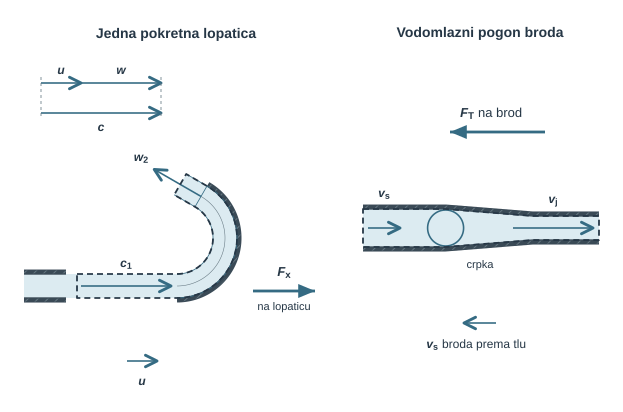
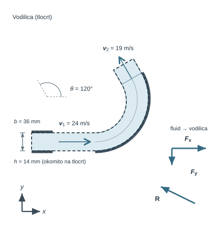
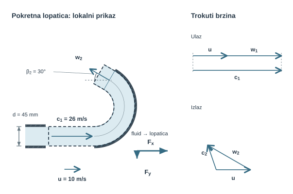
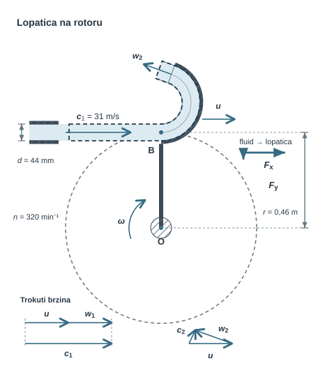
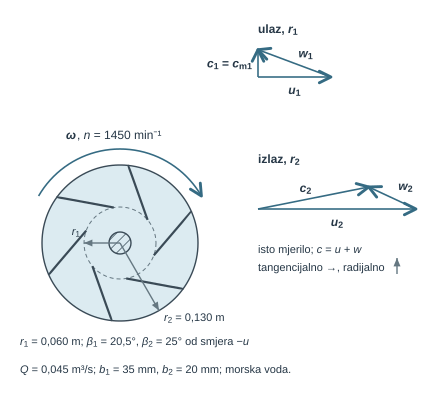
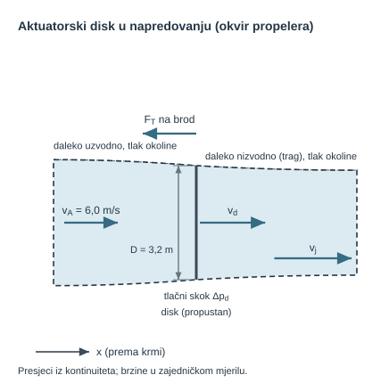
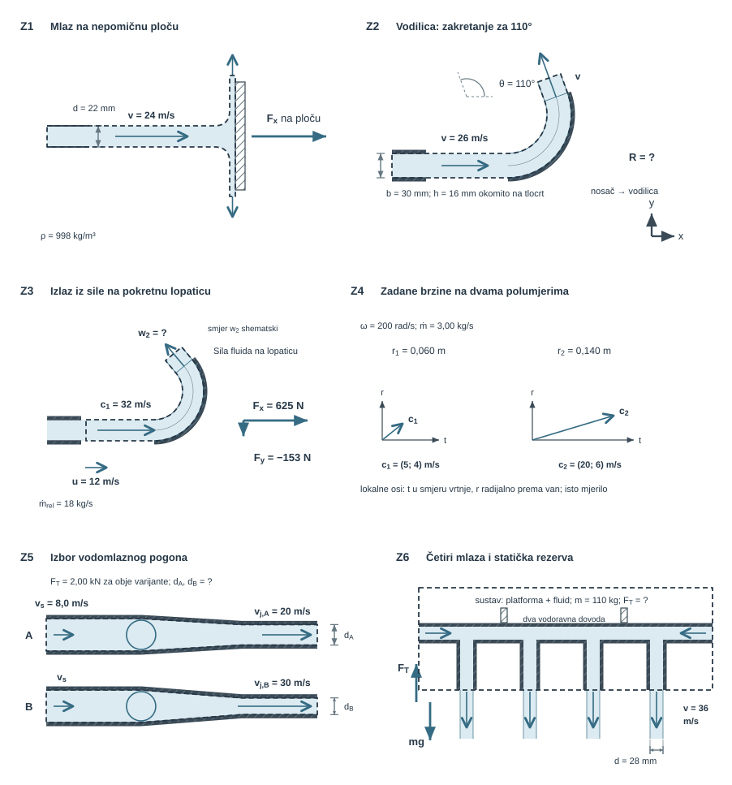

Crpka i ventilator predaju rad fluidu, turbina ga od fluida preuzima, a brodski propeler i vodomlazni pogon ubrzavaju vodu prema krmi i reakcijom dobivaju potisak. Svi ti turbostrojevi i propulzori izmjenjuju energiju s fluidom promjenom njegove količine gibanja i momenta količine gibanja, pa se poglavlje izravno oslanja na bilance kontrolnog volumena iz []{.mf1-chapter-ref target="u10"}. Novo je to što se lopatice gibaju, pa brzinu koju vidi nepomični promatrač treba razlikovati od one koju vidi lopatica.

Prema turbostrojarskom standardu $c$ je apsolutna brzina fluida, $u$ obodna brzina lopatice, a $w$ relativna brzina fluida; povezane su vektorski, $\vec c=\vec u+\vec w$. Kontrolni volumen koji prati jednu pokretnu lopaticu prima relativni maseni protok $\dot m_{rel}=\rho A(c_1-u)$, dok kolo s mnogo lopatica zahvaća puni sapnički protok $\dot m=\rho Ac_1$. Zato jedna lopatica prima najveću snagu pri $u=c_1/3$, a Peltonovo kolo pri $u=c_1/2$. Kad su ulaz i izlaz rotora na različitim polumjerima, moment količine gibanja vodi do Eulerove jednadžbe turbostrojarstva, $P=\dot m(u_2c_{2t}-u_1c_{1t})=M\omega$; ta je snaga pozitivna kad rotor predaje rad fluidu, kao u crpki. Rad daje samo promjena tangencijalne komponente brzine $c_t$, pa su kutovi lopatica $\beta_1$ i $\beta_2$, mjereni od smjera $-u$, izravni projektni parametri.

Kod propulzije sustav predaje energiju fluidu. Za aktuatorski disk, idealizirani propeler, idealna (Froudeova) učinkovitost $\eta_i=2v_A/(v_A+v_j)$ pokazuje da velika brzina mlaza kupuje potisak $F_T$ skupom kinetičkom energijom traga. Za isti potisak veći disk traži manju induciranu brzinu i snagu, kao kod drona u visu. Iza trupa broda brzina napredovanja manja je od brzine broda, $v_A=(1-\chi)v_s$, gdje je $\chi$ koeficijent sustrujanja.

Poglavlje redom obrađuje pokretnu lopaticu s kutom skretanja i gubitkom relativne brzine, Eulerovu jednadžbu s trokutima brzina na radnom kolu balastne crpke te aktuatorski disk u visu i napredovanju. Radna točka crpke u cjevovodu određuje se u []{.mf1-chapter-ref target="u13"}, a potisak se povezuje s otporom trupa, koji se iz modelnih ispitivanja prenosi Froudeovom sličnošću iz []{.mf1-chapter-ref target="u11"}. Modeli s jednolikim brzinama na presjecima i jednoliko opterećenim diskom bez vrtnje traga i utjecaja trupa daju gornju granicu učinkovitosti; hidrauličke, mehaničke i generatorske gubitke treba procijeniti zasebno.

Slika ispod lijevo prikazuje jednu pokretnu lopaticu: gore je trokut brzina na ulazu, gdje su $u$, $w$ i $c$ kolinearni, a isprekidana crta omeđuje kontrolni volumen koji prati lopaticu. Mlaz ulazi brzinom $c_1$, izlazi relativnom brzinom $w_2$, a $F_x$ je sila fluida na lopaticu u smjeru njezina gibanja brzinom $u$. Desno je shema vodomlaznog pogona s brzinama u brodskom okviru i osi $x$ prema krmi: voda ulazi brzinom broda $v_s$ i izlazi brzinom mlaza $v_j>v_s$, a krug označuje crpku. Potisak $F_T$ djeluje na brod prema pramcu, a donja strelica prikazuje brzinu broda $v_s$ prema tlu.

{#fig-uvod-u12 fig-align="center" fig-alt="Pregled poglavlja: turbostrojevi i propulzija kroz pokretne lopatice, moment i potisak."}

## Turbostrojevi i propulzija

::: {.mf1-application}

Inženjerski kontekst

Na Peltonovu kolu, radnom kolu balastne crpke, brodskom propeleru i vodomlaznom pogonu isti zakoni povezuju silu, moment i snagu. Račun pokazuje koliko snage rotor prima ili predaje, koliki je potisak i kako izlazni kut lopatice mijenja korisni učinak.
:::

**Procijenjeno vrijeme rada uz priručnik:** 9 sati.

## Od lopatice do turbostroja

Bilanca količine gibanja na nepomičnoj vodilici i na lopatici koja se giba stalnom brzinom izvedena je u []{.mf1-chapter-ref target="u10"}: u kontrolnom volumenu koji prati lopaticu masa ulazi relativnom brzinom $\vec w=\vec c-\vec u$, $\dot m_{rel}=\rho Aw_n$, a sila na fluid slijedi iz promjene apsolutne brzine; @ex-peltonova-lopatica-u-gibanju pokazuje taj račun na Peltonovoj lopatici. Ovdje se iz iste bilance izvode ono što je specifično za turbostrojeve: utjecaj kuta i gubitka u lopatici, dva optimuma obodne brzine, Eulerova jednadžba s trokutima brzina i idealna učinkovitost propulzije. Oznake slijede turbostrojarski standard: $c$ apsolutna, $u$ obodna i $w$ relativna brzina.

::: {.mf1-fizikalno-znacenje}

Fizikalno značenje

Snaga je umnožak tangencijalne sile i obodne brzine: pri $u=0$ postoji sila bez snage, a pri $u\to c_1$ relativni dotok nestaje; između tih granica leži optimum koji izvod u nastavku određuje.
:::

::: {.mf1-izvod}

Matematički izvod — Kut lopatice, gubitak relativne brzine i dva optimuma obodne brzine

**Fizikalno pitanje.** Kako kut skretanja i gubitak relativne brzine mijenjaju silu na lopaticu i pri kojoj obodnoj brzini lopatica odnosno kolo prima najviše snage?

**Bilanca.** Kontrolni volumen prati lopaticu; prema bilanci količine gibanja iz []{.mf1-chapter-ref target="u10"} sila fluida na lopaticu jednaka je $\dot m_{rel}(\vec c_1-\vec c_2)$, uz atmosferski tlak na slobodnim presjecima.

**Koraci.** Neka se lopatica giba u smjeru mlaza ($+x$) brzinom $u$, pa je $w_1=c_1-u$. Relativni izlaz $w_2=kw_1$ ($k\le1$ opisuje gubitak relativne brzine) slijedi izlazni brid lopatice. Kut lopatice na izlazu $\beta_2$ mjeri se od smjera suprotnog gibanju lopatice ($-u$, ovdje $-x$); $\beta_2=0^\circ$ znači puni povrat mlaza, a kut skretanja mlaza od $+x$ iznosi $\theta=180^\circ-\beta_2$. Apsolutni izlaz ima komponente

$$
c_{2x} = u - w_2\cos\beta_2, \qquad c_{2y} = w_2\sin\beta_2,
$$ {#eq-turbostrojevi-razrada-koraka-02}

pa je sila fluida na lopaticu u smjeru gibanja

$$
F_{f\to lop,x}=\dot m_{rel}(c_1-c_{2x})=\dot m_{rel}\,w_1(1+k\cos\beta_2),
$$ {#eq-turbostrojevi-razrada-koraka-04}

a snaga koju fluid predaje lopatici

$$
P_{f\to lop}=F_{f\to lop,x}\,u=\dot m_{rel}\,w_1u\,(1+k\cos\beta_2).
$$ {#eq-turbostrojevi-razrada-koraka-05}

Rad daje samo komponenta sile u smjeru gibanja; komponenta $F_y$ opterećuje ležajeve, ali ne prenosi snagu.

**Rezultat: dva optimuma.** Što ulazi u $\dot m$, odlučuje o položaju maksimuma snage.

*Jedna lopatica koja se udaljava od sapnice* prima samo relativni dotok $\dot m_{rel}=\rho A(c_1-u)$, pa je

$$
\begin{aligned}
P &= \rho A (1 + k\cos\beta_2)(c_1 - u)^2 u, \\
\frac{dP}{du}&=\rho A (1 + k\cos\beta_2)(c_1 - u)(c_1 - 3u),
\end{aligned}
$$ {#eq-turbostrojevi-matematicki-izvod-optimum-obodne-brzine-za-jednu-03}

odakle $u_{opt}=c_1/3$.

*Kolo s mnogo lopatica* (Peltonov rotor) stalno nalazi sljedeću lopaticu, pa cijeli sapnički protok $\dot m=\rho Ac_1$ sudjeluje u izmjeni količine gibanja:

$$
P = \rho A c_1 (1 + k\cos\beta_2)(c_1 - u)\,u,
\qquad
\frac{dP}{du} = \rho A c_1 (1 + k\cos\beta_2)(c_1 - 2u),
$$ {#eq-turbostrojevi-matematicki-izvod-optimum-obodne-brzine-za-jednu-07}

odakle $u_{opt}=c_1/2$, klasičan rezultat za Peltonovu turbinu. Ni jedan od dvaju rezultata nije pogrešan: razlikuju se kontrolni volumeni i zahvaćeni protoci.

**Provjera.** Pri $u=0$ sila je najveća, a snaga nula; pri $u\to c_1$ relativni dotok i sila nestaju. Pri $u=c_1/2$, $k=1$ i $\beta_2=0^\circ$ apsolutna izlazna brzina kola je nula, pa fluid preda svu kinetičku energiju. Ako geometrija ograniči izlaz na $\beta_2=15^\circ$ (skretanje $\theta=165^\circ$), faktor $(1+\cos\beta_2)$ pada s $2$ na približno $1{,}97$, odnosno za oko $1{,}7\,\%$; to nije ukupni gubitak turbine, jer se brzinski, volumetrijski i mehanički gubitci procjenjuju zasebno.

**Konvencija kuta.** U cijelom poglavlju, u izvodu, riješenim primjerima i zadatcima, kutovi lopatica $\beta_1$, $\beta_2$ mjere se od smjera suprotnog gibanju lopatice ($-u$), kao u konstrukciji turbostrojeva. Kut skretanja mlaza mjeren od $+x$, pa i skretanje u nepomičnoj vodilici, označuje se s $\theta$; za pokretnu lopaticu vrijedi $\theta=180^\circ-\beta_2$. Kutovi lopatica ne smiju se miješati s korekcijskim faktorom količine gibanja $\beta$ iz drugih poglavlja.
:::

Za rotor je mjerodavna tangencijalna komponenta sile, jer jedina predaje rad pri gibanju oboda:

$$
P = F_t u = M\omega
$$ {#eq-turbostrojevi-matematicki-izvod-optimum-obodne-brzine-za-jednu-09}

::: {.mf1-fizikalno-znacenje}

Fizikalno značenje

Radijalna i aksijalna promjena brzine opterećuju ležajeve, ali ne prenose snagu; rad daje samo promjena tangencijalne komponente. Zato su ulazni i izlazni kut lopatice izravni uvjeti korisnog učinka, a ne geometrijski detalj.
:::

Kad su ulaz i izlaz rotora na različitim polumjerima $r_1$ i $r_2$, umjesto sile treba primijeniti **moment količine gibanja**.

::: {.mf1-izvod}

Matematički izvod — Eulerova turbinska jednadžba iz momenta količine gibanja

**Fizikalno pitanje.** Koliki moment i snagu izmjenjuju rotor i fluid ako su poznate apsolutne brzine na ulaznom i izlaznom polumjeru?

**Bilanca.** Nepomični kontrolni volumen obuhvaća rotor, a pol je na osi vrtnje. Moment količine gibanja @eq-moment-kolicine-gibanja iz []{.mf1-chapter-ref target="u10"} vrijedi s apsolutnom brzinom $\vec c$. Pozitivan moment znači moment **rotora na fluid**; momenti tlaka i volumnih sila oko osi nemaju doprinos ili su zasebno uračunani. Za jedan ulaz na $r_1$ i jedan izlaz na $r_2$ s jednolikim brzinama:

$$
\vec M = \dot m\,(\vec r_2 \times \vec c_2) - \dot m\,(\vec r_1 \times \vec c_1).
$$ {#eq-turbostrojevi-matematicki-izvod-eulerova-turbinska-jednadzba-i-02}

**Koraci.** Osnu komponentu daje samo tangencijalna komponenta $c_t$: radijalna prolazi kroz os, a aksijalna joj je paralelna. Zato je

$$
M_{r\to f} = \dot m\,(r_2 c_{2t} - r_1 c_{1t}).
$$ {#eq-turbostrojevi-matematicki-izvod-eulerova-turbinska-jednadzba-i-03}

Reakcijski moment fluida na rotor ima suprotan predznak, $M_{f\to r}=-M_{r\to f}$. To je jezgra **Eulerove jednadžbe turbostrojarstva** za crpke, ventilatore, turbine i kompresore.

Množenjem s kutnom brzinom $\omega$ dobivaju se dvije jednako valjane, ali suprotno orijentirane bilance snage:

$$
P_{r\to f}=\dot m\,(u_2c_{2t}-u_1c_{1t}),
\qquad
P_{f\to r}=\dot m\,(u_1c_{1t}-u_2c_{2t}).
$$ {#eq-turbostrojevi-matematicki-izvod-eulerova-turbinska-jednadzba-i-04}

Pozitivan $P_{r\to f}$ opisuje rad koji rotor predaje fluidu, kao u crpki ili ventilatoru. Pozitivan $P_{f\to r}$ opisuje rad koji fluid predaje rotoru, kao u turbini. Ovdje je $u_i=\omega r_i$. Za Peltonov rotor vrijedi $r_1=r_2=r$ i $u_1=u_2=u$, pa turbinski izlaz postaje

$$
P_{f\to r} = \dot m\,u\,(c_{1t} - c_{2t}),
$$ {#eq-turbostrojevi-matematicki-izvod-eulerova-turbinska-jednadzba-i-05}

**Provjera.** To je isti izraz koji daje sila na pokretnu lopaticu, $F_xu$ iz [-@eq-turbostrojevi-razrada-koraka-04], samo zapisan komponentama brzine umjesto izlaznog kuta.
:::

Korisni rad daje samo promjena momenta količine gibanja oko osi, pa su ulazni i izlazni kutovi lopatica središnji projektni parametri svakoga turbostroja; @ex-radijalno-kolo-crpke-euler to pokazuje na radnom kolu crpke.

::: {.mf1-cfd title="Računalna dinamika fluida"}

**Crpka rashladnog kruga iznutra.** Dosad smo crpku opisivali njezinom karakteristikom. Ako želimo promijeniti lopatice ili objasniti neravnomjerno strujanje, CFD obuhvaća rotor i nepomično kućište. Zadamo brzinu vrtnje, svojstva fluida i kompatibilne uvjete dotoka i izlaza. Veza $\vec c=\vec w+\vec u$ određuje tumačenje brzina: na lopatici je relativna brzina prianjajućeg fluida nula, a apsolutna jednaka brzini lopatice.

Za procjenu srednjeg rada može se koristiti MRF (*Multiple Reference Frame*, više referentnih okvira): rotorsko područje rješava se u okviru koji rotira s kolom, nepomično kućište u mirujućem okviru, a na spoju se polja preslikavaju bez pomicanja mreže. Za pulsacije pri prolazu lopatica uz jezik kućišta klizajuća mreža (*sliding mesh*) fizički pomiče rotorski dio mreže kroz vrijeme. Izbor ovisi o pitanju: srednja crpna visina i vremenski promjenjivo opterećenje traže različitu razinu opisa. Provjera je obvezna u oba slučaja: snaga iz integriranog momenta $P=M\omega$ mora se podudarati s Eulerovim tokom momenta količine gibanja $\dot m(u_2c_{2t}-u_1c_{1t})$ između ulaznog i izlaznog presjeka; razlika otkriva nekonvergiranu mrežu ili propuštanje kroz spoj okvira.

[]{#strujanje-gledano-s-lopatice}
:::

::: {.mf1-interaktivno}

Interaktivni prikaz — Trokuti brzina i snaga na Peltonovoj lopatici

**Predvidi.** Zašto snaga nestaje pri nepomičnoj lopatici, iako sila postoji?

**Zastani i promisli.** Ručni model jedne lopatice daje optimum $u=c_1/3$, a model cijelog kola $u=c_1/2$. Mora li jedan račun biti pogrešan?

**Provjeri i protumači.** Prati trokut brzina i krivulju snage. Različiti optimumi sami ne znače pogrešku: prvi pokus zahvaća puni sapnički protok cijelog rotora, a dotok jednoj pokretnoj lopatici smanjuje se s njezinom brzinom. Nastavci obrađuju Z3–Z5.

<a class="mf1-interaktivno-veza" href="https://martibasic.github.io/MF1_udzbenik/jlite/lab/index.html?path=u12_pelton_lopatica.ipynb">Pokreni u pregledniku</a>

**Pitanja za samostalno istraživanje:** (a) Zašto puni sapnički protok daje maksimum pri $u=c_1/2$? (b) Zašto stvarne lopatice nemaju potpuni povrat mlaza ($\beta_2=0°$)?

:::

::: {#cfd-rotor-karakteristika .mf1-cfd title="Računalna dinamika fluida"}

**Od polja oko lopatica do karakteristike crpke.** Pri zadanoj brzini vrtnje provedemo račune za više protoka. Integracijom tlaka i viskoznih naprezanja po rotoru dobivamo moment, a iz energijskih tokova na presjecima porast mehaničke energije fluida. Tok momenta količine gibanja s apsolutnim brzinama služi neovisnoj provjeri i povezuje rezultat s Eulerovom jednadžbom.

Snaga na promatranim rotorskim plohama slijedi iz $P=M\omega$. Treba jasno navesti koje su plohe i gubitci uključeni; gubitci motora i ležajeva nisu automatski dio CFD-a. Dobivenu karakteristiku vraćamo u model rashladnog kruga. Tako promjena lopatice dobiva mjerljiv učinak na radni protok, crpnu visinu i potrebnu pogonsku snagu.
:::

Kod propulzije sustav predaje energiju fluidu. Potisak vodomlaznog pogona @eq-potisak-mlaznog-pogona i aktuatorski disk s brzinom kroz disk @eq-aktuatorski-disk-brzina izvedeni su u []{.mf1-chapter-ref target="u10"}; ovdje se disk proširuje na lebdenje, idealnu učinkovitost pri zadanom opterećenju i usporedbu promjera.

::: {.mf1-izvod}

Matematički izvod — Aktuatorski disk i Froudeov teorem

**Fizikalno pitanje.** Kolika je brzina kroz disk i koliko snage stoji zadani potisak, u lebdenju i u napredovanju?

**Bilanca.** Idealizirani rotor je tanki disk površine $A$ u stacionarnom, jednodimenzijskom, nestlačivom toku bez viskoznih gubitaka izvan tlačnog skoka na disku; opterećenje je jednoliko, bez vrtnje traga, vršnih gubitaka, utjecaja tla i susjednih rotora. Daleko ispred voda ima brzinu $v_A$, kroz disk $v_d$, a u dalekom tragu $v_j$, sve pri tlaku okoline. Zakon količine gibanja za strujnu cijev, $F_T=\rho Av_d(v_j-v_A)$, i tlačni skok s Bernoullijem ispred i iza diska, $F_T=\tfrac12\rho A(v_j^2-v_A^2)$, daju Froudeov teorem $v_d=\tfrac12(v_A+v_j)$, @eq-aktuatorski-disk-brzina.

**Lebdeći režim** ($v_A = 0$) — dron u visu, helikopter na mjestu, statički test propelera — daje $v_d = v_j/2$, pa potisak postaje

$$
F_T = \rho A v_d \cdot v_j = \rho A v_d \cdot 2 v_d = 2\rho A v_d^2.
$$ {#eq-turbostrojevi-matematicki-izvod-aktuatorski-disk-i-froudeov-te-08}

odnosno

$$
v_d = \sqrt{\frac{F_T}{2\rho A}}.
$$ {#eq-turbostrojevi-matematicki-izvod-aktuatorski-disk-i-froudeov-te-09}

Za isti potisak veća diskovna površina smanjuje induciranu brzinu i idealnu snagu $P_i=F_Tv_d$.

**Rezultat za rotor u napredovanju.** Snaga predana fluidu jest porast toka kinetičke energije, $P_i=\tfrac12\dot m(v_j^2-v_A^2)=F_Tv_d$, a korisna snaga $F_Tv_A$; njihov je omjer idealna (Froudeova) učinkovitost iz @eq-aktuatorski-disk-potisak

$$
\eta_i=\frac{F_Tv_A}{F_Tv_d}=\frac{v_A}{v_d}=\frac{2v_A}{v_A+v_j}.
$$ {#eq-idealna-ucinkovitost-propelera}

Uvede li se koeficijent opterećenja potiskom $C_{Th}=F_T/(\tfrac12\rho v_A^2A)$, iz $F_T=\tfrac12\rho A(v_j^2-v_A^2)$ slijedi $v_j/v_A=\sqrt{1+C_{Th}}$, pa je

$$
\eta_i=\frac{2}{1+\sqrt{1+C_{Th}}},
\qquad
v_d=\frac{v_A}{2}\left(1+\sqrt{1+C_{Th}}\right).
$$ {#eq-idealna-ucinkovitost-ct}

**Provjera.** Za $C_{Th}\to0$ (velik disk, malo opterećenje) $\eta_i\to1$; za $v_A\to0$ (vis) $\eta_i\to0$ jer potisak bez brzine ne daje korisnu snagu, iako $P_i>0$. Za vodomlazni pogon isti izraz daje $\eta_i=2v_s/(v_s+v_j)$: velika brzina mlaza kupuje potisak skupom kinetičkom energijom traga. Stvarni propeler dodaje vrtnju traga, profilne i vršne gubitke, pa je njegova učinkovitost u slobodnoj vožnji $\eta_0$ uvijek manja od $\eta_i$; iza trupa broda brzina napredovanja manja je od brzine broda, $v_A=(1-\chi)v_s$, gdje je $\chi$ koeficijent sustrujanja (oznaka $w$ u ovom je poglavlju zauzeta za relativnu brzinu).
:::

::: {.mf1-granica-modela}

Granica modela — aktuatorski disk i Peltonova lopatica

Aktuatorski disk pretpostavlja jednoliko opterećenje, nestlačiv fluid bez viskoznosti, bez vrtnje traga i bez međudjelovanja s trupom; zato daje gornju granicu učinkovitosti i donju granicu inducirane brzine, a ne radnu točku stvarnog propelera. Sustrujanje $\chi$, odbitak potiska i kavitacija zahtijevaju podatke o trupu i lopaticama. Model jedne pokretne lopatice s $\rho A(c_1-u)$ opisuje samo trenutačni doprinos lopatice koja se udaljava od sapnice; snaga Peltonova kola slijedi iz punog sapničkog protoka $\rho Ac_1$, uz zasebno procijenjene hidrauličke, mehaničke i generatorske gubitke.
:::

::: {.mf1-cfd title="Računalna dinamika fluida"}

**Propeler iza trupa: kada trebamo pojedine lopatice?** Ručni @ex-propeler-u-napredovanju koristi jednoliko opterećen disk u jednolikom dotoku bez trupa. Za propeler iza trupa CFD može zadržati disk kao raspodijeljenu silu na fluid, a uključiti nejednolik dotok i trag trupa. Potreban je zakon opterećenja, primjerice iz poznate karakteristike propelera. Takav model omogućuje ispitivanje međudjelovanja trupa i prosječnog propulzijskog učinka uz manji računski trošak.

Za promjenjivo opterećenje pojedine lopatice ili lokalnu kavitaciju treba detaljniji model rotora i odgovarajuća fizika. Potisak provjeravamo bilancom količine gibanja, uključujući tlakove na granicama, a snagu momentom i brzinom vrtnje. Potisak sam ne određuje brzinu plovila: povezuje se s otporom trupa. Time se nastavak priče o plutanju i sličnosti povezuje s pogonom.
:::

## Riješeni primjeri

Međurezultati su zaokruženi radi čitljivosti; završne vrijednosti računaju se iz nezaokruženih.

::: {#ex-u12-vodilica-mlaza-na-ispitnom-stolu-t2 .mf1-we}

Vodilica mlaza na ispitnom stolu&nbsp;T2

**Tekst zadatka**

Nepomična vodilica skreće vodeni mlaz u horizontalnoj ravnini za kut $\theta = 120^\circ$, mjeren od smjera ulaza $+x$. Pravokutna sapnica široka je $b = 36\ \text{mm}$ i visoka $h = 14\ \text{mm}$. Ulazna brzina je $v_1 = 24\ \text{m/s}$, izlazna $v_2 = 19\ \text{m/s}$, a gustoća vode $\rho = 998\ \text{kg/m}^3$. Tok je stacionaran, slobodni presjeci su na atmosferi. Računaj horizontalne komponente sila.

**Traži se**

1. Odredi maseni protok vode kroz sapnicu.
2. Odredi horizontalne komponente sile koju fluid vrši na vodilicu.
3. Odredi iznos i smjer reakcije koju mora preuzeti nosač vodilice.

{#fig-u12-vodilica-mlaza-na-ispitnom-stolu fig-alt="Vodilica mlaza na ispitnom stolu"}

**Veza s proračunom.** Dubina $h=14\,\mathrm{mm}$ mjeri se okomito na tlocrt; vektori sila fluida na vodilicu ne zadaju hvatišta, a reakcija nosača im je suprotna.

**Rješenje**

Površina pravokutnog izlaza sapnice iznosi

$$
A = bh = 0{,}036 \cdot 0{,}014 = 5{,}04 \cdot 10^{-4}\ \text{m}^2,
$$ {#eq-turbostrojevi-rijeseni-primjer-vodilica-mlaza-na-ispitnom-stol-01}

pa je maseni protok

$$
\dot{m} = \rho A v_1 = 998 \cdot 5{,}04 \cdot 10^{-4} \cdot 24 \approx 12{,}07\ \text{kg/s}.
$$ {#eq-turbostrojevi-rijeseni-primjer-vodilica-mlaza-na-ispitnom-stol-02}

Ulazna brzina je $\vec{v}_1 = (24, 0)\ \text{m/s}$, a izlazna

$$
\vec{v}_2 = (19\cos 120^\circ, 19\sin 120^\circ) = (-9{,}5, 16{,}45)\ \text{m/s}.
$$ {#eq-turbostrojevi-rijeseni-primjer-vodilica-mlaza-na-ispitnom-stol-03}

Sila vodilice na fluid zato glasi

$$
\vec{F}_{v\to f} = \dot{m}(\vec{v}_2 - \vec{v}_1) = (-404{,}4, 198{,}6)\ \text{N},
$$ {#eq-turbostrojevi-rijeseni-primjer-vodilica-mlaza-na-ispitnom-stol-04}

ali zadatak traži silu fluida na vodilicu, pa treba promijeniti predznak:

$$
\vec{F}_{f\to v} = (404{,}4, -198{,}6)\ \text{N} \implies F_x \approx 404\ \text{N},\ F_y \approx -199\ \text{N}.
$$ {#eq-turbostrojevi-rijeseni-primjer-vodilica-mlaza-na-ispitnom-stol-05}

Reakcija nosača mora biti jednaka po iznosu i suprotna po smjeru, $\vec{R} = (-404{,}4, 198{,}6)\ \text{N}$, pa je njezin iznos

$$
R = \sqrt{404{,}4^2 + 198{,}6^2} \approx 450{,}6\ \text{N} \approx 451\ \text{N}.
$$ {#eq-turbostrojevi-rijeseni-primjer-vodilica-mlaza-na-ispitnom-stol-06}

Kut reakcije $\theta_R$ iznad negativnog smjera osi $x$ iznosi

$$
\theta_R = \arctan\left(\frac{198{,}6}{404{,}4}\right) = 26{,}2^\circ.
$$ {#eq-turbostrojevi-rijeseni-primjer-vodilica-mlaza-na-ispitnom-stol-07}

**Provjera i tumačenje**

Iznos reakcije mora biti jednak $\dot m\,|\vec v_2-\vec v_1|=12{,}07\cdot37{,}3=450\ \text{N}$, što se podudara. Smanjenje iznosa brzine s 24 na 19 m/s znači da vodilica nije idealna; razlika kinetičke energije $\dot m(v_1^2-v_2^2)/2\approx1{,}3\ \text{kW}$ disipira se u vodilici, jer nepomična vodilica ne prima mehaničku snagu.
:::

::: {#ex-u12-pokretna-zakrivljena-lopatica-s-relativnim-izlazom-t3 .mf1-ch}

Pokretna zakrivljena lopatica s relativnim izlazom&nbsp;T3

**Tekst zadatka**

Zakrivljena lopatica giba se brzinom $u = 10\ \text{m/s}$ u smjeru vodenog mlaza gustoće $\rho = 998\ \text{kg/m}^3$. Sapnica ima promjer $d = 45\ \text{mm}$ i apsolutnu izlaznu brzinu $c_1 = 26\ \text{m/s}$. Relativni izlaz iz lopatice određen je s $w_2 = k w_1$, $k = 0{,}90$, pod kutom lopatice $\beta_2 = 30^\circ$ mjerenim od smjera $-u$, dakle iznad negativnog smjera osi $x$. Lopatica zahvaća cijeli mlaz. Tok je stacionaran u pokretnom sustavu, a ulaz i izlaz izloženi su atmosferi.

**Traži se**

1. Odredi maseni protok koji stvarno ulazi u pokretni kontrolni volumen $\dot{m}_{rel}$.
2. Odredi apsolutni vektor izlazne brzine $\vec{c}_2$.
3. Odredi komponente i iznos sile mlaza na lopaticu.
4. Odredi snagu koju mlaz predaje lopatici.

{#fig-u12-pokretna-zakrivljena-lopatica fig-alt="Pokretna zakrivljena lopatica"}

**Veza s proračunom.** Brzina lopatice na ulazu i izlazu ima smjer $+x$; prikazane sile djeluju na lopaticu, a trokuti imaju zajedničko mjerilo.

**Rješenje**

Površina mlaza iznosi

$$
A = \frac{\pi d^2}{4} = \frac{\pi \cdot 0{,}045^2}{4} = 1{,}590 \cdot 10^{-3}\ \text{m}^2.
$$ {#eq-turbostrojevi-cjeloviti-zadatak-pokretna-zakrivljena-lopatica-01}

Relativna ulazna brzina prema lopatici je $w_1 = c_1-u = 26-10 = 16\ \text{m/s}$, pa je maseni protok koji stvarno ulazi u pokretni kontrolni volumen

$$
\dot{m}_{rel} = \rho A w_1 = 998 \cdot 1{,}590 \cdot 10^{-3} \cdot 16 = 25{,}4\ \text{kg/s}.
$$ {#eq-turbostrojevi-cjeloviti-zadatak-pokretna-zakrivljena-lopatica-02}

Iz koeficijenta relativnog izlaza slijedi $w_2 = k w_1 = 0{,}90 \cdot 16 = 14{,}4\ \text{m/s}$. Relativni izlazni vektor glasi

$$
\begin{aligned}
\vec{w}_2 &= (-w_2 \cos \beta_2,\ w_2 \sin \beta_2) \\
&= (-14{,}4 \cos 30^\circ,\ 14{,}4 \sin 30^\circ) \\
&= (-12{,}47,\ 7{,}20)\ \text{m/s}.
\end{aligned}
$$ {#eq-turbostrojevi-cjeloviti-zadatak-pokretna-zakrivljena-lopatica-03}

Apsolutna izlazna brzina dobiva se dodavanjem transportne brzine lopatice:

$$
\vec{c}_2 = (u,0) + \vec{w}_2 = (10-12{,}47,\ 7{,}20) = (-2{,}47,\ 7{,}20)\ \text{m/s}.
$$ {#eq-turbostrojevi-cjeloviti-zadatak-pokretna-zakrivljena-lopatica-04}

Ulazna apsolutna brzina je $\vec{c}_1 = (26,0)\ \text{m/s}$. Sila lopatice na fluid glasi

$$
\vec{F}_{l \to f} = \dot{m}_{rel}(\vec{c}_2 - \vec{c}_1) \approx (-723{,}0,\ 182{,}9)\ \text{N}.
$$ {#eq-turbostrojevi-cjeloviti-zadatak-pokretna-zakrivljena-lopatica-05}

Zato fluid na lopaticu djeluje silom suprotnog smjera $\vec{F}_{f \to l} = (723{,}0,\ -182{,}9)\ \text{N}$, pa su komponente sile $F_x \approx 723\ \text{N}$, $F_y \approx -183\ \text{N}$, a rezultantni iznos

$$
F = \sqrt{723{,}0^2 + 182{,}9^2} = 746\ \text{N}.
$$ {#eq-turbostrojevi-cjeloviti-zadatak-pokretna-zakrivljena-lopatica-06}

Snagu predanu lopatici daje samo komponenta sile u smjeru gibanja:

$$
P = F_x u = 723{,}0 \cdot 10 = 7230\ \text{W} \approx 7{,}23\ \text{kW}.
$$ {#eq-turbostrojevi-cjeloviti-zadatak-pokretna-zakrivljena-lopatica-07}

**Provjera i tumačenje**

Energijska bilanca: fluid gubi $\dot m_{rel}(c_1^2-|\vec c_2|^2)/2=7{,}85\ \text{kW}$, lopatica prima $7{,}23\ \text{kW}$, a $0{,}62\ \text{kW}=\dot m_{rel}(w_1^2-w_2^2)/2$ disipira se zbog $k=0{,}90$. Uz $\beta_2=30^\circ$ [-@eq-turbostrojevi-razrada-koraka-04] daje $F_x=\dot m_{rel}w_1(1+k\cos30^\circ)=25{,}4\cdot16\cdot1{,}779=723\ \text{N}$, isto kao komponentni račun.
:::

::: {#ex-u12-peltonov-rotor-s-jednim-mlazom-i-momentom .mf1-ch}

Reprezentativna Peltonova lopatica i trenutačni moment&nbsp;T4

**Tekst zadatka**

Jedna Peltonova lopatica zahvaća cijeli vodeni mlaz gustoće $\rho = 998\ \text{kg/m}^3$, promjera sapnice $d = 44\ \text{mm}$ i apsolutne brzine $c_1 = 31\ \text{m/s}$. Rotor polumjera $r = 0{,}46\ \text{m}$ vrti se stalnom brzinom $n = 320\ \text{min}^{-1}$. Relativni izlaz određen je s $w_2 = k w_1$, $k = 0{,}90$, pod kutom lopatice $\beta_2 = 20^\circ$ mjerenim od smjera $-u$, dakle iznad negativne tangencijalne osi $x$. Tražena snaga generatora je $P_G = 9{,}5\ \text{kW}$, mehanička učinkovitost rotora i ležajeva $\eta_m=0{,}96$, a učinkovitost generatora $\eta_G=0{,}94$.

Ulaz i izlaz su na atmosferi. U prvom dijelu kontrolni volumen prati jednu lopaticu; tijekom kratkog prolaza fluida smjer obodne brzine smatra se stalnim, a rotacijska akumulacija zanemaruje. U drugom dijelu računa se cijelo kolo, koje slijedom lopatica zahvaća puni sapnički protok.

**Traži se**

1. Odredi obodnu brzinu rotora $u$ i relativnu ulaznu brzinu $w_1$.
2. Odredi maseni protok kroz pokretni kontrolni volumen $\dot{m}_{rel}$ i apsolutni izlazni vektor $\vec{c}_2$.
3. Odredi komponente i iznos sile fluida na lopaticu.
4. Odredi moment na obodu rotora i snagu koju mlaz predaje rotoru.
5. Odredi silu, moment i snagu cijeloga kola s punim sapničkim protokom, hidrauličku učinkovitost kola i raspoloživu električnu snagu te objasni zašto se za kolo ne smije uzeti protok jedne lopatice.

{#fig-u12-peltonov-rotor-s-jednim-mlazom fig-alt="Peltonov rotor s jednim mlazom"}

**Veza s proračunom.** Skica prikazuje jednu lopaticu tijekom kratkog prolaza; moment oko osi daje tangencijalna sila, a trokuti brzina imaju zajedničko mjerilo.

**Rješenje**

Površina mlaza iznosi

$$
A = \frac{\pi d^2}{4} = \frac{\pi \cdot 0{,}044^2}{4} = 1{,}521 \cdot 10^{-3}\ \text{m}^2.
$$ {#eq-turbostrojevi-cjeloviti-zadatak-reprezentativna-peltonova-lopa-01}

Kutna brzina rotora je

$$
\omega = \frac{2\pi n}{60} = \frac{2\pi \cdot 320}{60} = 33{,}51\ \text{rad/s},
$$ {#eq-turbostrojevi-cjeloviti-zadatak-reprezentativna-peltonova-lopa-02}

pa je obodna brzina $u = \omega r = 33{,}51 \cdot 0{,}46 = 15{,}41\ \text{m/s}$. Relativna ulazna brzina prema lopatici sada je $w_1 = c_1-u = 31 - 15{,}41 = 15{,}59\ \text{m/s}$. Maseni protok koji stvarno ulazi u pokretni kontrolni volumen zato je

$$
\dot{m}_{rel} = \rho A w_1 = 998 \cdot 1{,}521 \cdot 10^{-3} \cdot 15{,}59 = 23{,}65\ \text{kg/s}.
$$ {#eq-turbostrojevi-cjeloviti-zadatak-reprezentativna-peltonova-lopa-03}

Iz koeficijenta relativnog izlaza slijedi $w_2 = k w_1 = 0{,}90 \cdot 15{,}59 = 14{,}03\ \text{m/s}$. Relativni izlazni vektor glasi

$$
\begin{aligned}
\vec{w}_2 &= (-w_2 \cos \beta_2,\ w_2 \sin \beta_2) \\
&= (-14{,}03 \cos 20^\circ,\ 14{,}03 \sin 20^\circ) \\
&= (-13{,}18,\ 4{,}80)\ \text{m/s}.
\end{aligned}
$$ {#eq-turbostrojevi-cjeloviti-zadatak-reprezentativna-peltonova-lopa-04}

Apsolutni izlazni vektor dobiva se dodavanjem transportne brzine oboda:

$$
\vec{c}_2 = (u,0) + \vec{w}_2 = (15{,}41-13{,}18,\ 4{,}80) = (2{,}23,\ 4{,}80)\ \text{m/s}.
$$ {#eq-turbostrojevi-cjeloviti-zadatak-reprezentativna-peltonova-lopa-05}

Ulazna apsolutna brzina je $\vec{c}_1 = (31,0)\ \text{m/s}$. Sila lopatice na fluid sada glasi

$$
\vec{F}_{l \to f} = \dot{m}_{rel}(\vec{c}_2 - \vec{c}_1) \approx (-680{,}3,\ 113{,}5)\ \text{N}.
$$ {#eq-turbostrojevi-cjeloviti-zadatak-reprezentativna-peltonova-lopa-06}

Zato fluid na lopaticu djeluje silom suprotnog smjera $\vec{F}_{f \to l} = (680{,}3,\ -113{,}5)\ \text{N}$, pa su tražene komponente $F_x \approx 680\ \text{N}$, $F_y \approx -114\ \text{N}$, a rezultantni iznos sile je

$$
F = \sqrt{F_x^2 + F_y^2} \approx 689{,}7\ \text{N}.
$$ {#eq-turbostrojevi-cjeloviti-zadatak-reprezentativna-peltonova-lopa-07}

Tangencijalna komponenta $F_x$ stvara moment na obodu rotora:

$$
M = F_x r \approx 312{,}95\ \text{N m} \approx 313\ \text{N m}.
$$ {#eq-turbostrojevi-cjeloviti-zadatak-reprezentativna-peltonova-lopa-08}

Snaga koju mlaz predaje rotoru iznosi

$$
P = M\omega = 312{,}95 \cdot 33{,}51 = 10{,}49\ \text{kW},
$$ {#eq-turbostrojevi-cjeloviti-zadatak-reprezentativna-peltonova-lopa-09}

što odgovara i zapisu $P=F_xu=680{,}3\cdot15{,}41=10{,}49\ \text{kW}$. To je trenutačni doprinos jedne lopatice koja se udaljava od sapnice i **nije** snaga kola: voda koju ta lopatica ne stigne zahvatiti ne nestaje, nego pogađa sljedeću lopaticu.

### 5. Cijelo kolo s punim sapničkim protokom {.mf1-step .unnumbered .unlisted}

Kolo zahvaća sav protok sapnice, $\dot m=\rho Ac_1=998\cdot1{,}521\cdot10^{-3}\cdot31=47{,}04\ \text{kg/s}$. Trokut brzina svake lopatice je isti kao gore, pa je tangencijalna sila na kolo

$$
F_{x,kolo}=\dot m\,(c_1-c_{2x})=47{,}04\,(31-2{,}23)=1353\ \text{N},
$$ {#eq-pelton-kolo-sila}

moment $M_{kolo}=F_{x,kolo}\,r=622{,}5\ \text{N m}$ i snaga

$$
P_{kolo}=M_{kolo}\,\omega=F_{x,kolo}\,u=1353\cdot15{,}41=20{,}86\ \text{kW}.
$$ {#eq-pelton-kolo-snaga}

Snaga mlaza iznosi $\tfrac12\dot mc_1^2=22{,}60\ \text{kW}$, pa je hidraulička učinkovitost kola $\eta_h=20{,}86/22{,}60=0{,}923$; upravo je to Eulerov zapis $P=\dot m\,u\,(c_{1t}-c_{2t})$ s punim protokom. Raspoloživa električna snaga $P_{kolo}\,\eta_m\eta_G=20{,}86\cdot0{,}96\cdot0{,}94=18{,}8\ \text{kW}$ premašuje $P_G=9{,}5\ \text{kW}$; generator bi dakle radio na oko polovici raspoložive snage, što je odluka o regulaciji sapnice, ne o dostatnosti kola. Usporedba s $10{,}49\ \text{kW}$ jedne lopatice bila bi pogrešna: ona vrijedi za lopaticu koja bježi od mlaza, a kolo s $u/c_1\approx0{,}50$ radi upravo u optimumu modela s punim protokom.

**Provjera i tumačenje**

Omjer snaga $P_{kolo}/P_{lop}=c_1/(c_1-u)=1{,}99$ jednak je omjeru zahvaćenih protoka; kolo s $u/c_1=0{,}497$ radi u svojem optimumu, a model jedne lopatice preporučio bi $u=c_1/3$. Gubitak u lopatici $\dot m(w_1^2-w_2^2)/2=47{,}04\,(15{,}59^2-14{,}03^2)/2=1{,}09\ \text{kW}$ zajedno s izlaznom kinetičkom energijom $\dot m|\vec c_2|^2/2=0{,}66\ \text{kW}$ zatvara bilancu: $20{,}86+1{,}09+0{,}66=22{,}6\ \text{kW}$.
:::

::: {#ex-radijalno-kolo-crpke-euler .mf1-we}

Radijalno kolo balastne crpke i Eulerova visina&nbsp;T2

**Tekst zadatka**

Radijalno kolo balastne crpke vrti se brzinom $n = 1450\ \text{min}^{-1}$ i dobavlja morsku vodu gustoće $\rho = 1025\ \text{kg/m}^3$ protokom $Q = 0{,}045\ \text{m}^3\text{/s}$. Ulazni polumjer lopatica je $r_1 = 0{,}060\ \text{m}$ uz širinu kanala $b_1 = 0{,}035\ \text{m}$, izlazni polumjer $r_2 = 0{,}130\ \text{m}$ uz širinu $b_2 = 0{,}020\ \text{m}$. Fluid ulazi bez predvrtnje ($c_{1t}=0$), lopatice su unatrag zakrivljene s izlaznim kutom $\beta_2 = 25^\circ$ mjerenim od smjera $-u$, a fluid napušta lopaticu točno pod tim kutom (beskonačno mnogo tankih lopatica). Tlak i volumne sile nemaju moment oko osi, tok je stacionaran, a zadebljanje lopatica zanemari.

**Traži se**

1. Odredi obodne brzine $u_1$, $u_2$ i meridijanske komponente $c_{m1}$, $c_{m2}$.
2. Nacrtaj ulazni i izlazni trokut brzina, odredi $\vec w_1$, $\vec w_2$, kut $\beta_1$ za ulaz bez udara i tangencijalnu komponentu $c_{2t}$.
3. Odredi specifični rad, teorijsku (Eulerovu) visinu $H_{th}$, snagu na kolu i predznak rada.

{#fig-radijalno-kolo-crpke-trokuti fig-align="center" fig-alt="Presjek radijalnog kola s unatrag zakrivljenim lopaticama i smjerom vrtnje; uz ulazni polumjer nacrtan je trokut brzina s radijalnim c1, a uz izlazni polumjer trokut s u2, w2 pod kutom beta2 i apsolutnom brzinom c2. Oba trokuta imaju isto mjerilo."}

**Veza s proračunom.** Pozitivni tangencijalni smjer prati vrtnju; trokuti su nacrtani u zajedničkom mjerilu iz podataka zadatka.

**Rješenje**

Kutna brzina je $\omega=2\pi n/60=151{,}8\ \text{rad/s}$, pa su obodne brzine

$$
u_1=\omega r_1=9{,}11\ \text{m/s},
\qquad
u_2=\omega r_2=19{,}74\ \text{m/s}.
$$ {#eq-crpka-obodne-brzine}

Kontinuitet kroz cilindrične presjeke daje meridijanske komponente

$$
\begin{aligned}
c_{m1}&=\frac{Q}{2\pi r_1b_1}=\frac{0{,}045}{2\pi\cdot0{,}060\cdot0{,}035}=3{,}41\ \text{m/s}, \\
c_{m2}&=\frac{Q}{2\pi r_2b_2}=2{,}755\ \text{m/s}.
\end{aligned}
$$ {#eq-crpka-meridijanske-brzine}

Na ulazu je $\vec c_1=(0;\,3{,}41)$ m/s u lokalnim osima (tangencijalno, radijalno), pa je $\vec w_1=\vec c_1-(u_1;0)=(-9{,}11;\,3{,}41)$ m/s. Kut lopatice za ulaz bez udara, mjeren od smjera $-u$,

$$
\beta_1=\arctan\frac{c_{m1}}{u_1}=\arctan\frac{3{,}41}{9{,}11}=20{,}5^\circ.
$$ {#eq-crpka-ulazni-kut}

Na izlazu relativna brzina slijedi lopaticu: $\vec w_2=(-c_{m2}/\tan\beta_2;\,c_{m2})=(-5{,}91;\,2{,}755)$ m/s, $|\vec w_2|=6{,}52$ m/s, pa je

$$
c_{2t}=u_2+w_{2t}=19{,}74-5{,}91=13{,}83\ \text{m/s},
\qquad
\vec c_2=(13{,}83;\,2{,}755)\ \text{m/s}.
$$ {#eq-crpka-izlazna-brzina}

Eulerova jednadžba s $c_{1t}=0$ daje specifični rad rotora na fluid i teorijsku visinu

$$
\begin{aligned}
e_{r\to f}&=u_2c_{2t}-u_1c_{1t}=19{,}74\cdot13{,}83=273{,}0\ \text{J/kg}, \\
H_{th}&=\frac{e_{r\to f}}{g}=27{,}8\ \text{m}.
\end{aligned}
$$ {#eq-crpka-eulerova-visina}

Snaga koju kolo predaje fluidu je $P_{r\to f}=\rho Q\,e_{r\to f}=1025\cdot0{,}045\cdot273{,}0=12{,}6\ \text{kW}$; pozitivan predznak znači crpni režim (rotor radi na fluid), a moment na vratilu iznosi $M=P/\omega=82{,}9\ \text{N m}$.

**Provjera i tumačenje**

Rastav rada $e=(c_2^2-c_1^2)/2+(u_2^2-u_1^2)/2+(w_1^2-w_2^2)/2=93{,}6+153{,}3+26{,}1=273{,}0$ J/kg vraća Eulerov rezultat; većinu visine daje centrifugalni porast tlaka. $H_{th}$ je gornja granica: klizanje i hidraulički gubitci daju stvarnu visinu reda $0{,}82\cdot27{,}8\approx22{,}8$ m, koju treba usporediti s karakteristikom sustava iz []{.mf1-chapter-ref target="u13"}.
:::

::: {#ex-propeler-u-napredovanju .mf1-we}

Brodski propeler u napredovanju i idealna učinkovitost&nbsp;T3

**Tekst zadatka**

Propeler obalnog broda promjera $D = 3{,}2\ \text{m}$ mora pri brzini napredovanja $v_A = 6{,}0\ \text{m/s}$ dati potisak $F_T = 160\ \text{kN}$ u morskoj vodi gustoće $\rho = 1025\ \text{kg/m}^3$. Modeliraj ga jednoliko opterećenim aktuatorskim diskom u jednolikom dotoku, bez vrtnje traga i bez utjecaja trupa. Alternativa je propeler promjera $D' = 2{,}6\ \text{m}$ pri istim $F_T$ i $v_A$.

**Traži se**

1. Odredi koeficijent opterećenja potiskom $C_{Th}$, brzinu kroz disk $v_d$, brzinu dalekog traga $v_j$ i tlačni skok na disku.
2. Odredi korisnu snagu, idealnu snagu $P_i$ i idealnu učinkovitost $\eta_i$.
3. Usporedi oba promjera i obrazloži koji model (disk ili račun po lopaticama) odgovara kojem pitanju; navedi što sustrujanje mijenja.

{#fig-aktuatorski-disk-propelera fig-align="center" fig-alt="Strujna cijev koja se sužava od dalekog uzvodnog presjeka preko tankog diska propelera do dalekog traga; strelice brzina v_A, v_d i v_j rastu nizvodno u zajedničkom mjerilu, potisak F_T na brod djeluje prema pramcu, a kota D označuje promjer diska."}

**Veza s proračunom.** Brzine su u okviru propelera; presjeci strujne cijevi slijede iz kontinuiteta $A_\infty v_A=Av_d=A_jv_j$. Potisak $F_T$ je sila na brod, suprotna ubrzanju vode.

**Rješenje**

Površina diska je $A=\pi D^2/4=8{,}04\ \text{m}^2$, a koeficijent opterećenja

$$
C_{Th}=\frac{F_T}{\tfrac12\rho v_A^2A}=\frac{160\,000}{0{,}5\cdot1025\cdot6{,}0^2\cdot8{,}04}=1{,}078.
$$ {#eq-propeler-ct}

Iz [-@eq-idealna-ucinkovitost-ct] slijedi $\sqrt{1+C_{Th}}=1{,}441$, pa su

$$
v_d=\frac{v_A}{2}\left(1+\sqrt{1+C_{Th}}\right)=7{,}32\ \text{m/s},
\qquad
v_j=2v_d-v_A=8{,}65\ \text{m/s}.
$$ {#eq-propeler-brzine}

Inducirana brzina u disku iznosi $v_d-v_A=1{,}32\ \text{m/s}$, a tlačni skok $\Delta p_d=F_T/A=19{,}9\ \text{kPa}$. Korisna snaga je $F_Tv_A=960\ \text{kW}$, idealna snaga predana vodi

$$
P_i=F_Tv_d=160\,000\cdot7{,}32=1172\ \text{kW},
$$ {#eq-propeler-idealna-snaga}

a idealna učinkovitost

$$
\eta_i=\frac{2}{1+\sqrt{1+C_{Th}}}=\frac{2}{2{,}441}=0{,}819=\frac{960}{1172}.
$$ {#eq-propeler-eta-i}

Za manji propeler $D'=2{,}6\ \text{m}$ je $A'=5{,}31\ \text{m}^2$, $C_{Th}'=1{,}633$, $v_d'=7{,}87\ \text{m/s}$, $P_i'=1259\ \text{kW}$ i $\eta_i'=0{,}763$.

**Provjera i tumačenje**

Količina gibanja $\rho Av_d(v_j-v_A)=160\ \text{kN}$ vraća zadani potisak, a $P_i-F_Tv_A=212\ \text{kW}$ jest kinetička energija traga $\tfrac12\dot m(v_j-v_A)^2$. Veći disk štedi oko $87\ \text{kW}$ idealne snage, pa se bira najveći propeler koji gaz i trup dopuštaju; disk daje donju granicu snage, a broj okretaja, moment, kavitacija i stvarna $\eta_0\approx0{,}55$–$0{,}70$ traže račun po lopaticama. Iza trupa je $v_A=(1-\chi)v_s$: za $v_s=7{,}0\ \text{m/s}$ zadani $v_A$ odgovara $\chi\approx0{,}14$.
:::

Posljednji primjer prenosi aktuatorski disk iz mora u zrak: mijenjaju se medij i uređaj, ali ne i metoda, jer bilanca količine gibanja i dalje povezuje potisak, induciranu brzinu i snagu.

::: {#ex-u12-propeler-dronskog-kvadkoptera-u-stanju-visa-t2 .mf1-we}

Propeler dronskog kvadkoptera u stanju visa &nbsp;T2

**Tekst zadatka**

Kvadkopter mase $m = 2{,}4\ \text{kg}$ lebdi s četiri jednako opterećena propelera promjera $D = 280\ \text{mm}$. Na visini $1\,500\ \text{m}$ i temperaturi $5^\circ\text{C}$ gustoća zraka je $\rho = 1{,}045\ \text{kg/m}^3$. Faktor učinka (*figure of merit*) $FM = 0{,}70$ predstavlja omjer idealne inducirane i potrebne snage na vratilu; nije učinkovitost propulzije, jer u visu korisna snaga izostaje.

Svaki propeler modeliraj jednoliko opterećenim aktuatorskim diskom u nestlačivom zraku koji daleko ispred drona miruje. Zanemari međudjelovanje mlaznih traka, utjecaj trupa te gubitke motora, regulatora i baterije. Ukupni potisak uravnotežuje težinu.

**Traži se**

1. Odredi potreban potisak po pojedinom propeleru u stacionarnom visu.
2. Odredi srednju brzinu zraka kroz disk propelera $v_d$ prema teoriji aktuatorskog diska.
3. Odredi idealnu i stvarnu mehaničku snagu po propeleru.
4. Odredi ukupnu snagu svih četiriju propelera.

**Rješenje**

Iz ravnoteže sila u visu, potisak po pojedinom propeleru:

$$
F_T = \frac{m\,g}{4} = \frac{2{,}4 \cdot 9{,}81}{4} \approx 5{,}886\ \text{N}.
$$ {#eq-turbostrojevi-rijeseni-primjer-propeler-dronskog-kvadkoptera-u-01}

Površina diska pojedinog propelera:

$$
A = \frac{\pi D^2}{4} = \frac{\pi \cdot 0{,}280^2}{4} \approx 6{,}158 \cdot 10^{-2}\ \text{m}^2.
$$ {#eq-turbostrojevi-rijeseni-primjer-propeler-dronskog-kvadkoptera-u-02}

Prema teoriji aktuatorskog diska, [-@eq-turbostrojevi-matematicki-izvod-aktuatorski-disk-i-froudeov-te-09], srednja brzina zraka kroz disk u stacionarnom visu iznosi:

$$
v_d = \sqrt{\frac{F_T}{2\rho A}} = \sqrt{\frac{5{,}886}{2 \cdot 1{,}045 \cdot 6{,}158 \cdot 10^{-2}}}.
$$ {#eq-turbostrojevi-rijeseni-primjer-propeler-dronskog-kvadkoptera-u-03}

Računaju se redom $2\rho A \approx 0{,}1287$ i $5{,}886 / 0{,}1287 \approx 45{,}73$:

$$
v_d = \sqrt{45{,}73} \approx 6{,}76\ \text{m/s}.
$$ {#eq-turbostrojevi-rijeseni-primjer-propeler-dronskog-kvadkoptera-u-04}

Idealna mehanička snaga koju propeler predaje zraku:

$$
P_i = F_T v_d = 5{,}886 \cdot 6{,}76 \approx 39{,}8\ \text{W}.
$$ {#eq-turbostrojevi-rijeseni-primjer-propeler-dronskog-kvadkoptera-u-05}

Potrebna mehanička snaga na vratilu uz zadani faktor učinka:

$$
P_{st} = \frac{P_i}{FM} = \frac{39{,}8}{0{,}70} \approx 56{,}9\ \text{W}.
$$ {#eq-turbostrojevi-rijeseni-primjer-propeler-dronskog-kvadkoptera-u-06}

Ukupna snaga svih četiriju propelera:

$$
P_{uk} = 4 \cdot P_{st} \approx 227\ \text{W}.
$$ {#eq-turbostrojevi-rijeseni-primjer-propeler-dronskog-kvadkoptera-u-07}

**Provjera i tumačenje**

Provjera količinom gibanja: $\rho Av_d\cdot2v_d=1{,}045\cdot0{,}0616\cdot6{,}76\cdot13{,}5=5{,}89\ \text{N}$. U visu je $v_A=0$, pa je $\eta_i$ iz [-@eq-idealna-ucinkovitost-propelera] nula iako disk troši $39{,}8\ \text{W}$; mjera kvalitete je faktor učinka. Baterija kapaciteta $5\,000\ \text{mAh}$ pri $14{,}8\ \text{V}$ nominalno sadrži $74\ \text{Wh}$, pa bi gornja procjena samo iz dobivenih $227\ \text{W}$ bila

$$
t=\frac{74\ \text{Wh}}{227{,}47\ \text{W}}\approx0{,}325\ \text{h}\approx19{,}5\ \text{min}.
$$ {#eq-turbostrojevi-rijeseni-primjer-propeler-dronskog-kvadkoptera-u-08}

To je gornja granica, ne trajanje leta: nedostaju iskoristiva energija baterije, učinkovitost motora i regulatora, pomoćni potrošači i rezerva.
:::

::: {.mf1-samoprovjera}

Provjeri sebe

Sljedeća pitanja služe za samostalnu provjeru razumijevanja prije prelaska na zadatke za vježbu.

1. Po čemu se razlikuju apsolutna, relativna i obodna brzina u problemu pokretne lopatice?

::: {.callout-note collapse="true"}
### Odgovor
Apsolutna brzina $\vec{c}$ promatra se u nepomičnom (zemaljskom) okviru. Obodna brzina $\vec{u}$ je brzina same lopatice u istom okviru. Relativna brzina $\vec{w} = \vec{c} - \vec{u}$ je brzina fluida u okviru koji se giba s lopaticom. Maseni protok kroz lopaticu računa se iz relativne brzine, a promjena količine gibanja u apsolutnim brzinama.
:::

2. Dva propelera daju isti potisak pri istoj brzini napredovanja. Zašto veći disk ima veću idealnu učinkovitost i zašto ni on ne doseže $\eta_i=1$?

::: {.callout-note collapse="true"}
### Odgovor
Isti potisak kroz veću površinu traži manju induciranu brzinu, pa trag odnosi manje kinetičke energije; $C_{Th}$ pada i $\eta_i=2/(1+\sqrt{1+C_{Th}})$ raste. Granica $\eta_i\to1$ zahtijevala bi $C_{Th}\to0$, dakle beskonačno velik disk; stvarni propeler uz to gubi na vrtnji traga, profilnom otporu i vršnim gubitcima.
:::

3. Što se događa s mlazom iza Peltonove lopatice pri optimalnoj obodnoj brzini i potpunom povratu mlaza ($\beta_2=0^\circ$)?

::: {.callout-note collapse="true"}
### Odgovor
Uz dodatne idealizacije $k=1$, $u=c_1/2$ i $\beta_2=0^\circ$, apsolutna izlazna brzina mlaza teoretski je nula. Ako se samo kut lopatice promijeni na $\beta_2=15^\circ$, kutni faktor postaje $(1+\cos15^\circ)/2\approx0{,}983$, odnosno oko $98{,}3\,\%$ idealne vrijednosti. Ostali hidraulički i mehanički gubitci odvojeno smanjuju stvarni korisni rad.
:::

4. Vrijedi li isti pristup (trokut brzina, relativna brzina) i kod aksijalnih lopatica vjetroagregata ili samo kod hidroturbina?

::: {.callout-note collapse="true"}
### Odgovor
Vrijedi za rotirajuće lopatične strojeve u kojima fluid mijenja smjer ili iznos brzine u relativnom okviru lopatice. Vjetroagregati, hidroturbine, ventilatori, kompresori i propeleri koriste analognu kinematiku trokuta brzina; razlikuju se radnim medijem, smjerom prijenosa energije i oblikom lopatica.
:::
:::

## Zadaci za vježbu

{#fig-u12-vjezbe fig-align="center" fig-alt="Slobodni mlazovi završavaju na prednjoj strani ploče ili prate otvorenu vodilicu. Kote mjere unutarnje presjeke; brzine su odvojene od sila. Uz rotor su nacrtane samo zadane apsolutne brzine u lokalnim osima. Voda u razdjelnik platforme ulazi kroz dva otvorena vodoravna priključka."}

**Napomene uz skice.** U Z2 promatra se horizontalna ravnina, s ulazom prema $+x$ i izlazom prema $+y$; smjer reakcije nosača nije nacrtan. U Z3 smjer i širina izlaza $\vec w_2$ nacrtani su shematski, ne pod traženim kutom ni prema traženom $k$. U Z4 nacrtane su samo zadane apsolutne brzine $\vec c_1$ i $\vec c_2$ u istom mjerilu, s lokalnom tangencijalnom osi udesno i radijalnom gore; trokute brzina $\vec c=\vec u+\vec w$ crta student.

U Z5 brzine su u brodskom okviru: voda teče prema krmi, ulazi brzinom broda $v_s$ i izlazi brzinom mlaza $v_j$; brzine su u istoj skali, a presjeci i promjeri shematski. Krug označuje stroj. Z6 prikazuje početno mirovanje platforme i fluida; duljine strelica $F_T$ i $mg$ su shematske.

::::: {.mf1-vjezbe-list}

### Sila mlaza na nepomičnu ploču {#task-u12-vodeni-mlaz-brzine-izlazi-iz-kruzne-sapnice .unnumbered .unlisted}

**Tekst zadatka**

Vodeni mlaz udara okomito na nepomičnu ravnu ploču i slobodno se razlijeva uz njezinu prednju stranu. Zadano je $\rho=998\ \mathrm{kg/m^3}$, brzina $v=24\ \mathrm{m/s}$ i promjer slobodnog mlaza $d=22\ \mathrm{mm}$. Ploča zahvaća cijeli mlaz. Tok je stacionaran, tlak na slobodnim granicama atmosferski, a izlazna komponenta brzine okomita na ploču jednaka nuli. Težinu fluida u smjeru udara zanemari.

**Traži se**

Odredi maseni protok i silu fluida na ploču u smjeru ulaznog mlaza.

:::: {.content-visible .mf1-hint-online when-format="html"}
::: {.callout-note collapse="true" data-hint-key="true"}
### Naputak
Izračunaj $\dot m=\rho Av$. Bilanca količine gibanja daje silu ploče na fluid; za silu fluida na ploču promijeni predznak. Provjeri da nepomična ploča ne prima mehaničku snagu.
:::
::::
:::: {.content-visible .mf1-answer-online when-format="html"}
::: {.callout-tip collapse="true" data-answer-key="true"}
### Kontrolni rezultat
$\dot m\approx9{,}10\ \mathrm{kg/s}$ i $F_x\approx219\ \mathrm{N}$ u smjeru ulaznog mlaza. Ploča miruje, pa je predana mehanička snaga $P=0$ unatoč nenultoj sili.
:::
::::

[Razina: T1]{.mf1-task-level}

### Zakretanje mlaza u vodilici {#task-u12-vodeni-mlaz-brzine-izlazi-iz-pravokutne-sapnice .unnumbered .unlisted}

**Tekst zadatka**

Nepomična vodilica zakreće pravokutni mlaz u vodoravnoj ravnini. Voda gustoće $\rho=998\ \mathrm{kg/m^3}$ ulazi brzinom $v=26\ \mathrm{m/s}$ kroz presjek širine $b=30\ \mathrm{mm}$ u tlocrtu i visine $h=16\ \mathrm{mm}$ okomito na njega. Ulaz je u smjeru $+x$, a kut skretanja $\theta=110^\circ$ mjeri se od $+x$ prema $+y$. Iznos brzine ostaje jednak.

Tlakovi slobodnog mlaza su atmosferski, tok stacionaran, a težina ne doprinosi horizontalnim komponentama.

**Traži se**

Odredi predznačene komponente sile fluida na vodilicu te suprotnu reakciju nosača i njezin iznos.

:::: {.content-visible .mf1-hint-online when-format="html"}
::: {.callout-note collapse="true" data-hint-key="true"}
### Naputak
Najprije $\dot m=\rho bhv$. Rastavi izlaznu brzinu u istim osima kao ulaznu. Za ravnotežu vodilice vrijedi $\vec R=-\vec F_{f\to v}$; veća pozitivna izlazna komponenta duž osi y znači negativan $F_y$.
:::
::::
:::: {.content-visible .mf1-answer-online when-format="html"}
::: {.callout-tip collapse="true" data-answer-key="true"}
### Kontrolni rezultat
$\dot m\approx12{,}46\ \mathrm{kg/s}$; sila fluida je $(F_x,F_y)\approx(435;-304)\ \mathrm{N}$. Reakcija nosača na vodilicu je $(R_x,R_y)\approx(-435;304)\ \mathrm{N}$, a njezin iznos $R\approx531\ \mathrm{N}$.
:::
::::

[Razina: T1]{.mf1-task-level}

### Izlaz lopatice iz izmjerene sile {#task-izlaz-lopatice-iz-izmjerene-sile .unnumbered .unlisted}

**Tekst zadatka**

Lopatica se pravocrtno giba stalnom brzinom $u=12\ \mathrm{m/s}$ u smjeru $+x$. Apsolutna ulazna brzina je $\vec c_1=(32;0)\ \mathrm{m/s}$, a maseni protok kroz kontrolni volumen koji se giba s lopaticom jest $\dot m_{rel}=18\ \mathrm{kg/s}$. Sintetički istodobni podatci sile **fluida na lopaticu** jesu $F_x=625{,}0\ \mathrm{N}$ i $F_y=-153{,}0\ \mathrm{N}$; koristi ih kao zadane vrijednosti, bez analize mjerne nesigurnosti.

Tok je stacionaran u tom okviru, presjeci imaju jednolike brzine, tlakovi su atmosferski, a težinu zanemari. Za pasivnu lopaticu bez drugog energetskog ulaza mora vrijediti $0\le k\le1$ i $\dot E_g\ge0$.

**Traži se**

1. Odredi $\vec c_2$, $\vec w_2$, omjer $k=|\vec w_2|/|\vec w_1|$, izlazni kut lopatice $\beta_2$ (od smjera $-u$, tj. $-x$, prema $+y$), snagu lopatice $P$ i stopu gubitka mehaničke energije $\dot E_g$.
2. Provjeri dopušta li rezultat pasivnu lopaticu s gubitkom relativne brzine te zatvori bilancu predane snage i gubitka mehaničke energije.

:::: {.content-visible .mf1-hint-online when-format="html"}
::: {.callout-note collapse="true" data-hint-key="true"}
### Naputak
Iz $\vec F_{f\to l}=\dot m_{rel}(\vec c_1-\vec c_2)$ dobiješ apsolutni izlaz. Zatim $\vec w_2=\vec c_2-(u,0)$ i kut $\beta_2=\operatorname{atan2}(w_{2y},-w_{2x})$. Provjeri $P=F_xu$ i $\dot E_g=\dot m_{rel}(|\vec c_1|^2-|\vec c_2|^2)/2-P$.
:::
::::
:::: {.content-visible .mf1-answer-online when-format="html"}
::: {.callout-tip collapse="true" data-answer-key="true"}
### Kontrolni rezultat
$\vec c_2\approx(-2{,}722;8{,}500)\ \mathrm{m/s}$, $\vec w_2\approx(-14{,}722;8{,}500)\ \mathrm{m/s}$; $k\approx0{,}850$ i $\beta_2\approx30{,}00^\circ$ (skretanje $\theta=150{,}00^\circ$ od $+x$). Vrijedi $P=7{,}500\ \mathrm{kW}$ i $\dot E_g\approx0{,}999\ \mathrm{kW}$. Oba uvjeta pasivnosti su zadovoljena.
:::
::::

[Razina: T2]{.mf1-task-level}

### Dva radijusa i rad rotora {#task-dva-radijusa-i-rad-rotora .unnumbered .unlisted}

**Tekst zadatka**

Rotor ima $r_1=0{,}060\ \mathrm{m}$, $r_2=0{,}140\ \mathrm{m}$, $\omega=200\ \mathrm{rad/s}$ i ukupni stacionarni maseni protok kroz rotor $\dot m=3{,}00\ \mathrm{kg/s}$. Komponente u lokalnim osima (tangencijalno, radijalno prema van) jesu $\vec c_1=(5;4)\ \mathrm{m/s}$ i $\vec c_2=(20;6)\ \mathrm{m/s}$. Pozitivan tangencijalni smjer prati vrtnju; pri crtanju oba lokalna trokuta postavi ga udesno, a radijalni prema gore.

Tlak i volumne sile nemaju moment oko osi, a akumulacija momenta količine gibanja izostaje.

**Traži se**

1. Izračunaj $u_1$, $u_2$, oba relativna vektora, moment $M_{r\to f}$ i snagu $P_{r\to f}$ rotora na fluid te specifični rad $e_{r\to f}$. Nacrtaj oba trokuta brzina, odredi predznak momenta i snage te zaključi predaje li rotor rad fluidu ili prima rad od njega.
2. Navedi suprotni moment fluida na rotor i provjeri isti rezultat snage iz momenta i Eulerove jednadžbe. Razlikuj lokalne komponente brzine na ulazu i izlazu te odredi koja komponenta sudjeluje u prijenosu momenta oko osi.

:::: {.content-visible .mf1-hint-online when-format="html"}
::: {.callout-note collapse="true" data-hint-key="true"}
### Naputak
Za svaki presjek zasebno $u_i=\omega r_i$ i $\vec w_i=\vec c_i-(u_i,0)$. Pozitivan moment rotora na fluid jest $M_{r\to f}=\dot m(r_2c_{2t}-r_1c_{1t})$. Provjeri $P=M\omega=\dot m(u_2c_{2t}-u_1c_{1t})$.
:::
::::
:::: {.content-visible .mf1-answer-online when-format="html"}
::: {.callout-tip collapse="true" data-answer-key="true"}
### Kontrolni rezultat
$(u_1,u_2)=(12;28)\ \mathrm{m/s}$; $\vec w_1=(-7;4)\ \mathrm{m/s}$, $\vec w_2=(-8;6)\ \mathrm{m/s}$. $M_{r\to f}=+7{,}50\ \mathrm{N\,m}$, $M_{f\to r}=-7{,}50\ \mathrm{N\,m}$, $P_{r\to f}=+1{,}500\ \mathrm{kW}$ i $e_{r\to f}=+500\ \mathrm{J/kg}$. Rotor predaje rad fluidu; odgovara crpnom režimu.
:::
::::

[Razina: T2]{.mf1-task-level}

### Vodomlazni pogon uz ograničenu snagu {#task-vodomlazni-pogon-uz-ogranicenu-snagu .unnumbered .unlisted}

**Tekst zadatka**

Brod se jednoliko giba brzinom $v_s=8{,}0\ \mathrm{m/s}$ kroz mirujuću vodu gustoće $\rho=1000\ \mathrm{kg/m^3}$. Potreban potisak je $F_T=2{,}00\ \mathrm{kN}$. U brodskom okviru voda ulazi brzinom broda $v_s$ (bez sustrujanja), a kandidati A i B izbacuju je unatrag brzinama mlaza $v_{j,A}=20{,}0\ \mathrm{m/s}$ i $v_{j,B}=30{,}0\ \mathrm{m/s}$. Svaki kandidat ima jednu kružnu izlaznu sapnicu.

Zanemari razliku geodetskih visina, vanjske tlačne doprinose potisku, utjecaj traga trupa i gubitke u dovodu i sapnici. Referentne presjeke uzmi s jednakim atmosferskim tlakom. Tok je stacionaran u brodskom okviru, uz jednak ulazni i izlazni maseni protok. Za obje varijante zadana učinkovitost pretvorbe električne u hidrauličku snagu pogona jest $\eta=0{,}80$, a dostupno je najviše $P_{el,max}=40{,}0\ \mathrm{kW}$.

Ne poistovjećuj $\eta_{prop}$ sa zadanom učinkovitošću pogona.

**Traži se**

1. Odredi potreban $Q$, unutarnji promjer izlaza, snagu predanu fluidu $P_h$, električnu snagu i propulzijsku učinkovitost $\eta_{prop}=F_Tv_s/P_h$. Provjeri da je $\eta_{prop}=2v_s/(v_j+v_s)$, dakle upravo Froudeova idealna učinkovitost iz [-@eq-idealna-ucinkovitost-propelera] s $v_A=v_s$.
2. Zatvori bilancu korisne snage i kinetičke energije dalekog traga te obrazloži izbor. Izaberi izvedivu varijantu prema raspoloživoj električnoj snazi i objasni zašto veća izlazna brzina sama ne znači povoljniji pogon.

:::: {.content-visible .mf1-hint-online when-format="html"}
::: {.callout-note collapse="true" data-hint-key="true"}
### Naputak
U bilanci potiska zadrži ulazni tok količine gibanja: $F_T=\rho Q(v_j-v_s)$. Energijska bilanca brodskog okvira daje $P_h=\rho Q(v_j^2-v_s^2)/2$, a $P_{el}=P_h/\eta$. Površina sapnice je $Q/v_j$. Neovisno: $P_h=F_Tv_s+\rho Q(v_j-v_s)^2/2$.
:::
::::
:::: {.content-visible .mf1-answer-online when-format="html"}
::: {.callout-tip collapse="true" data-answer-key="true"}
### Kontrolni rezultat
Za A/B: $Q\approx(166{,}67;90{,}91)\ \mathrm{L/s}$, $d\approx(103{,}01;62{,}12)\ \mathrm{mm}$, $P_h=(28;38)\ \mathrm{kW}$, $P_{el}=(35;47{,}5)\ \mathrm{kW}$ i $\eta_{prop}\approx(0{,}571;0{,}421)$. Obje varijante daju $F_Tv_s=16\ \mathrm{kW}$; u traci ostaje 12 odnosno 22 kW, a $\eta_{prop}$ se podudara s $2v_s/(v_j+v_s)$. Granicu 40 kW zadovoljava samo A.
:::
::::

[Razina: T3]{.mf1-task-level}

### Podizanje mlazne platforme {#task-u12-mlazna-platforma-ukupne-mase-ima-cetiri-jednake .unnumbered .unlisted}

**Tekst zadatka**

Trenutačna ukupna masa platforme, uključujući zadržani fluid, jest $m=110\ \mathrm{kg}$. Četiri jednake sapnice unutarnjeg promjera $d=28\ \mathrm{mm}$ izbacuju vodu gustoće $\rho=998\ \mathrm{kg/m^3}$ okomito dolje brzinom $v=36\ \mathrm{m/s}$ prema platformi. Vanjski dovodi su simetrični i vodoravni: njihov ulazni vertikalni tok količine gibanja i ukupna vertikalna sila dovodne instalacije uzimaju se jednakima nuli. Izlazi su na atmosferskom tlaku.

Primijeni kvazistacionarni model u trenutku kad platforma miruje, uz zanemarenu akumulaciju relativne količine gibanja u razdjelniku. Stvarni promjer svake sapnice može biti do $0{,}3\ \mathrm{mm}$ manji, a brzina do $1{,}5\ \mathrm{m/s}$ manja od nazivnih vrijednosti; to su zadane granice, ne standardne nesigurnosti.

**Traži se**

1. Odredi ukupni potisak, najveću ukupnu masu lebdenja i trenutačno vertikalno ubrzanje pri zadanoj masi.
2. Za zahtjev najmanje $10\ \%$ rezerve potiska iznad težine odredi najveću masu koja zadovoljava cijeli interval ulaza.
3. Objasni zašto rezultat nije certificirana nosivost niti opis kasnijeg ubrzanog gibanja.

:::: {.content-visible .mf1-hint-online when-format="html"}
::: {.callout-note collapse="true" data-hint-key="true"}
### Naputak
Zbroji četiri izlazne površine. Uz zadane pretpostavke $F_T=\rho Av^2$, masa lebdenja je $F_T/g$, a trenutačno $a=(F_T-mg)/m$. Za zadani kriterij koristi $d_{min}$ i $v_{min}$ te zahtijevaj $F_{T,min}\ge1{,}10\,mg$.
:::
::::
:::: {.content-visible .mf1-answer-online when-format="html"}
::: {.callout-tip collapse="true" data-answer-key="true"}
### Kontrolni rezultat
$F_T\approx3{,}186\ \mathrm{kN}$, masa lebdenja $324{,}7\ \mathrm{kg}$ i početno $a\approx19{,}15\ \mathrm{m/s^2}$. Za $d_{min}=27{,}7\ \mathrm{mm}$ i $v_{min}=34{,}5\ \mathrm{m/s}$: $F_{T,min}\approx2{,}863\ \mathrm{kN}$ i $m_{krit}\approx265{,}3\ \mathrm{kg}$. Zaključak vrijedi u zadanom modelu; nedostaju stvarne sile dovoda, dinamika, stabilnost, konstrukcijska i upravljačka provjera.
:::
::::

[Razina: T4]{.mf1-task-level}
:::::

::: {.mf1-zavrsni-okvir}

Za ponijeti iz poglavlja

- Kontrolni volumen prati lopaticu (protok $\rho A(c_1-u)$) ili obuhvaća cijelo kolo (puni sapnički protok $\rho Ac_1$); o tome ovisi i optimum, $c_1/3$ odnosno $c_1/2$.
- Trokut brzina zatvara $\vec c=\vec u+\vec w$ u svakom presjeku; rad daje samo tangencijalna komponenta apsolutne brzine.
- Eulerova jednadžba $P_{r\to f}=\dot m(u_2c_{2t}-u_1c_{1t})$ svojim predznakom razlikuje crpku od turbine.
- Kutovi lopatica $\beta_1$, $\beta_2$ u cijelom se poglavlju mjere od smjera $-u$; kut skretanja mlaza od $+x$ jest $\theta=180^\circ-\beta_2$.
- Idealna učinkovitost propulzije $\eta_i=2/(1+\sqrt{1+C_{Th}})$ raste s promjerom diska; trag odnosi razliku $P_i-F_Tv_A$.

**Najčešća pogreška.** Snagu Peltonova kola računati s relativnim dotokom jedne lopatice ili silu vodilice na fluid navesti kao konačan odgovor bez promjene predznaka.

**Nakon ovoga poglavlja mora biti moguće**

1. odrediti silu i snagu na pokretnoj lopatici i Peltonovu kolu uz zadani kut i gubitak;
2. nacrtati trokute brzina rotora i iz Eulerove jednadžbe odrediti predznak rada, specifični rad i raspoloživu snagu;
3. iz aktuatorskog diska odrediti induciranu brzinu, idealnu snagu i učinkovitost te objasniti ulogu sustrujanja.
:::
