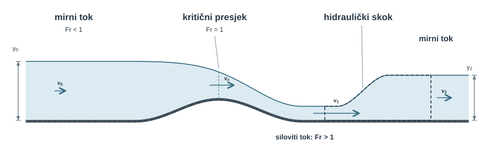
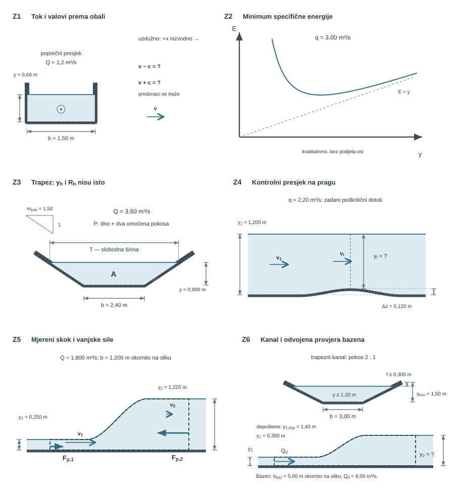

Rijeka, odvodni kanal i preljev brane prenose vodu čija je gornja granica izložena atmosferi. Takav tok pokreće gravitacija, a dubina nije zadana geometrijom, nego se prilagođuje protoku, nagibu i otporu dna te nizvodnim uvjetima. Pri istom protoku voda može teći duboko i polagano ili plitko i brzo, a povratak iz brzog u spori tok redovito je nagao. O tim stanjima ovise kapacitet kanala, razina vode uzvodno od građevine i zaštita dna od erozije.

Režim toka određuje Froudeov broj $Fr=v/\sqrt{gy_h}$, omjer srednje brzine i brzine dugoga gravitacijskog vala $c=\sqrt{gy_h}$. Pri $Fr<1$ tok je miran i poremećaj putuje i uzvodno, pri $Fr>1$ siloviti tok odnosi poremećaje nizvodno, a kritični tok ($Fr=1$) razdvaja ta dva režima. Za pravokutni kanal s protokom po jedinici širine $q=vy$ specifična energija $E=y+q^2/(2gy^2)$ najmanja je pri kritičnoj dubini $y_c=(q^2/g)^{1/3}$, uz $E_{min}=\tfrac32y_c$. Nagli prijelaz iz silovitog u mirni tok jest hidraulički skok: impulsna funkcija prije i poslije njega jednaka je, $I_1=I_2$, a specifična energija opada, $E_2<E_1$. Zato se skok računa bilancom količine gibanja, a ne Bernoullijevom jednadžbom.

Energijska bilanca s gubitkom visine $h_g$ nastavlja se na []{.mf1-chapter-ref target="u08"} i []{.mf1-chapter-ref target="u13"}, a bilanca skoka primjenjuje zakon količine gibanja iz []{.mf1-chapter-ref target="u10"}. Froudeov broj broda iz []{.mf1-chapter-ref target="u11"} na isti način uspoređuje brzinu s brzinom gravitacijskog vala, a ustava čije se opterećenje računa u []{.mf1-chapter-ref target="u05"} ovdje postaje kontrolna građevina. Primjene su odvodni i oborinski kanali, preljevi i umirni bazeni iza ustava, vučni bazeni te plovidba u plitkoj vodi.

Poglavlje redom obrađuje geometriju presjeka, Froudeov broj i širenje poremećaja, specifičnu energiju i kritičnu dubinu s ustavom i širokim preljevom, postupno promjenjiv tok, hidraulički skok te uniformni tok s Manningovom jednadžbom. Jednodimenzijski model sa srednjom brzinom pretpostavlja blag nagib i približno hidrostatičku raspodjelu tlaka; on ne opisuje unutrašnjost skoka ni tok preko kratkoga zakrivljenog praga. Koeficijenti $C_d$ i $C_{pr}$ te Manningov $n$ empirijski su i vrijede samo u ispitanom rasponu.

Slika [-@fig-otvoreni-tok-pregled] prikazuje ilustrativni tok s $q=1{,}40\,\mathrm{m^2/s}$ preko blagog praga. Lijevo je mirni tok početne (uzvodne) dubine $y_0=1{,}30\,\mathrm{m}$ i brzine $v_0$. Na tjemenu praga tok prolazi kritičnim presjekom s kritičnom brzinom $v_c$, a niz nizvodnu stranu praga ubrzava se u siloviti tok. Visina dna $z$ mijenja se duž praga, a do skoka vrijedi $z+E=\text{konst.}$ Indeksi 1 i 2 označuju, kao u izvodu hidrauličkog skoka, siloviti presjek neposredno ispred skoka ($y_1$, $v_1$) i mirni presjek iza njega ($y_2$, $v_2$); isprekidane crte omeđuju kontrolni volumen skoka. Duljina skoka nacrtana je shematski.

{#fig-otvoreni-tok-pregled fig-align="center" fig-alt="Uzdužni presjek kanala: mirni tok ispred blagog praga, kritični presjek na tjemenu, siloviti tok niz prag i hidraulički skok s isprekidanim kontrolnim volumenom."}

**Procijenjeno vrijeme rada uz priručnik:** 9 sati.

## Otvoreni tokovi {#sec-otvoreni-tok-motivacija}

U punoj cijevi geometrija presjeka zadaje cijelu granicu toka. U otvorenom kanalu gornja je granica slobodna površina, čiji položaj treba odrediti zajedno s brzinom. Gravitacija tada nije samo izvor potencijalne energije: ona određuje brzinu površinskih valova i razdvaja dva bitno različita režima [@chow1959].

## Geometrija presjeka i hidraulička dubina {#sec-geometrija-kanala}

Za poprečni presjek toka definiramo površinu $A$, širinu slobodne površine $T$ (širinu vodnog lica, ne gaz), oplakani opseg $P$ (dio ruba presjeka u dodiru sa stijenkama i dnom, bez slobodne površine) i hidraulički polumjer

$$
R_h=\frac{A}{P}.
$$ {#eq-otvoreni-tokovi-geometrija-presjeka-i-hidraulicka-dubina-sec-geo-01}

Hidraulička dubina

$$
y_h=\frac{A}{T}
$$ {#eq-otvoreni-tokovi-geometrija-presjeka-i-hidraulicka-dubina-sec-geo-02}

nije isto što i hidraulički promjer pune cijevi $D_h=4A/P$. To je karakteristična dubina koja povezuje promjenu površine s promjenom razine i ulazi u brzinu dugoga gravitacijskog vala u odnosu na vodu, $c=\sqrt{gy_h}$. Oznaka $c$ u ovom poglavlju znači isključivo tu brzinu vala.

Kontinuitet za stacionarni tok glasi $Q=Av$. Za pravokutni kanal širine $b$ i dubine $y$ vrijedi $A=by$, $T=b$, $y_h=y$, a protok po jedinici širine jest $q=Q/b=vy$ (oznaka $q$ u tom značenju koristi se samo u ovom poglavlju).

## Froudeov broj i prijenos informacije {#sec-froude-kanal}

Froudeov broj otvorenog toka definiramo kao

$$
Fr=\frac{v}{\sqrt{gy_h}}.
$$ {#eq-froude-otvoreni}

U jednodimenzijskom modelu plitke vode, uz približno hidrostatičku raspodjelu tlaka i pozitivni smjer nizvodno, vrijedi sljedeće tumačenje karakterističnih valova [@chow1959]:

- $Fr<1$: **mirni** ili potkritični tok; gravitacijski poremećaj može putovati i uzvodno i nizvodno.
- $Fr=1$: **kritični** tok; uzvodno širenje vala upravo je zaustavljeno.
- $Fr>1$: **siloviti** ili natkritični tok; tok odnosi oba karakteristična vala nizvodno.

Takvo je tumačenje preciznije od tvrdnje da je $Fr$ sam po sebi omjer sila: $Fr$ je omjer brzine toka i karakteristične brzine gravitacijskog vala, dok je $Fr^2$ omjer inercijske i gravitacijske skale.

::: {.mf1-fizikalno-znacenje}

Fizikalno značenje — Isti Froudeov broj u kanalu i uz brod

Za kanal je $Fr=v/\sqrt{gy_h}$, s dubinom kao referentnom duljinom, a za brod iz []{.mf1-chapter-ref target="u11"} $Fr=v_s/\sqrt{gL}$, s duljinom broda. Oba broja uspoređuju brzinu s brzinom gravitacijskog vala; razlikuje se samo referentna duljina. Čim brod plovi u plitkoj vodi dubine $y$, mjerodavna postaje i dubinska inačica $Fr_y=v_s/\sqrt{gy}$: pri $Fr_y\to1$ brod se približava brzini dugog vala, valni otpor naglo raste, a pad tlaka pod trupom povećava gaz i trim (*squat*). Zato u vučnom bazenu konačna dubina i širina (blokada presjeka) ograničavaju brzine pri kojima ispitivanje modela još odgovara dubokoj vodi. Kritični tok u kanalu i kritična brzina u plitkoj vodi ista su fizikalna pojava: tok, odnosno brod, sustiže vlastiti val.
:::

::: {#ex-rezim-retencijski-kanal .mf1-we}

Režim u retencijskom kanalu T1

**Tekst zadatka**

Pravokutni kanal širine $b=2{,}0\ \text{m}$ vodi protok $Q=3{,}0\ \text{m}^3/\text{s}$ pri dubini $y=0{,}80\ \text{m}$.

**Traži se**

Odredi srednju brzinu i Froudeov broj te klasificiraj režim toka.

**Rješenje**

$$
v=\frac{Q}{by}=\frac{3}{2\cdot0{,}8}=1{,}875\ \text{m/s},
$$ {#eq-otvoreni-tokovi-rijeseni-primjer-rezim-u-retencijskom-kanalu-t1-01}

$$
Fr=\frac{1{,}875}{\sqrt{9{,}81\cdot0{,}80}}=0{,}669.
$$ {#eq-otvoreni-tokovi-rijeseni-primjer-rezim-u-retencijskom-kanalu-t1-02}

**Provjera i tumačenje**

Tok je miran jer je $v<c=2{,}80\ \text{m/s}$, pa promjena nizvodnog vodostaja može djelovati i uzvodno.
:::

::: {#cfd-kanal-vodostaji .mf1-cfd title="Računalna dinamika fluida"}

**Povišena razina rijeke na izlazu gradskoga kanala.** Za odvodni kanal zanima nas podiže li nizvodni vodostaj razinu uzvodno i približava li se voda rubu obale. U dubinski integriranom modelu zadajemo geometriju i otpor dna, a za potkritični tok obično i ulazni protok te izlaznu razinu. Brzine dugih valova $v\pm\sqrt{gy_h}$ objašnjavaju kako nizvodni poremećaj može putovati uzvodno.

Uspoređujemo profile razine za više nizvodnih vodostaja pri istom dotoku. U natkritičnom režimu obje informacije dolaze s uzvodne strane, pa se mijenja i način zadavanja rubnih uvjeta. Za oborinski događaj dodajemo vremenski promjenjive dotoke. Model opisuje dulju dionicu, a lokalni tok oko ustave iz []{.mf1-chapter-ref target="u05"} po potrebi izdvajamo za detaljniji CFD.
:::

## Specifična energija i kritična dubina {#sec-specificna-energija}

Uz blag nagib, približno hidrostatičku raspodjelu tlaka i korekcijski faktor kinetičke energije (Coriolisov koeficijent) $\alpha\approx1$ energijska visina mjerena od dna jest

$$
E=y+\frac{v^2}{2g}.
$$ {#eq-otvoreni-tokovi-specificna-energija-i-kriticna-dubina-sec-specif-01}

Za pravokutni kanal pri zadanom protoku po jedinici širine $q=vy$ to postaje

$$
E(y)=y+\frac{q^2}{2gy^2}.
$$ {#eq-specificna-energija}

::: {.mf1-izvod}

Matematički izvod — Kritična dubina kao minimum specifične energije

**Fizikalno pitanje.** Pri kojoj dubini zadani protok teče s najmanjom energijom mjerenom od dna i što se ondje događa s valovima?

**Bilanca.** Energijska visina mjerena od dna, jednadžba [-@eq-specificna-energija], zbraja dubinu i brzinsku visinu. Pri stalnom $q$ brzina je $v=q/y$, pa je $E$ funkcija samo dubine.

**Koraci.** Deriviranjem uz konstantan $q$ dobivamo

$$
\frac{dE}{dy}=1-\frac{q^2}{gy^3}=0,
$$ {#eq-otvoreni-tokovi-specificna-energija-i-kriticna-dubina-sec-specif-02}

a druga derivacija, $d^2E/dy^2=3q^2/(gy^4)>0$, potvrđuje da je riječ o minimumu.

**Rezultat.**

$$
\boxed{y_c=\left(\frac{q^2}{g}\right)^{1/3}},
\qquad E_{min}=y_c+\frac{q^2}{2gy_c^2}=\frac{3}{2}y_c.
$$ {#eq-kriticna-dubina}

**Provjera.** Uvrštavanjem $q=vy$ u $q^2=gy_c^3$ dobiva se $v^2=gy_c$, odnosno $Fr=1$: minimum energije i zaustavljeni uzvodni val pripadaju istoj točki. Za energiju veću od minimuma postoje dvije alternativne dubine, dublja mirna i plića silovita. Za presjek općeg oblika isti postupak uz $dA=T\,dy$ daje opći kritični uvjet

$$
\frac{Q^2T}{gA^3}=1
\qquad\Longleftrightarrow\qquad
\frac{v}{\sqrt{gy_h}}=1,
$$ {#eq-opci-kriticni-uvjet}

koji se za trapezni kanal rješava numerički po $y$; pravokutni zapis $y_c=(q^2/g)^{1/3}$ njegov je poseban slučaj.
:::

::: {#ex-kriticni-preljev .mf1-we}

Kritični presjek na širokom preljevu T2

**Tekst zadatka**

Pravokutni kanal širine $b=4{,}0\ \text{m}$ vodi protok $Q=8{,}0\ \text{m}^3/\text{s}$ preko širokog preljeva.

**Traži se**

Odredi kritičnu dubinu i najmanju specifičnu energiju.

**Rješenje**

Jedinični protok iznosi $q=2{,}0\ \text{m}^2/\text{s}$, pa je kritična dubina

$$
y_c=\left(\frac{2^2}{9{,}81}\right)^{1/3}=0{,}742\ \text{m},
$$ {#eq-otvoreni-tokovi-rijeseni-primjer-kriticni-presjek-na-sirokom-pre-01}

a minimalna specifična energija $E_{min}\approx1{,}112\ \text{m}$.

Energiju smo izračunali iz nezaokružene kritične dubine.

**Provjera i tumačenje**

Kritična brzina je $v_c=q/y_c=2{,}70\ \text{m/s}$, a $v_c/\sqrt{gy_c}=1{,}00$. Za stvarni preljev dodaje se empirijski koeficijent $C_{pr}$ (vidi odjeljak o kontrolnim građevinama).
:::

### Kontrolne građevine: ustava i preljev {#sec-kontrolne-gradevine}

Kritični presjek nastaje ondje gdje građevina nameće vezu između protoka i razine. Ispod oštrobridne ustave s otvorom $a$ i uzvodnom dubinom $y_0$ mlaz se iza ruba ustave suzi na dubinu $y_1\approx C_ca$, gdje je $C_c$ koeficijent kontrakcije, omjer dubine suženog mlaza i visine otvora. Primijenimo li Bernoullijevu jednadžbu bez gubitaka između uzvodnog presjeka i suženog mlaza, protok iznosi

$$
Q=C_d\,b\,a\sqrt{2gy_0},
\qquad C_d\approx0{,}55\text{–}0{,}60,
$$ {#eq-istjecanje-ispod-ustave}

gdje $C_d$ obuhvaća kontrakciju i gubitke, a njegova vrijednost mora potjecati iz ispitivanja za konkretnu geometriju. Preko širokog preljeva tok prolazi kritičnim presjekom. Ako je $H$ energijska visina iznad krune (u ovom poglavlju $H$ označuje samo tu visinu), iz $y_c=\tfrac23H$ dobiva se

$$
Q=C_{pr}\,b\,\sqrt{g}\left(\tfrac23H\right)^{3/2}\approx1{,}70\,C_{pr}\,b\,H^{3/2},
$$ {#eq-preljev-siroki}

pri čemu je empirijski $C_{pr}$ za dobro zaobljen prag blizu jedinice. Obje relacije za zadani protok daju uzvodnu razinu. Dubinu suženog mlaza $y_1$ primjer [-@ex-hidraulicki-skok-bazen] uzima kao izmjerenu silovitu dubinu ispred skoka. Koeficijenti su empirijski i vrijede samo u ispitanom rasponu.

## Postupno promjenjiv tok i kontrolni presjek {#sec-postupno-promjenjiv-tok}

Energijsku bilancu između dvaju presjeka možemo zapisati kao

$$
z_1+y_1+\alpha_1\frac{v_1^2}{2g}
=z_2+y_2+\alpha_2\frac{v_2^2}{2g}+h_g.
$$ {#eq-otvoreni-tokovi-postupno-promjenjiv-tok-i-kontrolni-presjek-sec-01}

Ovdje je $z$ visina dna iznad referentne razine, a $h_g$ ukupni gubitak visine između presjeka (linijski gubitak zbog trenja i eventualni lokalni gubitci). U postupno promjenjivom toku dubina se mijenja na duljini mnogo većoj od same dubine, pa je raspodjela tlaka približno hidrostatička. Za prizmatični kanal diferencijalni oblik bilance glasi

$$
\frac{dy}{dx}=\frac{S_0-S_f}{1-Fr^2},
$$ {#eq-postupno-promjenjivi-tok}

gdje je $S_0$ nagib dna, a $S_f$ nagib energijske crte zbog trenja. Nazivnik pokazuje zašto presjek s kritičnom dubinom djeluje kao kontrolni presjek: ondje je veza dubine i protoka jednoznačna, pa taj presjek određuje uzvodnu razinu. Pri $Fr\to1$ već mala razlika nagiba može izazvati veliku promjenu dubine, a jednostavna diferencijalna procjena postaje osjetljiva.

::: {#ex-dvije-dubine .mf1-we}

Dvije dubine za istu energiju T2

**Tekst zadatka**

U pravokutnom kanalu jedinični protok iznosi $q=1{,}5\ \text{m}^2/\text{s}$, a specifična energija $E=1{,}20\ \text{m}$.

**Traži se**

Odredi obje pozitivne dubine koje odgovaraju zadanoj specifičnoj energiji te pripadne režime toka.

**Rješenje**

Rješavamo jednadžbu specifične energije:

$$
y+\frac{1{,}5^2}{2g y^2}=1{,}20.
$$ {#eq-otvoreni-tokovi-rijeseni-primjer-dvije-dubine-za-istu-energiju-01}

Numeričkim rješavanjem dobivamo alternativne dubine $y_a\approx1{,}106\ \text{m}$ i $y_b\approx0{,}372\ \text{m}$. Za dublju granu je $Fr\approx0{,}412$, a za pliću $Fr\approx2{,}11$.

**Provjera i tumačenje**

Oba korijena zadovoljavaju istu idealiziranu specifičnu energiju, ali rubni uvjeti i smjer širenja informacije određuju koji se režim stvarno može uspostaviti.
:::

::: {.mf1-cfd title="Računalna dinamika fluida"}

**Hoće li prag uzvodno podići vodu?** U isti kanal dodamo blagi prag i usporedimo tok s izvedbom bez praga. Model mora odabrati granu rješenja spojivu s protokom i nizvodnim uvjetima. Specifična energija i kritična dubina služe za ručnu provjeru: približavanje vrijednosti $Fr=1$ upozorava na kontrolni presjek i na osjetljivost uzvodne razine.

Za blage promjene često su dovoljne jednadžbe plitke vode. Ako nas zanimaju okomito ubrzanje preko kratkoga praga, odvajanje toka ili lokalni tlakovi na konstrukciji, prelazimo na prostorni CFD vode i zraka. Uspoređujemo uzvodni vodostaj, protok i položaj prijelaza režima. Hidrostatički model ne provjeravamo ondje gdje izrazita zakrivljenost toka ruši njegovu osnovnu pretpostavku.
:::

## Hidraulički skok: energija se gubi, količina gibanja zatvara prijelaz {#sec-hidraulicki-skok}

Hidraulički skok nagao je prijelaz iz silovitog u mirni tok. Dovoljno daleko ispred i iza skoka raspodjela tlaka približno je hidrostatička, ali je unutar skoka tok izrazito trodimenzijski i disipativan. Zato između rubnih presjeka primjenjujemo bilancu količine gibanja, a ne Bernoullijevu jednadžbu bez gubitaka.

::: {.mf1-izvod}

Matematički izvod — Spregnute dubine iz bilance količine gibanja

**Fizikalno pitanje.** Ako je uzvodna dubina silovitog toka poznata, kolika je dubina iza skoka i koliko se energije u njemu izgubi?

**Bilanca.** Kontrolni volumen obuhvaća kratak odsječak približno vodoravnog pravokutnog kanala širine $b$, s rubnim presjecima 1 i 2 izvan valjka, gdje je raspodjela tlaka hidrostatička. Trenje o dno i stijenke te uzdužnu komponentu težine zanemarujemo. Vanjske sile na fluid jesu hidrostatičke tlačne sile $\rho g b y_1^2/2$ (na uzvodnom presjeku, u smjeru toka) i $\rho g b y_2^2/2$ (na nizvodnom presjeku, protiv toka), a tok količine gibanja kroz presjek iznosi $\rho Q v=\rho b q^2/y$ uz korekcijski faktor količine gibanja (Boussinesqov koeficijent) $\beta\approx1$. Zakon količine gibanja u smjeru toka glasi

$$
\rho g b\frac{y_1^2}{2}-\rho g b\frac{y_2^2}{2}=\rho b\frac{q^2}{y_2}-\rho b\frac{q^2}{y_1}.
$$ {#eq-skok-bilanca-kolicine-gibanja}

**Koraci.** Zbroj tlačne sile i toka količine gibanja jest impulsna funkcija $I=pA+\dot mv$, u kojoj je $p$ hidrostatički tlak u težištu presjeka, pa je $pA$ ukupna tlačna sila na presjek. Za pravokutni kanal, podijeljena s $\rho gb$, ona glasi

$$
\frac{I}{\rho g b}=\frac{y^2}{2}+\frac{q^2}{gy},
$$ {#eq-otvoreni-tokovi-hidraulicki-skok-energija-se-gubi-kolicina-giban-01}

pa bilanca glasi $I_1=I_2$. Nakon preuređenja dobivamo

$$
\frac{y_1^2-y_2^2}{2}=\frac{q^2}{g}\left(\frac{1}{y_2}-\frac{1}{y_1}\right)=\frac{q^2}{g}\,\frac{y_1-y_2}{y_1y_2}.
$$ {#eq-skok-preuredjeno}

Jednadžbu dijelimo faktorom $(y_1-y_2)$, koji pripada trivijalnom rješenju $y_1=y_2$, pa ostaje $\tfrac12(y_1+y_2)y_1y_2=q^2/g$. Uz $q^2=Fr_1^2gy_1^3$ to je kvadratna jednadžba za omjer $y_2/y_1$: $(y_2/y_1)^2+(y_2/y_1)-2Fr_1^2=0$.

**Rezultat.** Pozitivan korijen daje omjer spregnutih dubina

$$
\boxed{
\frac{y_2}{y_1}=\frac{1}{2}\left(\sqrt{1+8Fr_1^2}-1\right)
},
$$ {#eq-spregnute-dubine}

a razlika specifičnih energija, nakon uvrštavanja $q^2/g=\tfrac12(y_1+y_2)y_1y_2$ u $E_1-E_2=(y_1-y_2)+\tfrac{q^2}{2g}(y_1^{-2}-y_2^{-2})$, svodi se na

$$
\Delta E=E_1-E_2=\frac{(y_2-y_1)^3}{4y_1y_2}.
$$ {#eq-gubitak-skoka}

**Provjera.** Za $Fr_1\to1$ korijen daje $y_2/y_1\to1$ i $\Delta E\to0$: skok iščezava u kritičnom presjeku. Za $Fr_1<1$ formula daje $y_2<y_1$ i negativan $\Delta E$, što bi značilo stvaranje mehaničke energije, pa skok iz mirnog u siloviti tok nije moguć. Energija pritom ne nestaje: $\Delta E$ se u valjku skoka pretvara u toplinu. Bilanca količine gibanja ipak ostaje zatvorena jer sile i tokovi na rubnim presjecima ne ovise o tome što se događa unutar valjka.
:::

::: {.mf1-granica-modela}

Granica modela — Hidraulički skok i plitkovodni opis

Relacija spregnutih dubina vrijedi za približno vodoravno dno, pravokutni presjek, hidrostatičke rubne presjeke i $\beta\approx1$. Na strmom dnu u bilancu ulaze uzdužna komponenta težine i trenje, u nepravokutnom presjeku mijenja se tlačni član, a zrak uvučen u valjak mijenja gustoću i debljinu mješavine. Duljina skoka, oblik valjka, pulsacije tlaka na dnu i erozija nizvodno nisu dio 1D modela: za njih su potrebne empirijske korelacije, modelna ispitivanja ili trodimenzijski dvofazni CFD validiran za taj režim. Jednadžbe plitke vode same po sebi ne opisuju presjeke s izrazitom zakrivljenošću strujnica, poput tjemena praga ili neposrednog podnožja ustave.
:::

::: {#ex-hidraulicki-skok-bazen .mf1-we}

Umirni bazen iza ustave T3

**Tekst zadatka**

Ispod ustave pravokutnog kanala, ispred hidrauličkog skoka, izmjereni su dubina $y_1=0{,}25\ \text{m}$ i srednja brzina $v_1=6{,}0\ \text{m/s}$.

**Traži se**

Odredi uzvodni Froudeov broj, spregnutu nizvodnu dubinu i gubitak specifične energije u skoku. Zatim odluči ostaje li skok neposredno iza ustave ako nizvodni vodostaj kanala (dubina daleko iza skoka) iznosi $y_{nv}=1{,}00\ \text{m}$ te što se mijenja ako on poraste na $1{,}40\ \text{m}$.

**Rješenje**

$$
Fr_1=\frac{6}{\sqrt{9{,}81\cdot0{,}25}}=3{,}83,
$$ {#eq-otvoreni-tokovi-rijeseni-primjer-disipacijski-bazen-iza-ustave-t-01}

$$
\frac{y_2}{y_1}=\frac{\sqrt{1+8(3{,}83)^2}-1}{2}=4{,}94,
\qquad y_2=1{,}24\ \text{m}.
$$ {#eq-otvoreni-tokovi-rijeseni-primjer-disipacijski-bazen-iza-ustave-t-02}

$$
\Delta E=\frac{(y_2-y_1)^3}{4y_1y_2}\approx0{,}774\ \text{m}.
$$ {#eq-otvoreni-tokovi-rijeseni-primjer-disipacijski-bazen-iza-ustave-t-03}

U posljednjem računu zadržana je puna točnost dubine $y_2=1{,}235326\ldots\ \text{m}$; ranije zaokruživanje na $1{,}24\ \text{m}$ dalo bi gubitak od oko $0{,}7825\ \text{m}$.

Odluka o položaju skoka slijedi iz usporedbe nizvodnog vodostaja sa spregnutom dubinom. Pri $y_{nv}=1{,}00\ \text{m}<y_2$ nizvodna impulsna funkcija premala je da zaustavi siloviti tok, pa se skok pomiče nizvodno (ili ga tok „odnese”) sve dok trenje ne poveća silovitu dubinu do one koja je spregnuta s $y_{nv}$. Bazen tada treba spušteno dno ili završni prag koji podiže lokalnu razinu. Pri $y_{nv}=1{,}40\ \text{m}>y_2$ skok je potopljen uz ustavu: mlaz ulazi ispod mirne vode i položaj je stabilan, ali se disipacija raspodjeljuje na dulji put, a tlačno je opterećenje dna drukčije.

**Provjera i tumačenje**

Nizvodna je dubina veća, a specifična energija manja, kako to zahtijeva disipacija. Duljina bazena ne slijedi iz 1D računa, nego iz empirijskih korelacija [@chow1959], modelnih ispitivanja ili validiranog CFD-a, čija se vjerodostojnost dokazuje postupkom verifikacije i validacije [@nasa-cfd-vv; @asme-vv20-2009].
:::

::: {#cfd-ustava-hidraulicki-skok .mf1-cfd title="Računalna dinamika fluida"}

**Smirivanje mlaza iza ustave.** U []{.mf1-chapter-ref target="u05"} određivali smo opterećenje ustave, a sada pratimo što se s njezinim brzim mlazom događa nizvodno. Za oblikovanje umirnog bazena zadajemo dotok, otvor ustave i odgovarajuću nizvodnu razinu. CFD prati položaj skoka, njegov valjak i promjenjive sile na dno i stijenke. Izvedbe bazena uspoređujemo pri istim radnim uvjetima.

**Zastani i promisli.** Model hidrauličkog skoka daje pad mehaničke energije, a bilanca količine gibanja pritom se zatvara. Jesu li ti rezultati nespojivi?

Nisu: pad mehaničke energije uz zatvorenu bilancu količine gibanja očekivana je posljedica disipacije u skoku. Ručni račun u primjeru [-@ex-hidraulicki-skok-bazen] daje spregnutu dubinu i gubitak uz hidrostatičke presjeke izvan valjka. U CFD-u provjeravamo te veličine, očuvanje vode i utjecaj prostornog i vremenskog profinjenja. Metoda VOF pritom prati volumenski udio vode u ćeliji: 1 znači vodu, 0 zrak, a međuvrijednost označuje ćeliju kroz koju prolazi granica faza. Mjehurići koje mreža ne razlučuje traže dodatni opis. Za predviđanje erozije iza bazena potreban je i model dna i pronosa sedimenta; sama velika brzina tek upozorava na mjesto koje treba dalje analizirati.
:::

## Uniformni tok i Manningova jednadžba {#sec-uniformni-tok}

U dugom prizmatičnom kanalu može se uspostaviti približno uniformni tok, u kojem su dubina i srednja brzina stalne, a nagib energijske crte jednak je nagibu dna. U sustavu SI za takav se tok često rabi empirijska Manningova relacija

$$
Q=\frac{1}{n}A R_h^{2/3}S_f^{1/2}.
$$ {#eq-manning}

U ovom zapisu Manningov koeficijent $n$ ima jedinicu $\text{s}/\text{m}^{1/3}$ i nije bezdimenzijski. Nije ni svojstvo fluida: sažima hrapavost, oblik, vegetaciju, nepravilnosti i stanje kanala, pa njegova vrijednost mora imati izvor i područje valjanosti [@chow1959]. U primjerima i zadatcima vrijednosti $n$ zadane su u toj jedinici. Jednadžba ne zamjenjuje lokalnu bilancu pri naglom suženju, na preljevu ili u hidrauličkom skoku.

::: {#ex-manning-osjetljivost .mf1-we}

Osjetljivost propusnosti odvodnog kanala na održavanje T2

**Tekst zadatka**

U pravokutnom kanalu širine $b=3{,}0\ \text{m}$ i dubine $y=1{,}0\ \text{m}$ tok je uniforman, pa je nagib energijske crte jednak nagibu dna, $S_f=S_0=0{,}001$. Manningov koeficijent čistog kanala iznosi $n=0{,}015$, a obraslog $n=0{,}025$.

**Traži se**

Odredi protok čistoga kanala i kanala obraslog vegetacijom te relativno smanjenje propusnosti.

**Rješenje**

Površina presjeka je $A=3{,}0\ \text{m}^2$, oplakani opseg $P=5{,}0\ \text{m}$, a hidraulički polumjer $R_h=0{,}60\ \text{m}$.

Za čisti kanal dobivamo

$$
Q=\frac{1}{0{,}015}(3)(0{,}60)^{2/3}(0{,}001)^{1/2}=4{,}50\ \text{m}^3/\text{s}.
$$ {#eq-otvoreni-tokovi-rijeseni-primjer-osjetljivost-odvodnog-kanala-01}

Za obrasli kanal ista geometrija i isti nagib daju $Q=2{,}70\ \text{m}^3/\text{s}$, pa je relativno smanjenje propusnosti $1-2{,}70/4{,}50=0{,}40$, odnosno 40 %.

**Provjera i tumačenje**

Budući da je $Q\propto1/n$, omjer protoka točno je jednak omjeru $0{,}015/0{,}025$.
:::

::: {.mf1-cfd title="Računalna dinamika fluida"}

**Cijeli kanal i detalj oko ustave.** Dug gradski kanal možemo opisati dubinski integriranim modelom s Manningovim koeficijentom otpora, a okolinu ustave izdvojiti za 3D CFD. Prvi model daje dotok i nizvodne vodostaje za lokalni račun, a lokalni rezultat može pomoći u određivanju veze između protoka, otvora i razlike razina za model cijele dionice.

Oba modela moraju imati usklađenu ukupnu bilancu vode i isti raspon radnih uvjeta. Manningov $n$ opisuje otpor bez razlučivanja profila brzine po dubini, dok 3D model računa naprezanje na stijenci uz odabrani način modeliranja stijenke; $n$ nije molekularna viskoznost ni izravna visina hrapavosti. Uniformni tok omogućuje jednostavnu provjeru ekvivalentnog otpora. Istu logiku povezivanja lokalnoga CFD-a s modelom sustava primijenili smo u []{.mf1-chapter-ref target="u13"} na razdjelnik rashladnog kruga, čiji je CFD rezultat postao koeficijent lokalnog gubitka u proračunu cjevovoda.
:::

## Postupak analize otvorenog toka {#sec-otvoreni-tok-ritual}

1. Skiciraj dno, slobodnu površinu, presjek i smjer toka.
2. Odredi $A$, $T$, $P$, $y_h$ i $R_h$ i razlikuj njihove fizikalne uloge.
3. Odredi srednju brzinu $v$ i $Fr$ prije nego što odabereš uzvodni ili nizvodni rubni uvjet.
4. Za glatku promjenu primijeni energijsku bilancu, a za hidraulički skok bilancu količine gibanja i gubitak energije.
5. Empirijske koeficijente navedi s izvorom i rasponom valjanosti te analiziraj osjetljivost rezultata na njih.

:::: {.mf1-samoprovjera}

Provjeri sebe

1. Zašto se utjecaj promjene nizvodnog vodostaja može prenijeti uzvodno samo pri $Fr<1$?

::: {.callout-note collapse="true"}
### Odgovor
Brzina uzvodnog gravitacijskog vala u odnosu na vodu tada je veća od srednje brzine toka.
:::

2. Zašto kritična dubina minimizira specifičnu energiju pri zadanom $q$?

::: {.callout-note collapse="true"}
### Odgovor
U minimumu je $dE/dy=0$, što vodi na $Fr=1$.
:::

3. Nizvodni vodostaj manji je od spregnute dubine izračunane za siloviti tok ispod ustave. Gdje će se skok uspostaviti?

::: {.callout-note collapse="true"}
### Odgovor
Ne uz ustavu: nizvodna impulsna funkcija premala je da zaustavi siloviti tok, pa se skok pomiče nizvodno, do mjesta gdje silovita dubina, povećana trenjem, postane spregnuta s nizvodnim vodostajem. Stabilan položaj u bazenu zahtijeva prag ili spušteno dno.
:::

4. Je li Manningov $n$ univerzalno svojstvo betona?

::: {.callout-note collapse="true"}
### Odgovor
Nije; $n$ empirijski opisuje cjelokupno stanje kanala i njegova vrijednost mora biti opravdana za konkretni kanal.
:::
::::

## Zadatci za vježbu {#sec-otvoreni-tok-zadaci}

{#fig-otvoreni-tok-vjezbe fig-align="center" fig-alt="Šest panela s presjecima pravokutnog i trapeznog kanala, bočnim presjekom ustave sa suženim mlazom, tokom preko praga, kontrolnim volumenom skoka s tlačnim silama i bazenom iza kanala."}

**Napomene uz skice.** Točka u poprečnom presjeku Z1 označuje tok prema promatraču. U Z2 dubina suženog mlaza nacrtana je shematski. U Z4 samo su $y_1$ i $\Delta z$ nacrtani u mjerilu. Sile u Z5 djeluju na fluid u kontrolnom volumenu, a valjak skoka je shematski. U Z6 dubina $y_2$ nacrtana je shematski, a $y_{2,dop}$ je samo podatak.

U svim vježbama koristi $g=9{,}81\ \mathrm{m/s^2}$.

::::: {.mf1-vjezbe-list}

### Froudeov broj i širenje poremećaja {#task-otvoreni-fr .unnumbered .unlisted}

**Tekst zadatka**

Pravokutni kanal širine $b=1{,}5\ \mathrm{m}$ vodi $Q=1{,}2\ \mathrm{m^3/s}$ pri dubini $y=0{,}60\ \mathrm{m}$. Pozitivan je smjer nizvodno; primijeni model plitke vode s približno hidrostatičkim tlakom.

**Traži se**

Odredi srednju brzinu, Froudeov broj te smjer i brzinu obaju dugih gravitacijskih poremećaja u odnosu na nepomičnu obalu.

:::: {.content-visible .mf1-hint-online when-format="html"}
::: {.callout-note collapse="true" data-hint-key="true"}
### Naputak

Iz kontinuiteta odredi $v$. Za pravokutni kanal je $y_h=y$, pa je relativna brzina dugog vala $c=\sqrt{gy}$. U odnosu na obalu valovi imaju brzine $v-c$ i $v+c$; zadrži predznake.
:::
::::

:::: {.content-visible .mf1-answer-online when-format="html"}
::: {.callout-tip collapse="true" data-answer-key="true"}
### Kontrolni rezultat

$v\approx1{,}333\ \mathrm{m/s}$, $Fr\approx0{,}550$, $c\approx2{,}426\ \mathrm{m/s}$. Brzine u odnosu na obalu jesu $v-c\approx-1{,}093\ \mathrm{m/s}$ i $v+c\approx3{,}759\ \mathrm{m/s}$. Jedan poremećaj putuje uzvodno, a drugi nizvodno.
:::
::::

[Razina: T1]{.mf1-task-level}

### Istjecanje ispod ustave i kontrakcija mlaza {#task-istjecanje-ispod-ustave .unnumbered .unlisted}

**Tekst zadatka**

U pravokutnom kanalu širine $b=2{,}00\ \mathrm{m}$ oštrobridna ustava podignuta je za $a=0{,}400\ \mathrm{m}$ iznad vodoravnog dna. Uzvodna dubina iznosi $y_0=2{,}00\ \mathrm{m}$, a mlaz se iza ruba ustave suzi na dubinu $y_1=C_ca$ uz $C_c=0{,}61$. Između uzvodnog presjeka i suženog mlaza zanemari gubitke; tlak je u oba presjeka približno hidrostatički, a $\alpha=1$. Nizvodno se mlaz slobodno nastavlja (nepotopljeno istjecanje).

**Traži se**

1. Odredi dubinu suženog mlaza, jedinični protok $q$ i protok $Q$ iz energijske jednadžbe između uzvodnog presjeka i suženog mlaza. Izrazi rezultat kao koeficijent $C_d$ u jednadžbi [-@eq-istjecanje-ispod-ustave] i usporedi ga s navedenim rasponom.
2. Odredi Froudeove brojeve uzvodno i u suženom mlazu te objasni zašto ustava djeluje kao kontrolni presjek.
3. Ustava se podigne na $a=0{,}800\ \mathrm{m}$ pri istoj uzvodnoj dubini. Odredi novi $q$ i objasni zašto se protok nije udvostručio.

:::: {.content-visible .mf1-hint-online when-format="html"}
::: {.callout-note collapse="true" data-hint-key="true"}
### Naputak

Napiši $y_0+q^2/(2gy_0^2)=y_1+q^2/(2gy_1^2)$ i riješi po $q$: $q=y_1\sqrt{2g(y_0-y_1)/[1-(y_1/y_0)^2]}$. Iz usporedbe s $q=C_da\sqrt{2gy_0}$ slijedi $C_d=C_c/\sqrt{1+C_ca/y_0}$, pa $C_d$ pada s porastom omjera $a/y_0$.
:::
::::

:::: {.content-visible .mf1-answer-online when-format="html"}
::: {.callout-tip collapse="true" data-answer-key="true"}
### Kontrolni rezultat

$y_1=0{,}244\ \mathrm{m}$, $q\approx1{,}443\ \mathrm{m^2/s}$, $Q\approx2{,}886\ \mathrm{m^3/s}$ i $C_d\approx0{,}576$, unutar raspona 0,55–0,60. $Fr_0\approx0{,}163$ (mirni tok) i $Fr_1\approx3{,}82$ (siloviti tok): tok prolazi kroz kritično stanje ispod ustave, pa uzvodna razina ovisi samo o protoku i otvoru, a ne o nizvodnom stanju. Pri $a=0{,}800\ \mathrm{m}$ je $y_1=0{,}488\ \mathrm{m}$, $q\approx2{,}741\ \mathrm{m^2/s}$, dakle $1{,}90$ puta više: $C_d$ pada na $0{,}547$ jer brzina dolaska uzvodno raste, a raspoloživa razlika $y_0-y_1$ se smanjuje.
:::
::::

[Razina: T1]{.mf1-task-level}

### Geometrija i tok trapeznog kanala {#task-trapezni-presjek .unnumbered .unlisted}

**Tekst zadatka**

Simetrični trapezni kanal ima širinu dna $b=2{,}40\ \mathrm{m}$, koeficijent pokosa $m_{pok}=1{,}50$ (vodoravno na jedan okomito; $z$ ostaje visina dna), dubinu $y=0{,}900\ \mathrm{m}$ i protok $Q=3{,}60\ \mathrm{m^3/s}$. Tok je jednodimenzijski, s približno hidrostatičkim tlakom. Slobodna površina nije dio oplakanog opsega.

**Traži se**

1. Izračunaj $A$, $T$, $P$, $y_h$, $R_h$, srednju brzinu i $Fr$. U trapeznom kanalu razlikuj površinu poprečnog presjeka toka, širinu slobodne površine i oplakani opseg.
2. Klasificiraj tok. Obrazloži koja duljina ulazi u brzinu gravitacijskog vala i zašto je ne smiješ zamijeniti duljinom mjerodavnom za otpor strujanju.

:::: {.content-visible .mf1-hint-online when-format="html"}
::: {.callout-note collapse="true" data-hint-key="true"}
### Naputak

Za pokos $m_{pok}{:}1$ vrijedi $A=y(b+m_{pok}y)$, $T=b+2m_{pok}y$ i $P=b+2y\sqrt{1+m_{pok}^2}$. U izrazu za $Fr$ upotrijebi $y_h=A/T$, a ne $R_h$.
:::
::::

:::: {.content-visible .mf1-answer-online when-format="html"}
::: {.callout-tip collapse="true" data-answer-key="true"}
### Kontrolni rezultat

$A=3{,}375\ \mathrm{m^2}$, $T=5{,}100\ \mathrm{m}$, $P\approx5{,}645\ \mathrm{m}$, $y_h\approx0{,}6618\ \mathrm{m}$, $R_h\approx0{,}5979\ \mathrm{m}$, $v\approx1{,}0667\ \mathrm{m/s}$ i $Fr\approx0{,}4186$ (mirni tok).
:::
::::

[Razina: T2]{.mf1-task-level}

### Kontrolni presjek na pragu {#task-kontrolni-presjek-na-pragu .unnumbered .unlisted}

**Tekst zadatka**

Povišenje dna smanjuje raspoloživu specifičnu energiju toka. Pravokutni kanal stalne širine vodi $q=2{,}20\ \mathrm{m^2/s}$ pri potkritičnoj uzvodnoj dubini $y_1=1{,}200\ \mathrm{m}$. Dno na tjemenu praga više je za $\Delta z=0{,}120\ \mathrm{m}$. Zanemari gubitke; tlak je približno hidrostatički, a $\alpha=1$. Nizvodni uvjet dopušta glatki potkritični nastavak. Promatraj presjeke daleko od lokalne zakrivljenosti prijelaza. Za odabrani korijen zahtijevaj energijski rezidual manji od $\varepsilon_E=10^{-6}\ \mathrm{m}$.

**Traži se**

1. Odredi $y_c$, $E_{min}$ i najveće povišenje dna $\Delta z_{max}$ koje još ne izaziva uzvodni uspor.
2. Za zadani prag odredi specifičnu energiju na tjemenu i oba pozitivna matematička korijena, a zatim prema fizikalnim uvjetima odaberi dubinu $y_t$ i odredi pripadni $Fr_t$.
3. Objasni što se u modelu mora promijeniti ako je prag pri istom protoku viši od izračunane granice.

:::: {.content-visible .mf1-hint-online when-format="html"}
::: {.callout-note collapse="true" data-hint-key="true"}
### Naputak

Između presjeka zbroj $z+E$ ostaje stalan. Na tjemenu je $E_t=E_1-\Delta z$, a minimum specifične energije granica je prolaza. Korijene traži s obiju strana $y_c$; neprekinuti potkritični dotok bira dublju granu. Pri graničnoj visini praga obje se grane spajaju.
:::
::::

:::: {.content-visible .mf1-answer-online when-format="html"}
::: {.callout-tip collapse="true" data-answer-key="true"}
### Kontrolni rezultat

$y_c\approx0{,}790179\ \mathrm{m}$, $E_{min}\approx1{,}185268\ \mathrm{m}$ i $\Delta z_{max}\approx0{,}186042\ \mathrm{m}$. Za zadani prag $E_t\approx1{,}251310\ \mathrm{m}$; korijeni su $0{,}630231$ i $1{,}009009\ \mathrm{m}$. Odabire se $y_t\approx1{,}009009\ \mathrm{m}$, uz $Fr_t\approx0{,}6930$. Viši prag zahtijeva uzvodni uspor ili promjenu protoka; prvotno stanje tada više nije moguće.
:::
::::

[Razina: T3]{.mf1-task-level}

### Provjera mjerenja hidrauličkog skoka {#task-skok-mjerenje .unnumbered .unlisted}

**Tekst zadatka**

Zadano je $Q=1{,}800\pm0{,}018\ \mathrm{m^3/s}$, $b=1{,}200\pm0{,}003\ \mathrm{m}$, $y_1=0{,}250\pm0{,}003\ \mathrm{m}$ i $y_2=1{,}220\pm0{,}008\ \mathrm{m}$; navedene su neovisne standardne nesigurnosti ($k=1$). Kanal je vodoravan i pravokutan. Na kratkom kontrolnom volumenu zanemari uzdužnu silu dna i stijenki; tlak u rubnim presjecima je hidrostatički, a $\beta_1=\beta_2=1$. U oba presjeka koristi se isti izračunati $q=Q/b$, pa njihove doprinose nesigurnosti ne smiješ tretirati kao dva neovisna protoka.

**Traži se**

1. Odaberi kontrolni volumen s rubnim presjecima izvan valjka skoka, prikaži vanjske sile i usporedi rezidual s mjernom nesigurnošću.
2. Izvedi rezidual $\Delta_I=(I_2-I_1)/(\rho gb)$, linearno propagiraj nesigurnost svih četiriju mjerenja i primijeni kriterij $|\Delta_I|\le2s_{\Delta}$, gdje je $s_{\Delta}$ standardna nesigurnost reziduala.
3. Odredi i teorijsku spregnutu dubinu iz srednjih vrijednosti uzvodnih ulaznih podataka. Zaključak ograniči na zadani model i kriterij slaganja mjerenja.

:::: {.content-visible .mf1-hint-online when-format="html"}
::: {.callout-note collapse="true" data-hint-key="true"}
### Naputak

Model: bilanca količine gibanja s impulsnom funkcijom iz jednadžbe [-@eq-otvoreni-tokovi-hidraulicki-skok-energija-se-gubi-kolicina-giban-01] u rubnim presjecima izvan valjka, uz zajednički $q=Q/b$ u oba presjeka i hidrostatičke sile suprotnih smjerova. Kriterij: linearna propagacija standardnih nesigurnosti (GUM) i sukladnost ako je $|\Delta_I|\le2s_{\Delta}$; slaganje ne dokazuje pretpostavke modela.
:::
::::

:::: {.content-visible .mf1-answer-online when-format="html"}
::: {.callout-tip collapse="true" data-answer-key="true" data-key-full="true"}
### Kontrolni rezultat

$q=1{,}5000\ \mathrm{m^2/s}$, $s_q\approx0{,}01546\ \mathrm{m^2/s}$, $\Delta_I\approx-0{,}01648\ \mathrm{m^2}$ i $s_{\Delta}\approx0{,}02010\ \mathrm{m^2}$. Omjer je $|\Delta_I|/s_{\Delta}\approx0{,}820<2$, pa su mjerenja prema zadanom kriteriju sukladna bilanci. Teorijska spregnuta dubina iznosi $1{,}2353\ \mathrm{m}$. Slaganje samo po sebi ne dokazuje sve pretpostavke modela. Najveći doprinos nesigurnosti $s_{\Delta}$ daje zajednički $q$, pa bi za strožu provjeru trebalo točnije izmjeriti protok.
:::
::::

[Razina: T4]{.mf1-task-level}

### Propusnost oborinskog kanala {#task-klimatski-kanal .unnumbered .unlisted}

**Tekst zadatka**

Simetrični trapezni kanal ima $b=3{,}00\ \mathrm{m}$, koeficijent pokosa $m_{pok}=2{,}00$ (vodoravno na jedan okomito), konstrukcijsku dubinu $y_{kon}=1{,}50\ \mathrm{m}$ i nagib dna $S_0=0{,}00150$. Kanal mora provesti projektni protok $Q_d=8{,}00\ \mathrm{m^3/s}$ uz slobodni rub od najmanje $f_{min}=0{,}300\ \mathrm{m}$. Primijeni uniformni Manningov model sa $S_f=S_0$.

Nastavne procjene hrapavosti za tri stanja održavanja jesu A: $n_A=0{,}018\pm0{,}001\ \mathrm{s/m^{1/3}}$, B: $n_B=0{,}026\pm0{,}002\ \mathrm{s/m^{1/3}}$ i C: $n_C=0{,}035\pm0{,}004\ \mathrm{s/m^{1/3}}$. Navedene standardne nesigurnosti u ovom zadatku ne ulaze u račun; nastavak s nepovoljnijom procjenom nalazi se u bilježnici.

Bazen je zaseban vodoravni pravokutni kontrolni volumen širine $b_{baz}=5{,}00\ \mathrm{m}$. Zadana je ulazna dubina $y_1=0{,}350\ \mathrm{m}$, a dopuštena spregnuta dubina iznosi $y_{2,dop}=1{,}40\ \mathrm{m}$. Ulazni tok je natkritičan, rubni tlakovi su hidrostatički, $\beta=1$, a uzdužne sile trenja zanemarive.

**Traži se**

1. Za svako stanje održavanja odredi kapacitet kanala na dopuštenoj dubini $y_{kon}-f_{min}$ te normalnu dubinu pri $Q_d$ i pripadni slobodni rub. Navedi koja stanja zadovoljavaju uvjet $f\ge f_{min}$.
2. Pri $Q_d$ odredi spregnutu dubinu u bazenu i usporedi je s dopuštenom.

:::: {.content-visible .mf1-hint-online when-format="html"}
::: {.callout-note collapse="true" data-hint-key="true"}
### Naputak

Na dopuštenoj dubini $y_{kon}-f_{min}$ izračunaj $A$, $P$, $R_h$ i kapacitet iz jednadžbe [-@eq-manning]. Pri $Q_d$ numerički riješi Manningovu jednadžbu po dubini (bisekcijom ili tablično); veći $n$ smanjuje kapacitet i povećava normalnu dubinu. Za bazen upotrijebi $q=Q_d/b_{baz}$ i jednadžbu [-@eq-spregnute-dubine].
:::
::::

:::: {.content-visible .mf1-answer-online when-format="html"}
::: {.callout-tip collapse="true" data-answer-key="true"}
### Kontrolni rezultat

Redom A/B/C (protoci u m³/s, dubine i rubovi u m): $Q_{cap}=(11{,}759;8{,}141;6{,}047)$; $y_n=(0{,}985;1{,}189;1{,}380)$; $f=(0{,}515;0{,}311;0{,}120)$. Uvjet slobodnog ruba zadovoljavaju A i B, a C ne. Pri $Q_d$ je $y_2=1{,}059\ \mathrm{m}<1{,}40\ \mathrm{m}$.
:::
::::

[Razina: T2]{.mf1-task-level}

:::::

::: {.mf1-interaktivno}

Numerički pokus — Grane energije i hidraulički skok

**Predvidi.** Skiciraj $E(y)$ i označi kritičnu dubinu. Koja grana ima $Fr>1$?

**Provjeri i protumači.** Numerički pronađi obje alternativne dubine. Objasni zašto rubni uvjeti biraju ostvarivu granu i zašto te dvije dubine nisu spregnute dubine skoka. Nastavci pokusa povezuju nesigurnost, prag i održavanje kanala.

<a class="mf1-interaktivno-veza" href="https://martibasic.github.io/MF1_udzbenik/jlite/lab/index.html?path=u15_otvoreni_tokovi.ipynb">Pokreni u pregledniku</a>

:::

## Sažetak

::: {.mf1-zavrsni-okvir}
- Slobodna površina uvodi gravitacijske valove brzine $c=\sqrt{gy_h}$, a hidraulička dubina $y_h=A/T$ postaje nova karakteristična skala; nije isto što i $R_h$ ni $D_h$.
- $Fr$ određuje smjer prijenosa informacije, a time i koji se rubni uvjet zadaje uzvodno, a koji nizvodno; $Fr=1$ označuje kritični presjek u plitkovodnom modelu.
- Pri zadanom protoku kritična dubina minimizira specifičnu energiju; većoj energiji pripadaju dvije alternativne dubine, a rubni uvjeti biraju ostvarivu granu.
- Ustava i preljev kontrolne su građevine: nameću vezu protoka i uzvodne razine, a njihovi koeficijenti $C_d$ i $C_{pr}$ empirijski su.
- Hidraulički skok opisuje se bilancom količine gibanja (jednakošću impulsne funkcije $I$ u rubnim presjecima), a u njemu se disipira mehanička energija; položaj skoka određuje nizvodni vodostaj.
- Manningov $n$ empirijski sažima stanje kanala i mora imati izvor, raspon i analizu osjetljivosti.
- Jednodimenzijski model ne opisuje unutrašnjost skoka, duljinu umirnog bazena ni tok preko kratkoga zakrivljenog praga.

**Najčešća pogreška.** Bernoullijeva jednadžba bez gubitaka primijenjena kroz hidraulički skok, umjesto bilance količine gibanja s impulsnom funkcijom.

**Nakon ovoga poglavlja mora biti moguće**

1. za zadani presjek odrediti $A$, $T$, $P$, $y_h$ i $R_h$, iz srednje brzine i $Fr$ klasificirati režim te odabrati uzvodni ili nizvodni rubni uvjet;
2. za glatku promjenu primijeniti energijsku bilancu, odrediti kritičnu dubinu i odabrati fizikalno ostvarivu granu;
3. za hidraulički skok primijeniti bilancu količine gibanja, odrediti spregnutu dubinu i gubitak energije te prosuditi položaj skoka prema nizvodnom vodostaju;
4. empirijske koeficijente navesti s izvorom i rasponom valjanosti te procijeniti osjetljivost rezultata na njih.
:::
